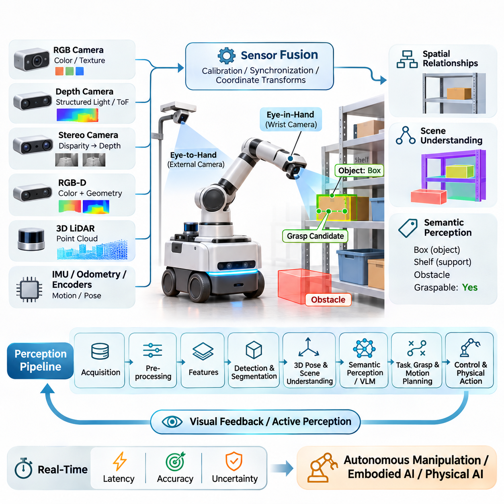
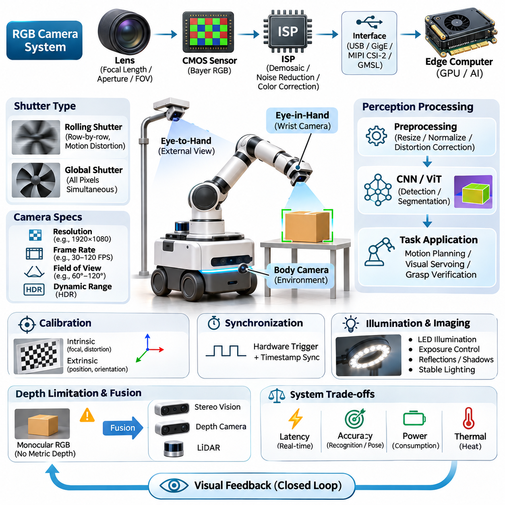
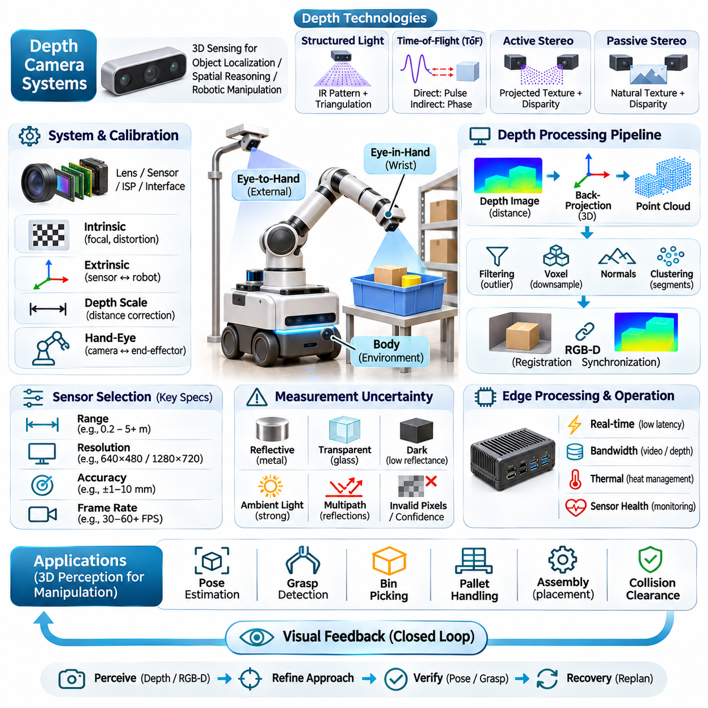
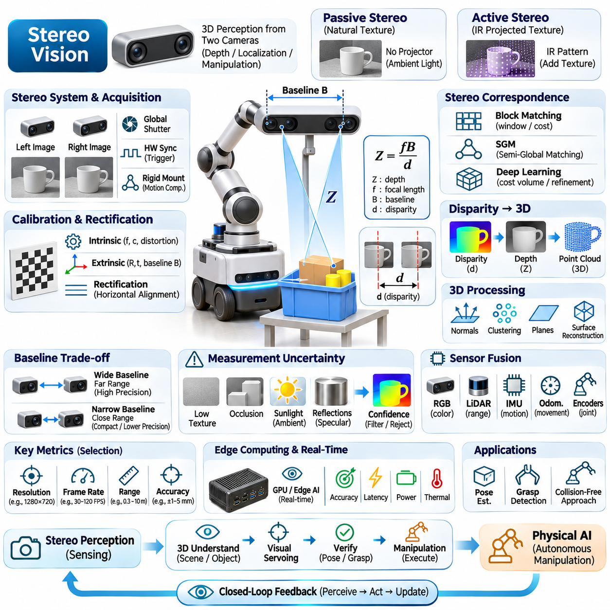
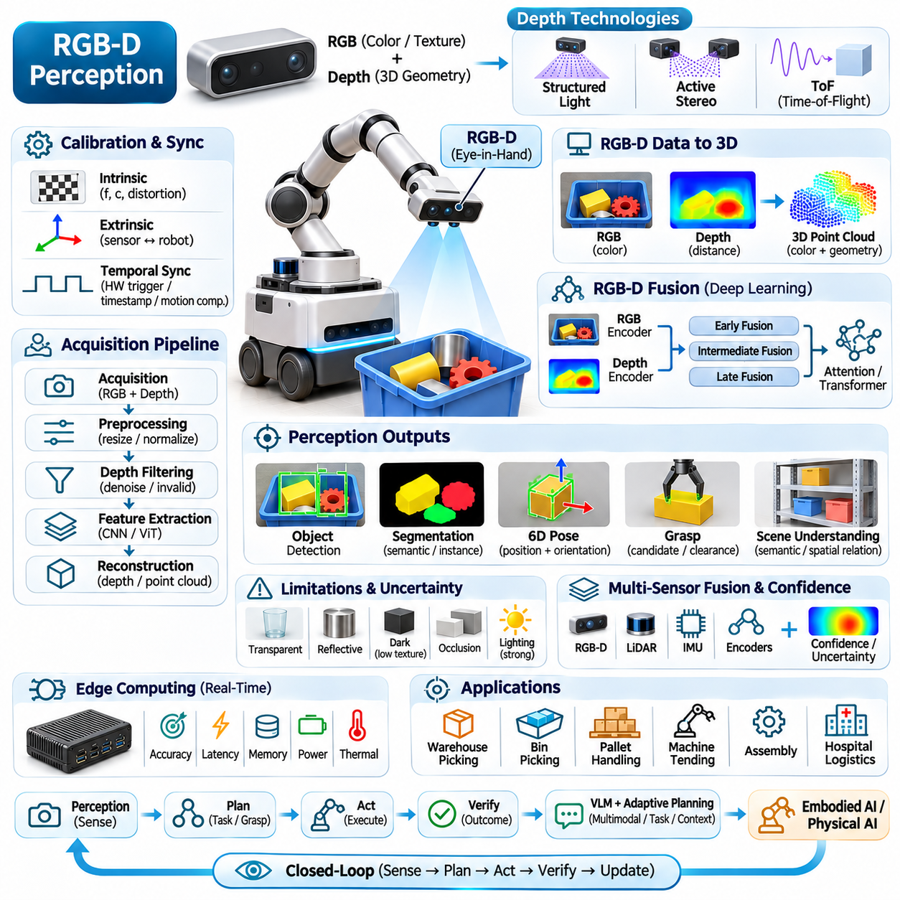
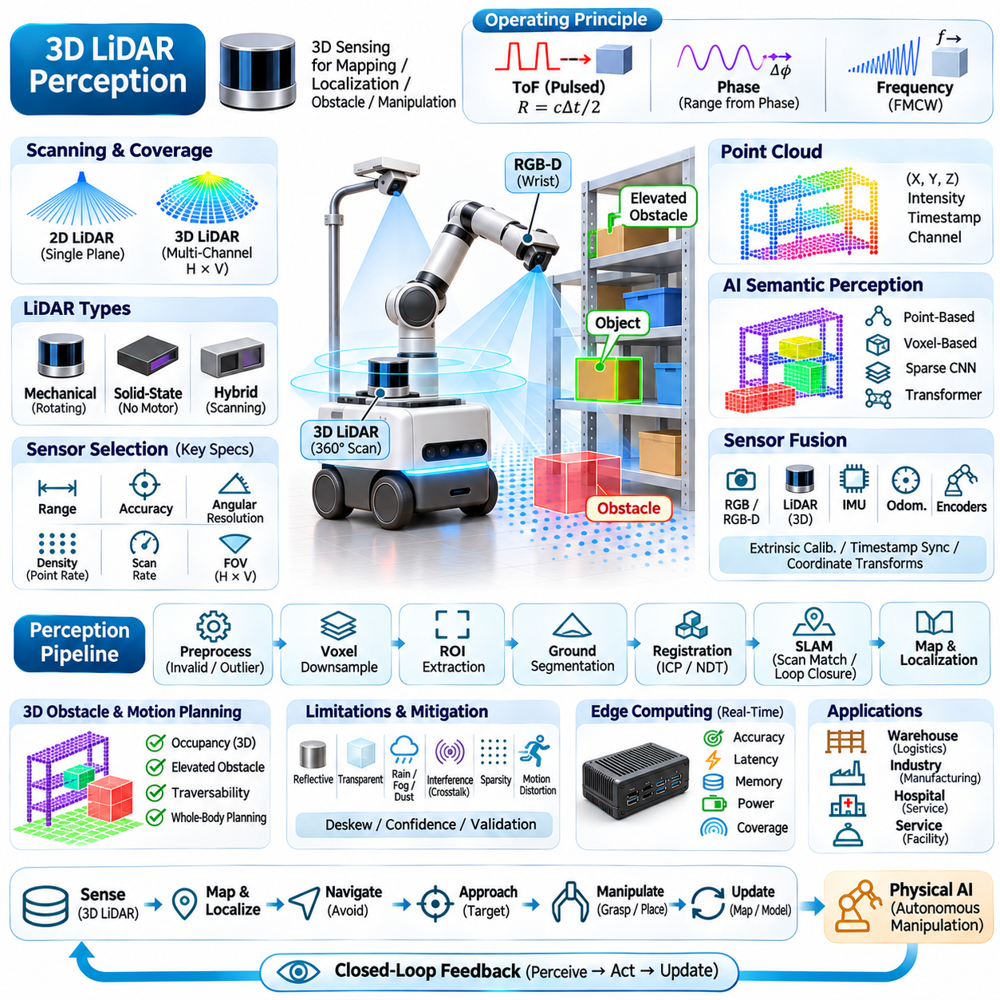
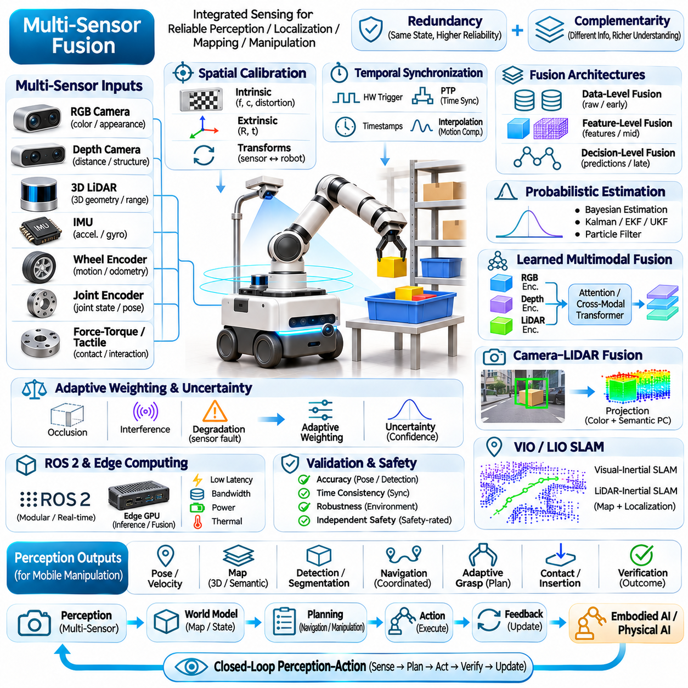
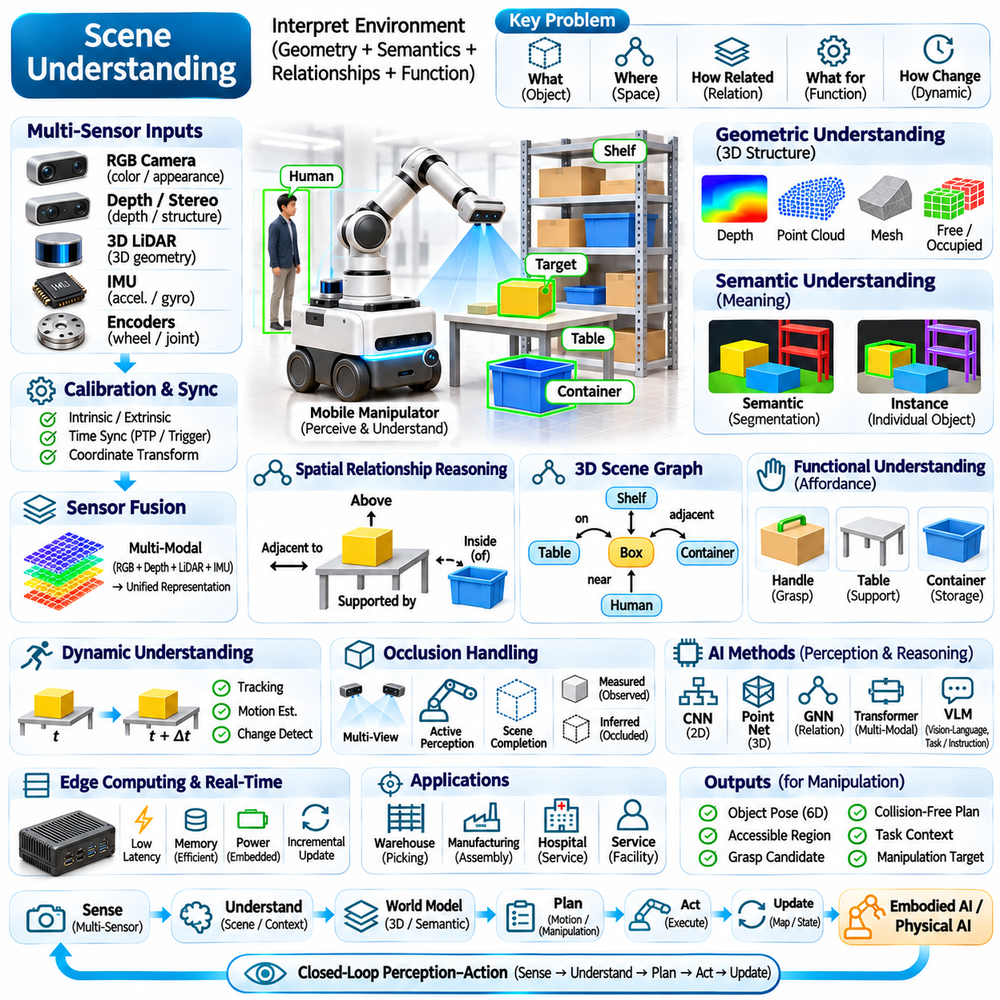
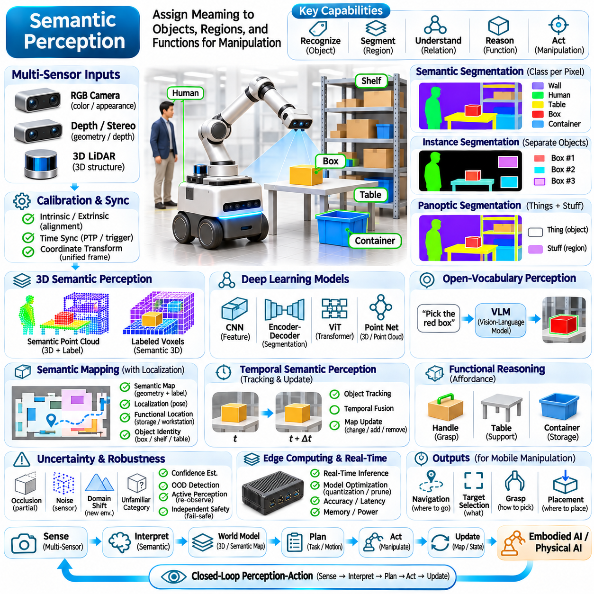
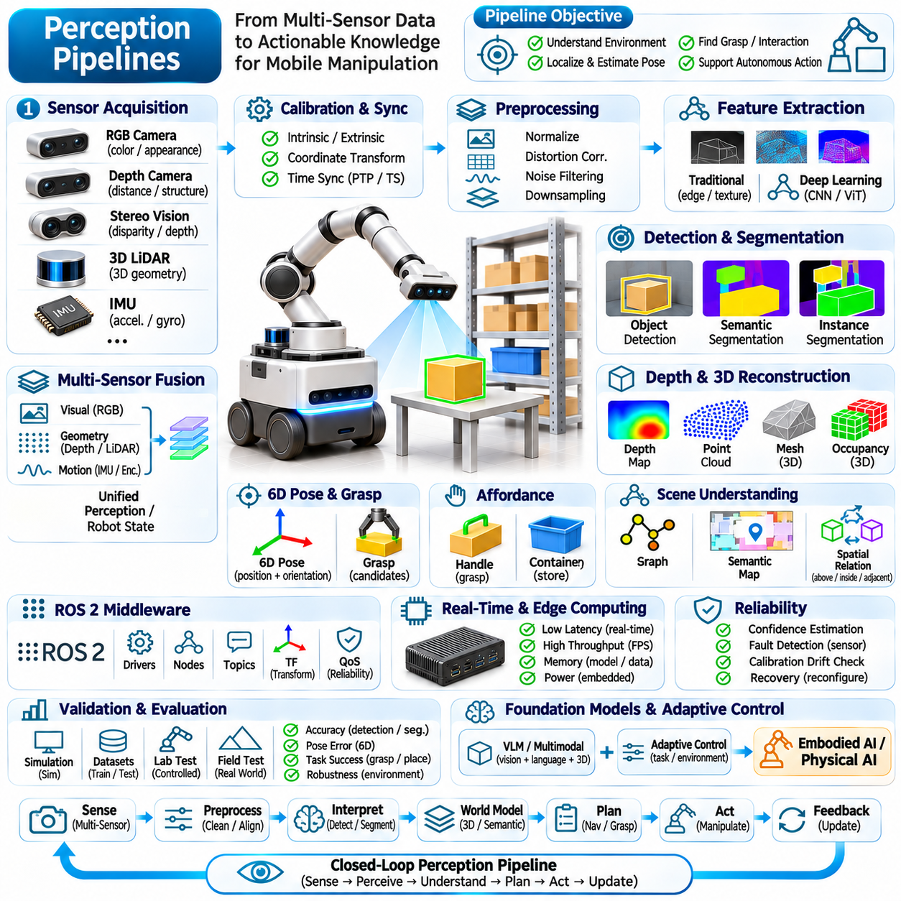

**Volume 03. Vision Manipulation and AI**

# Chapter 01. Visual Perception

## 01 Visual Perception Overview

{width="7.268055555555556in" height="7.268055555555556in"}

Visual perception is a fundamental capability that enables mobile manipulators to observe, interpret, and understand their surrounding physical environment. Unlike conventional industrial robots operating within predefined workspaces, mobile manipulators must interact with objects and environments whose spatial configurations may continuously change. Visual perception provides the sensory intelligence required to transform environmental observations into meaningful robotic actions.

The primary objective of visual perception is to convert raw sensor measurements into structured information that supports robotic decision-making. Cameras, depth sensors, and three-dimensional scanning devices capture physical characteristics of the environment, while perception algorithms extract geometric and semantic information. This information enables robots to identify objects, estimate spatial relationships, recognize obstacles, and determine appropriate manipulation strategies.

Visual perception establishes an essential connection between computer vision and robotic manipulation. Traditional computer vision primarily focuses on interpreting images, whereas robotic perception extends this interpretation into physical interaction. Recognizing an object represents only the initial stage of manipulation. The robot must additionally determine its position, orientation, dimensions, accessibility, and potential grasping locations before executing an action.

RGB cameras represent one of the most widely used sensing technologies in robotic perception. They capture color, texture, edges, and appearance characteristics that support object detection, classification, segmentation, and semantic recognition. Modern deep learning algorithms can extract complex visual features from RGB images. However, conventional monocular RGB cameras do not directly provide metric depth measurements, limiting their independent spatial perception capabilities.

Depth camera systems address this limitation by measuring distances between sensors and surrounding physical surfaces. Technologies such as structured light, active stereo vision, and Time-of-Flight enable robots to acquire depth information and reconstruct three-dimensional environmental structures. Depth measurements are particularly valuable for estimating object dimensions, identifying supporting surfaces, calculating approach distances, and generating grasp candidates.

Stereo vision estimates depth by analyzing geometric differences between images captured from two spatially separated cameras. Corresponding image features are identified, and their disparities are converted into distance measurements through triangulation. Stereo vision provides an important foundation for three-dimensional perception, although its accuracy depends on camera calibration, baseline distance, image resolution, and environmental characteristics.

RGB-D perception integrates color information with depth measurements to produce a richer representation of the physical environment. RGB data supports semantic recognition, while depth data provides geometric information required for spatial reasoning. Combining these complementary measurements enables mobile manipulators to perform object localization, three-dimensional segmentation, pose estimation, grasp detection, and manipulation planning within complex workspaces.

Three-dimensional LiDAR perception provides additional capabilities for understanding larger working environments. LiDAR sensors measure distances by emitting laser signals and analyzing their returns, producing spatial representations commonly expressed as point clouds. Mobile manipulators can utilize these representations for environmental mapping, obstacle detection, workspace assessment, navigation, and coordination between mobile platforms and robotic arms.

Multi-sensor fusion integrates complementary information from different sensing technologies to improve perception reliability. RGB cameras provide detailed appearance information, depth cameras reveal local geometric structures, and LiDAR sensors capture broader spatial characteristics. Inertial measurements, wheel odometry, and joint encoders contribute additional motion information. Effective fusion requires accurate calibration, synchronization, and consistent coordinate transformations.

Camera placement and calibration significantly influence visual perception performance. Cameras may be mounted on the mobile platform, robotic wrist, robot body, or surrounding infrastructure. Eye-in-hand configurations provide detailed observations near the end effector, while eye-to-hand configurations offer broader external perspectives. Intrinsic, extrinsic, and hand-eye calibration establish the geometric relationships required to translate visual measurements into robot coordinates.

Scene understanding extends visual perception beyond individual object recognition by examining relationships among objects, surfaces, obstacles, and surrounding structures. A mobile manipulator must determine whether objects are positioned on shelves, inside containers, attached to equipment, or obstructed by neighboring components. Understanding these spatial relationships enables robots to evaluate accessibility, identify interaction opportunities, and generate context-aware manipulation plans.

Semantic perception introduces meaningful interpretations of physical objects and environmental elements. Instead of representing the environment exclusively through geometric coordinates, semantic perception identifies object categories, functional properties, and contextual relationships. Deep neural networks, vision transformers, and vision-language models extend these capabilities, allowing robots to associate visual observations with task requirements and language-based instructions.

Visual perception operates as a continuous pipeline rather than an isolated recognition process. A typical perception pipeline includes sensor acquisition, preprocessing, feature extraction, object detection, segmentation, depth processing, pose estimation, and spatial representation. The resulting information is transferred to task planning, grasp planning, motion planning, and control modules. Each processing stage influences overall manipulation accuracy and reliability.

Real-time processing is particularly important because mobile manipulators operate within changing physical environments. Objects may move, humans may enter workspaces, and previously observed obstacles may change position. Perception systems must therefore balance computational complexity, inference latency, detection accuracy, and hardware limitations. Confidence estimation, uncertainty management, and continuous visual feedback help reduce the consequences of inaccurate or outdated observations.

Visual perception must ultimately function within a closed perception-action loop. Initial observations guide robot movements, while subsequent observations verify execution results and support corrective actions. Visual servoing, active perception, and adaptive grasp refinement allow mobile manipulators to improve their understanding through physical movement. This continuous interaction establishes the foundation for autonomous manipulation, Embodied AI, and Physical AI systems.

## 02 RGB Camera Systems

{width="7.268055555555556in" height="7.268055555555556in"}

RGB camera systems represent one of the most fundamental sensing technologies used in mobile manipulators, providing visual information required for environmental recognition, object identification, and intelligent manipulation. By capturing red, green, and blue color channels, these cameras generate digital images that describe the appearance of physical objects and surrounding environments. Such information forms the foundation of vision-based robotic intelligence.

An RGB camera system typically consists of an optical lens, an image sensor, an image signal processor, and a communication interface. The optical lens focuses incoming light onto the image sensor, which converts optical energy into electrical signals. These signals are processed to generate digital images containing spatial and color information. The resulting images are transmitted to embedded computing platforms for subsequent perception and artificial intelligence processing.

Modern RGB cameras commonly employ Complementary Metal-Oxide-Semiconductor (CMOS) image sensors because of their low power consumption, compact dimensions, high integration density, and favorable processing capabilities. Each photosensitive element measures incoming light intensity, while color filter arrays enable the reconstruction of red, green, and blue components. Image signal processing subsequently performs demosaicing, noise reduction, and color correction.

Image sensor architecture significantly influences the suitability of RGB cameras for robotic applications. Rolling shutter sensors capture image rows sequentially, potentially introducing geometric distortions when the camera or observed objects move rapidly. Global shutter sensors expose all pixels simultaneously, substantially reducing motion-related distortion. Global shutter technology is therefore particularly advantageous for mobile manipulators operating in dynamic environments.

Image resolution, frame rate, field of view, and dynamic range are essential parameters when selecting RGB camera systems. Higher resolution supports the recognition of small objects and detailed visual features, while higher frame rates improve temporal responsiveness. Wide-angle lenses provide broader environmental coverage, whereas narrower fields of view support detailed observations. High dynamic range improves visibility under challenging illumination conditions.

Optical lens selection directly affects the geometric and visual characteristics of captured images. Focal length determines image magnification and field of view, while aperture influences light transmission and depth of field. Lens distortion can introduce significant errors into spatial measurements if not properly corrected. Industrial robotic applications frequently require fixed-focus lenses and mechanically stable optical assemblies to maintain consistent imaging performance.

Camera calibration establishes the mathematical relationships between physical objects and their projected image coordinates. Intrinsic calibration determines parameters such as focal length, principal point, and lens distortion coefficients. Extrinsic calibration identifies the position and orientation of the camera relative to an external reference frame. Accurate calibration is essential for connecting visual observations with robot motion, spatial localization, and manipulation planning.

RGB cameras can be installed in several configurations depending on robotic application requirements. Eye-in-hand configurations place cameras near the robot wrist or end effector, enabling detailed observations during object approach and grasping. Eye-to-hand configurations position cameras externally to observe broader manipulation workspaces. Body-mounted cameras provide environmental awareness and support coordination between the mobile platform and robotic arm.

Environmental illumination significantly influences RGB camera performance because conventional RGB sensors depend on available visible light. Insufficient illumination, reflections, shadows, and excessive brightness can degrade image quality and recognition accuracy. Controlled lighting, exposure management, optical filters, and dedicated LED illumination can improve perception consistency, particularly in industrial inspection, warehouse automation, and precision manipulation applications.

RGB image processing converts raw visual measurements into representations suitable for robotic perception. Typical preprocessing operations include image resizing, normalization, distortion correction, noise filtering, and color adjustment. Traditional computer vision algorithms extract edges, corners, contours, and texture characteristics, while deep learning architectures automatically learn hierarchical visual features from large-scale datasets and task-specific training examples.

Object detection and semantic segmentation are primary applications of RGB camera systems in modern mobile manipulators. Convolutional Neural Networks and vision transformers identify objects, estimate image-space locations, and distinguish relevant regions from surrounding backgrounds. These capabilities allow robots to recognize products, tools, containers, human operators, and environmental structures while generating visual information required for subsequent manipulation tasks.

A fundamental limitation of monocular RGB camera systems is the absence of directly measured metric depth information. Although object dimensions, perspective geometry, motion parallax, and AI-based monocular depth estimation provide useful spatial cues, absolute distance estimation may remain uncertain. Consequently, RGB cameras are frequently integrated with depth cameras, stereo vision systems, or LiDAR sensors to improve three-dimensional perception accuracy.

Real-time RGB perception requires efficient coordination between image acquisition, communication bandwidth, computational processing, and robotic control. USB, Gigabit Ethernet, MIPI CSI-2, and GMSL interfaces provide different integration options depending on system architecture. Hardware triggering and timestamp synchronization help maintain temporal consistency between camera measurements, robot joint states, inertial sensors, and mobile platform localization data.

Edge computing platforms enable RGB camera data to be processed directly onboard mobile manipulators without continuous dependence on external computing infrastructure. GPU acceleration, optimized inference engines, model quantization, and asynchronous processing improve computational efficiency. System designers must balance recognition accuracy, processing latency, memory consumption, thermal management, and electrical power requirements to support reliable autonomous operation.

RGB camera systems ultimately function as an integral component of the closed-loop perception and manipulation architecture. Continuous visual observations enable robots to identify targets, monitor approach trajectories, refine grasping positions, and verify task completion. When integrated with geometric perception, motion planning, visual servoing, and vision-language models, RGB cameras provide a scalable sensory foundation for autonomous manipulation and advanced Physical AI systems.

## 03 Depth Camera Systems

{width="7.268055555555556in" height="7.268055555555556in"}

Depth camera systems are essential sensing technologies that enable mobile manipulators to perceive the three-dimensional structure of their surrounding physical environment. Unlike conventional RGB cameras, which primarily capture color and appearance information, depth cameras provide spatial measurements representing distances between the sensor and observed surfaces. These capabilities support object localization, spatial reasoning, and autonomous robotic manipulation.

A depth camera generates a depth image in which individual pixels represent measured or estimated distances rather than conventional color intensities. When combined with camera calibration parameters, these measurements can be transformed into three-dimensional coordinates. The resulting spatial information allows mobile manipulators to reconstruct object geometry, identify surface boundaries, calculate approach distances, and evaluate manipulation opportunities.

Depth camera technologies can be broadly classified into structured light, active stereo vision, passive stereo vision, and Time-of-Flight systems. Each technology utilizes a different physical or computational principle to estimate distance. Their measurement accuracy, operating range, environmental sensitivity, computational requirements, and hardware complexity vary considerably, making sensor selection dependent on specific robotic application requirements.

Structured light depth cameras project predefined infrared patterns onto surrounding objects and analyze the deformation of these patterns using imaging sensors. The geometric relationship between the projector and camera enables depth estimation through triangulation. Structured light systems generally provide detailed measurements within limited operating distances but may experience performance degradation under strong ambient illumination or challenging surface conditions.

Time-of-Flight (ToF) cameras estimate distances by measuring the propagation time or phase difference of emitted light signals reflected from physical surfaces. Direct ToF systems measure the round-trip travel time of light pulses, whereas indirect ToF systems typically analyze phase differences in modulated illumination. These technologies enable rapid depth acquisition but may experience measurement errors caused by multipath reflections and ambient light.

Active stereo depth cameras combine multiple imaging sensors with an illumination projector that introduces artificial texture into the observed environment. Corresponding features captured by spatially separated cameras are analyzed to calculate disparity and estimate depth through triangulation. Artificial texture improves correspondence estimation on surfaces lacking natural visual features, making active stereo useful for many robotic manipulation applications.

Passive stereo vision systems estimate depth using corresponding features observed by two or more cameras without requiring dedicated illumination. Their performance depends on environmental lighting, surface texture, camera calibration, and the baseline separating imaging sensors. Although passive stereo can operate effectively in suitable outdoor environments, uniform surfaces and insufficient illumination may reduce depth estimation reliability.

Depth resolution, spatial resolution, measurement accuracy, minimum operating distance, maximum operating range, and frame rate are important parameters when selecting depth camera systems. Close-range manipulation requires detailed geometric measurements, whereas environmental observation may prioritize broader coverage. Sensor specifications must therefore be evaluated against object dimensions, workspace geometry, and required manipulation tolerances.

Depth measurement uncertainty must be carefully considered when developing robotic perception systems. Reflective metals, transparent materials, dark surfaces, object boundaries, and strong environmental illumination can produce inaccurate or missing depth measurements. Depending on the sensing technology, measurement uncertainty may increase with distance. Confidence maps and invalid-pixel detection help downstream algorithms identify unreliable spatial information.

Depth camera calibration establishes the geometric relationships required to reconstruct accurate three-dimensional representations. Intrinsic calibration determines focal lengths, principal points, and distortion parameters, while extrinsic calibration defines relationships between sensors and robot coordinate frames. Depth scale correction and hand-eye calibration are particularly important when converting measured object positions into executable robotic movements.

Depth images can be transformed into three-dimensional point clouds through geometric back-projection using calibrated camera parameters. Each valid depth pixel corresponds to a spatial point expressed in the camera coordinate system. Point cloud processing techniques such as voxel downsampling, outlier removal, surface normal estimation, and clustering enable robots to extract useful geometric structures from large volumes of spatial measurements.

Depth camera placement significantly influences workspace coverage and manipulation reliability. Wrist-mounted cameras provide detailed observations near the end effector, while body-mounted cameras support broader environmental perception. Fixed external cameras can observe manipulation workstations from complementary viewpoints. Multiple camera configurations help reduce occlusion and improve geometric reconstruction when individual sensors cannot observe all relevant surfaces.

Integration with RGB cameras enables the construction of RGB-D perception systems that combine appearance information with three-dimensional measurements. Color information supports object recognition and semantic understanding, while depth measurements provide geometric information required for localization and manipulation. Accurate spatial registration and temporal synchronization are necessary to maintain correspondence between these complementary sensing modalities.

Depth camera systems support numerous manipulation applications, including object pose estimation, grasp detection, bin picking, pallet handling, and precision assembly. Spatial measurements enable robots to identify accessible surfaces, estimate object orientations, evaluate gripper clearances, and detect potential collisions. Continuous depth observations also support adaptive manipulation strategies when object positions or environmental configurations change during execution.

Real-time depth perception requires efficient coordination between sensor acquisition, data transmission, geometric processing, AI inference, and robotic control. Embedded computing platforms and GPU acceleration support high-throughput depth processing and three-dimensional perception. Reliable deployment additionally requires timestamp synchronization, bandwidth management, thermal stability, and monitoring of sensor health and measurement quality.

Depth camera systems ultimately operate as an integral component of the closed-loop perception-action architecture. Continuous three-dimensional observations enable mobile manipulators to refine approach trajectories, adjust grasp configurations, verify manipulation outcomes, and recover from execution errors. When integrated with multi-sensor fusion and AI-based spatial reasoning, depth cameras provide a geometric foundation for autonomous manipulation and Physical AI.

## 04 Stereo Vision

{width="7.268055555555556in" height="7.268055555555556in"}

Stereo vision is a fundamental three-dimensional perception technology that enables mobile manipulators to estimate the spatial structure of their surrounding environment using multiple camera observations. Inspired by human binocular vision, stereo vision analyzes differences between images captured from spatially separated viewpoints. These differences provide geometric information required for depth estimation, object localization, and autonomous robotic manipulation.

A conventional stereo vision system consists of two cameras mounted with a predefined separation distance known as the baseline. Both cameras observe overlapping regions of the physical environment from slightly different perspectives. The resulting images contain corresponding visual features whose relative positions vary according to object distance. By analyzing these positional differences, the system reconstructs three-dimensional spatial information through geometric calculations.

Disparity represents the difference in image coordinates between corresponding points observed by the left and right cameras. Objects located closer to the camera system generally produce larger disparities, whereas distant objects generate smaller disparities. For a calibrated and rectified stereo camera system, depth can be calculated by dividing the product of focal length and baseline distance by disparity, establishing a direct relationship between image geometry and physical distance.

Stereo camera calibration is essential for establishing accurate geometric relationships between individual cameras and their observed environments. Intrinsic calibration determines focal lengths, principal points, and lens distortion coefficients for each camera. Extrinsic calibration identifies the relative rotation and translation between cameras. Errors in these calibration parameters directly influence disparity estimation, depth accuracy, and subsequent robotic manipulation performance.

Image rectification transforms stereo image pairs into geometrically aligned representations in which corresponding points appear along common horizontal scanlines. This transformation simplifies stereo correspondence by reducing a two-dimensional feature search into a predominantly one-dimensional matching problem. Accurate rectification improves computational efficiency, reduces matching ambiguity, and establishes consistent geometric conditions for reliable depth reconstruction.

Stereo correspondence represents the central computational challenge of stereo vision. The objective is to identify image pixels or visual features that represent the same physical location in different camera observations. Traditional approaches employ block matching, correlation analysis, feature descriptors, and Semi-Global Matching. Their effectiveness depends on image texture, illumination consistency, occlusion, and the geometric characteristics of observed surfaces.

Deep learning has significantly expanded the capabilities of stereo correspondence estimation. Neural network architectures utilize feature extraction, matching cost volumes, contextual reasoning, and iterative disparity refinement to generate dense disparity maps. Learned stereo matching techniques can improve performance in challenging environments, although their reliability remains dependent on training data diversity, computational resources, and generalization to unfamiliar operating conditions.

Passive stereo vision estimates depth exclusively from available environmental illumination and naturally occurring visual features. Because it does not require an external light projector, passive stereo can offer favorable integration characteristics for mobile robotic platforms and outdoor applications. However, low-texture surfaces, repetitive patterns, insufficient illumination, and significant appearance differences between camera observations can reduce measurement reliability.

Active stereo vision introduces artificial visual patterns into the observed environment using an illumination projector, typically operating within the infrared spectrum. These projected patterns create additional texture that improves correspondence estimation on otherwise featureless surfaces. Active stereo is particularly useful for indoor manipulation and industrial automation, although strong sunlight, reflective materials, and interference between projectors may degrade performance.

Baseline distance plays a critical role in determining stereo vision measurement characteristics. A larger baseline generally improves depth discrimination at greater distances but may increase occlusion, reduce overlapping fields of view, and complicate correspondence estimation. A smaller baseline supports compact sensor integration and close-range observations but generally provides lower depth precision at extended distances. Baseline selection must reflect robotic workspace requirements.

Depth estimation uncertainty typically increases with object distance because small disparity errors produce progressively larger depth errors. Camera resolution, focal length, baseline distance, calibration accuracy, and subpixel disparity estimation collectively determine measurement precision. Confidence estimation and uncertainty modeling allow mobile manipulators to distinguish reliable geometric observations from measurements that should be rejected or independently verified.

Stereo vision systems generate disparity maps that can be converted into depth images and three-dimensional point clouds. These representations enable geometric processing techniques such as surface reconstruction, object clustering, plane segmentation, and surface normal estimation. Mobile manipulators utilize the resulting spatial information to identify graspable surfaces, evaluate object accessibility, estimate object poses, and calculate collision-free approach trajectories.

Mobile robotic applications introduce additional challenges because stereo cameras and surrounding objects may move during image acquisition. Mechanical vibration, motion blur, rolling shutter distortion, and unsynchronized image capture can introduce substantial correspondence errors. Global shutter cameras, hardware synchronization, rigid mounting structures, and motion compensation techniques improve measurement consistency during mobile navigation and dynamic manipulation.

Stereo vision can be integrated with RGB cameras, LiDAR sensors, inertial measurement units, wheel odometry, and robot joint encoders to establish comprehensive perception architectures. Multi-sensor fusion combines complementary measurements to compensate for individual sensing limitations. Accurate temporal synchronization and coordinate transformations are essential for maintaining spatial consistency between environmental observations, mobile platform localization, and robotic arm movements.

Real-time stereo perception requires efficient processing of synchronized image pairs within the computational constraints of mobile robotic platforms. GPU acceleration, dedicated vision processors, optimized stereo algorithms, and neural network inference engines support high-throughput disparity estimation. System designers must balance depth accuracy, image resolution, processing latency, power consumption, and thermal requirements to maintain reliable perception performance.

Stereo vision ultimately operates within the closed-loop perception-action architecture of mobile manipulators. Continuous depth observations support object localization, grasp refinement, obstacle avoidance, visual servoing, and manipulation outcome verification. By integrating stereo geometry with AI-based perception, spatial reasoning, and motion planning, mobile manipulators can develop adaptive interaction capabilities that contribute to autonomous manipulation and Physical AI.

## 05 RGBD Perception

{width="7.268055555555556in" height="7.268055555555556in"}

RGB-D perception is a fundamental sensing and processing technology that enables mobile manipulators to understand both the visual appearance and three-dimensional geometry of their surrounding physical environment. By integrating red, green, and blue color information with depth measurements, RGB-D perception provides complementary semantic and spatial information required for object recognition, localization, and autonomous robotic manipulation.

An RGB-D camera system typically combines an RGB imaging sensor with a depth sensing module based on structured light, active stereo vision, or Time-of-Flight technology. The RGB sensor captures color, texture, and appearance characteristics, while the depth sensor measures distances to observed surfaces. These complementary measurements establish a unified sensory foundation for interpreting both object identity and physical structure within robotic workspaces.

RGB-D data consists primarily of color images and corresponding depth maps that describe the spatial characteristics of observed environments. Each valid depth measurement provides information about the location of a physical surface relative to the camera. When properly aligned with color information, these measurements enable the construction of enriched spatial representations in which geometric coordinates are associated with visual appearance and semantic properties.

Spatial registration is essential for establishing correspondence between RGB images and depth measurements generated by different imaging sensors. Because the sensors may have different optical centers, resolutions, and fields of view, their observations must be transformed into a common coordinate system. Intrinsic and extrinsic calibration parameters enable accurate pixel-level alignment, reducing inconsistencies between visual recognition and geometric localization.

Temporal synchronization ensures that RGB and depth measurements represent approximately the same physical state of the observed environment. Unsynchronized measurements may introduce spatial inconsistencies when objects, robotic arms, or mobile platforms are moving. Hardware triggering, synchronized timestamps, and motion compensation techniques improve measurement consistency and enable reliable RGB-D perception during dynamic robotic operations.

Three-dimensional point clouds can be generated from RGB-D measurements through geometric back-projection using calibrated camera parameters. Each valid depth pixel is transformed into a spatial coordinate, while its associated RGB information provides color attributes. The resulting colored point cloud enables mobile manipulators to reconstruct object surfaces, identify geometric boundaries, estimate surface orientations, and analyze workspace characteristics.

RGB-D perception pipelines typically include sensor acquisition, image preprocessing, depth filtering, spatial registration, feature extraction, and geometric reconstruction. Depth measurements may require noise reduction, invalid-pixel removal, and edge-preserving filtering before further processing. Effective preprocessing improves the quality of spatial representations and reduces the propagation of measurement errors into downstream robotic planning and control algorithms.

Object detection and segmentation benefit significantly from the integration of RGB and depth information. Color images provide semantic features that distinguish object categories, while depth measurements help separate foreground objects from backgrounds and neighboring structures. Combining these modalities improves object boundary identification, three-dimensional segmentation, and instance-level recognition, particularly in cluttered manipulation environments.

RGB-D perception provides an important foundation for six-dimensional object pose estimation, which determines an object\'s three-dimensional position and orientation. Visual features support object identification and correspondence estimation, while depth measurements provide geometric constraints for spatial alignment. Pose refinement techniques can combine observed point clouds with known object models to improve localization accuracy and manipulation precision.

Grasp detection and grasp planning utilize RGB-D information to identify suitable contact regions and evaluate potential manipulation strategies. Color information helps distinguish target objects, while depth measurements reveal surface geometry, object thickness, orientation, and surrounding obstacles. These capabilities enable robots to generate grasp candidates, evaluate gripper accessibility, and select feasible grasp configurations within constrained workspaces.

Scene understanding extends RGB-D perception beyond individual objects by constructing representations of spatial relationships among surfaces, containers, obstacles, and environmental structures. Depth measurements support geometric reasoning, while semantic information describes the functional meaning of observed elements. Mobile manipulators can utilize these representations to evaluate object accessibility, identify supporting surfaces, and determine feasible interaction opportunities.

Deep learning architectures increasingly integrate RGB and depth information through multimodal feature learning. Separate or shared neural network encoders extract appearance and geometric features, which are subsequently combined through early fusion, intermediate fusion, or late fusion strategies. Attention mechanisms and transformer architectures further support cross-modal reasoning, enabling improved recognition and spatial understanding in complex environments.

RGB-D perception remains subject to limitations associated with sensor noise, environmental illumination, occlusion, and challenging material properties. Transparent objects, reflective metals, and highly absorptive surfaces may produce unreliable or missing depth measurements. Confidence estimation, uncertainty modeling, and complementary sensing technologies help identify unreliable observations and prevent erroneous geometric information from influencing manipulation decisions.

Real-time RGB-D perception requires efficient coordination between sensor acquisition, communication bandwidth, geometric processing, AI inference, and robotic control. Embedded computing platforms, GPU acceleration, optimized neural networks, and parallel processing techniques support high-throughput operation. System designers must balance spatial accuracy, inference latency, memory consumption, electrical power requirements, and thermal stability.

RGB-D perception supports numerous industrial and service robotics applications, including warehouse picking, random bin picking, pallet handling, machine tending, precision assembly, and hospital logistics. By combining semantic recognition with metric spatial measurements, mobile manipulators can adapt to variations in object placement and workspace configurations, reducing dependence on predefined object locations and rigid environmental arrangements.

Ultimately, RGB-D perception functions within the closed-loop perception-action architecture of autonomous mobile manipulators. Continuous observations allow robots to update spatial representations, refine approach trajectories, adjust grasp configurations, and verify manipulation outcomes. Integration with multi-sensor fusion, vision-language models, and adaptive motion planning establishes a multimodal sensory foundation for Embodied AI and Physical AI systems.

## 06 3D LiDAR Perception

{width="7.268055555555556in" height="7.268055555555556in"}

Three-dimensional Light Detection and Ranging (3D LiDAR) perception is an essential sensing technology that enables mobile manipulators to understand the spatial structure of their surrounding physical environment. By emitting laser signals and measuring their reflected returns, LiDAR sensors generate precise distance measurements that support environmental mapping, obstacle detection, spatial localization, and autonomous robotic manipulation.

The fundamental operating principle of LiDAR is based on measuring the propagation characteristics of emitted laser signals. Pulsed Time-of-Flight LiDAR calculates distance from the round-trip travel time of a laser pulse, while other architectures utilize phase measurements or frequency modulation. By combining distance measurements with known emission directions, LiDAR systems reconstruct three-dimensional spatial coordinates representing observed physical surfaces.

Unlike conventional two-dimensional LiDAR sensors that scan along a single plane, 3D LiDAR sensors acquire measurements across multiple horizontal and vertical directions. Mechanical rotation, multiple laser channels, oscillating mirrors, and solid-state scanning technologies enable different spatial coverage patterns. These capabilities allow mobile manipulators to observe complex environmental structures extending across multiple heights and distances.

Three-dimensional LiDAR measurements are generally represented as point clouds consisting of spatial coordinates along the X, Y, and Z axes. Individual points may additionally contain reflection intensity, timestamps, and laser channel identifiers. These attributes provide geometric and supplementary physical information that enables robotic systems to analyze environmental structures, distinguish spatial regions, and construct representations of operational workspaces.

Mechanical LiDAR systems typically employ rotating optical assemblies to achieve extensive horizontal coverage, making them suitable for mobile navigation and large-scale environmental mapping. Solid-state and hybrid solid-state LiDAR systems utilize alternative beam-steering mechanisms to reduce or eliminate conventional rotating assemblies. Their suitability depends on field of view, scanning patterns, mechanical durability, integration requirements, and manufacturing cost.

Measurement range, distance accuracy, angular resolution, point density, scanning frequency, and field of view are essential parameters when selecting 3D LiDAR sensors. Long-range perception supports navigation and environmental awareness, while dense spatial measurements improve local geometric analysis. Mobile manipulator developers must evaluate these characteristics against workspace dimensions, target object sizes, operating speeds, and manipulation accuracy requirements.

LiDAR point cloud preprocessing improves the quality and computational efficiency of subsequent perception operations. Typical processing techniques include invalid-point removal, statistical outlier filtering, voxel downsampling, region-of-interest extraction, and ground segmentation. These operations reduce unnecessary data volume while preserving relevant geometric structures required for environmental understanding, obstacle recognition, and robotic decision-making.

Point cloud registration aligns spatial measurements acquired from different sensor positions or observation times into a common coordinate system. Algorithms such as Iterative Closest Point and Normal Distributions Transform estimate geometric transformations between point clouds. Accurate registration supports environmental reconstruction, robot localization, workspace modeling, and the integration of observations collected during mobile platform movements.

Simultaneous Localization and Mapping (SLAM) represents an important application of 3D LiDAR perception in mobile robotic systems. LiDAR-based SLAM estimates robot motion while constructing a spatial representation of previously observed environments. By integrating scan matching, loop closure detection, and trajectory optimization, mobile manipulators can maintain environmental maps and estimate their positions within complex operating environments.

Three-dimensional obstacle detection enables mobile manipulators to identify physical structures that may interfere with platform navigation or robotic arm movements. Unlike planar sensing systems, 3D LiDAR can detect elevated obstacles, overhanging structures, shelving systems, and objects located at different heights. Occupancy grids and volumetric representations support collision checking, traversability assessment, and coordinated whole-body motion planning.

LiDAR-based semantic perception extends geometric measurements through artificial intelligence algorithms that identify object categories and environmental structures. Point-based neural networks, voxel-based architectures, sparse convolutional networks, and transformers process three-dimensional spatial data to perform object detection and semantic segmentation. These techniques enable robotic systems to distinguish humans, equipment, containers, and structural elements.

Multi-sensor fusion combines 3D LiDAR measurements with RGB cameras, depth cameras, inertial measurement units, wheel odometry, and robot joint encoders. LiDAR provides extensive geometric information, while cameras contribute detailed visual appearance and semantic features. Accurate extrinsic calibration, timestamp synchronization, and coordinate transformations are necessary to maintain spatial consistency across these complementary sensing modalities.

LiDAR perception remains subject to limitations associated with reflective surfaces, transparent materials, atmospheric conditions, sensor interference, and measurement sparsity. Rain, fog, dust, and strong ambient illumination may affect certain LiDAR technologies. Motion distortion can also occur when scans are acquired while the robot is moving, requiring timestamp-based deskewing, motion compensation, confidence assessment, and validation of unreliable measurements.

Real-time 3D LiDAR perception requires efficient processing of large point cloud datasets within the computational and electrical constraints of mobile robotic platforms. Embedded computing systems, GPU acceleration, spatial indexing, sparse data structures, and optimized neural network inference improve processing efficiency. System designers must balance spatial coverage, geometric accuracy, processing latency, memory consumption, and power requirements.

For mobile manipulation applications, 3D LiDAR primarily provides environmental geometry, navigation awareness, and global workspace information, while close-range RGB-D cameras frequently provide detailed observations required for precise grasping. Combining these sensing capabilities enables coordinated navigation, workspace assessment, object approach, and manipulation planning within industrial facilities, warehouses, hospitals, and service environments.

Ultimately, 3D LiDAR perception operates within the closed-loop perception-action architecture of autonomous mobile manipulators. Continuous spatial observations enable robots to update environmental maps, detect changing obstacles, refine navigation trajectories, and coordinate mobile platform positioning with robotic arm movements. Integration with multimodal perception and AI-based spatial reasoning establishes an important geometric foundation for Physical AI systems.

## 07 Multi Sensor Fusion

{width="7.268055555555556in" height="7.268055555555556in"}

Multi-sensor fusion is a fundamental perception technology that enables mobile manipulators to construct comprehensive and reliable representations of their surrounding physical environment by integrating measurements from multiple sensing modalities. Individual sensors possess unique operating characteristics and limitations, while their combined observations provide complementary geometric, semantic, temporal, and motion-related information required for autonomous robotic operations.

Mobile manipulators typically integrate RGB cameras, depth cameras, three-dimensional LiDAR sensors, inertial measurement units, wheel encoders, robot joint encoders, and force-torque sensors. RGB cameras provide visual appearance, depth cameras and LiDAR provide spatial geometry, and inertial sensors measure acceleration and angular velocity. Encoders and force-torque sensors contribute information about robot configuration, movement, and physical interaction with surrounding objects.

Sensor redundancy and complementarity represent two fundamental principles of multi-sensor fusion. Redundant measurements allow robotic systems to estimate the same physical quantities through independent sensing mechanisms, improving reliability and supporting fault detection. Complementary measurements provide different types of information that cannot be obtained from individual sensors, enabling more comprehensive environmental understanding and robotic state estimation.

Spatial calibration establishes geometric relationships among sensors mounted at different positions and orientations on a robotic platform. Intrinsic calibration determines individual sensor parameters, while extrinsic calibration identifies relative transformations between sensor coordinate systems. Accurate calibration enables observations from cameras, LiDAR sensors, mobile platforms, and robotic manipulators to be represented within consistent spatial reference frames.

Temporal synchronization ensures that measurements acquired from different sensors correspond to consistent physical states of the robot and its environment. Differences in sampling frequency, communication latency, and processing delays may introduce significant fusion errors during dynamic operations. Hardware triggering, Precision Time Protocol, synchronized timestamps, and temporal interpolation support reliable measurement integration across heterogeneous sensing devices.

Sensor fusion architectures are commonly classified into data-level, feature-level, and decision-level fusion. Data-level fusion combines raw or minimally processed sensor measurements, while feature-level fusion integrates representations extracted from individual sensing modalities. Decision-level fusion combines independently generated predictions or state estimates. Each approach offers different advantages regarding accuracy, computational efficiency, flexibility, and fault tolerance.

Probabilistic sensor fusion provides a mathematical framework for integrating measurements affected by noise and uncertainty. Bayesian estimation, Kalman filtering, Extended Kalman Filtering, Unscented Kalman Filtering, and particle filtering are widely applied to robotic state estimation. These techniques combine observations with predictive motion models, accounting for measurement uncertainty to improve estimates of robot position, orientation, velocity, and environmental states.

Visual-inertial and LiDAR-inertial fusion are important applications of multi-sensor fusion in mobile robotic localization. Cameras and LiDAR sensors provide environmental observations, while inertial measurement units capture high-frequency motion information. Integrating these measurements improves motion estimation, compensates for temporary sensing limitations, and supports reliable Simultaneous Localization and Mapping within complex and dynamically changing operating environments.

Camera-LiDAR fusion combines detailed visual appearance with three-dimensional spatial geometry. Calibrated coordinate transformations enable LiDAR points to be projected onto camera images, associating spatial measurements with color information and semantic labels. The resulting multimodal representations support three-dimensional object detection, semantic segmentation, obstacle classification, environmental reconstruction, and spatial reasoning for autonomous manipulation.

Deep learning-based sensor fusion extends conventional estimation methods through learned multimodal representations. Neural network architectures employ modality-specific encoders, shared feature spaces, attention mechanisms, and cross-modal transformers to integrate heterogeneous observations. These approaches can learn complex relationships between appearance, geometry, and motion, although their reliability depends on representative training data and effective uncertainty management.

Multi-sensor fusion must account for differences in sensor accuracy, measurement availability, environmental sensitivity, and operating conditions. Adaptive weighting allows perception systems to adjust the relative contribution of individual sensors according to estimated measurement reliability. When particular sensors experience occlusion, interference, or temporary degradation, complementary observations can help maintain perception continuity and reduce dependence on unreliable measurements.

For robotic manipulation, multi-sensor fusion extends beyond external environmental perception to include proprioceptive and physical interaction measurements. Visual observations estimate object position and orientation, joint encoders describe manipulator configuration, and force-torque or tactile sensors provide contact information. Combining these measurements supports grasp refinement, compliant manipulation, contact detection, insertion operations, and manipulation outcome verification.

Real-time multi-sensor fusion requires efficient coordination of sensor acquisition, communication interfaces, data buffering, coordinate transformations, and computational processing. Middleware frameworks such as ROS 2 support distributed sensor integration through standardized interfaces, timestamped messages, and transformation trees. Embedded processors and GPU acceleration enable parallel processing while maintaining operational constraints associated with latency, bandwidth, and power consumption.

Fusion system validation requires evaluating spatial accuracy, temporal consistency, estimation uncertainty, processing latency, and robustness against sensor degradation. Controlled experiments involving sensor occlusion, calibration drift, communication delays, and environmental variations help identify integration weaknesses. Independent safety-rated sensing and protective mechanisms remain necessary wherever perception failures could create unacceptable risks during physical robotic operations.

Ultimately, multi-sensor fusion establishes a unified sensory foundation within the closed-loop perception-action architecture of autonomous mobile manipulators. Continuous integration of geometric, semantic, proprioceptive, and physical interaction information enables coordinated navigation, adaptive grasping, and reliable environmental interaction. Combined with world models, foundation models, and adaptive control, multi-sensor fusion becomes a fundamental enabling technology for Embodied AI and Physical AI.

## 08 Scene Understanding

{width="7.268055555555556in" height="7.268055555555556in"}

Scene understanding is an advanced perception capability that enables mobile manipulators to interpret the surrounding physical environment beyond individual sensor measurements and object recognition. It integrates geometric structures, semantic information, spatial relationships, and functional characteristics into a coherent environmental representation. This capability allows robots to understand not only what objects exist but also how they relate to potential physical interactions.

Unlike conventional object detection, which primarily identifies individual objects and their locations, scene understanding focuses on interpreting the broader context of an observed environment. A robotic system must distinguish supporting surfaces, obstacles, accessible regions, containers, and target objects while recognizing relationships among these elements. Such contextual awareness supports intelligent decision-making and coordinated mobile manipulation.

Geometric scene understanding involves reconstructing the three-dimensional structure of physical environments using RGB-D cameras, stereo vision systems, and 3D LiDAR sensors. Point clouds, depth maps, surface meshes, and volumetric representations provide spatial information about environmental structures. Geometric processing enables robots to identify planes, boundaries, free spaces, occupied regions, and potential interaction surfaces.

Semantic scene understanding assigns meaningful categories and functional descriptions to observed environmental elements. Semantic segmentation identifies regions belonging to specific object categories, while instance segmentation distinguishes individual objects within the same category. Combining semantic information with geometric measurements enables mobile manipulators to construct meaningful three-dimensional representations of their operational environments.

Spatial relationship reasoning allows robotic systems to interpret relative positions and structural connections among multiple objects. Relationships such as above, below, inside, adjacent to, attached to, and supported by provide contextual information required for manipulation planning. Understanding these relationships enables robots to determine whether an object can be accessed directly or requires preliminary environmental rearrangement.

Scene graphs provide a structured representation of objects, environmental elements, and their relationships. Individual nodes represent objects or meaningful spatial entities, while edges describe geometric, semantic, or functional relationships between them. Three-dimensional scene graphs can integrate object poses, spatial connectivity, physical attributes, and interaction constraints, supporting higher-level robotic reasoning and task planning.

Functional scene understanding extends geometric and semantic perception by identifying the potential uses and interaction characteristics of environmental elements. A table may provide a supporting surface, a container may serve as a storage location, and a handle may enable object manipulation. Such functional reasoning establishes the foundation for affordance detection, allowing robots to identify feasible actions within unfamiliar physical environments.

Dynamic scene understanding incorporates temporal information to recognize changes in environmental structures and object states. Object tracking, motion estimation, temporal feature integration, and change detection enable robotic systems to maintain updated representations of dynamic environments. These capabilities are particularly important when mobile manipulators operate alongside humans, moving equipment, conveyor systems, and other autonomous robots.

Occlusion represents a significant challenge because physical objects frequently obstruct the visibility of other environmental elements. Multi-view perception, active perception, and learned scene completion techniques help robotic systems infer partially observed structures. However, inferred geometry must be distinguished from directly measured information to prevent uncertain environmental predictions from producing unsafe or infeasible manipulation decisions.

Deep learning-based scene understanding utilizes convolutional neural networks, point cloud networks, graph neural networks, and transformer architectures to extract complex environmental representations. These architectures can integrate visual appearance, spatial geometry, object relationships, and contextual information. Learned representations improve the ability of mobile manipulators to interpret cluttered, unstructured, and previously unfamiliar environments.

Vision-language models extend scene understanding by connecting visual observations with natural language descriptions and semantic knowledge. These models allow robotic systems to interpret contextual instructions, identify relevant objects, recognize functional relationships, and associate environmental observations with task objectives. Their outputs must be grounded in calibrated spatial measurements and validated against physical execution constraints.

Multi-sensor fusion contributes to comprehensive scene understanding by combining complementary observations from RGB cameras, depth sensors, LiDAR systems, inertial sensors, and robot proprioception. Spatial calibration and temporal synchronization ensure consistency across sensing modalities. Integrated observations improve environmental coverage, reduce perception uncertainty, and support continuous scene updates during navigation and manipulation.

Real-time scene understanding requires efficient coordination between sensor acquisition, AI inference, geometric reconstruction, spatial reasoning, and robotic control. Embedded computing platforms, GPU acceleration, sparse spatial representations, and incremental scene updates support computationally efficient operation. System designers must balance environmental representation quality, processing latency, memory consumption, and power requirements.

Industrial scene understanding enables mobile manipulators to operate within manufacturing facilities, warehouses, hospitals, and service environments containing diverse objects and changing spatial configurations. Applications include identifying accessible inventory, evaluating cluttered picking areas, recognizing assembly environments, and selecting suitable placement locations. Contextual awareness reduces dependence on rigid environmental arrangements and predefined object positions.

Ultimately, scene understanding operates within the closed-loop perception-action architecture of autonomous mobile manipulators. Continuous environmental observations update spatial representations, while robotic actions modify object states and environmental relationships. Integration with world models, task planning, and adaptive control transforms visual perception into actionable environmental knowledge, establishing a fundamental capability for Embodied AI and Physical AI.

## 09 Semantic Perception

{width="7.268055555555556in" height="7.268055555555556in"}

Semantic perception is a fundamental capability that enables mobile manipulators to interpret the meaningful characteristics of their surrounding physical environment. Unlike geometric perception, which primarily describes spatial structures and physical dimensions, semantic perception identifies objects, environmental regions, attributes, and functional meanings. This capability transforms raw sensory observations into knowledge that supports intelligent robotic behavior.

The primary objective of semantic perception is to associate meaningful information with visual and spatial observations acquired from robotic sensors. RGB images, depth maps, and three-dimensional point clouds are processed to identify objects, structural elements, and environmental categories. These semantic representations enable mobile manipulators to distinguish target objects, supporting surfaces, obstacles, humans, and operational regions within complex environments.

Semantic segmentation is a fundamental technique that assigns a semantic category to individual pixels within an image or individual points within a three-dimensional point cloud. Unlike conventional image classification, semantic segmentation provides detailed spatial distributions of environmental categories. This information enables robots to distinguish floors, walls, furniture, equipment, containers, and other structures required for navigation and manipulation.

Instance segmentation extends semantic segmentation by distinguishing individual objects belonging to the same semantic category. Multiple containers, tools, or industrial components can therefore be represented as separate object instances rather than a single semantic region. This capability is particularly important for mobile manipulation tasks involving object counting, target selection, grasp detection, inventory management, and cluttered object handling.

Panoptic segmentation combines semantic segmentation and instance segmentation within a unified perception framework. It distinguishes countable object instances from continuous environmental regions such as floors, walls, and supporting surfaces. By integrating these complementary representations, mobile manipulators can obtain a comprehensive interpretation of their surroundings while maintaining object-level information required for navigation and precise manipulation.

Three-dimensional semantic perception associates semantic labels with spatial structures reconstructed from depth cameras, stereo vision systems, and 3D LiDAR sensors. Semantic point clouds, labeled voxel grids, and three-dimensional object representations combine geometric and categorical information. These representations support semantic mapping, collision-aware manipulation, spatial reasoning, and identification of task-relevant objects within physical environments.

Deep learning-based semantic perception utilizes convolutional neural networks, encoder-decoder architectures, vision transformers, and point cloud neural networks to extract meaningful environmental features. These architectures learn hierarchical representations of visual appearance, object boundaries, textures, and spatial structures. Their effectiveness depends on training data quality, annotation accuracy, model architecture, and generalization across different environments.

Open-vocabulary semantic perception extends conventional recognition systems beyond predefined object categories by utilizing relationships between visual features and natural language descriptions. Vision-language models and multimodal foundation models enable robots to recognize previously unseen categories through textual prompts. This capability improves operational flexibility in environments containing diverse objects, unfamiliar equipment, and changing task requirements.

Semantic mapping integrates semantic perception with spatial localization and environmental mapping. Conventional geometric maps describe occupied and unoccupied regions, while semantic maps additionally represent object identities, environmental categories, functional locations, and task-relevant attributes. Mobile manipulators can use these representations to locate storage areas, identify workstations, retrieve objects, and navigate toward meaningful destinations.

Temporal semantic perception maintains consistent semantic information across consecutive observations acquired during robotic movements. Object tracking, temporal feature aggregation, and semantic map updating enable robots to preserve object identities and recognize changes in environmental states. These capabilities reduce inconsistencies caused by temporary occlusion, viewpoint variations, illumination changes, and intermittent recognition errors during dynamic operations.

Semantic perception also contributes to functional reasoning by associating environmental categories with potential physical interactions. Recognizing an object as a handle, container, tool, or supporting surface provides preliminary information about its possible uses. When combined with geometric analysis and affordance detection, semantic information helps mobile manipulators identify suitable grasping regions, placement locations, and task-specific interaction opportunities.

Multi-sensor semantic fusion combines categorical information extracted from RGB images with geometric measurements acquired from depth cameras and LiDAR sensors. Calibrated coordinate transformations and synchronized observations enable semantic labels to be associated with corresponding three-dimensional structures. This integration improves spatial consistency, environmental coverage, and recognition reliability across heterogeneous sensing modalities.

Semantic perception remains subject to uncertainties associated with ambiguous object appearances, sensor noise, occlusion, unfamiliar categories, and environmental domain shifts. Confidence estimation, uncertainty modeling, out-of-distribution detection, and active perception can help identify unreliable semantic predictions. Robotic systems must validate uncertain interpretations before executing physical actions and retain independent safety mechanisms.

Real-time semantic perception requires efficient coordination of sensor acquisition, neural network inference, feature extraction, semantic map updating, and communication with downstream robotic modules. Embedded computing platforms, GPU acceleration, model quantization, and optimized inference frameworks support practical deployment. System designers must balance recognition accuracy, inference latency, memory requirements, and power consumption.

Ultimately, semantic perception operates within the closed-loop perception-action architecture of autonomous mobile manipulators. Continuous integration of semantic knowledge with geometric representations, world models, task planning, and adaptive control enables robots to interpret environmental meaning and select appropriate physical actions. This capability establishes an essential connection between sensory observations, Embodied AI, and Physical AI.

## 10 Perception Pipelines

{width="7.268055555555556in" height="7.268055555555556in"}

Perception pipelines represent the integrated processing architecture through which mobile manipulators transform raw sensory observations into actionable information for autonomous navigation and robotic manipulation. These pipelines connect sensor acquisition, data preprocessing, feature extraction, environmental interpretation, and decision-support mechanisms. Their primary objective is to provide reliable environmental knowledge for intelligent physical actions.

A typical perception pipeline begins with data acquisition from heterogeneous sensing devices, including RGB cameras, depth cameras, stereo vision systems, 3D LiDAR sensors, and inertial measurement units. Each sensor generates measurements with different spatial resolutions, sampling frequencies, data formats, and noise characteristics. Sensor interfaces and acquisition modules organize these observations for subsequent computational processing.

Data preprocessing constitutes an essential stage of perception pipelines by improving measurement quality and reducing unnecessary computational complexity. Image normalization, lens distortion correction, noise filtering, depth refinement, point cloud downsampling, and invalid measurement removal are commonly employed. These operations preserve relevant environmental information while improving the reliability of subsequent perception algorithms.

Spatial calibration and temporal synchronization establish consistency among observations originating from different sensing devices. Intrinsic calibration determines individual sensor parameters, while extrinsic calibration establishes geometric transformations between coordinate systems. Timestamp synchronization and motion compensation ensure that measurements can be integrated reliably, particularly when mobile platforms and robotic manipulators are moving.

Feature extraction transforms preprocessed sensory observations into representative information suitable for environmental analysis. Traditional techniques utilize edges, corners, textures, geometric descriptors, and surface characteristics, while deep learning architectures automatically extract hierarchical features. These representations provide the computational foundation for object detection, segmentation, pose estimation, and spatial reasoning.

Object detection and segmentation modules identify environmental elements relevant to robotic operations. Object detection determines object categories and approximate locations, while semantic and instance segmentation provide detailed spatial boundaries. Integrated detection and segmentation results enable mobile manipulators to distinguish target objects, supporting surfaces, obstacles, human operators, and accessible manipulation regions.

Depth processing and three-dimensional reconstruction extend visual perception into spatial understanding. Depth maps, point clouds, surface meshes, and volumetric representations describe environmental geometry and object structures. These representations enable robotic systems to estimate object dimensions, identify supporting surfaces, evaluate available workspace, and provide geometric constraints for collision-aware motion planning.

Multi-sensor fusion integrates complementary observations to improve environmental representation and robotic state estimation. Camera observations contribute visual appearance and semantic information, while depth sensors and LiDAR provide spatial geometry. Inertial measurements and robot proprioception contribute motion-related information, enabling perception pipelines to maintain consistent observations under varying operating conditions.

Object pose estimation represents a critical interface between perception and manipulation. By determining object position and orientation within relevant coordinate systems, perception pipelines provide spatial information required for robotic arm motion planning. Six-degree-of-freedom pose estimation, grasp candidate generation, and affordance detection convert recognized environmental elements into potential physical interaction targets.

Scene understanding and semantic reasoning integrate individual perception outputs into meaningful environmental representations. Spatial relationships, functional attributes, semantic maps, and scene graphs provide contextual information beyond isolated object observations. These representations enable mobile manipulators to evaluate object accessibility, interpret task requirements, identify suitable interaction locations, and support higher-level decision-making.

Middleware frameworks such as ROS 2 facilitate modular perception pipeline development by connecting sensor drivers, processing nodes, AI inference modules, and robotic control components. Topics, services, actions, transformation trees, and Quality of Service configurations support distributed communication. Modular architectures improve system maintainability, component interoperability, diagnostic capabilities, and deployment flexibility.

Real-time perception pipelines require efficient computational resource management to satisfy operational latency and throughput requirements. Embedded processors, GPU acceleration, asynchronous execution, parallel processing, and optimized inference engines support continuous perception operations. Developers must balance model complexity, processing frequency, communication bandwidth, memory utilization, and electrical power consumption.

Perception pipeline reliability depends on systematic uncertainty management, fault detection, and continuous performance monitoring. Sensor degradation, calibration drift, communication failures, recognition errors, and outdated observations can compromise downstream robotic decisions. Confidence estimation, measurement validation, diagnostic monitoring, and controlled recovery mechanisms help maintain reliable operation under changing environmental conditions.

Pipeline validation requires evaluating individual perception modules and their combined influence on robotic task execution. Recognition accuracy, pose estimation error, processing latency, data throughput, temporal consistency, and manipulation success rates provide complementary performance metrics. Simulation, recorded sensor datasets, controlled laboratory experiments, and field testing support comprehensive evaluation under representative operating conditions.

Ultimately, perception pipelines establish the sensory and computational foundation of the closed-loop perception-action architecture of autonomous mobile manipulators. Continuous observations refine environmental representations, while robotic actions generate new sensory feedback. Integration with foundation models, world models, task planning, and adaptive control enables perception pipelines to support increasingly autonomous Embodied AI and Physical AI systems.
