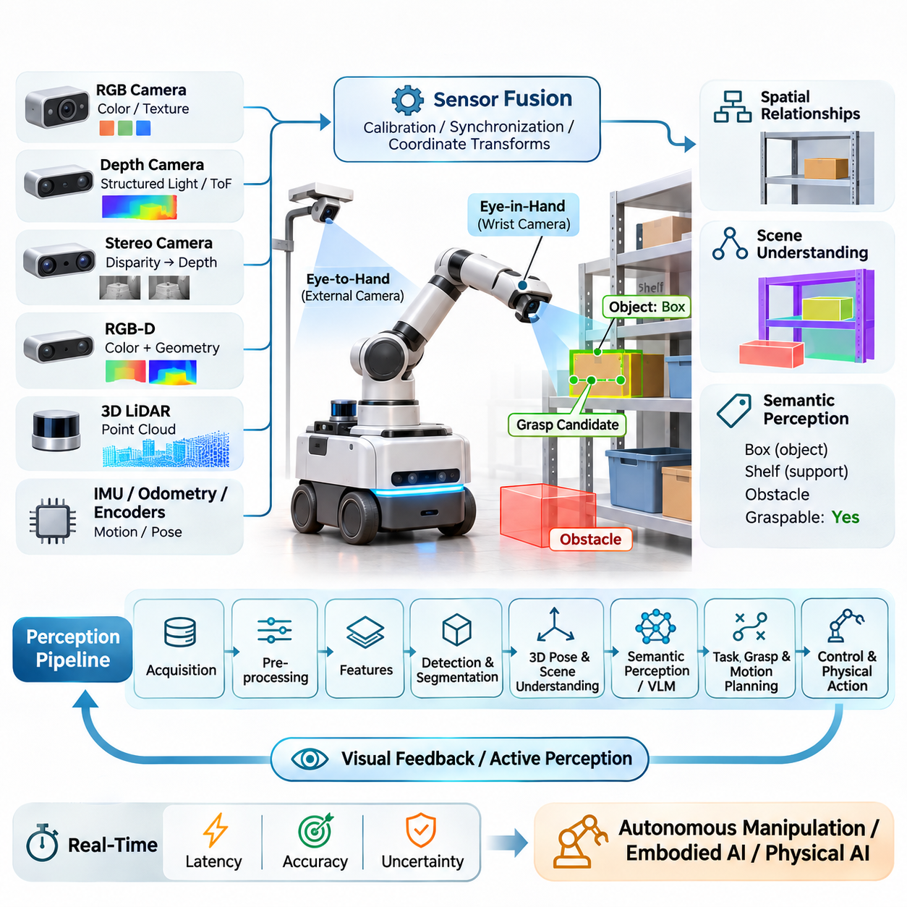
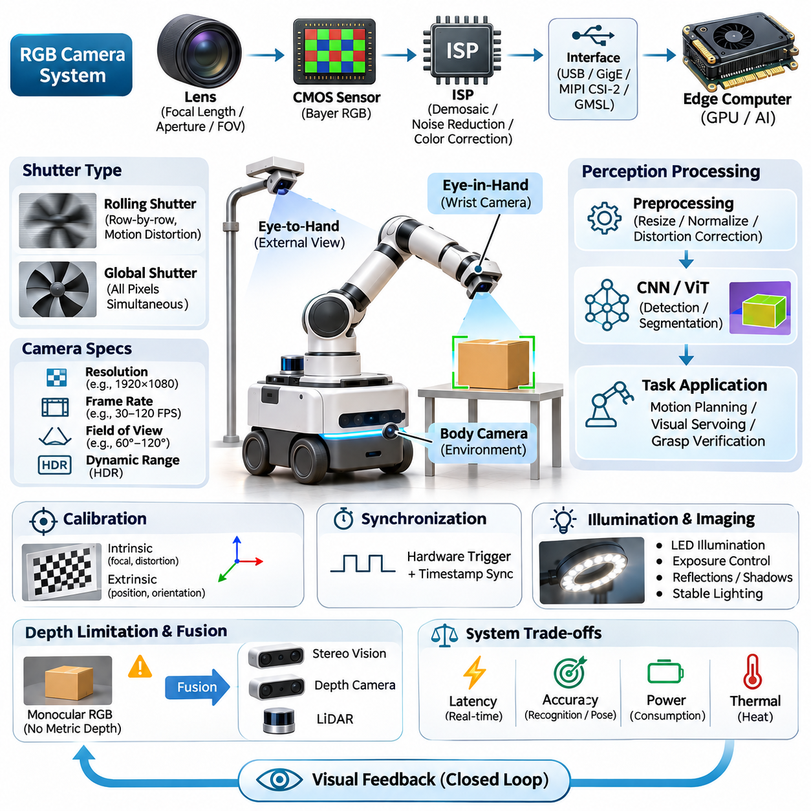
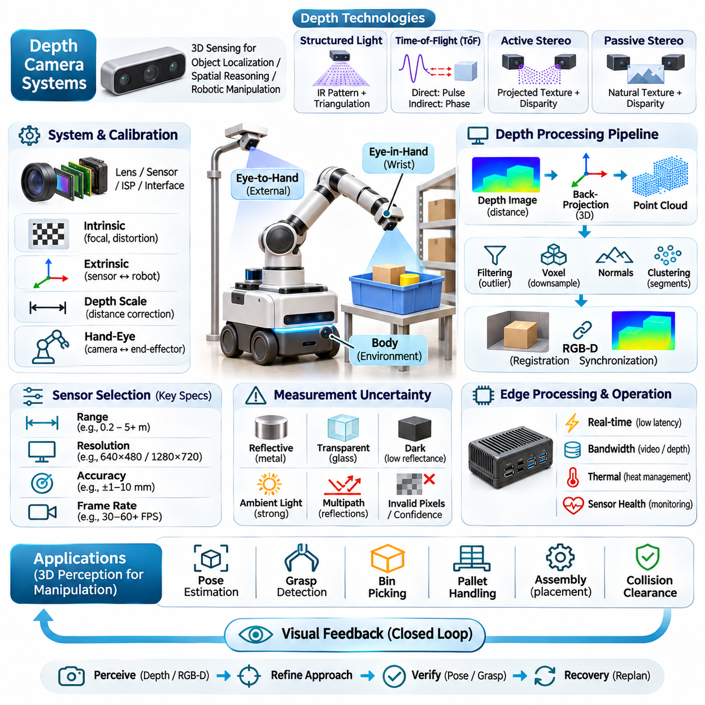
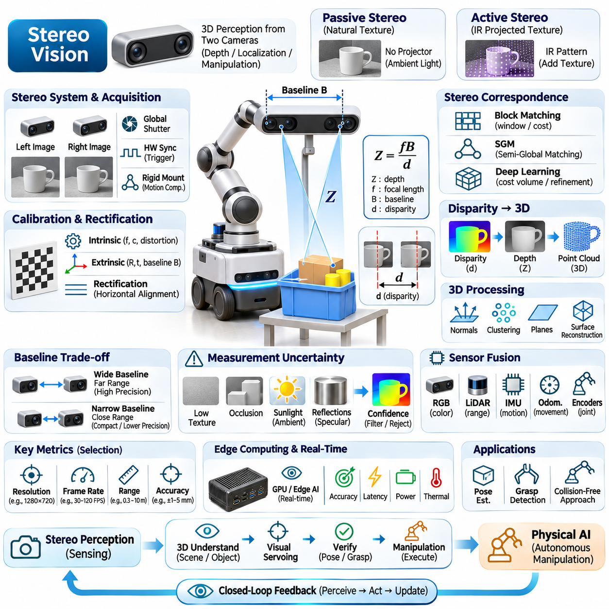
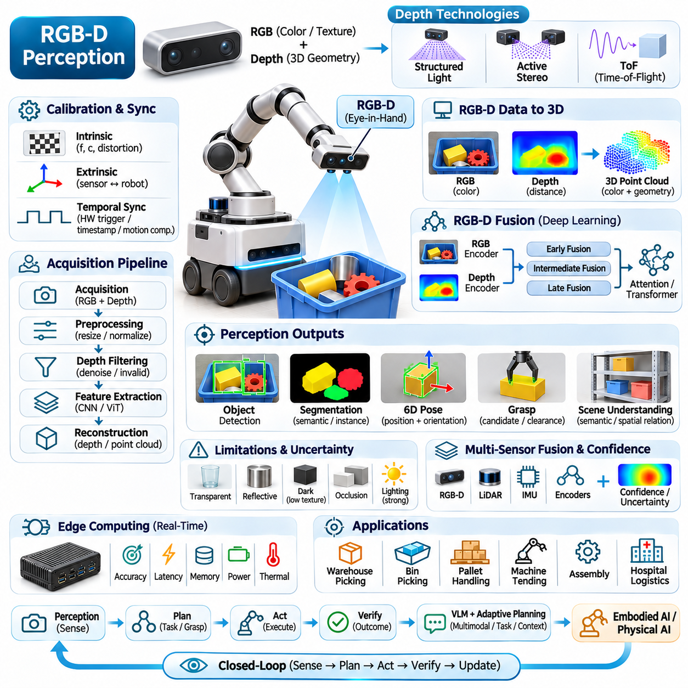
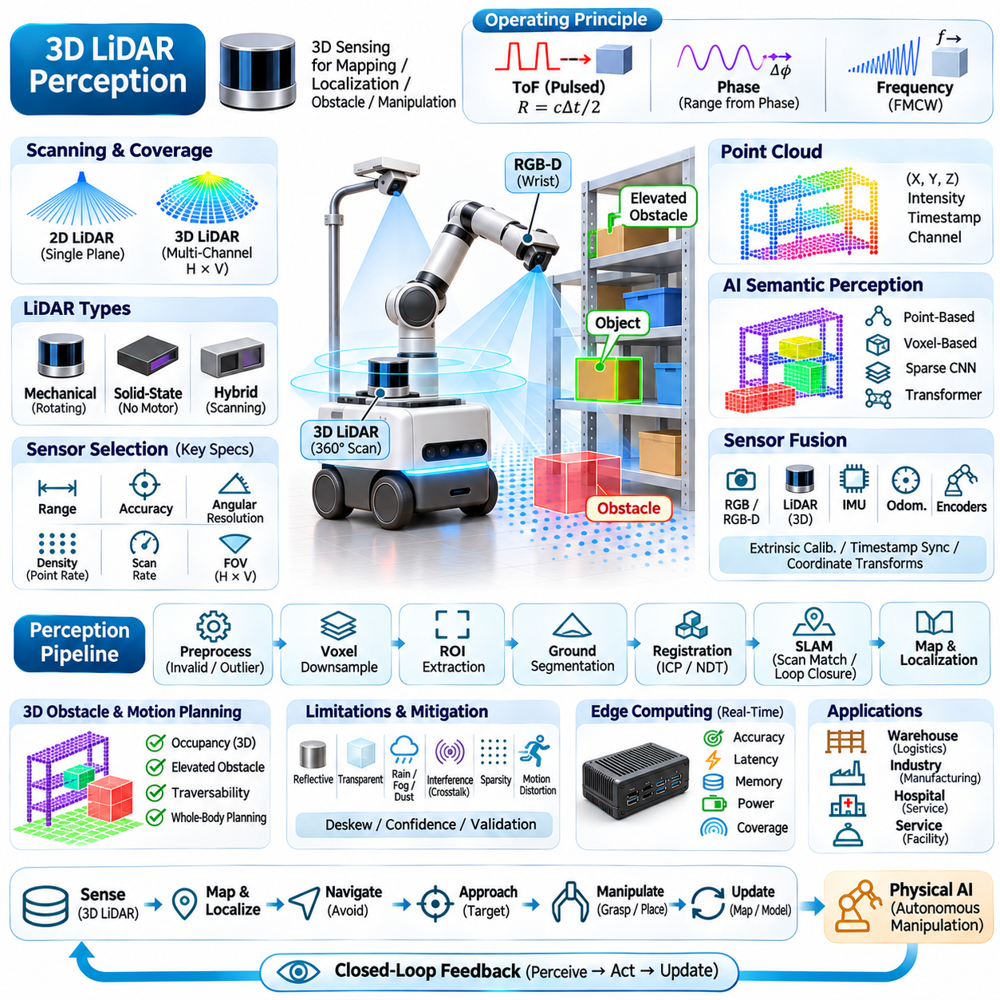
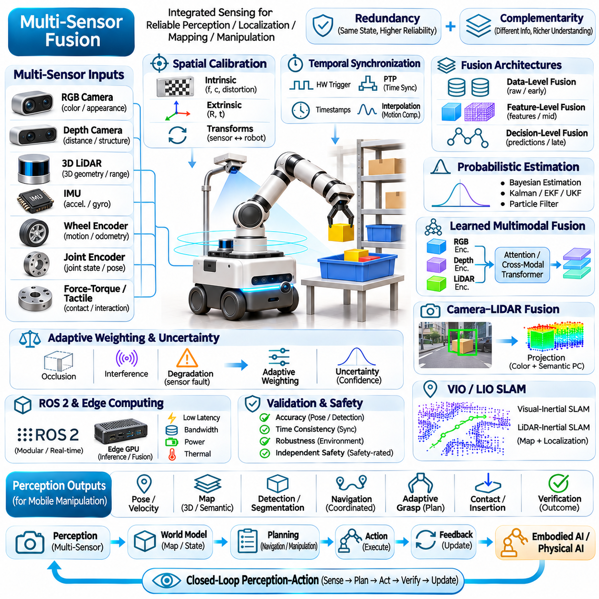
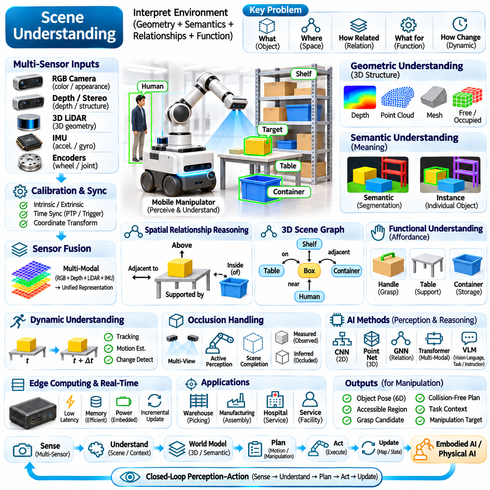
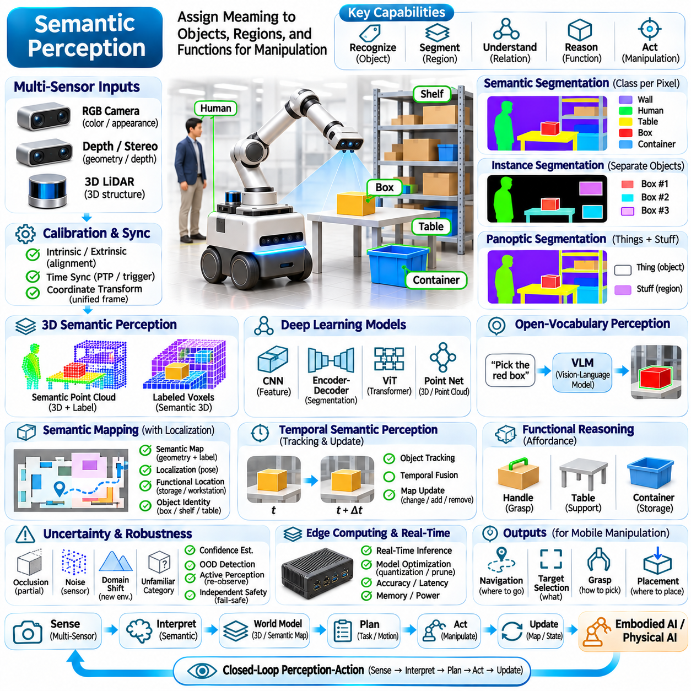
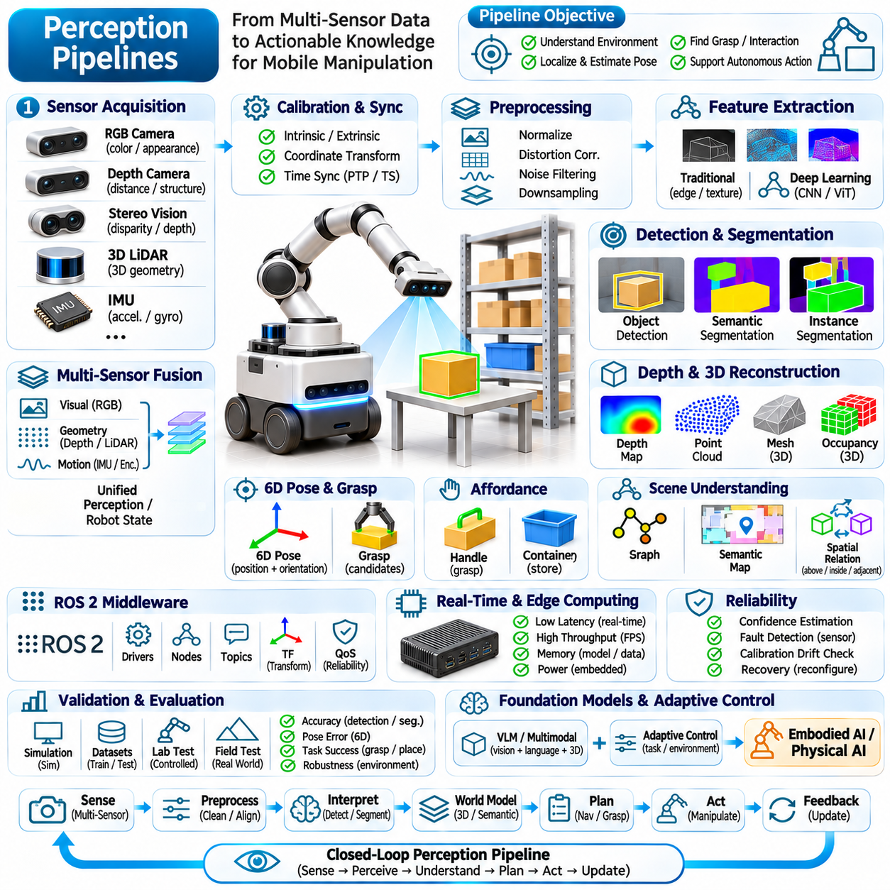

# Chapter 01. Visual Perception

## 01 Visual Perception Overview

{width="7.268055555555556in" height="7.268055555555556in"}

시각 인식(Visual Perception)은 모바일 매니퓰레이터(Mobile Manipulator)가 주변의 물리적 환경을 관찰하고, 해석하며, 이해할 수 있도록 하는 핵심 기능이다. 사전에 정의된 작업 공간(Workspace)에서 작동하는 기존 산업용 로봇(Industrial Robot)과 달리, 모바일 매니퓰레이터는 공간적 구성이 지속적으로 변화하는 객체 및 환경과 상호작용해야 한다. 시각 인식은 환경에서 관찰된 정보를 의미 있는 로봇 행동(Robotic Action)으로 변환하는 데 필요한 감각 지능(Sensory Intelligence)을 제공한다.

시각 인식의 주요 목적은 원시 센서 측정값(Raw Sensor Measurement)을 로봇의 의사결정(Decision-Making)을 지원하는 구조화된 정보(Structured Information)로 변환하는 것이다. 카메라(Camera), 깊이 센서(Depth Sensor), 3차원 스캐닝 장치(3D Scanning Device)는 환경의 물리적 특성을 수집하며, 인식 알고리즘(Perception Algorithm)은 기하학적 정보(Geometric Information)와 의미론적 정보(Semantic Information)를 추출한다. 이러한 정보는 로봇이 객체를 식별하고, 공간적 관계를 추정하며, 장애물을 인식하고, 적절한 조작 전략(Manipulation Strategy)을 결정할 수 있도록 한다.

시각 인식은 컴퓨터 비전(Computer Vision)과 로봇 조작(Robotic Manipulation) 사이의 핵심적인 연결 관계를 형성한다. 기존의 컴퓨터 비전은 주로 영상(Image)을 해석하는 데 중점을 두지만, 로봇 인식(Robotic Perception)은 이러한 해석을 물리적 상호작용(Physical Interaction)으로 확장한다. 객체를 인식하는 것은 조작 과정의 초기 단계에 불과하다. 로봇은 행동을 실행하기 전에 객체의 위치(Position), 방향(Orientation), 치수(Dimension), 접근 가능성(Accessibility), 잠재적인 파지 위치(Grasping Location)를 추가로 결정해야 한다.

RGB 카메라(RGB Camera)는 로봇 인식 분야에서 가장 널리 사용되는 센싱 기술(Sensing Technology) 중 하나이다. RGB 카메라는 객체 감지(Object Detection), 분류(Classification), 분할(Segmentation), 의미론적 인식(Semantic Recognition)을 지원하는 색상(Color), 질감(Texture), 경계선(Edge), 외형적 특성(Appearance Feature)을 수집한다. 현대의 딥러닝 알고리즘(Deep Learning Algorithm)은 RGB 영상으로부터 복잡한 시각적 특징(Visual Feature)을 추출할 수 있다. 그러나 기존 단안 RGB 카메라(Monocular RGB Camera)는 실제 거리 단위의 깊이 정보를 직접 제공하지 않으므로 독립적인 공간 인식 능력에 한계가 있다.

깊이 카메라 시스템(Depth Camera System)은 센서와 주변 물리적 표면 사이의 거리를 측정함으로써 이러한 한계를 해결한다. 구조광(Structured Light), 능동형 스테레오 비전(Active Stereo Vision), 비행시간 측정(Time-of-Flight, ToF)과 같은 기술은 로봇이 깊이 정보(Depth Information)를 획득하고 3차원 환경 구조(3D Environmental Structure)를 재구성할 수 있도록 한다. 깊이 측정값은 특히 객체 치수 추정, 지지 표면(Supporting Surface) 식별, 접근 거리(Approach Distance) 계산, 파지 후보(Grasp Candidate) 생성에 중요한 역할을 한다.

스테레오 비전(Stereo Vision)은 공간적으로 분리된 두 대의 카메라에서 획득한 영상 사이의 기하학적 차이를 분석하여 깊이를 추정한다. 두 영상에서 서로 대응하는 영상 특징(Image Feature)을 식별하고, 이들의 시차(Disparity)를 삼각측량(Triangulation)을 통해 거리 측정값으로 변환한다. 스테레오 비전은 3차원 인식(3D Perception)을 위한 중요한 기반 기술이지만, 정확도는 카메라 보정(Camera Calibration), 기준선 거리(Baseline Distance), 영상 해상도(Image Resolution), 환경적 특성에 따라 달라진다.

RGB-D 인식(RGB-D Perception)은 색상 정보(Color Information)와 깊이 측정값(Depth Measurement)을 통합하여 물리적 환경을 더욱 풍부하게 표현한다. RGB 데이터는 의미론적 인식을 지원하며, 깊이 데이터(Depth Data)는 공간 추론(Spatial Reasoning)에 필요한 기하학적 정보를 제공한다. 이러한 상호보완적인 측정 정보를 결합함으로써 모바일 매니퓰레이터는 복잡한 작업 공간에서 객체 위치 추정(Object Localization), 3차원 분할(3D Segmentation), 자세 추정(Pose Estimation), 파지 감지(Grasp Detection), 조작 계획(Manipulation Planning)을 수행할 수 있다.

3차원 라이다 인식(3D LiDAR Perception)은 더욱 넓은 작업 환경을 이해하기 위한 추가적인 기능을 제공한다. 라이다 센서(LiDAR Sensor)는 레이저 신호(Laser Signal)를 방출하고 반사되어 돌아오는 신호를 분석하여 거리를 측정하며, 일반적으로 점군(Point Cloud) 형태의 공간 표현(Spatial Representation)을 생성한다. 모바일 매니퓰레이터는 이러한 공간 표현을 환경 지도 작성(Environmental Mapping), 장애물 감지(Obstacle Detection), 작업 공간 평가(Workspace Assessment), 자율주행(Navigation), 이동 플랫폼과 로봇 팔 사이의 협조 제어(Coordination)에 활용할 수 있다.

다중 센서 융합(Multi-Sensor Fusion)은 서로 다른 센싱 기술에서 획득한 상호보완적인 정보를 통합하여 인식 신뢰성(Perception Reliability)을 향상시킨다. RGB 카메라는 상세한 외형 정보를 제공하고, 깊이 카메라는 국부적인 기하학적 구조(Local Geometric Structure)를 파악하며, 라이다 센서는 더욱 넓은 공간적 특성을 수집한다. 관성 측정값(Inertial Measurement), 바퀴 주행 거리 측정(Wheel Odometry), 관절 엔코더(Joint Encoder)는 추가적인 운동 정보를 제공한다. 효과적인 센서 융합을 위해서는 정확한 보정(Calibration), 동기화(Synchronization), 일관된 좌표 변환(Coordinate Transformation)이 필요하다.

카메라 배치(Camera Placement)와 보정은 시각 인식 성능(Visual Perception Performance)에 중요한 영향을 미친다. 카메라는 이동 플랫폼(Mobile Platform), 로봇 손목(Robot Wrist), 로봇 본체(Robot Body), 주변 기반 시설(Infrastructure)에 장착될 수 있다. 손 장착형 구성(Eye-in-Hand Configuration)은 말단 장치(End Effector) 주변의 상세한 관찰 정보를 제공하며, 외부 고정형 구성(Eye-to-Hand Configuration)은 더욱 넓은 외부 관측 시야를 제공한다. 내부 보정(Intrinsic Calibration), 외부 보정(Extrinsic Calibration), 손-눈 보정(Hand-Eye Calibration)은 시각적 측정값을 로봇 좌표계(Robot Coordinate System)로 변환하는 데 필요한 기하학적 관계를 정립한다.

장면 이해(Scene Understanding)는 객체, 표면, 장애물, 주변 구조물 사이의 관계를 분석함으로써 시각 인식의 범위를 개별 객체 인식(Object Recognition) 이상으로 확장한다. 모바일 매니퓰레이터는 객체가 선반 위에 놓여 있는지, 용기 내부에 위치하는지, 설비에 부착되어 있는지, 또는 주변 구성요소에 의해 접근이 제한되는지를 판단해야 한다. 이러한 공간적 관계(Spatial Relationship)를 이해함으로써 로봇은 접근 가능성을 평가하고, 상호작용 기회(Interaction Opportunity)를 식별하며, 상황 인식 기반 조작 계획(Context-Aware Manipulation Planning)을 생성할 수 있다.

의미론적 인식(Semantic Perception)은 물리적 객체와 환경 구성요소에 대한 의미 있는 해석을 제공한다. 환경을 단순히 기하학적 좌표(Geometric Coordinate)로만 표현하는 대신, 의미론적 인식은 객체 범주(Object Category), 기능적 속성(Functional Property), 상황적 관계(Contextual Relationship)를 식별한다. 심층 신경망(Deep Neural Network), 비전 트랜스포머(Vision Transformer, ViT), 비전-언어 모델(Vision-Language Model, VLM)은 이러한 기능을 확장하여 로봇이 시각적 관찰 결과를 작업 요구사항(Task Requirement) 및 언어 기반 명령(Language-Based Instruction)과 연결할 수 있도록 한다.

시각 인식은 독립적인 인식 과정이 아니라 연속적인 파이프라인(Pipeline)으로 작동한다. 일반적인 인식 파이프라인(Perception Pipeline)은 센서 데이터 획득(Sensor Acquisition), 전처리(Preprocessing), 특징 추출(Feature Extraction), 객체 감지, 분할, 깊이 처리(Depth Processing), 자세 추정, 공간 표현 등의 과정으로 구성된다. 처리된 정보는 작업 계획(Task Planning), 파지 계획(Grasp Planning), 동작 계획(Motion Planning), 제어(Control) 모듈로 전달된다. 각각의 처리 단계는 전체 조작 시스템의 정확도(Accuracy)와 신뢰성(Reliability)에 영향을 미친다.

실시간 처리(Real-Time Processing)는 모바일 매니퓰레이터가 지속적으로 변화하는 물리적 환경에서 작동하기 때문에 특히 중요하다. 객체가 이동하거나, 사람이 작업 공간에 진입하거나, 이전에 관찰된 장애물의 위치가 변경될 수 있다. 따라서 인식 시스템은 계산 복잡도(Computational Complexity), 추론 지연시간(Inference Latency), 감지 정확도(Detection Accuracy), 하드웨어 제약조건(Hardware Constraint) 사이의 균형을 유지해야 한다. 신뢰도 추정(Confidence Estimation), 불확실성 관리(Uncertainty Management), 지속적인 시각 피드백(Visual Feedback)은 부정확하거나 오래된 관찰 정보로 인한 부정적인 영향을 줄이는 데 기여한다.

궁극적으로 시각 인식은 폐루프 인식-행동 순환 구조(Closed-Loop Perception-Action Loop) 내에서 작동해야 한다. 초기 관찰 정보는 로봇의 움직임을 유도하며, 후속 관찰 정보는 실행 결과를 검증하고 보정 행동(Corrective Action)을 지원한다. 시각 서보 제어(Visual Servoing), 능동적 인식(Active Perception), 적응형 파지 개선(Adaptive Grasp Refinement)은 모바일 매니퓰레이터가 물리적 움직임을 통해 환경에 대한 이해를 향상시킬 수 있도록 한다. 이러한 지속적인 상호작용은 자율 조작(Autonomous Manipulation), 체화 인공지능(Embodied AI), 물리적 인공지능(Physical AI) 시스템을 구현하기 위한 핵심 기반을 형성한다.

## 02 RGB Camera Systems

{width="7.268055555555556in" height="7.268055555555556in"}

RGB 카메라 시스템(RGB Camera System)은 모바일 매니퓰레이터(Mobile Manipulator)에 사용되는 가장 기본적인 센싱 기술(Sensing Technology) 중 하나로, 환경 인식(Environmental Recognition), 객체 식별(Object Identification), 지능형 조작(Intelligent Manipulation)에 필요한 시각 정보를 제공한다. 적색(Red), 녹색(Green), 청색(Blue)의 색상 채널(Color Channel)을 수집하여 물리적 객체와 주변 환경의 외형을 표현하는 디지털 영상(Digital Image)을 생성한다. 이러한 정보는 비전 기반 로봇 지능(Vision-Based Robotic Intelligence)의 기반을 형성한다.

RGB 카메라 시스템은 일반적으로 광학 렌즈(Optical Lens), 이미지 센서(Image Sensor), 영상 신호 처리기(Image Signal Processor, ISP), 통신 인터페이스(Communication Interface)로 구성된다. 광학 렌즈는 입사광(Incoming Light)을 이미지 센서에 집중시키며, 이미지 센서는 광학 에너지(Optical Energy)를 전기 신호(Electrical Signal)로 변환한다. 이러한 신호는 공간 정보(Spatial Information)와 색상 정보(Color Information)를 포함하는 디지털 영상으로 처리된다. 생성된 영상은 후속 인식 및 인공지능 처리를 위해 임베디드 컴퓨팅 플랫폼(Embedded Computing Platform)으로 전송된다.

현대의 RGB 카메라는 낮은 전력 소비(Low Power Consumption), 소형화된 크기, 높은 집적도(Integration Density), 우수한 처리 성능 등의 장점으로 인해 상보형 금속 산화막 반도체(Complementary Metal-Oxide-Semiconductor, CMOS) 이미지 센서를 일반적으로 사용한다. 각각의 감광 소자(Photosensitive Element)는 입사광의 강도를 측정하며, 색상 필터 배열(Color Filter Array, CFA)은 적색, 녹색, 청색 성분의 재구성을 가능하게 한다. 이후 영상 신호 처리(Image Signal Processing)를 통해 디모자이킹(Demosaicing), 잡음 제거(Noise Reduction), 색상 보정(Color Correction)이 수행된다.

이미지 센서 아키텍처(Image Sensor Architecture)는 로봇 응용 분야에서 RGB 카메라의 적합성에 중요한 영향을 미친다. 롤링 셔터(Rolling Shutter) 센서는 영상의 각 행을 순차적으로 획득하므로 카메라 또는 관찰 대상 객체가 빠르게 움직일 때 기하학적 왜곡(Geometric Distortion)이 발생할 수 있다. 글로벌 셔터(Global Shutter) 센서는 모든 픽셀(Pixel)을 동시에 노출하여 움직임으로 인한 왜곡(Motion-Related Distortion)을 크게 감소시킨다. 따라서 글로벌 셔터 기술은 동적 환경(Dynamic Environment)에서 작동하는 모바일 매니퓰레이터에 특히 유리하다.

영상 해상도(Image Resolution), 프레임 속도(Frame Rate), 시야각(Field of View, FoV), 동적 범위(Dynamic Range)는 RGB 카메라 시스템을 선택할 때 고려해야 하는 핵심 매개변수(Parameter)이다. 높은 해상도는 작은 객체와 세부적인 시각적 특징(Visual Feature)의 인식을 지원하며, 높은 프레임 속도는 시간적 응답성(Temporal Responsiveness)을 향상시킨다. 광각 렌즈(Wide-Angle Lens)는 더욱 넓은 환경 관측 범위를 제공하는 반면, 좁은 시야각은 정밀한 관찰에 유리하다. 높은 동적 범위(High Dynamic Range, HDR)는 까다로운 조명 조건에서 가시성(Visibility)을 향상시킨다.

광학 렌즈의 선정(Optical Lens Selection)은 획득된 영상의 기하학적 특성(Geometric Characteristic)과 시각적 특성(Visual Characteristic)에 직접적인 영향을 미친다. 초점 거리(Focal Length)는 영상의 확대 배율(Image Magnification)과 시야각을 결정하며, 조리개(Aperture)는 광 투과량(Light Transmission)과 피사계 심도(Depth of Field, DoF)에 영향을 미친다. 렌즈 왜곡(Lens Distortion)이 적절하게 보정되지 않으면 공간 측정(Spatial Measurement) 과정에서 상당한 오차가 발생할 수 있다. 산업용 로봇 응용 분야에서는 일관된 영상 획득 성능을 유지하기 위해 고정 초점 렌즈(Fixed-Focus Lens)와 기계적으로 안정적인 광학 조립체(Optical Assembly)가 자주 요구된다.

카메라 보정(Camera Calibration)은 물리적 객체와 영상에 투영된 좌표(Projected Image Coordinate) 사이의 수학적 관계를 정립한다. 내부 보정(Intrinsic Calibration)은 초점 거리, 주점(Principal Point), 렌즈 왜곡 계수(Lens Distortion Coefficient)와 같은 매개변수를 결정한다. 외부 보정(Extrinsic Calibration)은 외부 기준 좌표계(External Reference Frame)에 대한 카메라의 위치(Position)와 방향(Orientation)을 식별한다. 정확한 카메라 보정은 시각적 관찰 정보를 로봇 동작(Robot Motion), 공간 위치 추정(Spatial Localization), 조작 계획(Manipulation Planning)과 연결하는 데 필수적이다.

RGB 카메라는 로봇 응용 분야의 요구사항에 따라 다양한 구성으로 설치될 수 있다. 손 장착형 구성(Eye-in-Hand Configuration)은 카메라를 로봇 손목(Robot Wrist) 또는 말단 장치(End Effector) 주변에 배치하여 객체 접근(Object Approach) 및 파지(Grasping) 과정에서 상세한 관찰을 가능하게 한다. 외부 고정형 구성(Eye-to-Hand Configuration)은 카메라를 외부에 배치하여 더욱 넓은 조작 작업 공간(Manipulation Workspace)을 관찰한다. 본체 장착형 카메라(Body-Mounted Camera)는 환경 인지(Environmental Awareness)를 지원하고 이동 플랫폼(Mobile Platform)과 로봇 팔(Robot Arm) 사이의 협조 동작(Coordination)을 지원한다.

기존 RGB 센서는 이용 가능한 가시광선(Visible Light)에 의존하기 때문에 환경 조명(Environmental Illumination)은 RGB 카메라의 성능에 중요한 영향을 미친다. 불충분한 조명(Insufficient Illumination), 반사(Reflection), 그림자(Shadow), 과도한 밝기(Excessive Brightness)는 영상 품질(Image Quality)과 인식 정확도(Recognition Accuracy)를 저하시킬 수 있다. 제어된 조명(Controlled Lighting), 노출 관리(Exposure Management), 광학 필터(Optical Filter), 전용 LED 조명(LED Illumination)은 특히 산업 검사(Industrial Inspection), 물류창고 자동화(Warehouse Automation), 정밀 조작(Precision Manipulation) 분야에서 인식 성능의 일관성을 향상시킬 수 있다.

RGB 영상 처리(RGB Image Processing)는 원시 시각 측정값(Raw Visual Measurement)을 로봇 인식(Robotic Perception)에 적합한 표현(Representation)으로 변환한다. 일반적인 전처리(Preprocessing) 작업에는 영상 크기 조정(Image Resizing), 정규화(Normalization), 왜곡 보정(Distortion Correction), 잡음 필터링(Noise Filtering), 색상 조정(Color Adjustment)이 포함된다. 기존의 컴퓨터 비전 알고리즘(Computer Vision Algorithm)은 경계선(Edge), 모서리(Corner), 윤곽선(Contour), 질감 특성(Texture Characteristic)을 추출하는 반면, 딥러닝 아키텍처(Deep Learning Architecture)는 대규모 데이터셋(Large-Scale Dataset)과 작업별 학습 데이터(Task-Specific Training Example)로부터 계층적 시각 특징(Hierarchical Visual Feature)을 자동으로 학습한다.

객체 감지(Object Detection)와 의미론적 분할(Semantic Segmentation)은 현대 모바일 매니퓰레이터에서 RGB 카메라 시스템의 주요 응용 분야이다. 합성곱 신경망(Convolutional Neural Network, CNN)과 비전 트랜스포머(Vision Transformer, ViT)는 객체를 식별하고, 영상 공간(Image Space)에서의 위치를 추정하며, 관련 영역을 주변 배경(Background)으로부터 구분한다. 이러한 기능은 로봇이 제품(Product), 도구(Tool), 용기(Container), 작업자(Human Operator), 환경 구조물(Environmental Structure)을 인식하면서 후속 조작 작업(Manipulation Task)에 필요한 시각 정보를 생성할 수 있도록 한다.

단안 RGB 카메라 시스템(Monocular RGB Camera System)의 근본적인 한계는 실제 거리 단위로 직접 측정된 깊이 정보(Metric Depth Information)가 없다는 것이다. 객체 치수(Object Dimension), 원근 기하학(Perspective Geometry), 운동 시차(Motion Parallax), 인공지능 기반 단안 깊이 추정(AI-Based Monocular Depth Estimation)은 유용한 공간적 단서(Spatial Cue)를 제공하지만, 절대 거리 추정(Absolute Distance Estimation)에는 여전히 불확실성이 존재할 수 있다. 따라서 RGB 카메라는 3차원 인식 정확도(3D Perception Accuracy)를 향상시키기 위해 깊이 카메라(Depth Camera), 스테레오 비전 시스템(Stereo Vision System), 라이다 센서(LiDAR Sensor)와 통합되는 경우가 많다.

실시간 RGB 인식(Real-Time RGB Perception)을 구현하려면 영상 획득(Image Acquisition), 통신 대역폭(Communication Bandwidth), 계산 처리(Computational Processing), 로봇 제어(Robotic Control) 사이의 효율적인 연계가 필요하다. USB, 기가비트 이더넷(Gigabit Ethernet), MIPI CSI-2, GMSL 인터페이스는 시스템 아키텍처(System Architecture)에 따라 다양한 통합 옵션(Integration Option)을 제공한다. 하드웨어 트리거링(Hardware Triggering)과 타임스탬프 동기화(Timestamp Synchronization)는 카메라 측정값, 로봇 관절 상태(Robot Joint State), 관성 센서(Inertial Sensor), 이동 플랫폼의 위치 추정 데이터(Localization Data) 사이의 시간적 일관성(Temporal Consistency)을 유지하는 데 기여한다.

엣지 컴퓨팅 플랫폼(Edge Computing Platform)은 외부 컴퓨팅 인프라(External Computing Infrastructure)에 지속적으로 의존하지 않고 모바일 매니퓰레이터 내부에서 RGB 카메라 데이터를 직접 처리할 수 있도록 한다. GPU 가속(GPU Acceleration), 최적화된 추론 엔진(Optimized Inference Engine), 모델 양자화(Model Quantization), 비동기 처리(Asynchronous Processing)는 계산 효율성(Computational Efficiency)을 향상시킨다. 시스템 설계자는 신뢰성 높은 자율 운용(Autonomous Operation)을 지원하기 위해 인식 정확도(Recognition Accuracy), 처리 지연시간(Processing Latency), 메모리 사용량(Memory Consumption), 열 관리(Thermal Management), 전력 요구사항(Electrical Power Requirement) 사이의 균형을 유지해야 한다.

궁극적으로 RGB 카메라 시스템은 폐루프 인식 및 조작 아키텍처(Closed-Loop Perception and Manipulation Architecture)의 핵심 구성요소로 작동한다. 지속적인 시각적 관찰(Visual Observation)을 통해 로봇은 목표 객체(Target Object)를 식별하고, 접근 궤적(Approach Trajectory)을 모니터링하며, 파지 위치(Grasping Position)를 정밀하게 보정하고, 작업 완료(Task Completion)를 검증할 수 있다. RGB 카메라는 기하학적 인식(Geometric Perception), 동작 계획(Motion Planning), 시각 서보 제어(Visual Servoing), 비전-언어 모델(Vision-Language Model, VLM)과 통합될 때 자율 조작(Autonomous Manipulation)과 고도화된 물리적 인공지능(Physical AI) 시스템을 위한 확장 가능한 감각 기반(Scalable Sensory Foundation)을 제공한다.

## 03 Depth Camera Systems

{width="7.268055555555556in" height="7.268055555555556in"}

깊이 카메라 시스템(Depth Camera System)은 모바일 매니퓰레이터(Mobile Manipulator)가 주변 물리적 환경의 3차원 구조(Three-Dimensional Structure)를 인식할 수 있도록 하는 핵심 센싱 기술(Sensing Technology)이다. 주로 색상과 외형 정보를 수집하는 기존 RGB 카메라와 달리, 깊이 카메라는 센서와 관찰 대상 표면 사이의 거리를 나타내는 공간 측정값(Spatial Measurement)을 제공한다. 이러한 기능은 객체 위치 추정(Object Localization), 공간 추론(Spatial Reasoning), 자율 로봇 조작(Autonomous Robotic Manipulation)을 지원한다.

깊이 카메라는 개별 픽셀(Pixel)이 일반적인 색상 강도(Color Intensity)가 아닌 측정되거나 추정된 거리를 나타내는 깊이 영상(Depth Image)을 생성한다. 이러한 측정값은 카메라 보정 매개변수(Camera Calibration Parameter)와 결합하여 3차원 좌표(3D Coordinate)로 변환할 수 있다. 생성된 공간 정보(Spatial Information)를 통해 모바일 매니퓰레이터는 객체의 기하학적 구조(Object Geometry)를 재구성하고, 표면 경계(Surface Boundary)를 식별하며, 접근 거리(Approach Distance)를 계산하고, 조작 가능성(Manipulation Opportunity)을 평가할 수 있다.

깊이 카메라 기술(Depth Camera Technology)은 크게 구조광(Structured Light), 능동형 스테레오 비전(Active Stereo Vision), 수동형 스테레오 비전(Passive Stereo Vision), 비행시간 측정(Time-of-Flight, ToF) 시스템으로 분류할 수 있다. 각각의 기술은 거리를 추정하기 위해 서로 다른 물리적 또는 계산적 원리(Computational Principle)를 활용한다. 측정 정확도(Measurement Accuracy), 작동 범위(Operating Range), 환경 민감도(Environmental Sensitivity), 계산 요구사항(Computational Requirement), 하드웨어 복잡도(Hardware Complexity)가 상당히 다르기 때문에 구체적인 로봇 응용 분야의 요구사항에 따라 센서를 선정해야 한다.

구조광 깊이 카메라(Structured Light Depth Camera)는 사전에 정의된 적외선 패턴(Infrared Pattern)을 주변 객체에 투사하고, 이미지 센서(Image Sensor)를 이용하여 이러한 패턴의 변형(Deformation)을 분석한다. 프로젝터(Projector)와 카메라 사이의 기하학적 관계(Geometric Relationship)를 통해 삼각측량(Triangulation) 기반의 깊이 추정(Depth Estimation)이 가능하다. 구조광 시스템은 일반적으로 제한된 작동 거리 내에서 정밀한 측정값을 제공하지만, 강한 주변 조명(Ambient Illumination)이나 까다로운 표면 조건(Surface Condition)에서는 성능 저하가 발생할 수 있다.

비행시간 측정 카메라(Time-of-Flight Camera, ToF Camera)는 물리적 표면에서 반사된 광 신호(Light Signal)의 전파 시간(Propagation Time) 또는 위상 차이(Phase Difference)를 측정하여 거리를 추정한다. 직접 비행시간 측정(Direct ToF, dToF) 시스템은 광 펄스(Light Pulse)의 왕복 이동 시간(Round-Trip Travel Time)을 측정하는 반면, 간접 비행시간 측정(Indirect ToF, iToF) 시스템은 일반적으로 변조된 조명(Modulated Illumination)의 위상 차이를 분석한다. 이러한 기술은 신속한 깊이 정보 획득을 가능하게 하지만, 다중 경로 반사(Multipath Reflection)와 주변광(Ambient Light)으로 인해 측정 오차가 발생할 수 있다.

능동형 스테레오 깊이 카메라(Active Stereo Depth Camera)는 여러 이미지 센서와 관찰 환경에 인공 질감(Artificial Texture)을 생성하는 조명 프로젝터(Illumination Projector)를 결합한다. 공간적으로 분리된 카메라에서 획득한 대응 특징(Corresponding Feature)을 분석하여 시차(Disparity)를 계산하고, 삼각측량을 통해 깊이를 추정한다. 인공 질감은 자연적인 시각 특징(Natural Visual Feature)이 부족한 표면에서 대응점 추정(Correspondence Estimation) 성능을 향상시키므로 능동형 스테레오 기술은 다양한 로봇 조작 응용 분야에서 유용하게 활용된다.

수동형 스테레오 비전 시스템(Passive Stereo Vision System)은 별도의 전용 조명(Dedicated Illumination) 없이 두 대 이상의 카메라에서 관찰된 대응 특징을 이용하여 깊이를 추정한다. 시스템의 성능은 환경 조명(Environmental Lighting), 표면 질감(Surface Texture), 카메라 보정(Camera Calibration), 이미지 센서 사이의 기준선 거리(Baseline Distance)에 따라 달라진다. 수동형 스테레오는 적절한 실외 환경(Outdoor Environment)에서 효과적으로 작동할 수 있지만, 균일한 표면(Uniform Surface)과 불충분한 조명(Insufficient Illumination)은 깊이 추정의 신뢰성을 저하시킬 수 있다.

깊이 해상도(Depth Resolution), 공간 해상도(Spatial Resolution), 측정 정확도(Measurement Accuracy), 최소 작동 거리(Minimum Operating Distance), 최대 작동 범위(Maximum Operating Range), 프레임 속도(Frame Rate)는 깊이 카메라 시스템을 선정할 때 고려해야 하는 중요한 매개변수이다. 근거리 조작(Close-Range Manipulation)에는 정밀한 기하학적 측정값이 요구되는 반면, 환경 관찰(Environmental Observation)에서는 더욱 넓은 관측 범위가 우선시될 수 있다. 따라서 센서 사양(Sensor Specification)은 객체 치수(Object Dimension), 작업 공간의 기하학적 구조(Workspace Geometry), 요구되는 조작 공차(Manipulation Tolerance)를 기준으로 평가해야 한다.

로봇 인식 시스템(Robotic Perception System)을 개발할 때는 깊이 측정 불확실성(Depth Measurement Uncertainty)을 신중하게 고려해야 한다. 반사성 금속(Reflective Metal), 투명 소재(Transparent Material), 어두운 표면(Dark Surface), 객체 경계(Object Boundary), 강한 환경 조명은 부정확하거나 누락된 깊이 측정값을 발생시킬 수 있다. 센싱 기술에 따라 측정 거리가 증가할수록 측정 불확실성이 증가할 수 있다. 신뢰도 맵(Confidence Map)과 유효하지 않은 픽셀 감지(Invalid-Pixel Detection)는 후속 처리 알고리즘(Downstream Algorithm)이 신뢰할 수 없는 공간 정보를 식별하는 데 도움을 준다.

깊이 카메라 보정(Depth Camera Calibration)은 정확한 3차원 표현(3D Representation)을 재구성하는 데 필요한 기하학적 관계를 정립한다. 내부 보정(Intrinsic Calibration)은 초점 거리(Focal Length), 주점(Principal Point), 왜곡 매개변수(Distortion Parameter)를 결정하는 반면, 외부 보정(Extrinsic Calibration)은 센서와 로봇 좌표계(Robot Coordinate Frame) 사이의 관계를 정의한다. 깊이 스케일 보정(Depth Scale Correction)과 손-눈 보정(Hand-Eye Calibration)은 측정된 객체 위치를 실행 가능한 로봇 동작(Executable Robotic Movement)으로 변환하는 과정에서 특히 중요하다.

깊이 영상은 보정된 카메라 매개변수를 활용한 기하학적 역투영(Geometric Back-Projection)을 통해 3차원 점군(3D Point Cloud)으로 변환할 수 있다. 각각의 유효한 깊이 픽셀(Valid Depth Pixel)은 카메라 좌표계(Camera Coordinate System)로 표현되는 공간상의 점(Spatial Point)에 대응한다. 복셀 다운샘플링(Voxel Downsampling), 이상치 제거(Outlier Removal), 표면 법선 추정(Surface Normal Estimation), 군집화(Clustering)와 같은 점군 처리 기술(Point Cloud Processing Technique)은 로봇이 대량의 공간 측정값으로부터 유용한 기하학적 구조를 추출할 수 있도록 한다.

깊이 카메라 배치(Depth Camera Placement)는 작업 공간 관측 범위(Workspace Coverage)와 조작 신뢰성(Manipulation Reliability)에 중요한 영향을 미친다. 손목 장착형 카메라(Wrist-Mounted Camera)는 말단 장치(End Effector) 주변의 상세한 관찰 정보를 제공하는 반면, 본체 장착형 카메라(Body-Mounted Camera)는 더욱 넓은 환경 인식을 지원한다. 외부 고정형 카메라(Fixed External Camera)는 상호보완적인 관측 시점(Complementary Viewpoint)에서 조작 작업장(Manipulation Workstation)을 관찰할 수 있다. 다중 카메라 구성(Multiple Camera Configuration)은 개별 센서가 모든 관련 표면을 관찰할 수 없는 경우 가림 현상(Occlusion)을 줄이고 기하학적 재구성(Geometric Reconstruction) 성능을 향상시킨다.

RGB 카메라와의 통합은 외형 정보(Appearance Information)와 3차원 측정값(3D Measurement)을 결합하는 RGB-D 인식 시스템(RGB-D Perception System)의 구축을 가능하게 한다. 색상 정보(Color Information)는 객체 인식(Object Recognition)과 의미론적 이해(Semantic Understanding)를 지원하며, 깊이 측정값은 위치 추정과 조작에 필요한 기하학적 정보(Geometric Information)를 제공한다. 이러한 상호보완적인 센싱 양식(Sensing Modality) 사이의 대응 관계를 유지하기 위해서는 정확한 공간 정합(Spatial Registration)과 시간 동기화(Temporal Synchronization)가 필요하다.

깊이 카메라 시스템은 객체 자세 추정(Object Pose Estimation), 파지 감지(Grasp Detection), 빈 피킹(Bin Picking), 팔레트 취급(Pallet Handling), 정밀 조립(Precision Assembly)을 포함한 다양한 조작 응용 분야를 지원한다. 공간 측정값을 통해 로봇은 접근 가능한 표면(Accessible Surface)을 식별하고, 객체의 방향(Object Orientation)을 추정하며, 그리퍼 여유 공간(Gripper Clearance)을 평가하고, 잠재적인 충돌(Potential Collision)을 감지할 수 있다. 지속적인 깊이 관찰(Continuous Depth Observation)은 작업 실행 중 객체의 위치나 환경 구성이 변화하는 경우 적응형 조작 전략(Adaptive Manipulation Strategy)을 지원한다.

실시간 깊이 인식(Real-Time Depth Perception)은 센서 데이터 획득(Sensor Acquisition), 데이터 전송(Data Transmission), 기하학적 처리(Geometric Processing), 인공지능 추론(AI Inference), 로봇 제어(Robotic Control) 사이의 효율적인 연계를 요구한다. 임베디드 컴퓨팅 플랫폼(Embedded Computing Platform)과 GPU 가속(GPU Acceleration)은 높은 처리량의 깊이 데이터 처리(High-Throughput Depth Processing) 및 3차원 인식을 지원한다. 신뢰성 높은 시스템 배포(Reliable Deployment)를 위해서는 추가적으로 타임스탬프 동기화(Timestamp Synchronization), 대역폭 관리(Bandwidth Management), 열적 안정성(Thermal Stability), 센서 상태(Sensor Health) 및 측정 품질(Measurement Quality)에 대한 모니터링이 필요하다.

궁극적으로 깊이 카메라 시스템은 폐루프 인식-행동 아키텍처(Closed-Loop Perception-Action Architecture)의 핵심 구성요소로 작동한다. 지속적인 3차원 관찰(Continuous 3D Observation)을 통해 모바일 매니퓰레이터는 접근 궤적(Approach Trajectory)을 정밀하게 보정하고, 파지 구성(Grasp Configuration)을 조정하며, 조작 결과(Manipulation Outcome)를 검증하고, 실행 오류(Execution Error)로부터 복구할 수 있다. 깊이 카메라는 다중 센서 융합(Multi-Sensor Fusion) 및 인공지능 기반 공간 추론(AI-Based Spatial Reasoning)과 통합될 때 자율 조작(Autonomous Manipulation)과 물리적 인공지능(Physical AI)을 구현하기 위한 기하학적 기반(Geometric Foundation)을 제공한다.

## 04 Stereo Vision

{width="7.268055555555556in" height="7.268055555555556in"}

스테레오 비전(Stereo Vision)은 모바일 매니퓰레이터(Mobile Manipulator)가 여러 카메라에서 획득한 관찰 정보를 이용하여 주변 환경의 공간적 구조(Spatial Structure)를 추정할 수 있도록 하는 핵심적인 3차원 인식 기술(3D Perception Technology)이다. 인간의 양안 시각(Binocular Vision)에서 영감을 얻은 스테레오 비전은 공간적으로 분리된 관측 시점(Viewpoint)에서 획득한 영상 사이의 차이를 분석한다. 이러한 차이는 깊이 추정(Depth Estimation), 객체 위치 추정(Object Localization), 자율 로봇 조작(Autonomous Robotic Manipulation)에 필요한 기하학적 정보(Geometric Information)를 제공한다.

일반적인 스테레오 비전 시스템(Stereo Vision System)은 기준선(Baseline)이라고 하는 사전에 정의된 이격 거리를 유지하도록 장착된 두 대의 카메라로 구성된다. 두 카메라는 약간씩 다른 관측 시점에서 물리적 환경의 중첩 영역(Overlapping Region)을 관찰한다. 획득된 영상에는 객체의 거리에 따라 상대적 위치가 달라지는 대응 시각 특징(Corresponding Visual Feature)이 포함된다. 시스템은 이러한 위치 차이(Positional Difference)를 분석하고 기하학적 계산(Geometric Calculation)을 통해 3차원 공간 정보(3D Spatial Information)를 재구성한다.

시차(Disparity)는 좌측 카메라(Left Camera)와 우측 카메라(Right Camera)에서 관찰된 대응점(Corresponding Point) 사이의 영상 좌표(Image Coordinate) 차이를 나타낸다. 일반적으로 카메라 시스템에 가까이 위치한 객체는 더 큰 시차를 생성하는 반면, 멀리 위치한 객체는 더 작은 시차를 생성한다. 보정 및 정류가 완료된 스테레오 카메라 시스템(Calibrated and Rectified Stereo Camera System)에서는 초점 거리(Focal Length)와 기준선 거리(Baseline Distance)의 곱을 시차로 나누어 깊이를 계산할 수 있으며, 이를 통해 영상 기하학(Image Geometry)과 물리적 거리(Physical Distance) 사이의 직접적인 관계가 정립된다.

스테레오 카메라 보정(Stereo Camera Calibration)은 개별 카메라와 관찰 대상 환경 사이의 정확한 기하학적 관계(Geometric Relationship)를 정립하는 데 필수적이다. 내부 보정(Intrinsic Calibration)은 각 카메라의 초점 거리, 주점(Principal Point), 렌즈 왜곡 계수(Lens Distortion Coefficient)를 결정한다. 외부 보정(Extrinsic Calibration)은 카메라 사이의 상대적 회전(Relative Rotation)과 병진 이동(Translation)을 식별한다. 이러한 보정 매개변수(Calibration Parameter)의 오차는 시차 추정(Disparity Estimation), 깊이 정확도(Depth Accuracy), 후속 로봇 조작 성능(Robotic Manipulation Performance)에 직접적인 영향을 미친다.

영상 정류(Image Rectification)는 스테레오 영상 쌍(Stereo Image Pair)을 대응점이 동일한 수평 주사선(Horizontal Scanline)에 나타나도록 기하학적으로 정렬된 표현(Geometrically Aligned Representation)으로 변환한다. 이러한 변환은 2차원 특징 탐색(Two-Dimensional Feature Search)을 주로 1차원 정합 문제(One-Dimensional Matching Problem)로 축소함으로써 스테레오 대응점 탐색(Stereo Correspondence)을 단순화한다. 정확한 영상 정류는 계산 효율성(Computational Efficiency)을 향상시키고, 정합 모호성(Matching Ambiguity)을 감소시키며, 신뢰성 높은 깊이 재구성(Depth Reconstruction)을 위한 일관된 기하학적 조건을 정립한다.

스테레오 대응점 탐색(Stereo Correspondence)은 스테레오 비전의 핵심적인 계산 문제(Computational Challenge)이다. 주요 목적은 서로 다른 카메라의 관찰 영상에서 동일한 물리적 위치(Physical Location)를 나타내는 영상 픽셀(Image Pixel) 또는 시각적 특징(Visual Feature)을 식별하는 것이다. 전통적인 접근 방식은 블록 정합(Block Matching), 상관관계 분석(Correlation Analysis), 특징 기술자(Feature Descriptor), 준전역 정합(Semi-Global Matching, SGM)을 활용한다. 이러한 기술의 효과는 영상 질감(Image Texture), 조명 일관성(Illumination Consistency), 가림 현상(Occlusion), 관찰 대상 표면의 기하학적 특성(Geometric Characteristic)에 따라 달라진다.

딥러닝(Deep Learning)은 스테레오 대응점 추정(Stereo Correspondence Estimation)의 기능을 크게 확장하였다. 신경망 아키텍처(Neural Network Architecture)는 특징 추출(Feature Extraction), 정합 비용 볼륨(Matching Cost Volume), 문맥적 추론(Contextual Reasoning), 반복적 시차 정밀화(Iterative Disparity Refinement)를 활용하여 밀집 시차 맵(Dense Disparity Map)을 생성한다. 학습 기반 스테레오 정합 기술(Learned Stereo Matching Technique)은 까다로운 환경에서 성능을 향상시킬 수 있지만, 신뢰성은 학습 데이터의 다양성(Training Data Diversity), 계산 자원(Computational Resource), 익숙하지 않은 작동 조건에 대한 일반화 능력(Generalization Capability)에 따라 달라진다.

수동형 스테레오 비전(Passive Stereo Vision)은 이용 가능한 환경 조명(Environmental Illumination)과 자연적으로 존재하는 시각적 특징만을 이용하여 깊이를 추정한다. 외부 광원 프로젝터(External Light Projector)가 필요하지 않기 때문에 수동형 스테레오는 이동 로봇 플랫폼(Mobile Robotic Platform) 및 실외 응용 분야(Outdoor Application)에 유리한 시스템 통합 특성(Integration Characteristic)을 제공할 수 있다. 그러나 질감이 부족한 표면(Low-Texture Surface), 반복 패턴(Repetitive Pattern), 불충분한 조명(Insufficient Illumination), 카메라 관찰 영상 사이의 상당한 외형 차이(Appearance Difference)는 측정 신뢰성(Measurement Reliability)을 저하시킬 수 있다.

능동형 스테레오 비전(Active Stereo Vision)은 일반적으로 적외선 스펙트럼(Infrared Spectrum)에서 작동하는 조명 프로젝터(Illumination Projector)를 이용하여 관찰 환경에 인공적인 시각 패턴(Artificial Visual Pattern)을 생성한다. 이러한 투사 패턴(Projected Pattern)은 시각적 특징이 부족한 표면에 추가적인 질감(Texture)을 형성하여 대응점 추정 성능을 향상시킨다. 능동형 스테레오는 실내 조작(Indoor Manipulation) 및 산업 자동화(Industrial Automation)에 특히 유용하지만, 강한 태양광(Strong Sunlight), 반사성 소재(Reflective Material), 프로젝터 사이의 간섭(Interference)은 성능을 저하시킬 수 있다.

기준선 거리(Baseline Distance)는 스테레오 비전의 측정 특성(Measurement Characteristic)을 결정하는 데 핵심적인 역할을 한다. 더 긴 기준선은 일반적으로 원거리에서 깊이 분별 능력(Depth Discrimination)을 향상시키지만, 가림 현상을 증가시키고, 중첩 시야각(Overlapping Field of View)을 감소시키며, 대응점 추정을 복잡하게 만들 수 있다. 더 짧은 기준선은 소형 센서 통합(Compact Sensor Integration)과 근거리 관찰(Close-Range Observation)에 유리하지만, 일반적으로 원거리에서 낮은 깊이 정밀도(Depth Precision)를 제공한다. 따라서 기준선 선정(Baseline Selection)은 로봇의 작업 공간 요구사항(Workspace Requirement)을 반영해야 한다.

깊이 추정 불확실성(Depth Estimation Uncertainty)은 일반적으로 객체와의 거리가 증가함에 따라 커지는데, 이는 작은 시차 오차(Disparity Error)가 점차 더 큰 깊이 오차(Depth Error)를 발생시키기 때문이다. 카메라 해상도(Camera Resolution), 초점 거리, 기준선 거리, 보정 정확도(Calibration Accuracy), 서브픽셀 시차 추정(Subpixel Disparity Estimation)은 종합적으로 측정 정밀도(Measurement Precision)를 결정한다. 신뢰도 추정(Confidence Estimation)과 불확실성 모델링(Uncertainty Modeling)을 통해 모바일 매니퓰레이터는 신뢰할 수 있는 기하학적 관찰 정보와 폐기하거나 독립적으로 검증해야 하는 측정값을 구분할 수 있다.

스테레오 비전 시스템은 깊이 영상(Depth Image)과 3차원 점군(3D Point Cloud)으로 변환할 수 있는 시차 맵(Disparity Map)을 생성한다. 이러한 공간 표현(Spatial Representation)은 표면 재구성(Surface Reconstruction), 객체 군집화(Object Clustering), 평면 분할(Plane Segmentation), 표면 법선 추정(Surface Normal Estimation)과 같은 기하학적 처리 기술(Geometric Processing Technique)을 가능하게 한다. 모바일 매니퓰레이터는 생성된 공간 정보를 활용하여 파지 가능한 표면(Graspable Surface)을 식별하고, 객체 접근 가능성(Object Accessibility)을 평가하며, 객체 자세(Object Pose)를 추정하고, 충돌 없는 접근 궤적(Collision-Free Approach Trajectory)을 계산한다.

이동 로봇 응용 분야(Mobile Robotic Application)에서는 영상 획득(Image Acquisition) 과정에서 스테레오 카메라와 주변 객체가 움직일 수 있기 때문에 추가적인 기술적 문제가 발생한다. 기계적 진동(Mechanical Vibration), 모션 블러(Motion Blur), 롤링 셔터 왜곡(Rolling Shutter Distortion), 비동기 영상 획득(Unsynchronized Image Capture)은 상당한 대응점 정합 오차(Correspondence Error)를 발생시킬 수 있다. 글로벌 셔터 카메라(Global Shutter Camera), 하드웨어 동기화(Hardware Synchronization), 강체 장착 구조(Rigid Mounting Structure), 운동 보상 기술(Motion Compensation Technique)은 이동 중 자율주행(Mobile Navigation) 및 동적 조작(Dynamic Manipulation) 과정에서 측정 일관성(Measurement Consistency)을 향상시킨다.

스테레오 비전은 RGB 카메라(RGB Camera), 라이다 센서(LiDAR Sensor), 관성 측정 장치(Inertial Measurement Unit, IMU), 바퀴 주행 거리 측정(Wheel Odometry), 로봇 관절 엔코더(Robot Joint Encoder)와 통합되어 종합적인 인식 아키텍처(Comprehensive Perception Architecture)를 구성할 수 있다. 다중 센서 융합(Multi-Sensor Fusion)은 개별 센싱 기술의 한계(Sensing Limitation)를 보완하기 위해 상호보완적인 측정값(Complementary Measurement)을 결합한다. 정확한 시간 동기화(Temporal Synchronization)와 좌표 변환(Coordinate Transformation)은 환경 관찰 정보(Environmental Observation), 이동 플랫폼 위치 추정(Mobile Platform Localization), 로봇 팔 동작(Robotic Arm Movement) 사이의 공간적 일관성(Spatial Consistency)을 유지하는 데 필수적이다.

실시간 스테레오 인식(Real-Time Stereo Perception)은 이동 로봇 플랫폼의 계산 자원 제약조건(Computational Constraint) 내에서 동기화된 영상 쌍(Synchronized Image Pair)을 효율적으로 처리해야 한다. GPU 가속(GPU Acceleration), 전용 비전 프로세서(Dedicated Vision Processor), 최적화된 스테레오 알고리즘(Optimized Stereo Algorithm), 신경망 추론 엔진(Neural Network Inference Engine)은 높은 처리량의 시차 추정(High-Throughput Disparity Estimation)을 지원한다. 시스템 설계자는 신뢰성 높은 인식 성능(Perception Performance)을 유지하기 위해 깊이 정확도, 영상 해상도, 처리 지연시간(Processing Latency), 전력 소비(Power Consumption), 열적 요구사항(Thermal Requirement) 사이의 균형을 유지해야 한다.

궁극적으로 스테레오 비전은 모바일 매니퓰레이터의 폐루프 인식-행동 아키텍처(Closed-Loop Perception-Action Architecture) 내에서 작동한다. 지속적인 깊이 관찰(Continuous Depth Observation)은 객체 위치 추정, 파지 정밀화(Grasp Refinement), 장애물 회피(Obstacle Avoidance), 시각 서보 제어(Visual Servoing), 조작 결과 검증(Manipulation Outcome Verification)을 지원한다. 스테레오 기하학(Stereo Geometry)을 인공지능 기반 인식(AI-Based Perception), 공간 추론(Spatial Reasoning), 동작 계획(Motion Planning)과 통합함으로써 모바일 매니퓰레이터는 자율 조작(Autonomous Manipulation)과 물리적 인공지능(Physical AI)의 구현에 기여하는 적응형 상호작용 능력(Adaptive Interaction Capability)을 확보할 수 있다.

## 05 RGBD Perception

{width="7.268055555555556in" height="7.268055555555556in"}

RGB-D 인식(RGB-D Perception)은 모바일 매니퓰레이터(Mobile Manipulator)가 주변 물리적 환경의 시각적 외형(Visual Appearance)과 3차원 기하학적 구조(3D Geometry)를 모두 이해할 수 있도록 하는 핵심적인 센싱 및 처리 기술(Sensing and Processing Technology)이다. 적색(Red), 녹색(Green), 청색(Blue)의 색상 정보와 깊이 측정값(Depth Measurement)을 통합함으로써 RGB-D 인식은 객체 인식(Object Recognition), 위치 추정(Localization), 자율 로봇 조작(Autonomous Robotic Manipulation)에 필요한 상호보완적인 의미론적 정보(Semantic Information)와 공간 정보(Spatial Information)를 제공한다.

RGB-D 카메라 시스템(RGB-D Camera System)은 일반적으로 RGB 이미지 센서(RGB Imaging Sensor)와 구조광(Structured Light), 능동형 스테레오 비전(Active Stereo Vision), 비행시간 측정(Time-of-Flight, ToF) 기술을 기반으로 하는 깊이 센싱 모듈(Depth Sensing Module)을 결합한다. RGB 센서는 색상(Color), 질감(Texture), 외형적 특성(Appearance Characteristic)을 수집하는 반면, 깊이 센서는 관찰 대상 표면까지의 거리를 측정한다. 이러한 상호보완적인 측정값은 로봇 작업 공간(Robotic Workspace) 내에서 객체의 정체성(Object Identity)과 물리적 구조(Physical Structure)를 모두 해석할 수 있는 통합 감각 기반(Unified Sensory Foundation)을 형성한다.

RGB-D 데이터(RGB-D Data)는 주로 관찰 대상 환경의 공간적 특성(Spatial Characteristic)을 표현하는 색상 영상(Color Image)과 이에 대응하는 깊이 맵(Depth Map)으로 구성된다. 각각의 유효한 깊이 측정값(Valid Depth Measurement)은 카메라에 대한 물리적 표면(Physical Surface)의 위치 정보를 제공한다. 이러한 측정값을 색상 정보와 정확하게 정렬하면 기하학적 좌표(Geometric Coordinate)를 시각적 외형 및 의미론적 속성(Semantic Property)과 연결하는 더욱 풍부한 공간 표현(Enriched Spatial Representation)을 구축할 수 있다.

공간 정합(Spatial Registration)은 서로 다른 이미지 센서에서 생성된 RGB 영상과 깊이 측정값 사이의 대응 관계(Correspondence)를 정립하는 데 필수적이다. 각 센서는 서로 다른 광학 중심(Optical Center), 해상도(Resolution), 시야각(Field of View, FoV)을 가질 수 있으므로 관찰 정보를 공통 좌표계(Common Coordinate System)로 변환해야 한다. 내부 및 외부 보정 매개변수(Intrinsic and Extrinsic Calibration Parameter)는 정확한 픽셀 수준 정렬(Pixel-Level Alignment)을 가능하게 하여 시각적 인식(Visual Recognition)과 기하학적 위치 추정(Geometric Localization) 사이의 불일치를 감소시킨다.

시간 동기화(Temporal Synchronization)는 RGB 측정값과 깊이 측정값이 관찰 대상 환경의 거의 동일한 물리적 상태(Physical State)를 나타내도록 보장한다. 동기화되지 않은 측정값(Unsynchronized Measurement)은 객체, 로봇 팔(Robot Arm), 이동 플랫폼(Mobile Platform)이 움직일 때 공간적 불일치(Spatial Inconsistency)를 발생시킬 수 있다. 하드웨어 트리거링(Hardware Triggering), 동기화된 타임스탬프(Synchronized Timestamp), 운동 보상 기술(Motion Compensation Technique)은 측정 일관성(Measurement Consistency)을 향상시키고 동적 로봇 운용(Dynamic Robotic Operation) 과정에서 신뢰성 높은 RGB-D 인식을 가능하게 한다.

3차원 점군(3D Point Cloud)은 보정된 카메라 매개변수(Calibrated Camera Parameter)를 활용한 기하학적 역투영(Geometric Back-Projection)을 통해 RGB-D 측정값으로부터 생성할 수 있다. 각각의 유효한 깊이 픽셀(Valid Depth Pixel)은 공간 좌표(Spatial Coordinate)로 변환되며, 해당 픽셀과 연결된 RGB 정보는 색상 속성(Color Attribute)을 제공한다. 생성된 컬러 점군(Colored Point Cloud)을 통해 모바일 매니퓰레이터는 객체 표면(Object Surface)을 재구성하고, 기하학적 경계(Geometric Boundary)를 식별하며, 표면 방향(Surface Orientation)을 추정하고, 작업 공간의 특성(Workspace Characteristic)을 분석할 수 있다.

RGB-D 인식 파이프라인(RGB-D Perception Pipeline)은 일반적으로 센서 데이터 획득(Sensor Acquisition), 영상 전처리(Image Preprocessing), 깊이 필터링(Depth Filtering), 공간 정합, 특징 추출(Feature Extraction), 기하학적 재구성(Geometric Reconstruction)으로 구성된다. 깊이 측정값은 후속 처리 이전에 잡음 제거(Noise Reduction), 유효하지 않은 픽셀 제거(Invalid-Pixel Removal), 경계 보존 필터링(Edge-Preserving Filtering) 등의 처리가 필요할 수 있다. 효과적인 전처리는 공간 표현의 품질을 향상시키고 측정 오차(Measurement Error)가 후속 로봇 계획 및 제어 알고리즘(Downstream Robotic Planning and Control Algorithm)으로 전파되는 것을 감소시킨다.

객체 감지(Object Detection)와 분할(Segmentation)은 RGB 정보와 깊이 정보의 통합을 통해 상당한 성능 향상을 얻을 수 있다. 색상 영상은 객체 범주(Object Category)를 구분하는 의미론적 특징(Semantic Feature)을 제공하는 반면, 깊이 측정값은 전경 객체(Foreground Object)를 배경(Background) 및 인접 구조물(Neighboring Structure)로부터 분리하는 데 도움을 준다. 이러한 센싱 양식(Sensing Modality)을 결합하면 특히 복잡하게 배치된 조작 환경(Cluttered Manipulation Environment)에서 객체 경계 식별(Object Boundary Identification), 3차원 분할(3D Segmentation), 개별 객체 수준 인식(Instance-Level Recognition) 성능을 향상시킬 수 있다.

RGB-D 인식은 객체의 3차원 위치(Position)와 방향(Orientation)을 결정하는 6차원 객체 자세 추정(6D Object Pose Estimation)을 위한 중요한 기반을 제공한다. 시각적 특징(Visual Feature)은 객체 식별(Object Identification)과 대응점 추정(Correspondence Estimation)을 지원하며, 깊이 측정값은 공간 정렬(Spatial Alignment)에 필요한 기하학적 제약조건(Geometric Constraint)을 제공한다. 자세 정밀화 기술(Pose Refinement Technique)은 관찰된 점군(Observed Point Cloud)과 사전에 알려진 객체 모델(Known Object Model)을 결합하여 위치 추정 정확도(Localization Accuracy)와 조작 정밀도(Manipulation Precision)를 향상시킬 수 있다.

파지 감지(Grasp Detection)와 파지 계획(Grasp Planning)은 RGB-D 정보를 활용하여 적절한 접촉 영역(Contact Region)을 식별하고 잠재적인 조작 전략(Manipulation Strategy)을 평가한다. 색상 정보는 목표 객체(Target Object)를 구분하는 데 도움을 주는 반면, 깊이 측정값은 표면 기하학(Surface Geometry), 객체 두께(Object Thickness), 방향, 주변 장애물(Surrounding Obstacle)에 대한 정보를 제공한다. 이러한 기능을 통해 로봇은 제한된 작업 공간(Constrained Workspace)에서 파지 후보(Grasp Candidate)를 생성하고, 그리퍼 접근 가능성(Gripper Accessibility)을 평가하며, 실행 가능한 파지 구성(Feasible Grasp Configuration)을 선택할 수 있다.

장면 이해(Scene Understanding)는 표면, 용기, 장애물, 환경 구조물(Environmental Structure) 사이의 공간적 관계(Spatial Relationship)를 표현함으로써 RGB-D 인식의 범위를 개별 객체 수준 이상으로 확장한다. 깊이 측정값은 기하학적 추론(Geometric Reasoning)을 지원하며, 의미론적 정보는 관찰된 구성요소의 기능적 의미(Functional Meaning)를 설명한다. 모바일 매니퓰레이터는 이러한 표현을 활용하여 객체 접근 가능성(Object Accessibility)을 평가하고, 지지 표면(Supporting Surface)을 식별하며, 실행 가능한 상호작용 기회(Feasible Interaction Opportunity)를 결정할 수 있다.

딥러닝 아키텍처(Deep Learning Architecture)는 다중 모달 특징 학습(Multimodal Feature Learning)을 통해 RGB 정보와 깊이 정보를 점차 통합하고 있다. 독립적 또는 공유형 신경망 인코더(Separate or Shared Neural Network Encoder)는 외형 특징(Appearance Feature)과 기하학적 특징(Geometric Feature)을 추출하며, 이후 초기 융합(Early Fusion), 중간 융합(Intermediate Fusion), 후기 융합(Late Fusion) 전략을 통해 이러한 특징을 결합한다. 어텐션 메커니즘(Attention Mechanism)과 트랜스포머 아키텍처(Transformer Architecture)는 모달 간 추론(Cross-Modal Reasoning)을 추가적으로 지원하여 복잡한 환경에서 향상된 인식 및 공간 이해(Spatial Understanding)를 가능하게 한다.

RGB-D 인식에는 여전히 센서 잡음(Sensor Noise), 환경 조명(Environmental Illumination), 가림 현상(Occlusion), 까다로운 소재 특성(Material Property)과 관련된 한계가 존재한다. 투명 객체(Transparent Object), 반사성 금속(Reflective Metal), 높은 광흡수율을 가진 표면(Highly Absorptive Surface)은 신뢰할 수 없거나 누락된 깊이 측정값을 발생시킬 수 있다. 신뢰도 추정(Confidence Estimation), 불확실성 모델링(Uncertainty Modeling), 상호보완적인 센싱 기술(Complementary Sensing Technology)은 신뢰할 수 없는 관찰 정보를 식별하고 잘못된 기하학적 정보가 조작 의사결정(Manipulation Decision)에 영향을 미치는 것을 방지하는 데 도움을 준다.

실시간 RGB-D 인식(Real-Time RGB-D Perception)은 센서 데이터 획득, 통신 대역폭(Communication Bandwidth), 기하학적 처리(Geometric Processing), 인공지능 추론(AI Inference), 로봇 제어(Robotic Control) 사이의 효율적인 연계를 요구한다. 임베디드 컴퓨팅 플랫폼(Embedded Computing Platform), GPU 가속(GPU Acceleration), 최적화된 신경망(Optimized Neural Network), 병렬 처리 기술(Parallel Processing Technique)은 높은 처리량의 시스템 운용(High-Throughput Operation)을 지원한다. 시스템 설계자는 공간 정확도(Spatial Accuracy), 추론 지연시간(Inference Latency), 메모리 사용량(Memory Consumption), 전력 요구사항(Electrical Power Requirement), 열적 안정성(Thermal Stability) 사이의 균형을 유지해야 한다.

RGB-D 인식은 물류창고 피킹(Warehouse Picking), 무작위 빈 피킹(Random Bin Picking), 팔레트 취급(Pallet Handling), 기계 작업 지원(Machine Tending), 정밀 조립(Precision Assembly), 병원 물류(Hospital Logistics)를 포함한 다양한 산업 및 서비스 로봇 응용 분야(Industrial and Service Robotics Application)를 지원한다. 의미론적 인식(Semantic Recognition)과 실제 거리 단위의 공간 측정값(Metric Spatial Measurement)을 결합함으로써 모바일 매니퓰레이터는 객체 배치(Object Placement) 및 작업 공간 구성(Workspace Configuration)의 변화에 적응할 수 있으며, 사전에 정의된 객체 위치(Predefined Object Location)와 고정된 환경 배치(Rigid Environmental Arrangement)에 대한 의존성을 감소시킬 수 있다.

궁극적으로 RGB-D 인식은 자율 모바일 매니퓰레이터(Autonomous Mobile Manipulator)의 폐루프 인식-행동 아키텍처(Closed-Loop Perception-Action Architecture) 내에서 작동한다. 지속적인 관찰(Continuous Observation)을 통해 로봇은 공간 표현을 갱신하고, 접근 궤적(Approach Trajectory)을 정밀하게 보정하며, 파지 구성을 조정하고, 조작 결과(Manipulation Outcome)를 검증할 수 있다. 다중 센서 융합(Multi-Sensor Fusion), 비전-언어 모델(Vision-Language Model, VLM), 적응형 동작 계획(Adaptive Motion Planning)과의 통합은 체화 인공지능(Embodied AI)과 물리적 인공지능(Physical AI) 시스템을 구현하기 위한 다중 모달 감각 기반(Multimodal Sensory Foundation)을 형성한다.

## 06 3D LiDAR Perception

{width="7.268055555555556in" height="7.268055555555556in"}

3차원 라이다 인식(3D Light Detection and Ranging Perception, 3D LiDAR Perception)은 모바일 매니퓰레이터(Mobile Manipulator)가 주변 물리적 환경의 공간적 구조(Spatial Structure)를 이해할 수 있도록 하는 핵심 센싱 기술(Sensing Technology)이다. 레이저 신호(Laser Signal)를 방출하고 반사되어 돌아오는 신호를 측정함으로써 라이다 센서는 환경 지도 작성(Environmental Mapping), 장애물 감지(Obstacle Detection), 공간 위치 추정(Spatial Localization), 자율 로봇 조작(Autonomous Robotic Manipulation)을 지원하는 정밀한 거리 측정값(Distance Measurement)을 생성한다.

라이다의 기본 작동 원리(Fundamental Operating Principle)는 방출된 레이저 신호의 전파 특성(Propagation Characteristic)을 측정하는 데 기반한다. 펄스형 비행시간 측정 라이다(Pulsed Time-of-Flight LiDAR)는 레이저 펄스(Laser Pulse)의 왕복 이동 시간(Round-Trip Travel Time)을 이용하여 거리를 계산하는 반면, 다른 아키텍처(Architecture)는 위상 측정(Phase Measurement) 또는 주파수 변조(Frequency Modulation)를 활용한다. 거리 측정값과 사전에 알려진 방출 방향(Emission Direction)을 결합함으로써 라이다 시스템은 관찰 대상 물리적 표면(Physical Surface)을 나타내는 3차원 공간 좌표(3D Spatial Coordinate)를 재구성한다.

단일 평면(Single Plane)을 따라 스캐닝하는 기존 2차원 라이다 센서(2D LiDAR Sensor)와 달리, 3차원 라이다 센서(3D LiDAR Sensor)는 여러 수평 및 수직 방향(Horizontal and Vertical Direction)에서 측정값을 획득한다. 기계적 회전(Mechanical Rotation), 다중 레이저 채널(Multiple Laser Channel), 진동 미러(Oscillating Mirror), 고체형 스캐닝 기술(Solid-State Scanning Technology)은 다양한 공간 관측 패턴(Spatial Coverage Pattern)을 구현한다. 이러한 기능을 통해 모바일 매니퓰레이터는 여러 높이와 거리에 걸쳐 존재하는 복잡한 환경 구조물(Environmental Structure)을 관찰할 수 있다.

3차원 라이다 측정값(3D LiDAR Measurement)은 일반적으로 X, Y, Z축을 기준으로 하는 공간 좌표(Spatial Coordinate)로 구성된 점군(Point Cloud) 형태로 표현된다. 개별 점(Point)은 추가적으로 반사 강도(Reflection Intensity), 타임스탬프(Timestamp), 레이저 채널 식별자(Laser Channel Identifier)를 포함할 수 있다. 이러한 속성(Attribute)은 기하학적 정보(Geometric Information)와 보충적인 물리적 정보(Supplementary Physical Information)를 제공하여 로봇 시스템이 환경 구조를 분석하고, 공간 영역(Spatial Region)을 구분하며, 실제 운용 작업 공간(Operational Workspace)에 대한 표현을 구축할 수 있도록 한다.

기계식 라이다 시스템(Mechanical LiDAR System)은 일반적으로 넓은 수평 관측 범위(Horizontal Coverage)를 확보하기 위해 회전형 광학 조립체(Rotating Optical Assembly)를 사용하므로 이동 로봇의 자율주행(Mobile Navigation) 및 대규모 환경 지도 작성(Large-Scale Environmental Mapping)에 적합하다. 고체형 라이다(Solid-State LiDAR)와 하이브리드 고체형 라이다(Hybrid Solid-State LiDAR)는 기존 회전형 조립체를 축소하거나 제거하기 위해 대체 빔 조향 메커니즘(Beam-Steering Mechanism)을 활용한다. 이러한 시스템의 적합성은 시야각(Field of View, FoV), 스캐닝 패턴(Scanning Pattern), 기계적 내구성(Mechanical Durability), 통합 요구사항(Integration Requirement), 제조 비용(Manufacturing Cost)에 따라 달라진다.

측정 범위(Measurement Range), 거리 정확도(Distance Accuracy), 각도 해상도(Angular Resolution), 점군 밀도(Point Density), 스캐닝 주파수(Scanning Frequency), 시야각은 3차원 라이다 센서를 선정할 때 고려해야 하는 핵심 매개변수(Parameter)이다. 장거리 인식(Long-Range Perception)은 자율주행과 환경 인지(Environmental Awareness)를 지원하는 반면, 고밀도 공간 측정값(Dense Spatial Measurement)은 국부적인 기하학적 분석(Local Geometric Analysis)의 성능을 향상시킨다. 모바일 매니퓰레이터 개발자는 작업 공간의 치수(Workspace Dimension), 목표 객체의 크기(Target Object Size), 작동 속도(Operating Speed), 조작 정확도 요구사항(Manipulation Accuracy Requirement)을 기준으로 이러한 특성을 평가해야 한다.

라이다 점군 전처리(LiDAR Point Cloud Preprocessing)는 후속 인식 작업(Perception Operation)의 품질과 계산 효율성(Computational Efficiency)을 향상시킨다. 일반적인 처리 기술에는 유효하지 않은 점 제거(Invalid-Point Removal), 통계적 이상치 필터링(Statistical Outlier Filtering), 복셀 다운샘플링(Voxel Downsampling), 관심 영역 추출(Region-of-Interest Extraction, ROI Extraction), 지면 분할(Ground Segmentation)이 포함된다. 이러한 처리 작업은 환경 이해(Environmental Understanding), 장애물 인식(Obstacle Recognition), 로봇 의사결정(Robotic Decision-Making)에 필요한 기하학적 구조를 유지하면서 불필요한 데이터의 양을 감소시킨다.

점군 정합(Point Cloud Registration)은 서로 다른 센서 위치 또는 관측 시간(Observation Time)에서 획득한 공간 측정값을 공통 좌표계(Common Coordinate System)로 정렬한다. 반복 최근접점(Iterative Closest Point, ICP) 및 정규분포 변환(Normal Distributions Transform, NDT)과 같은 알고리즘은 점군 사이의 기하학적 변환(Geometric Transformation)을 추정한다. 정확한 점군 정합은 환경 재구성(Environmental Reconstruction), 로봇 위치 추정(Robot Localization), 작업 공간 모델링(Workspace Modeling), 이동 플랫폼의 움직임 중에 수집된 관찰 정보의 통합을 지원한다.

동시 위치 추정 및 지도 작성(Simultaneous Localization and Mapping, SLAM)은 이동 로봇 시스템(Mobile Robotic System)에서 3차원 라이다 인식의 중요한 응용 분야이다. 라이다 기반 SLAM(LiDAR-Based SLAM)은 이전에 관찰된 환경에 대한 공간 표현(Spatial Representation)을 구축하면서 로봇의 움직임(Robot Motion)을 추정한다. 스캔 정합(Scan Matching), 루프 폐쇄 감지(Loop Closure Detection), 궤적 최적화(Trajectory Optimization)를 통합함으로써 모바일 매니퓰레이터는 환경 지도(Environmental Map)를 유지하고 복잡한 운용 환경(Operating Environment) 내에서 자신의 위치를 추정할 수 있다.

3차원 장애물 감지(3D Obstacle Detection)는 모바일 매니퓰레이터가 이동 플랫폼의 자율주행(Platform Navigation) 또는 로봇 팔 동작(Robotic Arm Movement)을 방해할 수 있는 물리적 구조물을 식별할 수 있도록 한다. 평면 센싱 시스템(Planar Sensing System)과 달리, 3차원 라이다는 높은 위치에 존재하는 장애물(Elevated Obstacle), 돌출 구조물(Overhanging Structure), 선반 시스템(Shelving System), 서로 다른 높이에 위치한 객체를 감지할 수 있다. 점유 격자(Occupancy Grid)와 체적 표현(Volumetric Representation)은 충돌 검사(Collision Checking), 주행 가능성 평가(Traversability Assessment), 전신 협조 동작 계획(Coordinated Whole-Body Motion Planning)을 지원한다.

라이다 기반 의미론적 인식(LiDAR-Based Semantic Perception)은 객체 범주(Object Category)와 환경 구조물을 식별하는 인공지능 알고리즘(AI Algorithm)을 통해 기하학적 측정값의 활용 범위를 확장한다. 점 기반 신경망(Point-Based Neural Network), 복셀 기반 아키텍처(Voxel-Based Architecture), 희소 합성곱 신경망(Sparse Convolutional Network), 트랜스포머(Transformer)는 객체 감지(Object Detection)와 의미론적 분할(Semantic Segmentation)을 수행하기 위해 3차원 공간 데이터를 처리한다. 이러한 기술은 로봇 시스템이 사람(Human), 설비(Equipment), 용기(Container), 구조적 구성요소(Structural Element)를 구분할 수 있도록 한다.

다중 센서 융합(Multi-Sensor Fusion)은 3차원 라이다 측정값을 RGB 카메라(RGB Camera), 깊이 카메라(Depth Camera), 관성 측정 장치(Inertial Measurement Unit, IMU), 바퀴 주행 거리 측정(Wheel Odometry), 로봇 관절 엔코더(Robot Joint Encoder)에서 획득한 정보와 결합한다. 라이다는 광범위한 기하학적 정보를 제공하는 반면, 카메라는 상세한 시각적 외형(Visual Appearance)과 의미론적 특징(Semantic Feature)을 제공한다. 이러한 상호보완적인 센싱 양식(Sensing Modality) 사이의 공간적 일관성(Spatial Consistency)을 유지하기 위해서는 정확한 외부 보정(Extrinsic Calibration), 타임스탬프 동기화(Timestamp Synchronization), 좌표 변환(Coordinate Transformation)이 필요하다.

라이다 인식에는 여전히 반사성 표면(Reflective Surface), 투명 소재(Transparent Material), 대기 조건(Atmospheric Condition), 센서 간섭(Sensor Interference), 측정값의 희소성(Measurement Sparsity)과 관련된 한계가 존재한다. 비(Rain), 안개(Fog), 먼지(Dust), 강한 주변광(Strong Ambient Illumination)은 특정 라이다 기술의 성능에 영향을 미칠 수 있다. 또한 로봇이 이동하는 동안 스캔 데이터를 획득하면 운동 왜곡(Motion Distortion)이 발생할 수 있으므로 타임스탬프 기반 왜곡 보정(Timestamp-Based Deskewing), 운동 보상(Motion Compensation), 신뢰도 평가(Confidence Assessment), 신뢰할 수 없는 측정값에 대한 검증(Validation)이 필요하다.

실시간 3차원 라이다 인식(Real-Time 3D LiDAR Perception)은 이동 로봇 플랫폼의 계산 및 전력 제약조건(Computational and Electrical Constraint) 내에서 대규모 점군 데이터셋(Large Point Cloud Dataset)을 효율적으로 처리해야 한다. 임베디드 컴퓨팅 시스템(Embedded Computing System), GPU 가속(GPU Acceleration), 공간 인덱싱(Spatial Indexing), 희소 데이터 구조(Sparse Data Structure), 최적화된 신경망 추론(Optimized Neural Network Inference)은 처리 효율성(Processing Efficiency)을 향상시킨다. 시스템 설계자는 공간 관측 범위(Spatial Coverage), 기하학적 정확도(Geometric Accuracy), 처리 지연시간(Processing Latency), 메모리 사용량(Memory Consumption), 전력 요구사항(Power Requirement) 사이의 균형을 유지해야 한다.

모바일 조작 응용 분야(Mobile Manipulation Application)에서 3차원 라이다는 주로 환경 기하학(Environmental Geometry), 자율주행 환경 인지(Navigation Awareness), 전역 작업 공간 정보(Global Workspace Information)를 제공하는 반면, 근거리 RGB-D 카메라(Close-Range RGB-D Camera)는 정밀 파지(Precise Grasping)에 필요한 상세한 관찰 정보를 제공하는 경우가 많다. 이러한 센싱 능력을 결합함으로써 산업 시설(Industrial Facility), 물류창고(Warehouse), 병원(Hospital), 서비스 환경(Service Environment)에서 협조 자율주행(Coordinated Navigation), 작업 공간 평가(Workspace Assessment), 객체 접근(Object Approach), 조작 계획(Manipulation Planning)을 수행할 수 있다.

궁극적으로 3차원 라이다 인식은 자율 모바일 매니퓰레이터(Autonomous Mobile Manipulator)의 폐루프 인식-행동 아키텍처(Closed-Loop Perception-Action Architecture) 내에서 작동한다. 지속적인 공간 관찰(Continuous Spatial Observation)을 통해 로봇은 환경 지도를 갱신하고, 변화하는 장애물을 감지하며, 자율주행 궤적(Navigation Trajectory)을 정밀하게 보정하고, 이동 플랫폼의 위치 결정(Mobile Platform Positioning)과 로봇 팔 동작 사이의 협조 제어(Coordination)를 수행할 수 있다. 다중 모달 인식(Multimodal Perception) 및 인공지능 기반 공간 추론(AI-Based Spatial Reasoning)과의 통합은 물리적 인공지능(Physical AI) 시스템을 구현하기 위한 중요한 기하학적 기반(Geometric Foundation)을 형성한다.

## 07 Multi Sensor Fusion

{width="7.268055555555556in" height="7.268055555555556in"}

다중 센서 융합(Multi-Sensor Fusion)은 모바일 매니퓰레이터(Mobile Manipulator)가 여러 센싱 양식(Sensing Modality)에서 획득한 측정값을 통합함으로써 주변 물리적 환경에 대한 포괄적이고 신뢰성 높은 표현(Representation)을 구축할 수 있도록 하는 핵심적인 인식 기술(Perception Technology)이다. 개별 센서는 고유한 작동 특성(Operating Characteristic)과 한계를 가지고 있지만, 이러한 센서의 관찰 정보를 결합하면 자율 로봇 운용(Autonomous Robotic Operation)에 필요한 상호보완적인 기하학적 정보(Geometric Information), 의미론적 정보(Semantic Information), 시간적 정보(Temporal Information), 운동 관련 정보(Motion-Related Information)를 확보할 수 있다.

모바일 매니퓰레이터는 일반적으로 RGB 카메라(RGB Camera), 깊이 카메라(Depth Camera), 3차원 라이다 센서(3D LiDAR Sensor), 관성 측정 장치(Inertial Measurement Unit, IMU), 바퀴 엔코더(Wheel Encoder), 로봇 관절 엔코더(Robot Joint Encoder), 힘-토크 센서(Force-Torque Sensor)를 통합한다. RGB 카메라는 시각적 외형(Visual Appearance)을 제공하고, 깊이 카메라와 라이다는 공간 기하학(Spatial Geometry)을 제공하며, 관성 센서(Inertial Sensor)는 가속도(Acceleration)와 각속도(Angular Velocity)를 측정한다. 엔코더와 힘-토크 센서는 로봇 구성(Robot Configuration), 움직임(Movement), 주변 객체와의 물리적 상호작용(Physical Interaction)에 관한 정보를 제공한다.

센서 중복성(Sensor Redundancy)과 상호보완성(Complementarity)은 다중 센서 융합의 두 가지 핵심 원리를 나타낸다. 중복 측정(Redundant Measurement)을 통해 로봇 시스템은 독립적인 센싱 메커니즘(Sensing Mechanism)을 이용하여 동일한 물리량(Physical Quantity)을 추정할 수 있으며, 이를 통해 신뢰성(Reliability)을 향상시키고 고장 감지(Fault Detection)를 지원할 수 있다. 상호보완적 측정(Complementary Measurement)은 개별 센서만으로는 획득할 수 없는 다양한 유형의 정보를 제공함으로써 더욱 포괄적인 환경 이해(Environmental Understanding)와 로봇 상태 추정(Robotic State Estimation)을 가능하게 한다.

공간 보정(Spatial Calibration)은 로봇 플랫폼(Robotic Platform)의 서로 다른 위치와 방향에 장착된 센서 사이의 기하학적 관계(Geometric Relationship)를 정립한다. 내부 보정(Intrinsic Calibration)은 개별 센서의 매개변수(Sensor Parameter)를 결정하는 반면, 외부 보정(Extrinsic Calibration)은 센서 좌표계(Sensor Coordinate System) 사이의 상대적 변환(Relative Transformation)을 식별한다. 정확한 보정을 통해 카메라, 라이다 센서, 이동 플랫폼(Mobile Platform), 로봇 매니퓰레이터(Robotic Manipulator)에서 획득한 관찰 정보를 일관된 공간 기준 좌표계(Spatial Reference Frame) 내에서 표현할 수 있다.

시간 동기화(Temporal Synchronization)는 서로 다른 센서에서 획득한 측정값이 로봇과 주변 환경의 일관된 물리적 상태(Physical State)에 대응하도록 보장한다. 샘플링 주파수(Sampling Frequency), 통신 지연시간(Communication Latency), 처리 지연(Processing Delay)의 차이는 동적 운용(Dynamic Operation) 과정에서 상당한 융합 오차(Fusion Error)를 발생시킬 수 있다. 하드웨어 트리거링(Hardware Triggering), 정밀 시간 프로토콜(Precision Time Protocol, PTP), 동기화된 타임스탬프(Synchronized Timestamp), 시간적 보간(Temporal Interpolation)은 이기종 센싱 장치(Heterogeneous Sensing Device) 사이에서 신뢰성 높은 측정값 통합(Measurement Integration)을 지원한다.

센서 융합 아키텍처(Sensor Fusion Architecture)는 일반적으로 데이터 수준 융합(Data-Level Fusion), 특징 수준 융합(Feature-Level Fusion), 의사결정 수준 융합(Decision-Level Fusion)으로 분류된다. 데이터 수준 융합은 원시 센서 측정값(Raw Sensor Measurement) 또는 최소한으로 처리된 센서 측정값을 결합하는 반면, 특징 수준 융합은 개별 센싱 양식에서 추출된 특징 표현(Feature Representation)을 통합한다. 의사결정 수준 융합은 독립적으로 생성된 예측 결과(Prediction) 또는 상태 추정값(State Estimate)을 결합한다. 각각의 접근 방식은 정확도(Accuracy), 계산 효율성(Computational Efficiency), 유연성(Flexibility), 내고장성(Fault Tolerance) 측면에서 서로 다른 장점을 제공한다.

확률적 센서 융합(Probabilistic Sensor Fusion)은 잡음(Noise)과 불확실성(Uncertainty)의 영향을 받는 측정값을 통합하기 위한 수학적 프레임워크(Mathematical Framework)를 제공한다. 베이지안 추정(Bayesian Estimation), 칼만 필터링(Kalman Filtering), 확장 칼만 필터링(Extended Kalman Filtering, EKF), 무향 칼만 필터링(Unscented Kalman Filtering, UKF), 입자 필터링(Particle Filtering)은 로봇 상태 추정에 널리 적용된다. 이러한 기술은 관찰 정보(Observation)와 예측 운동 모델(Predictive Motion Model)을 결합하고 측정 불확실성(Measurement Uncertainty)을 고려하여 로봇의 위치(Position), 방향(Orientation), 속도(Velocity), 환경 상태(Environmental State)에 대한 추정 정확도를 향상시킨다.

시각-관성 융합(Visual-Inertial Fusion)과 라이다-관성 융합(LiDAR-Inertial Fusion)은 이동 로봇 위치 추정(Mobile Robotic Localization)에서 다중 센서 융합의 중요한 응용 분야이다. 카메라와 라이다 센서는 환경 관찰 정보(Environmental Observation)를 제공하는 반면, 관성 측정 장치는 고주파 운동 정보(High-Frequency Motion Information)를 획득한다. 이러한 측정값을 통합하면 운동 추정(Motion Estimation) 성능을 향상시키고, 일시적인 센싱 한계(Temporary Sensing Limitation)를 보완하며, 복잡하고 동적으로 변화하는 운용 환경(Operating Environment) 내에서 신뢰성 높은 동시 위치 추정 및 지도 작성(Simultaneous Localization and Mapping, SLAM)을 지원할 수 있다.

카메라-라이다 융합(Camera-LiDAR Fusion)은 상세한 시각적 외형과 3차원 공간 기하학을 결합한다. 보정된 좌표 변환(Calibrated Coordinate Transformation)을 통해 라이다 점군의 개별 점(LiDAR Point)을 카메라 영상(Camera Image)에 투영함으로써 공간 측정값(Spatial Measurement)을 색상 정보(Color Information) 및 의미론적 레이블(Semantic Label)과 연결할 수 있다. 생성된 다중 모달 표현(Multimodal Representation)은 자율 조작(Autonomous Manipulation)에 필요한 3차원 객체 감지(3D Object Detection), 의미론적 분할(Semantic Segmentation), 장애물 분류(Obstacle Classification), 환경 재구성(Environmental Reconstruction), 공간 추론(Spatial Reasoning)을 지원한다.

딥러닝 기반 센서 융합(Deep Learning-Based Sensor Fusion)은 학습된 다중 모달 표현(Learned Multimodal Representation)을 통해 기존 추정 기법(Conventional Estimation Method)의 활용 범위를 확장한다. 신경망 아키텍처(Neural Network Architecture)는 이기종 관찰 정보(Heterogeneous Observation)를 통합하기 위해 모달별 인코더(Modality-Specific Encoder), 공유 특징 공간(Shared Feature Space), 어텐션 메커니즘(Attention Mechanism), 모달 간 트랜스포머(Cross-Modal Transformer)를 활용한다. 이러한 접근 방식은 외형(Appearance), 기하학(Geometry), 운동(Motion) 사이의 복잡한 관계를 학습할 수 있지만, 신뢰성은 대표성 있는 학습 데이터(Representative Training Data)와 효과적인 불확실성 관리(Uncertainty Management)에 따라 달라진다.

다중 센서 융합은 센서 정확도(Sensor Accuracy), 측정 가용성(Measurement Availability), 환경 민감도(Environmental Sensitivity), 작동 조건(Operating Condition)의 차이를 고려해야 한다. 적응형 가중치 부여(Adaptive Weighting)를 통해 인식 시스템(Perception System)은 추정된 측정 신뢰도(Measurement Reliability)에 따라 개별 센서의 상대적 기여도(Relative Contribution)를 조정할 수 있다. 특정 센서에서 가림 현상(Occlusion), 간섭(Interference), 일시적인 성능 저하(Temporary Degradation)가 발생하면 상호보완적인 관찰 정보를 활용하여 인식 연속성(Perception Continuity)을 유지하고 신뢰할 수 없는 측정값에 대한 의존성을 감소시킬 수 있다.

로봇 조작(Robotic Manipulation)에서 다중 센서 융합은 외부 환경 인식(External Environmental Perception)의 범위를 넘어 고유수용감각(Proprioception)과 물리적 상호작용 측정(Physical Interaction Measurement)을 포함하도록 확장된다. 시각적 관찰(Visual Observation)은 객체의 위치와 방향을 추정하고, 관절 엔코더(Joint Encoder)는 매니퓰레이터 구성(Manipulator Configuration)을 나타내며, 힘-토크 센서 또는 촉각 센서(Tactile Sensor)는 접촉 정보(Contact Information)를 제공한다. 이러한 측정값을 결합하면 파지 정밀화(Grasp Refinement), 순응형 조작(Compliant Manipulation), 접촉 감지(Contact Detection), 삽입 작업(Insertion Operation), 조작 결과 검증(Manipulation Outcome Verification)을 지원할 수 있다.

실시간 다중 센서 융합(Real-Time Multi-Sensor Fusion)은 센서 데이터 획득(Sensor Acquisition), 통신 인터페이스(Communication Interface), 데이터 버퍼링(Data Buffering), 좌표 변환(Coordinate Transformation), 계산 처리(Computational Processing) 사이의 효율적인 연계를 요구한다. ROS 2와 같은 미들웨어 프레임워크(Middleware Framework)는 표준화된 인터페이스(Standardized Interface), 타임스탬프가 포함된 메시지(Timestamped Message), 좌표 변환 트리(Transformation Tree)를 통해 분산 센서 통합(Distributed Sensor Integration)을 지원한다. 임베디드 프로세서(Embedded Processor)와 GPU 가속(GPU Acceleration)은 지연시간(Latency), 대역폭(Bandwidth), 전력 소비(Power Consumption)와 관련된 운용 제약조건(Operational Constraint)을 충족하면서 병렬 처리(Parallel Processing)를 가능하게 한다.

센서 융합 시스템 검증(Fusion System Validation)은 공간 정확도(Spatial Accuracy), 시간적 일관성(Temporal Consistency), 추정 불확실성(Estimation Uncertainty), 처리 지연시간(Processing Latency), 센서 성능 저하에 대한 강건성(Robustness Against Sensor Degradation)을 평가해야 한다. 센서 가림 현상(Sensor Occlusion), 보정 드리프트(Calibration Drift), 통신 지연(Communication Delay), 환경 변화(Environmental Variation)를 포함하는 통제된 실험(Controlled Experiment)은 시스템 통합의 취약점(Integration Weakness)을 식별하는 데 도움을 준다. 물리적 로봇 운용(Physical Robotic Operation) 중 인식 실패(Perception Failure)가 허용할 수 없는 위험(Unacceptable Risk)을 초래할 수 있는 경우에는 독립적인 안전 등급 센싱(Safety-Rated Sensing)과 보호 메커니즘(Protective Mechanism)이 여전히 필요하다.

궁극적으로 다중 센서 융합은 자율 모바일 매니퓰레이터(Autonomous Mobile Manipulator)의 폐루프 인식-행동 아키텍처(Closed-Loop Perception-Action Architecture) 내에서 통합 감각 기반(Unified Sensory Foundation)을 형성한다. 기하학적 정보, 의미론적 정보, 고유수용감각 정보(Proprioceptive Information), 물리적 상호작용 정보를 지속적으로 통합함으로써 협조 자율주행(Coordinated Navigation), 적응형 파지(Adaptive Grasping), 신뢰성 높은 환경 상호작용(Reliable Environmental Interaction)을 가능하게 한다. 월드 모델(World Model), 파운데이션 모델(Foundation Model), 적응형 제어(Adaptive Control)와 결합된 다중 센서 융합은 체화 인공지능(Embodied AI)과 물리적 인공지능(Physical AI)을 구현하기 위한 핵심 기반 기술(Fundamental Enabling Technology)이 된다.

## 08 Scene Understanding

{width="7.268055555555556in" height="7.268055555555556in"}

장면 이해(Scene Understanding)는 모바일 매니퓰레이터(Mobile Manipulator)가 개별 센서 측정값(Sensor Measurement)과 객체 인식(Object Recognition)의 범위를 넘어 주변 물리적 환경을 해석할 수 있도록 하는 고도화된 인식 능력(Advanced Perception Capability)이다. 기하학적 구조(Geometric Structure), 의미론적 정보(Semantic Information), 공간적 관계(Spatial Relationship), 기능적 특성(Functional Characteristic)을 일관된 환경 표현(Environmental Representation)으로 통합한다. 이러한 능력을 통해 로봇은 어떤 객체가 존재하는지뿐만 아니라 해당 객체들이 잠재적인 물리적 상호작용(Physical Interaction)과 어떠한 관계를 가지는지 이해할 수 있다.

주로 개별 객체와 해당 객체의 위치를 식별하는 기존 객체 감지(Object Detection)와 달리, 장면 이해는 관찰 대상 환경의 광범위한 맥락(Context)을 해석하는 데 중점을 둔다. 로봇 시스템(Robotic System)은 지지 표면(Supporting Surface), 장애물(Obstacle), 접근 가능 영역(Accessible Region), 용기(Container), 목표 객체(Target Object)를 구분하면서 이러한 구성요소 사이의 관계를 인식해야 한다. 이러한 맥락적 인지(Contextual Awareness)는 지능형 의사결정(Intelligent Decision-Making)과 협조 모바일 조작(Coordinated Mobile Manipulation)을 지원한다.

기하학적 장면 이해(Geometric Scene Understanding)는 RGB-D 카메라(RGB-D Camera), 스테레오 비전 시스템(Stereo Vision System), 3차원 라이다 센서(3D LiDAR Sensor)를 활용하여 물리적 환경의 3차원 구조(3D Structure)를 재구성하는 것을 포함한다. 점군(Point Cloud), 깊이 맵(Depth Map), 표면 메시(Surface Mesh), 체적 표현(Volumetric Representation)은 환경 구조물에 대한 공간 정보(Spatial Information)를 제공한다. 기하학적 처리(Geometric Processing)를 통해 로봇은 평면(Plane), 경계(Boundary), 자유 공간(Free Space), 점유 영역(Occupied Region), 잠재적 상호작용 표면(Potential Interaction Surface)을 식별할 수 있다.

의미론적 장면 이해(Semantic Scene Understanding)는 관찰된 환경 구성요소에 의미 있는 범주(Category)와 기능적 설명(Functional Description)을 부여한다. 의미론적 분할(Semantic Segmentation)은 특정 객체 범주(Object Category)에 속하는 영역을 식별하는 반면, 인스턴스 분할(Instance Segmentation)은 동일한 범주에 속하는 개별 객체를 구분한다. 의미론적 정보와 기하학적 측정값(Geometric Measurement)을 결합함으로써 모바일 매니퓰레이터는 실제 운용 환경(Operational Environment)에 대한 의미 있는 3차원 표현(3D Representation)을 구축할 수 있다.

공간 관계 추론(Spatial Relationship Reasoning)은 로봇 시스템이 여러 객체 사이의 상대적 위치(Relative Position)와 구조적 연결 관계(Structural Connection)를 해석할 수 있도록 한다. 위에 있음(Above), 아래에 있음(Below), 내부에 있음(Inside), 인접함(Adjacent To), 부착되어 있음(Attached To), 지지되고 있음(Supported By)과 같은 관계는 조작 계획(Manipulation Planning)에 필요한 맥락적 정보(Contextual Information)를 제공한다. 이러한 관계를 이해함으로써 로봇은 특정 객체에 직접 접근할 수 있는지 또는 사전 환경 재배치(Preliminary Environmental Rearrangement)가 필요한지를 판단할 수 있다.

장면 그래프(Scene Graph)는 객체, 환경 구성요소(Environmental Element), 그리고 이들 사이의 관계에 대한 구조화된 표현(Structured Representation)을 제공한다. 개별 노드(Node)는 객체 또는 의미 있는 공간적 개체(Spatial Entity)를 나타내는 반면, 에지(Edge)는 이들 사이의 기하학적 관계(Geometric Relationship), 의미론적 관계(Semantic Relationship), 기능적 관계(Functional Relationship)를 설명한다. 3차원 장면 그래프(3D Scene Graph)는 객체 자세(Object Pose), 공간 연결성(Spatial Connectivity), 물리적 속성(Physical Attribute), 상호작용 제약조건(Interaction Constraint)을 통합하여 상위 수준 로봇 추론(Higher-Level Robotic Reasoning)과 작업 계획(Task Planning)을 지원할 수 있다.

기능적 장면 이해(Functional Scene Understanding)는 환경 구성요소의 잠재적 용도(Potential Use)와 상호작용 특성(Interaction Characteristic)을 식별함으로써 기하학적 인식(Geometric Perception)과 의미론적 인식(Semantic Perception)의 범위를 확장한다. 테이블(Table)은 지지 표면을 제공할 수 있고, 용기는 물품 보관 위치(Storage Location)로 활용될 수 있으며, 손잡이(Handle)는 객체 조작(Object Manipulation)을 가능하게 할 수 있다. 이러한 기능적 추론(Functional Reasoning)은 행동 유도성 감지(Affordance Detection)의 기반을 형성하여 로봇이 익숙하지 않은 물리적 환경에서도 실행 가능한 행동(Feasible Action)을 식별할 수 있도록 한다.

동적 장면 이해(Dynamic Scene Understanding)는 환경 구조와 객체 상태(Object State)의 변화를 인식하기 위해 시간적 정보(Temporal Information)를 통합한다. 객체 추적(Object Tracking), 운동 추정(Motion Estimation), 시간적 특징 통합(Temporal Feature Integration), 변화 감지(Change Detection)를 통해 로봇 시스템은 동적 환경(Dynamic Environment)에 대한 최신 표현을 지속적으로 유지할 수 있다. 이러한 능력은 모바일 매니퓰레이터가 사람(Human), 이동 설비(Moving Equipment), 컨베이어 시스템(Conveyor System), 다른 자율 로봇(Autonomous Robot)과 함께 운용되는 환경에서 특히 중요하다.

가림 현상(Occlusion)은 물리적 객체가 다른 환경 구성요소의 가시성(Visibility)을 차단하는 경우가 많기 때문에 중요한 기술적 과제(Technical Challenge)가 된다. 다중 시점 인식(Multi-View Perception), 능동형 인식(Active Perception), 학습 기반 장면 완성 기술(Learned Scene Completion Technique)은 로봇 시스템이 부분적으로 관찰된 구조(Partially Observed Structure)를 추론하는 데 도움을 준다. 그러나 추론된 기하학적 정보(Inferred Geometry)는 직접 측정된 정보(Directly Measured Information)와 구분되어야 하며, 이를 통해 불확실한 환경 예측(Uncertain Environmental Prediction)으로 인해 안전하지 않거나 실행 불가능한 조작 의사결정(Manipulation Decision)이 이루어지는 것을 방지해야 한다.

딥러닝 기반 장면 이해(Deep Learning-Based Scene Understanding)는 복잡한 환경 표현을 추출하기 위해 합성곱 신경망(Convolutional Neural Network, CNN), 점군 신경망(Point Cloud Network), 그래프 신경망(Graph Neural Network, GNN), 트랜스포머 아키텍처(Transformer Architecture)를 활용한다. 이러한 아키텍처는 시각적 외형(Visual Appearance), 공간 기하학(Spatial Geometry), 객체 관계(Object Relationship), 맥락적 정보를 통합할 수 있다. 학습된 표현(Learned Representation)은 모바일 매니퓰레이터가 복잡하게 배치된 환경(Cluttered Environment), 비정형 환경(Unstructured Environment), 이전에 경험하지 못한 환경(Unfamiliar Environment)을 해석하는 능력을 향상시킨다.

비전-언어 모델(Vision-Language Model, VLM)은 시각적 관찰 정보(Visual Observation)를 자연어 설명(Natural Language Description) 및 의미론적 지식(Semantic Knowledge)과 연결함으로써 장면 이해의 범위를 확장한다. 이러한 모델은 로봇 시스템이 맥락적 명령(Contextual Instruction)을 해석하고, 관련 객체(Relevant Object)를 식별하며, 기능적 관계를 인식하고, 환경 관찰 정보를 작업 목표(Task Objective)와 연결할 수 있도록 한다. 모델의 출력(Output)은 보정된 공간 측정값(Calibrated Spatial Measurement)에 근거해야 하며, 물리적 실행 제약조건(Physical Execution Constraint)을 기준으로 검증되어야 한다.

다중 센서 융합(Multi-Sensor Fusion)은 RGB 카메라(RGB Camera), 깊이 센서(Depth Sensor), 라이다 시스템(LiDAR System), 관성 센서(Inertial Sensor), 로봇 고유수용감각(Robot Proprioception)에서 획득한 상호보완적인 관찰 정보를 결합함으로써 포괄적인 장면 이해(Comprehensive Scene Understanding)에 기여한다. 공간 보정(Spatial Calibration)과 시간 동기화(Temporal Synchronization)는 서로 다른 센싱 양식(Sensing Modality) 사이의 일관성(Consistency)을 보장한다. 통합된 관찰 정보(Integrated Observation)는 환경 관측 범위(Environmental Coverage)를 확대하고, 인식 불확실성(Perception Uncertainty)을 감소시키며, 자율주행(Navigation)과 조작(Manipulation) 과정에서 지속적인 장면 갱신(Continuous Scene Update)을 지원한다.

실시간 장면 이해(Real-Time Scene Understanding)는 센서 데이터 획득(Sensor Acquisition), 인공지능 추론(AI Inference), 기하학적 재구성(Geometric Reconstruction), 공간 추론(Spatial Reasoning), 로봇 제어(Robotic Control) 사이의 효율적인 연계를 요구한다. 임베디드 컴퓨팅 플랫폼(Embedded Computing Platform), GPU 가속(GPU Acceleration), 희소 공간 표현(Sparse Spatial Representation), 점진적 장면 갱신(Incremental Scene Update)은 계산 효율적인 시스템 운용(Computationally Efficient Operation)을 지원한다. 시스템 설계자는 환경 표현의 품질(Environmental Representation Quality), 처리 지연시간(Processing Latency), 메모리 사용량(Memory Consumption), 전력 요구사항(Power Requirement) 사이의 균형을 유지해야 한다.

산업용 장면 이해(Industrial Scene Understanding)는 모바일 매니퓰레이터가 다양한 객체와 변화하는 공간 구성(Spatial Configuration)을 포함하는 제조 시설(Manufacturing Facility), 물류창고(Warehouse), 병원(Hospital), 서비스 환경(Service Environment) 내에서 운용될 수 있도록 한다. 주요 응용 분야에는 접근 가능한 재고 물품 식별(Accessible Inventory Identification), 복잡하게 배치된 피킹 영역 평가(Cluttered Picking Area Assessment), 조립 환경 인식(Assembly Environment Recognition), 적절한 배치 위치 선정(Suitable Placement Location Selection)이 포함된다. 맥락적 인지는 고정된 환경 배치(Rigid Environmental Arrangement)와 사전에 정의된 객체 위치(Predefined Object Position)에 대한 의존성을 감소시킨다.

궁극적으로 장면 이해는 자율 모바일 매니퓰레이터(Autonomous Mobile Manipulator)의 폐루프 인식-행동 아키텍처(Closed-Loop Perception-Action Architecture) 내에서 작동한다. 지속적인 환경 관찰(Continuous Environmental Observation)은 공간 표현을 갱신하는 반면, 로봇 행동(Robotic Action)은 객체 상태와 환경적 관계(Environmental Relationship)를 변화시킨다. 월드 모델(World Model), 작업 계획(Task Planning), 적응형 제어(Adaptive Control)와의 통합은 시각적 인식(Visual Perception)을 실제 행동에 활용할 수 있는 환경 지식(Actionable Environmental Knowledge)으로 변환함으로써 체화 인공지능(Embodied AI)과 물리적 인공지능(Physical AI)을 구현하기 위한 핵심 능력(Fundamental Capability)을 형성한다.

## 09 Semantic Perception

{width="7.268055555555556in" height="7.268055555555556in"}

의미론적 인식(Semantic Perception)은 모바일 매니퓰레이터(Mobile Manipulator)가 주변 물리적 환경의 의미 있는 특성을 해석할 수 있도록 하는 핵심 능력(Fundamental Capability)이다. 주로 공간적 구조(Spatial Structure)와 물리적 치수(Physical Dimension)를 설명하는 기하학적 인식(Geometric Perception)과 달리, 의미론적 인식은 객체(Object), 환경 영역(Environmental Region), 속성(Attribute), 기능적 의미(Functional Meaning)를 식별한다. 이러한 능력은 원시 센서 관찰 정보(Raw Sensory Observation)를 지능형 로봇 행동(Intelligent Robotic Behavior)을 지원하는 지식(Knowledge)으로 변환한다.

의미론적 인식의 주요 목적은 로봇 센서(Robotic Sensor)에서 획득한 시각적 및 공간적 관찰 정보(Visual and Spatial Observation)에 의미 있는 정보를 연결하는 것이다. RGB 영상(RGB Image), 깊이 맵(Depth Map), 3차원 점군(3D Point Cloud)은 객체, 구조적 구성요소(Structural Element), 환경 범주(Environmental Category)를 식별하기 위해 처리된다. 이러한 의미론적 표현(Semantic Representation)을 통해 모바일 매니퓰레이터는 복잡한 환경 내에서 목표 객체(Target Object), 지지 표면(Supporting Surface), 장애물(Obstacle), 사람(Human), 운용 영역(Operational Region)을 구분할 수 있다.

의미론적 분할(Semantic Segmentation)은 영상 내의 개별 픽셀(Pixel) 또는 3차원 점군 내의 개별 점(Point)에 의미론적 범주(Semantic Category)를 할당하는 핵심 기술이다. 기존 영상 분류(Image Classification)와 달리, 의미론적 분할은 환경 범주의 상세한 공간적 분포(Spatial Distribution)를 제공한다. 이러한 정보를 통해 로봇은 자율주행(Navigation)과 조작(Manipulation)에 필요한 바닥(Floor), 벽(Wall), 가구(Furniture), 설비(Equipment), 용기(Container), 기타 구조물(Structure)을 구분할 수 있다.

인스턴스 분할(Instance Segmentation)은 동일한 의미론적 범주에 속하는 개별 객체를 구분함으로써 의미론적 분할의 기능을 확장한다. 따라서 여러 개의 용기, 도구(Tool), 산업용 부품(Industrial Component)은 하나의 의미론적 영역(Semantic Region)이 아니라 서로 독립적인 객체 인스턴스(Object Instance)로 표현될 수 있다. 이러한 능력은 객체 수량 산정(Object Counting), 목표 객체 선정(Target Selection), 파지 감지(Grasp Detection), 재고 관리(Inventory Management), 복잡하게 배치된 객체 처리(Cluttered Object Handling)를 포함하는 모바일 조작 작업(Mobile Manipulation Task)에서 특히 중요하다.

파놉틱 분할(Panoptic Segmentation)은 의미론적 분할과 인스턴스 분할을 통합 인식 프레임워크(Unified Perception Framework) 내에서 결합한다. 이 기술은 개별적으로 셀 수 있는 객체 인스턴스(Countable Object Instance)와 바닥, 벽, 지지 표면과 같은 연속적인 환경 영역(Continuous Environmental Region)을 구분한다. 이러한 상호보완적 표현(Complementary Representation)을 통합함으로써 모바일 매니퓰레이터는 자율주행과 정밀 조작(Precise Manipulation)에 필요한 객체 수준 정보(Object-Level Information)를 유지하면서 주변 환경에 대한 포괄적인 해석(Comprehensive Interpretation)을 확보할 수 있다.

3차원 의미론적 인식(3D Semantic Perception)은 깊이 카메라(Depth Camera), 스테레오 비전 시스템(Stereo Vision System), 3차원 라이다 센서(3D LiDAR Sensor)에서 재구성된 공간적 구조에 의미론적 레이블(Semantic Label)을 연결한다. 의미론적 점군(Semantic Point Cloud), 레이블이 지정된 복셀 격자(Labeled Voxel Grid), 3차원 객체 표현(3D Object Representation)은 기하학적 정보(Geometric Information)와 범주 정보(Categorical Information)를 결합한다. 이러한 표현은 의미론적 지도 작성(Semantic Mapping), 충돌 인지형 조작(Collision-Aware Manipulation), 공간 추론(Spatial Reasoning), 물리적 환경 내에서 작업 관련 객체(Task-Relevant Object)의 식별을 지원한다.

딥러닝 기반 의미론적 인식(Deep Learning-Based Semantic Perception)은 의미 있는 환경 특징(Environmental Feature)을 추출하기 위해 합성곱 신경망(Convolutional Neural Network, CNN), 인코더-디코더 아키텍처(Encoder-Decoder Architecture), 비전 트랜스포머(Vision Transformer, ViT), 점군 신경망(Point Cloud Neural Network)을 활용한다. 이러한 아키텍처는 시각적 외형(Visual Appearance), 객체 경계(Object Boundary), 질감(Texture), 공간적 구조에 대한 계층적 표현(Hierarchical Representation)을 학습한다. 이러한 기술의 효과는 학습 데이터 품질(Training Data Quality), 주석 정확도(Annotation Accuracy), 모델 아키텍처(Model Architecture), 서로 다른 환경에 대한 일반화 능력(Generalization Capability)에 따라 달라진다.

개방형 어휘 의미론적 인식(Open-Vocabulary Semantic Perception)은 시각적 특징(Visual Feature)과 자연어 설명(Natural Language Description) 사이의 관계를 활용함으로써 기존 인식 시스템(Recognition System)의 범위를 사전에 정의된 객체 범주(Predefined Object Category) 이상으로 확장한다. 비전-언어 모델(Vision-Language Model, VLM)과 다중 모달 파운데이션 모델(Multimodal Foundation Model)은 로봇이 텍스트 프롬프트(Textual Prompt)를 통해 이전에 접하지 못한 객체 범주를 인식할 수 있도록 한다. 이러한 능력은 다양한 객체, 익숙하지 않은 설비(Unfamiliar Equipment), 변화하는 작업 요구사항(Task Requirement)을 포함하는 환경에서 운용 유연성(Operational Flexibility)을 향상시킨다.

의미론적 지도 작성(Semantic Mapping)은 의미론적 인식을 공간 위치 추정(Spatial Localization) 및 환경 지도 작성(Environmental Mapping)과 통합한다. 기존 기하학적 지도(Geometric Map)는 점유 영역(Occupied Region)과 비점유 영역(Unoccupied Region)을 표현하는 반면, 의미론적 지도(Semantic Map)는 객체 식별 정보(Object Identity), 환경 범주, 기능적 위치(Functional Location), 작업 관련 속성(Task-Relevant Attribute)을 추가적으로 표현한다. 모바일 매니퓰레이터는 이러한 표현을 활용하여 보관 영역(Storage Area)의 위치를 파악하고, 작업 스테이션(Workstation)을 식별하며, 객체를 회수하고, 의미 있는 목적지(Meaningful Destination)까지 자율주행할 수 있다.

시간적 의미론적 인식(Temporal Semantic Perception)은 로봇이 이동하는 동안 획득한 연속적인 관찰 정보(Consecutive Observation)에서 일관된 의미론적 정보를 유지한다. 객체 추적(Object Tracking), 시간적 특징 집계(Temporal Feature Aggregation), 의미론적 지도 갱신(Semantic Map Updating)을 통해 로봇은 객체 식별 정보를 유지하고 환경 상태(Environmental State)의 변화를 인식할 수 있다. 이러한 능력은 동적 운용(Dynamic Operation) 과정에서 일시적인 가림 현상(Temporary Occlusion), 관측 시점 변화(Viewpoint Variation), 조명 변화(Illumination Change), 간헐적인 인식 오류(Intermittent Recognition Error)로 인해 발생하는 불일치(Inconsistency)를 감소시킨다.

의미론적 인식은 환경 범주를 잠재적인 물리적 상호작용(Potential Physical Interaction)과 연결함으로써 기능적 추론(Functional Reasoning)에도 기여한다. 특정 객체를 손잡이(Handle), 용기, 도구 또는 지지 표면으로 인식하는 것은 해당 객체의 잠재적 용도(Potential Use)에 대한 기초 정보를 제공한다. 기하학적 분석(Geometric Analysis) 및 행동 유도성 감지(Affordance Detection)와 결합된 의미론적 정보는 모바일 매니퓰레이터가 적절한 파지 영역(Grasping Region), 배치 위치(Placement Location), 작업 특화 상호작용 기회(Task-Specific Interaction Opportunity)를 식별하는 데 도움을 준다.

다중 센서 의미론적 융합(Multi-Sensor Semantic Fusion)은 RGB 영상에서 추출된 범주 정보와 깊이 카메라 및 라이다 센서에서 획득한 기하학적 측정값(Geometric Measurement)을 결합한다. 보정된 좌표 변환(Calibrated Coordinate Transformation)과 동기화된 관찰 정보(Synchronized Observation)를 통해 의미론적 레이블을 해당하는 3차원 구조와 연결할 수 있다. 이러한 통합은 이기종 센싱 양식(Heterogeneous Sensing Modality) 전반에서 공간적 일관성(Spatial Consistency), 환경 관측 범위(Environmental Coverage), 인식 신뢰성(Recognition Reliability)을 향상시킨다.

의미론적 인식에는 여전히 모호한 객체 외형(Ambiguous Object Appearance), 센서 잡음(Sensor Noise), 가림 현상, 익숙하지 않은 객체 범주(Unfamiliar Category), 환경 도메인 변화(Environmental Domain Shift)와 관련된 불확실성(Uncertainty)이 존재한다. 신뢰도 추정(Confidence Estimation), 불확실성 모델링(Uncertainty Modeling), 분포 외 데이터 감지(Out-of-Distribution Detection, OOD Detection), 능동형 인식(Active Perception)은 신뢰할 수 없는 의미론적 예측(Unreliable Semantic Prediction)을 식별하는 데 도움을 줄 수 있다. 로봇 시스템은 물리적 행동(Physical Action)을 실행하기 전에 불확실한 해석을 검증해야 하며, 독립적인 안전 메커니즘(Independent Safety Mechanism)을 유지해야 한다.

실시간 의미론적 인식(Real-Time Semantic Perception)은 센서 데이터 획득(Sensor Acquisition), 신경망 추론(Neural Network Inference), 특징 추출(Feature Extraction), 의미론적 지도 갱신, 후속 로봇 모듈(Downstream Robotic Module)과의 통신 사이에서 효율적인 연계를 요구한다. 임베디드 컴퓨팅 플랫폼(Embedded Computing Platform), GPU 가속(GPU Acceleration), 모델 양자화(Model Quantization), 최적화된 추론 프레임워크(Optimized Inference Framework)는 실제 시스템 배포(Practical Deployment)를 지원한다. 시스템 설계자는 인식 정확도(Recognition Accuracy), 추론 지연시간(Inference Latency), 메모리 요구사항(Memory Requirement), 전력 소비(Power Consumption) 사이의 균형을 유지해야 한다.

궁극적으로 의미론적 인식은 자율 모바일 매니퓰레이터(Autonomous Mobile Manipulator)의 폐루프 인식-행동 아키텍처(Closed-Loop Perception-Action Architecture) 내에서 작동한다. 의미론적 지식(Semantic Knowledge)을 기하학적 표현(Geometric Representation), 월드 모델(World Model), 작업 계획(Task Planning), 적응형 제어(Adaptive Control)와 지속적으로 통합함으로써 로봇은 환경의 의미(Environmental Meaning)를 해석하고 적절한 물리적 행동을 선택할 수 있다. 이러한 능력은 센서 관찰 정보(Sensory Observation), 체화 인공지능(Embodied AI), 물리적 인공지능(Physical AI) 사이의 핵심적인 연결 관계(Essential Connection)를 형성한다.

## 10 Perception Pipelines

{width="7.268055555555556in" height="7.268055555555556in"}

인식 파이프라인(Perception Pipeline)은 모바일 매니퓰레이터(Mobile Manipulator)가 원시 센서 관찰 정보(Raw Sensory Observation)를 자율주행(Autonomous Navigation)과 로봇 조작(Robotic Manipulation)에 활용할 수 있는 실행 가능 정보(Actionable Information)로 변환하는 통합 처리 아키텍처(Integrated Processing Architecture)를 나타낸다. 이러한 파이프라인은 센서 데이터 획득(Sensor Acquisition), 데이터 전처리(Data Preprocessing), 특징 추출(Feature Extraction), 환경 해석(Environmental Interpretation), 의사결정 지원 메커니즘(Decision-Support Mechanism)을 연결한다. 주요 목적은 지능형 물리적 행동(Intelligent Physical Action)에 필요한 신뢰성 높은 환경 지식(Environmental Knowledge)을 제공하는 것이다.

일반적인 인식 파이프라인은 RGB 카메라(RGB Camera), 깊이 카메라(Depth Camera), 스테레오 비전 시스템(Stereo Vision System), 3차원 라이다 센서(3D LiDAR Sensor), 관성 측정 장치(Inertial Measurement Unit, IMU)를 포함하는 이기종 센싱 장치(Heterogeneous Sensing Device)에서 데이터를 획득하는 것으로 시작된다. 각 센서는 서로 다른 공간 해상도(Spatial Resolution), 샘플링 주파수(Sampling Frequency), 데이터 형식(Data Format), 잡음 특성(Noise Characteristic)을 가진 측정값을 생성한다. 센서 인터페이스(Sensor Interface)와 데이터 획득 모듈(Acquisition Module)은 후속 계산 처리(Computational Processing)를 위해 이러한 관찰 정보를 체계적으로 구성한다.

데이터 전처리(Data Preprocessing)는 측정 품질(Measurement Quality)을 향상시키고 불필요한 계산 복잡도(Computational Complexity)를 감소시킴으로써 인식 파이프라인의 필수적인 처리 단계(Processing Stage)를 구성한다. 영상 정규화(Image Normalization), 렌즈 왜곡 보정(Lens Distortion Correction), 잡음 필터링(Noise Filtering), 깊이 정밀화(Depth Refinement), 점군 다운샘플링(Point Cloud Downsampling), 유효하지 않은 측정값 제거(Invalid Measurement Removal)가 일반적으로 활용된다. 이러한 처리 작업은 관련 환경 정보(Environmental Information)를 유지하면서 후속 인식 알고리즘(Perception Algorithm)의 신뢰성을 향상시킨다.

공간 보정(Spatial Calibration)과 시간 동기화(Temporal Synchronization)는 서로 다른 센싱 장치에서 획득한 관찰 정보 사이의 일관성(Consistency)을 확립한다. 내부 보정(Intrinsic Calibration)은 개별 센서의 매개변수(Sensor Parameter)를 결정하는 반면, 외부 보정(Extrinsic Calibration)은 좌표계(Coordinate System) 사이의 기하학적 변환(Geometric Transformation)을 확립한다. 타임스탬프 동기화(Timestamp Synchronization)와 운동 보상(Motion Compensation)은 특히 이동 플랫폼(Mobile Platform)과 로봇 매니퓰레이터(Robotic Manipulator)가 움직이는 동안에도 측정값을 신뢰성 있게 통합할 수 있도록 한다.

특징 추출(Feature Extraction)은 전처리된 센서 관찰 정보를 환경 분석(Environmental Analysis)에 적합한 대표 정보(Representative Information)로 변환한다. 전통적인 기술(Traditional Technique)은 에지(Edge), 코너(Corner), 질감(Texture), 기하학적 기술자(Geometric Descriptor), 표면 특성(Surface Characteristic)을 활용하는 반면, 딥러닝 아키텍처(Deep Learning Architecture)는 계층적 특징(Hierarchical Feature)을 자동으로 추출한다. 이러한 표현(Representation)은 객체 감지(Object Detection), 분할(Segmentation), 자세 추정(Pose Estimation), 공간 추론(Spatial Reasoning)을 위한 계산 기반(Computational Foundation)을 제공한다.

객체 감지 및 분할 모듈(Object Detection and Segmentation Module)은 로봇 운용(Robotic Operation)과 관련된 환경 구성요소(Environmental Element)를 식별한다. 객체 감지는 객체 범주(Object Category)와 대략적인 위치(Approximate Location)를 결정하는 반면, 의미론적 분할(Semantic Segmentation)과 인스턴스 분할(Instance Segmentation)은 상세한 공간 경계(Spatial Boundary)를 제공한다. 통합된 감지 및 분할 결과(Integrated Detection and Segmentation Result)를 통해 모바일 매니퓰레이터는 목표 객체(Target Object), 지지 표면(Supporting Surface), 장애물(Obstacle), 인간 작업자(Human Operator), 접근 가능한 조작 영역(Accessible Manipulation Region)을 구분할 수 있다.

깊이 처리(Depth Processing)와 3차원 재구성(3D Reconstruction)은 시각적 인식(Visual Perception)을 공간 이해(Spatial Understanding)의 영역으로 확장한다. 깊이 맵(Depth Map), 점군(Point Cloud), 표면 메시(Surface Mesh), 체적 표현(Volumetric Representation)은 환경 기하학(Environmental Geometry)과 객체 구조(Object Structure)를 설명한다. 이러한 표현을 통해 로봇 시스템은 객체 치수(Object Dimension)를 추정하고, 지지 표면을 식별하며, 사용 가능한 작업 공간(Available Workspace)을 평가하고, 충돌 인지형 동작 계획(Collision-Aware Motion Planning)에 필요한 기하학적 제약조건(Geometric Constraint)을 제공할 수 있다.

다중 센서 융합(Multi-Sensor Fusion)은 환경 표현(Environmental Representation)과 로봇 상태 추정(Robotic State Estimation)을 향상시키기 위해 상호보완적인 관찰 정보를 통합한다. 카메라 관찰 정보(Camera Observation)는 시각적 외형(Visual Appearance)과 의미론적 정보(Semantic Information)를 제공하는 반면, 깊이 센서(Depth Sensor)와 라이다는 공간 기하학(Spatial Geometry)을 제공한다. 관성 측정값(Inertial Measurement)과 로봇 고유수용감각(Robot Proprioception)은 운동 관련 정보(Motion-Related Information)를 제공함으로써 인식 파이프라인이 다양한 작동 조건(Operating Condition)에서도 일관된 관찰 정보를 유지할 수 있도록 한다.

객체 자세 추정(Object Pose Estimation)은 인식(Perception)과 조작(Manipulation) 사이의 핵심 인터페이스(Critical Interface)를 구성한다. 관련 좌표계 내에서 객체의 위치(Position)와 방향(Orientation)을 결정함으로써 인식 파이프라인은 로봇 팔 동작 계획(Robotic Arm Motion Planning)에 필요한 공간 정보(Spatial Information)를 제공한다. 6자유도 자세 추정(Six-Degree-of-Freedom Pose Estimation, 6D Pose Estimation), 파지 후보 생성(Grasp Candidate Generation), 행동 유도성 감지(Affordance Detection)는 인식된 환경 구성요소를 잠재적인 물리적 상호작용 대상(Potential Physical Interaction Target)으로 변환한다.

장면 이해(Scene Understanding)와 의미론적 추론(Semantic Reasoning)은 개별 인식 결과(Perception Output)를 의미 있는 환경 표현으로 통합한다. 공간적 관계(Spatial Relationship), 기능적 속성(Functional Attribute), 의미론적 지도(Semantic Map), 장면 그래프(Scene Graph)는 개별 객체 관찰 정보(Isolated Object Observation)를 넘어서는 맥락적 정보(Contextual Information)를 제공한다. 이러한 표현을 통해 모바일 매니퓰레이터는 객체 접근 가능성(Object Accessibility)을 평가하고, 작업 요구사항(Task Requirement)을 해석하며, 적절한 상호작용 위치(Interaction Location)를 식별하고, 상위 수준 의사결정(Higher-Level Decision-Making)을 지원할 수 있다.

ROS 2와 같은 미들웨어 프레임워크(Middleware Framework)는 센서 드라이버(Sensor Driver), 처리 노드(Processing Node), 인공지능 추론 모듈(AI Inference Module), 로봇 제어 구성요소(Robotic Control Component)를 연결함으로써 모듈형 인식 파이프라인 개발(Modular Perception Pipeline Development)을 지원한다. 토픽(Topic), 서비스(Service), 액션(Action), 좌표 변환 트리(Transformation Tree), 서비스 품질 설정(Quality of Service Configuration, QoS Configuration)은 분산 통신(Distributed Communication)을 지원한다. 모듈형 아키텍처(Modular Architecture)는 시스템 유지보수성(System Maintainability), 구성요소 상호운용성(Component Interoperability), 진단 능력(Diagnostic Capability), 배포 유연성(Deployment Flexibility)을 향상시킨다.

실시간 인식 파이프라인(Real-Time Perception Pipeline)은 운용 지연시간(Operational Latency)과 처리량 요구사항(Throughput Requirement)을 충족하기 위해 효율적인 계산 자원 관리(Computational Resource Management)를 필요로 한다. 임베디드 프로세서(Embedded Processor), GPU 가속(GPU Acceleration), 비동기 실행(Asynchronous Execution), 병렬 처리(Parallel Processing), 최적화된 추론 엔진(Optimized Inference Engine)은 지속적인 인식 작업(Continuous Perception Operation)을 지원한다. 개발자는 모델 복잡도(Model Complexity), 처리 주파수(Processing Frequency), 통신 대역폭(Communication Bandwidth), 메모리 활용률(Memory Utilization), 전력 소비(Electrical Power Consumption) 사이의 균형을 유지해야 한다.

인식 파이프라인의 신뢰성(Perception Pipeline Reliability)은 체계적인 불확실성 관리(Uncertainty Management), 고장 감지(Fault Detection), 지속적인 성능 모니터링(Continuous Performance Monitoring)에 따라 달라진다. 센서 성능 저하(Sensor Degradation), 보정 드리프트(Calibration Drift), 통신 장애(Communication Failure), 인식 오류(Recognition Error), 최신성이 상실된 관찰 정보(Outdated Observation)는 후속 로봇 의사결정(Downstream Robotic Decision)의 신뢰성을 저하시킬 수 있다. 신뢰도 추정(Confidence Estimation), 측정값 검증(Measurement Validation), 진단 모니터링(Diagnostic Monitoring), 통제된 복구 메커니즘(Controlled Recovery Mechanism)은 변화하는 환경 조건(Environmental Condition)에서도 신뢰성 높은 운용을 유지하는 데 도움을 준다.

파이프라인 검증(Pipeline Validation)은 개별 인식 모듈(Perception Module)과 이러한 모듈의 통합 결과가 로봇 작업 실행(Robotic Task Execution)에 미치는 영향을 평가해야 한다. 인식 정확도(Recognition Accuracy), 자세 추정 오차(Pose Estimation Error), 처리 지연시간(Processing Latency), 데이터 처리량(Data Throughput), 시간적 일관성(Temporal Consistency), 조작 성공률(Manipulation Success Rate)은 상호보완적인 성능 지표(Performance Metric)를 제공한다. 시뮬레이션(Simulation), 기록된 센서 데이터셋(Recorded Sensor Dataset), 통제된 실험실 실험(Controlled Laboratory Experiment), 현장 시험(Field Testing)은 실제 운용 환경을 대표하는 조건(Representative Operating Condition)에서 포괄적인 평가(Comprehensive Evaluation)를 지원한다.

궁극적으로 인식 파이프라인은 자율 모바일 매니퓰레이터(Autonomous Mobile Manipulator)의 폐루프 인식-행동 아키텍처(Closed-Loop Perception-Action Architecture)를 구성하는 감각적 및 계산적 기반(Sensory and Computational Foundation)을 확립한다. 지속적인 관찰(Continuous Observation)은 환경 표현을 정밀화하는 반면, 로봇 행동(Robotic Action)은 새로운 감각 피드백(Sensory Feedback)을 생성한다. 파운데이션 모델(Foundation Model), 월드 모델(World Model), 작업 계획(Task Planning), 적응형 제어(Adaptive Control)와의 통합을 통해 인식 파이프라인은 더욱 높은 자율성을 갖춘 체화 인공지능(Embodied AI) 및 물리적 인공지능(Physical AI) 시스템을 지원할 수 있다.
