**Volume 03. Vision Manipulation and AI**

# Chapter 02. Object Detection

## 01 Object Detection Fundamentals

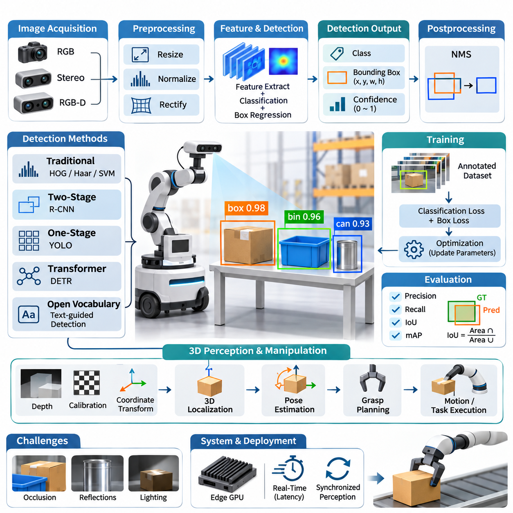{width="7.268055555555556in" height="7.268055555555556in"}

Object detection is a fundamental computer vision technology that enables robotic systems to identify and locate objects within visual environments. Unlike image classification, which determines the general category of an image, object detection simultaneously recognizes multiple objects and estimates their spatial locations. This capability provides the essential perception foundation for autonomous manipulation, environmental interaction, and intelligent robotic decision-making.

In mobile manipulators, object detection establishes a critical connection between visual perception and physical action. A robot must recognize target objects before approaching, grasping, transporting, or manipulating them. The detection system converts raw visual information into structured representations that can be processed by higher-level modules, including object localization, pose estimation, grasp planning, motion planning, and task execution.

The fundamental outputs of an object detection system are class labels, bounding boxes, and confidence scores. A class label identifies the semantic category of a detected object, while a bounding box represents its approximate location and dimensions within an image. The confidence score indicates the estimated reliability of the prediction. Together, these outputs allow robotic systems to distinguish relevant objects from surrounding environmental elements.

A bounding box is generally represented using four numerical parameters that describe its spatial boundaries. Common representations include the coordinates of the upper-left and lower-right corners or the center coordinates combined with width and height. Although bounding boxes provide efficient spatial representations, they do not directly describe object geometry, surface characteristics, physical orientation, or three-dimensional position.

The object detection pipeline typically begins with image acquisition through RGB cameras, stereo cameras, or RGB-D perception systems. Acquired images undergo preprocessing operations such as resizing, normalization, distortion correction, and color transformation. The processed information is then transferred to a detection algorithm that extracts visual features, identifies candidate objects, predicts object categories, and estimates spatial boundaries.

Traditional object detection methods rely primarily on handcrafted visual features and statistical classification algorithms. Techniques such as Histogram of Oriented Gradients (HOG), Haar-like features, template matching, and Support Vector Machines (SVMs) have historically been used for object recognition. Although these approaches remain useful in controlled environments, their performance often deteriorates under complex lighting, occlusion, and appearance variations.

Deep learning has significantly improved object detection by enabling neural networks to automatically learn hierarchical visual representations from large datasets. Convolutional Neural Networks (CNNs) extract features ranging from simple edges and textures to complex object structures. Modern detection architectures combine feature extraction, multi-scale representation, classification, and bounding box regression within integrated computational frameworks.

Modern object detectors are commonly categorized into two-stage and one-stage architectures. Two-stage detectors, such as the R-CNN family, generate candidate object regions before performing classification and localization. One-stage detectors, such as the YOLO family, predict object categories and bounding boxes directly. Their architectural differences create trade-offs involving detection accuracy, computational complexity, inference latency, and deployment efficiency.

Transformer-based object detection introduces attention mechanisms that capture relationships between visual elements across an image. Architectures such as Detection Transformer (DETR) formulate object detection as a direct set prediction problem. These approaches provide alternative mechanisms for global contextual understanding and object identification, while open-vocabulary detection further extends recognition beyond predefined training categories.

Object detection models are generally trained using annotated datasets containing images, object categories, and corresponding bounding boxes. During training, loss functions measure classification errors and localization discrepancies between predicted results and ground-truth annotations. Optimization algorithms progressively adjust model parameters to improve detection performance and generalization across different operational environments.

Detection performance is commonly evaluated using precision, recall, Intersection over Union (IoU), and mean Average Precision (mAP). Precision measures the proportion of correct detections among reported predictions, while recall measures the proportion of actual objects successfully detected. IoU quantifies spatial overlap between predicted and ground-truth bounding boxes, and mAP summarizes detection accuracy across object categories and specified evaluation thresholds.

Postprocessing mechanisms improve the reliability of detection outputs by filtering low-confidence predictions and removing redundant bounding boxes. Non-Maximum Suppression (NMS) is commonly used to suppress overlapping predictions associated with the same object. However, inappropriate confidence and overlap thresholds may eliminate valid detections or preserve incorrect predictions, particularly in densely populated industrial and warehouse environments.

For robotic manipulation, two-dimensional detection must often be integrated with three-dimensional perception. Depth measurements, camera calibration parameters, and coordinate transformations allow detected image regions to be associated with physical locations. These spatial estimates provide initial information for subsequent pose estimation and grasp planning, although additional geometric analysis is required for accurate and reliable physical interaction.

Real-time detection is particularly important for mobile manipulators operating in dynamic environments. Environmental changes, moving objects, platform motion, and human activities require continuous perception updates. Hardware acceleration through GPUs, embedded AI processors, and optimized inference engines helps reduce computational latency. Detection timestamps and coordinate transformations must also remain synchronized with the robot\'s physical state.

Industrial and warehouse applications introduce challenges such as reflective surfaces, transparent materials, inconsistent illumination, overlapping objects, and limited viewing angles. Reliable detection requires representative training datasets, appropriate camera placement, systematic performance validation, and uncertainty management. Ultimately, object detection serves as the semantic gateway through which mobile manipulators transform visual observations into meaningful, task-oriented physical actions.

## 02 Traditional Detection Methods

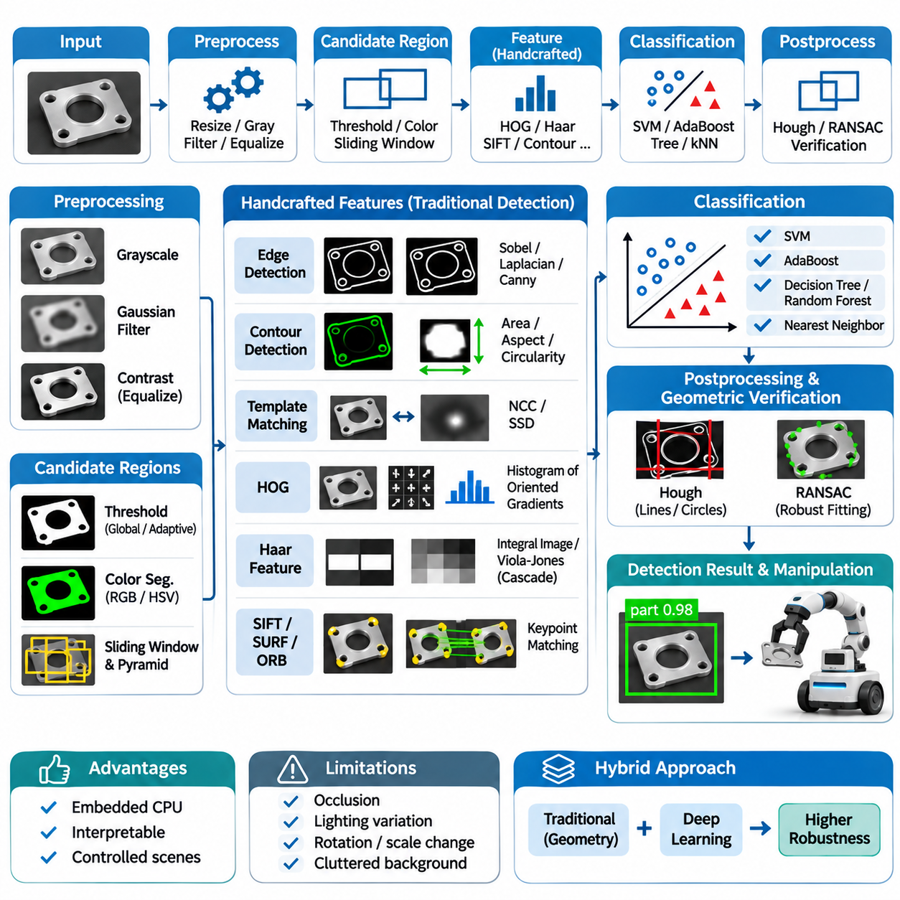{width="7.268055555555556in" height="7.268055555555556in"}

Traditional object detection methods represent the foundation of computer vision technologies developed before the widespread adoption of deep learning. These methods rely on mathematical models, handcrafted visual features, geometric characteristics, and statistical classification algorithms to identify objects within images. Their primary objective is to distinguish target objects from surrounding backgrounds using predefined visual characteristics and decision rules.

The traditional object detection pipeline generally consists of image preprocessing, candidate region generation, feature extraction, classification, and postprocessing. Each processing stage is independently designed and optimized according to specific application requirements. Unlike deep learning architectures, traditional approaches typically require engineers to manually define relevant visual features and establish appropriate detection criteria for the target environment.

Image preprocessing plays an important role in improving the reliability of traditional detection algorithms. Common preprocessing techniques include grayscale conversion, noise reduction, histogram equalization, contrast enhancement, and Gaussian filtering. These operations reduce unwanted visual variations and improve the visibility of meaningful object characteristics. Appropriate preprocessing is particularly important in industrial environments with inconsistent lighting.

Thresholding is one of the simplest traditional techniques for identifying objects based on pixel intensity or color characteristics. Global thresholding separates foreground objects from backgrounds using a fixed intensity value, while adaptive thresholding determines local thresholds according to surrounding pixel distributions. Color-based segmentation can also identify objects using predefined color ranges within RGB, HSV, or other color spaces.

Edge detection identifies significant changes in image intensity that frequently correspond to object boundaries. Representative algorithms include the Sobel operator, Laplacian operator, and Canny edge detector. Extracted edges provide geometric information that supports contour analysis, shape recognition, and object localization. In robotic manipulation, edge-based detection can be particularly effective for identifying manufactured components with distinctive structural boundaries.

Contour detection analyzes connected boundaries extracted from segmented or edge-detected images. Geometric properties such as contour area, perimeter, aspect ratio, circularity, and convexity can be used to distinguish different object categories. These characteristics are valuable in industrial automation, where objects frequently exhibit consistent dimensions and shapes. However, contour-based methods are sensitive to occlusion, background complexity, and perspective distortion.

Template matching identifies target objects by comparing predefined reference images with different regions of an input image. Similarity measurements such as normalized cross-correlation and sum of squared differences determine the correspondence between the reference template and candidate regions. Template matching is computationally straightforward for restricted search areas but becomes less reliable when objects experience significant rotation, scale changes, or deformation.

The Histogram of Oriented Gradients (HOG) is a widely recognized feature extraction technique that represents local object appearance through distributions of gradient orientations. An image is divided into small spatial cells, and gradient histograms are calculated and normalized across neighboring regions. HOG provides robustness against moderate illumination changes and is particularly effective for detecting objects with recognizable silhouettes and structural patterns.

Haar-like features describe differences in pixel intensity between adjacent rectangular image regions. These features can be efficiently calculated using integral images, significantly reducing computational requirements. The Viola-Jones detection framework combines Haar-like features, AdaBoost learning, and cascade classifiers to achieve rapid object detection. Cascade architectures eliminate unlikely candidate regions before performing more computationally demanding classification.

Local feature descriptors such as Scale-Invariant Feature Transform (SIFT), Speeded-Up Robust Features (SURF), and Oriented FAST and Rotated BRIEF (ORB) identify distinctive visual keypoints and describe their surrounding patterns. By matching extracted descriptors against reference objects, detection systems can recognize textured objects despite moderate changes in viewpoint, rotation, and scale. Geometric verification further improves matching reliability.

Support Vector Machines (SVMs) are commonly used as statistical classifiers in traditional object detection systems. Extracted visual features are represented as numerical vectors and classified using decision boundaries learned from labeled training samples. Kernel functions enable nonlinear classification when object categories cannot be separated using linear boundaries. Other classification approaches include decision trees, random forests, and nearest-neighbor algorithms.

Sliding window detection systematically examines different spatial regions of an image using predefined window dimensions. Image pyramids extend this technique by generating multiple scaled representations, allowing objects of different sizes to be detected. Although sliding window approaches provide systematic spatial coverage, repeated feature extraction and classification can introduce considerable computational overhead, particularly when processing high-resolution images.

Traditional detection methods also include geometric voting and transformation techniques such as the Hough Transform and Random Sample Consensus (RANSAC). The Hough Transform identifies geometric structures such as lines, circles, and parameterized shapes, while RANSAC estimates geometric models in the presence of incorrect observations. These techniques support reliable localization of structured industrial objects, mechanical components, and environmental landmarks.

In mobile manipulators, traditional object detection methods remain useful for applications involving predictable object appearances, controlled backgrounds, and standardized industrial processes. Their relatively low computational requirements enable implementation on embedded processors without dedicated GPU acceleration. Their transparent processing mechanisms also simplify system debugging, parameter adjustment, failure analysis, and deterministic integration with conventional robotic control systems.

Despite these advantages, traditional detection methods exhibit limitations when operating in unstructured and dynamically changing environments. Handcrafted features often fail to represent complex appearance variations, partial occlusion, reflective materials, and unfamiliar object categories. Modern robotic perception systems therefore frequently combine traditional geometric processing with deep learning detectors, preserving computational efficiency and geometric interpretability while improving recognition capability.

## 03 R-CNN Family

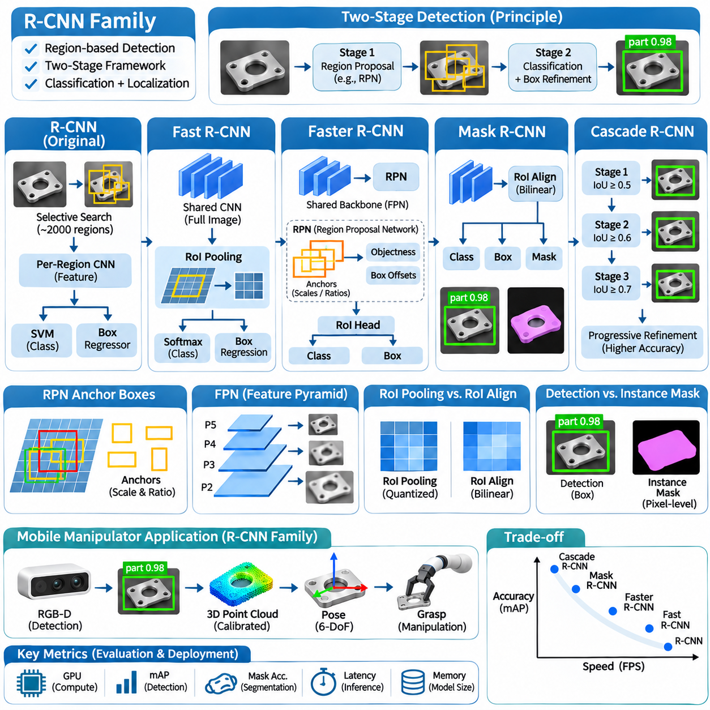{width="7.268055555555556in" height="7.268055555555556in"}

The Region-based Convolutional Neural Network (R-CNN) family represents a major milestone in the evolution of deep learning-based object detection. Unlike traditional detection methods that depend on handcrafted visual features, R-CNN architectures utilize convolutional neural networks to automatically learn discriminative object representations. These architectures establish a region-based detection framework that combines object classification with spatial localization.

The fundamental principle of the R-CNN family is to identify candidate regions that potentially contain objects before performing detailed classification and localization. This approach is generally referred to as two-stage object detection. The first stage generates region proposals, while the second stage evaluates these proposals to determine object categories and refine bounding box coordinates, reducing the need for exhaustive image scanning.

The original R-CNN architecture utilizes Selective Search to generate approximately two thousand candidate regions from an input image. Selective Search combines image segmentation with hierarchical region grouping based on color, texture, size, and shape similarity. Each proposed region is resized to satisfy the input dimensions of a convolutional neural network, which independently extracts high-level visual features for subsequent object classification.

R-CNN employs convolutional neural networks pretrained on large-scale image classification datasets and subsequently fine-tuned for object detection. Extracted feature vectors are processed by class-specific Support Vector Machines (SVMs), while separate bounding box regression models improve localization accuracy. Although R-CNN significantly improved detection performance, independent feature extraction for each candidate region introduced substantial computational overhead.

Fast R-CNN addresses the computational inefficiency of the original architecture by performing convolutional feature extraction only once for the entire input image. Candidate regions are projected onto a shared convolutional feature map, eliminating redundant computations. Region of Interest (RoI) Pooling converts variable-sized candidate regions into fixed-dimensional feature representations suitable for subsequent classification and bounding box regression.

Fast R-CNN introduces a unified multi-task learning framework that jointly optimizes object classification and bounding box localization. Instead of relying on separate external classifiers, the architecture integrates a softmax classification layer and bounding box regression outputs within a single network. This design simplifies the training pipeline and improves computational efficiency, although external region proposal generation remains a significant bottleneck.

Faster R-CNN extends the region-based detection framework by introducing the Region Proposal Network (RPN). The RPN operates directly on shared convolutional feature maps and predicts potential object regions together with corresponding objectness scores. By replacing external proposal generation algorithms with a trainable neural network, Faster R-CNN substantially reduces proposal generation latency and improves overall architectural integration.

The Region Proposal Network traditionally utilizes anchor boxes representing predefined combinations of object scales and aspect ratios. At each spatial location of the feature map, the network estimates objectness probabilities and bounding box coordinate adjustments relative to these anchors. Positive and negative training samples are assigned according to spatial overlap with ground-truth annotations, commonly measured using Intersection over Union (IoU).

Feature Pyramid Networks (FPNs) further enhance Faster R-CNN by constructing multi-scale feature representations from different levels of a convolutional backbone. Low-level features preserve detailed spatial information, while high-level features provide stronger semantic representations. Combining these characteristics allows region-based detectors to recognize objects of different sizes, including small mechanical components and large industrial assemblies.

Mask R-CNN extends Faster R-CNN by introducing an additional prediction branch for instance segmentation. In addition to class labels and bounding boxes, the network generates pixel-level masks for individual detected objects. This capability provides more precise information about object boundaries and visible surface regions, which is particularly valuable for robotic manipulation tasks involving irregular shapes, overlapping objects, and cluttered environments.

Mask R-CNN also introduces RoI Align to overcome spatial quantization errors associated with conventional RoI Pooling. RoI Align utilizes bilinear interpolation to extract features at fractional spatial coordinates without rounding region boundaries to integer positions. This improvement preserves spatial correspondence between input images and extracted features, enhancing segmentation accuracy and supporting precise object boundary estimation.

Cascade R-CNN improves detection quality by applying multiple successive detection stages trained using progressively higher IoU thresholds. Each stage refines bounding box predictions generated by the preceding stage. This architecture reduces the mismatch between proposal quality and detector training requirements, enabling more accurate localization. However, additional refinement stages may increase computational complexity and inference latency.

In mobile manipulators, R-CNN architectures are particularly useful when accurate object localization and detailed scene interpretation are more important than maximum inference speed. Mask R-CNN can support object isolation, depth information filtering, three-dimensional point cloud extraction, pose estimation, and grasp candidate generation. Detection outputs must nevertheless be integrated with calibrated perception systems to establish reliable physical object coordinates.

The deployment of R-CNN architectures requires careful consideration of computational resources, image resolution, backbone complexity, proposal count, and inference latency. GPU acceleration, optimized inference engines, lightweight feature extractors, and reduced proposal counts can improve execution efficiency. Performance should be evaluated using mAP, segmentation accuracy, localization error, memory consumption, and end-to-end processing latency under representative operating conditions.

The evolution from R-CNN to Fast R-CNN, Faster R-CNN, Mask R-CNN, and Cascade R-CNN demonstrates the progressive integration of feature extraction, region proposal generation, classification, localization, segmentation, and refinement. Although the supplied chapter structure does not prescribe individual architectures, these representative developments illustrate how region-based detection provides a robust perception foundation for industrial automation and intelligent mobile manipulation.

## 04 YOLO Family

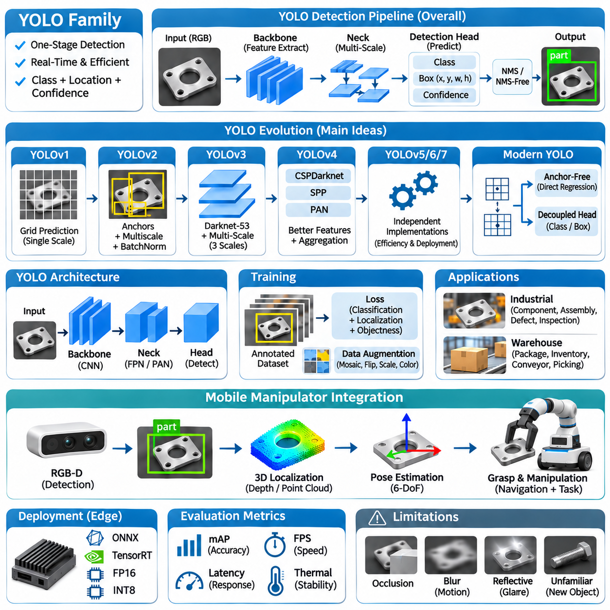{width="7.268055555555556in" height="7.268055555555556in"}

You Only Look Once (YOLO) represents a family of deep learning-based object detection architectures designed to achieve efficient visual recognition and spatial localization. Unlike conventional two-stage detectors that separately generate region proposals and classify candidate objects, YOLO formulates object detection as a unified prediction problem. This architectural approach enables rapid inference and supports real-time robotic perception.

The fundamental principle of YOLO is to process an entire input image through a neural network and simultaneously predict object categories, spatial locations, and confidence scores. By eliminating the need for an independent region proposal stage, YOLO significantly reduces redundant computational operations. This characteristic makes YOLO particularly suitable for mobile manipulators operating under strict latency and computational constraints.

The original YOLO architecture divides an input image into a spatial grid, where individual grid cells are responsible for detecting objects whose centers fall within their boundaries. Each cell predicts bounding box coordinates, confidence scores, and conditional class probabilities. Although this formulation introduced an efficient detection mechanism, its original implementation exhibited limitations when detecting small objects and closely positioned targets.

YOLOv2 introduced several architectural improvements, including batch normalization, anchor boxes, higher-resolution training, and multi-scale learning. Anchor boxes represent predefined bounding box dimensions that provide reference geometries for localization predictions. These improvements enhanced detection accuracy while preserving computational efficiency, allowing the network to accommodate objects with different sizes and aspect ratios.

YOLOv3 introduced a deeper feature extraction backbone known as Darknet-53 and improved multi-scale detection capabilities. By generating predictions at multiple spatial resolutions, the architecture became more effective at recognizing small, medium, and large objects. Residual connections also supported the training of deeper neural networks, improving feature representation and detection performance across complex visual environments.

YOLOv4 incorporated architectural and training improvements such as CSPDarknet, Spatial Pyramid Pooling (SPP), Path Aggregation Networks (PANet), and advanced data augmentation strategies. These techniques strengthened feature extraction, contextual understanding, and multi-scale information aggregation. The architecture demonstrated how systematic optimization could improve detection accuracy without proportionally increasing inference latency.

Subsequent YOLO implementations, including YOLOv5, YOLOv6, and YOLOv7, introduced additional improvements in network efficiency, training strategies, deployment flexibility, and hardware utilization. These implementations were developed by different research groups and organizations rather than through a single continuous development lineage. Nevertheless, they share the fundamental objective of achieving accurate and computationally efficient object detection.

More recent YOLO architectures have increasingly adopted anchor-free detection mechanisms, decoupled prediction heads, and optimized feature aggregation strategies. Anchor-free approaches estimate object locations without relying on predefined anchor box dimensions. Decoupled detection heads separate classification and localization tasks, allowing the network to optimize distinct prediction objectives and improve overall learning effectiveness.

A typical modern YOLO architecture consists of a backbone, a neck, and a detection head. The backbone extracts hierarchical visual features from input images, while the neck integrates information across multiple spatial resolutions. The detection head generates object classification and bounding box predictions. This modular architecture allows individual components to be optimized according to accuracy, processing speed, and hardware requirements.

YOLO training typically requires annotated datasets containing object categories and corresponding bounding box coordinates. Loss functions measure classification errors and localization discrepancies, with some architectures incorporating additional objectness or distribution-based regression losses. Data augmentation techniques such as Mosaic, image scaling, horizontal flipping, and color transformation improve robustness against environmental variations.

During inference, many YOLO implementations apply confidence thresholding and Non-Maximum Suppression (NMS) to eliminate unreliable or redundant predictions. However, overlapping objects may cause valid detections to be incorrectly suppressed, especially in densely populated environments. End-to-end YOLO variants have also introduced NMS-free detection approaches to reduce postprocessing requirements and improve inference efficiency.

In mobile manipulators, YOLO provides semantic information that supports autonomous navigation, object localization, target selection, and manipulation planning. When integrated with RGB-D cameras, detected bounding boxes can be associated with depth measurements to estimate three-dimensional object locations. Additional segmentation, pose estimation, and grasp detection modules are generally required to achieve reliable physical manipulation.

Industrial applications of YOLO include component recognition, assembly verification, surface defect detection, and automated inspection. Warehouse applications include package identification, inventory recognition, conveyor monitoring, and robotic picking. Detection reliability depends on camera configurations, illumination conditions, object visibility, and the availability of representative training datasets covering actual operational scenarios.

Deployment on mobile robotic platforms requires careful optimization of model size, numerical precision, memory consumption, power requirements, and inference latency. Technologies such as ONNX, TensorRT, FP16 inference, and INT8 quantization facilitate efficient execution on compatible embedded AI processors and GPUs. Performance validation should consider detection accuracy, frame rate, end-to-end latency, and sustained thermal stability.

Although YOLO provides significant advantages in real-time perception, its predictions remain sensitive to occlusion, motion blur, unfamiliar objects, reflective materials, and distribution shifts. Detection confidence alone cannot guarantee safe or successful manipulation. As the supplied chapter outline specifies the YOLO family without individual version requirements, the representative architectures discussed here illustrate its evolution and practical role in intelligent mobile manipulation.

## 05 DETR and Transformers

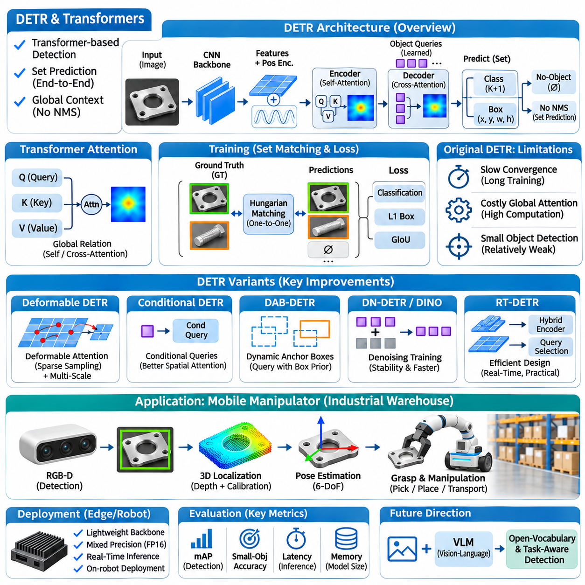{width="7.268055555555556in" height="7.268055555555556in"}

Detection Transformer (DETR) represents a fundamental shift in deep learning-based object detection by introducing Transformer architectures and attention mechanisms into visual recognition. Unlike conventional detectors that depend on predefined anchor boxes, region proposal networks, and complex postprocessing procedures, DETR formulates object detection as a direct set prediction problem within an end-to-end neural network architecture.

The Transformer architecture was originally developed for natural language processing to capture relationships between elements within sequential data. Its attention mechanism enables neural networks to identify relevant relationships regardless of their spatial or sequential separation. When applied to computer vision, Transformers allow detection models to analyze contextual relationships between objects and surrounding environmental features.

The original DETR architecture consists of a convolutional neural network backbone, a Transformer encoder, a Transformer decoder, and prediction heads. The backbone extracts visual features from an input image, while the encoder processes relationships among spatial feature elements. The decoder transforms learned object queries into object-specific representations that are subsequently used for classification and bounding box prediction.

Self-attention is a fundamental computational mechanism within Transformer-based object detection. It evaluates relationships between feature elements by calculating attention weights from query, key, and value representations. These weights determine how information from different spatial locations contributes to individual feature representations, allowing the network to capture global contextual dependencies beyond local convolutional receptive fields.

Positional encoding provides spatial information that would otherwise be absent from standard attention operations. Since Transformer architectures do not inherently preserve the spatial arrangement of image features, positional information is incorporated into feature representations. This mechanism enables DETR to distinguish different object locations and maintain spatial correspondence between visual observations and predicted bounding boxes.

Object queries are learned representations that enable the Transformer decoder to generate individual object predictions. Instead of assigning predefined anchors to specific image regions, DETR uses a fixed number of object queries to produce a corresponding set of candidate predictions. Through cross-attention, each query interacts with encoded image features and learns to identify relevant objects or predict the absence of an object.

Bipartite matching establishes a unique correspondence between predicted objects and ground-truth annotations during training. DETR employs the Hungarian algorithm to determine the optimal assignment based on classification and localization costs. This one-to-one matching strategy encourages the network to generate a single prediction for each object, reducing duplicate detections and eliminating the need for conventional Non-Maximum Suppression (NMS).

The DETR training objective combines object classification loss, bounding box coordinate regression loss, and Generalized Intersection over Union (GIoU) loss. Classification loss evaluates semantic recognition, while localization losses measure discrepancies between predicted and ground-truth bounding boxes. Unmatched predictions are assigned to a special no-object category, allowing the network to accommodate varying numbers of objects within images.

Despite its architectural simplicity, the original DETR exhibits limitations involving slow training convergence, computationally expensive attention operations, and relatively weak small-object detection. Global attention becomes increasingly demanding as feature map resolution increases. These limitations have motivated subsequent research into more efficient attention mechanisms, improved query initialization, and multi-scale feature processing.

Deformable DETR addresses several limitations of the original architecture by introducing deformable attention mechanisms. Instead of evaluating every spatial feature location, deformable attention selectively samples a limited number of relevant positions around reference points. This mechanism reduces computational complexity, accelerates training convergence, and improves multi-scale detection performance, particularly for small objects.

Subsequent DETR variants introduce additional improvements in object query design, training stability, and bounding box refinement. Conditional DETR improves spatial attention through conditional queries, while DAB-DETR incorporates dynamic anchor boxes into query representations. DN-DETR and DINO introduce denoising training strategies that help stabilize prediction assignments and accelerate the optimization of Transformer-based detectors.

Real-Time Detection Transformer (RT-DETR) extends Transformer-based detection toward applications requiring low-latency inference. Its efficient hybrid encoder combines intra-scale feature interactions with cross-scale feature fusion. An efficient query selection mechanism provides suitable initial object queries for the decoder, supporting practical deployment without the computational overhead of conventional NMS-based postprocessing.

Transformer-based object detection can support mobile manipulators through improved contextual understanding of complex environments. Global attention helps relate target objects to surrounding containers, shelves, tools, and environmental structures. When combined with depth sensing, coordinate transformations, pose estimation, and grasp planning, detection outputs contribute to reliable object localization and task-oriented physical interaction.

Deployment on mobile robotic platforms requires balancing detection accuracy, computational complexity, memory consumption, and inference latency. Lightweight backbones, efficient attention mechanisms, mixed-precision inference, and optimized inference engines can improve execution efficiency. Evaluation should include mean Average Precision (mAP), small-object detection accuracy, end-to-end latency, and performance under realistic environmental conditions.

The development of DETR and its derivatives demonstrates a transition from manually structured detection pipelines toward unified, attention-driven perception architectures. Their integration with multimodal learning and vision-language models also provides opportunities for more flexible object recognition. The representative architectures discussed here extend the supplied chapter outline, which defines the topic without prescribing specific Transformer variants.

## 06 Open Vocabulary Detection

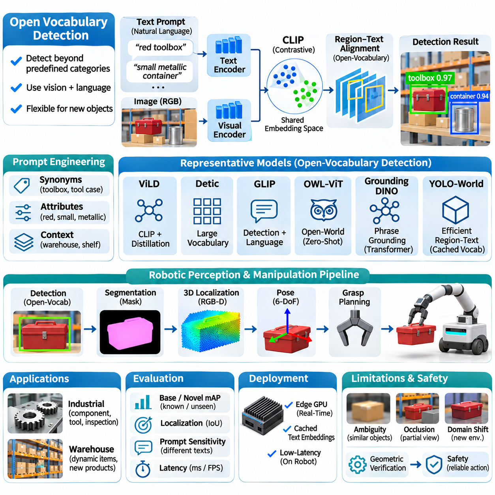{width="7.268055555555556in" height="7.268055555555556in"}

Open-vocabulary detection extends conventional object detection by enabling visual recognition beyond a fixed set of predefined object categories. Traditional supervised detectors are generally restricted to categories represented in their annotated training datasets. In contrast, open-vocabulary detection integrates visual and linguistic representations, allowing robotic systems to identify objects described through natural language.

The fundamental objective of open-vocabulary detection is to reduce dependency on predefined classification categories and category-specific annotations. Instead of treating object recognition as a closed-set classification problem, these models establish relationships between visual features and semantic descriptions. This approach enables more flexible perception in environments containing diverse, unfamiliar, or dynamically changing objects.

Vision-language learning provides the theoretical and computational foundation for open-vocabulary detection. Large-scale multimodal datasets containing images and corresponding textual descriptions enable neural networks to learn relationships between visual appearances and linguistic concepts. These learned representations allow previously unseen object categories to be recognized by comparing visual observations with relevant textual descriptions.

Contrastive Language-Image Pretraining (CLIP) represents an important foundation for open-vocabulary recognition. CLIP independently processes images and text using dedicated encoders and projects their representations into a shared embedding space. Contrastive learning increases the similarity between corresponding image-text pairs while reducing the similarity between unrelated pairs, establishing transferable semantic representations.

Open-vocabulary detection extends image-level vision-language recognition toward spatially localized object identification. Rather than comparing an entire image with a textual description, detection architectures associate individual image regions with semantic embeddings. Candidate object regions are evaluated against text representations, enabling the system to produce bounding boxes for objects described through flexible linguistic queries.

Text prompts serve as semantic specifications that define the objects a detection system should identify. A prompt may contain an object name, descriptive attributes, or contextual information relevant to a particular task. For example, a mobile manipulator may receive a request to identify a red toolbox or a small metallic container without requiring a separately trained detector for every possible combination of object characteristics.

Prompt engineering influences open-vocabulary detection performance because different textual descriptions can produce different semantic representations. Ambiguous terminology, insufficient contextual information, and inconsistent object naming may reduce recognition accuracy. Prompt templates, synonym expansion, and descriptive attributes can improve semantic alignment, although their effectiveness depends on the model and operating environment.

Representative open-vocabulary detection architectures include ViLD, Detic, GLIP, OWL-ViT, Grounding DINO, and YOLO-World. These models employ different combinations of knowledge distillation, vision-language pretraining, region-text alignment, Transformer architectures, and efficient detection networks. Their shared objective is to expand recognizable object categories without requiring exhaustive bounding box annotations for every category.

Grounding DINO combines Transformer-based object detection with language-conditioned visual grounding. Textual descriptions guide the identification and localization of corresponding objects through interactions between visual and linguistic features. This architecture enables phrase-level object localization, allowing robotic perception systems to associate natural language instructions with specific regions within complex visual environments.

YOLO-World extends the computationally efficient YOLO detection framework through open-vocabulary recognition and region-text alignment. Its architecture integrates textual embeddings with visual feature processing to support flexible object category definitions. Precomputing vocabulary embeddings can reduce repeated text-processing overhead, making this approach particularly relevant to low-latency perception on mobile robotic platforms.

In mobile manipulators, open-vocabulary detection provides a semantic interface between human instructions and autonomous physical actions. A robot receiving a request to retrieve an unfamiliar tool can convert the linguistic description into a detection query and search its surrounding environment. Detected object regions subsequently provide inputs for three-dimensional localization, pose estimation, grasp planning, and motion execution.

Open-vocabulary detection is also closely related to visual grounding, zero-shot detection, and instance segmentation. Visual grounding establishes spatial correspondence between linguistic expressions and image regions, while zero-shot detection evaluates recognition of categories without category-specific detection training. Integration with segmentation models can generate pixel-level object masks for more precise geometric analysis and manipulation.

Industrial and warehouse environments can benefit from open-vocabulary detection when product categories, packaging designs, tools, and inventory items change frequently. Instead of collecting annotated datasets and retraining detection models whenever new objects are introduced, operators can update textual vocabularies. However, specialized components with subtle visual differences may still require domain-specific adaptation and additional training.

Deployment requires consideration of visual encoder complexity, language encoder overhead, vocabulary size, memory consumption, and inference latency. Text embedding caching, model compression, mixed-precision inference, and hardware acceleration can improve computational efficiency. Evaluation should distinguish performance on previously learned and novel categories while measuring localization accuracy, prompt sensitivity, and operational reliability.

Despite its flexibility, open-vocabulary detection cannot guarantee correct recognition of arbitrary objects or linguistic descriptions. Semantic ambiguity, domain shifts, occlusion, and insufficient visual detail may produce incorrect predictions. Within the broader mobile manipulation framework, the representative architectures discussed here illustrate how language-conditioned perception can expand robotic adaptability while retaining the need for geometric verification and safety validation.

## 07 Zero Shot Detection

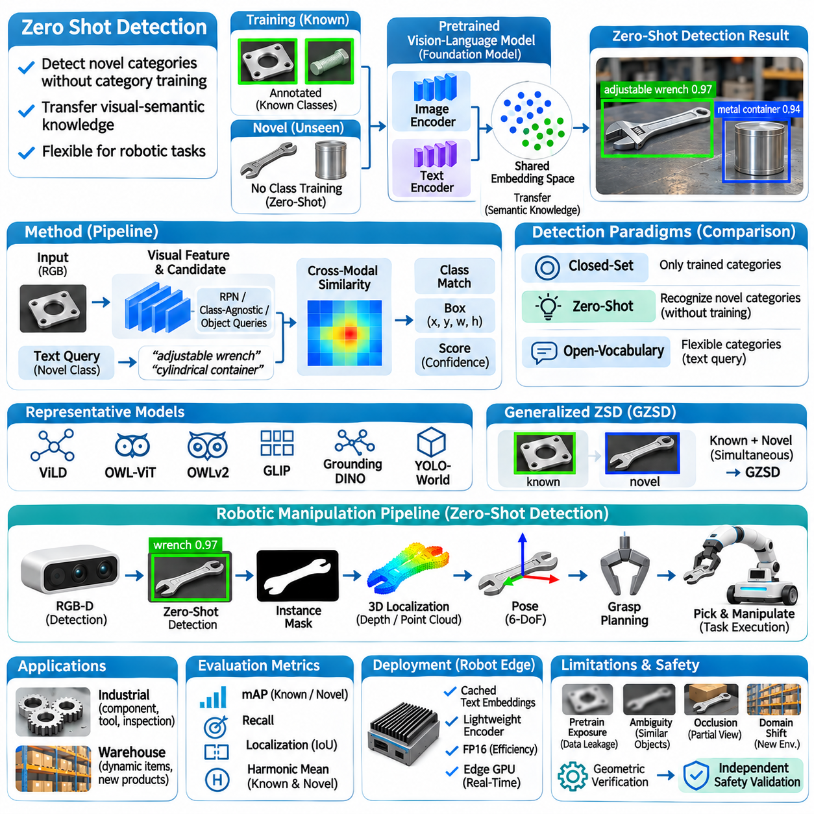{width="7.268055555555556in" height="7.268055555555556in"}

Zero-shot detection represents an advanced object detection paradigm that enables recognition and spatial localization of object categories without category-specific detection training. Unlike conventional supervised detectors that require annotated examples of every target category, zero-shot detection transfers previously acquired visual and semantic knowledge to novel categories, supporting greater adaptability in autonomous robotic systems.

The fundamental principle of zero-shot detection originates from zero-shot learning, which investigates how machine learning models recognize concepts that were not explicitly represented during task-specific training. Knowledge transfer is achieved through semantic relationships, shared feature representations, and pretrained multimodal embeddings. These mechanisms allow detection systems to generalize beyond their original training categories.

Zero-shot detection differs from conventional closed-set detection in its treatment of unfamiliar objects. Closed-set detectors classify observations according to a predefined category distribution, potentially assigning unfamiliar objects to incorrect known categories. Zero-shot detectors instead compare visual observations with semantic representations of novel categories, enabling recognition without additional category-specific model training.

Although zero-shot detection and open-vocabulary detection are closely related, they emphasize different capabilities. Open-vocabulary detection focuses on expanding recognizable categories through flexible semantic queries, whereas zero-shot detection emphasizes generalization to categories excluded from task-specific training. An open-vocabulary detector can therefore demonstrate zero-shot capabilities when evaluated on appropriately defined novel categories.

Semantic embeddings provide a computational mechanism for transferring knowledge between known and novel object categories. Object names, descriptive attributes, and linguistic relationships are represented as high-dimensional vectors within a semantic feature space. Visual representations extracted from candidate object regions are subsequently compared with these semantic embeddings to estimate category correspondence and recognition confidence.

Vision-language foundation models have significantly expanded the practical capabilities of zero-shot detection. Models pretrained on large-scale image-text datasets acquire semantic relationships across diverse visual concepts and natural language descriptions. These representations enable downstream detection architectures to identify novel object categories without requiring dedicated bounding box annotations or category-specific fine-tuning.

A typical zero-shot detection pipeline involves visual feature extraction, candidate object localization, semantic query encoding, cross-modal similarity estimation, and bounding box prediction. Depending on the architecture, candidate regions may originate from region proposal networks, class-agnostic localization modules, or Transformer object queries. Semantic matching subsequently determines which detected regions correspond to the requested categories.

Representative architectures supporting zero-shot detection include ViLD, OWL-ViT, OWLv2, GLIP, Grounding DINO, and YOLO-World. These models employ different combinations of visual knowledge distillation, contrastive learning, language-conditioned attention, and region-text alignment. Their effectiveness depends on pretraining coverage, localization capabilities, semantic representation quality, and the characteristics of target environments.

Generalized Zero-Shot Detection (GZSD) extends conventional zero-shot detection by requiring simultaneous recognition of previously learned and novel object categories. This evaluation setting more accurately reflects practical robotic environments, where familiar and unfamiliar objects frequently coexist. Generalized detection introduces additional challenges related to classification bias, confidence calibration, and competition between semantic categories.

Text-based queries allow zero-shot detectors to recognize objects using category names and descriptive attributes. For example, a mobile manipulator may search for a cylindrical metal container, an adjustable wrench, or an unfamiliar packaging component without requiring a newly trained detector. Nevertheless, ambiguous descriptions and visually similar objects can reduce semantic discrimination and lead to incorrect localization.

In mobile manipulators, zero-shot detection contributes to flexible task execution by connecting natural language instructions with environmental observations. When a requested object is detected, its bounding box can be associated with depth measurements to estimate its three-dimensional location. Subsequent instance segmentation, object pose estimation, and grasp planning refine the perception results into actionable manipulation information.

Industrial and warehouse environments provide practical opportunities for zero-shot detection because product varieties, inventory configurations, packaging formats, and tooling requirements frequently change. Zero-shot capabilities can reduce the initial effort required for dataset collection and detector retraining. However, recognizing visually similar industrial components may require additional geometric measurements or domain-specific recognition models.

Zero-shot detection evaluation requires clearly defined separation between known and novel categories within task-specific training and testing datasets. Performance metrics include mean Average Precision (mAP), recall, localization accuracy, and the harmonic mean of known-category and novel-category performance. Potential exposure to evaluation categories during foundation model pretraining must also be considered when interpreting generalization results.

Deployment on mobile robotic platforms requires balancing semantic generalization, detection accuracy, computational complexity, and inference latency. Text embedding caching, lightweight visual encoders, mixed-precision inference, and optimized hardware acceleration can improve execution efficiency. Operational reliability can be strengthened through multi-view observations, temporal consistency verification, and uncertainty-aware decision mechanisms.

Zero-shot detection does not imply unlimited recognition capability or complete independence from prior training data. Its effectiveness remains constrained by pretraining knowledge, semantic ambiguity, domain shifts, occlusion, and visual resolution. Expanding the supplied chapter outline through these representative methods and engineering principles illustrates how zero-shot perception supports adaptable mobile manipulation while preserving the need for geometric verification and independent safety validation.

## 08 Instance Segmentation

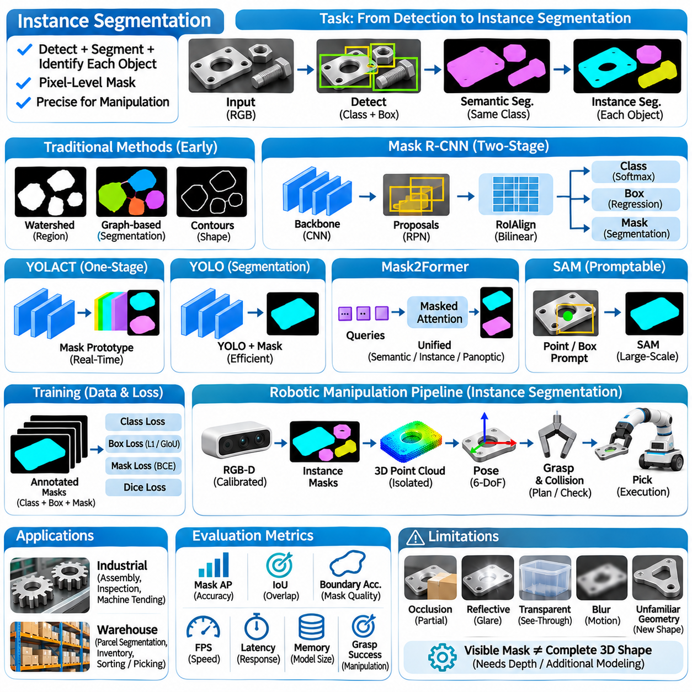{width="7.268055555555556in" height="7.268055555555556in"}

Instance segmentation represents an advanced visual perception technique that combines object detection with pixel-level object identification. Unlike conventional object detection, which represents individual objects using rectangular bounding boxes, instance segmentation generates a separate segmentation mask for each detected object. This detailed spatial representation is particularly important for precise physical interaction and robotic manipulation.

Semantic segmentation and instance segmentation differ in their treatment of individual objects within an image. Semantic segmentation assigns a category label to every pixel but does not distinguish separate objects belonging to the same category. Instance segmentation identifies each object independently, allowing robotic systems to distinguish multiple identical or visually similar objects occupying overlapping or adjacent spatial regions.

The fundamental objective of instance segmentation is to determine object identity, semantic category, spatial location, and pixel-level boundaries simultaneously. A segmentation mask represents the visible image region associated with an individual object instance. By providing more accurate geometric information than bounding boxes alone, instance segmentation supports advanced perception tasks requiring precise spatial understanding.

Traditional instance segmentation approaches generally combined object detection with handcrafted image segmentation algorithms. Techniques such as watershed segmentation, graph-based segmentation, and contour extraction were used to estimate individual object boundaries. However, these methods frequently exhibited limited robustness under complex illumination conditions, partial occlusion, background interference, and substantial object appearance variations.

Mask R-CNN introduced an influential deep learning architecture that extends Faster R-CNN by incorporating an additional segmentation branch. The network simultaneously predicts object categories, bounding box coordinates, and instance-specific segmentation masks. Its region-based architecture enables accurate object localization and segmentation while maintaining separate computational branches for classification, localization, and mask prediction.

Region of Interest Alignment (RoIAlign) represents an important component of Mask R-CNN. Unlike conventional region pooling operations that introduce spatial quantization errors, RoIAlign uses bilinear interpolation to preserve correspondence between image features and candidate object regions. Improved spatial alignment contributes to more accurate segmentation masks, particularly for objects with complex shapes and fine geometric details.

One-stage instance segmentation architectures were developed to improve computational efficiency and reduce inference latency. Models such as YOLACT and segmentation-enabled YOLO variants generate object detections together with mask prototypes or related mask representations. These approaches provide practical alternatives to two-stage architectures when real-time perception and limited computational resources are significant engineering constraints.

Transformer-based instance segmentation architectures introduce attention mechanisms and query-based prediction to identify individual objects and their corresponding masks. Models such as Mask2Former employ masked attention to concentrate feature processing on relevant spatial regions. These architectures provide flexible segmentation frameworks capable of supporting semantic, instance, and panoptic segmentation within unified perception systems.

The Segment Anything Model (SAM) and its subsequent developments introduce promptable segmentation capabilities based on large-scale visual pretraining. Segmentation masks can be generated from spatial prompts such as points and bounding boxes. When integrated with open-vocabulary or zero-shot detectors, promptable segmentation models enable object-specific mask generation without requiring dedicated segmentation training for every target category.

Instance segmentation training generally requires annotated datasets containing pixel-level masks for individual object instances. Annotation quality directly influences the accuracy of learned object boundaries and spatial representations. Training objectives may combine classification loss, bounding box regression loss, binary mask loss, Dice loss, and other segmentation-related optimization functions according to architectural requirements.

In mobile manipulators, instance segmentation provides essential geometric information for object localization, pose estimation, and grasp planning. When segmentation masks are associated with calibrated RGB-D observations, depth measurements belonging to individual objects can be extracted more selectively. This process reduces interference from surrounding objects and background surfaces during three-dimensional reconstruction.

Instance segmentation is particularly valuable in cluttered environments where multiple objects partially overlap or occupy closely adjacent positions. In robotic bin picking, individual segmentation masks help distinguish target components from neighboring items and supporting surfaces. These masks can support object-specific point cloud extraction, grasp candidate generation, collision assessment, and manipulation sequence planning.

Industrial applications include component identification, assembly verification, material handling, surface inspection, and automated machine tending. Warehouse applications include parcel segmentation, inventory recognition, mixed-product picking, and automated sorting. Segmentation accuracy becomes especially important when objects have irregular geometries, overlapping boundaries, or limited separation from surrounding materials.

Deployment and evaluation require consideration of segmentation accuracy, inference latency, memory consumption, and computational efficiency. Common evaluation metrics include mask Average Precision (Mask AP), Intersection over Union (IoU), boundary accuracy, and processing frame rate. Operational validation should additionally measure object localization errors, grasp success rates, and segmentation reliability under actual working conditions.

Instance segmentation remains sensitive to severe occlusion, reflective surfaces, transparent materials, motion blur, and unfamiliar object geometries. Visible segmentation masks also do not necessarily represent complete three-dimensional object shapes. Expanding the supplied chapter outline through representative architectures and engineering principles illustrates how instance segmentation connects pixel-level visual perception with reliable physical manipulation.

## 09 Dataset Design

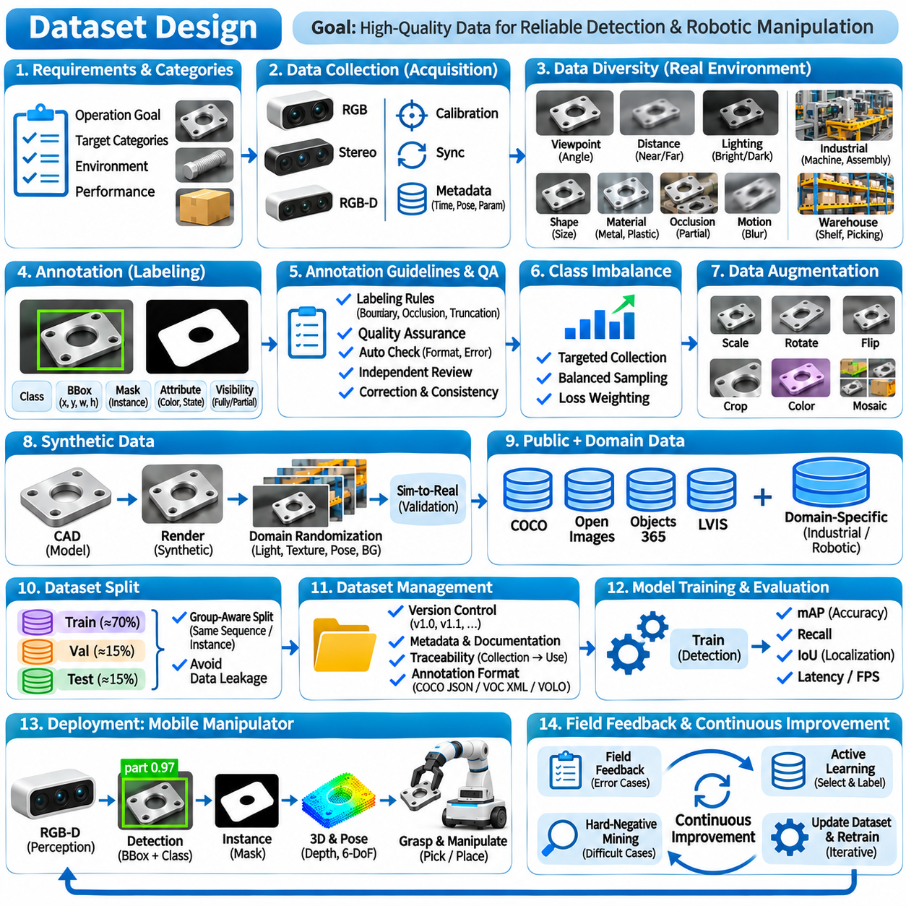{width="7.268055555555556in" height="7.268055555555556in"}

Dataset design represents a fundamental engineering process in the development of reliable object detection systems for mobile manipulators. Detection performance depends not only on neural network architectures but also on the quality, diversity, consistency, and representativeness of training data. A well-designed dataset establishes the connection between machine learning capabilities and actual robotic operating environments.

The dataset design process begins with defining operational requirements, target object categories, environmental conditions, and expected detection performance. Object categories should reflect the physical entities that a mobile manipulator must recognize, locate, and interact with during task execution. Clearly defined category boundaries reduce semantic ambiguity and improve consistency throughout data collection and annotation.

Data collection should represent the actual distribution of visual observations encountered during robotic operations. Images should capture variations in object orientation, viewing distance, camera angle, illumination, background complexity, and object arrangement. Mobile manipulators require particular attention to perspective changes resulting from mobile platform movement, robotic arm positioning, and dynamic sensor configurations.

Object diversity is essential for developing detection models capable of generalizing beyond individual training examples. A dataset should include variations in object dimensions, geometric shapes, surface materials, colors, textures, and manufacturing characteristics. Collecting multiple physical instances within each object category helps prevent the model from learning superficial features associated with specific training objects.

Environmental diversity contributes to detection robustness under realistic operating conditions. Industrial and warehouse datasets should represent production equipment, storage shelves, transportation containers, conveyor systems, and working personnel when relevant. Challenging conditions such as partial occlusion, reflective surfaces, shadows, motion blur, and densely arranged objects should also be systematically incorporated.

Data acquisition systems may include RGB cameras, RGB-D cameras, stereo vision systems, and other perception sensors integrated into mobile robotic platforms. Camera calibration, sensor synchronization, image resolution, exposure settings, and acquisition timestamps should be documented. Consistent metadata enables subsequent integration of object detection results with depth measurements and robotic coordinate transformations.

Annotation provides the supervised learning information required to associate visual observations with object categories and spatial locations. Bounding box annotations should accurately represent visible object extents according to explicitly defined annotation policies. Additional annotations may include instance segmentation masks, object attributes, occlusion levels, visibility conditions, and task-relevant geometric information.

Annotation guidelines establish standardized rules for labeling objects under different environmental and visual conditions. These guidelines should define category names, bounding box boundaries, minimum visible object sizes, partially occluded objects, truncated objects, and ambiguous instances. Annotation quality assurance should incorporate automated validation, independent review, and correction of inconsistent or inaccurate labels.

Class imbalance represents a common challenge when certain object categories appear substantially more frequently than others. Detection models trained on imbalanced datasets may exhibit reduced recognition performance for underrepresented categories. Targeted data collection, balanced sampling, class-aware augmentation, and appropriate loss weighting can mitigate these effects while preserving realistic operational distributions.

Data augmentation increases training diversity through controlled transformations of existing images and corresponding annotations. Common techniques include image scaling, rotation, horizontal flipping, cropping, brightness adjustment, color transformation, Mosaic, and object compositing. Augmentation policies should preserve physically meaningful object characteristics and avoid introducing unrealistic conditions that could degrade robotic perception.

Synthetic data generation provides additional opportunities to expand dataset coverage using simulation environments, CAD models, and photorealistic rendering. Domain randomization can introduce variations in lighting, textures, camera parameters, object positions, and environmental configurations. Nevertheless, differences between synthetic and real-world observations require careful validation and appropriate simulation-to-reality adaptation.

Dataset partitioning separates collected data into training, validation, and testing subsets. Training data supports model optimization, validation data supports hyperparameter selection, and testing data provides independent performance evaluation. Images originating from the same video sequence, physical object instance, or closely related acquisition session should be grouped appropriately to prevent data leakage between subsets.

Public datasets such as COCO, Open Images, Objects365, and LVIS provide valuable resources for object detection pretraining and benchmarking. However, generic visual datasets may not adequately represent specialized industrial components or mobile manipulation environments. Combining public datasets with domain-specific observations can improve generalization while addressing application-specific recognition and localization requirements.

Dataset management requires systematic version control, metadata documentation, annotation format standardization, storage organization, and traceability. Common annotation formats include COCO JSON, Pascal VOC XML, and YOLO text representations. Dataset quality should be continuously evaluated using category distributions, annotation statistics, detection accuracy, failure analysis, and operational feedback collected during robotic deployment.

Dataset design should be treated as an iterative engineering lifecycle rather than a one-time preparation activity. Active learning, hard-negative mining, and field failure analysis enable continuous improvement as new objects and environmental conditions emerge. The supplied chapter outline is expanded here through representative dataset engineering practices that connect object detection development with reliable, adaptable, and task-oriented mobile manipulation.

## 10 Industrial Object Detection

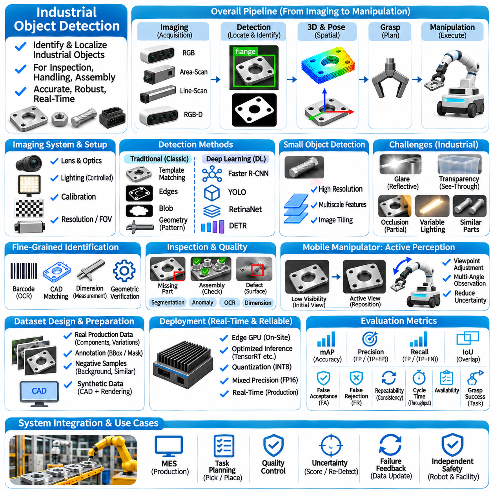{width="7.268055555555556in" height="7.268055555555556in"}

Industrial object detection represents a specialized application of computer vision focused on identifying and localizing physical objects within manufacturing and industrial automation environments. Unlike general-purpose object detection, industrial detection systems must satisfy application-specific requirements for accuracy, repeatability, processing speed, robustness, and compatibility with automated production systems.

The fundamental objective of industrial object detection is to provide reliable visual information for automated inspection, material handling, robotic assembly, machine tending, and production monitoring. In mobile manipulators, object detection establishes the initial connection between environmental observations and physical manipulation, enabling robots to identify target components and determine their spatial locations.

Industrial environments introduce distinctive perception challenges because manufactured components frequently exhibit similar geometries, metallic surfaces, limited texture, and subtle dimensional differences. Reflective materials, transparent components, variable illumination, and partial occlusion further complicate visual recognition. Detection systems must distinguish these objects while maintaining consistent performance under changing production conditions.

Industrial imaging systems generally incorporate high-resolution RGB cameras, industrial area-scan cameras, line-scan cameras, RGB-D sensors, and specialized optical equipment. Camera selection depends on object dimensions, required spatial resolution, working distance, optical characteristics, and production cycle time. Controlled illumination, appropriate lens configurations, and precise camera calibration improve image quality and detection reliability.

Traditional industrial object detection commonly utilizes template matching, edge detection, geometric feature extraction, blob analysis, and pattern recognition. These approaches remain effective in structured environments where object geometry, orientation, and illumination conditions are predictable. However, their robustness and scalability become limited when production systems introduce substantial product variability or environmental changes.

Deep learning-based industrial object detection addresses these limitations through automatic hierarchical feature learning. Architectures such as Faster R-CNN, YOLO, RetinaNet, and DETR can recognize complex visual patterns across diverse industrial components. Model selection should consider detection accuracy, inference latency, object scale, computational requirements, and the consequences of incorrect detection during automated operations.

Small object detection is particularly important in industrial applications involving electronic components, fasteners, connectors, mechanical assemblies, and surface defects. Small objects may occupy only a limited number of image pixels, making reliable feature extraction difficult. High-resolution imaging, multiscale feature processing, image tiling, and task-specific training strategies can improve detection performance.

Industrial object detection frequently requires distinguishing visually similar components that differ in dimensions, connector arrangements, mounting features, or manufacturing specifications. Category-level recognition alone may be insufficient for these applications. Fine-grained classification, geometric verification, barcode recognition, CAD-based matching, and dimensional measurements can provide complementary identification capabilities.

Industrial inspection systems utilize object detection to identify missing components, incorrect assembly configurations, misplaced parts, and localized manufacturing defects. Depending on inspection requirements, detection models may be combined with instance segmentation, anomaly detection, optical character recognition, and dimensional inspection algorithms. Such integration supports comprehensive automated quality assurance.

In mobile manipulation applications, industrial object detection must accommodate changes in camera viewpoints caused by mobile platform movement and robotic arm positioning. Unlike permanently installed industrial vision systems, mobile manipulators operate with variable observation distances and orientations. Active perception and viewpoint adjustment can improve target visibility and reduce uncertainties before physical interaction.

Integration with three-dimensional perception enables industrial detection systems to transform two-dimensional bounding boxes into actionable spatial information. RGB-D measurements, stereo reconstruction, and calibrated coordinate transformations support object localization within robotic reference frames. Subsequent six-degree-of-freedom pose estimation and grasp planning establish the geometric conditions required for manipulation.

Industrial object detection requires carefully designed datasets representing actual production components, manufacturing variations, operational environments, and challenging visual conditions. Dataset preparation should incorporate realistic object distributions, consistent annotation policies, representative negative samples, and independent validation subsets. Synthetic data generated from CAD models can supplement limited real-world observations.

Real-time industrial deployment requires balancing detection accuracy with production throughput, computational efficiency, and system reliability. Edge computing platforms, GPU acceleration, optimized inference engines, model quantization, and mixed-precision computation can reduce processing latency. End-to-end performance should also account for image acquisition, communication delays, coordinate transformations, and robotic control integration.

Performance evaluation should extend beyond conventional metrics such as mean Average Precision, precision, recall, and Intersection over Union. Industrial validation must consider false acceptance rates, false rejection rates, localization repeatability, inspection cycle time, equipment availability, and manipulation success rates. Acceptance criteria should reflect production quality requirements and the operational consequences of detection failures.

Industrial object detection should be integrated into a broader architecture encompassing sensor management, task planning, quality control, manufacturing execution systems, and independent safety mechanisms. Continuous monitoring, uncertainty assessment, failure logging, and controlled model updates support long-term reliability. These representative engineering practices extend the supplied chapter outline toward practical industrial mobile manipulation.

## 11 Warehouse Object Detection

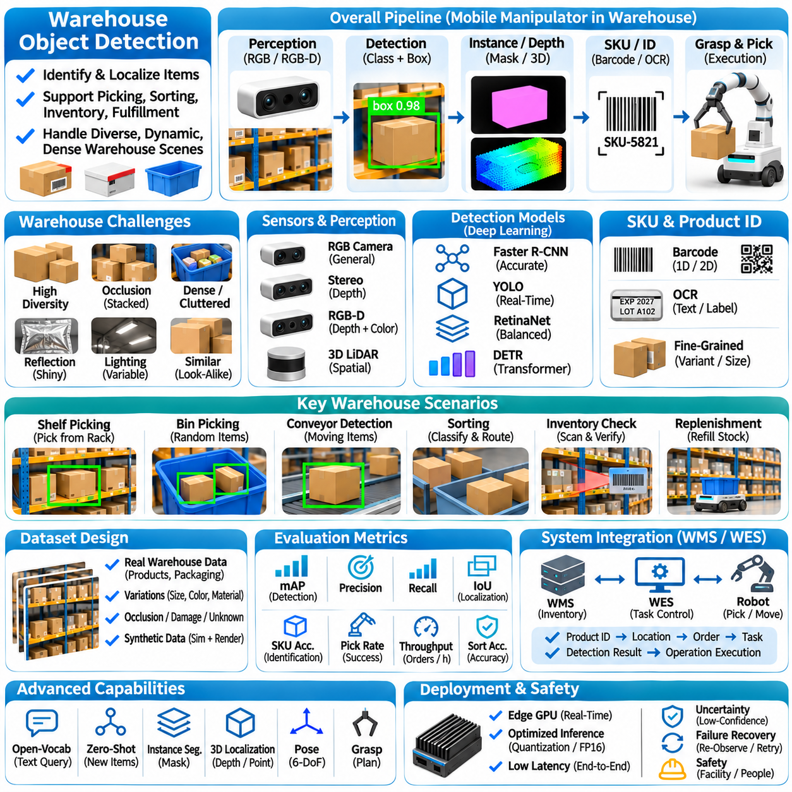{width="7.268055555555556in" height="7.268055555555556in"}

Warehouse object detection represents a specialized computer vision capability designed to identify and localize physical objects within logistics, storage, distribution, and fulfillment environments. Unlike conventional object detection applications, warehouse perception systems must accommodate extensive product diversity, dynamic inventory configurations, densely arranged objects, and demanding operational throughput requirements.

The fundamental objective of warehouse object detection is to provide reliable visual information for autonomous picking, sorting, inventory management, material transportation, and order fulfillment. In mobile manipulators, object detection establishes the perceptual foundation for identifying target products, locating storage positions, and coordinating autonomous navigation with robotic manipulation.

Warehouse environments introduce complex visual challenges because products frequently exhibit substantial variations in dimensions, packaging materials, colors, textures, and geometric characteristics. Objects may be stacked, partially concealed, randomly oriented, or densely arranged within storage containers. Changing illumination conditions and dynamic warehouse activities further increase the complexity of reliable visual recognition.

Warehouse perception systems commonly incorporate RGB cameras, RGB-D cameras, stereo vision systems, and three-dimensional LiDAR sensors. Fixed cameras can monitor conveyor systems and sorting stations, while mobile and wrist-mounted cameras provide flexible observation capabilities. Sensor selection should consider detection range, spatial resolution, field of view, environmental variability, and manipulation accuracy requirements.

Deep learning architectures such as Faster R-CNN, YOLO, RetinaNet, and DETR provide effective foundations for warehouse object detection. These models extract hierarchical visual features to predict object categories, bounding boxes, and confidence scores. Model selection depends on product diversity, object dimensions, inference latency, available computational resources, and required operational reliability.

Stock Keeping Unit (SKU) recognition represents an important warehouse perception requirement because visually similar products may correspond to different inventory identifiers. Conventional category-level detection may not sufficiently distinguish differences in packaging size, printed information, or product variations. Fine-grained recognition, barcode scanning, optical character recognition, and visual embedding matching provide complementary identification capabilities.

Object detection within densely populated storage shelves requires accurate localization under conditions of partial occlusion and limited object separation. Multiscale feature extraction, high-resolution imaging, instance segmentation, and attention mechanisms can improve discrimination between neighboring products. Active perception enables mobile manipulators to adjust camera viewpoints when initial observations provide insufficient visual information.

Conveyor-based warehouse detection requires continuous recognition of moving objects under strict timing constraints. Object detection can be integrated with multi-object tracking, conveyor encoder measurements, and motion prediction to estimate future object positions. Accurate timestamp synchronization and low-latency processing are essential for coordinating detection results with high-speed robotic picking and automated sorting operations.

In robotic bin picking, warehouse object detection identifies candidate products distributed randomly within containers or storage bins. Instance segmentation and depth measurements can refine detection results by separating individual objects from surrounding products and container surfaces. Object-specific point clouds subsequently support three-dimensional localization, grasp candidate generation, collision assessment, and manipulation planning.

Open-vocabulary detection and zero-shot detection introduce flexible recognition capabilities for warehouse environments experiencing frequent product and packaging changes. Language-conditioned detection models can identify objects described through textual queries without dedicated detection training for every product category. However, precise SKU identification and visually similar product discrimination may still require specialized recognition methods.

Warehouse object detection datasets should represent realistic product distributions, packaging variations, storage configurations, lighting conditions, and operational scenarios. Dataset design must include partially occluded products, damaged packaging, reflective materials, unfamiliar objects, and visually similar item categories. Synthetic data generation and targeted field data collection can improve coverage of challenging or infrequently observed conditions.

Integration with Warehouse Management Systems (WMS) and Warehouse Execution Systems (WES) connects visual detection results with inventory records, storage locations, order requirements, and task assignments. Detected objects should be associated with appropriate product identifiers and spatial coordinates. This integration enables mobile manipulators to perform coordinated picking, inventory verification, replenishment, and material handling operations.

Real-time warehouse deployment requires balancing recognition accuracy, computational efficiency, processing latency, and operational throughput. Edge computing platforms, GPU acceleration, optimized inference engines, model quantization, and mixed-precision inference can improve detection performance. End-to-end latency should account for sensor acquisition, image processing, communication, spatial localization, and robotic motion execution.

Performance evaluation should include conventional detection metrics such as mean Average Precision, precision, recall, and Intersection over Union, together with warehouse-specific operational indicators. SKU identification accuracy, picking success rate, sorting accuracy, inventory verification accuracy, order fulfillment throughput, and intervention frequency provide broader measures of practical system effectiveness.

Warehouse object detection should operate within an integrated perception and manipulation architecture that incorporates uncertainty assessment, failure recovery, continuous monitoring, and independent safety mechanisms. Low-confidence predictions may trigger additional observations or human verification. These representative engineering practices extend the supplied chapter outline toward scalable, adaptable, and reliable autonomous warehouse operations.
