# Chapter 02. Object Detection

## 01 Object Detection Fundamentals

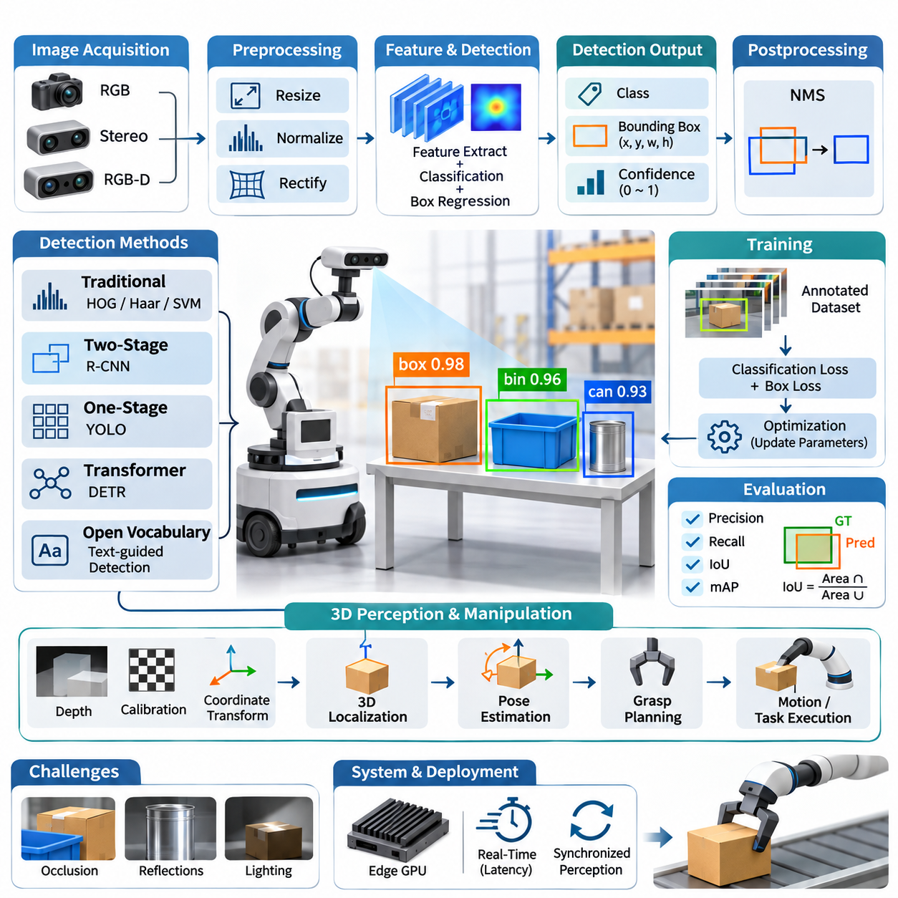{width="7.268055555555556in" height="7.268055555555556in"}

객체 검출(Object Detection)은 로봇 시스템(Robotic System)이 시각적 환경(Visual Environment) 내에서 객체를 식별하고 위치를 파악할 수 있도록 하는 컴퓨터 비전(Computer Vision)의 핵심 기술이다. 이미지의 전체적인 범주를 판단하는 이미지 분류(Image Classification)와 달리, 객체 검출은 여러 객체를 동시에 인식하고 공간적 위치(Spatial Location)를 추정한다. 이러한 기능은 자율 조작(Autonomous Manipulation), 환경 상호작용(Environmental Interaction), 지능형 로봇 의사결정(Intelligent Robotic Decision-Making)을 위한 필수적인 인지 기반을 제공한다.

모바일 매니퓰레이터(Mobile Manipulator)에서 객체 검출은 시각적 인지(Visual Perception)와 물리적 행동(Physical Action)을 연결하는 핵심적인 역할을 수행한다. 로봇은 대상 객체에 접근하거나 파지하고, 운반하거나 조작하기 전에 해당 객체를 인식해야 한다. 객체 검출 시스템은 원시 시각 정보(Raw Visual Information)를 구조화된 표현(Structured Representation)으로 변환하여 객체 위치 추정(Object Localization), 자세 추정(Pose Estimation), 파지 계획(Grasp Planning), 모션 계획(Motion Planning), 작업 실행(Task Execution) 등의 상위 모듈에서 처리할 수 있도록 한다.

객체 검출 시스템의 기본적인 출력은 클래스 레이블(Class Label), 경계 상자(Bounding Box), 신뢰도 점수(Confidence Score)이다. 클래스 레이블은 검출된 객체의 의미론적 범주(Semantic Category)를 식별하며, 경계 상자는 이미지 내에서 객체의 대략적인 위치와 크기를 나타낸다. 신뢰도 점수는 예측 결과의 추정 신뢰성을 나타낸다. 이러한 출력 정보를 종합함으로써 로봇 시스템은 주변 환경 요소로부터 작업과 관련된 객체를 구별할 수 있다.

경계 상자(Bounding Box)는 일반적으로 객체의 공간적 경계(Spatial Boundary)를 나타내는 네 개의 수치 매개변수(Numerical Parameter)를 사용하여 표현된다. 대표적인 표현 방식에는 좌측 상단과 우측 하단의 좌표를 사용하는 방식과 중심 좌표(Center Coordinate)에 너비(Width) 및 높이(Height)를 결합하는 방식이 있다. 경계 상자는 효율적인 공간 표현(Spatial Representation)을 제공하지만, 객체의 기하학적 형상(Object Geometry), 표면 특성(Surface Characteristics), 물리적 방향(Physical Orientation), 3차원 위치(3D Position)를 직접적으로 설명하지는 못한다.

객체 검출 파이프라인(Object Detection Pipeline)은 일반적으로 RGB 카메라(RGB Camera), 스테레오 카메라(Stereo Camera), RGB-D 인지 시스템(RGB-D Perception System)을 통한 이미지 획득(Image Acquisition)에서 시작된다. 획득된 이미지는 크기 조정(Resizing), 정규화(Normalization), 왜곡 보정(Distortion Correction), 색상 변환(Color Transformation) 등의 전처리(Preprocessing) 과정을 거친다. 처리된 정보는 특징 추출(Feature Extraction), 후보 객체 식별, 객체 범주 예측, 공간적 경계 추정을 수행하는 검출 알고리즘(Detection Algorithm)으로 전달된다.

전통적인 객체 검출 방법(Traditional Object Detection Method)은 주로 수작업으로 설계된 시각적 특징(Handcrafted Visual Feature)과 통계적 분류 알고리즘(Statistical Classification Algorithm)에 의존한다. 방향성 기울기 히스토그램(Histogram of Oriented Gradients, HOG), 하르 유사 특징(Haar-like Feature), 템플릿 정합(Template Matching), 서포트 벡터 머신(Support Vector Machine, SVM) 등의 기술은 오랫동안 객체 인식에 활용되어 왔다. 이러한 접근 방식은 통제된 환경에서는 여전히 유용하지만, 복잡한 조명 조건, 가려짐(Occlusion), 외형 변화(Appearance Variation)에서는 성능이 저하되는 경우가 많다.

딥러닝(Deep Learning)은 신경망(Neural Network)이 대규모 데이터셋(Dataset)으로부터 계층적 시각 표현(Hierarchical Visual Representation)을 자동으로 학습할 수 있도록 함으로써 객체 검출 성능을 크게 향상시켰다. 합성곱 신경망(Convolutional Neural Network, CNN)은 단순한 경계선과 질감(Texture)에서부터 복잡한 객체 구조에 이르기까지 다양한 특징을 추출한다. 현대적인 객체 검출 아키텍처(Detection Architecture)는 특징 추출, 다중 스케일 표현(Multi-Scale Representation), 분류(Classification), 경계 상자 회귀(Bounding Box Regression)를 통합된 연산 프레임워크(Computational Framework) 내에서 수행한다.

현대적인 객체 검출기는 일반적으로 2단계 검출 아키텍처(Two-Stage Detection Architecture)와 1단계 검출 아키텍처(One-Stage Detection Architecture)로 구분된다. R-CNN 계열(R-CNN Family)과 같은 2단계 검출기는 분류와 위치 추정을 수행하기 전에 후보 객체 영역(Candidate Object Region)을 생성한다. 반면 YOLO 계열(YOLO Family)과 같은 1단계 검출기는 객체 범주와 경계 상자를 직접 예측한다. 이러한 아키텍처의 차이는 검출 정확도(Detection Accuracy), 연산 복잡도(Computational Complexity), 추론 지연시간(Inference Latency), 배포 효율성(Deployment Efficiency) 사이의 상충 관계(Trade-off)를 형성한다.

트랜스포머 기반 객체 검출(Transformer-Based Object Detection)은 이미지 전체에 걸쳐 시각적 요소 사이의 관계를 파악하는 어텐션 메커니즘(Attention Mechanism)을 도입한다. 검출 트랜스포머(Detection Transformer, DETR)와 같은 아키텍처는 객체 검출을 직접적인 집합 예측 문제(Direct Set Prediction Problem)로 정의한다. 이러한 접근 방식은 전역적 문맥 이해(Global Contextual Understanding)와 객체 식별을 위한 새로운 메커니즘을 제공하며, 개방형 어휘 객체 검출(Open-Vocabulary Detection)은 사전에 정의된 학습 범주를 넘어 객체 인식 범위를 더욱 확장한다.

객체 검출 모델(Object Detection Model)은 일반적으로 이미지, 객체 범주, 해당 경계 상자 정보가 포함된 주석 데이터셋(Annotated Dataset)을 사용하여 학습된다. 학습 과정에서 손실 함수(Loss Function)는 예측 결과(Prediction Result)와 정답 주석(Ground-Truth Annotation) 사이의 분류 오차(Classification Error) 및 위치 추정 오차(Localization Error)를 측정한다. 최적화 알고리즘(Optimization Algorithm)은 다양한 운영 환경에서 검출 성능(Detection Performance)과 일반화 능력(Generalization Capability)을 향상시키기 위해 모델 매개변수(Model Parameter)를 점진적으로 조정한다.

객체 검출 성능은 일반적으로 정밀도(Precision), 재현율(Recall), 교집합 대 합집합 비율(Intersection over Union, IoU), 평균 정밀도의 평균(Mean Average Precision, mAP)을 사용하여 평가한다. 정밀도는 전체 검출 결과 중 올바르게 검출된 결과의 비율을 측정하며, 재현율은 실제 존재하는 객체 중 성공적으로 검출된 객체의 비율을 측정한다. IoU는 예측 경계 상자와 정답 경계 상자 사이의 공간적 중첩(Spatial Overlap)을 정량화하며, mAP는 객체 범주와 지정된 평가 임계값(Evaluation Threshold)에 따른 검출 정확도를 종합적으로 나타낸다.

후처리 메커니즘(Postprocessing Mechanism)은 신뢰도가 낮은 예측 결과를 필터링하고 중복된 경계 상자를 제거함으로써 검출 출력의 신뢰성을 향상시킨다. 비최대 억제(Non-Maximum Suppression, NMS)는 동일한 객체와 관련된 중첩 예측 결과(Overlapping Prediction)를 억제하기 위해 일반적으로 사용된다. 그러나 부적절한 신뢰도 임계값(Confidence Threshold)과 중첩 임계값(Overlap Threshold)은 유효한 검출 결과를 제거하거나 잘못된 예측 결과를 유지할 수 있으며, 특히 객체가 밀집된 산업 및 물류 창고 환경에서 이러한 문제가 발생할 수 있다.

로봇 조작(Robotic Manipulation)을 위해서는 2차원 객체 검출(2D Object Detection)을 3차원 인지(3D Perception)와 통합해야 하는 경우가 많다. 깊이 측정값(Depth Measurement), 카메라 보정 매개변수(Camera Calibration Parameter), 좌표 변환(Coordinate Transformation)을 활용하면 검출된 이미지 영역을 실제 물리적 위치(Physical Location)와 연결할 수 있다. 이러한 공간 추정 정보(Spatial Estimation Information)는 후속 자세 추정(Pose Estimation)과 파지 계획(Grasp Planning)을 위한 초기 정보를 제공하지만, 정확하고 신뢰할 수 있는 물리적 상호작용을 위해서는 추가적인 기하학적 분석(Geometric Analysis)이 필요하다.

실시간 객체 검출(Real-Time Object Detection)은 동적 환경(Dynamic Environment)에서 작동하는 모바일 매니퓰레이터에 특히 중요하다. 환경 변화, 이동 객체(Moving Object), 플랫폼 움직임(Platform Motion), 인간의 활동(Human Activity)은 지속적인 인지 정보 갱신(Perception Update)을 요구한다. GPU, 임베디드 AI 프로세서(Embedded AI Processor), 최적화된 추론 엔진(Optimized Inference Engine)을 통한 하드웨어 가속(Hardware Acceleration)은 연산 지연시간(Computational Latency)을 감소시키는 데 기여한다. 또한 검출 타임스탬프(Detection Timestamp)와 좌표 변환은 로봇의 물리적 상태(Physical State)와 동기화되어야 한다.

산업 및 물류 창고 응용 분야(Industrial and Warehouse Application)에서는 반사 표면(Reflective Surface), 투명 소재(Transparent Material), 불균일한 조명(Inconsistent Illumination), 중첩된 객체(Overlapping Object), 제한된 시야각(Limited Viewing Angle) 등의 문제가 발생한다. 신뢰할 수 있는 객체 검출을 위해서는 대표성 있는 학습 데이터셋(Representative Training Dataset), 적절한 카메라 배치(Camera Placement), 체계적인 성능 검증(Performance Validation), 불확실성 관리(Uncertainty Management)가 필요하다. 궁극적으로 객체 검출은 모바일 매니퓰레이터가 시각적 관측 정보(Visual Observation)를 의미 있고 작업 지향적인 물리적 행동(Task-Oriented Physical Action)으로 변환하는 의미론적 관문(Semantic Gateway)으로 기능한다.

## 02 Traditional Detection Methods

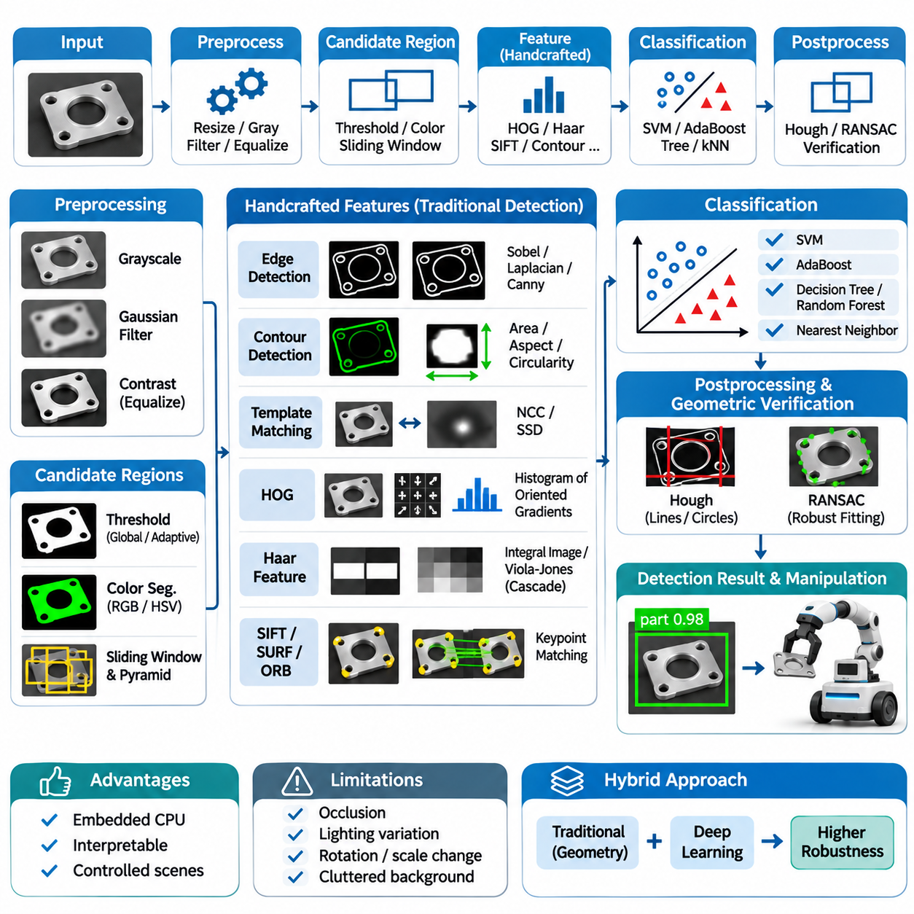{width="7.268055555555556in" height="7.268055555555556in"}

전통적인 객체 검출 방법(Traditional Object Detection Method)은 딥러닝(Deep Learning)이 광범위하게 도입되기 이전에 개발된 컴퓨터 비전(Computer Vision) 기술의 기반을 형성한다. 이러한 방법은 이미지 내의 객체를 식별하기 위해 수학적 모델(Mathematical Model), 수작업으로 설계된 시각적 특징(Handcrafted Visual Feature), 기하학적 특성(Geometric Characteristics), 통계적 분류 알고리즘(Statistical Classification Algorithm)에 의존한다. 주요 목적은 사전에 정의된 시각적 특성과 결정 규칙(Decision Rule)을 활용하여 주변 배경으로부터 대상 객체를 구별하는 것이다.

전통적인 객체 검출 파이프라인(Traditional Object Detection Pipeline)은 일반적으로 이미지 전처리(Image Preprocessing), 후보 영역 생성(Candidate Region Generation), 특징 추출(Feature Extraction), 분류(Classification), 후처리(Postprocessing)로 구성된다. 각 처리 단계는 특정 응용 분야의 요구사항에 따라 독립적으로 설계되고 최적화된다. 딥러닝 아키텍처(Deep Learning Architecture)와 달리, 전통적인 접근 방식은 일반적으로 엔지니어가 관련 시각적 특징을 수동으로 정의하고 대상 환경에 적합한 검출 기준(Detection Criteria)을 설정해야 한다.

이미지 전처리(Image Preprocessing)는 전통적인 검출 알고리즘의 신뢰성을 향상시키는 데 중요한 역할을 수행한다. 대표적인 전처리 기술에는 회색조 변환(Grayscale Conversion), 잡음 제거(Noise Reduction), 히스토그램 평활화(Histogram Equalization), 대비 향상(Contrast Enhancement), 가우시안 필터링(Gaussian Filtering)이 포함된다. 이러한 연산은 불필요한 시각적 변화를 감소시키고 의미 있는 객체 특성의 가시성을 향상시킨다. 적절한 전처리는 조명 조건이 일정하지 않은 산업 환경(Industrial Environment)에서 특히 중요하다.

임계값 처리(Thresholding)는 픽셀 밝기(Pixel Intensity) 또는 색상 특성(Color Characteristics)을 기반으로 객체를 식별하는 가장 단순한 전통적 기술 중 하나이다. 전역 임계값 처리(Global Thresholding)는 고정된 밝기 값을 사용하여 전경 객체(Foreground Object)와 배경(Background)을 분리하며, 적응형 임계값 처리(Adaptive Thresholding)는 주변 픽셀의 분포에 따라 국부적인 임계값을 결정한다. 색상 기반 분할(Color-Based Segmentation)은 RGB, HSV 또는 기타 색상 공간(Color Space) 내에서 사전에 정의된 색상 범위를 활용하여 객체를 식별할 수 있다.

경계선 검출(Edge Detection)은 일반적으로 객체의 경계에 해당하는 이미지 밝기의 급격한 변화를 식별한다. 대표적인 알고리즘에는 소벨 연산자(Sobel Operator), 라플라시안 연산자(Laplacian Operator), 캐니 경계선 검출기(Canny Edge Detector)가 포함된다. 추출된 경계선은 윤곽선 분석(Contour Analysis), 형상 인식(Shape Recognition), 객체 위치 추정(Object Localization)을 지원하는 기하학적 정보를 제공한다. 로봇 조작(Robotic Manipulation)에서 경계선 기반 검출(Edge-Based Detection)은 명확한 구조적 경계를 가진 제조 부품을 식별하는 데 특히 효과적이다.

윤곽선 검출(Contour Detection)은 분할된 이미지 또는 경계선이 검출된 이미지에서 추출된 연결 경계(Connected Boundary)를 분석한다. 윤곽선 면적(Contour Area), 둘레(Perimeter), 종횡비(Aspect Ratio), 원형도(Circularity), 볼록성(Convexity) 등의 기하학적 속성(Geometric Property)을 활용하여 서로 다른 객체 범주를 구별할 수 있다. 이러한 특성은 객체가 일정한 치수와 형상을 갖는 산업 자동화(Industrial Automation) 환경에서 유용하다. 그러나 윤곽선 기반 방법(Contour-Based Method)은 가려짐(Occlusion), 배경 복잡성(Background Complexity), 원근 왜곡(Perspective Distortion)에 민감하다.

템플릿 정합(Template Matching)은 사전에 정의된 참조 이미지(Reference Image)를 입력 이미지의 여러 영역과 비교하여 대상 객체를 식별한다. 정규화 상호상관(Normalized Cross-Correlation), 제곱 차이의 합(Sum of Squared Differences) 등의 유사도 측정(Similarity Measurement)을 통해 참조 템플릿과 후보 영역 사이의 일치 정도를 판단한다. 템플릿 정합은 제한된 탐색 영역(Search Area)에서 비교적 단순한 연산으로 구현할 수 있지만, 객체에 상당한 회전(Rotation), 크기 변화(Scale Change), 변형(Deformation)이 발생하면 검출 신뢰성이 저하된다.

방향성 기울기 히스토그램(Histogram of Oriented Gradients, HOG)은 기울기 방향(Gradient Orientation)의 분포를 통해 객체의 국부적인 외형을 표현하는 대표적인 특징 추출 기술이다. 이미지를 작은 공간 셀(Spatial Cell)로 분할하고, 기울기 히스토그램(Gradient Histogram)을 계산한 후 인접 영역을 기준으로 정규화한다. HOG는 중간 수준의 조명 변화(Illumination Change)에 대한 강건성(Robustness)을 제공하며, 뚜렷한 윤곽 형상(Silhouette)과 구조적 패턴(Structural Pattern)을 가진 객체를 검출하는 데 특히 효과적이다.

하르 유사 특징(Haar-like Feature)은 인접한 직사각형 이미지 영역 사이의 픽셀 밝기 차이를 표현한다. 이러한 특징은 적분 이미지(Integral Image)를 사용하여 효율적으로 계산할 수 있으므로 연산 요구량(Computational Requirement)을 크게 감소시킨다. 비올라-존스 검출 프레임워크(Viola-Jones Detection Framework)는 하르 유사 특징, 에이다부스트 학습(AdaBoost Learning), 직렬 분류기(Cascade Classifier)를 결합하여 신속한 객체 검출을 구현한다. 직렬 아키텍처(Cascade Architecture)는 더 많은 연산이 필요한 분류를 수행하기 전에 객체일 가능성이 낮은 후보 영역을 제거한다.

크기 불변 특징 변환(Scale-Invariant Feature Transform, SIFT), 고속 강건 특징(Speeded-Up Robust Features, SURF), 방향성 FAST 및 회전 BRIEF(Oriented FAST and Rotated BRIEF, ORB)와 같은 국부 특징 기술자(Local Feature Descriptor)는 뚜렷한 시각적 특징점(Visual Keypoint)을 식별하고 주변 패턴을 표현한다. 추출된 특징 기술자를 참조 객체(Reference Object)와 정합함으로써 검출 시스템은 시점(Viewpoint), 회전, 크기에 중간 수준의 변화가 발생하더라도 질감이 있는 객체(Textured Object)를 인식할 수 있다. 기하학적 검증(Geometric Verification)은 특징 정합의 신뢰성을 더욱 향상시킨다.

서포트 벡터 머신(Support Vector Machine, SVM)은 전통적인 객체 검출 시스템에서 통계적 분류기(Statistical Classifier)로 널리 활용된다. 추출된 시각적 특징은 수치 벡터(Numerical Vector)로 표현되며, 레이블이 지정된 학습 샘플(Labeled Training Sample)로부터 학습된 결정 경계(Decision Boundary)를 사용하여 분류된다. 객체 범주를 선형 경계(Linear Boundary)로 분리할 수 없는 경우 커널 함수(Kernel Function)를 활용하여 비선형 분류(Nonlinear Classification)를 수행할 수 있다. 기타 분류 방법에는 결정 트리(Decision Tree), 랜덤 포레스트(Random Forest), 최근접 이웃 알고리즘(Nearest-Neighbor Algorithm)이 포함된다.

슬라이딩 윈도우 검출(Sliding Window Detection)은 사전에 정의된 윈도우 크기(Window Dimension)를 사용하여 이미지의 다양한 공간적 영역을 체계적으로 검사한다. 이미지 피라미드(Image Pyramid)는 서로 다른 크기로 조정된 여러 이미지 표현을 생성함으로써 이 기술을 확장하며, 다양한 크기의 객체를 검출할 수 있도록 한다. 슬라이딩 윈도우 방식은 체계적인 공간적 탐색 범위(Spatial Coverage)를 제공하지만, 반복적인 특징 추출과 분류로 인해 상당한 연산 오버헤드(Computational Overhead)가 발생할 수 있으며, 특히 고해상도 이미지(High-Resolution Image)를 처리할 때 이러한 문제가 두드러진다.

전통적인 검출 방법에는 허프 변환(Hough Transform)과 무작위 표본 합의(Random Sample Consensus, RANSAC) 같은 기하학적 투표(Geometric Voting) 및 변환 기술(Transformation Technique)도 포함된다. 허프 변환은 직선(Line), 원(Circle), 매개변수화된 형상(Parameterized Shape)과 같은 기하학적 구조를 식별하며, RANSAC은 잘못된 관측값(Incorrect Observation)이 존재하는 상황에서도 기하학적 모델을 추정한다. 이러한 기술은 구조화된 산업 객체(Structured Industrial Object), 기계 부품(Mechanical Component), 환경 랜드마크(Environmental Landmark)의 신뢰성 높은 위치 추정을 지원한다.

모바일 매니퓰레이터(Mobile Manipulator)에서 전통적인 객체 검출 방법은 예측 가능한 객체 외형(Predictable Object Appearance), 통제된 배경(Controlled Background), 표준화된 산업 공정(Standardized Industrial Process)을 포함하는 응용 분야에서 여전히 유용하다. 상대적으로 낮은 연산 요구량을 통해 전용 GPU 가속(Dedicated GPU Acceleration) 없이도 임베디드 프로세서(Embedded Processor)에서 구현할 수 있다. 또한 투명한 처리 메커니즘(Transparent Processing Mechanism)은 시스템 디버깅(System Debugging), 매개변수 조정(Parameter Adjustment), 고장 분석(Failure Analysis), 기존 로봇 제어 시스템과의 결정론적 통합(Deterministic Integration)을 용이하게 한다.

이러한 장점에도 불구하고 전통적인 검출 방법은 비정형 환경(Unstructured Environment)과 동적으로 변화하는 환경에서 작동할 때 한계를 나타낸다. 수작업으로 설계된 특징은 복잡한 외형 변화(Complex Appearance Variation), 부분적 가려짐(Partial Occlusion), 반사 소재(Reflective Material), 익숙하지 않은 객체 범주(Unfamiliar Object Category)를 충분히 표현하지 못하는 경우가 많다. 따라서 현대적인 로봇 인지 시스템(Robotic Perception System)은 전통적인 기하학적 처리(Geometric Processing)와 딥러닝 기반 검출기(Deep Learning Detector)를 결합하여 연산 효율성(Computational Efficiency)과 기하학적 해석 가능성(Geometric Interpretability)을 유지하면서 객체 인식 능력(Recognition Capability)을 향상시키는 방식을 자주 활용한다.

## 03 R-CNN Family

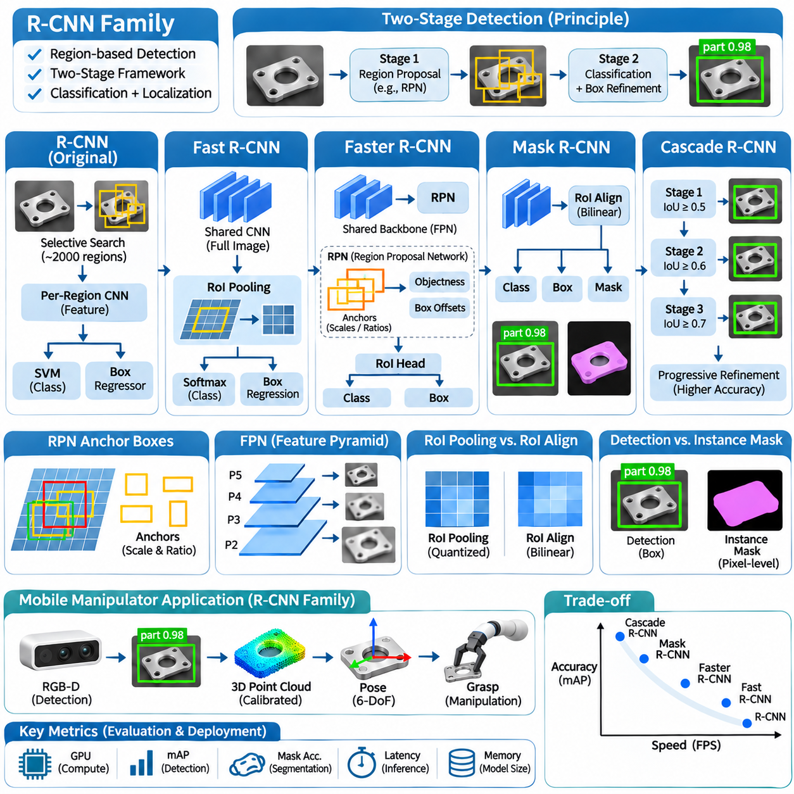{width="7.268055555555556in" height="7.268055555555556in"}

영역 기반 합성곱 신경망(Region-based Convolutional Neural Network, R-CNN) 계열은 딥러닝 기반 객체 검출(Deep Learning-Based Object Detection)의 발전 과정에서 중요한 이정표를 나타낸다. 수작업으로 설계된 시각적 특징(Handcrafted Visual Feature)에 의존하는 전통적인 검출 방법과 달리, R-CNN 아키텍처는 합성곱 신경망(Convolutional Neural Network, CNN)을 활용하여 객체를 구별할 수 있는 표현(Discriminative Object Representation)을 자동으로 학습한다. 이러한 아키텍처는 객체 분류(Object Classification)와 공간적 위치 추정(Spatial Localization)을 결합하는 영역 기반 검출 프레임워크(Region-Based Detection Framework)를 구축한다.

R-CNN 계열의 기본 원리는 세부적인 분류(Classification)와 위치 추정(Localization)을 수행하기 전에 객체가 존재할 가능성이 있는 후보 영역(Candidate Region)을 식별하는 것이다. 이러한 접근 방식은 일반적으로 2단계 객체 검출(Two-Stage Object Detection)이라고 한다. 첫 번째 단계에서는 영역 제안(Region Proposal)을 생성하고, 두 번째 단계에서는 이러한 제안 영역을 평가하여 객체 범주(Object Category)를 결정하고 경계 상자 좌표(Bounding Box Coordinate)를 정교화함으로써 이미지 전체를 빠짐없이 탐색해야 하는 필요성을 감소시킨다.

초기 R-CNN 아키텍처는 선택적 탐색(Selective Search)을 활용하여 입력 이미지로부터 약 2,000개의 후보 영역을 생성한다. 선택적 탐색은 색상(Color), 질감(Texture), 크기(Size), 형상 유사도(Shape Similarity)를 기반으로 이미지 분할(Image Segmentation)과 계층적 영역 그룹화(Hierarchical Region Grouping)를 결합한다. 각각의 제안 영역은 합성곱 신경망의 입력 크기(Input Dimension)를 충족하도록 크기가 조정되며, 합성곱 신경망은 후속 객체 분류를 위한 고수준 시각적 특징(High-Level Visual Feature)을 독립적으로 추출한다.

R-CNN은 대규모 이미지 분류 데이터셋(Large-Scale Image Classification Dataset)으로 사전 학습(Pretraining)된 후 객체 검출을 위해 미세 조정(Fine-Tuning)된 합성곱 신경망을 활용한다. 추출된 특징 벡터(Feature Vector)는 클래스별 서포트 벡터 머신(Class-Specific Support Vector Machine, SVM)에 의해 처리되며, 별도의 경계 상자 회귀 모델(Bounding Box Regression Model)은 위치 추정 정확도(Localization Accuracy)를 향상시킨다. R-CNN은 객체 검출 성능을 크게 향상시켰지만, 각각의 후보 영역에 대한 독립적인 특징 추출(Feature Extraction)로 인해 상당한 연산 오버헤드(Computational Overhead)가 발생하였다.

Fast R-CNN은 전체 입력 이미지에 대해 합성곱 특징 추출(Convolutional Feature Extraction)을 한 번만 수행함으로써 초기 아키텍처의 연산 비효율성(Computational Inefficiency)을 해결한다. 후보 영역은 공유 합성곱 특징 맵(Shared Convolutional Feature Map)에 투영되어 중복 연산(Redundant Computation)을 제거한다. 관심 영역 풀링(Region of Interest Pooling, RoI Pooling)은 다양한 크기의 후보 영역을 후속 분류 및 경계 상자 회귀에 적합한 고정 차원 특징 표현(Fixed-Dimensional Feature Representation)으로 변환한다.

Fast R-CNN은 객체 분류와 경계 상자 위치 추정을 공동으로 최적화하는 통합 다중 작업 학습 프레임워크(Unified Multi-Task Learning Framework)를 도입한다. 별도의 외부 분류기(External Classifier)에 의존하는 대신, 하나의 신경망 내부에 소프트맥스 분류 계층(Softmax Classification Layer)과 경계 상자 회귀 출력(Bounding Box Regression Output)을 통합한다. 이러한 설계는 학습 파이프라인(Training Pipeline)을 단순화하고 연산 효율성(Computational Efficiency)을 향상시키지만, 외부 영역 제안 생성(External Region Proposal Generation)은 여전히 주요 병목 현상(Bottleneck)으로 남아 있다.

Faster R-CNN은 영역 제안 네트워크(Region Proposal Network, RPN)를 도입하여 영역 기반 검출 프레임워크를 확장한다. RPN은 공유 합성곱 특징 맵에서 직접 작동하며, 객체가 존재할 가능성이 있는 영역과 해당 객체 존재 가능성 점수(Objectness Score)를 함께 예측한다. 외부 영역 제안 생성 알고리즘(External Proposal Generation Algorithm)을 학습 가능한 신경망(Trainable Neural Network)으로 대체함으로써 Faster R-CNN은 영역 제안 생성 지연시간(Proposal Generation Latency)을 크게 감소시키고 전체 아키텍처의 통합성(Architectural Integration)을 향상시킨다.

영역 제안 네트워크(Region Proposal Network, RPN)는 전통적으로 사전에 정의된 객체 크기(Object Scale)와 종횡비(Aspect Ratio)의 조합을 나타내는 앵커 상자(Anchor Box)를 활용한다. 특징 맵의 각 공간적 위치(Spatial Location)에서 신경망은 이러한 앵커를 기준으로 객체 존재 확률(Objectness Probability)과 경계 상자 좌표 보정값(Bounding Box Coordinate Adjustment)을 추정한다. 양성 학습 샘플(Positive Training Sample)과 음성 학습 샘플(Negative Training Sample)은 정답 주석(Ground-Truth Annotation)과의 공간적 중첩(Spatial Overlap)에 따라 할당되며, 일반적으로 교집합 대 합집합 비율(Intersection over Union, IoU)을 사용하여 측정한다.

특징 피라미드 네트워크(Feature Pyramid Network, FPN)는 합성곱 백본(Convolutional Backbone)의 다양한 계층으로부터 다중 스케일 특징 표현(Multi-Scale Feature Representation)을 구성함으로써 Faster R-CNN의 성능을 더욱 향상시킨다. 저수준 특징(Low-Level Feature)은 세부적인 공간 정보(Spatial Information)를 보존하는 반면, 고수준 특징(High-Level Feature)은 더욱 강력한 의미론적 표현(Semantic Representation)을 제공한다. 이러한 특성을 결합함으로써 영역 기반 검출기(Region-Based Detector)는 소형 기계 부품(Small Mechanical Component)부터 대형 산업 조립체(Large Industrial Assembly)에 이르기까지 다양한 크기의 객체를 인식할 수 있다.

Mask R-CNN은 인스턴스 분할(Instance Segmentation)을 위한 추가적인 예측 분기(Prediction Branch)를 도입하여 Faster R-CNN을 확장한다. 클래스 레이블(Class Label) 및 경계 상자(Bounding Box)뿐만 아니라, 신경망은 검출된 개별 객체에 대한 픽셀 수준 마스크(Pixel-Level Mask)를 생성한다. 이러한 기능은 객체 경계(Object Boundary)와 가시 표면 영역(Visible Surface Region)에 관한 더욱 정밀한 정보를 제공하며, 불규칙한 형상(Irregular Shape), 중첩된 객체(Overlapping Object), 복잡하게 얽힌 환경(Cluttered Environment)을 포함하는 로봇 조작 작업(Robotic Manipulation Task)에서 특히 유용하다.

Mask R-CNN은 또한 기존 관심 영역 풀링(RoI Pooling)과 관련된 공간적 양자화 오차(Spatial Quantization Error)를 극복하기 위해 관심 영역 정렬(Region of Interest Align, RoI Align)을 도입한다. RoI Align은 영역 경계를 정수 위치로 반올림하지 않고 소수 단위의 공간 좌표(Fractional Spatial Coordinate)에서 특징을 추출하기 위해 이중 선형 보간법(Bilinear Interpolation)을 활용한다. 이러한 개선은 입력 이미지와 추출된 특징 사이의 공간적 대응 관계(Spatial Correspondence)를 보존하여 분할 정확도(Segmentation Accuracy)를 향상시키고 정밀한 객체 경계 추정(Object Boundary Estimation)을 지원한다.

Cascade R-CNN은 점진적으로 높아지는 IoU 임계값(IoU Threshold)을 사용하여 학습된 여러 연속적인 검출 단계(Detection Stage)를 적용함으로써 검출 품질(Detection Quality)을 향상시킨다. 각 단계는 이전 단계에서 생성된 경계 상자 예측(Bounding Box Prediction)을 정교화한다. 이러한 아키텍처는 제안 영역 품질(Proposal Quality)과 검출기 학습 요구사항(Detector Training Requirement) 사이의 불일치를 감소시켜 더욱 정확한 위치 추정을 가능하게 한다. 그러나 추가적인 정교화 단계(Refinement Stage)는 연산 복잡도(Computational Complexity)와 추론 지연시간(Inference Latency)을 증가시킬 수 있다.

모바일 매니퓰레이터(Mobile Manipulator)에서 R-CNN 아키텍처는 최대 추론 속도(Inference Speed)보다 정확한 객체 위치 추정과 세부적인 장면 해석(Scene Interpretation)이 더욱 중요한 경우에 특히 유용하다. Mask R-CNN은 객체 분리(Object Isolation), 깊이 정보 필터링(Depth Information Filtering), 3차원 포인트 클라우드 추출(3D Point Cloud Extraction), 자세 추정(Pose Estimation), 파지 후보 생성(Grasp Candidate Generation)을 지원할 수 있다. 그러나 신뢰성 높은 물리적 객체 좌표(Physical Object Coordinate)를 확보하려면 검출 출력(Detection Output)을 보정된 인지 시스템(Calibrated Perception System)과 통합해야 한다.

R-CNN 아키텍처의 배포(Deployment)를 위해서는 연산 자원(Computational Resource), 이미지 해상도(Image Resolution), 백본 복잡도(Backbone Complexity), 제안 영역 수(Proposal Count), 추론 지연시간을 신중하게 고려해야 한다. GPU 가속(GPU Acceleration), 최적화된 추론 엔진(Optimized Inference Engine), 경량 특징 추출기(Lightweight Feature Extractor), 제안 영역 수 감소 등을 통해 실행 효율성(Execution Efficiency)을 향상시킬 수 있다. 성능은 대표적인 운영 조건(Representative Operating Condition)에서 평균 정밀도의 평균(Mean Average Precision, mAP), 분할 정확도, 위치 추정 오차(Localization Error), 메모리 사용량(Memory Consumption), 종단 간 처리 지연시간(End-to-End Processing Latency)을 활용하여 평가해야 한다.

R-CNN에서 Fast R-CNN, Faster R-CNN, Mask R-CNN, Cascade R-CNN으로 이어지는 발전 과정은 특징 추출(Feature Extraction), 영역 제안 생성(Region Proposal Generation), 분류(Classification), 위치 추정(Localization), 분할(Segmentation), 정교화(Refinement)의 점진적인 통합을 보여준다. 제공된 장 구성(Chapter Structure)에서는 개별 아키텍처를 구체적으로 지정하지 않았지만, 이러한 대표적인 기술 발전은 영역 기반 객체 검출(Region-Based Object Detection)이 산업 자동화(Industrial Automation)와 지능형 모바일 조작(Intelligent Mobile Manipulation)을 위한 강건한 인지 기반(Robust Perception Foundation)을 어떻게 제공하는지를 보여준다.

## 04 YOLO Family

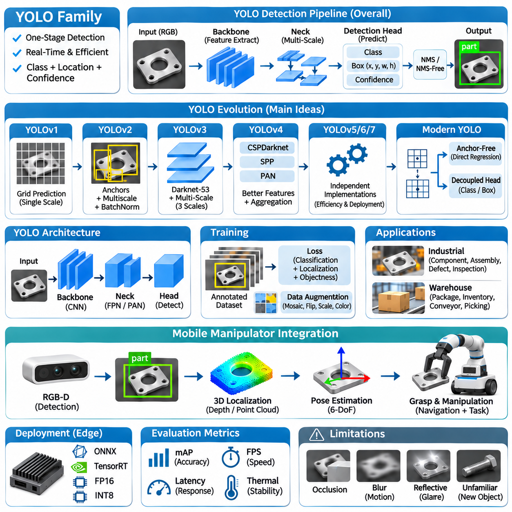{width="7.268055555555556in" height="7.268055555555556in"}

YOLO(You Only Look Once)는 효율적인 시각적 인식(Visual Recognition)과 공간적 위치 추정(Spatial Localization)을 달성하기 위해 설계된 딥러닝 기반 객체 검출 아키텍처(Deep Learning-Based Object Detection Architecture) 계열을 의미한다. 영역 제안(Region Proposal)을 생성하고 후보 객체(Candidate Object)를 별도로 분류하는 기존의 2단계 검출기(Two-Stage Detector)와 달리, YOLO는 객체 검출을 통합된 예측 문제(Unified Prediction Problem)로 정의한다. 이러한 아키텍처 접근 방식은 신속한 추론(Rapid Inference)을 가능하게 하며 실시간 로봇 인지(Real-Time Robotic Perception)를 지원한다.

YOLO의 기본 원리는 전체 입력 이미지(Input Image)를 신경망(Neural Network)을 통해 처리하고 객체 범주(Object Category), 공간적 위치(Spatial Location), 신뢰도 점수(Confidence Score)를 동시에 예측하는 것이다. YOLO는 독립적인 영역 제안 단계(Region Proposal Stage)를 제거함으로써 중복 연산(Redundant Computational Operation)을 크게 감소시킨다. 이러한 특성은 엄격한 지연시간(Latency)과 연산 제약조건(Computational Constraint)에서 작동하는 모바일 매니퓰레이터(Mobile Manipulator)에 YOLO가 특히 적합하도록 한다.

초기 YOLO 아키텍처는 입력 이미지를 공간 격자(Spatial Grid)로 분할하며, 각각의 격자 셀(Grid Cell)은 중심점이 자신의 경계 내부에 위치하는 객체의 검출을 담당한다. 각 셀은 경계 상자 좌표(Bounding Box Coordinate), 신뢰도 점수(Confidence Score), 조건부 클래스 확률(Conditional Class Probability)을 예측한다. 이러한 문제 정의 방식은 효율적인 검출 메커니즘(Detection Mechanism)을 도입하였지만, 초기 구현에서는 소형 객체(Small Object)와 서로 인접한 대상 객체(Closely Positioned Target)를 검출하는 데 한계가 있었다.

YOLOv2는 배치 정규화(Batch Normalization), 앵커 상자(Anchor Box), 고해상도 학습(Higher-Resolution Training), 다중 스케일 학습(Multi-Scale Learning)을 포함한 여러 아키텍처 개선 사항을 도입하였다. 앵커 상자는 위치 추정 예측(Localization Prediction)을 위한 참조 기하 구조(Reference Geometry)를 제공하는 사전 정의된 경계 상자 치수(Bounding Box Dimension)를 나타낸다. 이러한 개선은 연산 효율성(Computational Efficiency)을 유지하면서 검출 정확도(Detection Accuracy)를 향상시켰으며, 신경망이 다양한 크기와 종횡비(Aspect Ratio)를 가진 객체를 처리할 수 있도록 하였다.

YOLOv3는 Darknet-53으로 알려진 더욱 깊은 특징 추출 백본(Feature Extraction Backbone)을 도입하고 다중 스케일 검출 능력(Multi-Scale Detection Capability)을 향상시켰다. 여러 공간 해상도(Spatial Resolution)에서 예측 결과를 생성함으로써 소형, 중형, 대형 객체를 더욱 효과적으로 인식할 수 있게 되었다. 잔차 연결(Residual Connection)은 더욱 깊은 신경망(Deep Neural Network)의 학습을 지원하여 복잡한 시각적 환경(Complex Visual Environment)에서 특징 표현(Feature Representation)과 검출 성능(Detection Performance)을 향상시켰다.

YOLOv4는 CSPDarknet, 공간 피라미드 풀링(Spatial Pyramid Pooling, SPP), 경로 집계 네트워크(Path Aggregation Network, PANet), 고급 데이터 증강 전략(Advanced Data Augmentation Strategy)과 같은 아키텍처 및 학습 개선 기술을 통합하였다. 이러한 기술은 특징 추출(Feature Extraction), 문맥 이해(Contextual Understanding), 다중 스케일 정보 집계(Multi-Scale Information Aggregation)를 강화하였다. 이 아키텍처는 체계적인 최적화(Systematic Optimization)를 통해 추론 지연시간(Inference Latency)을 비례적으로 증가시키지 않으면서 검출 정확도를 향상시킬 수 있음을 보여주었다.

YOLOv5, YOLOv6, YOLOv7을 포함한 후속 YOLO 구현 모델(YOLO Implementation)은 신경망 효율성(Network Efficiency), 학습 전략(Training Strategy), 배포 유연성(Deployment Flexibility), 하드웨어 활용도(Hardware Utilization) 측면에서 추가적인 개선 사항을 도입하였다. 이러한 구현 모델은 하나의 연속적인 개발 계보(Development Lineage)를 통해 발전한 것이 아니라 서로 다른 연구 그룹(Research Group)과 조직(Organization)에 의해 개발되었다. 그럼에도 불구하고 정확하고 연산 효율적인 객체 검출을 달성한다는 기본적인 목표를 공유한다.

최근의 YOLO 아키텍처는 앵커 프리 검출 메커니즘(Anchor-Free Detection Mechanism), 분리형 예측 헤드(Decoupled Prediction Head), 최적화된 특징 집계 전략(Optimized Feature Aggregation Strategy)을 점차 적극적으로 도입하고 있다. 앵커 프리 접근 방식(Anchor-Free Approach)은 사전에 정의된 앵커 상자 치수에 의존하지 않고 객체의 위치를 추정한다. 분리형 검출 헤드(Decoupled Detection Head)는 분류(Classification)와 위치 추정(Localization) 작업을 분리하여 신경망이 서로 다른 예측 목표(Prediction Objective)를 최적화하고 전체적인 학습 효과(Learning Effectiveness)를 향상시킬 수 있도록 한다.

일반적인 현대 YOLO 아키텍처는 백본(Backbone), 넥(Neck), 검출 헤드(Detection Head)로 구성된다. 백본은 입력 이미지로부터 계층적 시각 특징(Hierarchical Visual Feature)을 추출하며, 넥은 여러 공간 해상도에 걸쳐 특징 정보를 통합한다. 검출 헤드는 객체 분류(Object Classification)와 경계 상자 예측(Bounding Box Prediction)을 수행한다. 이러한 모듈형 아키텍처(Modular Architecture)는 정확도(Accuracy), 처리 속도(Processing Speed), 하드웨어 요구사항(Hardware Requirement)에 따라 개별 구성요소(Component)를 최적화할 수 있도록 한다.

YOLO 학습(Training)은 일반적으로 객체 범주와 해당 경계 상자 좌표가 포함된 주석 데이터셋(Annotated Dataset)을 필요로 한다. 손실 함수(Loss Function)는 분류 오차(Classification Error)와 위치 추정 오차(Localization Error)를 측정하며, 일부 아키텍처는 추가적인 객체 존재 가능성 손실(Objectness Loss) 또는 분포 기반 회귀 손실(Distribution-Based Regression Loss)을 통합한다. 모자이크(Mosaic), 이미지 크기 조정(Image Scaling), 수평 반전(Horizontal Flipping), 색상 변환(Color Transformation)과 같은 데이터 증강 기술(Data Augmentation Technique)은 환경 변화(Environmental Variation)에 대한 강건성(Robustness)을 향상시킨다.

추론(Inference) 과정에서 많은 YOLO 구현 모델은 신뢰도 임계값 처리(Confidence Thresholding)와 비최대 억제(Non-Maximum Suppression, NMS)를 적용하여 신뢰성이 낮거나 중복된 예측 결과를 제거한다. 그러나 중첩된 객체(Overlapping Object)로 인해 유효한 검출 결과가 잘못 억제될 수 있으며, 특히 객체가 밀집된 환경(Densely Populated Environment)에서 이러한 문제가 발생할 수 있다. 종단 간 YOLO 변형 모델(End-to-End YOLO Variant)은 후처리 요구사항(Postprocessing Requirement)을 감소시키고 추론 효율성(Inference Efficiency)을 향상시키기 위해 비최대 억제가 필요 없는 검출 방식(NMS-Free Detection Approach)도 도입하였다.

모바일 매니퓰레이터(Mobile Manipulator)에서 YOLO는 자율 주행(Autonomous Navigation), 객체 위치 추정(Object Localization), 대상 선택(Target Selection), 조작 계획(Manipulation Planning)을 지원하는 의미론적 정보(Semantic Information)를 제공한다. RGB-D 카메라(RGB-D Camera)와 통합하면 검출된 경계 상자를 깊이 측정값(Depth Measurement)과 연결하여 3차원 객체 위치(3D Object Location)를 추정할 수 있다. 신뢰성 높은 물리적 조작(Physical Manipulation)을 달성하기 위해서는 일반적으로 추가적인 분할(Segmentation), 자세 추정(Pose Estimation), 파지 검출(Grasp Detection) 모듈이 필요하다.

YOLO의 산업 응용 분야(Industrial Application)에는 부품 인식(Component Recognition), 조립 검증(Assembly Verification), 표면 결함 검출(Surface Defect Detection), 자동 검사(Automated Inspection)가 포함된다. 물류 창고 응용 분야(Warehouse Application)에는 포장물 식별(Package Identification), 재고 인식(Inventory Recognition), 컨베이어 모니터링(Conveyor Monitoring), 로봇 피킹(Robotic Picking)이 포함된다. 검출 신뢰성(Detection Reliability)은 카메라 구성(Camera Configuration), 조명 조건(Illumination Condition), 객체 가시성(Object Visibility), 실제 운영 시나리오(Operational Scenario)를 포괄하는 대표성 있는 학습 데이터셋(Representative Training Dataset)의 확보 여부에 따라 달라진다.

모바일 로봇 플랫폼(Mobile Robotic Platform)에 YOLO를 배포(Deployment)하기 위해서는 모델 크기(Model Size), 수치 정밀도(Numerical Precision), 메모리 사용량(Memory Consumption), 전력 요구사항(Power Requirement), 추론 지연시간을 신중하게 최적화해야 한다. ONNX, TensorRT, FP16 추론(FP16 Inference), INT8 양자화(INT8 Quantization)와 같은 기술은 호환 가능한 임베디드 AI 프로세서(Embedded AI Processor)와 GPU에서 효율적인 실행을 가능하게 한다. 성능 검증(Performance Validation)은 검출 정확도, 프레임 처리율(Frame Rate), 종단 간 지연시간(End-to-End Latency), 지속적인 열 안정성(Sustained Thermal Stability)을 고려해야 한다.

YOLO는 실시간 인지(Real-Time Perception)에서 상당한 장점을 제공하지만, 예측 결과는 여전히 가려짐(Occlusion), 모션 블러(Motion Blur), 익숙하지 않은 객체(Unfamiliar Object), 반사 소재(Reflective Material), 데이터 분포 변화(Distribution Shift)에 민감하다. 검출 신뢰도(Detection Confidence)만으로는 안전하고 성공적인 로봇 조작을 보장할 수 없다. 제공된 장 구성(Chapter Outline)은 개별 버전에 대한 요구사항 없이 YOLO 계열을 지정하고 있으므로, 여기에서 설명한 대표적인 아키텍처는 YOLO의 발전 과정과 지능형 모바일 조작(Intelligent Mobile Manipulation)에서의 실질적인 역할을 보여준다.

## 05 DETR and Transformers

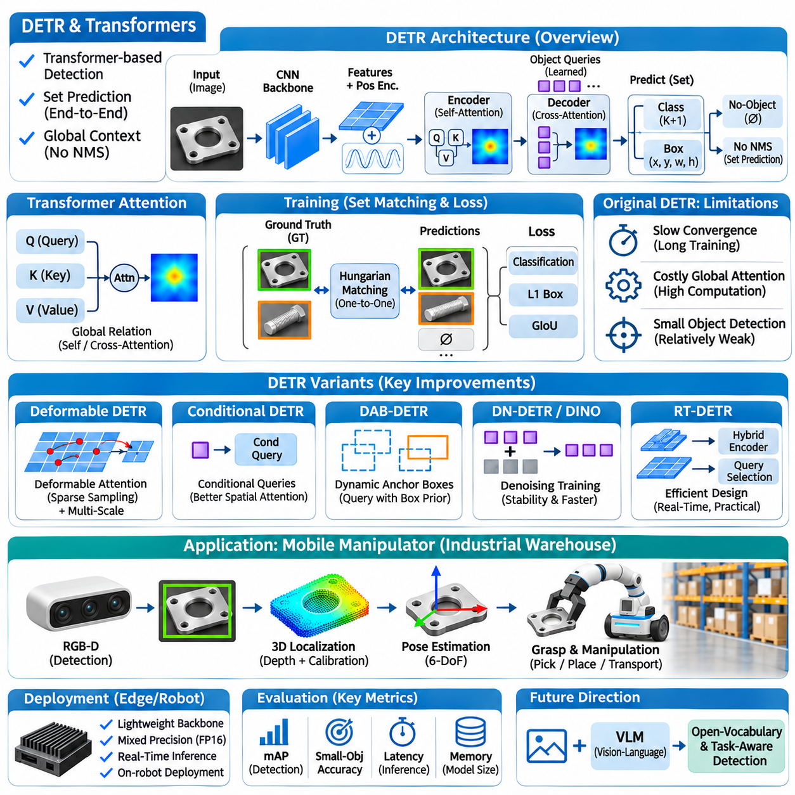{width="7.268055555555556in" height="7.268055555555556in"}

검출 트랜스포머(Detection Transformer, DETR)는 트랜스포머 아키텍처(Transformer Architecture)와 어텐션 메커니즘(Attention Mechanism)을 시각적 인식(Visual Recognition)에 도입함으로써 딥러닝 기반 객체 검출(Deep Learning-Based Object Detection)의 근본적인 패러다임 전환을 나타낸다. 사전에 정의된 앵커 상자(Anchor Box), 영역 제안 네트워크(Region Proposal Network), 복잡한 후처리 절차(Postprocessing Procedure)에 의존하는 기존 검출기와 달리, DETR은 종단 간 신경망 아키텍처(End-to-End Neural Network Architecture) 내에서 객체 검출을 직접적인 집합 예측 문제(Direct Set Prediction Problem)로 정의한다.

트랜스포머 아키텍처(Transformer Architecture)는 본래 순차적 데이터(Sequential Data) 내에서 구성요소 간의 관계를 파악하기 위해 자연어 처리(Natural Language Processing, NLP) 분야에서 개발되었다. 트랜스포머의 어텐션 메커니즘은 공간적 또는 순차적 거리에 관계없이 신경망이 관련성 있는 관계를 식별할 수 있도록 한다. 컴퓨터 비전(Computer Vision)에 적용될 경우, 트랜스포머는 검출 모델이 객체와 주변 환경 특징(Environmental Feature) 사이의 문맥적 관계(Contextual Relationship)를 분석할 수 있도록 한다.

초기 DETR 아키텍처는 합성곱 신경망 백본(Convolutional Neural Network Backbone), 트랜스포머 인코더(Transformer Encoder), 트랜스포머 디코더(Transformer Decoder), 예측 헤드(Prediction Head)로 구성된다. 백본은 입력 이미지(Input Image)로부터 시각적 특징(Visual Feature)을 추출하며, 인코더는 공간적 특징 요소(Spatial Feature Element) 사이의 관계를 처리한다. 디코더는 학습된 객체 쿼리(Learned Object Query)를 객체별 표현(Object-Specific Representation)으로 변환하며, 이러한 표현은 후속 객체 분류(Object Classification)와 경계 상자 예측(Bounding Box Prediction)에 활용된다.

셀프 어텐션(Self-Attention)은 트랜스포머 기반 객체 검출(Transformer-Based Object Detection)의 핵심 연산 메커니즘(Computational Mechanism)이다. 셀프 어텐션은 쿼리(Query), 키(Key), 값(Value) 표현으로부터 어텐션 가중치(Attention Weight)를 계산하여 특징 요소 사이의 관계를 평가한다. 이러한 가중치는 서로 다른 공간적 위치(Spatial Location)의 정보가 개별 특징 표현(Feature Representation)에 얼마나 기여하는지를 결정하며, 신경망이 국부적인 합성곱 수용 영역(Local Convolutional Receptive Field)을 넘어 전역적 문맥 의존성(Global Contextual Dependency)을 파악할 수 있도록 한다.

위치 인코딩(Positional Encoding)은 표준 어텐션 연산(Standard Attention Operation)만으로는 확보할 수 없는 공간적 정보(Spatial Information)를 제공한다. 트랜스포머 아키텍처는 본질적으로 이미지 특징의 공간적 배열(Spatial Arrangement)을 보존하지 않으므로 위치 정보를 특징 표현에 통합한다. 이러한 메커니즘은 DETR이 서로 다른 객체 위치를 구별하고 시각적 관측 정보(Visual Observation)와 예측 경계 상자(Predicted Bounding Box) 사이의 공간적 대응 관계(Spatial Correspondence)를 유지할 수 있도록 한다.

객체 쿼리(Object Query)는 트랜스포머 디코더가 개별 객체 예측(Individual Object Prediction)을 생성할 수 있도록 하는 학습된 표현(Learned Representation)이다. DETR은 특정 이미지 영역에 사전 정의된 앵커(Predefined Anchor)를 할당하는 대신, 고정된 개수의 객체 쿼리를 사용하여 이에 대응하는 후보 예측 집합(Candidate Prediction Set)을 생성한다. 교차 어텐션(Cross-Attention)을 통해 각각의 쿼리는 인코딩된 이미지 특징(Encoded Image Feature)과 상호작용하며, 관련 객체를 식별하거나 객체가 존재하지 않는 상태를 예측하도록 학습한다.

이분 매칭(Bipartite Matching)은 학습 과정에서 예측 객체(Predicted Object)와 정답 주석(Ground-Truth Annotation) 사이의 고유한 대응 관계(Unique Correspondence)를 설정한다. DETR은 헝가리안 알고리즘(Hungarian Algorithm)을 활용하여 분류 비용(Classification Cost)과 위치 추정 비용(Localization Cost)을 기반으로 최적 할당(Optimal Assignment)을 결정한다. 이러한 일대일 매칭 전략(One-to-One Matching Strategy)은 신경망이 각각의 객체에 대해 단일 예측을 생성하도록 유도하여 중복 검출(Duplicate Detection)을 감소시키고 기존의 비최대 억제(Non-Maximum Suppression, NMS)가 필요하지 않도록 한다.

DETR의 학습 목적 함수(Training Objective)는 객체 분류 손실(Object Classification Loss), 경계 상자 좌표 회귀 손실(Bounding Box Coordinate Regression Loss), 일반화된 교집합 대 합집합 비율 손실(Generalized Intersection over Union Loss, GIoU Loss)을 결합한다. 분류 손실은 의미론적 인식(Semantic Recognition)을 평가하며, 위치 추정 손실(Localization Loss)은 예측 경계 상자와 정답 경계 상자 사이의 불일치를 측정한다. 정답 객체와 매칭되지 않은 예측(Unmatched Prediction)은 특수한 객체 없음 범주(No-Object Category)에 할당되어 신경망이 이미지 내의 다양한 객체 수를 처리할 수 있도록 한다.

아키텍처의 단순성(Architectural Simplicity)에도 불구하고 초기 DETR은 느린 학습 수렴(Training Convergence), 높은 연산 비용의 어텐션 연산(Computationally Expensive Attention Operation), 상대적으로 낮은 소형 객체 검출 성능(Small-Object Detection Performance)과 관련된 한계를 나타낸다. 특징 맵 해상도(Feature Map Resolution)가 증가함에 따라 전역 어텐션(Global Attention)의 연산 요구량도 크게 증가한다. 이러한 한계는 더욱 효율적인 어텐션 메커니즘, 개선된 쿼리 초기화(Query Initialization), 다중 스케일 특징 처리(Multi-Scale Feature Processing)에 관한 후속 연구를 촉진하였다.

변형 가능 DETR(Deformable DETR)은 변형 가능 어텐션 메커니즘(Deformable Attention Mechanism)을 도입하여 초기 아키텍처의 여러 한계를 해결한다. 모든 공간적 특징 위치(Spatial Feature Location)를 평가하는 대신, 변형 가능 어텐션은 참조점(Reference Point) 주변에서 제한된 개수의 관련 위치를 선택적으로 샘플링(Selective Sampling)한다. 이러한 메커니즘은 연산 복잡도(Computational Complexity)를 감소시키고 학습 수렴을 가속하며, 특히 소형 객체에 대한 다중 스케일 검출 성능(Multi-Scale Detection Performance)을 향상시킨다.

후속 DETR 변형 모델(DETR Variant)은 객체 쿼리 설계(Object Query Design), 학습 안정성(Training Stability), 경계 상자 정교화(Bounding Box Refinement) 측면에서 추가적인 개선 사항을 도입한다. Conditional DETR은 조건부 쿼리(Conditional Query)를 통해 공간적 어텐션(Spatial Attention)을 향상시키며, DAB-DETR은 동적 앵커 상자(Dynamic Anchor Box)를 쿼리 표현(Query Representation)에 통합한다. DN-DETR과 DINO는 예측 할당(Prediction Assignment)을 안정화하고 트랜스포머 기반 검출기의 최적화(Optimization)를 가속하는 잡음 제거 학습 전략(Denoising Training Strategy)을 도입한다.

실시간 검출 트랜스포머(Real-Time Detection Transformer, RT-DETR)는 트랜스포머 기반 객체 검출을 낮은 지연시간의 추론(Low-Latency Inference)이 요구되는 응용 분야로 확장한다. 효율적인 하이브리드 인코더(Efficient Hybrid Encoder)는 동일 스케일 내 특징 상호작용(Intra-Scale Feature Interaction)과 스케일 간 특징 융합(Cross-Scale Feature Fusion)을 결합한다. 효율적인 쿼리 선택 메커니즘(Query Selection Mechanism)은 디코더에 적합한 초기 객체 쿼리(Initial Object Query)를 제공하며, 기존 NMS 기반 후처리(NMS-Based Postprocessing)의 연산 오버헤드(Computational Overhead) 없이 실질적인 배포(Practical Deployment)를 지원한다.

트랜스포머 기반 객체 검출은 복잡한 환경(Complex Environment)에 대한 향상된 문맥 이해(Contextual Understanding)를 통해 모바일 매니퓰레이터(Mobile Manipulator)를 지원할 수 있다. 전역 어텐션은 대상 객체(Target Object)와 주변 용기(Container), 선반(Shelf), 도구(Tool), 환경 구조물(Environmental Structure) 사이의 관계를 파악하는 데 기여한다. 깊이 센싱(Depth Sensing), 좌표 변환(Coordinate Transformation), 자세 추정(Pose Estimation), 파지 계획(Grasp Planning)과 결합할 경우, 객체 검출 출력(Detection Output)은 신뢰성 높은 객체 위치 추정(Object Localization)과 작업 지향적 물리적 상호작용(Task-Oriented Physical Interaction)에 기여한다.

모바일 로봇 플랫폼(Mobile Robotic Platform)에 배포하기 위해서는 검출 정확도(Detection Accuracy), 연산 복잡도(Computational Complexity), 메모리 사용량(Memory Consumption), 추론 지연시간(Inference Latency) 사이의 균형을 고려해야 한다. 경량 백본(Lightweight Backbone), 효율적인 어텐션 메커니즘(Efficient Attention Mechanism), 혼합 정밀도 추론(Mixed-Precision Inference), 최적화된 추론 엔진(Optimized Inference Engine)은 실행 효율성(Execution Efficiency)을 향상시킬 수 있다. 성능 평가(Evaluation)에는 평균 정밀도의 평균(Mean Average Precision, mAP), 소형 객체 검출 정확도(Small-Object Detection Accuracy), 종단 간 지연시간(End-to-End Latency), 실제와 유사한 환경 조건(Realistic Environmental Condition)에서의 성능이 포함되어야 한다.

DETR과 그 파생 모델(Derivative Model)의 발전은 수동으로 구조화된 객체 검출 파이프라인(Manually Structured Detection Pipeline)에서 통합된 어텐션 중심 인지 아키텍처(Unified Attention-Driven Perception Architecture)로의 전환을 보여준다. 또한 멀티모달 학습(Multimodal Learning) 및 비전 언어 모델(Vision-Language Model, VLM)과의 통합은 더욱 유연한 객체 인식(Flexible Object Recognition)을 위한 가능성을 제공한다. 여기에서 설명한 대표적인 아키텍처는 특정 트랜스포머 변형 모델을 지정하지 않고 주제만을 정의한 기존 장 구성(Chapter Outline)을 확장한 것이다.

## 06 Open Vocabulary Detection

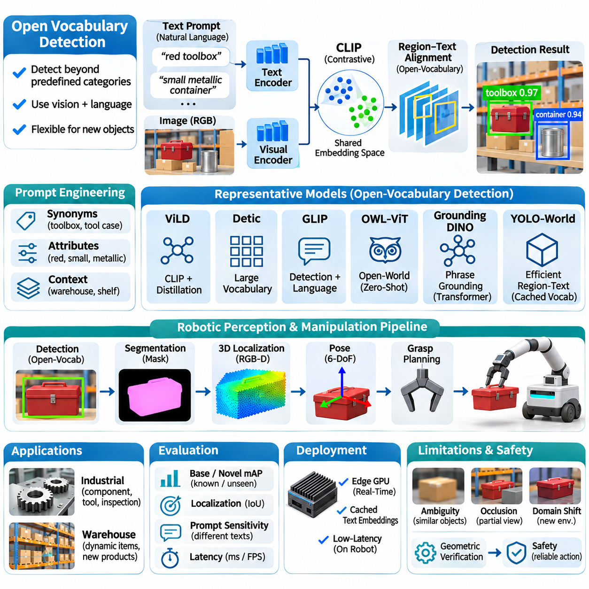{width="7.268055555555556in" height="7.268055555555556in"}

개방형 어휘 객체 검출(Open-Vocabulary Detection)은 고정된 사전 정의 객체 범주(Predefined Object Category)를 넘어 시각적 인식(Visual Recognition)을 가능하게 함으로써 기존 객체 검출(Object Detection)의 범위를 확장한다. 전통적인 지도학습 기반 검출기(Supervised Detector)는 일반적으로 주석이 지정된 학습 데이터셋(Annotated Training Dataset)에 포함된 객체 범주로 제한된다. 반면 개방형 어휘 객체 검출은 시각적 표현(Visual Representation)과 언어적 표현(Linguistic Representation)을 통합하여 로봇 시스템이 자연어(Natural Language)로 설명된 객체를 식별할 수 있도록 한다.

개방형 어휘 객체 검출의 근본적인 목적은 사전에 정의된 분류 범주(Classification Category)와 범주별 주석(Category-Specific Annotation)에 대한 의존성을 감소시키는 것이다. 객체 인식(Object Recognition)을 폐쇄형 집합 분류 문제(Closed-Set Classification Problem)로 처리하는 대신, 이러한 모델은 시각적 특징(Visual Feature)과 의미론적 설명(Semantic Description) 사이의 관계를 구축한다. 이러한 접근 방식은 다양하고 익숙하지 않거나 동적으로 변화하는 객체가 존재하는 환경에서 더욱 유연한 인지(Flexible Perception)를 가능하게 한다.

비전 언어 학습(Vision-Language Learning)은 개방형 어휘 객체 검출을 위한 이론적 및 연산적 기반(Theoretical and Computational Foundation)을 제공한다. 이미지와 해당 텍스트 설명(Textual Description)이 포함된 대규모 멀티모달 데이터셋(Large-Scale Multimodal Dataset)은 신경망(Neural Network)이 시각적 외형(Visual Appearance)과 언어적 개념(Linguistic Concept) 사이의 관계를 학습할 수 있도록 한다. 이러한 학습된 표현(Learned Representation)은 시각적 관측 정보(Visual Observation)와 관련 텍스트 설명을 비교함으로써 이전에 접하지 못한 객체 범주를 인식할 수 있도록 한다.

대조적 언어 이미지 사전 학습(Contrastive Language-Image Pretraining, CLIP)은 개방형 어휘 인식(Open-Vocabulary Recognition)을 위한 중요한 기반 기술이다. CLIP은 전용 인코더(Dedicated Encoder)를 사용하여 이미지와 텍스트를 독립적으로 처리하고, 각각의 표현을 공유 임베딩 공간(Shared Embedding Space)에 투영한다. 대조 학습(Contrastive Learning)은 서로 대응하는 이미지-텍스트 쌍(Image-Text Pair) 사이의 유사도(Similarity)를 증가시키는 동시에 관련성이 없는 쌍 사이의 유사도를 감소시켜 전이 가능한 의미론적 표현(Transferable Semantic Representation)을 구축한다.

개방형 어휘 객체 검출은 이미지 수준의 비전 언어 인식(Image-Level Vision-Language Recognition)을 공간적 위치가 지정된 객체 식별(Spatially Localized Object Identification)로 확장한다. 전체 이미지를 텍스트 설명과 비교하는 대신, 검출 아키텍처(Detection Architecture)는 개별 이미지 영역(Image Region)을 의미론적 임베딩(Semantic Embedding)과 연결한다. 후보 객체 영역(Candidate Object Region)은 텍스트 표현(Text Representation)을 기준으로 평가되며, 이를 통해 시스템은 유연한 언어적 쿼리(Linguistic Query)로 설명된 객체에 대한 경계 상자(Bounding Box)를 생성할 수 있다.

텍스트 프롬프트(Text Prompt)는 객체 검출 시스템이 식별해야 하는 객체를 정의하는 의미론적 명세(Semantic Specification)로 기능한다. 프롬프트에는 객체 이름(Object Name), 설명적 속성(Descriptive Attribute), 특정 작업과 관련된 문맥 정보(Contextual Information)가 포함될 수 있다. 예를 들어, 모바일 매니퓰레이터(Mobile Manipulator)는 가능한 모든 객체 특성의 조합에 대해 별도로 학습된 검출기를 필요로 하지 않고도 빨간색 공구 상자(Red Toolbox) 또는 소형 금속 용기(Small Metallic Container)를 식별하라는 요청을 받을 수 있다.

프롬프트 엔지니어링(Prompt Engineering)은 서로 다른 텍스트 설명이 서로 다른 의미론적 표현을 생성할 수 있기 때문에 개방형 어휘 객체 검출 성능(Detection Performance)에 영향을 미친다. 모호한 용어(Ambiguous Terminology), 불충분한 문맥 정보(Insufficient Contextual Information), 일관되지 않은 객체 명칭(Inconsistent Object Naming)은 인식 정확도(Recognition Accuracy)를 감소시킬 수 있다. 프롬프트 템플릿(Prompt Template), 동의어 확장(Synonym Expansion), 설명적 속성은 의미론적 정렬(Semantic Alignment)을 향상시킬 수 있지만, 그 효과는 모델과 운영 환경(Operating Environment)에 따라 달라진다.

대표적인 개방형 어휘 객체 검출 아키텍처에는 ViLD, Detic, GLIP, OWL-ViT, Grounding DINO, YOLO-World가 포함된다. 이러한 모델은 지식 증류(Knowledge Distillation), 비전 언어 사전 학습(Vision-Language Pretraining), 영역-텍스트 정렬(Region-Text Alignment), 트랜스포머 아키텍처(Transformer Architecture), 효율적인 검출 네트워크(Efficient Detection Network)의 다양한 조합을 활용한다. 이들 모델의 공통적인 목적은 모든 객체 범주에 대한 포괄적인 경계 상자 주석(Bounding Box Annotation)을 요구하지 않으면서 인식 가능한 객체 범주를 확장하는 것이다.

Grounding DINO는 트랜스포머 기반 객체 검출(Transformer-Based Object Detection)과 언어 조건부 시각적 그라운딩(Language-Conditioned Visual Grounding)을 결합한다. 텍스트 설명은 시각적 특징과 언어적 특징(Linguistic Feature) 사이의 상호작용을 통해 해당 객체의 식별과 위치 추정을 유도한다. 이러한 아키텍처는 구문 수준 객체 위치 추정(Phrase-Level Object Localization)을 가능하게 하며, 로봇 인지 시스템(Robotic Perception System)이 자연어 명령(Natural Language Instruction)을 복잡한 시각적 환경 내의 특정 영역과 연결할 수 있도록 한다.

YOLO-World는 개방형 어휘 인식과 영역-텍스트 정렬을 통해 연산 효율적인 YOLO 검출 프레임워크(YOLO Detection Framework)를 확장한다. 해당 아키텍처는 유연한 객체 범주 정의(Flexible Object Category Definition)를 지원하기 위해 텍스트 임베딩(Text Embedding)과 시각적 특징 처리(Visual Feature Processing)를 통합한다. 어휘 임베딩(Vocabulary Embedding)을 사전에 계산하면 반복적인 텍스트 처리 오버헤드(Text-Processing Overhead)를 감소시킬 수 있으므로, 이러한 접근 방식은 모바일 로봇 플랫폼(Mobile Robotic Platform)에서의 저지연 인지(Low-Latency Perception)에 특히 적합하다.

모바일 매니퓰레이터에서 개방형 어휘 객체 검출은 인간의 명령(Human Instruction)과 자율적인 물리적 행동(Autonomous Physical Action) 사이의 의미론적 인터페이스(Semantic Interface)를 제공한다. 익숙하지 않은 도구를 가져오라는 요청을 받은 로봇은 언어적 설명을 검출 쿼리(Detection Query)로 변환하고 주변 환경을 탐색할 수 있다. 이후 검출된 객체 영역(Detected Object Region)은 3차원 위치 추정(3D Localization), 자세 추정(Pose Estimation), 파지 계획(Grasp Planning), 모션 실행(Motion Execution)을 위한 입력 정보를 제공한다.

개방형 어휘 객체 검출은 시각적 그라운딩(Visual Grounding), 제로샷 검출(Zero-Shot Detection), 인스턴스 분할(Instance Segmentation)과도 밀접한 관련이 있다. 시각적 그라운딩은 언어적 표현과 이미지 영역 사이의 공간적 대응 관계(Spatial Correspondence)를 구축하며, 제로샷 검출은 범주별 검출 학습(Category-Specific Detection Training) 없이 해당 객체 범주를 인식하는 능력을 평가한다. 분할 모델(Segmentation Model)과 통합하면 더욱 정밀한 기하학적 분석(Geometric Analysis)과 로봇 조작(Robotic Manipulation)을 위한 픽셀 수준 객체 마스크(Pixel-Level Object Mask)를 생성할 수 있다.

산업 및 물류 창고 환경(Industrial and Warehouse Environment)에서는 제품 범주(Product Category), 포장 디자인(Packaging Design), 도구(Tool), 재고 품목(Inventory Item)이 빈번하게 변화할 때 개방형 어휘 객체 검출의 이점을 활용할 수 있다. 새로운 객체가 도입될 때마다 주석 데이터셋(Annotated Dataset)을 수집하고 검출 모델을 재학습(Retraining)하는 대신, 운영자는 텍스트 어휘(Textual Vocabulary)를 갱신할 수 있다. 그러나 미세한 시각적 차이(Subtle Visual Difference)를 가진 특수 부품(Specialized Component)의 경우 여전히 도메인 특화 적응(Domain-Specific Adaptation)과 추가 학습(Additional Training)이 필요할 수 있다.

개방형 어휘 객체 검출 모델의 배포(Deployment)를 위해서는 시각 인코더 복잡도(Visual Encoder Complexity), 언어 인코더 오버헤드(Language Encoder Overhead), 어휘 크기(Vocabulary Size), 메모리 사용량(Memory Consumption), 추론 지연시간(Inference Latency)을 고려해야 한다. 텍스트 임베딩 캐싱(Text Embedding Caching), 모델 압축(Model Compression), 혼합 정밀도 추론(Mixed-Precision Inference), 하드웨어 가속(Hardware Acceleration)은 연산 효율성(Computational Efficiency)을 향상시킬 수 있다. 성능 평가(Evaluation)는 기존에 학습된 범주와 새로운 범주(Novel Category)에 대한 성능을 구분하면서 위치 추정 정확도(Localization Accuracy), 프롬프트 민감도(Prompt Sensitivity), 운영 신뢰성(Operational Reliability)을 측정해야 한다.

이러한 유연성에도 불구하고 개방형 어휘 객체 검출은 임의의 객체 또는 언어적 설명에 대한 정확한 인식을 보장할 수 없다. 의미론적 모호성(Semantic Ambiguity), 도메인 변화(Domain Shift), 가려짐(Occlusion), 불충분한 시각적 세부 정보(Insufficient Visual Detail)는 잘못된 예측(Incorrect Prediction)을 발생시킬 수 있다. 보다 포괄적인 모바일 조작 프레임워크(Mobile Manipulation Framework)에서 여기에서 설명한 대표적인 아키텍처는 언어 조건부 인지(Language-Conditioned Perception)가 기하학적 검증(Geometric Verification)과 안전성 검증(Safety Validation)의 필요성을 유지하면서 로봇의 적응 능력(Robotic Adaptability)을 어떻게 확장할 수 있는지를 보여준다.

## 07 Zero Shot Detection

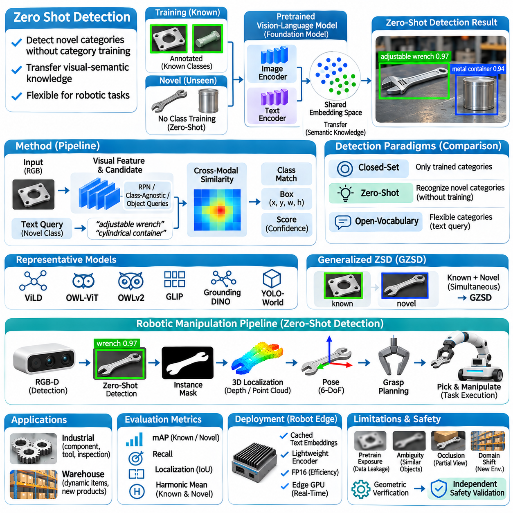{width="7.268055555555556in" height="7.268055555555556in"}

제로샷 검출(Zero-Shot Detection)은 범주별 검출 학습(Category-Specific Detection Training) 없이 객체 범주의 인식(Recognition)과 공간적 위치 추정(Spatial Localization)을 가능하게 하는 고급 객체 검출 패러다임(Advanced Object Detection Paradigm)이다. 모든 대상 범주에 대한 주석이 지정된 학습 사례(Annotated Training Example)를 필요로 하는 기존의 지도학습 기반 검출기(Supervised Detector)와 달리, 제로샷 검출은 이전에 획득한 시각적 및 의미론적 지식(Visual and Semantic Knowledge)을 새로운 범주(Novel Category)로 전이하여 자율 로봇 시스템(Autonomous Robotic System)의 적응 능력(Adaptability)을 향상시킨다.

제로샷 검출의 기본 원리는 작업 특화 학습(Task-Specific Training) 과정에서 명시적으로 표현되지 않은 개념을 기계학습 모델(Machine Learning Model)이 어떻게 인식하는지를 연구하는 제로샷 학습(Zero-Shot Learning)에서 비롯된다. 지식 전이(Knowledge Transfer)는 의미론적 관계(Semantic Relationship), 공유 특징 표현(Shared Feature Representation), 사전 학습된 멀티모달 임베딩(Pretrained Multimodal Embedding)을 통해 이루어진다. 이러한 메커니즘은 객체 검출 시스템(Object Detection System)이 기존 학습 범주(Training Category)를 넘어 일반화(Generalization)할 수 있도록 한다.

제로샷 검출은 익숙하지 않은 객체(Unfamiliar Object)를 처리하는 방식에서 기존의 폐쇄형 집합 검출(Closed-Set Detection)과 차이가 있다. 폐쇄형 집합 검출기는 사전에 정의된 범주 분포(Predefined Category Distribution)에 따라 관측 정보를 분류하므로 익숙하지 않은 객체를 잘못된 기존 범주(Known Category)에 할당할 가능성이 있다. 반면 제로샷 검출기는 시각적 관측 정보(Visual Observation)를 새로운 범주의 의미론적 표현(Semantic Representation)과 비교하여 추가적인 범주별 모델 학습(Category-Specific Model Training) 없이 객체를 인식할 수 있도록 한다.

제로샷 검출과 개방형 어휘 객체 검출(Open-Vocabulary Detection)은 밀접한 관련이 있지만 서로 다른 능력에 중점을 둔다. 개방형 어휘 객체 검출은 유연한 의미론적 쿼리(Flexible Semantic Query)를 통해 인식 가능한 객체 범주를 확장하는 데 중점을 두는 반면, 제로샷 검출은 작업 특화 학습에서 제외된 범주에 대한 일반화 능력(Generalization Capability)에 중점을 둔다. 따라서 개방형 어휘 객체 검출기는 적절하게 정의된 새로운 범주를 대상으로 평가될 때 제로샷 능력(Zero-Shot Capability)을 입증할 수 있다.

의미론적 임베딩(Semantic Embedding)은 기존 범주와 새로운 객체 범주 사이에서 지식을 전이하기 위한 연산 메커니즘(Computational Mechanism)을 제공한다. 객체 이름(Object Name), 설명적 속성(Descriptive Attribute), 언어적 관계(Linguistic Relationship)는 의미론적 특징 공간(Semantic Feature Space) 내의 고차원 벡터(High-Dimensional Vector)로 표현된다. 이후 후보 객체 영역(Candidate Object Region)에서 추출된 시각적 표현(Visual Representation)을 이러한 의미론적 임베딩과 비교하여 범주 대응 관계(Category Correspondence)와 인식 신뢰도(Recognition Confidence)를 추정한다.

비전 언어 기반 모델(Vision-Language Foundation Model)은 제로샷 검출의 실질적인 활용 능력을 크게 확장하였다. 대규모 이미지-텍스트 데이터셋(Large-Scale Image-Text Dataset)을 기반으로 사전 학습된 모델은 다양한 시각적 개념(Visual Concept)과 자연어 설명(Natural Language Description)에 걸쳐 의미론적 관계를 획득한다. 이러한 표현은 후속 검출 아키텍처(Downstream Detection Architecture)가 전용 경계 상자 주석(Dedicated Bounding Box Annotation)이나 범주별 미세 조정(Category-Specific Fine-Tuning) 없이 새로운 객체 범주를 식별할 수 있도록 한다.

일반적인 제로샷 검출 파이프라인(Zero-Shot Detection Pipeline)은 시각적 특징 추출(Visual Feature Extraction), 후보 객체 위치 추정(Candidate Object Localization), 의미론적 쿼리 인코딩(Semantic Query Encoding), 교차 모달 유사도 추정(Cross-Modal Similarity Estimation), 경계 상자 예측(Bounding Box Prediction)으로 구성된다. 아키텍처에 따라 후보 영역(Candidate Region)은 영역 제안 네트워크(Region Proposal Network), 클래스 비종속적 위치 추정 모듈(Class-Agnostic Localization Module), 트랜스포머 객체 쿼리(Transformer Object Query)로부터 생성될 수 있다. 이후 의미론적 매칭(Semantic Matching)을 통해 검출된 영역 중 요청된 범주에 해당하는 영역을 결정한다.

제로샷 검출을 지원하는 대표적인 아키텍처에는 ViLD, OWL-ViT, OWLv2, GLIP, Grounding DINO, YOLO-World가 포함된다. 이러한 모델은 시각적 지식 증류(Visual Knowledge Distillation), 대조 학습(Contrastive Learning), 언어 조건부 어텐션(Language-Conditioned Attention), 영역-텍스트 정렬(Region-Text Alignment)의 다양한 조합을 활용한다. 이러한 모델의 효과는 사전 학습 범위(Pretraining Coverage), 위치 추정 능력(Localization Capability), 의미론적 표현 품질(Semantic Representation Quality), 대상 환경(Target Environment)의 특성에 따라 달라진다.

일반화된 제로샷 검출(Generalized Zero-Shot Detection, GZSD)은 이전에 학습된 객체 범주와 새로운 객체 범주를 동시에 인식하도록 요구함으로써 기존 제로샷 검출을 확장한다. 이러한 평가 환경(Evaluation Setting)은 익숙한 객체와 익숙하지 않은 객체가 빈번하게 공존하는 실제 로봇 운영 환경(Practical Robotic Environment)을 더욱 정확하게 반영한다. 일반화된 제로샷 검출은 분류 편향(Classification Bias), 신뢰도 보정(Confidence Calibration), 의미론적 범주 간 경쟁(Competition Between Semantic Categories)과 관련된 추가적인 기술적 과제를 발생시킨다.

텍스트 기반 쿼리(Text-Based Query)는 제로샷 검출기가 범주 이름(Category Name)과 설명적 속성을 사용하여 객체를 인식할 수 있도록 한다. 예를 들어, 모바일 매니퓰레이터(Mobile Manipulator)는 새롭게 학습된 검출기 없이도 원통형 금속 용기(Cylindrical Metal Container), 조절식 렌치(Adjustable Wrench), 익숙하지 않은 포장 부품(Unfamiliar Packaging Component)을 탐색할 수 있다. 그러나 모호한 설명(Ambiguous Description)과 시각적으로 유사한 객체(Visually Similar Object)는 의미론적 구별 능력(Semantic Discrimination)을 감소시키고 부정확한 위치 추정(Incorrect Localization)을 초래할 수 있다.

모바일 매니퓰레이터에서 제로샷 검출은 자연어 명령(Natural Language Instruction)과 환경 관측 정보(Environmental Observation)를 연결함으로써 유연한 작업 실행(Flexible Task Execution)에 기여한다. 요청된 객체가 검출되면 해당 경계 상자(Bounding Box)를 깊이 측정값(Depth Measurement)과 연결하여 객체의 3차원 위치(Three-Dimensional Location)를 추정할 수 있다. 이후 인스턴스 분할(Instance Segmentation), 객체 자세 추정(Object Pose Estimation), 파지 계획(Grasp Planning)을 통해 인지 결과(Perception Result)를 실제 조작에 활용할 수 있는 실행 가능한 조작 정보(Actionable Manipulation Information)로 정교화한다.

산업 및 물류 창고 환경(Industrial and Warehouse Environment)은 제품 종류(Product Variety), 재고 구성(Inventory Configuration), 포장 형태(Packaging Format), 공구 사용 요구사항(Tooling Requirement)이 빈번하게 변화하기 때문에 제로샷 검출을 실질적으로 활용할 수 있는 기회를 제공한다. 제로샷 능력은 데이터셋 수집(Dataset Collection)과 검출기 재학습(Detector Retraining)에 필요한 초기 작업 부담을 감소시킬 수 있다. 그러나 시각적으로 유사한 산업용 부품(Industrial Component)을 인식하기 위해서는 추가적인 기하학적 측정(Geometric Measurement)이나 도메인 특화 인식 모델(Domain-Specific Recognition Model)이 필요할 수 있다.

제로샷 검출 평가(Zero-Shot Detection Evaluation)는 작업 특화 학습 및 테스트 데이터셋(Task-Specific Training and Testing Dataset) 내에서 기존 범주와 새로운 범주를 명확하게 분리할 것을 요구한다. 성능 평가 지표(Performance Metric)에는 평균 정밀도의 평균(Mean Average Precision, mAP), 재현율(Recall), 위치 추정 정확도(Localization Accuracy), 기존 범주와 새로운 범주에 대한 성능의 조화 평균(Harmonic Mean)이 포함된다. 일반화 성능 평가 결과(Generalization Result)를 해석할 때는 기반 모델의 사전 학습(Foundation Model Pretraining) 과정에서 평가 대상 범주(Evaluation Category)에 노출되었을 가능성도 고려해야 한다.

모바일 로봇 플랫폼(Mobile Robotic Platform)에 제로샷 검출 모델을 배포(Deployment)하기 위해서는 의미론적 일반화(Semantic Generalization), 검출 정확도(Detection Accuracy), 연산 복잡도(Computational Complexity), 추론 지연시간(Inference Latency) 사이의 균형을 고려해야 한다. 텍스트 임베딩 캐싱(Text Embedding Caching), 경량 시각 인코더(Lightweight Visual Encoder), 혼합 정밀도 추론(Mixed-Precision Inference), 최적화된 하드웨어 가속(Optimized Hardware Acceleration)은 실행 효율성(Execution Efficiency)을 향상시킬 수 있다. 다중 시점 관측(Multi-View Observation), 시간적 일관성 검증(Temporal Consistency Verification), 불확실성 인식 의사결정 메커니즘(Uncertainty-Aware Decision Mechanism)을 통해 운영 신뢰성(Operational Reliability)을 강화할 수 있다.

제로샷 검출은 무제한적인 인식 능력(Unlimited Recognition Capability)이나 기존 학습 데이터(Prior Training Data)로부터의 완전한 독립성을 의미하지 않는다. 제로샷 검출의 효과는 사전 학습 지식(Pretraining Knowledge), 의미론적 모호성(Semantic Ambiguity), 도메인 변화(Domain Shift), 가려짐(Occlusion), 시각적 해상도(Visual Resolution)에 의해 여전히 제한된다. 제공된 장 구성(Chapter Outline)을 이러한 대표적인 방법론과 공학적 원리(Engineering Principle)를 통해 확장함으로써, 제로샷 인지(Zero-Shot Perception)가 기하학적 검증(Geometric Verification)과 독립적인 안전성 검증(Independent Safety Validation)의 필요성을 유지하면서 적응형 모바일 조작(Adaptable Mobile Manipulation)을 어떻게 지원하는지를 보여준다.

## 08 Instance Segmentation

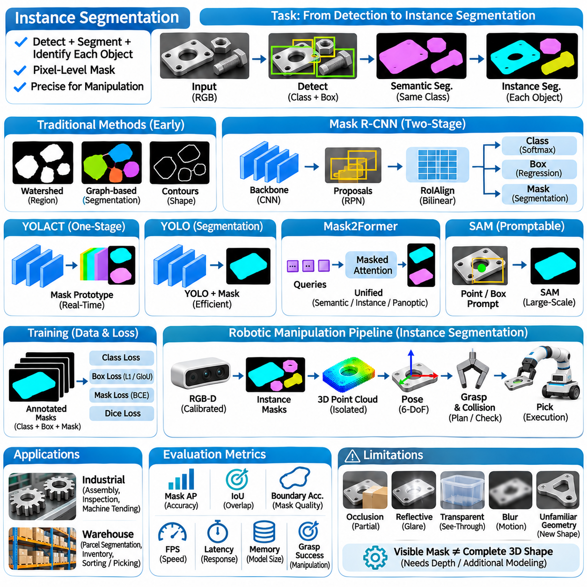{width="7.268055555555556in" height="7.268055555555556in"}

인스턴스 분할(Instance Segmentation)은 객체 검출(Object Detection)과 픽셀 수준 객체 식별(Pixel-Level Object Identification)을 결합한 고급 시각적 인지 기술(Advanced Visual Perception Technique)이다. 개별 객체를 직사각형 경계 상자(Rectangular Bounding Box)로 표현하는 기존 객체 검출과 달리, 인스턴스 분할은 검출된 각각의 객체에 대해 독립적인 분할 마스크(Segmentation Mask)를 생성한다. 이러한 상세한 공간적 표현(Spatial Representation)은 정밀한 물리적 상호작용(Physical Interaction)과 로봇 조작(Robotic Manipulation)에 특히 중요하다.

의미론적 분할(Semantic Segmentation)과 인스턴스 분할은 이미지 내의 개별 객체(Individual Object)를 처리하는 방식에서 차이가 있다. 의미론적 분할은 모든 픽셀(Pixel)에 범주 레이블(Category Label)을 할당하지만 동일한 범주에 속하는 개별 객체를 구분하지 않는다. 반면 인스턴스 분할은 각각의 객체를 독립적으로 식별하여 로봇 시스템(Robotic System)이 서로 중첩되거나 인접한 공간 영역(Spatial Region)에 위치하는 동일하거나 시각적으로 유사한 여러 객체를 구별할 수 있도록 한다.

인스턴스 분할의 근본적인 목적은 객체 식별 정보(Object Identity), 의미론적 범주(Semantic Category), 공간적 위치(Spatial Location), 픽셀 수준 경계(Pixel-Level Boundary)를 동시에 결정하는 것이다. 분할 마스크는 개별 객체 인스턴스(Object Instance)에 해당하는 가시적 이미지 영역(Visible Image Region)을 나타낸다. 인스턴스 분할은 경계 상자만 사용하는 방식보다 더욱 정확한 기하학적 정보(Geometric Information)를 제공함으로써 정밀한 공간 이해(Spatial Understanding)가 요구되는 고급 인지 작업(Advanced Perception Task)을 지원한다.

전통적인 인스턴스 분할 접근 방식은 일반적으로 객체 검출과 수작업으로 설계된 이미지 분할 알고리즘(Handcrafted Image Segmentation Algorithm)을 결합하였다. 워터셰드 분할(Watershed Segmentation), 그래프 기반 분할(Graph-Based Segmentation), 윤곽선 추출(Contour Extraction)과 같은 기술은 개별 객체의 경계(Object Boundary)를 추정하는 데 사용되었다. 그러나 이러한 방법은 복잡한 조명 조건(Complex Illumination Condition), 부분적 가려짐(Partial Occlusion), 배경 간섭(Background Interference), 상당한 객체 외형 변화(Object Appearance Variation)에 대해 제한적인 강건성(Robustness)을 나타내는 경우가 많았다.

Mask R-CNN은 추가적인 분할 분기(Segmentation Branch)를 통합하여 Faster R-CNN을 확장한 영향력 있는 딥러닝 아키텍처(Deep Learning Architecture)를 도입하였다. 해당 신경망은 객체 범주(Object Category), 경계 상자 좌표(Bounding Box Coordinate), 인스턴스별 분할 마스크(Instance-Specific Segmentation Mask)를 동시에 예측한다. 이러한 영역 기반 아키텍처(Region-Based Architecture)는 분류(Classification), 위치 추정(Localization), 마스크 예측(Mask Prediction)을 위한 독립적인 연산 분기(Computational Branch)를 유지하면서 정확한 객체 위치 추정과 분할을 가능하게 한다.

관심 영역 정렬(Region of Interest Alignment, RoIAlign)은 Mask R-CNN의 중요한 구성요소(Component)이다. 공간적 양자화 오차(Spatial Quantization Error)를 발생시키는 기존 영역 풀링 연산(Region Pooling Operation)과 달리, RoIAlign은 쌍선형 보간(Bilinear Interpolation)을 사용하여 이미지 특징(Image Feature)과 후보 객체 영역(Candidate Object Region) 사이의 대응 관계(Correspondence)를 유지한다. 향상된 공간적 정렬(Spatial Alignment)은 특히 복잡한 형상(Complex Shape)과 미세한 기하학적 세부 특징(Fine Geometric Detail)을 가진 객체에 대해 더욱 정확한 분할 마스크를 생성하는 데 기여한다.

1단계 인스턴스 분할 아키텍처(One-Stage Instance Segmentation Architecture)는 연산 효율성(Computational Efficiency)을 향상시키고 추론 지연시간(Inference Latency)을 감소시키기 위해 개발되었다. YOLACT 및 분할 기능을 지원하는 YOLO 변형 모델(Segmentation-Enabled YOLO Variant)과 같은 모델은 객체 검출 결과와 함께 마스크 원형(Mask Prototype) 또는 관련 마스크 표현(Mask Representation)을 생성한다. 이러한 접근 방식은 실시간 인지(Real-Time Perception)와 제한된 연산 자원(Limited Computational Resource)이 중요한 공학적 제약조건(Engineering Constraint)으로 작용할 때 2단계 아키텍처(Two-Stage Architecture)에 대한 실용적인 대안을 제공한다.

트랜스포머 기반 인스턴스 분할 아키텍처(Transformer-Based Instance Segmentation Architecture)는 개별 객체와 해당 마스크를 식별하기 위해 어텐션 메커니즘(Attention Mechanism)과 쿼리 기반 예측(Query-Based Prediction)을 도입한다. Mask2Former와 같은 모델은 관련 공간 영역에 특징 처리(Feature Processing)를 집중시키기 위해 마스킹된 어텐션(Masked Attention)을 활용한다. 이러한 아키텍처는 통합된 인지 시스템(Unified Perception System) 내에서 의미론적 분할, 인스턴스 분할, 파놉틱 분할(Panoptic Segmentation)을 지원할 수 있는 유연한 분할 프레임워크(Flexible Segmentation Framework)를 제공한다.

범용 분할 모델(Segment Anything Model, SAM)과 그 후속 모델은 대규모 시각적 사전 학습(Large-Scale Visual Pretraining)을 기반으로 프롬프트 기반 분할 능력(Promptable Segmentation Capability)을 도입한다. 점(Point)과 경계 상자와 같은 공간적 프롬프트(Spatial Prompt)로부터 분할 마스크를 생성할 수 있다. 개방형 어휘 객체 검출기(Open-Vocabulary Detector) 또는 제로샷 검출기(Zero-Shot Detector)와 통합할 경우, 프롬프트 기반 분할 모델은 모든 대상 범주에 대한 전용 분할 학습(Dedicated Segmentation Training) 없이 객체별 마스크 생성(Object-Specific Mask Generation)을 가능하게 한다.

인스턴스 분할 학습(Instance Segmentation Training)은 일반적으로 개별 객체 인스턴스에 대한 픽셀 수준 마스크(Pixel-Level Mask)가 포함된 주석 데이터셋(Annotated Dataset)을 필요로 한다. 주석 품질(Annotation Quality)은 학습된 객체 경계와 공간적 표현의 정확도에 직접적인 영향을 미친다. 학습 목적 함수(Training Objective)는 아키텍처 요구사항(Architectural Requirement)에 따라 분류 손실(Classification Loss), 경계 상자 회귀 손실(Bounding Box Regression Loss), 이진 마스크 손실(Binary Mask Loss), 다이스 손실(Dice Loss), 기타 분할 관련 최적화 함수(Segmentation-Related Optimization Function)를 결합할 수 있다.

모바일 매니퓰레이터(Mobile Manipulator)에서 인스턴스 분할은 객체 위치 추정(Object Localization), 자세 추정(Pose Estimation), 파지 계획(Grasp Planning)을 위한 필수적인 기하학적 정보를 제공한다. 분할 마스크를 보정된 RGB-D 관측 정보(Calibrated RGB-D Observation)와 연결하면 개별 객체에 해당하는 깊이 측정값(Depth Measurement)을 더욱 선택적으로 추출할 수 있다. 이러한 처리 과정은 3차원 재구성(Three-Dimensional Reconstruction) 과정에서 주변 객체(Surrounding Object)와 배경 표면(Background Surface)으로부터 발생하는 간섭(Interference)을 감소시킨다.

인스턴스 분할은 여러 객체가 부분적으로 중첩되거나 서로 인접한 위치를 차지하는 복잡하게 혼재된 환경(Cluttered Environment)에서 특히 유용하다. 로봇 빈 피킹(Robotic Bin Picking)에서는 개별 분할 마스크를 통해 대상 부품(Target Component)을 인접 품목(Neighboring Item) 및 지지 표면(Supporting Surface)과 구별할 수 있다. 이러한 마스크는 객체별 포인트 클라우드 추출(Object-Specific Point Cloud Extraction), 파지 후보 생성(Grasp Candidate Generation), 충돌 평가(Collision Assessment), 조작 순서 계획(Manipulation Sequence Planning)을 지원할 수 있다.

산업 응용 분야(Industrial Application)에는 부품 식별(Component Identification), 조립 검증(Assembly Verification), 자재 취급(Material Handling), 표면 검사(Surface Inspection), 자동화된 머신 텐딩(Automated Machine Tending)이 포함된다. 물류 창고 응용 분야(Warehouse Application)에는 소포 분할(Parcel Segmentation), 재고 인식(Inventory Recognition), 혼합 제품 피킹(Mixed-Product Picking), 자동 분류(Automated Sorting)가 포함된다. 객체가 불규칙한 기하학적 형상(Irregular Geometry), 중첩된 경계(Overlapping Boundary)를 가지거나 주변 물체와의 이격 거리가 제한적인 경우 분할 정확도(Segmentation Accuracy)는 특히 중요해진다.

인스턴스 분할 모델의 배포 및 평가(Deployment and Evaluation)를 위해서는 분할 정확도, 추론 지연시간, 메모리 사용량(Memory Consumption), 연산 효율성을 고려해야 한다. 일반적인 성능 평가 지표(Evaluation Metric)에는 마스크 평균 정밀도(Mask Average Precision, Mask AP), 교집합 대 합집합 비율(Intersection over Union, IoU), 경계 정확도(Boundary Accuracy), 처리 프레임 속도(Processing Frame Rate)가 포함된다. 운영 검증(Operational Validation)에서는 실제 작업 조건(Actual Working Condition)에서의 객체 위치 추정 오차(Object Localization Error), 파지 성공률(Grasp Success Rate), 분할 신뢰성(Segmentation Reliability)도 추가적으로 측정해야 한다.

인스턴스 분할은 여전히 심각한 가려짐(Severe Occlusion), 반사 표면(Reflective Surface), 투명 소재(Transparent Material), 모션 블러(Motion Blur), 익숙하지 않은 객체 형상(Unfamiliar Object Geometry)에 민감하다. 또한 가시적 분할 마스크(Visible Segmentation Mask)가 반드시 완전한 3차원 객체 형상(Complete Three-Dimensional Object Shape)을 나타내는 것은 아니다. 제공된 장 구성(Chapter Outline)을 이러한 대표적인 아키텍처와 공학적 원리(Engineering Principle)를 통해 확장함으로써, 인스턴스 분할이 픽셀 수준 시각적 인지(Pixel-Level Visual Perception)와 신뢰성 높은 물리적 조작(Reliable Physical Manipulation)을 어떻게 연결하는지를 보여준다.

## 09 Dataset Design

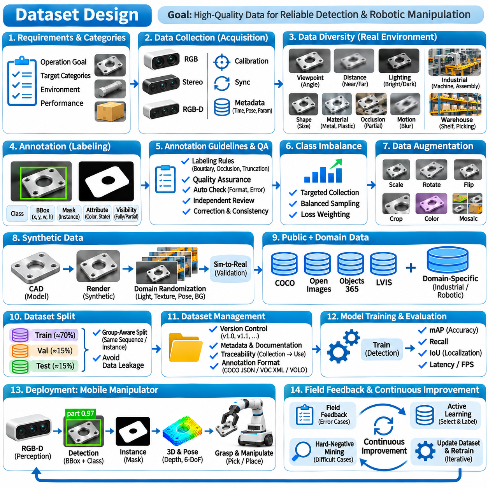{width="7.268055555555556in" height="7.268055555555556in"}

데이터셋 설계(Dataset Design)는 모바일 매니퓰레이터(Mobile Manipulator)를 위한 신뢰성 높은 객체 검출 시스템(Object Detection System)을 개발하는 데 있어 핵심적인 공학적 프로세스(Engineering Process)이다. 객체 검출 성능(Detection Performance)은 신경망 아키텍처(Neural Network Architecture)뿐만 아니라 학습 데이터(Training Data)의 품질(Quality), 다양성(Diversity), 일관성(Consistency), 대표성(Representativeness)에 따라 달라진다. 체계적으로 설계된 데이터셋은 기계학습 능력(Machine Learning Capability)과 실제 로봇 운영 환경(Actual Robotic Operating Environment) 사이의 연결 관계를 확립한다.

데이터셋 설계 프로세스는 운영 요구사항(Operational Requirement), 대상 객체 범주(Target Object Category), 환경 조건(Environmental Condition), 기대 검출 성능(Expected Detection Performance)을 정의하는 것에서 시작된다. 객체 범주는 모바일 매니퓰레이터가 작업 실행(Task Execution) 과정에서 인식(Recognition), 위치 추정(Localization), 상호작용(Interaction)을 수행해야 하는 물리적 개체(Physical Entity)를 반영해야 한다. 명확하게 정의된 범주 경계(Category Boundary)는 의미론적 모호성(Semantic Ambiguity)을 감소시키고 데이터 수집(Data Collection)과 주석 지정(Annotation) 전반의 일관성을 향상시킨다.

데이터 수집은 로봇 운영(Robotic Operation) 과정에서 발생하는 실제 시각적 관측 정보(Visual Observation)의 분포를 반영해야 한다. 이미지는 객체 방향(Object Orientation), 관측 거리(Viewing Distance), 카메라 각도(Camera Angle), 조명(Illumination), 배경 복잡도(Background Complexity), 객체 배치(Object Arrangement)의 다양한 변화를 포함해야 한다. 모바일 매니퓰레이터의 경우 이동 플랫폼의 움직임(Mobile Platform Movement), 로봇팔 위치 제어(Robotic Arm Positioning), 동적 센서 구성(Dynamic Sensor Configuration)으로 인해 발생하는 관측 시점 변화(Perspective Change)에 특별한 주의를 기울여야 한다.

객체 다양성(Object Diversity)은 개별 학습 사례(Individual Training Example)를 넘어 일반화(Generalization)할 수 있는 객체 검출 모델(Object Detection Model)을 개발하는 데 필수적이다. 데이터셋에는 객체 치수(Object Dimension), 기하학적 형상(Geometric Shape), 표면 소재(Surface Material), 색상(Color), 질감(Texture), 제조 특성(Manufacturing Characteristic)의 다양한 변화가 포함되어야 한다. 각 객체 범주에 속하는 여러 물리적 인스턴스(Physical Instance)를 수집함으로써 모델이 특정 학습 객체에만 관련된 피상적 특징(Superficial Feature)을 학습하는 것을 방지할 수 있다.

환경 다양성(Environmental Diversity)은 현실적인 운영 조건(Realistic Operating Condition)에서 객체 검출의 강건성(Detection Robustness)을 향상시키는 데 기여한다. 산업 및 물류 창고 데이터셋(Industrial and Warehouse Dataset)은 필요한 경우 생산 설비(Production Equipment), 보관 선반(Storage Shelf), 운송 용기(Transportation Container), 컨베이어 시스템(Conveyor System), 작업 인력(Working Personnel)을 포함해야 한다. 부분적 가려짐(Partial Occlusion), 반사 표면(Reflective Surface), 그림자(Shadow), 모션 블러(Motion Blur), 밀집 배치 객체(Densely Arranged Object)와 같은 까다로운 조건도 체계적으로 포함해야 한다.

데이터 획득 시스템(Data Acquisition System)은 모바일 로봇 플랫폼(Mobile Robotic Platform)에 통합된 RGB 카메라(RGB Camera), RGB-D 카메라(RGB-D Camera), 스테레오 비전 시스템(Stereo Vision System), 기타 인지 센서(Perception Sensor)를 포함할 수 있다. 카메라 보정(Camera Calibration), 센서 동기화(Sensor Synchronization), 이미지 해상도(Image Resolution), 노출 설정(Exposure Setting), 획득 타임스탬프(Acquisition Timestamp)는 문서화되어야 한다. 일관된 메타데이터(Metadata)는 이후 객체 검출 결과를 깊이 측정값(Depth Measurement) 및 로봇 좌표 변환(Robotic Coordinate Transformation)과 통합할 수 있도록 한다.

주석 지정(Annotation)은 시각적 관측 정보를 객체 범주 및 공간적 위치(Spatial Location)와 연결하는 데 필요한 지도학습 정보(Supervised Learning Information)를 제공한다. 경계 상자 주석(Bounding Box Annotation)은 명확하게 정의된 주석 정책(Annotation Policy)에 따라 객체의 가시적 범위(Visible Object Extent)를 정확하게 표현해야 한다. 추가적인 주석 정보에는 인스턴스 분할 마스크(Instance Segmentation Mask), 객체 속성(Object Attribute), 가려짐 수준(Occlusion Level), 가시성 조건(Visibility Condition), 작업 관련 기하학적 정보(Task-Relevant Geometric Information)가 포함될 수 있다.

주석 지침(Annotation Guideline)은 다양한 환경 및 시각적 조건에서 객체에 레이블을 지정하기 위한 표준화된 규칙(Standardized Rule)을 확립한다. 이러한 지침에는 범주 이름(Category Name), 경계 상자 경계(Bounding Box Boundary), 최소 가시 객체 크기(Minimum Visible Object Size), 부분적으로 가려진 객체(Partially Occluded Object), 이미지 경계에서 잘린 객체(Truncated Object), 모호한 인스턴스(Ambiguous Instance)에 대한 정의가 포함되어야 한다. 주석 품질 보증(Annotation Quality Assurance)은 자동화된 검증(Automated Validation), 독립적 검토(Independent Review), 일관성이 없거나 부정확한 레이블의 수정(Correction)을 포함해야 한다.

클래스 불균형(Class Imbalance)은 특정 객체 범주가 다른 범주보다 상당히 높은 빈도로 등장할 때 발생하는 일반적인 문제이다. 불균형 데이터셋(Imbalanced Dataset)을 기반으로 학습된 객체 검출 모델은 충분히 표현되지 않은 범주(Underrepresented Category)에 대해 낮은 인식 성능(Recognition Performance)을 나타낼 수 있다. 표적 데이터 수집(Targeted Data Collection), 균형 샘플링(Balanced Sampling), 클래스 인식 기반 데이터 증강(Class-Aware Augmentation), 적절한 손실 가중치 설정(Loss Weighting)은 현실적인 운영 데이터 분포(Operational Distribution)를 유지하면서 이러한 영향을 완화할 수 있다.

데이터 증강(Data Augmentation)은 기존 이미지와 해당 주석에 제어된 변환(Controlled Transformation)을 적용하여 학습 데이터의 다양성(Training Diversity)을 증가시킨다. 일반적인 기술에는 이미지 크기 조정(Image Scaling), 회전(Rotation), 수평 반전(Horizontal Flipping), 이미지 자르기(Cropping), 밝기 조정(Brightness Adjustment), 색상 변환(Color Transformation), 모자이크(Mosaic), 객체 합성(Object Compositing)이 포함된다. 데이터 증강 정책(Augmentation Policy)은 물리적으로 의미 있는 객체 특성(Physically Meaningful Object Characteristic)을 유지하고 로봇 인지 성능(Robotic Perception Performance)을 저하시킬 수 있는 비현실적인 조건(Unrealistic Condition)의 도입을 방지해야 한다.

합성 데이터 생성(Synthetic Data Generation)은 시뮬레이션 환경(Simulation Environment), CAD 모델(CAD Model), 사실적 렌더링(Photorealistic Rendering)을 활용하여 데이터셋의 포괄 범위(Dataset Coverage)를 확장할 수 있는 추가적인 기회를 제공한다. 도메인 무작위화(Domain Randomization)는 조명, 질감, 카메라 매개변수(Camera Parameter), 객체 위치(Object Position), 환경 구성(Environmental Configuration)에 다양한 변화를 도입할 수 있다. 그러나 합성 데이터와 실제 환경의 관측 정보(Real-World Observation) 사이의 차이로 인해 신중한 검증(Validation)과 적절한 시뮬레이션-현실 간 적응(Simulation-to-Reality Adaptation)이 필요하다.

데이터셋 분할(Dataset Partitioning)은 수집된 데이터를 학습 데이터셋(Training Dataset), 검증 데이터셋(Validation Dataset), 테스트 데이터셋(Test Dataset)으로 분리하는 과정이다. 학습 데이터는 모델 최적화(Model Optimization)를 지원하고, 검증 데이터는 하이퍼파라미터 선택(Hyperparameter Selection)을 지원하며, 테스트 데이터는 독립적인 성능 평가(Independent Performance Evaluation)를 제공한다. 동일한 비디오 시퀀스(Video Sequence), 물리적 객체 인스턴스(Physical Object Instance), 밀접하게 관련된 데이터 획득 세션(Acquisition Session)에서 생성된 이미지는 데이터셋 간 데이터 누출(Data Leakage)을 방지하기 위해 적절하게 그룹화되어야 한다.

COCO, Open Images, Objects365, LVIS와 같은 공개 데이터셋(Public Dataset)은 객체 검출 모델의 사전 학습(Pretraining)과 벤치마킹(Benchmarking)을 위한 중요한 자원을 제공한다. 그러나 범용 시각 데이터셋(Generic Visual Dataset)은 특수 산업용 부품(Specialized Industrial Component)이나 모바일 조작 환경(Mobile Manipulation Environment)을 충분하게 표현하지 못할 수 있다. 공개 데이터셋을 도메인 특화 관측 정보(Domain-Specific Observation)와 결합하면 응용 분야별 인식 요구사항(Application-Specific Recognition Requirement)과 위치 추정 요구사항(Localization Requirement)을 충족하면서 일반화 성능(Generalization Performance)을 향상시킬 수 있다.

데이터셋 관리(Dataset Management)는 체계적인 버전 관리(Version Control), 메타데이터 문서화(Metadata Documentation), 주석 형식 표준화(Annotation Format Standardization), 저장소 구성(Storage Organization), 추적성(Traceability)을 필요로 한다. 일반적인 주석 형식(Annotation Format)에는 COCO JSON, Pascal VOC XML, YOLO 텍스트 표현(YOLO Text Representation)이 포함된다. 데이터셋 품질(Dataset Quality)은 범주 분포(Category Distribution), 주석 통계(Annotation Statistics), 검출 정확도(Detection Accuracy), 실패 분석(Failure Analysis), 로봇 배포(Robotic Deployment) 과정에서 수집된 운영 피드백(Operational Feedback)을 활용하여 지속적으로 평가되어야 한다.

데이터셋 설계는 일회성 준비 활동(One-Time Preparation Activity)이 아니라 반복적인 공학적 생명주기(Iterative Engineering Lifecycle)로 다루어져야 한다. 능동 학습(Active Learning), 어려운 음성 샘플 채굴(Hard-Negative Mining), 현장 실패 분석(Field Failure Analysis)은 새로운 객체와 환경 조건이 등장함에 따라 지속적인 개선(Continuous Improvement)을 가능하게 한다. 제공된 장 구성(Chapter Outline)은 객체 검출 기술 개발(Object Detection Development)을 신뢰성 높고 적응 가능하며 작업 지향적인 모바일 조작(Task-Oriented Mobile Manipulation)과 연결하는 대표적인 데이터셋 공학 실무 방법론(Dataset Engineering Practice)을 통해 확장되었다.

## 10 Industrial Object Detection

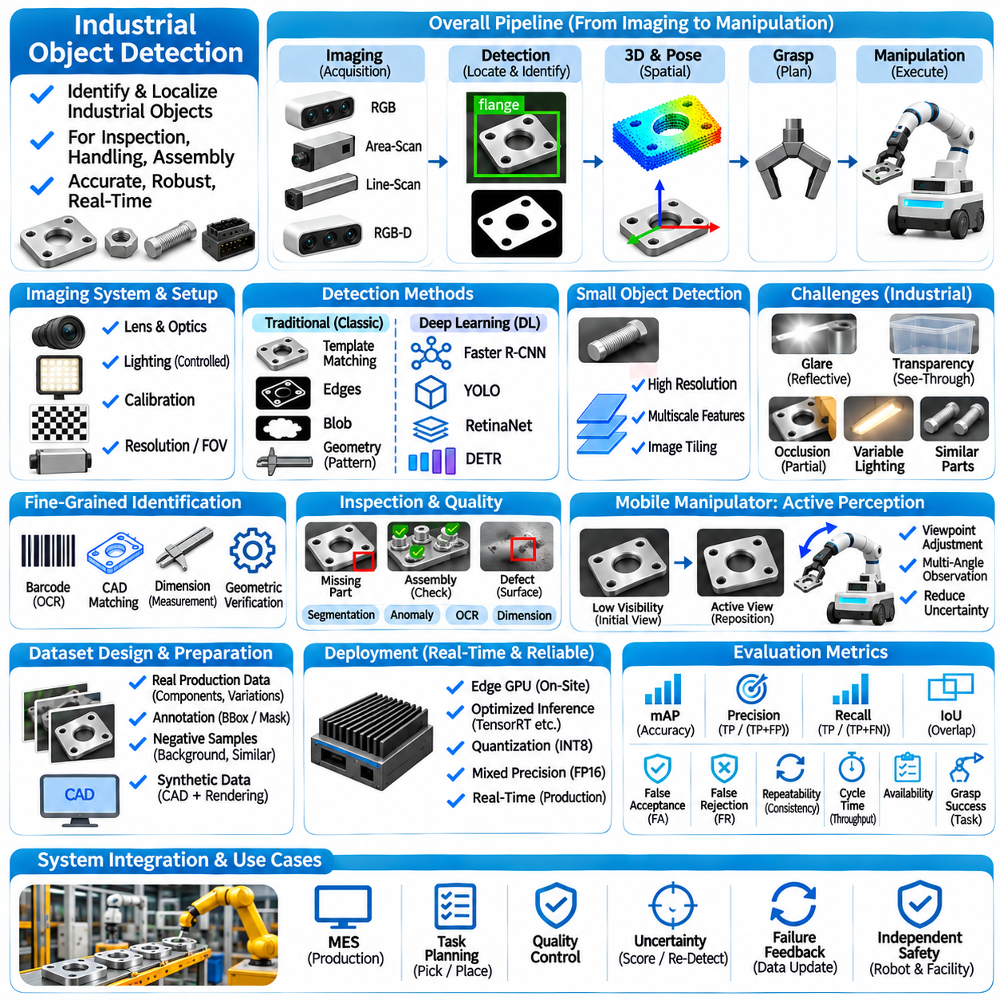{width="7.268055555555556in" height="7.268055555555556in"}

산업용 객체 검출(Industrial Object Detection)은 제조 및 산업 자동화 환경(Manufacturing and Industrial Automation Environment) 내에서 물리적 객체(Physical Object)를 식별하고 위치를 추정하는 데 중점을 둔 컴퓨터 비전(Computer Vision)의 특화된 응용 분야이다. 범용 객체 검출(General-Purpose Object Detection)과 달리, 산업용 객체 검출 시스템은 정확도(Accuracy), 반복성(Repeatability), 처리 속도(Processing Speed), 강건성(Robustness), 자동화 생산 시스템(Automated Production System)과의 호환성(Compatibility)에 대한 응용 분야별 요구사항(Application-Specific Requirement)을 충족해야 한다.

산업용 객체 검출의 근본적인 목적은 자동화 검사(Automated Inspection), 자재 취급(Material Handling), 로봇 조립(Robotic Assembly), 머신 텐딩(Machine Tending), 생산 모니터링(Production Monitoring)을 위한 신뢰성 높은 시각적 정보(Visual Information)를 제공하는 것이다. 모바일 매니퓰레이터(Mobile Manipulator)에서 객체 검출은 환경 관측 정보(Environmental Observation)와 물리적 조작(Physical Manipulation) 사이의 초기 연결 관계를 확립하여 로봇이 대상 부품(Target Component)을 식별하고 해당 부품의 공간적 위치(Spatial Location)를 결정할 수 있도록 한다.

산업 환경(Industrial Environment)은 제조 부품(Manufactured Component)이 유사한 기하학적 형상(Similar Geometry), 금속 표면(Metallic Surface), 제한적인 질감(Limited Texture), 미세한 치수 차이(Subtle Dimensional Difference)를 가지는 경우가 많기 때문에 특수한 인지 문제(Perception Challenge)를 발생시킨다. 반사 소재(Reflective Material), 투명 부품(Transparent Component), 가변 조명(Variable Illumination), 부분적 가려짐(Partial Occlusion)은 시각적 인식(Visual Recognition)을 더욱 어렵게 만든다. 검출 시스템(Detection System)은 변화하는 생산 조건(Production Condition)에서도 일관된 성능을 유지하면서 이러한 객체들을 구별해야 한다.

산업용 영상 획득 시스템(Industrial Imaging System)은 일반적으로 고해상도 RGB 카메라(High-Resolution RGB Camera), 산업용 영역 스캔 카메라(Industrial Area-Scan Camera), 라인 스캔 카메라(Line-Scan Camera), RGB-D 센서(RGB-D Sensor), 특수 광학 장비(Specialized Optical Equipment)를 통합한다. 카메라 선택(Camera Selection)은 객체 치수(Object Dimension), 요구 공간 해상도(Required Spatial Resolution), 작업 거리(Working Distance), 광학적 특성(Optical Characteristic), 생산 사이클 시간(Production Cycle Time)에 따라 결정된다. 제어된 조명(Controlled Illumination), 적절한 렌즈 구성(Lens Configuration), 정밀한 카메라 보정(Camera Calibration)은 이미지 품질(Image Quality)과 검출 신뢰성(Detection Reliability)을 향상시킨다.

전통적인 산업용 객체 검출(Traditional Industrial Object Detection)은 일반적으로 템플릿 매칭(Template Matching), 에지 검출(Edge Detection), 기하학적 특징 추출(Geometric Feature Extraction), 블롭 분석(Blob Analysis), 패턴 인식(Pattern Recognition)을 활용한다. 이러한 접근 방식은 객체의 기하학적 형상(Object Geometry), 방향(Orientation), 조명 조건(Illumination Condition)을 예측할 수 있는 구조화된 환경(Structured Environment)에서 여전히 효과적이다. 그러나 생산 시스템에 상당한 제품 다양성(Product Variability)이나 환경 변화(Environmental Change)가 발생하면 강건성과 확장성(Scalability)이 제한된다.

딥러닝 기반 산업용 객체 검출(Deep Learning-Based Industrial Object Detection)은 자동 계층적 특징 학습(Automatic Hierarchical Feature Learning)을 통해 이러한 한계를 해결한다. Faster R-CNN, YOLO, RetinaNet, DETR과 같은 아키텍처(Architecture)는 다양한 산업용 부품(Industrial Component)에서 나타나는 복잡한 시각적 패턴(Complex Visual Pattern)을 인식할 수 있다. 모델 선택(Model Selection)에서는 검출 정확도(Detection Accuracy), 추론 지연시간(Inference Latency), 객체 크기(Object Scale), 연산 요구사항(Computational Requirement), 자동화 운영 과정에서 잘못된 검출(Incorrect Detection)이 초래하는 결과를 고려해야 한다.

소형 객체 검출(Small Object Detection)은 전자 부품(Electronic Component), 체결 부품(Fastener), 커넥터(Connector), 기계 조립체(Mechanical Assembly), 표면 결함(Surface Defect)을 다루는 산업 응용 분야(Industrial Application)에서 특히 중요하다. 소형 객체는 이미지 내에서 제한된 수의 픽셀(Pixel)만을 차지할 수 있으므로 신뢰성 높은 특징 추출(Feature Extraction)이 어렵다. 고해상도 영상 획득(High-Resolution Imaging), 다중 스케일 특징 처리(Multiscale Feature Processing), 이미지 타일링(Image Tiling), 작업 특화 학습 전략(Task-Specific Training Strategy)은 검출 성능(Detection Performance)을 향상시킬 수 있다.

산업용 객체 검출에서는 치수(Dimension), 커넥터 배열(Connector Arrangement), 장착 특징(Mounting Feature), 제조 사양(Manufacturing Specification)이 서로 다른 시각적으로 유사한 부품(Visually Similar Component)을 구별해야 하는 경우가 많다. 이러한 응용 분야에서는 범주 수준 인식(Category-Level Recognition)만으로 충분하지 않을 수 있다. 세분화된 분류(Fine-Grained Classification), 기하학적 검증(Geometric Verification), 바코드 인식(Barcode Recognition), CAD 기반 매칭(CAD-Based Matching), 치수 측정(Dimensional Measurement)은 상호 보완적인 식별 능력(Complementary Identification Capability)을 제공할 수 있다.

산업용 검사 시스템(Industrial Inspection System)은 누락된 부품(Missing Component), 잘못된 조립 구성(Incorrect Assembly Configuration), 잘못 배치된 부품(Misplaced Part), 국부적인 제조 결함(Localized Manufacturing Defect)을 식별하기 위해 객체 검출을 활용한다. 검사 요구사항(Inspection Requirement)에 따라 객체 검출 모델은 인스턴스 분할(Instance Segmentation), 이상 탐지(Anomaly Detection), 광학 문자 인식(Optical Character Recognition, OCR), 치수 검사 알고리즘(Dimensional Inspection Algorithm)과 결합될 수 있다. 이러한 통합(Integration)은 포괄적인 자동화 품질 보증(Comprehensive Automated Quality Assurance)을 지원한다.

모바일 조작 응용 분야(Mobile Manipulation Application)에서 산업용 객체 검출은 이동 플랫폼의 움직임(Mobile Platform Movement)과 로봇팔 위치 제어(Robotic Arm Positioning)로 인해 발생하는 카메라 관측 시점(Camera Viewpoint)의 변화에 대응해야 한다. 고정 설치된 산업용 비전 시스템(Permanently Installed Industrial Vision System)과 달리, 모바일 매니퓰레이터는 가변적인 관측 거리(Variable Observation Distance)와 관측 방향(Observation Orientation)에서 작동한다. 능동적 인지(Active Perception)와 관측 시점 조정(Viewpoint Adjustment)은 물리적 상호작용(Physical Interaction) 이전에 대상 객체의 가시성(Target Visibility)을 향상시키고 불확실성(Uncertainty)을 감소시킬 수 있다.

3차원 인지(Three-Dimensional Perception)와의 통합은 산업용 객체 검출 시스템이 2차원 경계 상자(Two-Dimensional Bounding Box)를 실행 가능한 공간 정보(Actionable Spatial Information)로 변환할 수 있도록 한다. RGB-D 측정(RGB-D Measurement), 스테레오 재구성(Stereo Reconstruction), 보정된 좌표 변환(Calibrated Coordinate Transformation)은 로봇 기준 좌표계(Robotic Reference Frame) 내에서의 객체 위치 추정(Object Localization)을 지원한다. 이후 6자유도 자세 추정(Six-Degree-of-Freedom Pose Estimation)과 파지 계획(Grasp Planning)을 통해 조작에 필요한 기하학적 조건(Geometric Condition)을 확립한다.

산업용 객체 검출은 실제 생산 부품(Actual Production Component), 제조 편차(Manufacturing Variation), 운영 환경(Operational Environment), 까다로운 시각적 조건(Challenging Visual Condition)을 반영하여 신중하게 설계된 데이터셋(Dataset)을 필요로 한다. 데이터셋 준비(Dataset Preparation) 과정에는 현실적인 객체 분포(Realistic Object Distribution), 일관된 주석 정책(Consistent Annotation Policy), 대표성 있는 음성 샘플(Representative Negative Sample), 독립적인 검증 데이터 부분집합(Independent Validation Subset)이 포함되어야 한다. CAD 모델(CAD Model)로부터 생성된 합성 데이터(Synthetic Data)는 제한적인 실제 환경 관측 데이터(Real-World Observation)를 보완할 수 있다.

실시간 산업 현장 배포(Real-Time Industrial Deployment)를 위해서는 검출 정확도, 생산 처리량(Production Throughput), 연산 효율성(Computational Efficiency), 시스템 신뢰성(System Reliability) 사이의 균형을 고려해야 한다. 엣지 컴퓨팅 플랫폼(Edge Computing Platform), GPU 가속(GPU Acceleration), 최적화된 추론 엔진(Optimized Inference Engine), 모델 양자화(Model Quantization), 혼합 정밀도 연산(Mixed-Precision Computation)은 처리 지연시간(Processing Latency)을 감소시킬 수 있다. 종단 간 성능(End-to-End Performance)은 이미지 획득(Image Acquisition), 통신 지연(Communication Delay), 좌표 변환(Coordinate Transformation), 로봇 제어 통합(Robotic Control Integration)도 함께 고려해야 한다.

성능 평가(Performance Evaluation)는 평균 정밀도의 평균(Mean Average Precision, mAP), 정밀도(Precision), 재현율(Recall), 교집합 대 합집합 비율(Intersection over Union, IoU)과 같은 기존 평가 지표(Conventional Metric)를 넘어 확장되어야 한다. 산업용 검증(Industrial Validation)은 오합격률(False Acceptance Rate), 오불합격률(False Rejection Rate), 위치 추정 반복성(Localization Repeatability), 검사 사이클 시간(Inspection Cycle Time), 설비 가용성(Equipment Availability), 조작 성공률(Manipulation Success Rate)을 고려해야 한다. 수용 기준(Acceptance Criteria)은 생산 품질 요구사항(Production Quality Requirement)과 검출 실패(Detection Failure)가 초래하는 운영상의 영향을 반영해야 한다.

산업용 객체 검출은 센서 관리(Sensor Management), 작업 계획(Task Planning), 품질 관리(Quality Control), 제조 실행 시스템(Manufacturing Execution System, MES), 독립적인 안전 메커니즘(Independent Safety Mechanism)을 포괄하는 상위 시스템 아키텍처(System Architecture)에 통합되어야 한다. 지속적인 모니터링(Continuous Monitoring), 불확실성 평가(Uncertainty Assessment), 실패 기록(Failure Logging), 통제된 모델 업데이트(Controlled Model Update)는 장기적인 신뢰성(Long-Term Reliability)을 지원한다. 이러한 대표적인 공학적 실무 방법론(Engineering Practice)은 제공된 장 구성(Chapter Outline)을 실질적인 산업용 모바일 조작(Industrial Mobile Manipulation) 분야로 확장한다.

## 11 Warehouse Object Detection

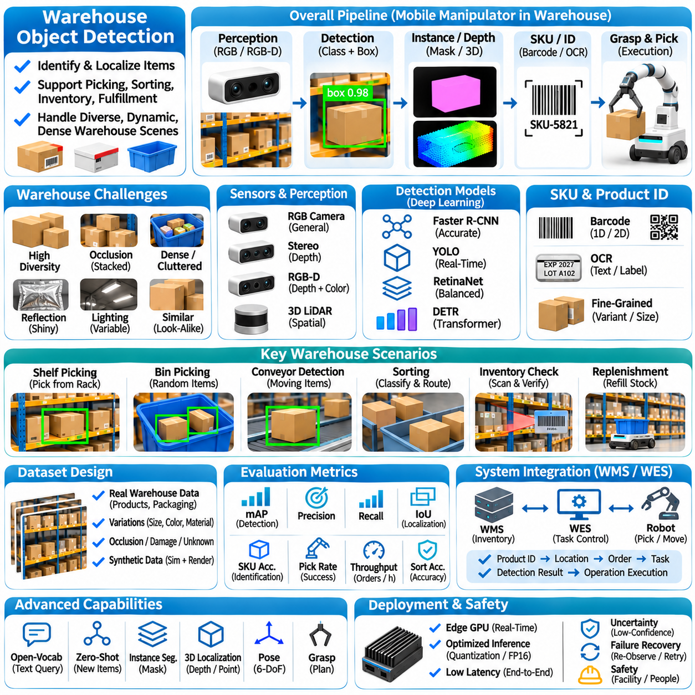{width="7.268055555555556in" height="7.268055555555556in"}

물류 창고 객체 검출(Warehouse Object Detection)은 물류(Logistics), 보관(Storage), 유통(Distribution), 주문 이행(Fulfillment) 환경 내에서 물리적 객체(Physical Object)를 식별하고 위치를 추정하기 위해 설계된 특화된 컴퓨터 비전 능력(Specialized Computer Vision Capability)이다. 기존 객체 검출 응용 분야(Conventional Object Detection Application)와 달리, 물류 창고 인지 시스템(Warehouse Perception System)은 광범위한 제품 다양성(Product Diversity), 동적 재고 구성(Dynamic Inventory Configuration), 밀집 배치 객체(Densely Arranged Object), 까다로운 운영 처리량 요구사항(Operational Throughput Requirement)에 대응해야 한다.

물류 창고 객체 검출의 근본적인 목적은 자율 피킹(Autonomous Picking), 분류(Sorting), 재고 관리(Inventory Management), 자재 운송(Material Transportation), 주문 이행(Order Fulfillment)을 위한 신뢰성 높은 시각적 정보(Visual Information)를 제공하는 것이다. 모바일 매니퓰레이터(Mobile Manipulator)에서 객체 검출은 대상 제품(Target Product)을 식별하고 보관 위치(Storage Location)를 파악하며 자율 주행(Autonomous Navigation)과 로봇 조작(Robotic Manipulation)을 협조적으로 수행하기 위한 인지 기반(Perceptual Foundation)을 확립한다.

물류 창고 환경(Warehouse Environment)은 제품의 치수(Dimension), 포장 소재(Packaging Material), 색상(Color), 질감(Texture), 기하학적 특성(Geometric Characteristic)이 상당한 차이를 나타내는 경우가 많기 때문에 복잡한 시각적 문제(Visual Challenge)를 발생시킨다. 객체는 적층(Stacking), 부분적 가려짐(Partial Occlusion), 무작위 방향(Random Orientation), 보관 용기(Storage Container) 내부의 밀집 배치(Dense Arrangement) 상태로 존재할 수 있다. 변화하는 조명 조건(Illumination Condition)과 동적인 물류 창고 작업(Dynamic Warehouse Activity)은 신뢰성 높은 시각적 인식(Visual Recognition)의 복잡성을 더욱 증가시킨다.

물류 창고 인지 시스템은 일반적으로 RGB 카메라(RGB Camera), RGB-D 카메라(RGB-D Camera), 스테레오 비전 시스템(Stereo Vision System), 3차원 라이다 센서(Three-Dimensional LiDAR Sensor)를 통합한다. 고정형 카메라(Fixed Camera)는 컨베이어 시스템(Conveyor System)과 분류 작업장(Sorting Station)을 모니터링할 수 있으며, 이동형 카메라(Mobile Camera)와 손목 장착형 카메라(Wrist-Mounted Camera)는 유연한 관측 능력(Flexible Observation Capability)을 제공한다. 센서 선택(Sensor Selection)은 검출 거리(Detection Range), 공간 해상도(Spatial Resolution), 시야각(Field of View, FoV), 환경 변동성(Environmental Variability), 조작 정확도 요구사항(Manipulation Accuracy Requirement)을 고려해야 한다.

Faster R-CNN, YOLO, RetinaNet, DETR과 같은 딥러닝 아키텍처(Deep Learning Architecture)는 물류 창고 객체 검출을 위한 효과적인 기술적 기반(Technical Foundation)을 제공한다. 이러한 모델은 계층적 시각 특징(Hierarchical Visual Feature)을 추출하여 객체 범주(Object Category), 경계 상자(Bounding Box), 신뢰도 점수(Confidence Score)를 예측한다. 모델 선택(Model Selection)은 제품 다양성, 객체 치수(Object Dimension), 추론 지연시간(Inference Latency), 가용 연산 자원(Available Computational Resource), 요구되는 운영 신뢰성(Operational Reliability)에 따라 결정된다.

재고 관리 단위 인식(Stock Keeping Unit Recognition, SKU Recognition)은 시각적으로 유사한 제품(Visually Similar Product)이 서로 다른 재고 식별자(Inventory Identifier)에 대응할 수 있기 때문에 중요한 물류 창고 인지 요구사항(Warehouse Perception Requirement)이다. 기존의 범주 수준 검출(Category-Level Detection)은 포장 크기(Packaging Size), 인쇄 정보(Printed Information), 제품 변형(Product Variation)의 차이를 충분히 구별하지 못할 수 있다. 세분화된 인식(Fine-Grained Recognition), 바코드 스캐닝(Barcode Scanning), 광학 문자 인식(Optical Character Recognition, OCR), 시각적 임베딩 매칭(Visual Embedding Matching)은 상호 보완적인 식별 능력(Complementary Identification Capability)을 제공한다.

제품이 밀집된 보관 선반(Storage Shelf) 내부의 객체 검출은 부분적 가려짐과 제한적인 객체 간 이격 거리(Limited Object Separation) 조건에서도 정확한 위치 추정(Accurate Localization)을 요구한다. 다중 스케일 특징 추출(Multiscale Feature Extraction), 고해상도 영상 획득(High-Resolution Imaging), 인스턴스 분할(Instance Segmentation), 어텐션 메커니즘(Attention Mechanism)은 인접 제품(Neighboring Product) 사이의 구별 능력(Discrimination Capability)을 향상시킬 수 있다. 능동적 인지(Active Perception)는 초기 관측(Initial Observation)에서 충분한 시각적 정보를 확보하지 못했을 때 모바일 매니퓰레이터가 카메라 관측 시점(Camera Viewpoint)을 조정할 수 있도록 한다.

컨베이어 기반 물류 창고 객체 검출(Conveyor-Based Warehouse Detection)은 엄격한 시간 제약조건(Timing Constraint) 아래에서 이동 객체(Moving Object)를 지속적으로 인식할 것을 요구한다. 객체 검출은 다중 객체 추적(Multi-Object Tracking, MOT), 컨베이어 엔코더 측정(Conveyor Encoder Measurement), 움직임 예측(Motion Prediction)과 통합되어 미래 객체 위치(Future Object Position)를 추정할 수 있다. 정확한 타임스탬프 동기화(Timestamp Synchronization)와 저지연 처리(Low-Latency Processing)는 검출 결과를 고속 로봇 피킹(High-Speed Robotic Picking) 및 자동 분류 작업(Automated Sorting Operation)과 연계하는 데 필수적이다.

로봇 빈 피킹(Robotic Bin Picking)에서 물류 창고 객체 검출은 용기(Container) 또는 보관함(Storage Bin) 내부에 무작위로 분포된 후보 제품(Candidate Product)을 식별한다. 인스턴스 분할과 깊이 측정(Depth Measurement)은 개별 객체를 주변 제품(Surrounding Product) 및 용기 표면(Container Surface)으로부터 분리하여 검출 결과(Detection Result)를 정교화할 수 있다. 이후 객체별 포인트 클라우드(Object-Specific Point Cloud)는 3차원 위치 추정(Three-Dimensional Localization), 파지 후보 생성(Grasp Candidate Generation), 충돌 평가(Collision Assessment), 조작 계획(Manipulation Planning)을 지원한다.

개방형 어휘 객체 검출(Open-Vocabulary Detection)과 제로샷 검출(Zero-Shot Detection)은 제품 및 포장의 변화가 빈번하게 발생하는 물류 창고 환경에 유연한 인식 능력(Flexible Recognition Capability)을 제공한다. 언어 조건부 검출 모델(Language-Conditioned Detection Model)은 모든 제품 범주에 대한 전용 검출 학습(Dedicated Detection Training) 없이 텍스트 쿼리(Textual Query)를 통해 설명된 객체를 식별할 수 있다. 그러나 정밀한 재고 관리 단위 식별(Precise SKU Identification)과 시각적으로 유사한 제품의 구별(Visually Similar Product Discrimination)을 위해서는 여전히 특화된 인식 방법(Specialized Recognition Method)이 필요할 수 있다.

물류 창고 객체 검출 데이터셋(Warehouse Object Detection Dataset)은 현실적인 제품 분포(Realistic Product Distribution), 포장 변화(Packaging Variation), 보관 구성(Storage Configuration), 조명 조건, 운영 시나리오(Operational Scenario)를 반영해야 한다. 데이터셋 설계(Dataset Design)에는 부분적으로 가려진 제품(Partially Occluded Product), 손상된 포장(Damaged Packaging), 반사 소재(Reflective Material), 익숙하지 않은 객체(Unfamiliar Object), 시각적으로 유사한 품목 범주(Visually Similar Item Category)가 포함되어야 한다. 합성 데이터 생성(Synthetic Data Generation)과 표적 현장 데이터 수집(Targeted Field Data Collection)은 까다롭거나 관측 빈도가 낮은 조건에 대한 데이터셋 포괄 범위(Dataset Coverage)를 향상시킬 수 있다.

물류 창고 관리 시스템(Warehouse Management System, WMS) 및 물류 창고 실행 시스템(Warehouse Execution System, WES)과의 통합(Integration)은 시각적 검출 결과(Visual Detection Result)를 재고 기록(Inventory Record), 보관 위치, 주문 요구사항(Order Requirement), 작업 할당(Task Assignment)과 연결한다. 검출된 객체는 적절한 제품 식별자(Product Identifier) 및 공간 좌표(Spatial Coordinate)와 연계되어야 한다. 이러한 통합은 모바일 매니퓰레이터가 협조적 피킹(Coordinated Picking), 재고 검증(Inventory Verification), 재고 보충(Replenishment), 자재 취급(Material Handling) 작업을 수행할 수 있도록 한다.

실시간 물류 창고 배포(Real-Time Warehouse Deployment)를 위해서는 인식 정확도(Recognition Accuracy), 연산 효율성(Computational Efficiency), 처리 지연시간(Processing Latency), 운영 처리량(Operational Throughput) 사이의 균형을 고려해야 한다. 엣지 컴퓨팅 플랫폼(Edge Computing Platform), GPU 가속(GPU Acceleration), 최적화된 추론 엔진(Optimized Inference Engine), 모델 양자화(Model Quantization), 혼합 정밀도 추론(Mixed-Precision Inference)은 검출 성능(Detection Performance)을 향상시킬 수 있다. 종단 간 지연시간(End-to-End Latency)은 센서 데이터 획득(Sensor Acquisition), 이미지 처리(Image Processing), 통신(Communication), 공간적 위치 추정(Spatial Localization), 로봇 동작 실행(Robotic Motion Execution)을 모두 고려해야 한다.

성능 평가(Performance Evaluation)는 평균 정밀도의 평균(Mean Average Precision, mAP), 정밀도(Precision), 재현율(Recall), 교집합 대 합집합 비율(Intersection over Union, IoU)과 같은 기존 검출 성능 지표(Conventional Detection Metric)와 함께 물류 창고 특화 운영 지표(Warehouse-Specific Operational Indicator)를 포함해야 한다. 재고 관리 단위 식별 정확도(SKU Identification Accuracy), 피킹 성공률(Picking Success Rate), 분류 정확도(Sorting Accuracy), 재고 검증 정확도(Inventory Verification Accuracy), 주문 이행 처리량(Order Fulfillment Throughput), 개입 빈도(Intervention Frequency)는 실제 시스템 효과성(Practical System Effectiveness)을 평가하기 위한 보다 포괄적인 측정 기준(Measurement Criterion)을 제공한다.

물류 창고 객체 검출은 불확실성 평가(Uncertainty Assessment), 오류 복구(Failure Recovery), 지속적 모니터링(Continuous Monitoring), 독립적인 안전 메커니즘(Independent Safety Mechanism)을 통합하는 인지 및 조작 아키텍처(Integrated Perception and Manipulation Architecture) 내에서 작동해야 한다. 낮은 신뢰도의 예측(Low-Confidence Prediction)은 추가적인 관측(Additional Observation) 또는 작업자 검증(Human Verification)을 유발할 수 있다. 이러한 대표적인 공학적 실무 방법론(Engineering Practice)은 제공된 장 구성(Chapter Outline)을 확장 가능하고(Scalable), 적응 가능하며(Adaptable), 신뢰성 높은(Reliable) 자율 물류 창고 운영(Autonomous Warehouse Operation) 분야로 확장한다.
