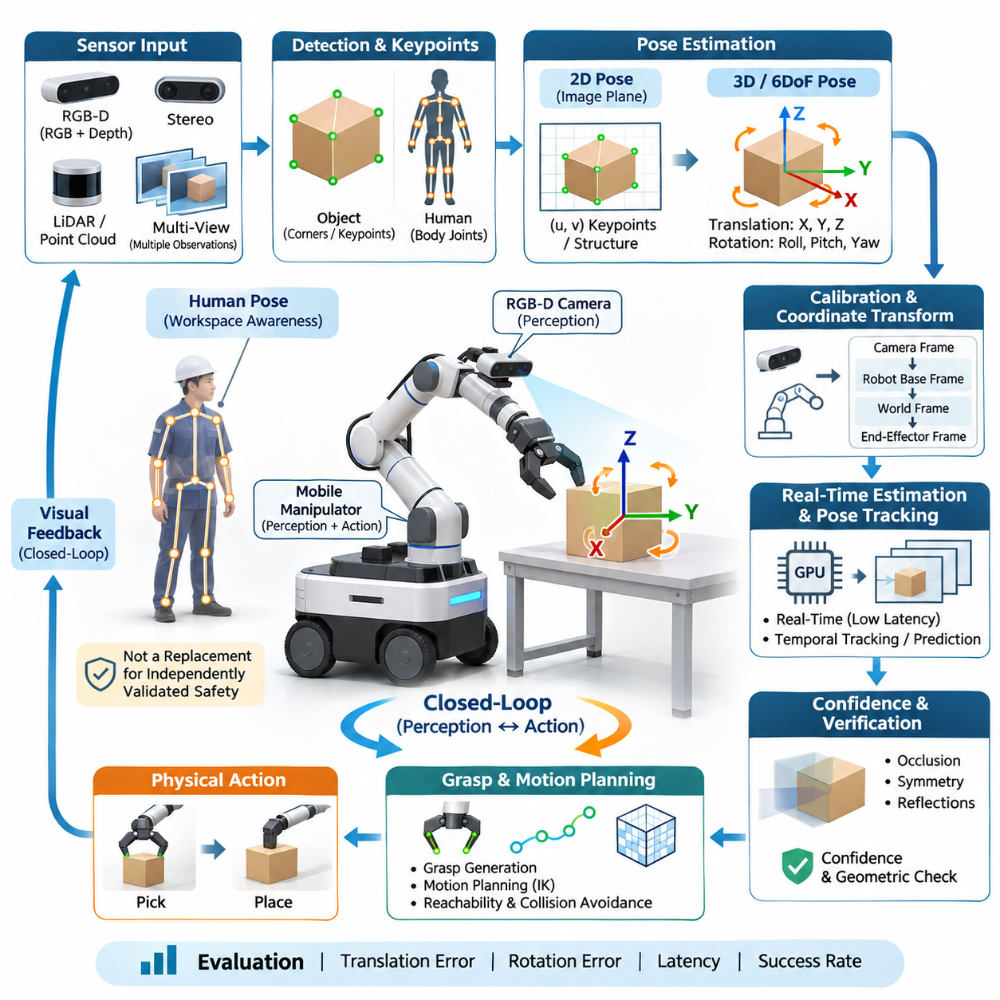
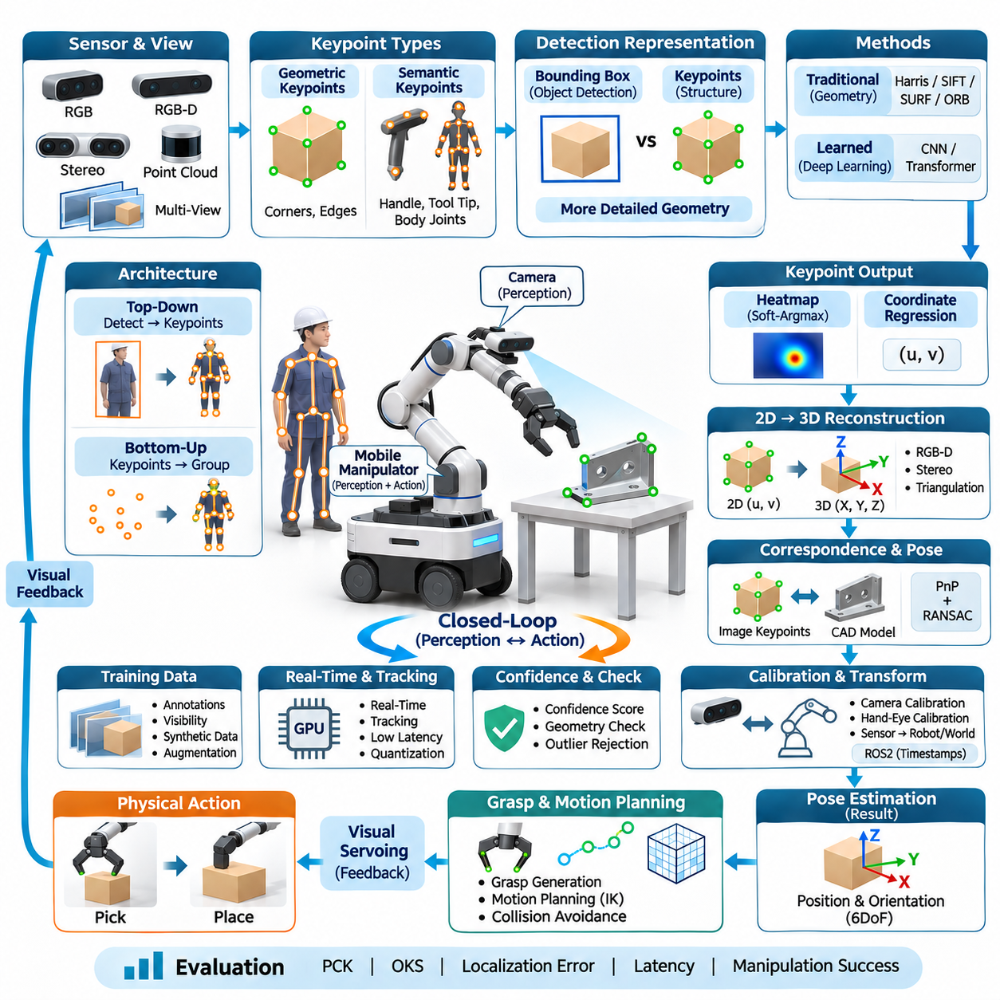
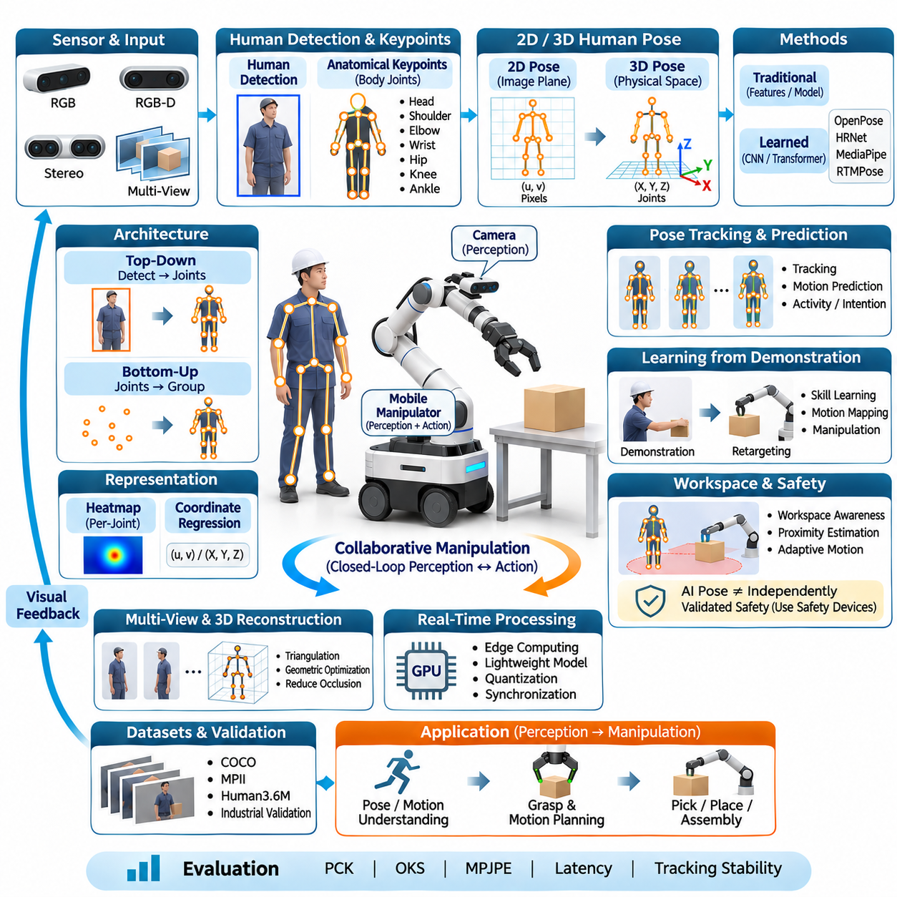
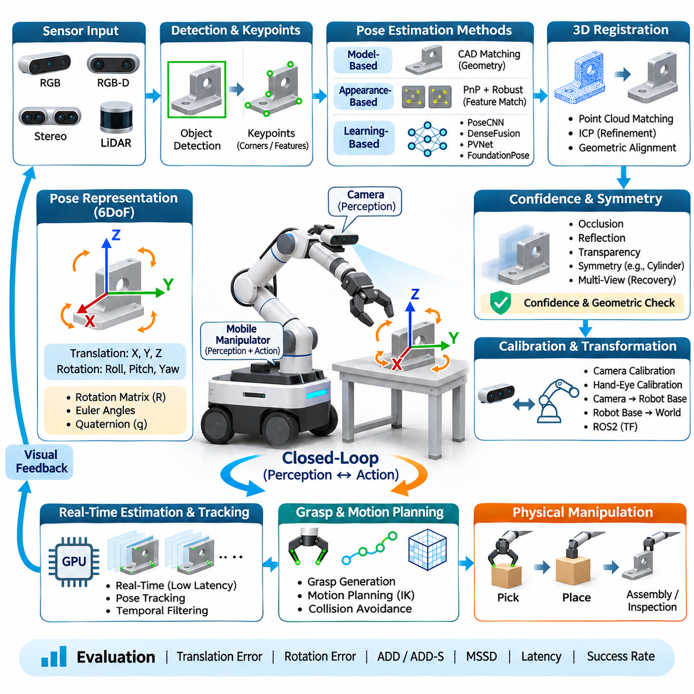
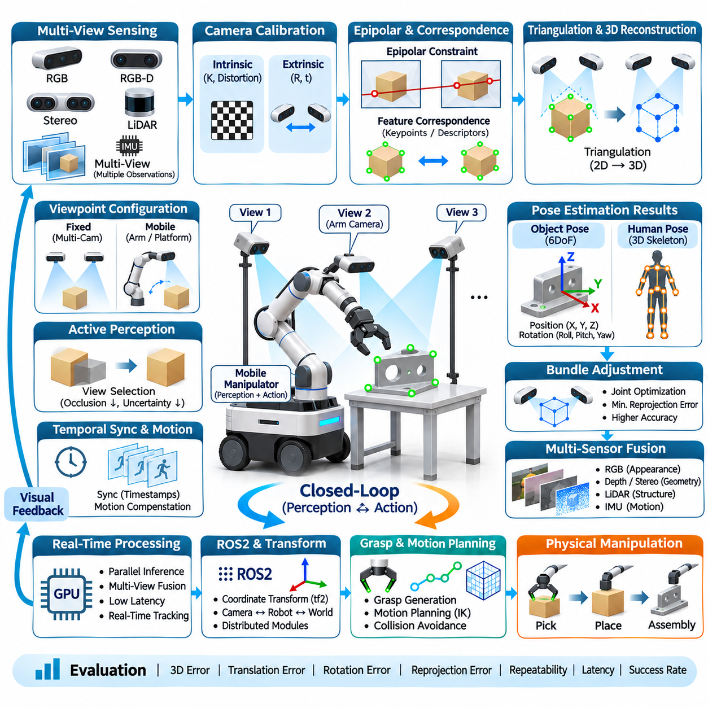
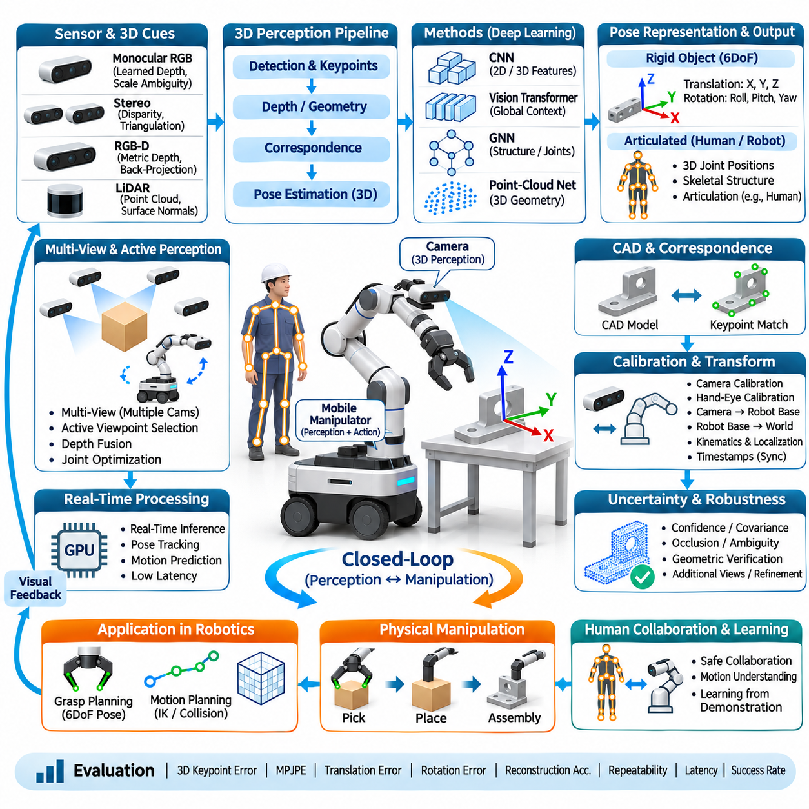
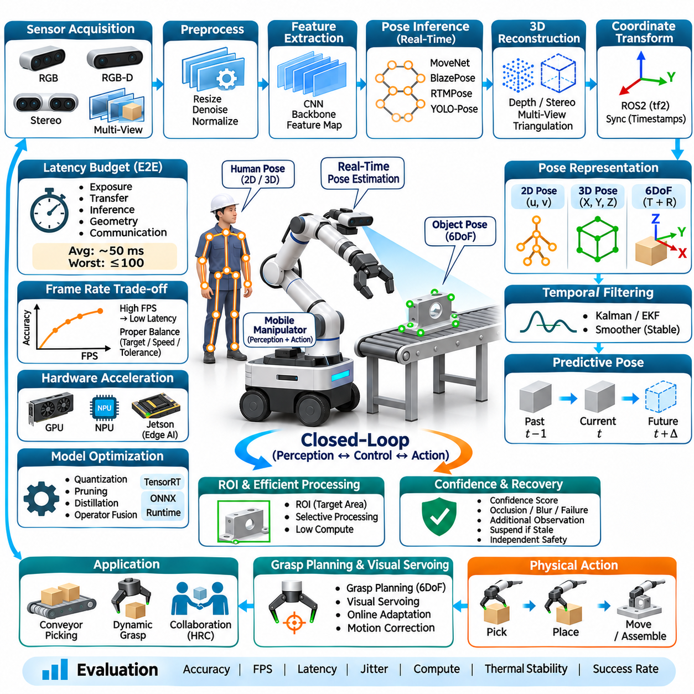
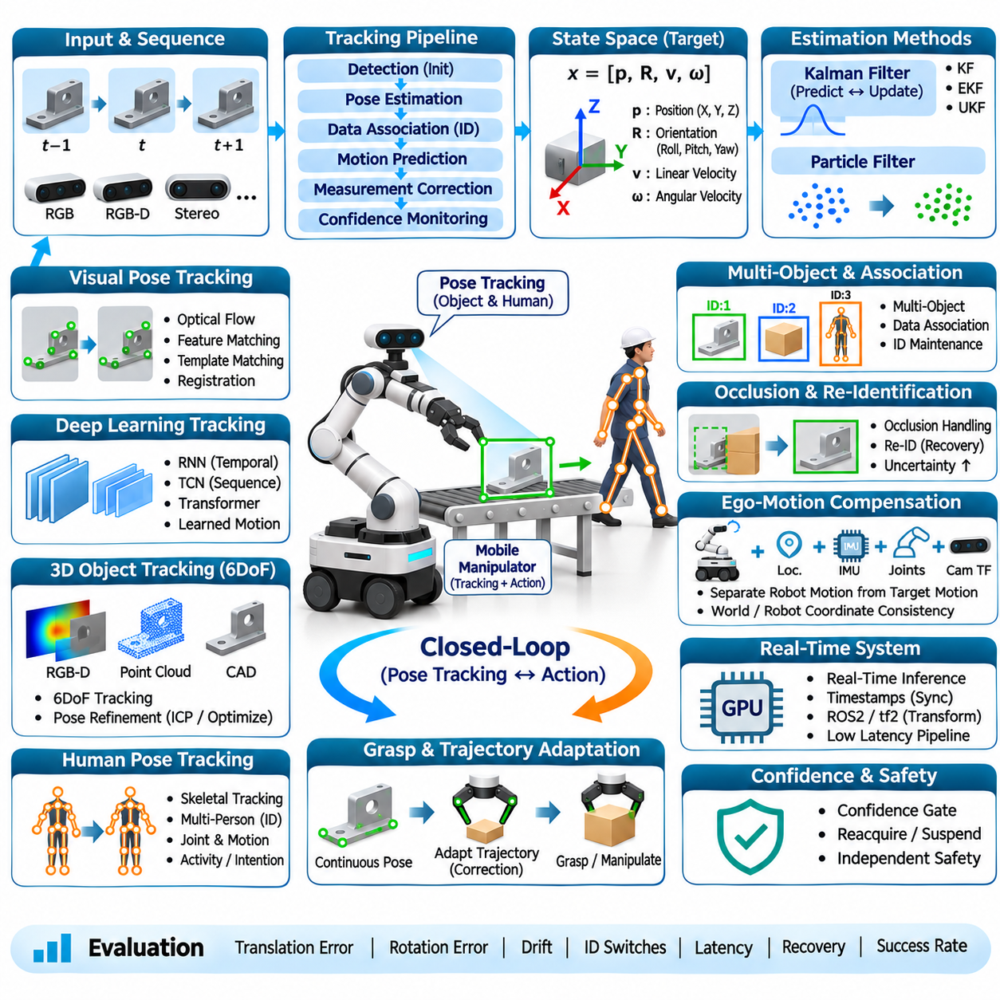
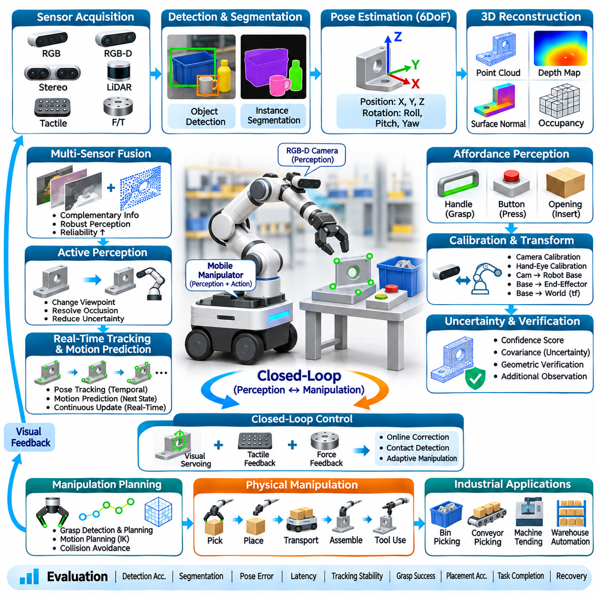

**Volume 03. Vision Manipulation and AI**

# Chapter 03. Pose Estimation

## 01 Pose Estimation Overview

{width="7.268055555555556in" height="7.268055555555556in"}

Pose estimation is a fundamental component of robotic perception that determines the spatial configuration of objects, humans, and other physical entities within an observed environment. While object detection identifies the presence and location of a target, pose estimation provides additional geometric information about its position, orientation, or structural configuration. This capability enables robots to understand how physical entities are arranged in space.

In mobile manipulation systems, pose estimation establishes an essential connection between visual perception and physical interaction. A mobile manipulator must identify a target object and determine its spatial relationship to the robotic arm and end effector before executing manipulation tasks. Accurate pose information supports grasp generation, approach planning, object transportation, assembly, and placement within dynamic and unstructured environments.

Pose estimation can generally be categorized into two-dimensional (2D) and three-dimensional (3D) approaches. Two-dimensional pose estimation determines spatial attributes or keypoint locations within the image plane, typically expressed using pixel coordinates. Three-dimensional pose estimation extends this representation into physical space, allowing robotic systems to reason about object depth, spatial orientation, and geometric relationships.

A rigid object\'s spatial pose is commonly represented using six degrees of freedom (6DoF), consisting of three translational and three rotational components. Translation specifies the position of the object along the X, Y, and Z axes, while rotation describes its orientation in three-dimensional space. These components provide the geometric information required to establish a desired spatial relationship between an object and a robotic end effector.

Keypoint detection represents an important foundation for many pose estimation methods. Keypoints correspond to identifiable geometric or semantic features, such as object corners, structural landmarks, or human body joints. By establishing relationships between detected keypoints and known geometric structures, a robotic perception system can estimate spatial configurations even when only a portion of the target remains visible.

Human pose estimation focuses on identifying the spatial arrangement of body joints and anatomical landmarks, including shoulders, elbows, wrists, hips, and knees. In collaborative robotics, human pose information supports motion prediction, gesture recognition, workspace awareness, and learning from human demonstrations. However, vision-based human pose estimation should not replace independently validated safety mechanisms.

Object pose estimation determines the position and orientation of physical objects relative to a reference coordinate system. Traditional methods employ geometric feature matching, template matching, and correspondence-based optimization. Modern deep learning approaches learn robust visual representations from training datasets, improving estimation capabilities under variations in lighting, viewpoints, backgrounds, and partial occlusion.

Multi-view pose estimation integrates visual observations collected from multiple camera positions or viewing directions. A mobile manipulator can acquire these observations by moving its mobile platform or repositioning an arm-mounted camera. Combining complementary viewpoints reduces geometric ambiguity, improves spatial reconstruction, and helps recover object features that are hidden or difficult to identify from a single observation.

Three-dimensional pose estimation frequently utilizes RGB-D cameras, stereo vision systems, and point cloud data to obtain spatial information. Depth measurements provide geometric constraints that complement visual appearance and semantic features extracted from RGB images. Combining these information sources improves spatial reasoning and enables more reliable pose determination for complex objects and cluttered manipulation environments.

Coordinate transformation is a critical requirement when integrating pose estimation into robotic control systems. Estimated poses are initially expressed relative to a sensor or camera coordinate system and must be transformed into the robot base, world, or end-effector coordinate system. Camera calibration, hand-eye calibration, accurate transformation relationships, and synchronized measurements are necessary to maintain spatial consistency.

Real-time pose estimation enables robotic systems to respond continuously to changes in their operating environments. Applications such as conveyor picking, mobile manipulation, and human-robot collaboration require updated spatial information with sufficiently low processing latency. Efficient neural network architectures, GPU acceleration, optimized inference engines, and synchronized sensor pipelines support these computational requirements.

Pose tracking extends individual pose estimates across consecutive observations, maintaining temporal consistency as objects, humans, or robotic platforms move. Tracking algorithms combine current measurements with previous estimates and motion predictions to reduce instability and compensate for temporary observation failures. This temporal information supports predictive manipulation and adaptive motion planning in dynamic environments.

Pose estimation performance depends on sensor accuracy, calibration quality, environmental conditions, object characteristics, and algorithm robustness. Reflective surfaces, transparent materials, repetitive patterns, symmetric geometries, and severe occlusion can introduce substantial estimation uncertainty. Confidence assessment, additional observations, and geometric verification help prevent unreliable estimates from directly initiating robotic actions.

The integration of pose estimation with manipulation planning transforms visual observations into actionable geometric information. Estimated object poses support grasp candidate generation, inverse kinematics, reachability analysis, collision avoidance, and trajectory planning. Closed-loop visual feedback can subsequently refine the estimated spatial relationship between the target and the end effector during approach and manipulation.

Pose estimation systems are evaluated using translation error, rotation error, keypoint localization accuracy, tracking stability, processing latency, and manipulation success rates. Evaluation should consider both controlled laboratory conditions and realistic operational environments. For mobile manipulators, the combined influence of localization uncertainty, platform movement, sensor calibration, and mechanical positioning must also be considered.

Ultimately, pose estimation provides the geometric foundation connecting visual perception, spatial reasoning, and robotic action. Its integration with object detection, 6D object pose estimation, grasp detection, grasp planning, and intelligent control enables mobile manipulators to interact with diverse physical environments. Reliable pose estimation is therefore an essential building block for autonomous manipulation and the advancement of Physical AI.

## 02 Keypoint Detection

{width="7.268055555555556in" height="7.268055555555556in"}

Keypoint detection is a fundamental technique in visual perception that identifies distinctive spatial locations within images or three-dimensional representations. These locations correspond to meaningful geometric or semantic features, such as object corners, structural landmarks, surface characteristics, and human body joints. In robotic systems, keypoint detection provides structured visual information for pose estimation, spatial reasoning, and physical interaction.

Unlike conventional object detection, which typically represents objects using bounding boxes, keypoint detection identifies specific locations that describe the internal structure of a target. These locations provide more detailed geometric information about object shape, orientation, and spatial configuration. This detailed representation enables robotic systems to establish precise relationships between visual observations and manipulation objectives.

Keypoints can generally be categorized into geometric keypoints and semantic keypoints. Geometric keypoints correspond to distinctive visual structures, including corners, edges, and surface discontinuities. Semantic keypoints represent meaningful locations associated with specific object categories or functional structures, such as a door handle, a tool tip, a mechanical connector, or a designated grasping point.

Traditional keypoint detection methods rely on mathematical analysis of local image characteristics. Algorithms such as Harris Corner Detection, Scale-Invariant Feature Transform (SIFT), Speeded-Up Robust Features (SURF), and Oriented FAST and Rotated BRIEF (ORB) identify distinctive image regions. These approaches support feature matching, image registration, camera localization, and geometric correspondence across multiple observations.

Deep learning has significantly expanded the capabilities of keypoint detection by enabling neural networks to identify complex semantic structures directly from visual data. Convolutional Neural Networks (CNNs) and vision transformers learn hierarchical feature representations from annotated datasets. These learned representations improve detection robustness under variations in illumination, object appearance, scale, viewing direction, and background complexity.

Heatmap-based keypoint detection represents a widely adopted approach in modern vision systems. Rather than directly predicting spatial coordinates, neural networks generate probability maps indicating the likely locations of individual keypoints. The spatial distribution of these predictions supports confidence estimation, while techniques such as soft-argmax and local interpolation can provide subpixel localization accuracy.

Coordinate regression provides an alternative approach in which neural networks directly predict keypoint coordinates from input images. This method offers a compact output representation and can reduce computational requirements for certain applications. However, direct regression may have difficulty representing spatial ambiguity when multiple plausible locations exist, particularly under severe occlusion or challenging visual conditions.

Top-down and bottom-up architectures provide different strategies for detecting keypoints in scenes containing multiple targets. Top-down methods first identify individual objects or humans before estimating their associated keypoints. Bottom-up methods detect keypoints across the entire image and subsequently associate them with individual instances. The appropriate architecture depends on scene complexity, computational resources, and application requirements.

Three-dimensional keypoint detection extends conventional image-based localization into physical space. RGB-D cameras, stereo vision, and point cloud processing provide depth information associated with detected visual features. By combining two-dimensional image coordinates with calibrated depth measurements, robotic systems can reconstruct three-dimensional keypoint positions for spatial reasoning, pose estimation, and manipulation planning.

Keypoint correspondence establishes relationships between detected visual features and known geometric or semantic reference points. For rigid objects with known three-dimensional geometry, corresponding image and model keypoints can be processed using Perspective-n-Point (PnP) algorithms to estimate object position and orientation. Robust estimation methods such as RANSAC help reduce the influence of incorrect feature correspondences.

Multi-view keypoint detection integrates observations acquired from different camera positions to improve localization accuracy and geometric consistency. Mobile manipulators can actively reposition their platforms or arm-mounted cameras to acquire additional visual information. Triangulation, feature correspondence, and geometric optimization enable the reconstruction of spatial keypoints while reducing uncertainties associated with individual observations.

Dataset design plays a critical role in developing reliable learning-based keypoint detection systems. Training datasets should include consistently annotated keypoint locations, visibility labels, diverse object configurations, and representative environmental conditions. Synthetic data generation, domain randomization, and image augmentation can expand dataset diversity while reducing the cost of collecting and annotating physical observations.

Real-time keypoint detection is particularly important for mobile manipulation applications involving moving objects, changing viewpoints, and continuous visual feedback. Lightweight neural network architectures, GPU acceleration, model quantization, and optimized inference engines can reduce processing latency. Temporal filtering and keypoint tracking further improve stability by maintaining spatial consistency across consecutive camera frames.

Integration with robotic control requires detected keypoints to be transformed into appropriate robot coordinate systems. Accurate camera calibration, hand-eye calibration, sensor synchronization, and coordinate transformations are essential for converting visual measurements into reliable manipulation targets. Within ROS2-based systems, timestamped keypoint information can be distributed to pose estimation, motion planning, and visual servoing modules.

Keypoint detection performance is evaluated using localization error, Percentage of Correct Keypoints (PCK), Object Keypoint Similarity (OKS), detection confidence, and inference latency. Industrial validation should additionally consider three-dimensional measurement error, repeatability, occlusion robustness, and downstream manipulation success. Confidence thresholds and geometric consistency checks help prevent unreliable detections from initiating physical actions.

Ultimately, keypoint detection provides a structured representation that connects visual appearance with physical geometry and functional understanding. Its integration with object pose estimation, human pose estimation, grasp detection, and closed-loop robotic control enables mobile manipulators to perform precise and adaptive physical interactions. This capability constitutes an important perceptual foundation for autonomous manipulation and Physical AI.

## 03 Human Pose Estimation

{width="7.268055555555556in" height="7.268055555555556in"}

Human pose estimation is a fundamental visual perception technique that determines the spatial configuration of the human body by identifying anatomical landmarks and joint positions. These landmarks typically include the head, shoulders, elbows, wrists, hips, knees, and ankles. In robotic systems, human pose estimation provides structured information about human posture, movement, and physical interaction within shared operational environments.

In mobile manipulation systems, human pose estimation enables robots to recognize and respond to human activities within their surrounding environments. Unlike conventional human detection, which primarily identifies the presence and approximate location of individuals, pose estimation provides detailed information about body configuration. This information supports collaborative manipulation, gesture recognition, motion prediction, and adaptive robot behavior.

Two-dimensional human pose estimation identifies anatomical keypoints within the image plane using pixel coordinates. These keypoints are connected according to predefined anatomical relationships to construct a skeletal representation of the human body. Although two-dimensional representations do not directly provide metric depth information, they are useful for posture recognition, activity classification, gesture interpretation, and human motion analysis.

Three-dimensional human pose estimation extends skeletal representations into physical space by estimating the spatial coordinates of individual body joints. Depth cameras, stereo vision systems, multi-view camera configurations, and monocular deep learning models can support this process. Three-dimensional representations enable robotic systems to evaluate spatial relationships between humans, robotic manipulators, and surrounding physical objects.

Traditional human pose estimation methods relied on handcrafted visual features, anatomical constraints, and graphical models to identify human body configurations. These approaches often encountered difficulties in complex environments involving occlusion, illumination changes, and diverse body postures. Deep learning has substantially improved pose estimation by enabling neural networks to learn complex anatomical and spatial relationships directly from visual data.

Convolutional Neural Networks and vision transformers are widely used in modern human pose estimation architectures. Representative frameworks include OpenPose, High-Resolution Network (HRNet), MediaPipe Pose, and RTMPose. These approaches provide different trade-offs between localization accuracy, computational efficiency, model complexity, and real-time processing capabilities, allowing developers to select architectures appropriate for robotic applications.

Top-down human pose estimation first detects individual humans within an image and subsequently estimates anatomical keypoints for each detected person. Bottom-up approaches identify keypoints across the entire image before grouping them into individual skeletal representations. Top-down methods often provide accurate individual pose estimates, while bottom-up methods can offer computational advantages in scenes containing multiple people.

Heatmap prediction is a common technique for representing the probable locations of human body joints. Neural networks generate spatial confidence maps corresponding to individual anatomical keypoints, allowing joint locations to be determined from predicted responses. Coordinate regression provides an alternative approach by directly predicting joint coordinates, potentially reducing output complexity for computationally constrained robotic platforms.

Multi-view human pose estimation combines observations from multiple cameras to improve spatial accuracy and reduce uncertainties caused by occlusion. Corresponding anatomical keypoints can be reconstructed in three-dimensional space through triangulation and geometric optimization. Mobile manipulators can also acquire complementary viewpoints through controlled movement, provided that camera poses, observation timing, and human motion are appropriately considered.

Human pose tracking extends individual skeletal estimates across consecutive camera frames to maintain temporal consistency. Tracking algorithms associate detected individuals and anatomical landmarks over time, reducing instability and compensating for temporary observation failures. Sequential pose information supports human motion prediction, activity recognition, intention estimation, and adaptive collaboration between humans and robotic systems.

Human pose estimation plays an important role in learning from demonstration, where robots acquire manipulation skills by observing human activities. Human arm trajectories, wrist orientations, and body movements can provide reference information for generating robotic action sequences. Retargeting techniques map observed human movements onto robot kinematic structures while considering differences in joint configurations, workspace limitations, and physical constraints.

In collaborative manipulation environments, human pose information supports workspace monitoring and context-aware motion planning. Robotic systems can estimate human proximity, identify potential movement directions, and adjust operational trajectories accordingly. However, conventional AI-based pose estimation does not independently guarantee functional safety and must operate alongside appropriately validated protective devices and safety control architectures.

Real-time human pose estimation requires an effective balance between inference accuracy, processing latency, and computational resource consumption. Edge computing platforms, GPU acceleration, lightweight neural networks, model quantization, and optimized inference engines enable continuous processing of visual observations. Accurate sensor synchronization and timestamp management are particularly important when the robotic platform and observed individuals are moving simultaneously.

Dataset design and model validation are essential for developing reliable human pose estimation systems. Representative datasets include COCO Keypoints, MPII Human Pose, and Human3.6M. Industrial applications may require additional training and validation data covering protective clothing, unusual working postures, partial visibility, diverse body characteristics, and interactions with tools, machinery, and surrounding industrial equipment.

Performance evaluation commonly employs Percentage of Correct Keypoints (PCK), Object Keypoint Similarity (OKS), and Mean Per Joint Position Error (MPJPE). Robotic applications should additionally evaluate tracking stability, end-to-end latency, robustness against occlusion, and spatial measurement accuracy. Calibration errors, confidence uncertainty, and coordinate transformation accuracy must also be considered when integrating estimated poses with robotic control.

Ultimately, human pose estimation enables mobile manipulators to interpret human movements as structured spatial information rather than isolated visual observations. Its integration with human activity recognition, trajectory prediction, learning from demonstration, and intelligent motion planning supports adaptive human-robot collaboration. This capability represents an important perceptual foundation for autonomous robotic systems, Embodied AI, and Physical AI.

## 04 Object Pose Estimation

{width="7.268055555555556in" height="7.268055555555556in"}

Object pose estimation is a fundamental robotic perception technique that determines the spatial position and orientation of physical objects within an observed environment. Unlike conventional object detection, which identifies object categories and approximate locations, pose estimation provides geometric information describing how objects are positioned and oriented. This information enables robotic systems to interact accurately with physical targets.

In mobile manipulation systems, object pose estimation establishes a geometric connection between visual perception and robotic action. A mobile manipulator must determine the spatial relationship between a target object, its mobile platform, and its robotic arm before executing physical operations. Accurate pose information supports autonomous picking, object transportation, precision assembly, inspection, and tool manipulation.

Object poses are commonly represented using six degrees of freedom (6DoF), consisting of three translational and three rotational components. Translation describes the object\'s position along the X, Y, and Z axes, while rotation specifies its spatial orientation. Rotation matrices, Euler angles, and quaternions provide mathematical representations that can be integrated with robotic kinematics and motion planning algorithms.

Object pose estimation methods can generally be categorized into model-based, appearance-based, and learning-based approaches. Model-based methods utilize known object geometry, while appearance-based methods rely on visual characteristics and reference observations. Learning-based methods employ neural networks to estimate spatial configurations from image or depth data, supporting more flexible perception across diverse operating conditions.

Traditional geometric pose estimation frequently relies on feature detection and correspondence matching between observed images and reference object models. Distinctive visual features are identified and associated with known three-dimensional locations. Perspective-n-Point (PnP) algorithms calculate object position and orientation from these correspondences, while robust estimation techniques help reject incorrect feature matches.

CAD-based pose estimation utilizes three-dimensional computer-aided design models to establish geometric relationships between physical objects and digital representations. Observed object features, contours, or surface measurements are aligned with reference geometry to determine spatial transformations. This approach is particularly valuable in industrial manufacturing environments where accurate engineering models are available.

RGB-based object pose estimation determines spatial configurations using conventional color images. Deep learning models can predict semantic keypoints, object orientations, or dense correspondences between image pixels and object reference coordinates. Although RGB cameras provide detailed appearance information at relatively low hardware cost, depth ambiguity and varying environmental conditions can affect estimation accuracy.

RGB-D-based object pose estimation combines color information with depth measurements to improve spatial localization and geometric reasoning. Depth data provides direct measurements of visible object surfaces, while RGB images contribute texture and semantic information. Integrating both sensing modalities enables more reliable estimation in cluttered environments, particularly when objects exhibit limited visual texture or complex geometry.

Point cloud-based pose estimation processes three-dimensional surface measurements obtained from depth cameras, stereo vision systems, or LiDAR sensors. Registration algorithms align observed point clouds with reference object models to calculate spatial transformations. Methods such as Iterative Closest Point (ICP) refine geometric alignment, although their performance depends on initialization quality, measurement noise, and surface visibility.

Deep learning has expanded object pose estimation capabilities by enabling neural networks to learn complex relationships between visual observations and spatial configurations. Representative approaches include PoseCNN, DenseFusion, PVNet, and FoundationPose. These methods employ different combinations of feature learning, keypoint prediction, geometric correspondence, and pose refinement to address diverse object perception requirements.

Object symmetry presents a significant challenge because multiple spatial orientations may produce identical or nearly identical visual observations. Cylindrical components, spherical objects, and repetitive industrial structures frequently exhibit such geometric ambiguity. Symmetry-aware representations, training objectives, and evaluation metrics help distinguish meaningful rotational differences from geometrically equivalent object configurations.

Occlusion and environmental variability also influence object pose estimation performance. Overlapping objects, reflective materials, transparent surfaces, illumination changes, and sensor noise can reduce the availability of reliable geometric information. Multi-view observation, sensor fusion, confidence estimation, and geometric verification improve estimation robustness and support recovery when initial observations are insufficient.

For mobile manipulators, estimated object poses must be transformed from camera coordinates into appropriate robot reference coordinate systems. Camera calibration, hand-eye calibration, platform localization, and sensor synchronization establish the transformation relationships required for accurate spatial control. ROS2 transformation frameworks can maintain these coordinate relationships across distributed perception and manipulation modules.

Real-time object pose estimation supports manipulation tasks involving moving targets, changing viewpoints, and dynamic operating environments. GPU acceleration, lightweight neural networks, optimized inference engines, and temporal pose tracking help reduce processing latency and maintain estimation stability. Continuous pose updates enable closed-loop visual control to compensate for positioning errors during robotic approach and interaction.

Performance evaluation commonly utilizes translation error, rotation error, Average Distance of Model Points (ADD), and symmetry-aware metrics such as ADD-S or Maximum Symmetry-Aware Surface Distance (MSSD). Industrial validation should additionally consider repeatability, processing latency, estimation confidence, and manipulation success rates under representative operating conditions rather than relying exclusively on perception benchmarks.

Ultimately, object pose estimation transforms visual observations into actionable spatial information for autonomous robotic manipulation. Its integration with 6D object pose estimation, grasp detection, grasp planning, inverse kinematics, collision avoidance, and closed-loop control enables mobile manipulators to perform precise physical operations. This capability constitutes a fundamental geometric foundation for Embodied AI and Physical AI.

## 05 Multi View Pose Estimation

{width="7.268055555555556in" height="7.268055555555556in"}

Multi-view pose estimation is a robotic perception technique that determines the spatial configuration of objects or humans by integrating visual observations acquired from multiple viewpoints. Unlike single-view approaches, which rely on information captured from one camera perspective, multi-view estimation combines complementary geometric and visual information to improve spatial accuracy, reduce ambiguity, and increase perception robustness.

In mobile manipulation systems, multi-view pose estimation enables robots to overcome the limitations of individual visual observations. A target object may be partially occluded, poorly illuminated, or positioned at an unfavorable viewing angle. By collecting observations from different locations, mobile manipulators can obtain more comprehensive geometric information and establish reliable spatial relationships for subsequent manipulation tasks.

Multi-view perception systems can employ fixed multi-camera configurations, robot-mounted cameras, or combinations of stationary and mobile sensors. Fixed configurations simultaneously capture objects from predefined viewing directions, while mobile configurations acquire sequential observations through controlled robot movement. The selection of an appropriate configuration depends on environmental characteristics, task requirements, and target dynamics.

Camera calibration establishes the mathematical foundation for multi-view pose estimation. Intrinsic calibration determines internal camera parameters, including focal length, principal point, and lens distortion. Extrinsic calibration determines the relative positions and orientations of cameras within a common reference coordinate system. Accurate calibration is essential for maintaining geometric consistency across multiple visual observations.

Epipolar geometry describes the geometric relationships between images acquired from different camera viewpoints. When a physical feature is observed by two cameras, its corresponding image locations are constrained by the relative camera geometry. These constraints reduce the search space for feature correspondence and support reliable identification of matching keypoints across multiple images.

Triangulation is a fundamental geometric technique used to reconstruct three-dimensional positions from corresponding two-dimensional observations. By determining the intersection or closest agreement of viewing rays projected from calibrated cameras, robotic perception systems can estimate spatial feature locations. Reconstruction accuracy depends on camera geometry, baseline distance, calibration quality, and keypoint localization accuracy.

Feature correspondence plays an important role in establishing relationships between observations acquired from different viewpoints. Traditional approaches utilize local visual descriptors and geometric matching algorithms, while modern deep learning methods predict semantic keypoints or dense feature correspondences. Robust correspondence estimation helps eliminate incorrect matches and improve the reliability of reconstructed spatial information.

Multi-view object pose estimation determines object position and orientation by combining geometric constraints from several observations. Known object models, detected keypoints, surface measurements, and visual correspondences can be jointly processed to estimate a consistent spatial transformation. Integrating observations from multiple viewpoints improves robustness when individual images contain incomplete or ambiguous object information.

Multi-view human pose estimation reconstructs three-dimensional body configurations by combining anatomical keypoints detected from multiple camera perspectives. Corresponding joints are associated across observations and reconstructed through triangulation or optimization. This capability supports collaborative robotics, human motion analysis, learning from demonstration, and workspace awareness in shared human-robot operational environments.

Bundle adjustment provides a geometric optimization framework for improving multi-view reconstruction accuracy. This technique jointly refines camera parameters and reconstructed spatial feature positions by minimizing reprojection errors across multiple observations. In robotic applications, additional constraints derived from known object geometry, robot kinematics, and sensor measurements can improve optimization stability and spatial consistency.

Active perception extends multi-view pose estimation by enabling robots to deliberately select informative observation positions. A mobile manipulator can reposition its autonomous mobile robot base or move an arm-mounted camera to acquire additional visual information. Viewpoint selection strategies consider visibility, geometric uncertainty, collision constraints, sensor coverage, and the operational cost of acquiring new observations.

Multi-sensor fusion further improves multi-view pose estimation by integrating complementary measurements from RGB cameras, depth cameras, stereo vision systems, LiDAR sensors, and inertial measurement units. Visual observations provide appearance and semantic information, while depth and motion measurements contribute geometric and temporal constraints. Sensor fusion improves estimation reliability under challenging environmental conditions.

Temporal synchronization is particularly important when multiple cameras observe moving objects, humans, or robotic platforms. Measurements acquired at different times may represent inconsistent physical configurations, introducing errors into geometric reconstruction. Hardware synchronization, accurate timestamps, motion compensation, and temporal alignment techniques help maintain consistency across distributed perception systems.

Real-time multi-view pose estimation requires efficient processing of multiple visual streams, feature correspondences, and geometric optimization operations. GPU acceleration, parallel processing, optimized neural network inference, and selective observation processing can reduce computational latency. Adaptive strategies may prioritize informative viewpoints while avoiding unnecessary processing of redundant or low-quality visual observations.

Integration with robotic control requires estimated poses to be expressed within appropriate robot reference coordinate systems. In ROS2-based mobile manipulation architectures, coordinate transformation frameworks maintain spatial relationships among cameras, mobile platforms, robotic arms, and target objects. Reliable multi-view estimates support grasp planning, inverse kinematics, trajectory generation, and closed-loop visual control.

Performance evaluation should consider three-dimensional reconstruction error, translation error, rotation error, reprojection error, estimation repeatability, and end-to-end processing latency. Industrial validation should additionally examine robustness against occlusion, camera calibration errors, platform positioning uncertainty, and environmental variability. Manipulation success rates provide a practical measure of downstream effectiveness.

Ultimately, multi-view pose estimation enables mobile manipulators to construct reliable spatial representations by integrating complementary observations of physical environments. Its combination with active perception, sensor fusion, three-dimensional reconstruction, and intelligent manipulation planning supports precise and adaptive robotic interaction. This capability constitutes an important technological foundation for Embodied AI and Physical AI.

## 06 3D Pose Estimation

{width="7.268055555555556in" height="7.268055555555556in"}

Three-dimensional pose estimation is a fundamental robotic perception technique that determines the spatial configuration of objects, humans, and physical structures within three-dimensional environments. Unlike two-dimensional pose estimation, which primarily operates within the image plane, three-dimensional approaches provide spatial information that supports geometric reasoning, physical interaction, and autonomous robotic manipulation.

In mobile manipulation systems, three-dimensional pose estimation establishes a connection between visual observations and physical execution. A mobile manipulator must determine the spatial relationship between its robotic arm, target objects, and surrounding structures before performing manipulation tasks. Accurate spatial information enables reliable grasping, precision assembly, object transportation, and interaction within unstructured environments.

Three-dimensional pose representations vary according to the characteristics of the observed target. Rigid objects are commonly represented using six degrees of freedom (6DoF), consisting of three translational and three rotational components. Articulated structures, including human bodies and robotic mechanisms, require additional joint positions or articulation parameters to describe their internal spatial configurations.

Monocular three-dimensional pose estimation reconstructs spatial configurations from images acquired by a single RGB camera. Learning-based methods estimate depth, orientation, and three-dimensional keypoint positions using visual features and learned geometric relationships. Although monocular approaches reduce hardware complexity, scale ambiguity, occlusion, and limited depth observability remain significant challenges.

Stereo vision-based pose estimation utilizes images acquired from two cameras with known relative positions and orientations. Corresponding visual features are identified across stereo images, and disparity information is processed to estimate depth through triangulation. Accurate stereo calibration, sufficient baseline distance, and reliable feature correspondence are essential for achieving precise spatial reconstruction.

RGB-D-based three-dimensional pose estimation combines color images with measured depth information to establish spatial relationships directly. Detected two-dimensional keypoints can be projected into three-dimensional camera coordinates using depth measurements and intrinsic camera parameters. This approach is particularly useful for robotic manipulation because it combines semantic understanding with metric spatial information.

Point cloud-based pose estimation processes three-dimensional surface measurements acquired from depth cameras, stereo systems, or LiDAR sensors. Spatial features, surface normals, and geometric structures provide information for estimating target configurations. Point cloud registration and geometric optimization can align observed surfaces with reference models, enabling accurate spatial localization and orientation estimation.

Deep learning has significantly expanded three-dimensional pose estimation capabilities by learning complex relationships between visual observations and spatial configurations. Convolutional Neural Networks, vision transformers, graph neural networks, and point cloud architectures provide different mechanisms for extracting spatial features. These approaches can estimate joint coordinates, object orientations, and geometric correspondences.

Three-dimensional human pose estimation determines the spatial arrangement of anatomical landmarks and body joints. Skeletal representations describe relationships among body segments and support the analysis of human movement. Within mobile manipulation systems, three-dimensional human pose information contributes to collaborative task planning, learning from demonstration, gesture interpretation, and human motion prediction.

Three-dimensional object pose estimation focuses on determining the spatial position and orientation of physical objects relative to a reference coordinate system. Known object geometry, CAD models, semantic keypoints, and surface correspondences can provide constraints for estimating rigid transformations. Accurate object poses enable robotic systems to calculate grasping positions, approach directions, and placement configurations.

Multi-view three-dimensional pose estimation integrates observations acquired from multiple camera positions to reduce spatial uncertainty and improve geometric consistency. Triangulation, joint optimization, and depth fusion combine complementary information from different viewpoints. Mobile manipulators can actively acquire additional observations by repositioning their platforms or moving arm-mounted cameras.

Coordinate transformation is essential when integrating three-dimensional pose estimation with robotic control. Estimated poses must be transformed from sensor coordinates into robot base, end-effector, or world coordinate systems. Camera calibration, hand-eye calibration, robot kinematics, platform localization, and timestamp synchronization establish the spatial relationships required for accurate manipulation.

Three-dimensional pose estimation must account for measurement uncertainty arising from sensor noise, calibration errors, occlusion, and ambiguous object geometry. Confidence scores, covariance estimation, geometric verification, and temporal filtering help characterize the reliability of estimated configurations. Uncertain estimates may require additional observations or pose refinement before initiating physical manipulation.

Real-time three-dimensional pose estimation requires an effective balance between spatial accuracy, computational complexity, and processing latency. GPU acceleration, lightweight neural networks, optimized inference engines, and efficient geometric algorithms support continuous perception. Temporal tracking and predictive estimation help maintain spatial consistency when objects, humans, or mobile robotic platforms are moving.

Performance evaluation commonly includes three-dimensional keypoint localization error, Mean Per Joint Position Error (MPJPE), translation error, rotation error, and geometric reconstruction accuracy. Industrial validation should additionally examine repeatability, estimation confidence, processing latency, environmental robustness, and manipulation success rates under representative operating conditions.

Ultimately, three-dimensional pose estimation transforms visual observations into actionable spatial representations for autonomous robotic systems. Its integration with multi-view perception, sensor fusion, 6D object pose estimation, grasp planning, inverse kinematics, and closed-loop control enables mobile manipulators to perform precise and adaptive physical interactions, supporting the development of Embodied AI and Physical AI.

## 07 Real Time Pose Estimation

{width="7.268055555555556in" height="7.268055555555556in"}

Real-time pose estimation is a robotic perception technique that continuously determines the spatial position, orientation, and configuration of objects or humans within operational time constraints. Unlike offline pose estimation, which prioritizes accuracy without strict timing requirements, real-time approaches must balance estimation accuracy, computational efficiency, processing latency, and temporal consistency to support immediate robotic decisions.

In mobile manipulation systems, real-time pose estimation establishes a continuous connection between environmental perception and physical execution. Mobile platforms, robotic arms, target objects, and surrounding humans may change their spatial configurations during operation. Continuous pose updates enable mobile manipulators to adapt their movements, correct positioning errors, and maintain reliable interaction with dynamic physical environments.

A typical real-time pose estimation pipeline consists of sensor acquisition, data preprocessing, feature extraction, pose inference, geometric reconstruction, and coordinate transformation. Each processing stage contributes to overall system latency. Efficient pipeline design requires coordinated execution of these stages while maintaining sufficient estimation accuracy and preventing outdated perception information from reaching robotic control modules.

Processing latency is a critical performance parameter because delayed pose information may no longer represent the current physical environment. End-to-end latency includes sensor exposure, data transmission, preprocessing, neural network inference, geometric computation, and communication delays. Real-time system design must consider both average processing latency and worst-case execution time to ensure predictable operational behavior.

Frame rate determines how frequently new visual observations and pose estimates become available. Higher frame rates generally improve responsiveness to rapid movements but increase computational and bandwidth requirements. A suitable update frequency should be determined according to target motion, robotic operating speed, positioning tolerance, and control system requirements rather than relying exclusively on maximum achievable inference speed.

Deep learning-based real-time pose estimation frequently utilizes lightweight neural network architectures optimized for efficient inference. Representative approaches for human pose estimation include MoveNet, BlazePose, RTMPose, and YOLO-based pose models. Object pose estimation requires additional geometric constraints or orientation prediction mechanisms, depending on whether the application requires two-dimensional, three-dimensional, or six-degree-of-freedom representations.

Hardware acceleration significantly improves real-time pose estimation performance by distributing computational workloads across specialized processing units. Graphics Processing Units (GPUs), Neural Processing Units (NPUs), and dedicated AI accelerators support parallel execution of neural network operations. Embedded computing platforms such as NVIDIA Jetson enable perception processing directly on mobile manipulators, reducing dependence on external computing infrastructure.

Model optimization techniques reduce computational requirements while maintaining acceptable estimation accuracy. Quantization, network pruning, knowledge distillation, and operator fusion can improve inference efficiency. Optimized inference frameworks such as TensorRT and ONNX Runtime support hardware-specific deployment strategies, although each optimization must be validated against potential accuracy degradation in representative operational environments.

Real-time three-dimensional pose estimation may combine RGB images, depth measurements, stereo vision, and multi-view observations. Depth information enables direct spatial reconstruction, while visual features support semantic interpretation and target identification. Efficient geometric algorithms and selective processing of regions of interest reduce unnecessary computation while maintaining accurate spatial representations of relevant objects.

Temporal filtering improves estimation stability by reducing random measurement noise and inconsistent frame-to-frame predictions. Kalman filters, extended Kalman filters, and other state estimation methods integrate current observations with previous motion estimates. Appropriate filter parameters must balance noise suppression and responsiveness because excessive smoothing can introduce delays when targets undergo rapid or unexpected movements.

Predictive pose estimation compensates for processing and communication delays by estimating future target configurations. Motion models, velocity measurements, and learned temporal representations can predict object or human movement over short time intervals. Such predictions are particularly valuable in conveyor picking, dynamic grasping, collaborative robotics, and manipulation tasks involving continuously moving targets.

Sensor synchronization and coordinate transformation are essential for maintaining spatial accuracy during real-time robotic operations. Camera measurements, robot joint states, mobile platform localization, and inertial measurements must correspond to consistent observation times. ROS2 communication and tf2 transformation frameworks support the distribution of timestamped perception information across robotic software components.

Closed-loop visual control utilizes continuously updated pose information to adjust robotic motion during physical execution. Rather than relying exclusively on an initial target estimate, the robot repeatedly observes the target and corrects its approach trajectory. Visual servoing and online grasp adaptation can compensate for localization errors, target displacement, mechanical deviations, and changing environmental conditions.

Real-time pose estimation systems must also handle occlusion, motion blur, illumination changes, sensor failures, and unexpected target movements. Confidence monitoring, geometric verification, fallback estimation, and active perception support robust operation. When estimated poses become unreliable or outdated, the manipulation controller should suspend the affected operation or request additional observations, independently of certified safety functions.

Performance evaluation should consider estimation accuracy, inference speed, end-to-end latency, update frequency, timing jitter, and computational resource utilization. Industrial validation must additionally examine thermal stability, sustained processing performance, communication reliability, and manipulation success rates. These measurements help determine whether the perception system satisfies actual robotic operating requirements.

Ultimately, real-time pose estimation enables mobile manipulators to maintain an updated understanding of dynamic physical environments. Its integration with pose tracking, sensor fusion, 6D object pose estimation, grasp planning, and closed-loop motion control establishes a continuous perception-action loop. This capability provides an essential technological foundation for adaptive autonomous manipulation, Embodied AI, and Physical AI.

## 08 Pose Tracking

{width="7.268055555555556in" height="7.268055555555556in"}

Pose tracking is a robotic perception technique that continuously estimates and maintains the spatial configuration of objects, humans, or robotic structures across consecutive observations. Unlike independent pose estimation, which determines spatial configurations separately for each observation, pose tracking incorporates temporal relationships, historical measurements, and motion predictions to maintain consistent and reliable spatial representations.

In mobile manipulation systems, pose tracking enables robots to maintain awareness of changing spatial relationships during physical operations. Target objects may move, humans may enter shared workspaces, and the mobile platform itself may change position and orientation. Continuous tracking allows mobile manipulators to adjust their movements, preserve target awareness, and maintain reliable interaction with dynamic physical environments.

A typical pose tracking pipeline combines initial target detection, pose estimation, temporal data association, motion prediction, measurement correction, and confidence monitoring. The initial observation establishes the target configuration, while subsequent observations update its estimated state. This continuous estimation process reduces dependence on isolated measurements and supports stable perception throughout extended robotic operations.

State-space representation provides a mathematical foundation for pose tracking. A target state may include three-dimensional position, orientation, linear velocity, angular velocity, and additional motion parameters. State transition models describe how these variables evolve over time, while observation models relate sensor measurements to the estimated state. Together, these models support systematic prediction and correction.

Kalman filtering is widely used for tracking dynamic systems subject to measurement noise and motion uncertainty. The algorithm alternates between predicting the target state and correcting the prediction using newly acquired observations. Extended Kalman Filters and Unscented Kalman Filters extend this approach to nonlinear motion and observation models commonly encountered in robotic pose tracking applications.

Particle filtering provides an alternative approach for tracking targets with nonlinear dynamics, non-Gaussian measurement noise, or ambiguous spatial configurations. Multiple weighted state hypotheses represent the probability distribution of possible target poses. As new observations become available, these hypotheses are updated and resampled, enabling tracking systems to maintain alternative interpretations of uncertain observations.

Visual pose tracking utilizes consecutive image frames to estimate changes in target position and orientation. Optical flow, feature correspondence, template matching, and geometric registration provide traditional mechanisms for maintaining tracking continuity. These approaches can reduce computational requirements by updating previously estimated poses rather than performing complete target detection and pose estimation for every frame.

Deep learning-based pose tracking employs neural networks to extract visual features, identify spatial relationships, and model temporal dependencies across consecutive observations. Recurrent neural networks, temporal convolutional networks, and transformer-based architectures can integrate historical information. Learned motion representations improve tracking capabilities when conventional geometric assumptions become insufficient.

Three-dimensional object pose tracking maintains continuous estimates of object position and orientation within a spatial reference coordinate system. RGB-D measurements, point clouds, CAD models, and geometric correspondences can support six-degree-of-freedom tracking. Pose refinement algorithms update previously estimated transformations by minimizing discrepancies between observed object geometry and predicted spatial configurations.

Human pose tracking maintains temporal consistency among anatomical keypoints, body joints, and skeletal configurations. Tracking multiple individuals requires reliable identity association to distinguish people across consecutive observations. Within collaborative robotic environments, continuous human pose information supports movement prediction, interaction planning, gesture interpretation, and learning from demonstration.

Multi-object pose tracking introduces additional challenges associated with target identification, overlapping trajectories, partial visibility, and changing object appearances. Data association algorithms determine which current observations correspond to previously tracked targets. Geometric proximity, appearance embeddings, motion predictions, and assignment algorithms help maintain consistent object identities throughout dynamic operations.

Occlusion handling and target re-identification are essential for maintaining tracking continuity when objects temporarily disappear from sensor observations. Motion prediction can maintain approximate target states during short observation gaps, while feature-based re-identification supports tracking recovery. Prediction uncertainty should increase during prolonged occlusion to prevent excessive confidence in unverified spatial estimates.

Mobile manipulator motion introduces additional complexity because observed target displacement may result from camera movement rather than actual object motion. Ego-motion compensation integrates mobile platform localization, robot joint states, inertial measurements, and camera transformations. Separating sensor motion from target motion enables more reliable tracking within common robot or world reference coordinate systems.

Real-time pose tracking requires efficient processing, accurate timestamps, and predictable communication latency. GPU acceleration, lightweight inference models, asynchronous processing, and selective pose refinement help maintain suitable tracking frequencies. ROS2 communication interfaces and tf2 coordinate transformation frameworks support the integration of timestamped tracking information with distributed robotic control modules.

Integration with closed-loop manipulation enables robots to continuously adjust grasping positions, approach trajectories, and placement configurations according to updated target poses. Tracking confidence and prediction uncertainty should influence motion planning decisions. When tracking becomes unreliable, the controller should suspend the affected operation or initiate target reacquisition without replacing independent safety functions.

Performance evaluation should consider translation and rotation errors, tracking drift, identity switches, trajectory consistency, recovery time, processing latency, and tracking update frequency. Industrial validation should additionally examine robustness against occlusion, motion blur, sensor noise, platform movement, and environmental variability. Manipulation success rates provide a practical measure of tracking effectiveness.

Ultimately, pose tracking extends spatial perception into continuous spatiotemporal understanding by maintaining object and human configurations across changing physical conditions. Its integration with real-time pose estimation, sensor fusion, motion prediction, grasp planning, and closed-loop control enables adaptive mobile manipulation and provides an essential technological foundation for Embodied AI and Physical AI.

## 09 Perception for Manipulation

{width="7.268055555555556in" height="7.268055555555556in"}

Perception for manipulation is a fundamental capability that enables robotic systems to interpret physical environments and transform sensory observations into actionable information for object interaction. Unlike perception systems designed primarily for recognition or navigation, manipulation-oriented perception must provide accurate spatial, geometric, semantic, and physical information required to perform reliable robotic actions.

In mobile manipulation systems, perception establishes a connection between environmental understanding and physical execution. A mobile manipulator must identify target objects, determine their spatial configurations, evaluate surrounding obstacles, and understand potential interaction opportunities. These capabilities enable autonomous robots to perform picking, placing, transportation, assembly, and tool manipulation within dynamic environments.

The perception pipeline for manipulation typically integrates sensor acquisition, object detection, instance segmentation, pose estimation, spatial reconstruction, and affordance analysis. Each processing stage contributes information required by subsequent manipulation modules. The resulting environmental representation supports grasp detection, motion planning, collision avoidance, and closed-loop control throughout physical execution.

Object detection provides an initial understanding of which objects are present and where they are located within visual observations. Deep learning-based detection models identify object categories and generate bounding boxes, while instance segmentation separates individual objects from surrounding structures. These capabilities are particularly important when mobile manipulators operate within cluttered warehouses, production facilities, and unstructured workspaces.

Pose estimation provides spatial information beyond conventional object recognition by determining the position and orientation of target objects. Six-degree-of-freedom pose representations describe three translational and three rotational components relative to reference coordinate systems. Accurate pose information enables manipulation systems to calculate grasping configurations, approach directions, tool orientations, and placement positions.

Three-dimensional perception enables robotic systems to understand object geometry, surface characteristics, and surrounding spatial structures. RGB-D cameras, stereo vision systems, and LiDAR sensors provide different forms of spatial measurements. Point clouds, depth maps, surface normals, and occupancy representations support geometric reasoning, collision checking, contact planning, and the evaluation of feasible manipulation configurations.

Affordance perception extends conventional object understanding by identifying potential physical interactions associated with objects and their constituent regions. Handles may provide grasping opportunities, buttons may support pressing actions, and container openings may support insertion tasks. Learning-based affordance models connect semantic visual information with functional properties and task-specific manipulation requirements.

Multi-sensor fusion improves perception reliability by combining complementary information from different sensing modalities. RGB images provide appearance and semantic information, depth sensors provide geometric measurements, and tactile or force-torque sensors provide physical interaction feedback. Integrating these measurements enables robotic systems to maintain reliable environmental understanding when individual sensing modalities become insufficient.

Active perception enables mobile manipulators to deliberately modify their sensor viewpoints to obtain additional information before or during manipulation. The robot may reposition its mobile platform, adjust an arm-mounted camera, or observe a target from multiple directions. Such actions help resolve occlusion, reduce pose uncertainty, improve geometric reconstruction, and identify accessible grasping regions within complex environments.

Spatial coordinate transformation is essential for connecting perception outputs with robotic manipulation commands. Object positions estimated within camera coordinate systems must be transformed into robot base, end-effector, or world coordinate systems. Camera calibration, hand-eye calibration, robot kinematics, platform localization, and sensor synchronization establish the geometric relationships required for accurate physical execution.

Real-time perception and pose tracking allow manipulation systems to respond continuously to changing environmental conditions. Moving targets, human activities, and mobile platform displacement can invalidate previously estimated spatial configurations. Continuous perception updates, temporal filtering, and motion prediction maintain spatial awareness and support adaptive grasp planning, trajectory correction, and dynamic object interaction.

Perception uncertainty must be explicitly considered when generating robotic manipulation decisions. Sensor noise, calibration errors, reflective surfaces, occlusion, and ambiguous object geometry can reduce estimation reliability. Confidence scores, covariance representations, geometric verification, and additional observations help determine whether available perception information is sufficient for executing a planned physical action.

Closed-loop manipulation combines continuous perception with robotic motion execution and feedback control. Visual servoing enables robots to correct positioning errors during approach movements, while tactile sensing and force feedback provide information about contact conditions. Integrating visual and physical feedback allows manipulation systems to adjust their actions when environmental conditions differ from initial predictions.

Industrial manipulation applications require perception systems to maintain consistent performance under representative production conditions. Robotic bin picking, conveyor picking, precision assembly, machine tending, and warehouse automation impose different requirements for spatial accuracy, processing speed, and environmental robustness. Perception architectures should therefore be designed according to application-specific operating constraints.

Performance evaluation should examine object detection accuracy, segmentation quality, pose estimation error, processing latency, tracking stability, and environmental robustness. However, perception accuracy alone does not guarantee successful manipulation. End-to-end evaluation must also consider grasp success rates, placement accuracy, task completion rates, recovery effectiveness, and overall robotic operating efficiency.

Ultimately, perception for manipulation transforms environmental observations into spatial understanding and executable physical interaction opportunities. Its integration with 6D object pose estimation, grasp detection, grasp planning, motion planning, and closed-loop control establishes a continuous perception-action loop. This integrated capability provides an essential technological foundation for autonomous mobile manipulation, Embodied AI, and Physical AI.
