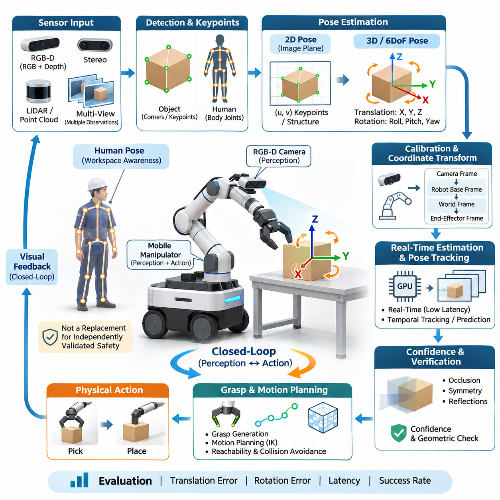
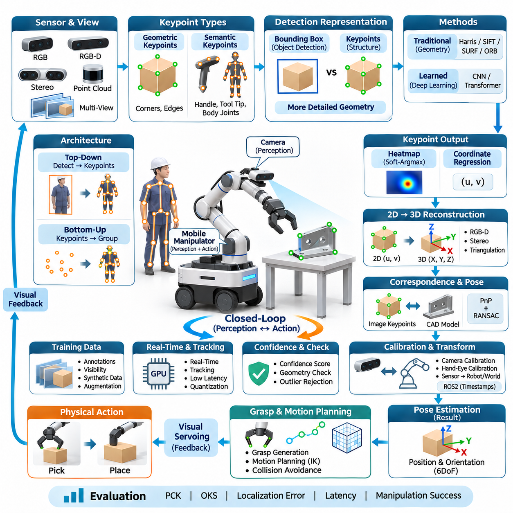
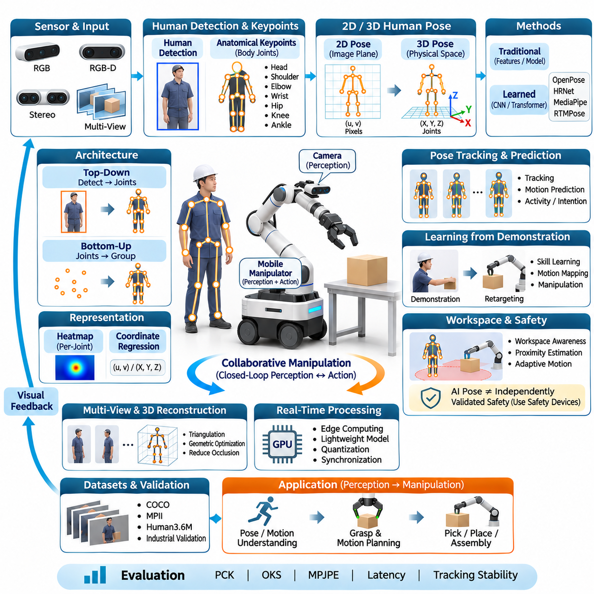
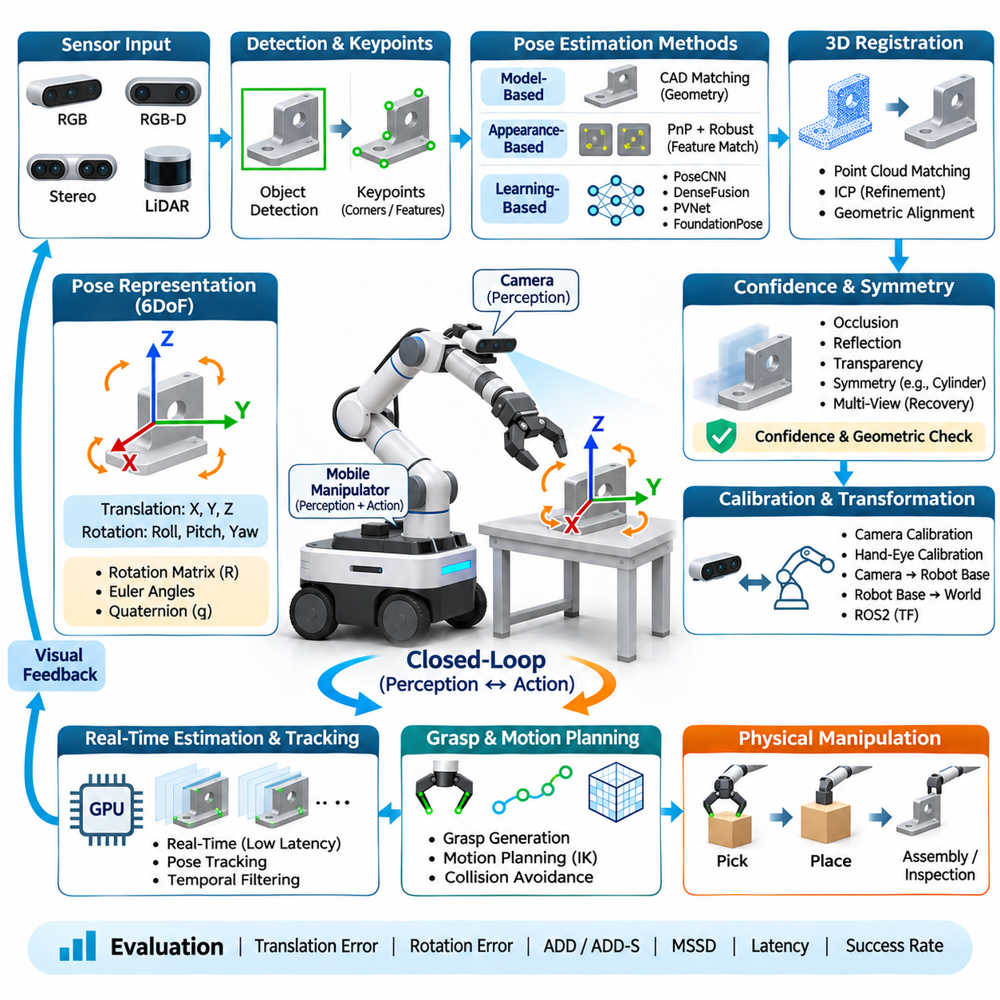
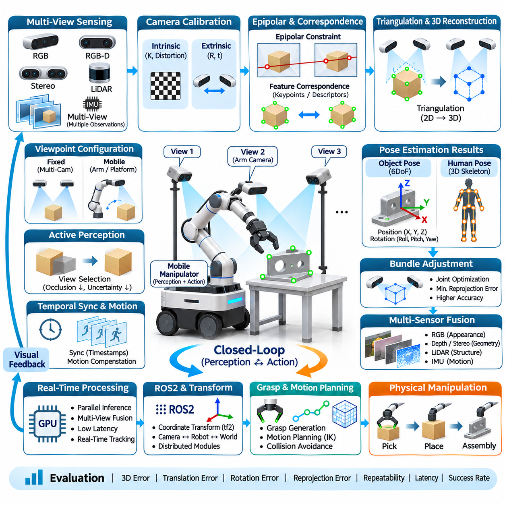
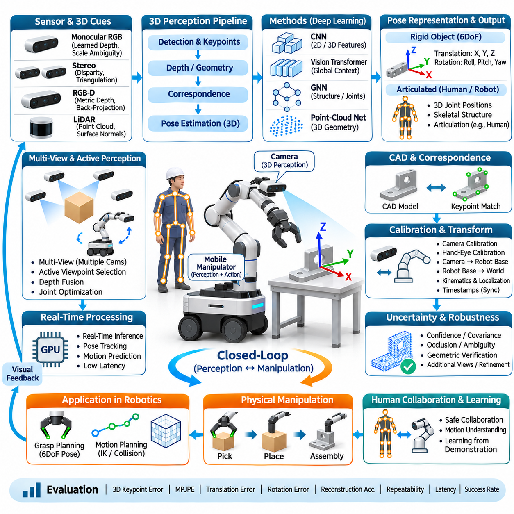
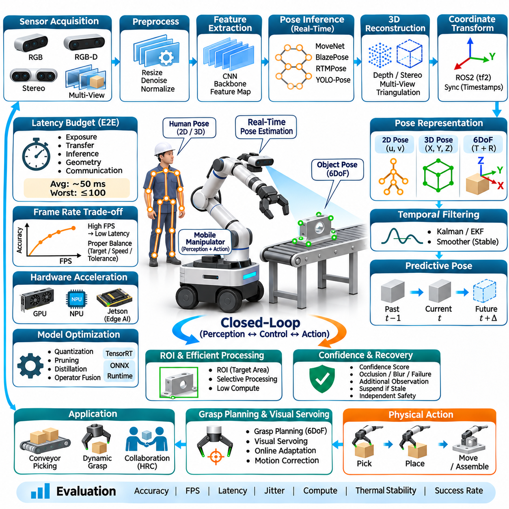
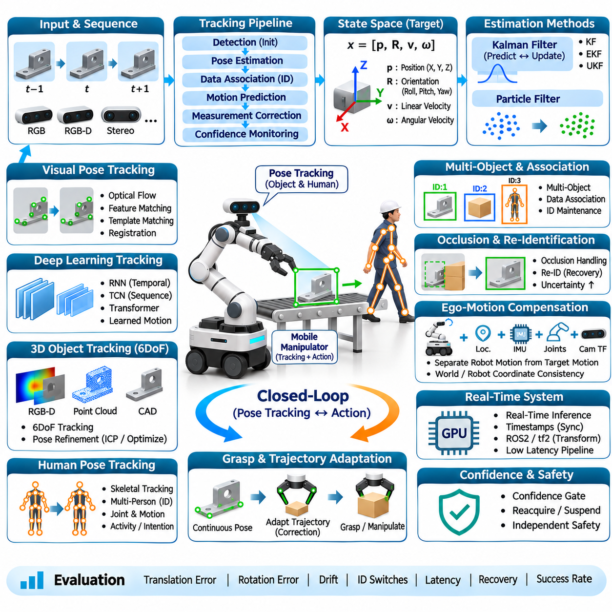
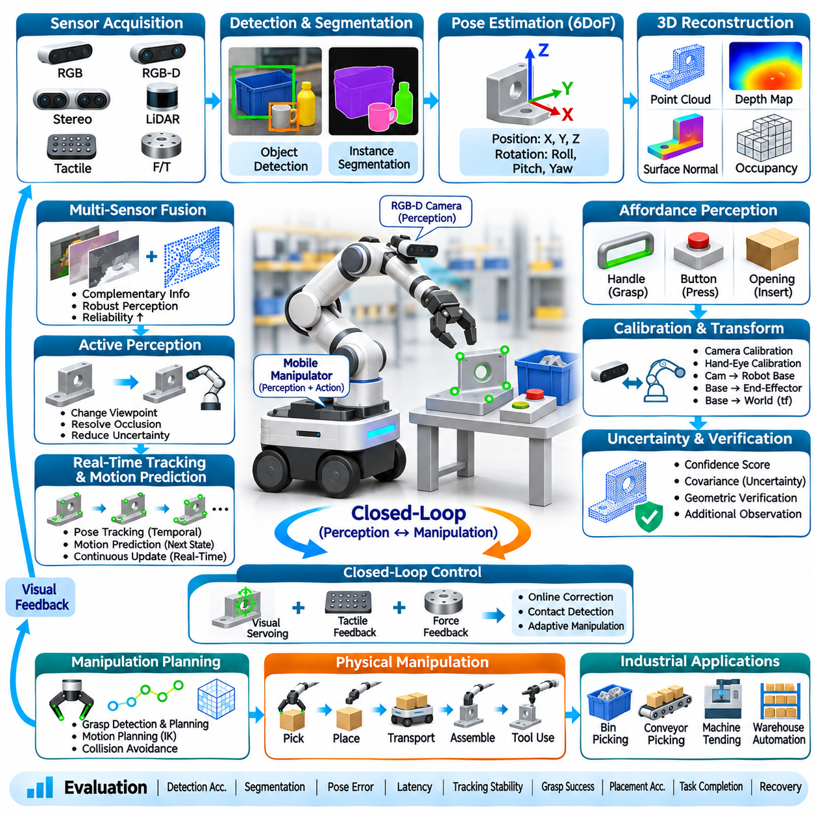

# Chapter 03. Pose Estimation

## 01 Pose Estimation Overview

{width="7.268055555555556in" height="7.268055555555556in"}

자세 추정(Pose Estimation)은 관측된 환경 내에서 객체, 사람 및 기타 물리적 개체의 공간적 구성(Spatial Configuration)을 결정하는 로봇 인식(Robotic Perception)의 핵심 구성 요소이다. 객체 감지(Object Detection)가 대상의 존재 여부와 위치를 식별하는 반면, 자세 추정은 대상의 위치(Position), 방향(Orientation) 또는 구조적 구성(Structural Configuration)에 관한 추가적인 기하학적 정보를 제공한다. 이러한 기능을 통해 로봇은 물리적 개체가 공간 내에서 어떻게 배치되어 있는지 이해할 수 있다.

모바일 매니퓰레이션(Mobile Manipulation) 시스템에서 자세 추정은 시각 인식(Visual Perception)과 물리적 상호작용(Physical Interaction)을 연결하는 필수적인 역할을 수행한다. 모바일 매니퓰레이터(Mobile Manipulator)는 조작 작업을 수행하기 전에 대상 객체를 식별하고 로봇 팔(Robotic Arm) 및 말단 작동기(End Effector)와의 공간적 관계를 파악해야 한다. 정확한 자세 정보는 동적이고 비정형적인 환경에서 파지 생성(Grasp Generation), 접근 계획(Approach Planning), 객체 운반(Object Transportation), 조립(Assembly) 및 배치(Placement)를 지원한다.

자세 추정은 일반적으로 2차원(2D) 접근 방식과 3차원(3D) 접근 방식으로 구분할 수 있다. 2차원 자세 추정(2D Pose Estimation)은 이미지 평면(Image Plane) 내의 공간적 속성이나 특징점(Keypoint)의 위치를 결정하며, 일반적으로 픽셀 좌표(Pixel Coordinates)로 표현된다. 3차원 자세 추정(3D Pose Estimation)은 이러한 표현을 물리적 공간으로 확장하여 로봇 시스템이 객체의 깊이(Depth), 공간적 방향(Spatial Orientation) 및 기하학적 관계(Geometric Relationships)를 추론할 수 있도록 한다.

강체 객체(Rigid Object)의 공간적 자세는 일반적으로 세 개의 병진 운동 성분(Translational Components)과 세 개의 회전 운동 성분(Rotational Components)으로 구성된 6자유도(6 Degrees of Freedom, 6DoF)를 사용하여 표현한다. 병진(Translation)은 X, Y, Z축을 기준으로 객체의 위치를 지정하며, 회전(Rotation)은 3차원 공간에서 객체의 방향을 나타낸다. 이러한 구성 요소는 객체와 로봇 말단 작동기 사이의 목표 공간적 관계를 설정하는 데 필요한 기하학적 정보를 제공한다.

특징점 감지(Keypoint Detection)는 다양한 자세 추정 방법의 중요한 기반을 구성한다. 특징점은 객체의 모서리(Object Corners), 구조적 기준점(Structural Landmarks), 사람의 신체 관절(Human Body Joints)과 같이 식별 가능한 기하학적 또는 의미론적 특징(Semantic Features)에 해당한다. 감지된 특징점과 알려진 기하학적 구조 사이의 관계를 설정함으로써 로봇 인식 시스템은 대상의 일부만 관측할 수 있는 상황에서도 공간적 구성을 추정할 수 있다.

인체 자세 추정(Human Pose Estimation)은 어깨, 팔꿈치, 손목, 골반 및 무릎을 포함한 신체 관절과 해부학적 기준점(Anatomical Landmarks)의 공간적 배치를 식별하는 데 중점을 둔다. 협동 로보틱스(Collaborative Robotics)에서 인체 자세 정보는 움직임 예측(Motion Prediction), 제스처 인식(Gesture Recognition), 작업 공간 인지(Workspace Awareness) 및 인간 시연을 통한 학습(Learning from Human Demonstrations)을 지원한다. 그러나 비전 기반 인체 자세 추정은 독립적으로 검증된 안전 메커니즘(Safety Mechanisms)을 대체해서는 안 된다.

객체 자세 추정(Object Pose Estimation)은 기준 좌표계(Reference Coordinate System)에 대한 물리적 객체의 위치와 방향을 결정한다. 전통적인 방법은 기하학적 특징 매칭(Geometric Feature Matching), 템플릿 매칭(Template Matching) 및 대응점 기반 최적화(Correspondence-Based Optimization)를 활용한다. 현대적인 딥러닝(Deep Learning) 접근 방식은 학습 데이터셋(Training Dataset)으로부터 강건한 시각적 표현(Robust Visual Representation)을 학습하여 조명, 관측 시점, 배경 및 부분 가림(Partial Occlusion)의 변화에 대한 추정 성능을 향상시킨다.

다중 시점 자세 추정(Multi-View Pose Estimation)은 여러 카메라 위치 또는 관측 방향에서 수집된 시각적 관측 정보(Visual Observations)를 통합한다. 모바일 매니퓰레이터는 이동 플랫폼(Mobile Platform)을 이동시키거나 로봇 팔에 장착된 카메라(Arm-Mounted Camera)의 위치를 변경하여 이러한 관측 정보를 획득할 수 있다. 상호 보완적인 관측 시점을 결합하면 기하학적 모호성(Geometric Ambiguity)을 줄이고 공간 재구성(Spatial Reconstruction)의 정확도를 향상시키며, 단일 관측에서 가려지거나 식별하기 어려운 객체의 특징을 복원하는 데 도움이 된다.

3차원 자세 추정(3D Pose Estimation)은 공간 정보를 획득하기 위해 RGB-D 카메라(RGB-D Camera), 스테레오 비전 시스템(Stereo Vision System) 및 포인트 클라우드 데이터(Point Cloud Data)를 활용하는 경우가 많다. 깊이 측정(Depth Measurement)은 RGB 이미지에서 추출된 시각적 외형(Visual Appearance)과 의미론적 특징을 보완하는 기하학적 제약 조건(Geometric Constraints)을 제공한다. 이러한 정보원을 결합하면 공간적 추론(Spatial Reasoning) 능력이 향상되며, 복잡한 객체와 혼잡한 조작 환경에서도 더욱 신뢰성 높은 자세 추정이 가능해진다.

좌표 변환(Coordinate Transformation)은 자세 추정을 로봇 제어 시스템(Robot Control System)에 통합하기 위한 핵심 요구사항이다. 추정된 자세는 초기에는 센서 또는 카메라 좌표계(Camera Coordinate System)를 기준으로 표현되며, 이후 로봇 베이스 좌표계(Robot Base Coordinate System), 월드 좌표계(World Coordinate System) 또는 말단 작동기 좌표계(End-Effector Coordinate System)로 변환되어야 한다. 공간적 일관성(Spatial Consistency)을 유지하려면 카메라 보정(Camera Calibration), 핸드-아이 보정(Hand-Eye Calibration), 정확한 좌표 변환 관계 및 동기화된 측정(Synchronized Measurement)이 필요하다.

실시간 자세 추정(Real-Time Pose Estimation)은 로봇 시스템이 운영 환경의 변화에 지속적으로 대응할 수 있도록 한다. 컨베이어 피킹(Conveyor Picking), 모바일 매니퓰레이션 및 인간-로봇 협업(Human-Robot Collaboration)과 같은 응용 분야에서는 충분히 낮은 처리 지연시간(Processing Latency)으로 갱신된 공간 정보가 필요하다. 효율적인 신경망 아키텍처(Neural Network Architecture), GPU 가속(GPU Acceleration), 최적화된 추론 엔진(Inference Engine) 및 동기화된 센서 파이프라인(Sensor Pipeline)은 이러한 연산 요구사항을 충족하는 데 기여한다.

자세 추적(Pose Tracking)은 객체, 사람 또는 로봇 플랫폼이 이동하는 동안 개별 자세 추정 결과를 연속적인 관측 정보로 확장하여 시간적 일관성(Temporal Consistency)을 유지한다. 추적 알고리즘(Tracking Algorithm)은 현재의 측정값을 이전의 추정값 및 움직임 예측 결과와 결합하여 불안정성을 줄이고 일시적인 관측 실패(Observation Failure)를 보완한다. 이러한 시간적 정보(Temporal Information)는 동적 환경에서 예측 기반 매니퓰레이션(Predictive Manipulation)과 적응형 모션 계획(Adaptive Motion Planning)을 지원한다.

자세 추정 성능(Pose Estimation Performance)은 센서 정확도(Sensor Accuracy), 보정 품질(Calibration Quality), 환경 조건(Environmental Conditions), 객체 특성(Object Characteristics) 및 알고리즘 강건성(Algorithm Robustness)에 따라 달라진다. 반사 표면(Reflective Surfaces), 투명 소재(Transparent Materials), 반복 패턴(Repetitive Patterns), 대칭 기하 구조(Symmetric Geometries) 및 심각한 가림(Severe Occlusion)은 상당한 추정 불확실성(Estimation Uncertainty)을 유발할 수 있다. 신뢰도 평가(Confidence Assessment), 추가 관측(Additional Observation) 및 기하학적 검증(Geometric Verification)은 신뢰성이 낮은 추정 결과가 직접적으로 로봇의 동작을 유발하는 것을 방지하는 데 도움이 된다.

자세 추정과 조작 계획(Manipulation Planning)의 통합은 시각적 관측 정보를 실제 동작에 활용할 수 있는 기하학적 정보(Actionable Geometric Information)로 변환한다. 추정된 객체 자세는 파지 후보 생성(Grasp Candidate Generation), 역기구학(Inverse Kinematics), 도달 가능성 분석(Reachability Analysis), 충돌 회피(Collision Avoidance) 및 궤적 계획(Trajectory Planning)을 지원한다. 이후 폐루프 시각 피드백(Closed-Loop Visual Feedback)을 통해 접근 및 조작 과정에서 대상 객체와 말단 작동기 사이의 추정된 공간적 관계를 더욱 정밀하게 보정할 수 있다.

자세 추정 시스템은 병진 오차(Translation Error), 회전 오차(Rotation Error), 특징점 위치 추정 정확도(Keypoint Localization Accuracy), 추적 안정성(Tracking Stability), 처리 지연시간(Processing Latency) 및 조작 성공률(Manipulation Success Rate)을 사용하여 평가한다. 성능 평가(Performance Evaluation)는 통제된 실험실 조건과 실제 운영 환경을 모두 고려해야 한다. 모바일 매니퓰레이터의 경우 위치 추정 불확실성(Localization Uncertainty), 플랫폼 이동(Platform Movement), 센서 보정(Sensor Calibration) 및 기계적 위치 결정(Mechanical Positioning)이 복합적으로 미치는 영향도 고려해야 한다.

궁극적으로 자세 추정은 시각 인식(Visual Perception), 공간적 추론(Spatial Reasoning) 및 로봇 행동(Robotic Action)을 연결하는 기하학적 기반(Geometric Foundation)을 제공한다. 객체 감지(Object Detection), 6차원 객체 자세 추정(6D Object Pose Estimation), 파지 감지(Grasp Detection), 파지 계획(Grasp Planning) 및 지능형 제어(Intelligent Control)와의 통합을 통해 모바일 매니퓰레이터는 다양한 물리적 환경과 상호작용할 수 있다. 따라서 신뢰성 높은 자세 추정은 자율 매니퓰레이션(Autonomous Manipulation)과 물리적 인공지능(Physical AI)의 발전을 위한 필수적인 핵심 구성 요소이다.

## 02 Keypoint Detection

{width="7.268055555555556in" height="7.268055555555556in"}

특징점 감지(Keypoint Detection)는 이미지 또는 3차원 표현(Three-Dimensional Representation) 내에서 구별 가능한 공간적 위치를 식별하는 시각 인식(Visual Perception)의 핵심 기술이다. 이러한 위치는 객체의 모서리(Object Corners), 구조적 기준점(Structural Landmarks), 표면 특성(Surface Characteristics) 및 사람의 신체 관절(Human Body Joints)과 같이 의미 있는 기하학적 또는 의미론적 특징(Geometric or Semantic Features)에 해당한다. 로봇 시스템에서 특징점 감지는 자세 추정(Pose Estimation), 공간적 추론(Spatial Reasoning) 및 물리적 상호작용(Physical Interaction)을 위한 구조화된 시각 정보를 제공한다.

일반적으로 경계 상자(Bounding Box)를 사용하여 객체를 표현하는 기존의 객체 감지(Object Detection)와 달리, 특징점 감지는 대상의 내부 구조(Internal Structure)를 설명하는 특정 위치를 식별한다. 이러한 위치는 객체의 형상(Shape), 방향(Orientation) 및 공간적 구성(Spatial Configuration)에 관한 더욱 상세한 기하학적 정보를 제공한다. 이러한 세부적인 표현을 통해 로봇 시스템은 시각적 관측 정보(Visual Observations)와 조작 목표(Manipulation Objectives) 사이의 정밀한 관계를 설정할 수 있다.

특징점은 일반적으로 기하학적 특징점(Geometric Keypoints)과 의미론적 특징점(Semantic Keypoints)으로 구분할 수 있다. 기하학적 특징점은 모서리(Corners), 경계선(Edges) 및 표면 불연속점(Surface Discontinuities)을 포함하는 구별 가능한 시각적 구조에 해당한다. 의미론적 특징점은 문손잡이(Door Handle), 공구 끝점(Tool Tip), 기계적 연결부(Mechanical Connector) 또는 지정된 파지점(Grasping Point)과 같이 특정 객체 범주나 기능적 구조(Functional Structure)와 관련된 의미 있는 위치를 나타낸다.

전통적인 특징점 감지 방법은 국소 이미지 특성(Local Image Characteristics)에 대한 수학적 분석을 기반으로 한다. 해리스 코너 감지(Harris Corner Detection), 크기 불변 특징 변환(Scale-Invariant Feature Transform, SIFT), 고속 강건 특징(Speeded-Up Robust Features, SURF) 및 방향성 FAST와 회전 BRIEF(Oriented FAST and Rotated BRIEF, ORB)와 같은 알고리즘은 구별 가능한 이미지 영역을 식별한다. 이러한 접근 방식은 특징 매칭(Feature Matching), 이미지 정합(Image Registration), 카메라 위치 추정(Camera Localization) 및 여러 관측 정보 사이의 기하학적 대응 관계(Geometric Correspondence)를 지원한다.

딥러닝(Deep Learning)은 신경망(Neural Network)이 시각 데이터로부터 복잡한 의미론적 구조(Semantic Structure)를 직접 식별할 수 있도록 함으로써 특징점 감지의 기능을 크게 확장하였다. 합성곱 신경망(Convolutional Neural Network, CNN)과 비전 트랜스포머(Vision Transformer)는 주석이 지정된 데이터셋(Annotated Dataset)으로부터 계층적 특징 표현(Hierarchical Feature Representation)을 학습한다. 이러한 학습된 표현은 조명, 객체 외형, 크기, 관측 방향 및 배경 복잡도의 변화에 대한 감지 강건성(Detection Robustness)을 향상시킨다.

히트맵 기반 특징점 감지(Heatmap-Based Keypoint Detection)는 현대적인 비전 시스템에서 널리 채택되는 접근 방식이다. 신경망은 공간 좌표(Spatial Coordinates)를 직접 예측하는 대신 개별 특징점이 존재할 가능성이 높은 위치를 나타내는 확률 지도(Probability Map)를 생성한다. 이러한 예측 결과의 공간적 분포(Spatial Distribution)는 신뢰도 추정(Confidence Estimation)을 지원하며, 소프트 아그맥스(Soft-Argmax) 및 국소 보간법(Local Interpolation)과 같은 기술은 서브픽셀 위치 추정 정확도(Subpixel Localization Accuracy)를 제공할 수 있다.

좌표 회귀(Coordinate Regression)는 신경망이 입력 이미지로부터 특징점의 좌표를 직접 예측하는 대안적인 접근 방식이다. 이 방법은 간결한 출력 표현(Output Representation)을 제공하며 특정 응용 분야에서 연산 요구사항(Computational Requirements)을 줄일 수 있다. 그러나 직접 회귀(Direct Regression)는 여러 개의 가능한 위치가 존재하는 경우 공간적 모호성(Spatial Ambiguity)을 표현하는 데 어려움을 겪을 수 있으며, 특히 심각한 가림(Severe Occlusion)이나 까다로운 시각적 조건에서 이러한 문제가 두드러질 수 있다.

하향식(Top-Down) 및 상향식(Bottom-Up) 아키텍처는 여러 대상이 존재하는 장면에서 특징점을 감지하기 위한 서로 다른 전략을 제공한다. 하향식 방법은 개별 객체 또는 사람을 먼저 식별한 이후 각각에 해당하는 특징점을 추정한다. 상향식 방법은 전체 이미지에서 특징점을 감지한 이후 이를 개별 인스턴스(Individual Instances)와 연결한다. 적절한 아키텍처의 선택은 장면 복잡도(Scene Complexity), 연산 자원(Computational Resources) 및 응용 분야의 요구사항(Application Requirements)에 따라 달라진다.

3차원 특징점 감지(3D Keypoint Detection)는 기존의 이미지 기반 위치 추정(Image-Based Localization)을 물리적 공간으로 확장한다. RGB-D 카메라(RGB-D Camera), 스테레오 비전(Stereo Vision) 및 포인트 클라우드 처리(Point Cloud Processing)는 감지된 시각적 특징과 관련된 깊이 정보(Depth Information)를 제공한다. 2차원 이미지 좌표와 보정된 깊이 측정값(Calibrated Depth Measurements)을 결합함으로써 로봇 시스템은 공간적 추론, 자세 추정 및 조작 계획(Manipulation Planning)을 위한 3차원 특징점 위치를 재구성할 수 있다.

특징점 대응 관계(Keypoint Correspondence)는 감지된 시각적 특징과 알려진 기하학적 또는 의미론적 기준점(Reference Points) 사이의 관계를 설정한다. 알려진 3차원 기하 구조를 가진 강체 객체(Rigid Object)의 경우, 이미지와 모델 사이에서 대응되는 특징점에 원근 투영 기반 다중점 자세 추정(Perspective-n-Point, PnP) 알고리즘을 적용하여 객체의 위치와 방향을 추정할 수 있다. 무작위 표본 합의(Random Sample Consensus, RANSAC)와 같은 강건 추정 방법(Robust Estimation Methods)은 잘못된 특징 대응 관계의 영향을 줄이는 데 도움이 된다.

다중 시점 특징점 감지(Multi-View Keypoint Detection)는 서로 다른 카메라 위치에서 획득한 관측 정보를 통합하여 위치 추정 정확도(Localization Accuracy)와 기하학적 일관성(Geometric Consistency)을 향상시킨다. 모바일 매니퓰레이터(Mobile Manipulator)는 추가적인 시각 정보를 획득하기 위해 이동 플랫폼 또는 로봇 팔에 장착된 카메라(Arm-Mounted Camera)의 위치를 능동적으로 변경할 수 있다. 삼각 측량(Triangulation), 특징 대응 관계(Feature Correspondence) 및 기하학적 최적화(Geometric Optimization)는 개별 관측과 관련된 불확실성을 줄이면서 공간적 특징점을 재구성할 수 있도록 한다.

데이터셋 설계(Dataset Design)는 신뢰성 높은 학습 기반 특징점 감지 시스템(Learning-Based Keypoint Detection System)을 개발하는 데 핵심적인 역할을 수행한다. 학습 데이터셋(Training Dataset)은 일관되게 주석이 지정된 특징점 위치, 가시성 레이블(Visibility Labels), 다양한 객체 구성(Object Configurations) 및 대표적인 환경 조건을 포함해야 한다. 합성 데이터 생성(Synthetic Data Generation), 도메인 무작위화(Domain Randomization) 및 이미지 증강(Image Augmentation)은 실제 관측 데이터를 수집하고 주석을 지정하는 비용을 줄이면서 데이터셋의 다양성(Dataset Diversity)을 확장할 수 있다.

실시간 특징점 감지(Real-Time Keypoint Detection)는 움직이는 객체, 변화하는 관측 시점 및 지속적인 시각 피드백(Visual Feedback)을 포함하는 모바일 매니퓰레이션(Mobile Manipulation) 응용 분야에서 특히 중요하다. 경량 신경망 아키텍처(Lightweight Neural Network Architecture), GPU 가속(GPU Acceleration), 모델 양자화(Model Quantization) 및 최적화된 추론 엔진(Optimized Inference Engine)은 처리 지연시간(Processing Latency)을 줄일 수 있다. 시간적 필터링(Temporal Filtering)과 특징점 추적(Keypoint Tracking)은 연속적인 카메라 프레임 사이에서 공간적 일관성을 유지함으로써 안정성을 더욱 향상시킨다.

로봇 제어(Robotic Control)와의 통합을 위해서는 감지된 특징점을 적절한 로봇 좌표계(Robot Coordinate System)로 변환해야 한다. 정확한 카메라 보정(Camera Calibration), 핸드-아이 보정(Hand-Eye Calibration), 센서 동기화(Sensor Synchronization) 및 좌표 변환(Coordinate Transformation)은 시각적 측정값을 신뢰성 높은 조작 목표(Manipulation Targets)로 변환하는 데 필수적이다. ROS2 기반 시스템에서는 타임스탬프(Timestamp)가 포함된 특징점 정보를 자세 추정, 모션 계획(Motion Planning) 및 시각 서보 제어(Visual Servoing) 모듈에 전달할 수 있다.

특징점 감지 성능(Keypoint Detection Performance)은 위치 추정 오차(Localization Error), 올바른 특징점의 비율(Percentage of Correct Keypoints, PCK), 객체 특징점 유사도(Object Keypoint Similarity, OKS), 감지 신뢰도(Detection Confidence) 및 추론 지연시간(Inference Latency)을 사용하여 평가한다. 산업 현장 검증(Industrial Validation)에서는 추가적으로 3차원 측정 오차(3D Measurement Error), 반복 정밀도(Repeatability), 가림에 대한 강건성(Occlusion Robustness) 및 후속 조작 성공률(Downstream Manipulation Success Rate)을 고려해야 한다. 신뢰도 임계값(Confidence Threshold)과 기하학적 일관성 검사(Geometric Consistency Check)는 신뢰성이 낮은 감지 결과가 물리적 동작을 유발하는 것을 방지하는 데 도움이 된다.

궁극적으로 특징점 감지(Keypoint Detection)는 시각적 외형(Visual Appearance)을 물리적 기하 구조(Physical Geometry) 및 기능적 이해(Functional Understanding)와 연결하는 구조화된 표현(Structured Representation)을 제공한다. 객체 자세 추정(Object Pose Estimation), 인체 자세 추정(Human Pose Estimation), 파지 감지(Grasp Detection) 및 폐루프 로봇 제어(Closed-Loop Robotic Control)와의 통합을 통해 모바일 매니퓰레이터는 정밀하고 적응적인 물리적 상호작용(Adaptive Physical Interaction)을 수행할 수 있다. 이러한 기능은 자율 매니퓰레이션(Autonomous Manipulation)과 물리적 인공지능(Physical AI)을 위한 중요한 인식 기반(Perceptual Foundation)을 구성한다.

## 03 Human Pose Estimation

{width="7.268055555555556in" height="7.268055555555556in"}

인체 자세 추정(Human Pose Estimation)은 해부학적 기준점(Anatomical Landmarks)과 관절 위치(Joint Positions)를 식별하여 인체의 공간적 구성(Spatial Configuration)을 결정하는 시각 인식(Visual Perception)의 핵심 기술이다. 이러한 기준점은 일반적으로 머리, 어깨, 팔꿈치, 손목, 골반, 무릎 및 발목을 포함한다. 로봇 시스템에서 인체 자세 추정은 공유 운영 환경(Shared Operational Environment) 내에서 인간의 자세(Posture), 움직임(Movement) 및 물리적 상호작용(Physical Interaction)에 관한 구조화된 정보를 제공한다.

모바일 매니퓰레이션(Mobile Manipulation) 시스템에서 인체 자세 추정은 로봇이 주변 환경 내에서 인간의 활동을 인식하고 대응할 수 있도록 한다. 주로 사람의 존재 여부와 대략적인 위치를 식별하는 기존의 인체 감지(Human Detection)와 달리, 자세 추정은 신체 구성(Body Configuration)에 관한 상세한 정보를 제공한다. 이러한 정보는 협업 매니퓰레이션(Collaborative Manipulation), 제스처 인식(Gesture Recognition), 움직임 예측(Motion Prediction) 및 적응형 로봇 행동(Adaptive Robot Behavior)을 지원한다.

2차원 인체 자세 추정(2D Human Pose Estimation)은 픽셀 좌표(Pixel Coordinates)를 사용하여 이미지 평면(Image Plane) 내의 해부학적 특징점(Anatomical Keypoints)을 식별한다. 이러한 특징점은 사전에 정의된 해부학적 관계(Anatomical Relationships)에 따라 연결되어 인체의 골격 표현(Skeletal Representation)을 구성한다. 2차원 표현은 실제 거리 단위의 깊이 정보(Metric Depth Information)를 직접 제공하지는 않지만, 자세 인식(Posture Recognition), 활동 분류(Activity Classification), 제스처 해석(Gesture Interpretation) 및 인간 움직임 분석(Human Motion Analysis)에 유용하다.

3차원 인체 자세 추정(3D Human Pose Estimation)은 개별 신체 관절의 공간 좌표(Spatial Coordinates)를 추정함으로써 골격 표현을 물리적 공간으로 확장한다. 깊이 카메라(Depth Camera), 스테레오 비전 시스템(Stereo Vision System), 다중 시점 카메라 구성(Multi-View Camera Configuration) 및 단안 딥러닝 모델(Monocular Deep Learning Model)은 이러한 과정을 지원할 수 있다. 3차원 표현을 통해 로봇 시스템은 인간, 로봇 매니퓰레이터 및 주변 물리적 객체 사이의 공간적 관계(Spatial Relationships)를 평가할 수 있다.

전통적인 인체 자세 추정 방법은 인체 구성을 식별하기 위해 수작업으로 설계된 시각적 특징(Handcrafted Visual Features), 해부학적 제약 조건(Anatomical Constraints) 및 그래픽 모델(Graphical Models)에 의존하였다. 이러한 접근 방식은 가림(Occlusion), 조명 변화(Illumination Changes) 및 다양한 신체 자세를 포함하는 복잡한 환경에서 어려움을 겪는 경우가 많았다. 딥러닝(Deep Learning)은 신경망(Neural Network)이 시각 데이터로부터 복잡한 해부학적 및 공간적 관계를 직접 학습할 수 있도록 함으로써 자세 추정 성능을 크게 향상시켰다.

합성곱 신경망(Convolutional Neural Network, CNN)과 비전 트랜스포머(Vision Transformer)는 현대적인 인체 자세 추정 아키텍처(Architecture)에서 널리 사용된다. 대표적인 프레임워크(Framework)에는 OpenPose, 고해상도 신경망(High-Resolution Network, HRNet), MediaPipe Pose 및 RTMPose가 포함된다. 이러한 접근 방식은 위치 추정 정확도(Localization Accuracy), 연산 효율성(Computational Efficiency), 모델 복잡도(Model Complexity) 및 실시간 처리 능력(Real-Time Processing Capability) 사이에서 서로 다른 절충 관계(Trade-Off)를 제공하므로, 개발자는 로봇 응용 분야에 적합한 아키텍처를 선택할 수 있다.

하향식 인체 자세 추정(Top-Down Human Pose Estimation)은 이미지 내에서 개별 사람을 먼저 감지한 이후 감지된 각 사람의 해부학적 특징점을 추정한다. 상향식 접근 방식(Bottom-Up Approach)은 전체 이미지에서 특징점을 식별한 이후 이를 개별 골격 표현으로 그룹화(Grouping)한다. 하향식 방법은 일반적으로 정확한 개별 자세 추정 결과를 제공하는 반면, 상향식 방법은 여러 사람이 존재하는 장면에서 연산상의 이점(Computational Advantages)을 제공할 수 있다.

히트맵 예측(Heatmap Prediction)은 인체 관절이 존재할 가능성이 높은 위치를 표현하는 일반적인 기술이다. 신경망은 개별 해부학적 특징점에 대응하는 공간적 신뢰도 지도(Spatial Confidence Map)를 생성하며, 예측된 응답값(Predicted Response)을 기반으로 관절 위치를 결정할 수 있도록 한다. 좌표 회귀(Coordinate Regression)는 관절 좌표를 직접 예측하는 대안적인 접근 방식으로, 연산 자원이 제한된 로봇 플랫폼(Robotic Platform)의 출력 복잡도(Output Complexity)를 줄일 수 있다.

다중 시점 인체 자세 추정(Multi-View Human Pose Estimation)은 여러 카메라에서 획득한 관측 정보를 결합하여 공간적 정확도(Spatial Accuracy)를 향상시키고 가림으로 인한 불확실성(Uncertainty)을 줄인다. 서로 대응하는 해부학적 특징점은 삼각 측량(Triangulation)과 기하학적 최적화(Geometric Optimization)를 통해 3차원 공간에서 재구성할 수 있다. 모바일 매니퓰레이터(Mobile Manipulator) 역시 카메라 자세(Camera Pose), 관측 시점(Observation Timing) 및 인간의 움직임을 적절하게 고려한다면 제어된 이동(Controlled Movement)을 통해 상호 보완적인 관측 시점(Complementary Viewpoints)을 획득할 수 있다.

인체 자세 추적(Human Pose Tracking)은 개별 골격 추정 결과를 연속적인 카메라 프레임으로 확장하여 시간적 일관성(Temporal Consistency)을 유지한다. 추적 알고리즘(Tracking Algorithm)은 시간의 흐름에 따라 감지된 사람과 해부학적 기준점을 연결함으로써 불안정성을 줄이고 일시적인 관측 실패(Observation Failure)를 보완한다. 연속적인 자세 정보(Sequential Pose Information)는 인간 움직임 예측(Human Motion Prediction), 활동 인식(Activity Recognition), 의도 추정(Intention Estimation) 및 인간과 로봇 시스템 사이의 적응형 협업(Adaptive Collaboration)을 지원한다.

인체 자세 추정은 로봇이 인간의 활동을 관찰하여 조작 기술을 습득하는 시연 기반 학습(Learning from Demonstration, LfD)에서 중요한 역할을 수행한다. 인간의 팔 궤적(Arm Trajectory), 손목 방향(Wrist Orientation) 및 신체 움직임은 로봇 행동 시퀀스(Robotic Action Sequence)를 생성하기 위한 참조 정보를 제공할 수 있다. 동작 재매핑(Retargeting) 기술은 관절 구성(Joint Configuration), 작업 공간 제한(Workspace Limitation) 및 물리적 제약 조건(Physical Constraints)의 차이를 고려하여 관측된 인간의 움직임을 로봇의 기구학적 구조(Kinematic Structure)에 매핑한다.

협업 매니퓰레이션 환경(Collaborative Manipulation Environment)에서 인체 자세 정보는 작업 공간 모니터링(Workspace Monitoring)과 상황 인식형 모션 계획(Context-Aware Motion Planning)을 지원한다. 로봇 시스템은 인간과의 근접도(Human Proximity)를 추정하고 잠재적인 이동 방향을 식별하며, 이에 따라 작업 궤적(Operational Trajectory)을 조정할 수 있다. 그러나 일반적인 인공지능 기반 자세 추정(AI-Based Pose Estimation)은 독립적으로 기능 안전(Functional Safety)을 보장하지 못하므로, 적절하게 검증된 보호 장치(Protective Devices) 및 안전 제어 아키텍처(Safety Control Architecture)와 함께 운영되어야 한다.

실시간 인체 자세 추정(Real-Time Human Pose Estimation)은 추론 정확도(Inference Accuracy), 처리 지연시간(Processing Latency) 및 연산 자원 소비(Computational Resource Consumption) 사이의 효과적인 균형을 요구한다. 엣지 컴퓨팅 플랫폼(Edge Computing Platform), GPU 가속(GPU Acceleration), 경량 신경망(Lightweight Neural Network), 모델 양자화(Model Quantization) 및 최적화된 추론 엔진(Optimized Inference Engine)은 시각적 관측 정보의 지속적인 처리를 가능하게 한다. 정확한 센서 동기화(Sensor Synchronization)와 타임스탬프 관리(Timestamp Management)는 로봇 플랫폼과 관측 대상인 사람이 동시에 움직이는 상황에서 특히 중요하다.

데이터셋 설계(Dataset Design)와 모델 검증(Model Validation)은 신뢰성 높은 인체 자세 추정 시스템을 개발하는 데 필수적이다. 대표적인 데이터셋(Dataset)에는 COCO Keypoints, MPII Human Pose 및 Human3.6M이 포함된다. 산업 응용 분야(Industrial Applications)에서는 보호복(Protective Clothing), 비정형적인 작업 자세(Unusual Working Postures), 부분적 가시성(Partial Visibility), 다양한 신체적 특성 및 공구, 기계류, 주변 산업 설비와의 상호작용을 포함하는 추가적인 학습 및 검증 데이터(Training and Validation Data)가 필요할 수 있다.

성능 평가(Performance Evaluation)는 일반적으로 올바른 특징점의 비율(Percentage of Correct Keypoints, PCK), 객체 특징점 유사도(Object Keypoint Similarity, OKS) 및 평균 관절 위치 오차(Mean Per Joint Position Error, MPJPE)를 활용한다. 로봇 응용 분야에서는 추가적으로 추적 안정성(Tracking Stability), 종단 간 지연시간(End-to-End Latency), 가림에 대한 강건성(Occlusion Robustness) 및 공간 측정 정확도(Spatial Measurement Accuracy)를 평가해야 한다. 추정된 자세를 로봇 제어와 통합할 때는 보정 오차(Calibration Error), 신뢰도 불확실성(Confidence Uncertainty) 및 좌표 변환 정확도(Coordinate Transformation Accuracy) 역시 고려해야 한다.

궁극적으로 인체 자세 추정(Human Pose Estimation)은 모바일 매니퓰레이터가 인간의 움직임을 개별적인 시각적 관측 정보가 아닌 구조화된 공간 정보(Structured Spatial Information)로 해석할 수 있도록 한다. 인간 활동 인식(Human Activity Recognition), 궤적 예측(Trajectory Prediction), 시연 기반 학습(Learning from Demonstration) 및 지능형 모션 계획(Intelligent Motion Planning)과의 통합은 적응형 인간-로봇 협업(Adaptive Human-Robot Collaboration)을 지원한다. 이러한 기능은 자율 로봇 시스템(Autonomous Robotic System), 체화 인공지능(Embodied AI) 및 물리적 인공지능(Physical AI)을 위한 중요한 인식 기반(Perceptual Foundation)을 구성한다.

## 04 Object Pose Estimation

{width="7.268055555555556in" height="7.268055555555556in"}

객체 자세 추정(Object Pose Estimation)은 관측된 환경 내에서 물리적 객체의 공간적 위치(Spatial Position)와 방향(Orientation)을 결정하는 로봇 인식(Robotic Perception)의 핵심 기술이다. 객체의 범주와 대략적인 위치를 식별하는 기존의 객체 감지(Object Detection)와 달리, 자세 추정은 객체가 어떻게 배치되고 방향이 설정되어 있는지를 설명하는 기하학적 정보(Geometric Information)를 제공한다. 이러한 정보를 통해 로봇 시스템은 물리적 대상과 정확하게 상호작용할 수 있다.

모바일 매니퓰레이션(Mobile Manipulation) 시스템에서 객체 자세 추정은 시각 인식(Visual Perception)과 로봇 행동(Robotic Action) 사이의 기하학적 연결(Geometric Connection)을 형성한다. 모바일 매니퓰레이터(Mobile Manipulator)는 물리적 작업을 수행하기 전에 대상 객체, 이동 플랫폼(Mobile Platform) 및 로봇 팔(Robotic Arm) 사이의 공간적 관계(Spatial Relationships)를 결정해야 한다. 정확한 자세 정보는 자율 피킹(Autonomous Picking), 객체 운반(Object Transportation), 정밀 조립(Precision Assembly), 검사(Inspection) 및 공구 조작(Tool Manipulation)을 지원한다.

객체 자세(Object Pose)는 일반적으로 세 개의 병진 운동 성분(Translational Components)과 세 개의 회전 운동 성분(Rotational Components)으로 구성된 6자유도(6 Degrees of Freedom, 6DoF)를 사용하여 표현한다. 병진(Translation)은 X, Y, Z축을 기준으로 객체의 위치를 설명하며, 회전(Rotation)은 객체의 공간적 방향을 지정한다. 회전 행렬(Rotation Matrix), 오일러 각(Euler Angles) 및 쿼터니언(Quaternion)은 로봇 기구학(Robotic Kinematics)과 모션 계획 알고리즘(Motion Planning Algorithm)에 통합할 수 있는 수학적 표현(Mathematical Representation)을 제공한다.

객체 자세 추정 방법은 일반적으로 모델 기반 접근 방식(Model-Based Approach), 외형 기반 접근 방식(Appearance-Based Approach) 및 학습 기반 접근 방식(Learning-Based Approach)으로 구분할 수 있다. 모델 기반 방법은 알려진 객체의 기하 구조(Object Geometry)를 활용하는 반면, 외형 기반 방법은 시각적 특성(Visual Characteristics)과 참조 관측 정보(Reference Observations)에 의존한다. 학습 기반 방법은 신경망(Neural Network)을 활용하여 이미지 또는 깊이 데이터(Depth Data)로부터 공간적 구성을 추정함으로써 다양한 운영 조건에서 더욱 유연한 인식을 지원한다.

전통적인 기하학적 자세 추정(Geometric Pose Estimation)은 관측된 이미지와 참조 객체 모델(Reference Object Model) 사이의 특징 감지(Feature Detection) 및 대응점 매칭(Correspondence Matching)에 의존하는 경우가 많다. 구별 가능한 시각적 특징(Distinctive Visual Features)을 식별하고 이를 알려진 3차원 위치와 연결한다. 원근 투영 기반 다중점 자세 추정(Perspective-n-Point, PnP) 알고리즘은 이러한 대응 관계로부터 객체의 위치와 방향을 계산하며, 강건 추정 기술(Robust Estimation Techniques)은 잘못된 특징 매칭 결과를 제거하는 데 도움이 된다.

CAD 기반 자세 추정(CAD-Based Pose Estimation)은 물리적 객체와 디지털 표현(Digital Representation) 사이의 기하학적 관계를 설정하기 위해 3차원 컴퓨터 지원 설계(Computer-Aided Design, CAD) 모델을 활용한다. 관측된 객체의 특징, 윤곽선(Contours) 또는 표면 측정값(Surface Measurements)을 참조 기하 구조(Reference Geometry)와 정합하여 공간 변환(Spatial Transformation)을 결정한다. 이러한 접근 방식은 정확한 엔지니어링 모델(Engineering Model)을 확보할 수 있는 산업 제조 환경(Industrial Manufacturing Environment)에서 특히 유용하다.

RGB 기반 객체 자세 추정(RGB-Based Object Pose Estimation)은 일반적인 컬러 이미지(Color Image)를 사용하여 공간적 구성을 결정한다. 딥러닝 모델(Deep Learning Model)은 의미론적 특징점(Semantic Keypoints), 객체 방향(Object Orientation) 또는 이미지 픽셀과 객체 참조 좌표(Object Reference Coordinates) 사이의 밀집 대응 관계(Dense Correspondences)를 예측할 수 있다. RGB 카메라는 비교적 낮은 하드웨어 비용으로 상세한 외형 정보를 제공하지만, 깊이 모호성(Depth Ambiguity)과 다양한 환경 조건은 추정 정확도(Estimation Accuracy)에 영향을 미칠 수 있다.

RGB-D 기반 객체 자세 추정(RGB-D-Based Object Pose Estimation)은 공간적 위치 추정(Spatial Localization)과 기하학적 추론(Geometric Reasoning)을 향상시키기 위해 컬러 정보(Color Information)와 깊이 측정값(Depth Measurements)을 결합한다. 깊이 데이터는 관측 가능한 객체 표면의 직접적인 측정값을 제공하는 반면, RGB 이미지는 질감(Texture)과 의미론적 정보(Semantic Information)를 제공한다. 두 가지 센싱 방식(Sensing Modalities)을 통합하면 혼잡한 환경(Cluttered Environment), 특히 객체의 시각적 질감이 제한적이거나 복잡한 기하 구조를 가지고 있는 경우 더욱 신뢰성 높은 자세 추정이 가능해진다.

포인트 클라우드 기반 자세 추정(Point Cloud-Based Pose Estimation)은 깊이 카메라(Depth Camera), 스테레오 비전 시스템(Stereo Vision System) 또는 라이다 센서(LiDAR Sensor)에서 획득한 3차원 표면 측정값을 처리한다. 정합 알고리즘(Registration Algorithm)은 관측된 포인트 클라우드(Point Cloud)를 참조 객체 모델과 정합하여 공간 변환을 계산한다. 반복 최근접점(Iterative Closest Point, ICP)과 같은 방법은 기하학적 정합(Geometric Alignment)을 정밀하게 보정하지만, 그 성능은 초기화 품질(Initialization Quality), 측정 잡음(Measurement Noise) 및 표면 가시성(Surface Visibility)에 따라 달라진다.

딥러닝(Deep Learning)은 신경망이 시각적 관측 정보(Visual Observations)와 공간적 구성(Spatial Configuration) 사이의 복잡한 관계를 학습할 수 있도록 함으로써 객체 자세 추정의 기능을 확장하였다. 대표적인 접근 방식에는 PoseCNN, DenseFusion, PVNet 및 FoundationPose가 포함된다. 이러한 방법은 다양한 객체 인식 요구사항(Object Perception Requirements)을 충족하기 위해 특징 학습(Feature Learning), 특징점 예측(Keypoint Prediction), 기하학적 대응 관계(Geometric Correspondence) 및 자세 정밀화(Pose Refinement)를 서로 다른 방식으로 결합하여 활용한다.

객체 대칭성(Object Symmetry)은 여러 공간적 방향이 동일하거나 거의 동일한 시각적 관측 결과를 생성할 수 있으므로 중요한 해결 과제로 작용한다. 원통형 부품(Cylindrical Components), 구형 객체(Spherical Objects) 및 반복적인 산업 구조물(Repetitive Industrial Structures)은 이러한 기하학적 모호성(Geometric Ambiguity)을 나타내는 경우가 많다. 대칭성 인식 표현(Symmetry-Aware Representation), 학습 목적 함수(Training Objectives) 및 평가 지표(Evaluation Metrics)는 의미 있는 회전 차이와 기하학적으로 동등한 객체 구성(Geometrically Equivalent Object Configurations)을 구분하는 데 도움이 된다.

가림(Occlusion)과 환경 변동성(Environmental Variability) 역시 객체 자세 추정 성능에 영향을 미친다. 중첩된 객체(Overlapping Objects), 반사 소재(Reflective Materials), 투명 표면(Transparent Surfaces), 조명 변화(Illumination Changes) 및 센서 잡음(Sensor Noise)은 신뢰할 수 있는 기하학적 정보의 가용성을 감소시킬 수 있다. 다중 시점 관측(Multi-View Observation), 센서 융합(Sensor Fusion), 신뢰도 추정(Confidence Estimation) 및 기하학적 검증(Geometric Verification)은 추정 강건성(Estimation Robustness)을 향상시키고 초기 관측 정보가 충분하지 않은 경우 복구(Recovery)를 지원한다.

모바일 매니퓰레이터의 경우 추정된 객체 자세를 카메라 좌표계(Camera Coordinate System)에서 적절한 로봇 기준 좌표계(Robot Reference Coordinate System)로 변환해야 한다. 카메라 보정(Camera Calibration), 핸드-아이 보정(Hand-Eye Calibration), 플랫폼 위치 추정(Platform Localization) 및 센서 동기화(Sensor Synchronization)는 정확한 공간 제어(Spatial Control)에 필요한 좌표 변환 관계(Transformation Relationships)를 설정한다. ROS2 좌표 변환 프레임워크(Transformation Framework)는 분산된 인식 및 매니퓰레이션 모듈(Distributed Perception and Manipulation Modules) 사이에서 이러한 좌표 관계를 유지할 수 있다.

실시간 객체 자세 추정(Real-Time Object Pose Estimation)은 움직이는 대상, 변화하는 관측 시점 및 동적 운영 환경(Dynamic Operating Environment)을 포함하는 조작 작업을 지원한다. GPU 가속(GPU Acceleration), 경량 신경망(Lightweight Neural Network), 최적화된 추론 엔진(Optimized Inference Engine) 및 시간적 자세 추적(Temporal Pose Tracking)은 처리 지연시간(Processing Latency)을 줄이고 추정 안정성(Estimation Stability)을 유지하는 데 도움이 된다. 지속적인 자세 정보 갱신(Continuous Pose Update)을 통해 폐루프 시각 제어(Closed-Loop Visual Control)는 로봇의 접근 및 상호작용 과정에서 위치 결정 오차(Positioning Error)를 보상할 수 있다.

성능 평가(Performance Evaluation)는 일반적으로 병진 오차(Translation Error), 회전 오차(Rotation Error), 모델 점 평균 거리(Average Distance of Model Points, ADD) 및 대칭성을 고려한 모델 점 평균 거리(ADD-S) 또는 최대 대칭성 인식 표면 거리(Maximum Symmetry-Aware Surface Distance, MSSD)와 같은 대칭성 인식 지표(Symmetry-Aware Metrics)를 활용한다. 산업 현장 검증(Industrial Validation)에서는 인식 벤치마크(Perception Benchmark)에만 의존하는 것이 아니라 대표적인 운영 조건에서의 반복 정밀도(Repeatability), 처리 지연시간, 추정 신뢰도(Estimation Confidence) 및 조작 성공률(Manipulation Success Rate)을 추가적으로 고려해야 한다.

궁극적으로 객체 자세 추정(Object Pose Estimation)은 시각적 관측 정보를 자율 로봇 매니퓰레이션(Autonomous Robotic Manipulation)에 활용할 수 있는 공간 정보(Actionable Spatial Information)로 변환한다. 6차원 객체 자세 추정(6D Object Pose Estimation), 파지 감지(Grasp Detection), 파지 계획(Grasp Planning), 역기구학(Inverse Kinematics), 충돌 회피(Collision Avoidance) 및 폐루프 제어(Closed-Loop Control)와의 통합을 통해 모바일 매니퓰레이터는 정밀한 물리적 작업을 수행할 수 있다. 이러한 기능은 체화 인공지능(Embodied AI)과 물리적 인공지능(Physical AI)을 구현하기 위한 핵심적인 기하학적 기반(Geometric Foundation)을 구성한다.

## 05 Multi View Pose Estimation

{width="7.268055555555556in" height="7.268055555555556in"}

다중 시점 자세 추정(Multi-View Pose Estimation)은 여러 관측 시점(Viewpoints)에서 획득한 시각적 관측 정보(Visual Observations)를 통합하여 객체 또는 인간의 공간적 구성(Spatial Configuration)을 결정하는 로봇 인식(Robotic Perception) 기술이다. 단일 카메라 관점에서 획득한 정보에 의존하는 단일 시점 접근 방식(Single-View Approach)과 달리, 다중 시점 자세 추정은 상호 보완적인 기하학적 정보와 시각 정보를 결합하여 공간적 정확도(Spatial Accuracy)를 향상시키고, 모호성(Ambiguity)을 줄이며, 인식 강건성(Perception Robustness)을 높인다.

모바일 매니퓰레이션(Mobile Manipulation) 시스템에서 다중 시점 자세 추정은 로봇이 개별적인 시각적 관측의 한계를 극복할 수 있도록 한다. 대상 객체(Target Object)는 부분적으로 가려져 있거나, 조명 조건이 불량하거나, 관측하기 어려운 각도에 배치되어 있을 수 있다. 서로 다른 위치에서 관측 정보를 수집함으로써 모바일 매니퓰레이터(Mobile Manipulator)는 더욱 포괄적인 기하학적 정보(Geometric Information)를 획득하고 후속 조작 작업(Manipulation Tasks)을 위한 신뢰성 높은 공간적 관계(Spatial Relationships)를 설정할 수 있다.

다중 시점 인식 시스템(Multi-View Perception System)은 고정형 다중 카메라 구성(Fixed Multi-Camera Configuration), 로봇 장착형 카메라(Robot-Mounted Camera) 또는 고정형 센서와 이동형 센서의 조합을 활용할 수 있다. 고정형 구성은 사전에 정의된 관측 방향에서 객체의 영상을 동시에 획득하는 반면, 이동형 구성은 제어된 로봇 이동(Controlled Robot Movement)을 통해 순차적인 관측 정보(Sequential Observations)를 획득한다. 적절한 구성의 선택은 환경 특성(Environmental Characteristics), 작업 요구사항(Task Requirements) 및 대상의 동적 특성(Target Dynamics)에 따라 달라진다.

카메라 보정(Camera Calibration)은 다중 시점 자세 추정을 위한 수학적 기반(Mathematical Foundation)을 형성한다. 내부 파라미터 보정(Intrinsic Calibration)은 초점 거리(Focal Length), 주점(Principal Point) 및 렌즈 왜곡(Lens Distortion)을 포함한 카메라 내부 파라미터(Intrinsic Parameters)를 결정한다. 외부 파라미터 보정(Extrinsic Calibration)은 공통 기준 좌표계(Common Reference Coordinate System) 내에서 카메라의 상대적 위치와 방향을 결정한다. 정확한 보정은 여러 시각적 관측 정보 사이의 기하학적 일관성(Geometric Consistency)을 유지하는 데 필수적이다.

에피폴라 기하학(Epipolar Geometry)은 서로 다른 카메라 관측 시점에서 획득한 이미지 사이의 기하학적 관계(Geometric Relationships)를 설명한다. 하나의 물리적 특징점(Physical Feature)이 두 대의 카메라에 의해 관측되는 경우, 각 이미지에서 대응되는 위치는 카메라 사이의 상대적 기하 구조(Relative Camera Geometry)에 의해 제약된다. 이러한 제약 조건(Constraints)은 특징 대응 관계(Feature Correspondence)를 탐색하기 위한 탐색 공간(Search Space)을 줄이고 여러 이미지에서 일치하는 특징점(Matching Keypoints)을 신뢰성 있게 식별할 수 있도록 지원한다.

삼각 측량(Triangulation)은 서로 대응하는 2차원 관측 정보로부터 3차원 위치를 재구성하는 핵심 기하학적 기술이다. 보정된 카메라(Calibrated Camera)에서 투영된 관측 광선(Viewing Rays)의 교차점(Intersection) 또는 광선들이 가장 근접하게 일치하는 위치를 결정함으로써 로봇 인식 시스템은 공간적 특징점 위치(Spatial Feature Locations)를 추정할 수 있다. 재구성 정확도(Reconstruction Accuracy)는 카메라 기하 구조(Camera Geometry), 기선 거리(Baseline Distance), 보정 품질(Calibration Quality) 및 특징점 위치 추정 정확도(Keypoint Localization Accuracy)에 따라 달라진다.

특징 대응 관계(Feature Correspondence)는 서로 다른 관측 시점에서 획득한 관측 정보 사이의 관계를 설정하는 데 중요한 역할을 수행한다. 전통적인 접근 방식은 국소 시각 특징 기술자(Local Visual Descriptors)와 기하학적 매칭 알고리즘(Geometric Matching Algorithms)을 활용하는 반면, 현대적인 딥러닝(Deep Learning) 방법은 의미론적 특징점(Semantic Keypoints) 또는 밀집 특징 대응 관계(Dense Feature Correspondences)를 예측한다. 강건한 대응 관계 추정(Robust Correspondence Estimation)은 잘못된 매칭 결과를 제거하고 재구성된 공간 정보의 신뢰성을 향상시키는 데 도움이 된다.

다중 시점 객체 자세 추정(Multi-View Object Pose Estimation)은 여러 관측 정보에서 획득한 기하학적 제약 조건(Geometric Constraints)을 결합하여 객체의 위치와 방향을 결정한다. 알려진 객체 모델(Object Model), 감지된 특징점(Detected Keypoints), 표면 측정값(Surface Measurements) 및 시각적 대응 관계(Visual Correspondences)를 공동으로 처리하여 일관된 공간 변환(Spatial Transformation)을 추정할 수 있다. 여러 관측 시점의 정보를 통합하면 개별 이미지에 불완전하거나 모호한 객체 정보가 포함된 경우에도 추정 강건성(Estimation Robustness)을 향상시킬 수 있다.

다중 시점 인체 자세 추정(Multi-View Human Pose Estimation)은 여러 카메라 관점에서 감지된 해부학적 특징점(Anatomical Keypoints)을 결합하여 3차원 신체 구성(3D Body Configuration)을 재구성한다. 서로 대응하는 관절(Joints)은 여러 관측 정보 사이에서 연결되며, 삼각 측량 또는 최적화(Optimization)를 통해 재구성된다. 이러한 기능은 인간과 로봇이 공유하는 운영 환경(Shared Human-Robot Operational Environment)에서 협동 로보틱스(Collaborative Robotics), 인간 움직임 분석(Human Motion Analysis), 시연 기반 학습(Learning from Demonstration) 및 작업 공간 인지(Workspace Awareness)를 지원한다.

번들 조정(Bundle Adjustment)은 다중 시점 재구성 정확도를 향상시키기 위한 기하학적 최적화 프레임워크(Geometric Optimization Framework)를 제공한다. 이 기술은 여러 관측 정보에 걸쳐 재투영 오차(Reprojection Error)를 최소화함으로써 카메라 파라미터(Camera Parameters)와 재구성된 공간적 특징점 위치를 공동으로 정밀하게 보정한다. 로봇 응용 분야에서는 알려진 객체 기하 구조(Object Geometry), 로봇 기구학(Robot Kinematics) 및 센서 측정값(Sensor Measurements)으로부터 도출된 추가적인 제약 조건을 활용하여 최적화 안정성(Optimization Stability)과 공간적 일관성(Spatial Consistency)을 향상시킬 수 있다.

능동적 인식(Active Perception)은 로봇이 유용한 정보를 획득할 수 있는 관측 위치를 의도적으로 선택하도록 함으로써 다중 시점 자세 추정의 기능을 확장한다. 모바일 매니퓰레이터는 추가적인 시각 정보를 획득하기 위해 자율 이동 로봇(Autonomous Mobile Robot, AMR)의 베이스 위치를 변경하거나 로봇 팔에 장착된 카메라(Arm-Mounted Camera)를 이동시킬 수 있다. 관측 시점 선택 전략(Viewpoint Selection Strategy)은 가시성(Visibility), 기하학적 불확실성(Geometric Uncertainty), 충돌 제약 조건(Collision Constraints), 센서 감지 범위(Sensor Coverage) 및 새로운 관측 정보를 획득하는 데 필요한 운영 비용(Operational Cost)을 고려한다.

다중 센서 융합(Multi-Sensor Fusion)은 RGB 카메라, 깊이 카메라(Depth Camera), 스테레오 비전 시스템(Stereo Vision System), 라이다 센서(LiDAR Sensor) 및 관성 측정 장치(Inertial Measurement Unit, IMU)에서 획득한 상호 보완적인 측정값을 통합하여 다중 시점 자세 추정 성능을 더욱 향상시킨다. 시각적 관측 정보는 외형 정보(Appearance Information)와 의미론적 정보(Semantic Information)를 제공하는 반면, 깊이 및 움직임 측정값은 기하학적 제약 조건과 시간적 제약 조건(Temporal Constraints)을 제공한다. 센서 융합(Sensor Fusion)은 까다로운 환경 조건에서 추정 신뢰성(Estimation Reliability)을 향상시킨다.

시간 동기화(Temporal Synchronization)는 여러 카메라가 움직이는 객체, 인간 또는 로봇 플랫폼을 관측할 때 특히 중요하다. 서로 다른 시간에 획득한 측정값은 일관되지 않은 물리적 구성(Physical Configuration)을 나타낼 수 있으며, 이로 인해 기하학적 재구성(Geometric Reconstruction) 과정에서 오차가 발생할 수 있다. 하드웨어 동기화(Hardware Synchronization), 정확한 타임스탬프(Timestamp), 움직임 보상(Motion Compensation) 및 시간적 정렬 기술(Temporal Alignment Techniques)은 분산 인식 시스템(Distributed Perception System) 전반에서 일관성을 유지하는 데 도움이 된다.

실시간 다중 시점 자세 추정(Real-Time Multi-View Pose Estimation)은 여러 시각 데이터 스트림(Visual Data Streams), 특징 대응 관계 및 기하학적 최적화 연산을 효율적으로 처리해야 한다. GPU 가속(GPU Acceleration), 병렬 처리(Parallel Processing), 최적화된 신경망 추론(Optimized Neural Network Inference) 및 선택적 관측 정보 처리(Selective Observation Processing)는 연산 지연시간(Computational Latency)을 줄일 수 있다. 적응형 전략(Adaptive Strategy)은 중복되거나 품질이 낮은 시각적 관측 정보에 대한 불필요한 처리를 방지하면서 유용한 정보를 제공하는 관측 시점을 우선적으로 활용할 수 있다.

로봇 제어(Robotic Control)와의 통합을 위해서는 추정된 자세를 적절한 로봇 기준 좌표계(Robot Reference Coordinate System) 내에서 표현해야 한다. ROS2 기반 모바일 매니퓰레이션 아키텍처(Mobile Manipulation Architecture)에서 좌표 변환 프레임워크(Coordinate Transformation Framework)는 카메라, 이동 플랫폼(Mobile Platform), 로봇 팔(Robotic Arm) 및 대상 객체 사이의 공간적 관계를 유지한다. 신뢰성 높은 다중 시점 자세 추정 결과는 파지 계획(Grasp Planning), 역기구학(Inverse Kinematics), 궤적 생성(Trajectory Generation) 및 폐루프 시각 제어(Closed-Loop Visual Control)를 지원한다.

성능 평가(Performance Evaluation)는 3차원 재구성 오차(3D Reconstruction Error), 병진 오차(Translation Error), 회전 오차(Rotation Error), 재투영 오차(Reprojection Error), 추정 반복 정밀도(Estimation Repeatability) 및 종단 간 처리 지연시간(End-to-End Processing Latency)을 고려해야 한다. 산업 현장 검증(Industrial Validation)에서는 가림(Occlusion), 카메라 보정 오차(Camera Calibration Error), 플랫폼 위치 결정 불확실성(Platform Positioning Uncertainty) 및 환경 변동성(Environmental Variability)에 대한 강건성을 추가적으로 검토해야 한다. 조작 성공률(Manipulation Success Rate)은 후속 작업의 효과성(Downstream Effectiveness)을 평가하기 위한 실질적인 지표를 제공한다.

궁극적으로 다중 시점 자세 추정(Multi-View Pose Estimation)은 모바일 매니퓰레이터가 물리적 환경에 대한 상호 보완적인 관측 정보를 통합하여 신뢰성 높은 공간적 표현(Spatial Representation)을 구성할 수 있도록 한다. 능동적 인식(Active Perception), 센서 융합(Sensor Fusion), 3차원 재구성(3D Reconstruction) 및 지능형 조작 계획(Intelligent Manipulation Planning)과의 결합은 정밀하고 적응적인 로봇 상호작용(Adaptive Robotic Interaction)을 지원한다. 이러한 기능은 체화 인공지능(Embodied AI)과 물리적 인공지능(Physical AI)을 구현하기 위한 중요한 기술적 기반(Technological Foundation)을 구성한다.

## 06 3D Pose Estimation

{width="7.268055555555556in" height="7.268055555555556in"}

3차원 자세 추정(Three-Dimensional Pose Estimation, 3D Pose Estimation)은 3차원 환경 내에서 객체, 인간 및 물리적 구조물의 공간적 구성(Spatial Configuration)을 결정하는 로봇 인식(Robotic Perception)의 핵심 기술이다. 주로 이미지 평면(Image Plane) 내에서 동작하는 2차원 자세 추정(2D Pose Estimation)과 달리, 3차원 접근 방식은 기하학적 추론(Geometric Reasoning), 물리적 상호작용(Physical Interaction) 및 자율 로봇 매니퓰레이션(Autonomous Robotic Manipulation)을 지원하는 공간 정보(Spatial Information)를 제공한다.

모바일 매니퓰레이션(Mobile Manipulation) 시스템에서 3차원 자세 추정은 시각적 관측 정보(Visual Observations)와 물리적 실행(Physical Execution) 사이의 연결을 형성한다. 모바일 매니퓰레이터(Mobile Manipulator)는 조작 작업(Manipulation Tasks)을 수행하기 전에 로봇 팔(Robotic Arm), 대상 객체(Target Objects) 및 주변 구조물 사이의 공간적 관계(Spatial Relationships)를 결정해야 한다. 정확한 공간 정보는 비정형 환경(Unstructured Environment)에서 신뢰성 높은 파지(Grasping), 정밀 조립(Precision Assembly), 객체 운반(Object Transportation) 및 상호작용을 가능하게 한다.

3차원 자세 표현(3D Pose Representation)은 관측 대상의 특성에 따라 달라진다. 강체 객체(Rigid Objects)는 일반적으로 세 개의 병진 운동 성분(Translational Components)과 세 개의 회전 운동 성분(Rotational Components)으로 구성된 6자유도(6 Degrees of Freedom, 6DoF)를 사용하여 표현한다. 인체와 로봇 메커니즘(Robotic Mechanisms)을 포함하는 관절형 구조(Articulated Structures)는 내부의 공간적 구성을 설명하기 위해 추가적인 관절 위치(Joint Positions) 또는 관절 운동 파라미터(Articulation Parameters)를 필요로 한다.

단안 3차원 자세 추정(Monocular 3D Pose Estimation)은 단일 RGB 카메라에서 획득한 이미지로부터 공간적 구성을 재구성한다. 학습 기반 방법(Learning-Based Methods)은 시각적 특징(Visual Features)과 학습된 기하학적 관계(Learned Geometric Relationships)를 활용하여 깊이(Depth), 방향(Orientation) 및 3차원 특징점 위치(3D Keypoint Positions)를 추정한다. 단안 접근 방식(Monocular Approach)은 하드웨어 복잡도(Hardware Complexity)를 줄일 수 있지만, 크기 모호성(Scale Ambiguity), 가림(Occlusion) 및 제한적인 깊이 관측 가능성(Depth Observability)은 여전히 중요한 해결 과제로 남아 있다.

스테레오 비전 기반 자세 추정(Stereo Vision-Based Pose Estimation)은 상대적 위치와 방향이 알려진 두 대의 카메라에서 획득한 이미지를 활용한다. 스테레오 이미지(Stereo Images) 사이에서 서로 대응하는 시각적 특징을 식별하고, 시차 정보(Disparity Information)를 처리하여 삼각 측량(Triangulation)을 통해 깊이를 추정한다. 정확한 스테레오 보정(Stereo Calibration), 충분한 기선 거리(Baseline Distance) 및 신뢰성 높은 특징 대응 관계(Feature Correspondence)는 정밀한 공간 재구성(Spatial Reconstruction)을 달성하는 데 필수적이다.

RGB-D 기반 3차원 자세 추정(RGB-D-Based 3D Pose Estimation)은 공간적 관계를 직접 설정하기 위해 컬러 이미지(Color Images)와 측정된 깊이 정보(Depth Information)를 결합한다. 감지된 2차원 특징점(2D Keypoints)은 깊이 측정값(Depth Measurements)과 카메라 내부 파라미터(Intrinsic Camera Parameters)를 사용하여 3차원 카메라 좌표(3D Camera Coordinates)로 역투영(Back-Projection)할 수 있다. 이러한 접근 방식은 의미론적 이해(Semantic Understanding)와 실제 거리 단위의 공간 정보(Metric Spatial Information)를 결합하므로 로봇 매니퓰레이션(Robotic Manipulation)에 특히 유용하다.

포인트 클라우드 기반 자세 추정(Point Cloud-Based Pose Estimation)은 깊이 카메라(Depth Camera), 스테레오 시스템(Stereo System) 또는 라이다 센서(LiDAR Sensor)에서 획득한 3차원 표면 측정값(3D Surface Measurements)을 처리한다. 공간적 특징(Spatial Features), 표면 법선(Surface Normals) 및 기하학적 구조(Geometric Structures)는 대상의 공간적 구성을 추정하기 위한 정보를 제공한다. 포인트 클라우드 정합(Point Cloud Registration)과 기하학적 최적화(Geometric Optimization)는 관측된 표면을 참조 모델(Reference Model)과 정합하여 정확한 공간적 위치 추정(Spatial Localization)과 방향 추정(Orientation Estimation)을 가능하게 한다.

딥러닝(Deep Learning)은 시각적 관측 정보와 공간적 구성 사이의 복잡한 관계를 학습함으로써 3차원 자세 추정의 기능을 크게 확장하였다. 합성곱 신경망(Convolutional Neural Network, CNN), 비전 트랜스포머(Vision Transformer), 그래프 신경망(Graph Neural Network, GNN) 및 포인트 클라우드 아키텍처(Point Cloud Architecture)는 공간적 특징을 추출하기 위한 서로 다른 메커니즘(Mechanisms)을 제공한다. 이러한 접근 방식은 관절 좌표(Joint Coordinates), 객체 방향(Object Orientations) 및 기하학적 대응 관계(Geometric Correspondences)를 추정할 수 있다.

3차원 인체 자세 추정(3D Human Pose Estimation)은 해부학적 기준점(Anatomical Landmarks)과 신체 관절(Body Joints)의 공간적 배치를 결정한다. 골격 표현(Skeletal Representation)은 신체 분절(Body Segments) 사이의 관계를 설명하고 인간 움직임 분석(Human Motion Analysis)을 지원한다. 모바일 매니퓰레이션 시스템에서 3차원 인체 자세 정보는 협업 작업 계획(Collaborative Task Planning), 시연 기반 학습(Learning from Demonstration, LfD), 제스처 해석(Gesture Interpretation) 및 인간 움직임 예측(Human Motion Prediction)에 기여한다.

3차원 객체 자세 추정(3D Object Pose Estimation)은 기준 좌표계(Reference Coordinate System)에 대한 물리적 객체의 공간적 위치와 방향을 결정하는 데 중점을 둔다. 알려진 객체 기하 구조(Object Geometry), CAD 모델(CAD Models), 의미론적 특징점(Semantic Keypoints) 및 표면 대응 관계(Surface Correspondences)는 강체 변환(Rigid Transformation)을 추정하기 위한 제약 조건(Constraints)을 제공할 수 있다. 정확한 객체 자세를 통해 로봇 시스템은 파지 위치(Grasping Positions), 접근 방향(Approach Directions) 및 배치 구성(Placement Configurations)을 계산할 수 있다.

다중 시점 3차원 자세 추정(Multi-View 3D Pose Estimation)은 여러 카메라 위치에서 획득한 관측 정보를 통합하여 공간적 불확실성(Spatial Uncertainty)을 줄이고 기하학적 일관성(Geometric Consistency)을 향상시킨다. 삼각 측량(Triangulation), 공동 최적화(Joint Optimization) 및 깊이 융합(Depth Fusion)은 서로 다른 관측 시점에서 획득한 상호 보완적인 정보를 결합한다. 모바일 매니퓰레이터는 이동 플랫폼(Mobile Platform)의 위치를 변경하거나 로봇 팔에 장착된 카메라(Arm-Mounted Camera)를 이동시켜 추가적인 관측 정보를 능동적으로 획득할 수 있다.

좌표 변환(Coordinate Transformation)은 3차원 자세 추정을 로봇 제어(Robotic Control)와 통합할 때 필수적이다. 추정된 자세는 센서 좌표계(Sensor Coordinate System)에서 로봇 베이스 좌표계(Robot Base Coordinate System), 말단 작동기 좌표계(End-Effector Coordinate System) 또는 월드 좌표계(World Coordinate System)로 변환되어야 한다. 카메라 보정(Camera Calibration), 핸드-아이 보정(Hand-Eye Calibration), 로봇 기구학(Robot Kinematics), 플랫폼 위치 추정(Platform Localization) 및 타임스탬프 동기화(Timestamp Synchronization)는 정확한 조작에 필요한 공간적 관계를 설정한다.

3차원 자세 추정은 센서 잡음(Sensor Noise), 보정 오차(Calibration Errors), 가림(Occlusion) 및 모호한 객체 기하 구조(Ambiguous Object Geometry)에서 발생하는 측정 불확실성(Measurement Uncertainty)을 고려해야 한다. 신뢰도 점수(Confidence Scores), 공분산 추정(Covariance Estimation), 기하학적 검증(Geometric Verification) 및 시간적 필터링(Temporal Filtering)은 추정된 공간적 구성의 신뢰성을 판단하는 데 도움이 된다. 불확실성이 높은 추정 결과는 물리적 조작을 시작하기 전에 추가적인 관측(Additional Observations) 또는 자세 정밀화(Pose Refinement)를 필요로 할 수 있다.

실시간 3차원 자세 추정(Real-Time 3D Pose Estimation)은 공간적 정확도(Spatial Accuracy), 연산 복잡도(Computational Complexity) 및 처리 지연시간(Processing Latency) 사이의 효과적인 균형을 요구한다. GPU 가속(GPU Acceleration), 경량 신경망(Lightweight Neural Network), 최적화된 추론 엔진(Optimized Inference Engine) 및 효율적인 기하학적 알고리즘(Geometric Algorithms)은 지속적인 인식(Continuous Perception)을 지원한다. 시간적 추적(Temporal Tracking)과 예측 기반 추정(Predictive Estimation)은 객체, 인간 또는 이동형 로봇 플랫폼이 움직이는 상황에서 공간적 일관성을 유지하는 데 도움이 된다.

성능 평가(Performance Evaluation)는 일반적으로 3차원 특징점 위치 추정 오차(3D Keypoint Localization Error), 평균 관절 위치 오차(Mean Per Joint Position Error, MPJPE), 병진 오차(Translation Error), 회전 오차(Rotation Error) 및 기하학적 재구성 정확도(Geometric Reconstruction Accuracy)를 포함한다. 산업 현장 검증(Industrial Validation)에서는 대표적인 운영 조건(Representative Operating Conditions)에서의 반복 정밀도(Repeatability), 추정 신뢰도(Estimation Confidence), 처리 지연시간, 환경적 강건성(Environmental Robustness) 및 조작 성공률(Manipulation Success Rate)을 추가적으로 검토해야 한다.

궁극적으로 3차원 자세 추정(3D Pose Estimation)은 시각적 관측 정보를 자율 로봇 시스템(Autonomous Robotic System)에서 실제 행동에 활용할 수 있는 공간적 표현(Actionable Spatial Representation)으로 변환한다. 다중 시점 인식(Multi-View Perception), 센서 융합(Sensor Fusion), 6차원 객체 자세 추정(6D Object Pose Estimation), 파지 계획(Grasp Planning), 역기구학(Inverse Kinematics) 및 폐루프 제어(Closed-Loop Control)와의 통합을 통해 모바일 매니퓰레이터는 정밀하고 적응적인 물리적 상호작용(Adaptive Physical Interaction)을 수행할 수 있으며, 이는 체화 인공지능(Embodied AI)과 물리적 인공지능(Physical AI)의 발전을 지원한다.

## 07 Real Time Pose Estimation

{width="7.268055555555556in" height="7.268055555555556in"}

실시간 자세 추정(Real-Time Pose Estimation)은 운영 시간 제약(Operational Time Constraints) 내에서 객체 또는 인간의 공간적 위치(Spatial Position), 방향(Orientation) 및 구성(Configuration)을 지속적으로 결정하는 로봇 인식(Robotic Perception) 기술이다. 엄격한 시간 요구사항 없이 정확도를 우선시하는 오프라인 자세 추정(Offline Pose Estimation)과 달리, 실시간 접근 방식은 즉각적인 로봇 의사결정(Robotic Decision-Making)을 지원하기 위해 추정 정확도(Estimation Accuracy), 연산 효율성(Computational Efficiency), 처리 지연시간(Processing Latency) 및 시간적 일관성(Temporal Consistency) 사이의 균형을 유지해야 한다.

모바일 매니퓰레이션(Mobile Manipulation) 시스템에서 실시간 자세 추정은 환경 인식(Environmental Perception)과 물리적 실행(Physical Execution) 사이의 지속적인 연결을 형성한다. 이동 플랫폼(Mobile Platform), 로봇 팔(Robotic Arm), 대상 객체(Target Objects) 및 주변 인간은 운영 중에 공간적 구성(Spatial Configuration)이 변화할 수 있다. 지속적인 자세 정보 갱신(Continuous Pose Updates)을 통해 모바일 매니퓰레이터(Mobile Manipulator)는 움직임을 적응적으로 조정하고, 위치 결정 오차(Positioning Error)를 보정하며, 동적 물리적 환경(Dynamic Physical Environment)과 신뢰성 높은 상호작용을 유지할 수 있다.

일반적인 실시간 자세 추정 파이프라인(Real-Time Pose Estimation Pipeline)은 센서 데이터 획득(Sensor Acquisition), 데이터 전처리(Data Preprocessing), 특징 추출(Feature Extraction), 자세 추론(Pose Inference), 기하학적 재구성(Geometric Reconstruction) 및 좌표 변환(Coordinate Transformation)으로 구성된다. 각각의 처리 단계는 전체 시스템 지연시간(System Latency)에 영향을 미친다. 효율적인 파이프라인 설계(Pipeline Design)는 충분한 추정 정확도를 유지하고 오래된 인식 정보(Outdated Perception Information)가 로봇 제어 모듈(Robotic Control Module)에 전달되는 것을 방지하면서 이러한 단계의 실행을 조율해야 한다.

처리 지연시간(Processing Latency)은 지연된 자세 정보가 현재의 물리적 환경을 더 이상 정확하게 나타내지 못할 수 있으므로 중요한 성능 파라미터(Performance Parameter)이다. 종단 간 지연시간(End-to-End Latency)은 센서 노출(Sensor Exposure), 데이터 전송(Data Transmission), 전처리(Preprocessing), 신경망 추론(Neural Network Inference), 기하학적 연산(Geometric Computation) 및 통신 지연(Communication Delay)을 포함한다. 실시간 시스템 설계(Real-Time System Design)는 예측 가능한 운영 동작(Predictable Operational Behavior)을 보장하기 위해 평균 처리 지연시간(Average Processing Latency)과 최악 조건 실행 시간(Worst-Case Execution Time)을 모두 고려해야 한다.

프레임률(Frame Rate)은 새로운 시각적 관측 정보(Visual Observations)와 자세 추정 결과(Pose Estimates)가 얼마나 자주 제공되는지를 결정한다. 높은 프레임률은 일반적으로 빠른 움직임에 대한 응답성(Responsiveness)을 향상시키지만, 연산 요구사항(Computational Requirements)과 대역폭 요구사항(Bandwidth Requirements)을 증가시킨다. 적절한 갱신 주파수(Update Frequency)는 달성 가능한 최대 추론 속도(Maximum Achievable Inference Speed)에만 의존하는 것이 아니라 대상의 움직임(Target Motion), 로봇 운영 속도(Robotic Operating Speed), 위치 결정 허용오차(Positioning Tolerance) 및 제어 시스템 요구사항(Control System Requirements)에 따라 결정해야 한다.

딥러닝 기반 실시간 자세 추정(Deep Learning-Based Real-Time Pose Estimation)은 효율적인 추론(Efficient Inference)을 위해 최적화된 경량 신경망 아키텍처(Lightweight Neural Network Architecture)를 활용하는 경우가 많다. 인체 자세 추정(Human Pose Estimation)의 대표적인 접근 방식에는 MoveNet, BlazePose, RTMPose 및 YOLO 기반 자세 추정 모델(YOLO-Based Pose Models)이 포함된다. 객체 자세 추정(Object Pose Estimation)은 응용 분야에서 2차원 표현(2D Representation), 3차원 표현(3D Representation) 또는 6자유도 표현(6DoF Representation) 중 어떤 것을 요구하는지에 따라 추가적인 기하학적 제약 조건(Geometric Constraints) 또는 방향 예측 메커니즘(Orientation Prediction Mechanisms)을 필요로 한다.

하드웨어 가속(Hardware Acceleration)은 연산 작업 부하(Computational Workloads)를 특화된 처리 장치(Specialized Processing Units)에 분산함으로써 실시간 자세 추정 성능을 크게 향상시킨다. 그래픽 처리 장치(Graphics Processing Unit, GPU), 신경망 처리 장치(Neural Processing Unit, NPU) 및 전용 인공지능 가속기(Dedicated AI Accelerator)는 신경망 연산(Neural Network Operations)의 병렬 실행(Parallel Execution)을 지원한다. NVIDIA Jetson과 같은 임베디드 컴퓨팅 플랫폼(Embedded Computing Platform)은 모바일 매니퓰레이터에서 직접 인식 처리를 수행할 수 있도록 하여 외부 컴퓨팅 인프라(External Computing Infrastructure)에 대한 의존성을 감소시킨다.

모델 최적화 기술(Model Optimization Techniques)은 허용 가능한 추정 정확도를 유지하면서 연산 요구사항을 줄인다. 양자화(Quantization), 신경망 가지치기(Network Pruning), 지식 증류(Knowledge Distillation) 및 연산자 융합(Operator Fusion)은 추론 효율성(Inference Efficiency)을 향상시킬 수 있다. TensorRT 및 ONNX Runtime과 같은 최적화된 추론 프레임워크(Optimized Inference Framework)는 하드웨어 특화 배포 전략(Hardware-Specific Deployment Strategy)을 지원하지만, 각각의 최적화 방법은 대표적인 운영 환경(Representative Operational Environment)에서 발생할 수 있는 정확도 저하(Accuracy Degradation)에 대해 검증되어야 한다.

실시간 3차원 자세 추정(Real-Time 3D Pose Estimation)은 RGB 이미지, 깊이 측정값(Depth Measurements), 스테레오 비전(Stereo Vision) 및 다중 시점 관측 정보(Multi-View Observations)를 결합할 수 있다. 깊이 정보(Depth Information)는 직접적인 공간 재구성(Spatial Reconstruction)을 가능하게 하는 반면, 시각적 특징(Visual Features)은 의미론적 해석(Semantic Interpretation)과 대상 식별(Target Identification)을 지원한다. 효율적인 기하학적 알고리즘(Geometric Algorithms)과 관심 영역(Region of Interest, ROI)의 선택적 처리는 관련 객체에 대한 정확한 공간적 표현(Spatial Representation)을 유지하면서 불필요한 연산을 줄인다.

시간적 필터링(Temporal Filtering)은 무작위 측정 잡음(Random Measurement Noise)과 프레임 간 비일관적인 예측(Inconsistent Frame-to-Frame Predictions)을 감소시킴으로써 추정 안정성(Estimation Stability)을 향상시킨다. 칼만 필터(Kalman Filter), 확장 칼만 필터(Extended Kalman Filter, EKF) 및 기타 상태 추정 방법(State Estimation Methods)은 현재의 관측 정보와 이전의 움직임 추정 결과(Motion Estimates)를 통합한다. 과도한 평활화(Excessive Smoothing)는 대상이 빠르거나 예기치 않은 움직임을 보일 때 지연을 발생시킬 수 있으므로, 적절한 필터 파라미터(Filter Parameters)는 잡음 억제(Noise Suppression)와 응답성 사이의 균형을 유지해야 한다.

예측 기반 자세 추정(Predictive Pose Estimation)은 미래의 대상 구성(Future Target Configuration)을 추정함으로써 처리 지연과 통신 지연을 보상한다. 운동 모델(Motion Model), 속도 측정값(Velocity Measurements) 및 학습된 시간적 표현(Learned Temporal Representation)은 짧은 시간 간격에 걸쳐 객체 또는 인간의 움직임을 예측할 수 있다. 이러한 예측은 컨베이어 피킹(Conveyor Picking), 동적 파지(Dynamic Grasping), 협동 로보틱스(Collaborative Robotics) 및 지속적으로 움직이는 대상을 포함하는 매니퓰레이션 작업(Manipulation Tasks)에서 특히 유용하다.

센서 동기화(Sensor Synchronization)와 좌표 변환(Coordinate Transformation)은 실시간 로봇 운영(Real-Time Robotic Operation) 중에 공간적 정확도(Spatial Accuracy)를 유지하는 데 필수적이다. 카메라 측정값(Camera Measurements), 로봇 관절 상태(Robot Joint States), 이동 플랫폼 위치 추정 정보(Mobile Platform Localization) 및 관성 측정값(Inertial Measurements)은 서로 일관된 관측 시간(Observation Time)에 대응해야 한다. ROS2 통신(ROS2 Communication) 및 tf2 좌표 변환 프레임워크(Transformation Framework)는 로봇 소프트웨어 구성 요소(Robotic Software Components) 전반에 타임스탬프가 포함된 인식 정보(Timestamped Perception Information)를 분배할 수 있도록 지원한다.

폐루프 시각 제어(Closed-Loop Visual Control)는 물리적 실행 과정에서 로봇 움직임(Robotic Motion)을 조정하기 위해 지속적으로 갱신되는 자세 정보를 활용한다. 로봇은 초기 대상 추정 결과(Initial Target Estimate)에만 의존하는 것이 아니라 대상을 반복적으로 관측하고 접근 궤적(Approach Trajectory)을 보정한다. 비주얼 서보잉(Visual Servoing)과 온라인 파지 적응(Online Grasp Adaptation)은 위치 추정 오차(Localization Error), 대상 변위(Target Displacement), 기계적 편차(Mechanical Deviation) 및 변화하는 환경 조건(Environmental Conditions)을 보상할 수 있다.

실시간 자세 추정 시스템(Real-Time Pose Estimation System)은 가림(Occlusion), 움직임 흐림(Motion Blur), 조명 변화(Illumination Changes), 센서 고장(Sensor Failure) 및 예기치 않은 대상 움직임(Unexpected Target Movement)에도 대응해야 한다. 신뢰도 모니터링(Confidence Monitoring), 기하학적 검증(Geometric Verification), 대체 추정(Fallback Estimation) 및 능동적 인식(Active Perception)은 강건한 운영(Robust Operation)을 지원한다. 추정된 자세의 신뢰성이 저하되거나 해당 정보가 오래된 경우, 매니퓰레이션 제어기(Manipulation Controller)는 인증된 안전 기능(Certified Safety Functions)과는 별개로 영향을 받는 작업을 일시 중단하거나 추가적인 관측 정보를 요청해야 한다.

성능 평가(Performance Evaluation)는 추정 정확도(Estimation Accuracy), 추론 속도(Inference Speed), 종단 간 지연시간(End-to-End Latency), 갱신 주파수(Update Frequency), 타이밍 변동(Timing Jitter) 및 연산 자원 활용률(Computational Resource Utilization)을 고려해야 한다. 산업 현장 검증(Industrial Validation)에서는 열적 안정성(Thermal Stability), 지속 처리 성능(Sustained Processing Performance), 통신 신뢰성(Communication Reliability) 및 조작 성공률(Manipulation Success Rate)을 추가적으로 검토해야 한다. 이러한 측정값은 인식 시스템(Perception System)이 실제 로봇 운영 요구사항(Robotic Operating Requirements)을 충족하는지를 판단하는 데 도움이 된다.

궁극적으로 실시간 자세 추정(Real-Time Pose Estimation)은 모바일 매니퓰레이터가 동적 물리적 환경에 대한 최신 상태의 이해를 지속적으로 유지할 수 있도록 한다. 자세 추적(Pose Tracking), 센서 융합(Sensor Fusion), 6차원 객체 자세 추정(6D Object Pose Estimation), 파지 계획(Grasp Planning) 및 폐루프 모션 제어(Closed-Loop Motion Control)와의 통합은 지속적인 인식-행동 루프(Continuous Perception-Action Loop)를 형성한다. 이러한 기능은 적응형 자율 매니퓰레이션(Adaptive Autonomous Manipulation), 체화 인공지능(Embodied AI) 및 물리적 인공지능(Physical AI)을 구현하기 위한 필수적인 기술적 기반(Technological Foundation)을 제공한다.

## 08 Pose Tracking

{width="7.268055555555556in" height="7.268055555555556in"}

자세 추적(Pose Tracking)은 연속적인 관측 정보(Consecutive Observations)에 걸쳐 객체, 인간 또는 로봇 구조물(Robotic Structures)의 공간적 구성(Spatial Configuration)을 지속적으로 추정하고 유지하는 로봇 인식(Robotic Perception) 기술이다. 각각의 관측 정보에 대해 공간적 구성을 독립적으로 결정하는 개별 자세 추정(Independent Pose Estimation)과 달리, 자세 추적은 시간적 관계(Temporal Relationships), 과거 측정값(Historical Measurements) 및 움직임 예측(Motion Prediction)을 통합하여 일관되고 신뢰성 높은 공간적 표현(Spatial Representation)을 유지한다.

모바일 매니퓰레이션(Mobile Manipulation) 시스템에서 자세 추적은 로봇이 물리적 작업 중에 변화하는 공간적 관계(Spatial Relationships)를 지속적으로 인지할 수 있도록 한다. 대상 객체(Target Objects)는 움직일 수 있고, 인간은 공유 작업 공간(Shared Workspace)에 진입할 수 있으며, 이동 플랫폼(Mobile Platform) 자체의 위치와 방향도 변화할 수 있다. 지속적인 추적(Continuous Tracking)을 통해 모바일 매니퓰레이터(Mobile Manipulator)는 움직임을 조정하고, 대상에 대한 인지 상태(Target Awareness)를 유지하며, 동적 물리적 환경(Dynamic Physical Environment)과 신뢰성 높은 상호작용을 유지할 수 있다.

일반적인 자세 추적 파이프라인(Pose Tracking Pipeline)은 초기 대상 감지(Initial Target Detection), 자세 추정(Pose Estimation), 시간적 데이터 연관(Temporal Data Association), 움직임 예측(Motion Prediction), 측정값 보정(Measurement Correction) 및 신뢰도 모니터링(Confidence Monitoring)을 결합한다. 초기 관측 정보(Initial Observation)는 대상의 공간적 구성을 설정하며, 후속 관측 정보(Subsequent Observations)는 추정된 상태(Estimated State)를 갱신한다. 이러한 지속적인 추정 과정(Continuous Estimation Process)은 개별 측정값(Isolated Measurements)에 대한 의존성을 줄이고 장시간의 로봇 운영(Extended Robotic Operations) 전반에서 안정적인 인식(Stable Perception)을 지원한다.

상태 공간 표현(State-Space Representation)은 자세 추적을 위한 수학적 기반(Mathematical Foundation)을 제공한다. 대상 상태(Target State)는 3차원 위치(3D Position), 방향(Orientation), 선속도(Linear Velocity), 각속도(Angular Velocity) 및 추가적인 운동 파라미터(Motion Parameters)를 포함할 수 있다. 상태 전이 모델(State Transition Model)은 이러한 변수들이 시간에 따라 어떻게 변화하는지를 설명하는 반면, 관측 모델(Observation Model)은 센서 측정값(Sensor Measurements)과 추정된 상태 사이의 관계를 설정한다. 이러한 모델은 체계적인 예측(Prediction)과 보정(Correction)을 지원한다.

칼만 필터링(Kalman Filtering)은 측정 잡음(Measurement Noise)과 운동 불확실성(Motion Uncertainty)이 존재하는 동적 시스템(Dynamic System)을 추적하는 데 널리 활용된다. 이 알고리즘은 대상 상태를 예측하고 새롭게 획득한 관측 정보를 사용하여 예측 결과를 보정하는 과정을 반복한다. 확장 칼만 필터(Extended Kalman Filter, EKF)와 무향 칼만 필터(Unscented Kalman Filter, UKF)는 이러한 접근 방식을 로봇 자세 추적 응용 분야에서 일반적으로 나타나는 비선형 운동 모델(Nonlinear Motion Model)과 비선형 관측 모델(Nonlinear Observation Model)로 확장한다.

파티클 필터링(Particle Filtering)은 비선형 동역학(Nonlinear Dynamics), 비가우시안 측정 잡음(Non-Gaussian Measurement Noise) 또는 모호한 공간적 구성(Ambiguous Spatial Configuration)을 가진 대상을 추적하기 위한 대안적 접근 방식을 제공한다. 가중치가 부여된 여러 상태 가설(Weighted State Hypotheses)은 가능한 대상 자세의 확률 분포(Probability Distribution)를 표현한다. 새로운 관측 정보가 제공되면 이러한 가설은 갱신(Update) 및 재표본화(Resampling)되며, 이를 통해 추적 시스템(Tracking System)은 불확실한 관측 정보에 대한 여러 대안적 해석(Alternative Interpretations)을 유지할 수 있다.

시각적 자세 추적(Visual Pose Tracking)은 연속적인 이미지 프레임(Consecutive Image Frames)을 활용하여 대상의 위치와 방향 변화를 추정한다. 광학 흐름(Optical Flow), 특징 대응 관계(Feature Correspondence), 템플릿 매칭(Template Matching) 및 기하학적 정합(Geometric Registration)은 추적 연속성(Tracking Continuity)을 유지하기 위한 전통적인 메커니즘을 제공한다. 이러한 접근 방식은 모든 프레임에 대해 완전한 대상 감지(Target Detection)와 자세 추정을 수행하는 대신 이전에 추정된 자세를 갱신함으로써 연산 요구사항(Computational Requirements)을 줄일 수 있다.

딥러닝 기반 자세 추적(Deep Learning-Based Pose Tracking)은 신경망(Neural Network)을 활용하여 시각적 특징(Visual Features)을 추출하고, 공간적 관계를 식별하며, 연속적인 관측 정보 사이의 시간적 의존성(Temporal Dependencies)을 모델링한다. 순환 신경망(Recurrent Neural Network, RNN), 시간적 합성곱 신경망(Temporal Convolutional Network, TCN) 및 트랜스포머 기반 아키텍처(Transformer-Based Architecture)는 과거 정보(Historical Information)를 통합할 수 있다. 학습된 운동 표현(Learned Motion Representation)은 기존의 기하학적 가정(Geometric Assumptions)이 충분하지 않은 상황에서 추적 능력(Tracking Capability)을 향상시킨다.

3차원 객체 자세 추적(3D Object Pose Tracking)은 공간적 기준 좌표계(Spatial Reference Coordinate System) 내에서 객체의 위치와 방향에 대한 지속적인 추정 결과를 유지한다. RGB-D 측정값(RGB-D Measurements), 포인트 클라우드(Point Cloud), CAD 모델(CAD Model) 및 기하학적 대응 관계(Geometric Correspondences)는 6자유도 추적(6 Degrees of Freedom Tracking, 6DoF Tracking)을 지원할 수 있다. 자세 정밀화 알고리즘(Pose Refinement Algorithm)은 관측된 객체 기하 구조(Object Geometry)와 예측된 공간적 구성(Predicted Spatial Configuration) 사이의 불일치(Discrepancy)를 최소화함으로써 이전에 추정된 공간 변환(Spatial Transformation)을 갱신한다.

인체 자세 추적(Human Pose Tracking)은 해부학적 특징점(Anatomical Keypoints), 신체 관절(Body Joints) 및 골격 구성(Skeletal Configuration) 사이의 시간적 일관성(Temporal Consistency)을 유지한다. 여러 사람을 추적하려면 연속적인 관측 정보에 걸쳐 각각의 사람을 구분할 수 있는 신뢰성 높은 신원 연관(Identity Association)이 필요하다. 협동 로봇 환경(Collaborative Robotic Environment)에서 지속적인 인체 자세 정보(Continuous Human Pose Information)는 움직임 예측(Movement Prediction), 상호작용 계획(Interaction Planning), 제스처 해석(Gesture Interpretation) 및 시연 기반 학습(Learning from Demonstration, LfD)을 지원한다.

다중 객체 자세 추적(Multi-Object Pose Tracking)은 대상 식별(Target Identification), 중첩되는 이동 궤적(Overlapping Trajectories), 부분적 가시성(Partial Visibility) 및 변화하는 객체 외형(Changing Object Appearance)과 관련된 추가적인 해결 과제를 발생시킨다. 데이터 연관 알고리즘(Data Association Algorithm)은 현재의 관측 정보가 이전에 추적된 대상 중 어느 대상에 해당하는지를 결정한다. 기하학적 근접성(Geometric Proximity), 외형 임베딩(Appearance Embedding), 움직임 예측(Motion Prediction) 및 할당 알고리즘(Assignment Algorithm)은 동적 운영(Dynamic Operation) 전반에서 일관된 객체 식별 정보(Object Identity)를 유지하는 데 도움이 된다.

가림 처리(Occlusion Handling)와 대상 재식별(Target Re-Identification, Re-ID)은 객체가 센서 관측 범위에서 일시적으로 사라질 때 추적 연속성을 유지하는 데 필수적이다. 움직임 예측은 짧은 관측 공백(Observation Gap) 동안 대상의 대략적인 상태를 유지할 수 있으며, 특징 기반 재식별(Feature-Based Re-Identification)은 추적 복구(Tracking Recovery)를 지원한다. 장시간의 가림(Prolonged Occlusion)이 발생하는 동안에는 검증되지 않은 공간적 추정 결과(Unverified Spatial Estimates)에 대해 과도한 신뢰도를 부여하지 않도록 예측 불확실성(Prediction Uncertainty)을 증가시켜야 한다.

모바일 매니퓰레이터의 움직임(Mobile Manipulator Motion)은 관측된 대상 변위(Target Displacement)가 실제 객체 움직임(Object Motion)이 아니라 카메라 움직임(Camera Motion)으로 인해 발생할 수 있으므로 추가적인 복잡성을 유발한다. 자체 움직임 보상(Ego-Motion Compensation)은 이동 플랫폼 위치 추정(Mobile Platform Localization), 로봇 관절 상태(Robot Joint States), 관성 측정값(Inertial Measurements) 및 카메라 좌표 변환(Camera Transformation)을 통합한다. 센서 움직임(Sensor Motion)과 대상 움직임(Target Motion)을 분리함으로써 공통 로봇 기준 좌표계(Common Robot Reference Coordinate System) 또는 월드 기준 좌표계(World Reference Coordinate System) 내에서 더욱 신뢰성 높은 추적이 가능해진다.

실시간 자세 추적(Real-Time Pose Tracking)은 효율적인 데이터 처리(Efficient Processing), 정확한 타임스탬프(Accurate Timestamps) 및 예측 가능한 통신 지연시간(Predictable Communication Latency)을 요구한다. GPU 가속(GPU Acceleration), 경량 추론 모델(Lightweight Inference Model), 비동기 처리(Asynchronous Processing) 및 선택적 자세 정밀화(Selective Pose Refinement)는 적절한 추적 주파수(Tracking Frequency)를 유지하는 데 도움이 된다. ROS2 통신 인터페이스(Communication Interface)와 tf2 좌표 변환 프레임워크(Coordinate Transformation Framework)는 타임스탬프가 포함된 추적 정보(Timestamped Tracking Information)를 분산 로봇 제어 모듈(Distributed Robotic Control Module)과 통합할 수 있도록 지원한다.

폐루프 매니퓰레이션(Closed-Loop Manipulation)과의 통합을 통해 로봇은 갱신된 대상 자세(Updated Target Pose)에 따라 파지 위치(Grasping Position), 접근 궤적(Approach Trajectory) 및 배치 구성(Placement Configuration)을 지속적으로 조정할 수 있다. 추적 신뢰도(Tracking Confidence)와 예측 불확실성은 모션 계획 의사결정(Motion Planning Decision)에 반영되어야 한다. 추적 결과의 신뢰성이 저하되는 경우, 제어기(Controller)는 독립적인 안전 기능(Independent Safety Function)을 대체하지 않으면서 영향을 받는 작업을 일시 중단하거나 대상 재획득(Target Reacquisition)을 시작해야 한다.

성능 평가(Performance Evaluation)는 병진 오차(Translation Error), 회전 오차(Rotation Error), 추적 드리프트(Tracking Drift), 식별 정보 전환(Identity Switch), 궤적 일관성(Trajectory Consistency), 복구 시간(Recovery Time), 처리 지연시간(Processing Latency) 및 추적 갱신 주파수(Tracking Update Frequency)를 고려해야 한다. 산업 현장 검증(Industrial Validation)에서는 가림(Occlusion), 움직임 흐림(Motion Blur), 센서 잡음(Sensor Noise), 플랫폼 움직임(Platform Movement) 및 환경 변동성(Environmental Variability)에 대한 강건성(Robustness)을 추가적으로 검토해야 한다. 조작 성공률(Manipulation Success Rate)은 추적 효과성(Tracking Effectiveness)을 평가하기 위한 실질적인 지표를 제공한다.

궁극적으로 자세 추적(Pose Tracking)은 변화하는 물리적 조건(Changing Physical Conditions)에 걸쳐 객체와 인간의 공간적 구성을 지속적으로 유지함으로써 공간 인식(Spatial Perception)을 연속적인 시공간적 이해(Continuous Spatiotemporal Understanding)로 확장한다. 실시간 자세 추정(Real-Time Pose Estimation), 센서 융합(Sensor Fusion), 움직임 예측(Motion Prediction), 파지 계획(Grasp Planning) 및 폐루프 제어(Closed-Loop Control)와의 통합은 적응형 모바일 매니퓰레이션(Adaptive Mobile Manipulation)을 가능하게 하며, 체화 인공지능(Embodied AI)과 물리적 인공지능(Physical AI)을 구현하기 위한 필수적인 기술적 기반(Technological Foundation)을 제공한다.

## 09 Perception for Manipulation

{width="7.268055555555556in" height="7.268055555555556in"}

매니퓰레이션을 위한 인식(Perception for Manipulation)은 로봇 시스템(Robotic System)이 물리적 환경(Physical Environment)을 해석하고 센서 관측 정보(Sensory Observations)를 객체와의 상호작용에 활용할 수 있는 실행 가능한 정보(Actionable Information)로 변환하는 핵심 기능이다. 주로 인식(Recognition) 또는 자율주행(Navigation)을 목적으로 설계된 인식 시스템(Perception System)과 달리, 매니퓰레이션 지향 인식(Manipulation-Oriented Perception)은 신뢰성 높은 로봇 행동(Robotic Action)을 수행하는 데 필요한 정확한 공간적 정보(Spatial Information), 기하학적 정보(Geometric Information), 의미론적 정보(Semantic Information) 및 물리적 정보(Physical Information)를 제공해야 한다.

모바일 매니퓰레이션(Mobile Manipulation) 시스템에서 인식(Perception)은 환경 이해(Environmental Understanding)와 물리적 실행(Physical Execution) 사이의 연결을 형성한다. 모바일 매니퓰레이터(Mobile Manipulator)는 대상 객체(Target Objects)를 식별하고, 공간적 구성(Spatial Configuration)을 결정하며, 주변 장애물(Surrounding Obstacles)을 평가하고, 잠재적인 상호작용 가능성(Potential Interaction Opportunities)을 이해해야 한다. 이러한 기능을 통해 자율 로봇(Autonomous Robot)은 동적 환경(Dynamic Environment)에서 피킹(Picking), 배치(Placing), 운반(Transportation), 조립(Assembly) 및 도구 조작(Tool Manipulation)을 수행할 수 있다.

매니퓰레이션을 위한 인식 파이프라인(Perception Pipeline for Manipulation)은 일반적으로 센서 데이터 획득(Sensor Acquisition), 객체 감지(Object Detection), 인스턴스 분할(Instance Segmentation), 자세 추정(Pose Estimation), 공간 재구성(Spatial Reconstruction) 및 행동 유도성 분석(Affordance Analysis)을 통합한다. 각각의 처리 단계는 후속 매니퓰레이션 모듈(Manipulation Module)에서 요구되는 정보를 제공한다. 이를 통해 생성된 환경 표현(Environmental Representation)은 물리적 실행 과정 전반에서 파지 감지(Grasp Detection), 모션 계획(Motion Planning), 충돌 회피(Collision Avoidance) 및 폐루프 제어(Closed-Loop Control)를 지원한다.

객체 감지(Object Detection)는 시각적 관측 정보(Visual Observations) 내에 어떤 객체가 존재하며 어디에 위치하는지에 대한 초기 이해를 제공한다. 딥러닝 기반 객체 감지 모델(Deep Learning-Based Object Detection Model)은 객체 범주(Object Category)를 식별하고 경계 상자(Bounding Box)를 생성하는 반면, 인스턴스 분할(Instance Segmentation)은 개별 객체를 주변 구조물(Surrounding Structures)로부터 분리한다. 이러한 기능은 모바일 매니퓰레이터가 복잡한 물류 창고(Cluttered Warehouse), 생산 시설(Production Facility) 및 비정형 작업 공간(Unstructured Workspace)에서 운영될 때 특히 중요하다.

자세 추정(Pose Estimation)은 대상 객체의 위치(Position)와 방향(Orientation)을 결정함으로써 기존의 객체 인식(Object Recognition)을 넘어서는 공간 정보를 제공한다. 6자유도 자세 표현(6 Degrees of Freedom Pose Representation, 6DoF Pose Representation)은 기준 좌표계(Reference Coordinate System)에 대한 세 개의 병진 운동 성분(Translational Components)과 세 개의 회전 운동 성분(Rotational Components)을 설명한다. 정확한 자세 정보(Pose Information)를 통해 매니퓰레이션 시스템은 파지 구성(Grasping Configuration), 접근 방향(Approach Direction), 도구 방향(Tool Orientation) 및 배치 위치(Placement Position)를 계산할 수 있다.

3차원 인식(Three-Dimensional Perception, 3D Perception)은 로봇 시스템이 객체의 기하 구조(Object Geometry), 표면 특성(Surface Characteristics) 및 주변 공간 구조(Spatial Structures)를 이해할 수 있도록 한다. RGB-D 카메라(RGB-D Camera), 스테레오 비전 시스템(Stereo Vision System) 및 라이다 센서(LiDAR Sensor)는 서로 다른 형태의 공간 측정값(Spatial Measurements)을 제공한다. 포인트 클라우드(Point Cloud), 깊이 맵(Depth Map), 표면 법선(Surface Normal) 및 점유 공간 표현(Occupancy Representation)은 기하학적 추론(Geometric Reasoning), 충돌 검사(Collision Checking), 접촉 계획(Contact Planning) 및 실행 가능한 매니퓰레이션 구성(Feasible Manipulation Configuration)의 평가를 지원한다.

행동 유도성 인식(Affordance Perception)은 객체 및 객체를 구성하는 영역과 관련된 잠재적인 물리적 상호작용(Potential Physical Interaction)을 식별함으로써 기존의 객체 이해(Object Understanding)를 확장한다. 손잡이(Handle)는 파지 가능성(Grasping Opportunity)을 제공할 수 있으며, 버튼(Button)은 누르기 동작(Pressing Action)을 지원하고, 용기의 개방부(Container Opening)는 삽입 작업(Insertion Task)을 지원할 수 있다. 학습 기반 행동 유도성 모델(Learning-Based Affordance Model)은 의미론적 시각 정보(Semantic Visual Information)를 기능적 특성(Functional Properties) 및 작업별 매니퓰레이션 요구사항(Task-Specific Manipulation Requirements)과 연결한다.

다중 센서 융합(Multi-Sensor Fusion)은 서로 다른 센싱 방식(Sensing Modalities)에서 획득한 상호 보완적 정보(Complementary Information)를 결합하여 인식 신뢰성(Perception Reliability)을 향상시킨다. RGB 이미지는 외형 정보(Appearance Information)와 의미론적 정보를 제공하고, 깊이 센서(Depth Sensor)는 기하학적 측정값(Geometric Measurements)을 제공하며, 촉각 센서(Tactile Sensor) 또는 힘-토크 센서(Force-Torque Sensor)는 물리적 상호작용 피드백(Physical Interaction Feedback)을 제공한다. 이러한 측정값을 통합함으로써 개별 센싱 방식만으로 충분한 정보를 확보할 수 없는 상황에서도 로봇 시스템은 신뢰성 높은 환경 이해를 유지할 수 있다.

능동적 인식(Active Perception)은 모바일 매니퓰레이터가 매니퓰레이션 작업 이전 또는 작업 도중에 추가적인 정보를 획득하기 위해 센서의 관측 시점(Sensor Viewpoint)을 의도적으로 변경할 수 있도록 한다. 로봇은 이동 플랫폼(Mobile Platform)의 위치를 변경하거나, 로봇 팔에 장착된 카메라(Arm-Mounted Camera)를 조정하거나, 여러 방향에서 대상을 관측할 수 있다. 이러한 행동은 복잡한 환경(Complex Environment)에서 가림(Occlusion)을 해소하고, 자세 불확실성(Pose Uncertainty)을 줄이며, 기하학적 재구성(Geometric Reconstruction)을 개선하고, 접근 가능한 파지 영역(Accessible Grasping Region)을 식별하는 데 도움이 된다.

공간 좌표 변환(Spatial Coordinate Transformation)은 인식 출력(Perception Output)을 로봇 매니퓰레이션 명령(Robotic Manipulation Command)과 연결하는 데 필수적이다. 카메라 좌표계(Camera Coordinate System) 내에서 추정된 객체 위치(Object Position)는 로봇 베이스 좌표계(Robot Base Coordinate System), 말단 작동기 좌표계(End-Effector Coordinate System) 또는 월드 좌표계(World Coordinate System)로 변환되어야 한다. 카메라 보정(Camera Calibration), 핸드-아이 보정(Hand-Eye Calibration), 로봇 기구학(Robot Kinematics), 플랫폼 위치 추정(Platform Localization) 및 센서 동기화(Sensor Synchronization)는 정확한 물리적 실행에 필요한 기하학적 관계(Geometric Relationships)를 설정한다.

실시간 인식(Real-Time Perception)과 자세 추적(Pose Tracking)은 매니퓰레이션 시스템이 변화하는 환경 조건(Environmental Conditions)에 지속적으로 대응할 수 있도록 한다. 움직이는 대상(Moving Target), 인간의 활동(Human Activity) 및 이동 플랫폼의 변위(Mobile Platform Displacement)는 이전에 추정된 공간적 구성을 무효화할 수 있다. 지속적인 인식 정보 갱신(Continuous Perception Updates), 시간적 필터링(Temporal Filtering) 및 움직임 예측(Motion Prediction)은 공간적 인지 상태(Spatial Awareness)를 유지하고 적응형 파지 계획(Adaptive Grasp Planning), 궤적 보정(Trajectory Correction) 및 동적 객체 상호작용(Dynamic Object Interaction)을 지원한다.

인식 불확실성(Perception Uncertainty)은 로봇 매니퓰레이션 의사결정(Robotic Manipulation Decision)을 생성할 때 명시적으로 고려되어야 한다. 센서 잡음(Sensor Noise), 보정 오차(Calibration Error), 반사 표면(Reflective Surface), 가림(Occlusion) 및 모호한 객체 기하 구조(Ambiguous Object Geometry)는 추정 신뢰성(Estimation Reliability)을 저하시킬 수 있다. 신뢰도 점수(Confidence Score), 공분산 표현(Covariance Representation), 기하학적 검증(Geometric Verification) 및 추가적인 관측(Additional Observations)은 현재 확보된 인식 정보가 계획된 물리적 행동(Planned Physical Action)을 실행하는 데 충분한지를 판단하는 데 도움이 된다.

폐루프 매니퓰레이션(Closed-Loop Manipulation)은 지속적인 인식(Continuous Perception)을 로봇 모션 실행(Robotic Motion Execution) 및 피드백 제어(Feedback Control)와 결합한다. 비주얼 서보잉(Visual Servoing)은 로봇이 접근 동작(Approach Motion) 중에 위치 결정 오차(Positioning Error)를 보정할 수 있도록 하며, 촉각 센싱(Tactile Sensing)과 힘 피드백(Force Feedback)은 접촉 상태(Contact Condition)에 대한 정보를 제공한다. 시각적 피드백(Visual Feedback)과 물리적 피드백(Physical Feedback)의 통합을 통해 매니퓰레이션 시스템은 실제 환경 조건이 초기 예측(Initial Prediction)과 다른 경우에도 자신의 행동을 조정할 수 있다.

산업용 매니퓰레이션 응용 분야(Industrial Manipulation Applications)에서는 인식 시스템이 대표적인 생산 조건(Representative Production Conditions)에서 일관된 성능(Consistent Performance)을 유지해야 한다. 로봇 빈 피킹(Robotic Bin Picking), 컨베이어 피킹(Conveyor Picking), 정밀 조립(Precision Assembly), 머신 텐딩(Machine Tending) 및 물류 창고 자동화(Warehouse Automation)는 공간적 정확도(Spatial Accuracy), 처리 속도(Processing Speed) 및 환경적 강건성(Environmental Robustness)에 대해 서로 다른 요구사항을 부과한다. 따라서 인식 아키텍처(Perception Architecture)는 응용 분야별 운영 제약 조건(Application-Specific Operating Constraints)에 따라 설계되어야 한다.

성능 평가(Performance Evaluation)는 객체 감지 정확도(Object Detection Accuracy), 분할 품질(Segmentation Quality), 자세 추정 오차(Pose Estimation Error), 처리 지연시간(Processing Latency), 추적 안정성(Tracking Stability) 및 환경적 강건성(Environmental Robustness)을 검토해야 한다. 그러나 인식 정확도(Perception Accuracy)만으로 성공적인 매니퓰레이션을 보장할 수는 없다. 종단 간 평가(End-to-End Evaluation)는 파지 성공률(Grasp Success Rate), 배치 정확도(Placement Accuracy), 작업 완료율(Task Completion Rate), 복구 효과성(Recovery Effectiveness) 및 전체 로봇 운영 효율성(Overall Robotic Operating Efficiency)을 함께 고려해야 한다.

궁극적으로 매니퓰레이션을 위한 인식(Perception for Manipulation)은 환경 관측 정보(Environmental Observations)를 공간적 이해(Spatial Understanding)와 실행 가능한 물리적 상호작용 기회(Executable Physical Interaction Opportunities)로 변환한다. 6차원 객체 자세 추정(6D Object Pose Estimation), 파지 감지(Grasp Detection), 파지 계획(Grasp Planning), 모션 계획(Motion Planning) 및 폐루프 제어(Closed-Loop Control)와의 통합은 지속적인 인식-행동 루프(Continuous Perception-Action Loop)를 형성한다. 이러한 통합 기능(Integrated Capability)은 자율 모바일 매니퓰레이션(Autonomous Mobile Manipulation), 체화 인공지능(Embodied AI) 및 물리적 인공지능(Physical AI)을 구현하기 위한 필수적인 기술적 기반(Technological Foundation)을 제공한다.
