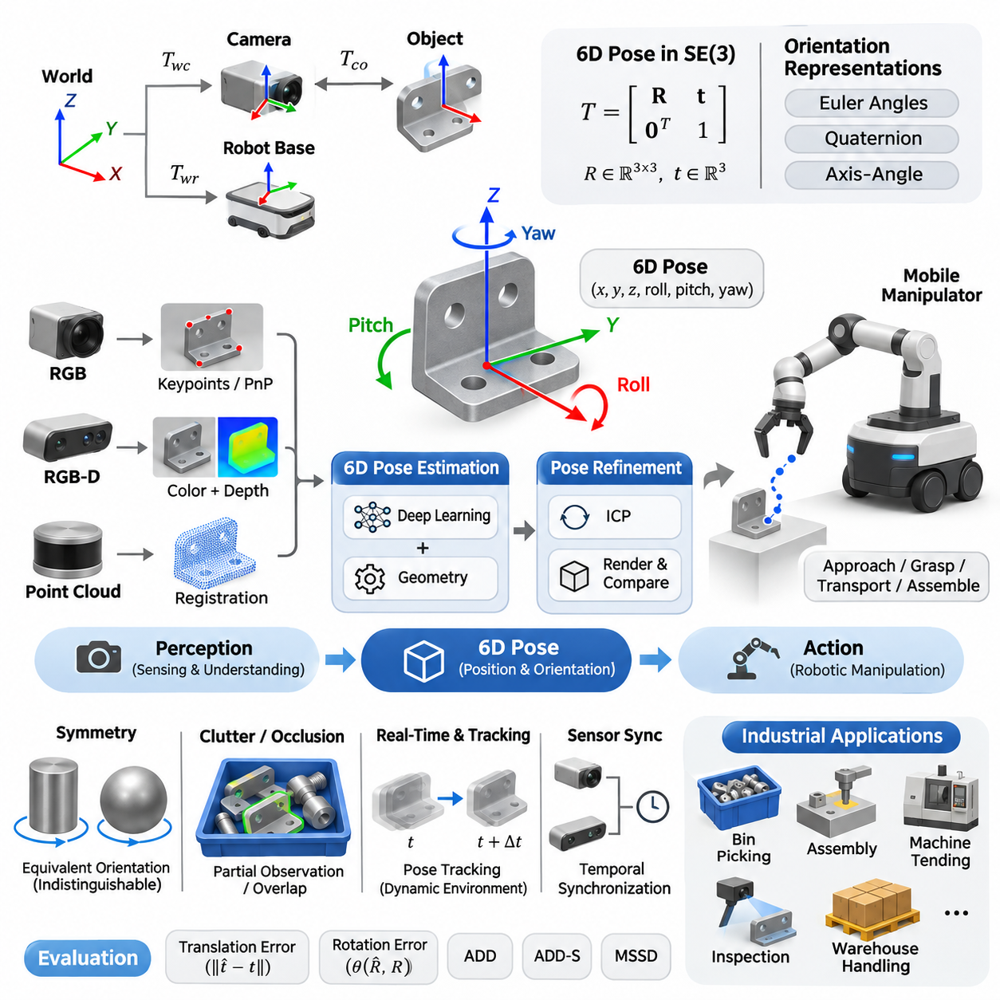
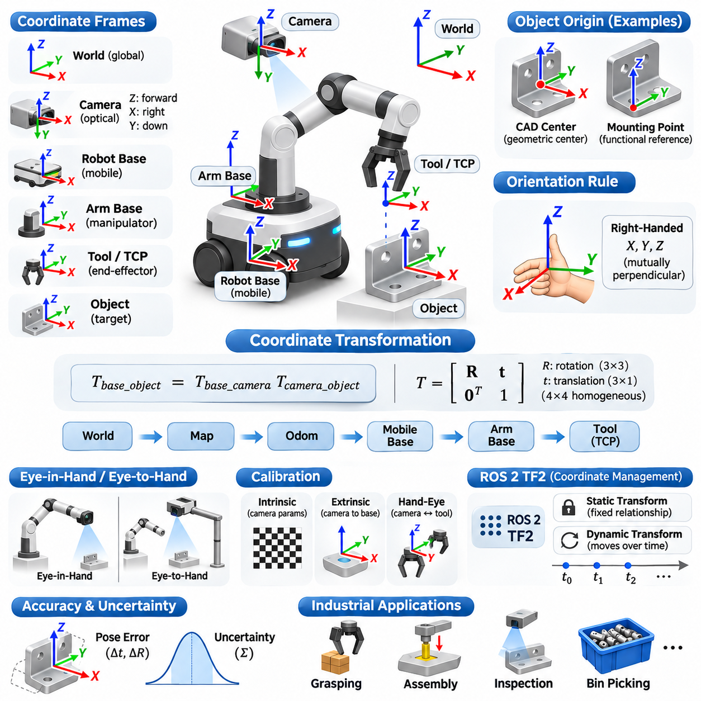
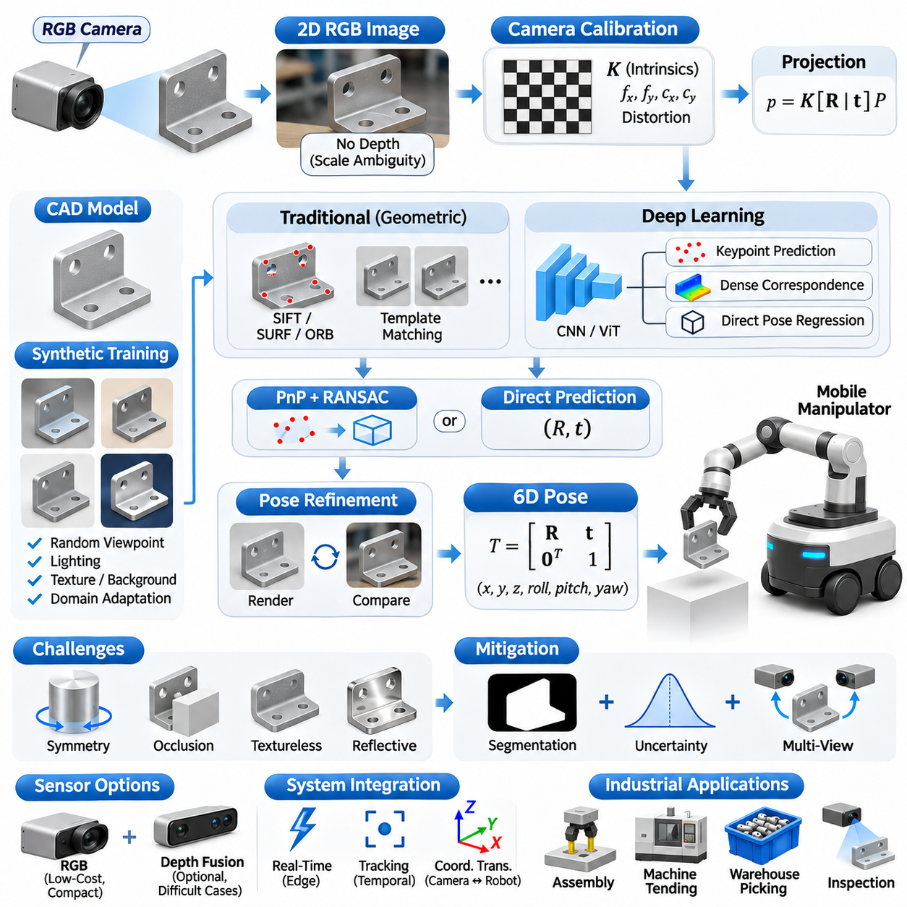
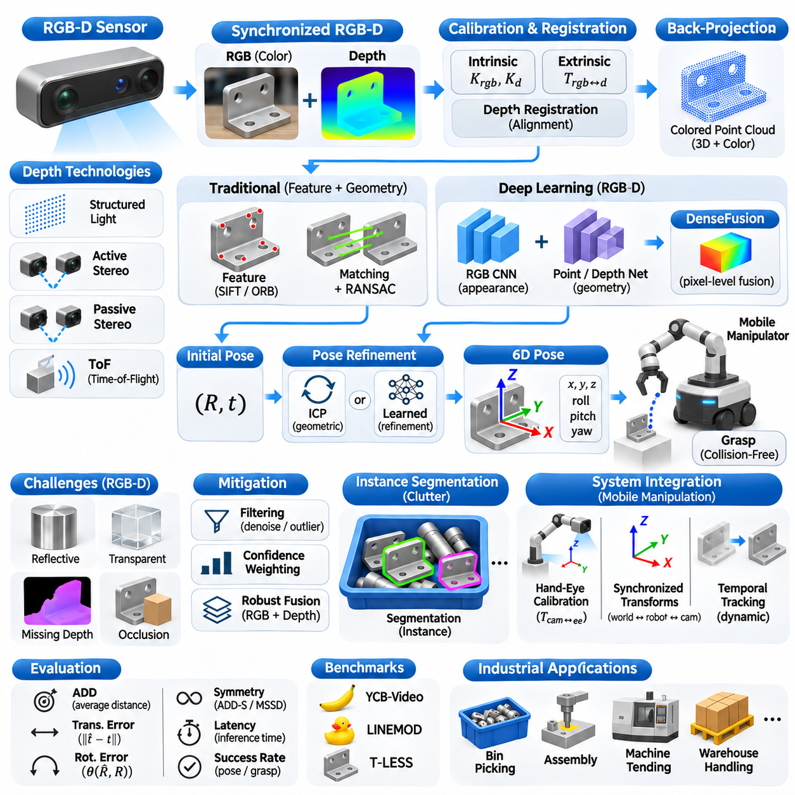
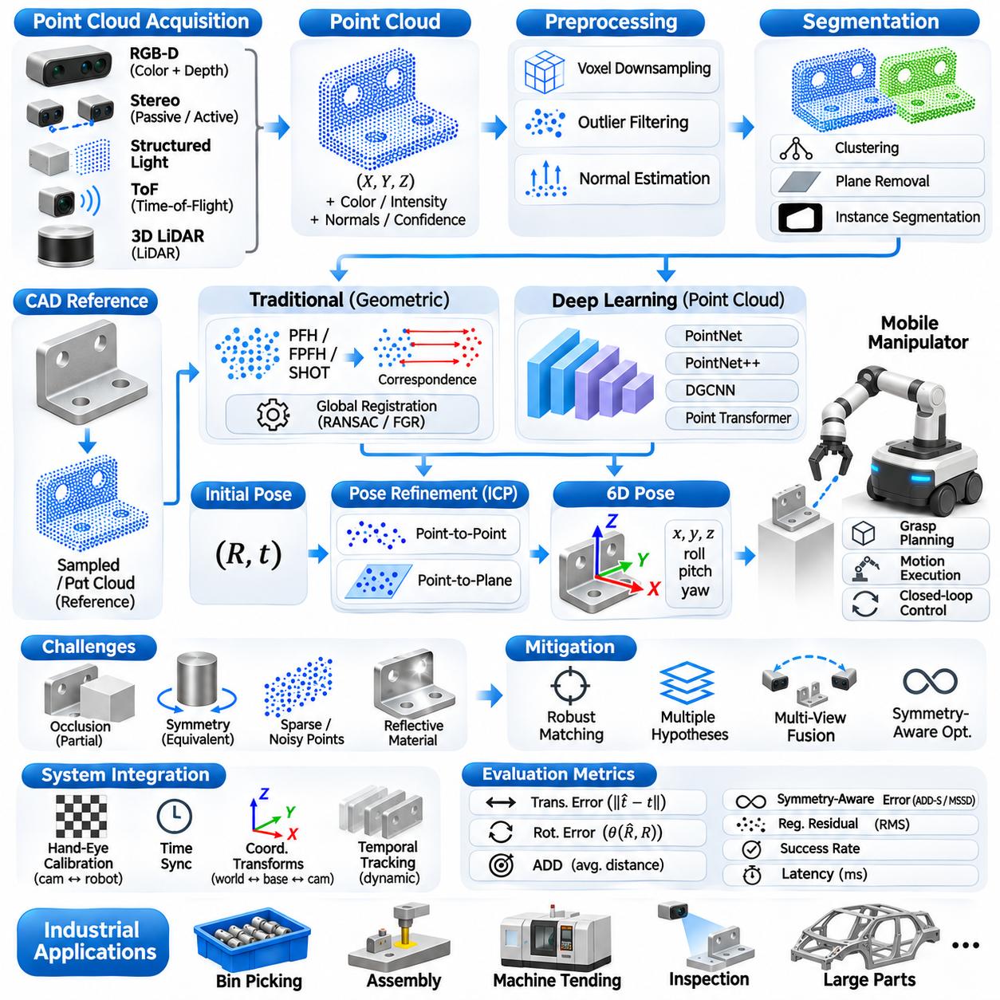
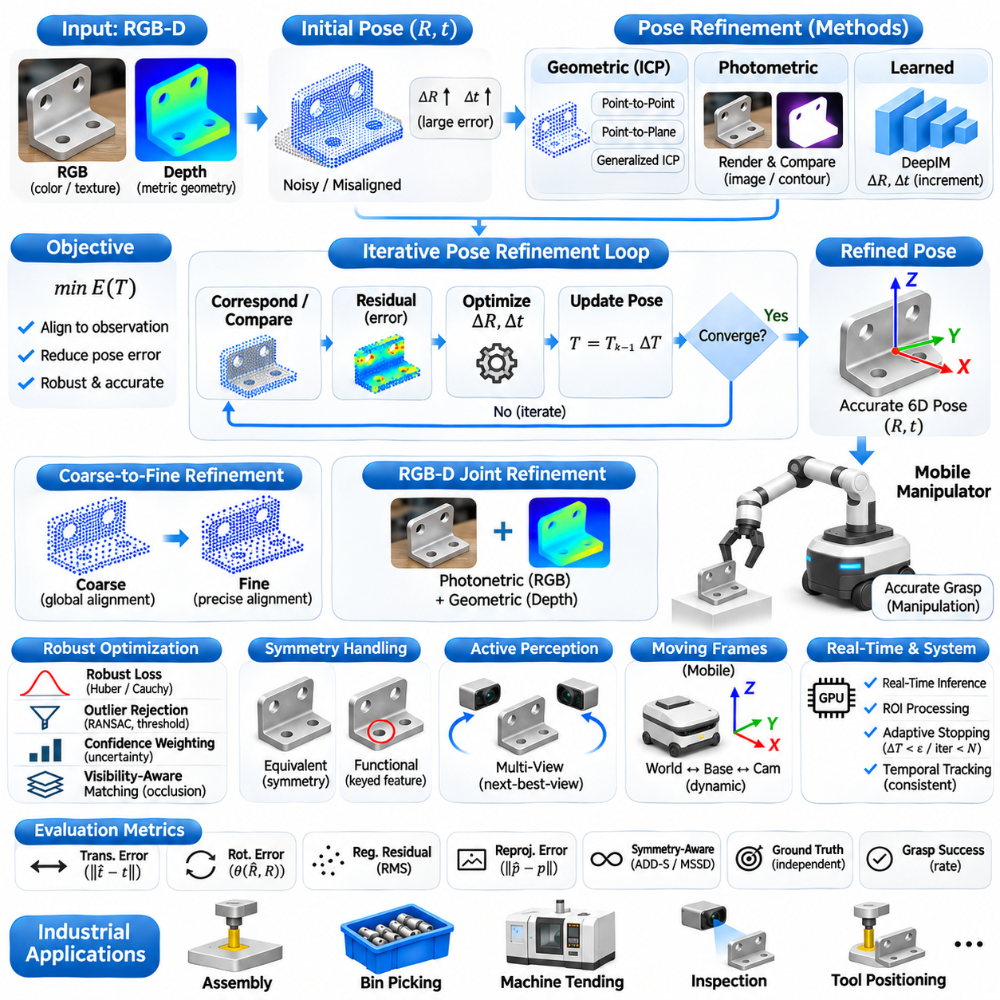
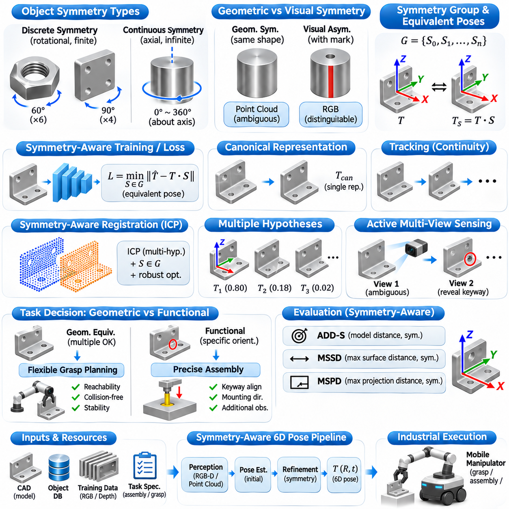
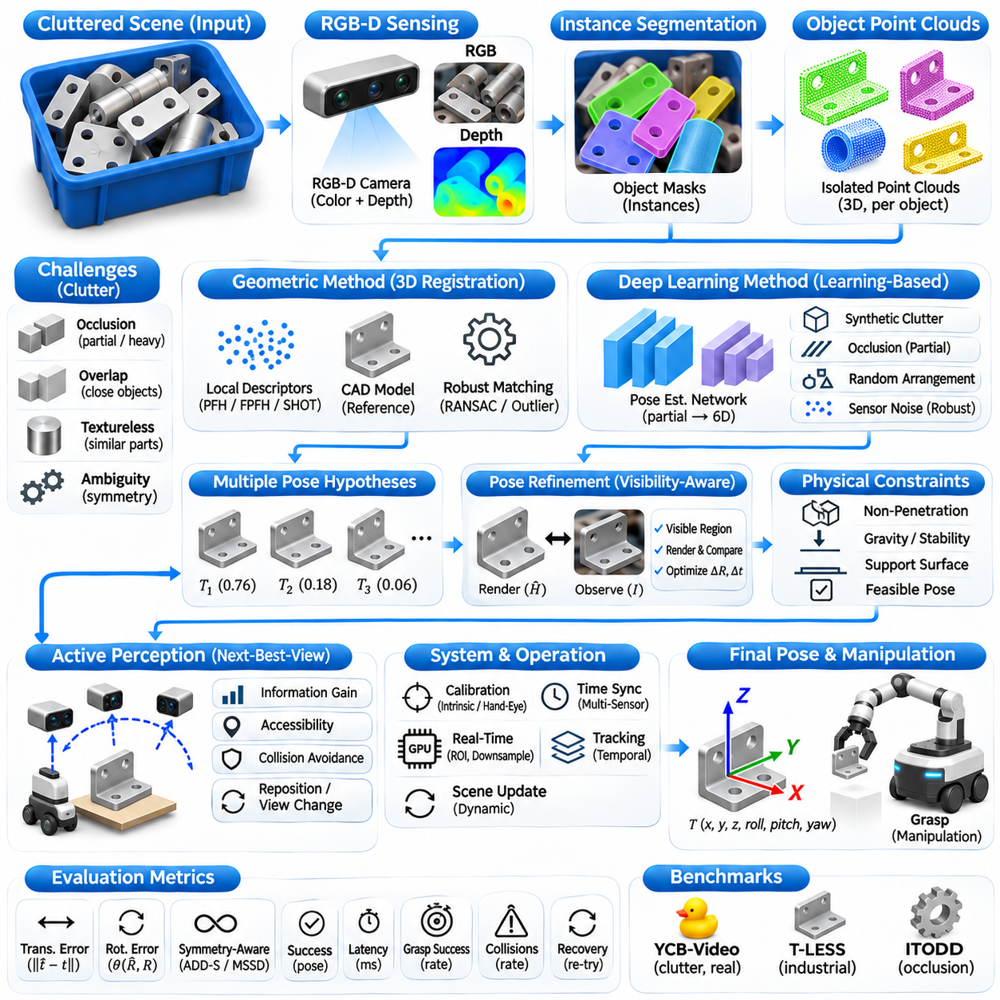
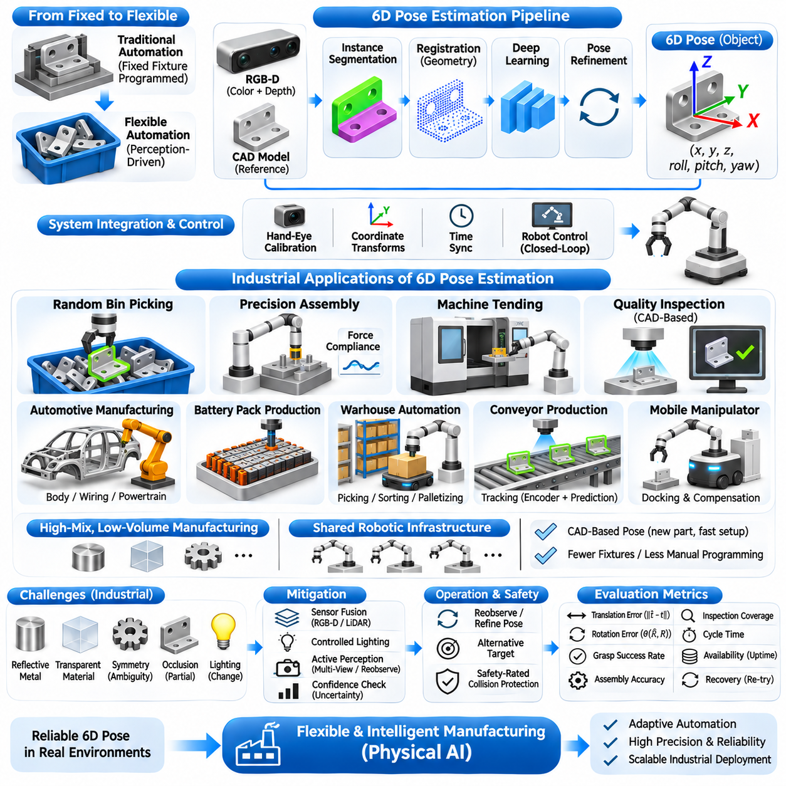

**Volume 03. Vision Manipulation and AI**


# Chapter 04. 6D Object Pose

##  

## 01 6D Pose Overview

{width="7.268055555555556in" height="7.268055555555556in"}

Six-dimensional (6D) object pose estimation is a fundamental perception technology that enables robotic systems to determine the complete spatial position and orientation of physical objects within a three-dimensional environment. Unlike conventional object detection, which identifies object categories and locations within two-dimensional images, 6D pose estimation provides the geometric information necessary for precise physical interaction and autonomous manipulation.

The six dimensions of an object pose correspond to three translational degrees of freedom and three rotational degrees of freedom. Translation describes the position of an object along the X, Y, and Z axes, while rotation describes its orientation around these axes. Together, these components establish the spatial relationship between an object and a reference coordinate system, enabling robotic systems to understand how the object is positioned in physical space.

Mathematically, a 6D object pose is commonly represented using a rotation matrix and a translation vector within the Special Euclidean Group SE(3). These components can be combined into a 4 × 4 homogeneous transformation matrix. Alternative orientation representations include Euler angles, quaternions, and axis-angle representations. Each representation offers different computational characteristics regarding numerical stability, interpolation, and transformation operations.

In mobile manipulation, accurate 6D object pose estimation establishes a critical connection between visual perception and robotic motion control. A mobile manipulator must determine not only where a target object is located but also how it should approach, grasp, transport, or assemble that object. Even relatively small positional or rotational errors can result in unsuccessful grasping, mechanical interference, or inaccurate placement during precision operations.

Object coordinate systems provide a consistent geometric foundation for describing object poses. A local coordinate frame is typically defined relative to the physical geometry or CAD model of an object, while camera, robot base, and world coordinate frames describe its surrounding environment. Coordinate transformations convert estimated poses between these reference frames, allowing perception results to be directly utilized by robotic motion planning algorithms.

RGB-based 6D pose estimation determines object position and orientation using conventional color images. These approaches commonly identify geometric features, semantic keypoints, object contours, or learned correspondences between image observations and three-dimensional object models. Perspective-n-Point (PnP) algorithms can subsequently recover the spatial transformation when sufficient reliable correspondences and calibrated camera parameters are available.

RGB-D-based pose estimation combines color information with depth measurements to improve geometric understanding. Depth observations provide explicit distance information, reducing ambiguities associated with monocular images. By integrating visual appearance and spatial geometry, RGB-D perception systems can estimate object poses more robustly under challenging conditions involving complex backgrounds, limited texture, partial occlusion, and varying illumination.

Point cloud-based pose estimation operates directly on three-dimensional spatial measurements acquired through depth cameras, stereo vision systems, structured-light sensors, or LiDAR. These methods analyze geometric structures and establish correspondences between observed point clouds and reference object models. Registration algorithms align the observed and reference geometries to recover object translation and rotation, particularly in applications involving known industrial components.

Traditional pose estimation approaches rely extensively on handcrafted geometric features, template matching, feature correspondence, and model registration. Modern deep learning approaches utilize convolutional neural networks, transformers, and three-dimensional neural architectures to learn robust object representations directly from training data. Hybrid approaches combine learned representations with analytical geometric optimization to improve accuracy and reliability.

Pose refinement improves the accuracy of an initially estimated object pose through additional geometric or photometric optimization. Algorithms such as Iterative Closest Point (ICP) minimize spatial discrepancies between observed and reference surfaces. Other refinement methods compare rendered object models with captured images or employ neural networks to predict incremental pose corrections. These processes are particularly important for precision manipulation and assembly.

Object symmetry introduces fundamental challenges because multiple orientations may produce visually or geometrically equivalent observations. Cylindrical components, spherical objects, and rotationally symmetric mechanical parts frequently exhibit this ambiguity. Symmetry-aware pose estimation incorporates equivalent transformations into training, inference, and evaluation processes, preventing physically indistinguishable orientations from being incorrectly classified as estimation failures.

Cluttered environments introduce additional difficulties through occlusion, overlapping objects, complex backgrounds, and incomplete geometric observations. In industrial bin picking, objects frequently occupy irregular positions and partially obstruct one another. Reliable pose estimation requires effective instance segmentation, robust feature extraction, partial geometry matching, and uncertainty assessment to identify physically meaningful poses despite incomplete sensory information.

Real-time pose estimation is especially important for mobile manipulators operating in dynamic environments. As the mobile platform moves, the spatial relationship between the camera, robot arm, and target object changes continuously. Accurate sensor synchronization, calibrated coordinate transformations, efficient inference, and temporal pose tracking help maintain consistent object localization while reducing the effects of platform movement and computational latency.

Evaluation of 6D pose estimation involves translational error, rotational error, and geometric alignment metrics. The Average Distance of Model Points (ADD) measures the average spatial discrepancy between model points transformed by estimated and reference poses. ADD-S accommodates indistinguishable model orientations through nearest-point comparisons, while metrics such as Maximum Symmetry-Aware Surface Distance provide additional symmetry-aware evaluation capabilities.

Industrial applications of 6D object pose estimation include robotic bin picking, automated assembly, machine tending, component inspection, warehouse automation, and precision material handling. In these applications, estimated object poses support grasp candidate generation, collision-free motion planning, approach trajectory calculation, and accurate tool positioning. Reliable integration with robot control systems transforms geometric perception into executable physical actions.

Ultimately, 6D object pose estimation represents an essential geometric interface between computer vision and physical intelligence. By converting raw sensory observations into actionable spatial representations, it enables mobile manipulators to interact with objects beyond predefined fixtures and predetermined locations. Its integration with grasp planning, motion control, and learning-based decision-making establishes a foundation for adaptive and autonomous robotic manipulation.

6차원 객체 자세 추정(6D Object Pose Estimation)은 로봇 시스템(Robotic System)이 3차원 환경(Three-Dimensional Environment) 내에서 물리적 객체(Physical Object)의 완전한 공간적 위치(Spatial Position)와 방향(Orientation)을 결정할 수 있도록 하는 핵심 인식 기술(Perception Technology)이다. 2차원 영상(Two-Dimensional Image)에서 객체의 범주(Category)와 위치(Location)를 식별하는 기존의 객체 검출(Object Detection)과 달리, 6차원 자세 추정은 정밀한 물리적 상호작용(Physical Interaction)과 자율 조작(Autonomous Manipulation)에 필요한 기하학적 정보(Geometric Information)를 제공한다.

객체 자세(Object Pose)의 6개 차원은 3개의 병진 자유도(Translational Degrees of Freedom)와 3개의 회전 자유도(Rotational Degrees of Freedom)에 해당한다. 병진(Translation)은 X, Y, Z축을 따라 객체의 위치를 설명하며, 회전(Rotation)은 이러한 축을 중심으로 하는 객체의 방향을 설명한다. 이러한 구성 요소들은 객체와 기준 좌표계(Reference Coordinate System) 사이의 공간적 관계(Spatial Relationship)를 정의함으로써 로봇 시스템이 물리적 공간에서 객체가 어떠한 자세로 배치되어 있는지를 이해할 수 있도록 한다.

수학적으로 6차원 객체 자세는 일반적으로 특수 유클리드 군(Special Euclidean Group, SE(3)) 내에서 회전 행렬(Rotation Matrix)과 병진 벡터(Translation Vector)를 사용하여 표현된다. 이러한 구성 요소들은 4 × 4 동차 변환 행렬(Homogeneous Transformation Matrix)로 결합될 수 있다. 대안적인 방향 표현 방식에는 오일러 각(Euler Angles), 쿼터니언(Quaternion), 축-각 표현(Axis-Angle Representation) 등이 있다. 각각의 표현 방식은 수치적 안정성(Numerical Stability), 보간(Interpolation), 변환 연산(Transformation Operation) 측면에서 서로 다른 계산적 특성을 제공한다.

이동형 매니퓰레이션(Mobile Manipulation)에서 정확한 6차원 객체 자세 추정은 시각 인식(Visual Perception)과 로봇 모션 제어(Robot Motion Control)를 연결하는 핵심적인 역할을 수행한다. 이동형 매니퓰레이터(Mobile Manipulator)는 대상 객체(Target Object)가 어디에 위치하는지뿐만 아니라 해당 객체에 어떻게 접근하고, 파지하며, 운반하거나 조립해야 하는지를 결정해야 한다. 비교적 작은 위치 오차(Positional Error)나 회전 오차(Rotational Error)도 정밀 작업 과정에서 파지 실패(Grasping Failure), 기계적 간섭(Mechanical Interference), 부정확한 배치(Inaccurate Placement)를 초래할 수 있다.

객체 좌표계(Object Coordinate System)는 객체 자세를 설명하기 위한 일관된 기하학적 기반(Geometric Foundation)을 제공한다. 지역 좌표계(Local Coordinate Frame)는 일반적으로 객체의 물리적 형상(Physical Geometry)이나 CAD 모델(CAD Model)을 기준으로 정의되며, 카메라 좌표계(Camera Coordinate Frame), 로봇 베이스 좌표계(Robot Base Coordinate Frame), 월드 좌표계(World Coordinate Frame)는 객체의 주변 환경을 설명한다. 좌표 변환(Coordinate Transformation)은 추정된 자세를 이러한 기준 좌표계 사이에서 변환하여 인식 결과(Perception Result)가 로봇 모션 계획 알고리즘(Robot Motion Planning Algorithm)에 직접 활용될 수 있도록 한다.

RGB 기반 6차원 자세 추정(RGB-Based 6D Pose Estimation)은 일반적인 컬러 영상(Color Image)을 사용하여 객체의 위치와 방향을 결정한다. 이러한 접근 방식은 일반적으로 기하학적 특징(Geometric Feature), 의미적 특징점(Semantic Keypoint), 객체 윤곽선(Object Contour), 영상 관측값(Image Observation)과 3차원 객체 모델(3D Object Model) 사이의 학습 기반 대응 관계(Learned Correspondence)를 식별한다. 충분히 신뢰할 수 있는 대응 관계와 보정된 카메라 매개변수(Calibrated Camera Parameter)가 확보되면 PnP(Perspective-n-Point) 알고리즘을 통해 공간 변환(Spatial Transformation)을 복원할 수 있다.

RGB-D 기반 자세 추정(RGB-D-Based Pose Estimation)은 색상 정보(Color Information)와 깊이 측정값(Depth Measurement)을 결합하여 기하학적 이해(Geometric Understanding)를 향상시킨다. 깊이 관측값(Depth Observation)은 명시적인 거리 정보(Distance Information)를 제공함으로써 단안 영상(Monocular Image)에서 발생하는 모호성(Ambiguity)을 감소시킨다. RGB-D 인식 시스템(RGB-D Perception System)은 시각적 외관(Visual Appearance)과 공간적 형상(Spatial Geometry)을 통합하여 복잡한 배경(Complex Background), 제한된 텍스처(Limited Texture), 부분 가림(Partial Occlusion), 변화하는 조명(Varying Illumination) 등의 어려운 조건에서도 객체 자세를 더욱 강건하게 추정할 수 있다.

포인트 클라우드 기반 자세 추정(Point Cloud-Based Pose Estimation)은 깊이 카메라(Depth Camera), 스테레오 비전 시스템(Stereo Vision System), 구조광 센서(Structured-Light Sensor), 라이다(LiDAR) 등을 통해 획득한 3차원 공간 측정값(3D Spatial Measurement)을 직접 활용한다. 이러한 방식은 기하학적 구조(Geometric Structure)를 분석하고 관측된 포인트 클라우드(Point Cloud)와 기준 객체 모델(Reference Object Model) 사이의 대응 관계를 설정한다. 정합 알고리즘(Registration Algorithm)은 관측된 형상과 기준 형상을 정렬하여 객체의 병진과 회전을 복원하며, 특히 형상이 알려진 산업용 부품(Industrial Component)을 처리하는 응용 분야에서 활용된다.

전통적인 자세 추정 방식(Traditional Pose Estimation Approach)은 수작업으로 설계된 기하학적 특징(Handcrafted Geometric Feature), 템플릿 매칭(Template Matching), 특징 대응(Feature Correspondence), 모델 정합(Model Registration)에 크게 의존한다. 현대적인 딥러닝 기반 접근 방식(Deep Learning-Based Approach)은 합성곱 신경망(Convolutional Neural Network, CNN), 트랜스포머(Transformer), 3차원 신경망 아키텍처(3D Neural Architecture)를 활용하여 학습 데이터(Training Data)로부터 강건한 객체 표현(Object Representation)을 직접 학습한다. 하이브리드 접근 방식(Hybrid Approach)은 학습된 표현(Learned Representation)과 해석적 기하 최적화(Analytical Geometric Optimization)를 결합하여 정확도(Accuracy)와 신뢰성(Reliability)을 향상시킨다.

자세 정제(Pose Refinement)는 추가적인 기하학적 최적화(Geometric Optimization) 또는 광도 기반 최적화(Photometric Optimization)를 통해 초기 추정 객체 자세(Initially Estimated Object Pose)의 정확도를 향상시킨다. 반복 최근접점(Iterative Closest Point, ICP)과 같은 알고리즘은 관측된 표면(Observed Surface)과 기준 표면(Reference Surface) 사이의 공간적 불일치(Spatial Discrepancy)를 최소화한다. 다른 정제 방식은 렌더링된 객체 모델(Rendered Object Model)을 실제 촬영 영상(Captured Image)과 비교하거나 신경망(Neural Network)을 활용하여 점진적인 자세 보정값(Incremental Pose Correction)을 예측한다. 이러한 과정은 정밀 조작(Precision Manipulation)과 조립(Assembly)에서 특히 중요하다.

객체 대칭성(Object Symmetry)은 여러 방향이 시각적 또는 기하학적으로 동일한 관측 결과를 생성할 수 있다는 근본적인 문제를 발생시킨다. 원통형 부품(Cylindrical Component), 구형 객체(Spherical Object), 회전 대칭형 기계 부품(Rotationally Symmetric Mechanical Part)은 이러한 모호성을 빈번하게 나타낸다. 대칭성 인식 자세 추정(Symmetry-Aware Pose Estimation)은 등가 변환(Equivalent Transformation)을 학습(Training), 추론(Inference), 평가(Evaluation) 과정에 반영함으로써 물리적으로 구분할 수 없는 방향이 자세 추정 실패(Pose Estimation Failure)로 잘못 분류되는 것을 방지한다.

혼잡 환경(Cluttered Environment)은 객체 가림(Occlusion), 객체 중첩(Object Overlapping), 복잡한 배경(Complex Background), 불완전한 기하학적 관측(Incomplete Geometric Observation) 등으로 인해 추가적인 어려움을 발생시킨다. 산업용 빈 피킹(Industrial Bin Picking)에서는 객체들이 불규칙한 위치를 점유하고 서로를 부분적으로 가리는 경우가 빈번하다. 신뢰성 높은 자세 추정을 위해서는 효과적인 인스턴스 분할(Instance Segmentation), 강건한 특징 추출(Robust Feature Extraction), 부분 형상 매칭(Partial Geometry Matching), 불확실성 평가(Uncertainty Assessment)를 통해 불완전한 센서 정보(Sensory Information)에도 불구하고 물리적으로 의미 있는 자세를 식별해야 한다.

실시간 자세 추정(Real-Time Pose Estimation)은 동적 환경(Dynamic Environment)에서 작동하는 이동형 매니퓰레이터에 특히 중요하다. 이동 플랫폼(Mobile Platform)이 움직이면 카메라(Camera), 로봇 암(Robot Arm), 대상 객체 사이의 공간적 관계가 지속적으로 변화한다. 정확한 센서 동기화(Sensor Synchronization), 보정된 좌표 변환(Calibrated Coordinate Transformation), 효율적인 추론(Efficient Inference), 시간적 자세 추적(Temporal Pose Tracking)은 플랫폼 이동(Platform Movement)과 연산 지연(Computational Latency)의 영향을 감소시키면서 일관된 객체 위치 추정(Object Localization)을 유지하는 데 기여한다.

6차원 자세 추정의 평가(Evaluation)는 병진 오차(Translational Error), 회전 오차(Rotational Error), 기하학적 정렬 지표(Geometric Alignment Metric)를 포함한다. 모델 점 평균 거리(Average Distance of Model Points, ADD)는 추정 자세(Estimated Pose)와 기준 자세(Reference Pose)에 의해 각각 변환된 모델 점(Model Point) 사이의 평균 공간적 불일치를 측정한다. ADD-S는 최근접점 비교(Nearest-Point Comparison)를 통해 구분하기 어려운 모델 방향을 고려하며, 최대 대칭성 인식 표면 거리(Maximum Symmetry-Aware Surface Distance, MSSD)와 같은 지표는 추가적인 대칭성 인식 평가(Symmetry-Aware Evaluation) 기능을 제공한다.

6차원 객체 자세 추정의 산업적 응용(Industrial Application)에는 로봇 빈 피킹(Robotic Bin Picking), 자동화 조립(Automated Assembly), 머신 텐딩(Machine Tending), 부품 검사(Component Inspection), 물류창고 자동화(Warehouse Automation), 정밀 자재 취급(Precision Material Handling) 등이 포함된다. 이러한 응용 분야에서 추정된 객체 자세는 파지 후보 생성(Grasp Candidate Generation), 충돌 없는 모션 계획(Collision-Free Motion Planning), 접근 궤적 계산(Approach Trajectory Calculation), 정확한 도구 위치 결정(Tool Positioning)을 지원한다. 로봇 제어 시스템(Robot Control System)과의 신뢰성 높은 통합은 기하학적 인식(Geometric Perception)을 실행 가능한 물리적 행동(Executable Physical Action)으로 변환한다.

궁극적으로 6차원 객체 자세 추정은 컴퓨터 비전(Computer Vision)과 물리적 지능(Physical Intelligence)을 연결하는 필수적인 기하학적 인터페이스(Geometric Interface)이다. 원시 센서 관측값(Raw Sensory Observation)을 행동에 활용할 수 있는 공간적 표현(Actionable Spatial Representation)으로 변환함으로써 이동형 매니퓰레이터가 사전에 정의된 고정 지그(Predefined Fixture)와 미리 결정된 위치(Predetermined Location)의 제약을 넘어 객체와 상호작용할 수 있도록 한다. 파지 계획(Grasp Planning), 모션 제어(Motion Control), 학습 기반 의사결정(Learning-Based Decision-Making)과의 통합은 적응형 자율 로봇 조작(Adaptive and Autonomous Robotic Manipulation)을 구현하기 위한 기반을 확립한다.

##  

## 02 Object Coordinate Systems

{width="7.268055555555556in" height="7.268055555555556in"}

Object coordinate systems provide the geometric foundation for representing the position and orientation of physical objects within three-dimensional environments. In six-dimensional (6D) object pose estimation, a coordinate system establishes a reference frame through which spatial relationships can be mathematically described. These representations enable robotic systems to convert visual observations into actionable geometric information for autonomous manipulation.

An object coordinate system typically consists of three mutually perpendicular axes, designated as X, Y, and Z, together with an origin that defines the reference position. The orientation of these axes determines how the object\'s geometry is represented in three-dimensional space. Most robotic systems adopt a right-handed coordinate system to maintain mathematical consistency across perception, kinematics, motion planning, and control operations.

The object coordinate frame is generally established according to the physical geometry, functional characteristics, or CAD model of a target object. Its origin may be located at the geometric center, center of mass, mounting surface, or designated assembly reference point. Selecting an appropriate origin and axis orientation simplifies spatial calculations and improves consistency between object recognition, grasp planning, and mechanical alignment.

Camera coordinate systems describe the spatial relationships between visual sensors and observed objects. In a conventional optical coordinate frame, the Z-axis extends forward along the optical axis, the X-axis extends horizontally toward the right, and the Y-axis extends vertically downward. Three-dimensional object positions obtained from calibrated vision systems are initially expressed relative to this camera coordinate frame.

The robot base coordinate system establishes a reference frame for robotic arm kinematics and manipulation operations. Joint configurations, end-effector positions, and motion trajectories are commonly calculated relative to this frame. For mobile manipulators, the robot base coordinate system is attached to the mobile platform or manipulator mounting structure, causing its relationship with external reference frames to change during navigation.

The world coordinate system provides a global spatial reference for representing objects, robots, workstations, and environmental structures. Unlike coordinate frames attached to moving components, the world coordinate frame generally remains fixed relative to the operational environment. Mobile robots utilize global reference frames to maintain spatial awareness and coordinate navigation, localization, mapping, and manipulation activities.

End-effector coordinate systems describe the position and orientation of robotic grippers, tools, and other manipulation devices. The Tool Center Point (TCP) defines a specific reference location associated with the functional portion of the end effector. By establishing spatial relationships between object coordinate frames and tool coordinate frames, robotic systems can calculate appropriate grasping orientations and approach trajectories.

Coordinate transformations enable spatial information to be converted between different reference frames. A rigid-body transformation consists of a three-dimensional translation vector and a three-dimensional rotation represented by a rotation matrix. These components are commonly combined into a 4 × 4 homogeneous transformation matrix, allowing position and orientation transformations to be performed within a unified mathematical framework.

Multiple coordinate transformations can be combined through matrix multiplication to establish spatial relationships across interconnected robotic subsystems. For example, an object pose initially estimated in the camera coordinate frame can be transformed into the robot base coordinate frame using calibrated camera-to-robot transformations. The multiplication order and transformation direction must remain consistent throughout the computational pipeline.

Camera calibration and hand-eye calibration are essential processes for establishing accurate relationships between visual sensors and robotic coordinate systems. Intrinsic calibration determines camera parameters such as focal length and optical center, while extrinsic calibration determines spatial relationships between reference frames. Hand-eye calibration specifically estimates the rigid transformation between the camera and the robot mounting frame.

Eye-in-hand and eye-to-hand configurations represent two common arrangements for integrating visual sensors with robotic manipulators. In an eye-in-hand configuration, the camera is mounted on the robot arm and changes its position and orientation during movement. In an eye-to-hand configuration, the camera is mounted externally to the manipulator, providing observations from a separate reference frame within the operational environment.

In mobile manipulation, coordinate frame management becomes more complex because the robotic arm and visual sensors may be mounted on a moving platform. The complete transformation chain can include world, map, odometry, mobile base, manipulator base, camera, object, and end-effector coordinate frames. Accurate management of these interconnected frames enables manipulation tasks to remain geometrically consistent despite changes in platform position.

ROS 2 provides a distributed coordinate transformation infrastructure through the TF2 framework. TF2 maintains relationships between coordinate frames over time and enables software components to retrieve transformations corresponding to specific timestamps. Static transformations describe fixed mechanical relationships, while dynamic transformations represent changing relationships caused by robot motion, platform navigation, or articulated mechanisms.

Coordinate system accuracy is influenced by calibration errors, mechanical tolerances, structural deformation, sensor noise, and synchronization discrepancies. Small angular errors can produce substantial positional deviations when transformations are applied over extended distances. Consequently, coordinate frame validation, uncertainty propagation, timestamp synchronization, and periodic calibration are important engineering considerations for precision robotic manipulation.

Industrial applications require consistent object coordinate definitions across CAD models, perception datasets, pose estimation algorithms, and robotic control systems. Standardized reference frames simplify automated assembly, machine tending, precision inspection, and bin picking. Even when objects exhibit geometric symmetry, their coordinate conventions should preserve functional requirements and distinguish orientations whenever physically necessary for successful task execution.

Ultimately, object coordinate systems establish a common geometric language connecting visual perception, spatial reasoning, robotic kinematics, and physical action. Accurate coordinate definitions and reliable transformations enable mobile manipulators to understand object poses, generate feasible manipulation trajectories, and execute precise operations. This geometric infrastructure forms the basis for subsequent 6D pose estimation and autonomous manipulation technologies.

객체 좌표계(Object Coordinate System)는 3차원 환경(Three-Dimensional Environment) 내에서 물리적 객체(Physical Object)의 위치(Position)와 방향(Orientation)을 표현하기 위한 기하학적 기반(Geometric Foundation)을 제공한다. 6차원 객체 자세 추정(6D Object Pose Estimation)에서 좌표계(Coordinate System)는 공간적 관계(Spatial Relationship)를 수학적으로 설명할 수 있는 기준 좌표계(Reference Frame)를 정의한다. 이러한 표현을 통해 로봇 시스템(Robotic System)은 시각적 관측값(Visual Observation)을 자율 조작(Autonomous Manipulation)에 활용할 수 있는 기하학적 정보(Geometric Information)로 변환할 수 있다.

객체 좌표계는 일반적으로 기준 위치(Reference Position)를 정의하는 원점(Origin)과 X, Y, Z로 지정되는 상호 직교하는 세 개의 축(Mutually Perpendicular Axes)으로 구성된다. 이러한 축의 방향은 객체의 형상(Object Geometry)이 3차원 공간(Three-Dimensional Space)에서 어떻게 표현되는지를 결정한다. 대부분의 로봇 시스템은 인식(Perception), 기구학(Kinematics), 모션 계획(Motion Planning), 제어 연산(Control Operation) 전반에서 수학적 일관성(Mathematical Consistency)을 유지하기 위해 오른손 좌표계(Right-Handed Coordinate System)를 채택한다.

객체 기준 좌표계(Object Coordinate Frame)는 일반적으로 대상 객체(Target Object)의 물리적 형상(Physical Geometry), 기능적 특성(Functional Characteristics) 또는 CAD 모델(CAD Model)에 따라 설정된다. 원점은 기하학적 중심(Geometric Center), 질량 중심(Center of Mass), 장착 표면(Mounting Surface) 또는 지정된 조립 기준점(Assembly Reference Point)에 위치할 수 있다. 적절한 원점과 축 방향(Axis Orientation)을 선택하면 공간 연산(Spatial Calculation)을 단순화하고 객체 인식(Object Recognition), 파지 계획(Grasp Planning), 기계적 정렬(Mechanical Alignment) 사이의 일관성을 향상시킬 수 있다.

카메라 좌표계(Camera Coordinate System)는 시각 센서(Visual Sensor)와 관측된 객체(Observed Object) 사이의 공간적 관계를 설명한다. 일반적인 광학 좌표계(Optical Coordinate Frame)에서 Z축은 광축(Optical Axis)을 따라 전방으로 확장되며, X축은 수평 방향으로 오른쪽을 향하고, Y축은 수직 방향으로 아래쪽을 향한다. 보정된 비전 시스템(Calibrated Vision System)을 통해 획득한 3차원 객체 위치(3D Object Position)는 초기 단계에서 이러한 카메라 좌표계를 기준으로 표현된다.

로봇 베이스 좌표계(Robot Base Coordinate System)는 로봇 암 기구학(Robot Arm Kinematics)과 조작 작업(Manipulation Operation)을 위한 기준 좌표계를 정의한다. 관절 구성(Joint Configuration), 엔드 이펙터 위치(End-Effector Position), 모션 궤적(Motion Trajectory)은 일반적으로 이 좌표계를 기준으로 계산된다. 이동형 매니퓰레이터(Mobile Manipulator)의 경우 로봇 베이스 좌표계는 이동 플랫폼(Mobile Platform) 또는 매니퓰레이터 장착 구조물(Manipulator Mounting Structure)에 고정되므로 주행(Navigation) 중 외부 기준 좌표계(External Reference Frame)와의 관계가 변화한다.

월드 좌표계(World Coordinate System)는 객체, 로봇, 작업 스테이션(Workstation), 환경 구조물(Environmental Structure)을 표현하기 위한 전역 공간 기준(Global Spatial Reference)을 제공한다. 움직이는 구성 요소에 부착된 좌표계와 달리 월드 좌표계는 일반적으로 운영 환경(Operational Environment)을 기준으로 고정되어 있다. 이동형 로봇(Mobile Robot)은 전역 기준 좌표계(Global Reference Frame)를 활용하여 공간 인식(Spatial Awareness)을 유지하고 주행(Navigation), 위치 추정(Localization), 지도 작성(Mapping), 조작 활동(Manipulation Activity)을 조율한다.

엔드 이펙터 좌표계(End-Effector Coordinate System)는 로봇 그리퍼(Robotic Gripper), 도구(Tool), 기타 조작 장치(Manipulation Device)의 위치와 방향을 설명한다. 도구 중심점(Tool Center Point, TCP)은 엔드 이펙터의 기능적 부분(Functional Portion)과 관련된 특정 기준 위치를 정의한다. 객체 좌표계와 도구 좌표계(Tool Coordinate Frame) 사이의 공간적 관계를 설정함으로써 로봇 시스템은 적절한 파지 방향(Grasping Orientation)과 접근 궤적(Approach Trajectory)을 계산할 수 있다.

좌표 변환(Coordinate Transformation)은 서로 다른 기준 좌표계 사이에서 공간 정보(Spatial Information)를 변환할 수 있도록 한다. 강체 변환(Rigid-Body Transformation)은 3차원 병진 벡터(Three-Dimensional Translation Vector)와 회전 행렬(Rotation Matrix)로 표현되는 3차원 회전(Three-Dimensional Rotation)으로 구성된다. 이러한 구성 요소들은 일반적으로 4 × 4 동차 변환 행렬(Homogeneous Transformation Matrix)로 결합되며, 이를 통해 위치 변환(Position Transformation)과 방향 변환(Orientation Transformation)을 통합된 수학적 프레임워크(Unified Mathematical Framework) 내에서 수행할 수 있다.

여러 좌표 변환은 행렬 곱셈(Matrix Multiplication)을 통해 결합되어 상호 연결된 로봇 하위 시스템(Robotic Subsystem) 사이의 공간적 관계를 정의할 수 있다. 예를 들어, 카메라 좌표계에서 초기 추정된 객체 자세(Object Pose)는 보정된 카메라-로봇 간 변환(Calibrated Camera-to-Robot Transformation)을 활용하여 로봇 베이스 좌표계로 변환될 수 있다. 행렬 곱셈 순서(Multiplication Order)와 변환 방향(Transformation Direction)은 전체 연산 파이프라인(Computational Pipeline)에서 일관되게 유지되어야 한다.

카메라 보정(Camera Calibration)과 손-눈 보정(Hand-Eye Calibration)은 시각 센서와 로봇 좌표계 사이의 정확한 관계를 설정하기 위한 필수적인 과정이다. 내부 매개변수 보정(Intrinsic Calibration)은 초점 거리(Focal Length)와 광학 중심(Optical Center) 등의 카메라 매개변수(Camera Parameter)를 결정하며, 외부 매개변수 보정(Extrinsic Calibration)은 기준 좌표계 사이의 공간적 관계를 결정한다. 손-눈 보정은 구체적으로 카메라와 로봇 장착 좌표계(Robot Mounting Frame) 사이의 강체 변환을 추정한다.

손 장착형(Eye-in-Hand)과 외부 장착형(Eye-to-Hand) 구성은 시각 센서를 로봇 매니퓰레이터(Robotic Manipulator)와 통합하기 위한 두 가지 일반적인 배치 방식이다. 손 장착형 구성에서는 카메라가 로봇 암에 장착되며 로봇의 움직임에 따라 위치와 방향이 변화한다. 외부 장착형 구성에서는 카메라가 매니퓰레이터 외부에 장착되어 운영 환경 내의 별도 기준 좌표계에서 관측값(Observation)을 제공한다.

이동형 매니퓰레이션(Mobile Manipulation)에서는 로봇 암과 시각 센서가 이동 플랫폼에 장착될 수 있으므로 좌표계 관리(Coordinate Frame Management)가 더욱 복잡해진다. 전체 변환 체인(Transformation Chain)에는 월드 좌표계(World Frame), 지도 좌표계(Map Frame), 주행 거리 추정 좌표계(Odometry Frame), 이동 베이스 좌표계(Mobile Base Frame), 매니퓰레이터 베이스 좌표계(Manipulator Base Frame), 카메라 좌표계(Camera Frame), 객체 좌표계(Object Frame), 엔드 이펙터 좌표계(End-Effector Frame)가 포함될 수 있다. 이러한 상호 연결된 좌표계를 정확하게 관리하면 플랫폼의 위치 변화에도 불구하고 조작 작업의 기하학적 일관성(Geometric Consistency)을 유지할 수 있다.

ROS 2(Robot Operating System 2)는 TF2 프레임워크(TF2 Framework)를 통해 분산형 좌표 변환 인프라(Distributed Coordinate Transformation Infrastructure)를 제공한다. TF2는 시간의 흐름에 따른 좌표계 사이의 관계를 유지하며, 소프트웨어 구성 요소(Software Component)가 특정 타임스탬프(Timestamp)에 해당하는 변환 정보를 조회할 수 있도록 한다. 정적 변환(Static Transformation)은 고정된 기계적 관계(Fixed Mechanical Relationship)를 설명하는 반면, 동적 변환(Dynamic Transformation)은 로봇 움직임(Robot Motion), 플랫폼 주행(Platform Navigation), 관절형 메커니즘(Articulated Mechanism)에 의해 변화하는 관계를 표현한다.

좌표계 정확도(Coordinate System Accuracy)는 보정 오차(Calibration Error), 기계적 공차(Mechanical Tolerance), 구조적 변형(Structural Deformation), 센서 노이즈(Sensor Noise), 동기화 불일치(Synchronization Discrepancy)의 영향을 받는다. 작은 각도 오차(Angular Error)라도 긴 거리에 걸쳐 좌표 변환이 적용되면 상당한 위치 편차(Positional Deviation)를 발생시킬 수 있다. 따라서 좌표계 검증(Coordinate Frame Validation), 불확실성 전파(Uncertainty Propagation), 타임스탬프 동기화(Timestamp Synchronization), 주기적 보정(Periodic Calibration)은 정밀 로봇 조작(Precision Robotic Manipulation)을 위한 중요한 공학적 고려사항(Engineering Consideration)이다.

산업적 응용(Industrial Application)에서는 CAD 모델, 인식 데이터셋(Perception Dataset), 자세 추정 알고리즘(Pose Estimation Algorithm), 로봇 제어 시스템(Robot Control System) 전반에 걸쳐 일관된 객체 좌표계 정의(Object Coordinate Definition)가 요구된다. 표준화된 기준 좌표계(Standardized Reference Frame)는 자동화 조립(Automated Assembly), 머신 텐딩(Machine Tending), 정밀 검사(Precision Inspection), 빈 피킹(Bin Picking)을 단순화한다. 객체가 기하학적 대칭성(Geometric Symmetry)을 나타내는 경우에도 좌표계 규약(Coordinate Convention)은 기능적 요구사항(Functional Requirement)을 유지해야 하며, 성공적인 작업 수행(Task Execution)을 위해 물리적으로 필요한 경우 서로 다른 방향을 구분할 수 있어야 한다.

궁극적으로 객체 좌표계는 시각 인식(Visual Perception), 공간 추론(Spatial Reasoning), 로봇 기구학(Robot Kinematics), 물리적 행동(Physical Action)을 연결하는 공통의 기하학적 언어(Common Geometric Language)를 확립한다. 정확한 좌표계 정의(Coordinate Definition)와 신뢰성 높은 좌표 변환(Reliable Transformation)은 이동형 매니퓰레이터가 객체 자세를 이해하고, 실행 가능한 조작 궤적(Feasible Manipulation Trajectory)을 생성하며, 정밀 작업(Precision Operation)을 수행할 수 있도록 한다. 이러한 기하학적 인프라(Geometric Infrastructure)는 후속 6차원 자세 추정(6D Pose Estimation) 및 자율 조작 기술(Autonomous Manipulation Technology)의 기반을 형성한다.

##  

## 03 RGB Based 6D Pose

{width="7.268055555555556in" height="7.268055555555556in"}

RGB-based six-dimensional (6D) object pose estimation is a computer vision technology that determines the three-dimensional position and orientation of physical objects using conventional color images. Unlike depth-based perception systems, RGB-based approaches rely primarily on visual appearance, geometric features, and learned representations to reconstruct spatial relationships between observed objects and the camera coordinate system.

The fundamental challenge of RGB-based pose estimation arises from the projection of three-dimensional objects onto two-dimensional image planes. During this projection, explicit depth information is lost, creating ambiguities regarding object distance, scale, and orientation. Recovering a complete 6D pose therefore requires additional geometric constraints, known object dimensions, reference models, or learned knowledge acquired from training datasets.

Camera calibration establishes the mathematical relationship between three-dimensional object coordinates and two-dimensional image coordinates. Intrinsic camera parameters include focal lengths, principal point coordinates, and lens distortion coefficients. Accurate calibration enables mathematical projection and reprojection operations, allowing pose estimation algorithms to determine the spatial transformation that best explains observed image features.

Traditional RGB-based pose estimation approaches utilize geometric features extracted from object images. Feature detectors and descriptors such as Scale-Invariant Feature Transform (SIFT), Speeded-Up Robust Features (SURF), and Oriented FAST and Rotated BRIEF (ORB) establish correspondences between observed image features and reference object models. These correspondences provide geometric constraints for subsequent pose calculations.

The Perspective-n-Point (PnP) algorithm is a widely used mathematical method for recovering object poses from corresponding three-dimensional model points and two-dimensional image points. Given calibrated camera parameters and sufficient reliable correspondences, PnP estimates the rotation matrix and translation vector describing the object relative to the camera. RANSAC can improve robustness by rejecting inconsistent feature correspondences.

Template matching represents another conventional approach to RGB-based pose estimation. Reference images are generated by observing or rendering an object from multiple known viewpoints. During inference, captured images are compared against these templates to identify the most probable object orientation and position. Although effective in controlled environments, template-based methods may be sensitive to illumination changes and partial occlusion.

Deep learning has significantly advanced RGB-based 6D pose estimation by enabling neural networks to learn discriminative visual representations directly from training data. Convolutional neural networks and vision transformers can extract object-specific features despite changes in viewpoint, background, and illumination. These learned representations support direct pose regression, keypoint prediction, and dense correspondence estimation.

Keypoint-based pose estimation predicts the two-dimensional locations of predefined three-dimensional object landmarks. These landmarks may correspond to geometric corners, bounding box vertices, or distinctive surface features. Once the image coordinates of these keypoints have been identified, geometric solvers recover the complete object pose. This approach combines the adaptability of deep learning with established mathematical constraints.

Dense correspondence methods establish relationships between individual image pixels and corresponding locations on three-dimensional object surfaces. Neural networks predict object-relative coordinates for visible regions, generating extensive geometric evidence for pose recovery. Compared with sparse keypoint approaches, dense correspondence estimation can provide greater robustness when individual landmarks are obscured or difficult to distinguish.

Direct pose regression approaches predict object translation and rotation directly from RGB images using neural networks. Translation may be represented through three-dimensional coordinates or decomposed into image-plane localization and estimated depth, while orientation can be expressed using quaternions or continuous rotation representations. Appropriate loss functions help maintain geometric consistency and reduce orientation ambiguities.

Synthetic training data plays an important role in developing RGB-based pose estimation systems. Photorealistic rendering engines generate images of CAD models under diverse viewpoints, lighting conditions, textures, and backgrounds while automatically producing accurate pose annotations. Domain randomization and domain adaptation reduce discrepancies between simulated and real-world observations, improving generalization without extensive manual labeling.

Pose refinement enhances initial RGB-based pose predictions by comparing rendered object appearances with actual image observations. Render-and-compare techniques iteratively adjust translation and rotation to minimize visual or geometric discrepancies. Learning-based refinement networks can also estimate incremental transformations, improving alignment accuracy for precision operations involving assembly, inspection, and robotic grasping.

Object symmetry, partial occlusion, textureless surfaces, and reflective materials remain significant challenges for RGB-based pose estimation. Visually indistinguishable orientations can produce multiple valid pose hypotheses, while incomplete observations reduce the available geometric evidence. Symmetry-aware training, instance segmentation, uncertainty estimation, and multi-view observations help mitigate these limitations and improve perception reliability.

In mobile manipulation, RGB-based pose estimation must operate under changing camera viewpoints, platform movement, and variable environmental conditions. Efficient neural network inference, temporal pose tracking, and synchronized coordinate transformations are essential for maintaining consistent object localization. Edge computing platforms can reduce communication latency and support real-time integration with robotic motion planning and grasp execution.

Industrial applications of RGB-based 6D pose estimation include automated assembly, machine tending, warehouse picking, component inspection, and flexible manufacturing. Conventional RGB cameras offer advantages in hardware cost, compact integration, and installation flexibility. However, applications requiring highly accurate metric depth or reliable perception under difficult optical conditions may benefit from additional depth sensing or multi-sensor fusion.

Ultimately, RGB-based 6D pose estimation transforms two-dimensional visual observations into actionable three-dimensional object representations. Its integration with geometric reasoning, deep learning, camera calibration, and robotic coordinate transformations enables mobile manipulators to perform autonomous physical interactions. Continued advances in vision foundation models and generalizable pose estimation further expand its potential within Physical AI systems.

RGB 기반 6차원 객체 자세 추정(RGB-Based 6D Object Pose Estimation)은 일반적인 컬러 영상(Color Image)을 사용하여 물리적 객체(Physical Object)의 3차원 위치(Three-Dimensional Position)와 방향(Orientation)을 결정하는 컴퓨터 비전 기술(Computer Vision Technology)이다. 깊이 기반 인식 시스템(Depth-Based Perception System)과 달리 RGB 기반 접근 방식은 주로 시각적 외관(Visual Appearance), 기하학적 특징(Geometric Feature), 학습된 표현(Learned Representation)을 활용하여 관측된 객체(Observed Object)와 카메라 좌표계(Camera Coordinate System) 사이의 공간적 관계(Spatial Relationship)를 복원한다.

RGB 기반 자세 추정(RGB-Based Pose Estimation)의 근본적인 어려움은 3차원 객체(Three-Dimensional Object)가 2차원 영상 평면(Two-Dimensional Image Plane)에 투영되는 과정에서 발생한다. 이러한 투영(Projection) 과정에서 명시적인 깊이 정보(Explicit Depth Information)가 손실되므로 객체 거리(Object Distance), 크기(Scale), 방향에 대한 모호성(Ambiguity)이 발생한다. 따라서 완전한 6차원 자세(6D Pose)를 복원하기 위해서는 추가적인 기하학적 제약조건(Geometric Constraint), 알려진 객체 치수(Known Object Dimension), 기준 모델(Reference Model) 또는 학습 데이터셋(Training Dataset)으로부터 획득한 학습 지식(Learned Knowledge)이 필요하다.

카메라 보정(Camera Calibration)은 3차원 객체 좌표(3D Object Coordinate)와 2차원 영상 좌표(2D Image Coordinate) 사이의 수학적 관계(Mathematical Relationship)를 설정한다. 카메라 내부 매개변수(Intrinsic Camera Parameter)에는 초점 거리(Focal Length), 주점 좌표(Principal Point Coordinate), 렌즈 왜곡 계수(Lens Distortion Coefficient)가 포함된다. 정확한 카메라 보정은 수학적 투영(Projection)과 재투영(Reprojection) 연산을 가능하게 하며, 자세 추정 알고리즘(Pose Estimation Algorithm)이 관측된 영상 특징(Observed Image Feature)을 가장 잘 설명하는 공간 변환(Spatial Transformation)을 결정할 수 있도록 한다.

전통적인 RGB 기반 자세 추정 방식(Traditional RGB-Based Pose Estimation Approach)은 객체 영상(Object Image)에서 추출한 기하학적 특징을 활용한다. 크기 불변 특징 변환(Scale-Invariant Feature Transform, SIFT), 고속 강건 특징(Speeded-Up Robust Features, SURF), 방향성 FAST 및 회전 BRIEF(Oriented FAST and Rotated BRIEF, ORB)와 같은 특징 검출기(Feature Detector)와 특징 기술자(Feature Descriptor)는 관측된 영상 특징과 기준 객체 모델(Reference Object Model) 사이의 대응 관계(Correspondence)를 설정한다. 이러한 대응 관계는 후속 자세 계산(Pose Calculation)을 위한 기하학적 제약조건을 제공한다.

PnP(Perspective-n-Point) 알고리즘은 서로 대응하는 3차원 모델 점(3D Model Point)과 2차원 영상 점(2D Image Point)으로부터 객체 자세(Object Pose)를 복원하기 위해 널리 사용되는 수학적 방법(Mathematical Method)이다. 보정된 카메라 매개변수(Calibrated Camera Parameter)와 충분히 신뢰할 수 있는 대응 관계가 주어지면 PnP는 카메라를 기준으로 객체의 자세를 설명하는 회전 행렬(Rotation Matrix)과 병진 벡터(Translation Vector)를 추정한다. 무작위 표본 합의(Random Sample Consensus, RANSAC)는 일관성이 부족한 특징 대응 관계(Feature Correspondence)를 제거함으로써 강건성(Robustness)을 향상시킬 수 있다.

템플릿 매칭(Template Matching)은 RGB 기반 자세 추정을 위한 또 다른 전통적인 접근 방식이다. 기준 영상(Reference Image)은 알려진 여러 시점(Known Viewpoint)에서 객체를 관측하거나 렌더링(Rendering)하여 생성된다. 추론(Inference) 과정에서는 촬영된 영상(Captured Image)을 이러한 템플릿(Template)과 비교하여 가장 가능성이 높은 객체 방향과 위치를 식별한다. 템플릿 기반 방식(Template-Based Method)은 통제된 환경(Controlled Environment)에서 효과적이지만 조명 변화(Illumination Change)와 부분 가림(Partial Occlusion)에 민감할 수 있다.

딥러닝(Deep Learning)은 신경망(Neural Network)이 학습 데이터(Training Data)로부터 높은 판별력을 갖는 시각적 표현(Discriminative Visual Representation)을 직접 학습할 수 있도록 함으로써 RGB 기반 6차원 자세 추정 기술을 크게 발전시켰다. 합성곱 신경망(Convolutional Neural Network, CNN)과 비전 트랜스포머(Vision Transformer, ViT)는 시점(Viewpoint), 배경(Background), 조명(Illumination)의 변화에도 불구하고 객체 고유의 특징(Object-Specific Feature)을 추출할 수 있다. 이러한 학습된 표현은 직접 자세 회귀(Direct Pose Regression), 특징점 예측(Keypoint Prediction), 밀집 대응 관계 추정(Dense Correspondence Estimation)을 지원한다.

특징점 기반 자세 추정(Keypoint-Based Pose Estimation)은 사전에 정의된 3차원 객체 기준점(Predefined 3D Object Landmark)의 2차원 위치를 예측한다. 이러한 기준점은 기하학적 모서리(Geometric Corner), 경계 상자 꼭짓점(Bounding Box Vertex), 고유한 표면 특징(Distinctive Surface Feature)에 해당할 수 있다. 이러한 특징점의 영상 좌표(Image Coordinate)가 식별되면 기하학적 해석기(Geometric Solver)를 통해 완전한 객체 자세를 복원한다. 이러한 접근 방식은 딥러닝의 적응성(Adaptability)과 확립된 수학적 제약조건(Mathematical Constraint)을 결합한다.

밀집 대응 관계 방식(Dense Correspondence Method)은 개별 영상 픽셀(Image Pixel)과 3차원 객체 표면(3D Object Surface)상의 대응 위치 사이의 관계를 설정한다. 신경망은 가시 영역(Visible Region)에 대한 객체 상대 좌표(Object-Relative Coordinate)를 예측하여 자세 복원(Pose Recovery)에 필요한 광범위한 기하학적 근거(Geometric Evidence)를 생성한다. 희소 특징점 기반 접근 방식(Sparse Keypoint Approach)과 비교하여 밀집 대응 관계 추정은 개별 기준점이 가려지거나 구분하기 어려운 상황에서 더욱 높은 강건성을 제공할 수 있다.

직접 자세 회귀 방식(Direct Pose Regression Approach)은 신경망을 활용하여 RGB 영상으로부터 객체의 병진(Translation)과 회전(Rotation)을 직접 예측한다. 병진은 3차원 좌표(Three-Dimensional Coordinate)로 표현되거나 영상 평면 위치 추정(Image-Plane Localization)과 추정 깊이(Estimated Depth)로 분해될 수 있으며, 방향은 쿼터니언(Quaternion) 또는 연속적 회전 표현(Continuous Rotation Representation)을 사용하여 나타낼 수 있다. 적절한 손실 함수(Loss Function)는 기하학적 일관성(Geometric Consistency)을 유지하고 방향 모호성(Orientation Ambiguity)을 감소시키는 데 기여한다.

합성 학습 데이터(Synthetic Training Data)는 RGB 기반 자세 추정 시스템(Pose Estimation System)을 개발하는 데 중요한 역할을 수행한다. 사실적 렌더링 엔진(Photorealistic Rendering Engine)은 다양한 시점, 조명 조건(Lighting Condition), 텍스처(Texture), 배경에서 CAD 모델(CAD Model)의 영상을 생성하는 동시에 정확한 자세 주석(Pose Annotation)을 자동으로 생성한다. 도메인 무작위화(Domain Randomization)와 도메인 적응(Domain Adaptation)은 시뮬레이션 관측값(Simulated Observation)과 실제 환경 관측값(Real-World Observation) 사이의 불일치를 감소시켜 대규모 수동 라벨링(Manual Labeling) 없이도 일반화 성능(Generalization Performance)을 향상시킨다.

자세 정제(Pose Refinement)는 렌더링된 객체 외관(Rendered Object Appearance)과 실제 영상 관측값(Actual Image Observation)을 비교하여 초기 RGB 기반 자세 예측(Initial RGB-Based Pose Prediction)의 정확도를 향상시킨다. 렌더링 및 비교 기법(Render-and-Compare Technique)은 시각적 또는 기하학적 불일치(Visual or Geometric Discrepancy)를 최소화하기 위해 병진과 회전을 반복적으로 조정한다. 학습 기반 정제 네트워크(Learning-Based Refinement Network)는 점진적 변환(Incremental Transformation)을 추정할 수도 있으며, 이를 통해 조립(Assembly), 검사(Inspection), 로봇 파지(Robotic Grasping)와 관련된 정밀 작업(Precision Operation)의 정렬 정확도(Alignment Accuracy)를 향상시킨다.

객체 대칭성(Object Symmetry), 부분 가림, 무텍스처 표면(Textureless Surface), 반사성 재질(Reflective Material)은 RGB 기반 자세 추정에서 여전히 중요한 기술적 과제로 남아 있다. 시각적으로 구분할 수 없는 방향(Visually Indistinguishable Orientation)은 여러 개의 유효한 자세 가설(Valid Pose Hypothesis)을 생성할 수 있으며, 불완전한 관측값(Incomplete Observation)은 활용 가능한 기하학적 근거를 감소시킨다. 대칭성 인식 학습(Symmetry-Aware Training), 인스턴스 분할(Instance Segmentation), 불확실성 추정(Uncertainty Estimation), 다중 시점 관측(Multi-View Observation)은 이러한 한계를 완화하고 인식 신뢰성(Perception Reliability)을 향상시키는 데 기여한다.

이동형 매니퓰레이션(Mobile Manipulation)에서 RGB 기반 자세 추정은 변화하는 카메라 시점(Camera Viewpoint), 플랫폼 이동(Platform Movement), 가변적인 환경 조건(Variable Environmental Condition)에서도 작동할 수 있어야 한다. 효율적인 신경망 추론(Neural Network Inference), 시간적 자세 추적(Temporal Pose Tracking), 동기화된 좌표 변환(Synchronized Coordinate Transformation)은 일관된 객체 위치 추정(Object Localization)을 유지하는 데 필수적이다. 엣지 컴퓨팅 플랫폼(Edge Computing Platform)은 통신 지연(Communication Latency)을 감소시키고 로봇 모션 계획(Robot Motion Planning) 및 파지 실행(Grasp Execution)과의 실시간 통합(Real-Time Integration)을 지원할 수 있다.

RGB 기반 6차원 자세 추정의 산업적 응용(Industrial Application)에는 자동화 조립(Automated Assembly), 머신 텐딩(Machine Tending), 물류창고 피킹(Warehouse Picking), 부품 검사(Component Inspection), 유연 생산(Flexible Manufacturing) 등이 포함된다. 일반적인 RGB 카메라(RGB Camera)는 하드웨어 비용(Hardware Cost), 소형 통합(Compact Integration), 설치 유연성(Installation Flexibility) 측면에서 장점을 제공한다. 그러나 높은 정확도의 절대 깊이 정보(Metric Depth) 또는 까다로운 광학적 조건(Challenging Optical Condition)에서 신뢰성 높은 인식이 요구되는 응용 분야는 추가적인 깊이 센싱(Depth Sensing)이나 다중 센서 융합(Multi-Sensor Fusion)을 통해 성능을 향상시킬 수 있다.

궁극적으로 RGB 기반 6차원 자세 추정은 2차원 시각적 관측값(Two-Dimensional Visual Observation)을 행동에 활용할 수 있는 3차원 객체 표현(Actionable 3D Object Representation)으로 변환한다. 기하학적 추론(Geometric Reasoning), 딥러닝, 카메라 보정, 로봇 좌표 변환(Robotic Coordinate Transformation)과의 통합은 이동형 매니퓰레이터(Mobile Manipulator)가 자율적인 물리적 상호작용(Autonomous Physical Interaction)을 수행할 수 있도록 한다. 비전 파운데이션 모델(Vision Foundation Model)과 일반화 가능한 자세 추정(Generalizable Pose Estimation)의 지속적인 발전은 물리적 인공지능 시스템(Physical AI System) 내에서 이러한 기술의 활용 가능성을 더욱 확대한다.

##  

## 04 RGBD Based 6D Pose

{width="7.268055555555556in" height="7.268055555555556in"}

RGB-D-based six-dimensional (6D) object pose estimation determines the three-dimensional position and orientation of physical objects by combining color images with depth measurements. Unlike conventional RGB-based approaches, RGB-D perception provides direct information about object distance and surface geometry. This combination enables robotic systems to recover spatial transformations with improved accuracy and robustness.

An RGB-D sensor captures synchronized color and depth images representing the same physical environment. The RGB image provides visual characteristics such as color, texture, boundaries, and semantic features, while the depth image describes the distance between the sensor and observed surfaces. Integrating these complementary observations allows perception algorithms to establish richer representations of objects and their surroundings.

Depth information can be acquired through structured-light technology, active stereo vision, passive stereo vision, or Time-of-Flight (ToF) sensing. Each technology exhibits different characteristics regarding measurement accuracy, operating range, spatial resolution, and environmental sensitivity. Selecting an appropriate depth sensing technology is essential for achieving reliable pose estimation under specific robotic operating conditions.

Accurate RGB-D perception requires calibration and spatial alignment between color and depth sensors. Intrinsic calibration determines the internal parameters of each camera, while extrinsic calibration establishes the geometric transformation between their coordinate systems. Depth registration aligns depth measurements with corresponding RGB pixels, enabling consistent associations between visual features and three-dimensional spatial information.

Depth images can be transformed into three-dimensional point clouds through back-projection using calibrated camera parameters. Each valid depth pixel is converted into a spatial point expressed in the camera coordinate system. When corresponding RGB information is associated with these points, the resulting colored point cloud provides a representation containing both geometric structure and visual appearance for object pose estimation.

Traditional RGB-D pose estimation methods combine image-based feature extraction with three-dimensional geometric matching. Visual descriptors identify corresponding object regions, while depth measurements establish spatial relationships between observed surfaces and reference models. Algorithms such as Random Sample Consensus (RANSAC) reject incorrect correspondences and estimate rigid transformations describing object translation and rotation.

Deep learning-based RGB-D pose estimation integrates visual and geometric features through specialized neural network architectures. Convolutional neural networks extract appearance information from RGB images, while point-based or depth-based networks analyze spatial geometry. Feature fusion combines these complementary representations to predict object coordinates, spatial correspondences, or complete six-dimensional transformation parameters.

DenseFusion represents an influential approach that combines RGB image features with corresponding three-dimensional point cloud features at the pixel level. This dense feature fusion enables object pose prediction using localized appearance and geometric information. Iterative refinement further improves initial pose estimates, demonstrating the effectiveness of combining complementary sensing modalities within an integrated learning architecture.

Pose refinement is particularly important in RGB-D systems because depth measurements provide explicit geometric constraints for correcting initial estimation errors. Iterative Closest Point (ICP) and related registration algorithms minimize discrepancies between observed object surfaces and transformed reference models. Learning-based refinement methods can additionally predict incremental pose corrections using integrated color and depth features.

Despite its advantages, RGB-D perception remains sensitive to reflective surfaces, transparent materials, depth discontinuities, and incomplete sensor measurements. Occlusion and environmental interference can introduce missing or inaccurate depth values. Depth filtering, outlier rejection, confidence weighting, and robust RGB-D feature fusion help reduce these effects, preventing unreliable geometric observations from dominating pose predictions.

In cluttered environments, RGB-D-based pose estimation benefits from the ability to distinguish objects through both appearance and spatial separation. Instance segmentation identifies individual objects within the RGB image, while depth measurements isolate their corresponding three-dimensional structures. These capabilities are particularly valuable in industrial bin picking, where partially overlapping components frequently obstruct one another.

For mobile manipulators, RGB-D pose estimation must account for changing sensor viewpoints, platform movement, and dynamic coordinate relationships. Accurate timestamp synchronization, hand-eye calibration, and coordinate transformations ensure that estimated object poses remain consistent with the robot base and end-effector reference frames. Temporal tracking and uncertainty estimation further improve operational reliability during movement.

Performance evaluation of RGB-D-based 6D pose estimation commonly involves translation error, rotation error, Average Distance of Model Points (ADD), and symmetry-aware geometric metrics. Benchmark datasets such as YCB-Video, LINEMOD, and T-LESS support comparative evaluation under different object geometries and environmental conditions. Inference latency and pose estimation success rates are also important for real-time robotic deployment.

Industrial applications of RGB-D-based pose estimation include automated assembly, random bin picking, machine tending, warehouse automation, and precision material handling. By providing explicit depth information and accurate object orientation estimates, RGB-D systems support grasp candidate generation, collision-free approach planning, and precise tool positioning. These capabilities reduce dependence on predefined object arrangements.

Ultimately, RGB-D-based 6D object pose estimation establishes a powerful geometric interface between multimodal perception and autonomous robotic manipulation. Its integration of visual appearance, depth measurements, geometric registration, and deep learning enables mobile manipulators to operate in complex and unstructured environments. Combined with grasp planning and closed-loop control, it forms an essential perception component of Physical AI systems.

RGB-D 기반 6차원 객체 자세 추정(RGB-D-Based 6D Object Pose Estimation)은 컬러 영상(Color Image)과 깊이 측정값(Depth Measurement)을 결합하여 물리적 객체(Physical Object)의 3차원 위치(Three-Dimensional Position)와 방향(Orientation)을 결정한다. 기존의 RGB 기반 접근 방식(RGB-Based Approach)과 달리 RGB-D 인식(RGB-D Perception)은 객체 거리(Object Distance)와 표면 형상(Surface Geometry)에 대한 직접적인 정보를 제공한다. 이러한 정보의 결합을 통해 로봇 시스템(Robotic System)은 향상된 정확도(Accuracy)와 강건성(Robustness)으로 공간 변환(Spatial Transformation)을 복원할 수 있다.

RGB-D 센서(RGB-D Sensor)는 동일한 물리적 환경(Physical Environment)을 표현하는 동기화된 컬러 영상과 깊이 영상(Depth Image)을 획득한다. RGB 영상(RGB Image)은 색상(Color), 텍스처(Texture), 경계(Boundary), 의미적 특징(Semantic Feature)과 같은 시각적 특성(Visual Characteristic)을 제공하는 반면, 깊이 영상은 센서와 관측된 표면(Observed Surface) 사이의 거리를 나타낸다. 이러한 상호 보완적 관측값(Complementary Observation)을 통합하면 인식 알고리즘(Perception Algorithm)이 객체와 주변 환경에 대한 더욱 풍부한 표현(Rich Representation)을 구축할 수 있다.

깊이 정보(Depth Information)는 구조광 기술(Structured-Light Technology), 능동형 스테레오 비전(Active Stereo Vision), 수동형 스테레오 비전(Passive Stereo Vision), 비행시간 기반 센싱(Time-of-Flight Sensing, ToF)을 통해 획득할 수 있다. 각각의 기술은 측정 정확도(Measurement Accuracy), 작동 범위(Operating Range), 공간 해상도(Spatial Resolution), 환경 민감도(Environmental Sensitivity) 측면에서 서로 다른 특성을 나타낸다. 특정 로봇 운영 조건(Robotic Operating Condition)에서 신뢰성 높은 자세 추정을 구현하기 위해서는 적절한 깊이 센싱 기술(Depth Sensing Technology)을 선택하는 것이 필수적이다.

정확한 RGB-D 인식을 위해서는 컬러 센서(Color Sensor)와 깊이 센서(Depth Sensor) 사이의 보정(Calibration) 및 공간적 정렬(Spatial Alignment)이 필요하다. 내부 매개변수 보정(Intrinsic Calibration)은 각 카메라의 내부 매개변수(Internal Parameter)를 결정하며, 외부 매개변수 보정(Extrinsic Calibration)은 두 카메라 좌표계(Camera Coordinate System) 사이의 기하학적 변환(Geometric Transformation)을 설정한다. 깊이 정합(Depth Registration)은 깊이 측정값을 대응하는 RGB 픽셀(RGB Pixel)과 정렬하여 시각적 특징(Visual Feature)과 3차원 공간 정보(3D Spatial Information) 사이의 일관된 연관 관계를 형성한다.

깊이 영상은 보정된 카메라 매개변수(Calibrated Camera Parameter)를 활용한 역투영(Back-Projection)을 통해 3차원 포인트 클라우드(3D Point Cloud)로 변환될 수 있다. 각각의 유효한 깊이 픽셀(Valid Depth Pixel)은 카메라 좌표계에서 표현되는 공간 점(Spatial Point)으로 변환된다. 이러한 점에 대응하는 RGB 정보(RGB Information)가 결합되면 컬러 포인트 클라우드(Colored Point Cloud)가 생성되며, 이는 객체 자세 추정(Object Pose Estimation)에 필요한 기하학적 구조(Geometric Structure)와 시각적 외관(Visual Appearance)을 모두 포함하는 표현을 제공한다.

전통적인 RGB-D 자세 추정 방식(Traditional RGB-D Pose Estimation Method)은 영상 기반 특징 추출(Image-Based Feature Extraction)과 3차원 기하학적 매칭(3D Geometric Matching)을 결합한다. 시각적 특징 기술자(Visual Descriptor)는 서로 대응하는 객체 영역(Object Region)을 식별하며, 깊이 측정값은 관측된 표면과 기준 모델(Reference Model) 사이의 공간적 관계(Spatial Relationship)를 설정한다. 무작위 표본 합의(Random Sample Consensus, RANSAC)와 같은 알고리즘은 부정확한 대응 관계(Incorrect Correspondence)를 제거하고 객체의 병진(Translation)과 회전(Rotation)을 설명하는 강체 변환(Rigid Transformation)을 추정한다.

딥러닝 기반 RGB-D 자세 추정(Deep Learning-Based RGB-D Pose Estimation)은 특화된 신경망 아키텍처(Specialized Neural Network Architecture)를 통해 시각적 특징과 기하학적 특징(Geometric Feature)을 통합한다. 합성곱 신경망(Convolutional Neural Network, CNN)은 RGB 영상으로부터 외관 정보(Appearance Information)를 추출하며, 포인트 기반 신경망(Point-Based Network) 또는 깊이 기반 신경망(Depth-Based Network)은 공간적 형상(Spatial Geometry)을 분석한다. 특징 융합(Feature Fusion)은 이러한 상호 보완적 표현을 결합하여 객체 좌표(Object Coordinate), 공간적 대응 관계(Spatial Correspondence) 또는 완전한 6차원 변환 매개변수(6D Transformation Parameter)를 예측한다.

DenseFusion은 RGB 영상 특징(RGB Image Feature)과 이에 대응하는 3차원 포인트 클라우드 특징(3D Point Cloud Feature)을 픽셀 수준(Pixel Level)에서 결합하는 대표적인 접근 방식이다. 이러한 밀집 특징 융합(Dense Feature Fusion)은 지역적 외관 정보(Localized Appearance Information)와 기하학적 정보(Geometric Information)를 활용하여 객체 자세 예측(Object Pose Prediction)을 가능하게 한다. 반복적 자세 정제(Iterative Pose Refinement)는 초기 자세 추정값(Initial Pose Estimate)을 더욱 개선하며, 통합 학습 아키텍처(Integrated Learning Architecture) 내에서 상호 보완적인 센싱 방식(Complementary Sensing Modality)을 결합하는 접근 방식의 효과를 보여준다.

RGB-D 시스템(RGB-D System)에서는 깊이 측정값이 초기 추정 오차(Initial Estimation Error)를 보정하기 위한 명시적인 기하학적 제약조건(Explicit Geometric Constraint)을 제공하므로 자세 정제(Pose Refinement)가 특히 중요하다. 반복 최근접점(Iterative Closest Point, ICP) 및 관련 정합 알고리즘(Registration Algorithm)은 관측된 객체 표면(Observed Object Surface)과 변환된 기준 모델(Transformed Reference Model) 사이의 불일치(Discrepancy)를 최소화한다. 학습 기반 자세 정제 방식(Learning-Based Pose Refinement Method)은 통합된 색상 및 깊이 특징(Integrated Color and Depth Feature)을 활용하여 점진적인 자세 보정값(Incremental Pose Correction)을 추가로 예측할 수 있다.

이러한 장점에도 불구하고 RGB-D 인식은 반사성 표면(Reflective Surface), 투명 재질(Transparent Material), 깊이 불연속성(Depth Discontinuity), 불완전한 센서 측정값(Incomplete Sensor Measurement)에 여전히 민감하다. 객체 가림(Occlusion)과 환경적 간섭(Environmental Interference)은 누락되거나 부정확한 깊이 값(Missing or Inaccurate Depth Value)을 발생시킬 수 있다. 깊이 필터링(Depth Filtering), 이상치 제거(Outlier Rejection), 신뢰도 가중치 적용(Confidence Weighting), 강건한 RGB-D 특징 융합(Robust RGB-D Feature Fusion)은 이러한 영향을 감소시키고 신뢰성이 낮은 기하학적 관측값이 자세 예측 결과를 지배하는 것을 방지한다.

혼잡 환경(Cluttered Environment)에서 RGB-D 기반 자세 추정은 시각적 외관과 공간적 분리(Spatial Separation)를 모두 활용하여 객체를 구분할 수 있다는 장점을 제공한다. 인스턴스 분할(Instance Segmentation)은 RGB 영상 내에서 개별 객체(Individual Object)를 식별하며, 깊이 측정값은 이에 대응하는 3차원 구조(Three-Dimensional Structure)를 분리한다. 이러한 기능은 부분적으로 중첩된 부품(Partially Overlapping Component)이 서로를 빈번하게 가리는 산업용 빈 피킹(Industrial Bin Picking) 환경에서 특히 유용하다.

이동형 매니퓰레이터(Mobile Manipulator)의 경우 RGB-D 자세 추정은 변화하는 센서 시점(Changing Sensor Viewpoint), 플랫폼 이동(Platform Movement), 동적 좌표 관계(Dynamic Coordinate Relationship)를 고려해야 한다. 정확한 타임스탬프 동기화(Timestamp Synchronization), 손-눈 보정(Hand-Eye Calibration), 좌표 변환(Coordinate Transformation)은 추정된 객체 자세가 로봇 베이스(Robot Base) 및 엔드 이펙터 기준 좌표계(End-Effector Reference Frame)와 일관성을 유지하도록 한다. 시간적 자세 추적(Temporal Pose Tracking)과 불확실성 추정(Uncertainty Estimation)은 이동 중 운영 신뢰성(Operational Reliability)을 더욱 향상시킨다.

RGB-D 기반 6차원 자세 추정의 성능 평가(Performance Evaluation)에는 일반적으로 병진 오차(Translation Error), 회전 오차(Rotation Error), 모델 점 평균 거리(Average Distance of Model Points, ADD), 대칭성 인식 기하학적 지표(Symmetry-Aware Geometric Metric)가 활용된다. YCB-Video, LINEMOD, T-LESS와 같은 벤치마크 데이터셋(Benchmark Dataset)은 다양한 객체 형상(Object Geometry)과 환경 조건(Environmental Condition)에서 비교 평가(Comparative Evaluation)를 지원한다. 추론 지연 시간(Inference Latency)과 자세 추정 성공률(Pose Estimation Success Rate) 역시 실시간 로봇 배포(Real-Time Robotic Deployment)를 위한 중요한 평가 요소이다.

RGB-D 기반 자세 추정의 산업적 응용(Industrial Application)에는 자동화 조립(Automated Assembly), 무작위 빈 피킹(Random Bin Picking), 머신 텐딩(Machine Tending), 물류창고 자동화(Warehouse Automation), 정밀 자재 취급(Precision Material Handling) 등이 포함된다. RGB-D 시스템은 명시적인 깊이 정보와 정확한 객체 방향 추정값(Object Orientation Estimate)을 제공함으로써 파지 후보 생성(Grasp Candidate Generation), 충돌 없는 접근 계획(Collision-Free Approach Planning), 정밀 도구 위치 결정(Precise Tool Positioning)을 지원한다. 이러한 기능은 사전에 정의된 객체 배치(Predefined Object Arrangement)에 대한 의존성을 감소시킨다.

궁극적으로 RGB-D 기반 6차원 객체 자세 추정은 다중 모달 인식(Multimodal Perception)과 자율 로봇 조작(Autonomous Robotic Manipulation)을 연결하는 강력한 기하학적 인터페이스(Geometric Interface)를 확립한다. 시각적 외관, 깊이 측정값, 기하학적 정합(Geometric Registration), 딥러닝(Deep Learning)의 통합은 이동형 매니퓰레이터가 복잡하고 비정형적인 환경(Complex and Unstructured Environment)에서 작동할 수 있도록 한다. 파지 계획(Grasp Planning) 및 폐루프 제어(Closed-Loop Control)와 결합된 RGB-D 기반 자세 추정은 물리적 인공지능 시스템(Physical AI System)의 필수적인 인식 구성 요소(Perception Component)를 형성한다.

##  

## 05 Point Cloud Based 6D Pose

{width="7.268055555555556in" height="7.268055555555556in"}

Point cloud-based six-dimensional (6D) object pose estimation is a three-dimensional perception technology that determines the spatial position and orientation of physical objects by analyzing their geometric structures. Unlike RGB-based approaches that primarily rely on visual appearance, point cloud-based methods utilize explicit spatial measurements to estimate rigid-body transformations between observed objects and reference models.

A point cloud consists of a collection of discrete points distributed throughout three-dimensional space, with each point typically represented by X, Y, and Z coordinates. Additional attributes may include color, intensity, surface normals, and measurement confidence. These spatial representations enable robotic perception systems to analyze object dimensions, surface characteristics, geometric boundaries, and structural relationships within physical environments.

Point clouds can be acquired using RGB-D cameras, stereo vision systems, structured-light sensors, Time-of-Flight (ToF) cameras, and three-dimensional LiDAR systems. Each sensing technology provides different characteristics in terms of spatial resolution, measurement accuracy, operating distance, and acquisition frequency. Industrial manipulation applications generally require sufficient point density to distinguish fine geometric features and recover precise object poses.

Point cloud preprocessing is essential for improving the quality and computational efficiency of pose estimation. Common preprocessing operations include voxel-based downsampling, statistical outlier removal, radius-based filtering, background segmentation, and surface normal estimation. These operations reduce redundant measurements, eliminate unreliable observations, and preserve significant geometric structures required for subsequent object recognition and registration.

Object segmentation separates target objects from surrounding environmental structures and neighboring components within a point cloud. Geometric clustering, Euclidean distance-based segmentation, plane extraction, and deep learning-based instance segmentation can identify individual object regions. Accurate segmentation reduces irrelevant spatial information and improves the reliability of pose estimation in cluttered and unstructured environments.

Traditional point cloud-based pose estimation relies on geometric feature extraction and correspondence establishment between observed surfaces and reference object models. Local descriptors such as Point Feature Histograms (PFH), Fast Point Feature Histograms (FPFH), and Signature of Histograms of Orientations (SHOT) characterize neighborhoods within three-dimensional structures, enabling geometric matching across different viewpoints.

Global registration algorithms estimate initial object transformations without requiring highly accurate initial alignment. Random Sample Consensus (RANSAC), Fast Global Registration (FGR), and robust optimization approaches identify geometrically consistent correspondences while rejecting incorrect matches. These methods are particularly useful when objects appear in arbitrary positions and orientations within complex operational environments.

Iterative Closest Point (ICP) is a widely used registration algorithm that refines spatial alignment between observed point clouds and reference object models. ICP iteratively establishes point correspondences, calculates rigid transformations, and minimizes geometric alignment errors. Point-to-point and point-to-plane variants provide different convergence characteristics depending on surface geometry, measurement quality, and initial pose accuracy.

CAD-based pose estimation utilizes predefined three-dimensional object models as geometric references for recovering object transformations. CAD surfaces can be sampled into reference point clouds and subsequently aligned with observed measurements. This approach is particularly suitable for industrial manufacturing environments where mechanical components have known dimensions, standardized geometries, and predefined assembly coordinate systems.

Deep learning has expanded the capabilities of point cloud-based perception through neural architectures that directly process unordered spatial measurements. PointNet, PointNet++, Dynamic Graph Convolutional Neural Networks (DGCNN), and point cloud transformers extract local and global geometric representations. These learned features support object recognition, correspondence prediction, transformation regression, and robust six-dimensional pose estimation.

Partial observations and geometric symmetry introduce significant challenges because multiple spatial transformations may explain the same visible object surfaces. Occlusion, sparse measurements, reflective materials, and sensor noise further increase estimation uncertainty. Robust feature matching, symmetry-aware optimization, multiple pose hypotheses, and multi-view point cloud integration help address these limitations.

Mobile manipulators require point cloud-based pose estimation to remain consistent despite platform movement and changing sensor viewpoints. Accurate sensor synchronization, hand-eye calibration, and coordinate transformations allow estimated object poses to be expressed relative to the manipulator base or world coordinate system. Computational optimization and temporal tracking support real-time integration with robotic motion planning and control.

Performance evaluation typically considers translational error, rotational error, geometric registration residuals, Average Distance of Model Points (ADD), and symmetry-aware alignment metrics. Additional operational indicators include registration success rate, processing latency, robustness against occlusion, and sensitivity to point density. Industrial validation should also assess whether estimated poses satisfy actual grasping and assembly tolerances.

Industrial applications of point cloud-based 6D pose estimation include random bin picking, precision assembly, machine tending, automated inspection, and handling of large mechanical components. Explicit geometric information supports grasp candidate generation, surface alignment, collision avoidance, and accurate tool positioning. Integration with CAD models further enables flexible automation across high-mix manufacturing environments.

Ultimately, point cloud-based 6D object pose estimation establishes a geometric interface between three-dimensional perception and autonomous robotic manipulation. By converting spatial measurements into actionable object transformations, it enables mobile manipulators to understand physical structures and execute precise interactions. Its integration with multimodal perception, grasp planning, and closed-loop control strengthens the foundation of Physical AI systems.

포인트 클라우드 기반 6차원 객체 자세 추정(Point Cloud-Based 6D Object Pose Estimation)은 물리적 객체(Physical Object)의 기하학적 구조(Geometric Structure)를 분석하여 객체의 공간적 위치(Spatial Position)와 방향(Orientation)을 결정하는 3차원 인식 기술(3D Perception Technology)이다. 주로 시각적 외관(Visual Appearance)에 의존하는 RGB 기반 접근 방식(RGB-Based Approach)과 달리, 포인트 클라우드 기반 방식은 명시적인 공간 측정값(Explicit Spatial Measurement)을 활용하여 관측된 객체(Observed Object)와 기준 모델(Reference Model) 사이의 강체 변환(Rigid-Body Transformation)을 추정한다.

포인트 클라우드(Point Cloud)는 3차원 공간(Three-Dimensional Space) 전체에 분포하는 이산적인 점(Discrete Point)의 집합으로 구성되며, 각각의 점은 일반적으로 X, Y, Z 좌표로 표현된다. 추가적인 속성(Attribute)에는 색상(Color), 반사 강도(Intensity), 표면 법선(Surface Normal), 측정 신뢰도(Measurement Confidence) 등이 포함될 수 있다. 이러한 공간적 표현(Spatial Representation)은 로봇 인식 시스템(Robotic Perception System)이 물리적 환경(Physical Environment) 내에서 객체 치수(Object Dimension), 표면 특성(Surface Characteristic), 기하학적 경계(Geometric Boundary), 구조적 관계(Structural Relationship)를 분석할 수 있도록 한다.

포인트 클라우드는 RGB-D 카메라(RGB-D Camera), 스테레오 비전 시스템(Stereo Vision System), 구조광 센서(Structured-Light Sensor), 비행시간 기반 카메라(Time-of-Flight Camera, ToF), 3차원 라이다 시스템(3D LiDAR System)을 활용하여 획득할 수 있다. 각각의 센싱 기술(Sensing Technology)은 공간 해상도(Spatial Resolution), 측정 정확도(Measurement Accuracy), 작동 거리(Operating Distance), 데이터 획득 빈도(Acquisition Frequency) 측면에서 서로 다른 특성을 제공한다. 산업용 조작 응용 분야(Industrial Manipulation Application)에서는 일반적으로 미세한 기하학적 특징(Fine Geometric Feature)을 구분하고 정밀한 객체 자세(Precise Object Pose)를 복원하기 위해 충분한 포인트 밀도(Point Density)가 요구된다.

포인트 클라우드 전처리(Point Cloud Preprocessing)는 자세 추정(Pose Estimation)의 품질(Quality)과 연산 효율성(Computational Efficiency)을 향상시키기 위해 필수적이다. 일반적인 전처리 연산(Preprocessing Operation)에는 복셀 기반 다운샘플링(Voxel-Based Downsampling), 통계적 이상치 제거(Statistical Outlier Removal), 반경 기반 필터링(Radius-Based Filtering), 배경 분할(Background Segmentation), 표면 법선 추정(Surface Normal Estimation) 등이 포함된다. 이러한 연산은 중복 측정값(Redundant Measurement)을 감소시키고 신뢰성이 낮은 관측값(Unreliable Observation)을 제거하며, 후속 객체 인식(Object Recognition)과 정합(Registration)에 필요한 주요 기하학적 구조를 보존한다.

객체 분할(Object Segmentation)은 포인트 클라우드 내에서 대상 객체(Target Object)를 주변 환경 구조물(Environmental Structure) 및 인접 부품(Neighboring Component)으로부터 분리한다. 기하학적 군집화(Geometric Clustering), 유클리드 거리 기반 분할(Euclidean Distance-Based Segmentation), 평면 추출(Plane Extraction), 딥러닝 기반 인스턴스 분할(Deep Learning-Based Instance Segmentation)은 개별 객체 영역(Individual Object Region)을 식별할 수 있다. 정확한 객체 분할은 불필요한 공간 정보(Irrelevant Spatial Information)를 감소시키고 혼잡하고 비정형적인 환경(Cluttered and Unstructured Environment)에서 자세 추정의 신뢰성(Reliability)을 향상시킨다.

전통적인 포인트 클라우드 기반 자세 추정(Traditional Point Cloud-Based Pose Estimation)은 기하학적 특징 추출(Geometric Feature Extraction)과 관측된 표면(Observed Surface) 및 기준 객체 모델(Reference Object Model) 사이의 대응 관계 설정(Correspondence Establishment)에 의존한다. 포인트 특징 히스토그램(Point Feature Histograms, PFH), 고속 포인트 특징 히스토그램(Fast Point Feature Histograms, FPFH), 방향 히스토그램 서명(Signature of Histograms of Orientations, SHOT)과 같은 지역 특징 기술자(Local Descriptor)는 3차원 구조 내의 주변 영역(Neighborhood)을 특징화하여 서로 다른 시점(Viewpoint) 사이에서 기하학적 매칭(Geometric Matching)을 가능하게 한다.

전역 정합 알고리즘(Global Registration Algorithm)은 높은 정확도의 초기 정렬(Initial Alignment)을 요구하지 않고 초기 객체 변환(Initial Object Transformation)을 추정한다. 무작위 표본 합의(Random Sample Consensus, RANSAC), 고속 전역 정합(Fast Global Registration, FGR), 강건 최적화 기반 접근 방식(Robust Optimization Approach)은 부정확한 매칭(Incorrect Match)을 제거하면서 기하학적으로 일관된 대응 관계(Geometrically Consistent Correspondence)를 식별한다. 이러한 방식은 복잡한 운영 환경(Complex Operational Environment)에서 객체가 임의의 위치(Arbitrary Position)와 방향으로 배치되어 있는 경우 특히 유용하다.

반복 최근접점(Iterative Closest Point, ICP)은 관측된 포인트 클라우드(Observed Point Cloud)와 기준 객체 모델 사이의 공간적 정렬(Spatial Alignment)을 정제하기 위해 널리 사용되는 정합 알고리즘(Registration Algorithm)이다. ICP는 반복적으로 점 대응 관계(Point Correspondence)를 설정하고 강체 변환을 계산하며 기하학적 정렬 오차(Geometric Alignment Error)를 최소화한다. 점 대 점(Point-to-Point) 방식과 점 대 평면(Point-to-Plane) 방식은 표면 형상(Surface Geometry), 측정 품질(Measurement Quality), 초기 자세 정확도(Initial Pose Accuracy)에 따라 서로 다른 수렴 특성(Convergence Characteristic)을 제공한다.

CAD 기반 자세 추정(CAD-Based Pose Estimation)은 사전에 정의된 3차원 객체 모델(Predefined 3D Object Model)을 객체 변환(Object Transformation)을 복원하기 위한 기하학적 기준(Geometric Reference)으로 활용한다. CAD 표면(CAD Surface)은 샘플링(Sampling)을 통해 기준 포인트 클라우드(Reference Point Cloud)로 변환될 수 있으며, 이후 실제 관측 측정값(Observed Measurement)과 정렬된다. 이러한 접근 방식은 기계 부품(Mechanical Component)의 치수가 알려져 있고 표준화된 형상(Standardized Geometry)과 사전에 정의된 조립 좌표계(Predefined Assembly Coordinate System)를 사용하는 산업 제조 환경(Industrial Manufacturing Environment)에 특히 적합하다.

딥러닝(Deep Learning)은 순서가 정해지지 않은 공간 측정값(Unordered Spatial Measurement)을 직접 처리하는 신경망 아키텍처(Neural Network Architecture)를 통해 포인트 클라우드 기반 인식(Point Cloud-Based Perception)의 기능을 확장하였다. PointNet, PointNet++, 동적 그래프 합성곱 신경망(Dynamic Graph Convolutional Neural Network, DGCNN), 포인트 클라우드 트랜스포머(Point Cloud Transformer)는 지역적 및 전역적 기하학적 표현(Local and Global Geometric Representation)을 추출한다. 이러한 학습된 특징(Learned Feature)은 객체 인식, 대응 관계 예측(Correspondence Prediction), 변환 회귀(Transformation Regression), 강건한 6차원 자세 추정(Robust 6D Pose Estimation)을 지원한다.

부분 관측(Partial Observation)과 기하학적 대칭성(Geometric Symmetry)은 여러 공간 변환(Spatial Transformation)이 동일한 가시 객체 표면(Visible Object Surface)을 설명할 수 있다는 점에서 중요한 기술적 과제를 발생시킨다. 객체 가림(Occlusion), 희소 측정값(Sparse Measurement), 반사성 재질(Reflective Material), 센서 노이즈(Sensor Noise)는 추정 불확실성(Estimation Uncertainty)을 더욱 증가시킨다. 강건한 특징 매칭(Robust Feature Matching), 대칭성 인식 최적화(Symmetry-Aware Optimization), 다중 자세 가설(Multiple Pose Hypotheses), 다중 시점 포인트 클라우드 통합(Multi-View Point Cloud Integration)은 이러한 한계를 극복하는 데 기여한다.

이동형 매니퓰레이터(Mobile Manipulator)는 플랫폼 이동(Platform Movement)과 변화하는 센서 시점(Changing Sensor Viewpoint)에도 불구하고 포인트 클라우드 기반 자세 추정의 일관성을 유지해야 한다. 정확한 센서 동기화(Sensor Synchronization), 손-눈 보정(Hand-Eye Calibration), 좌표 변환(Coordinate Transformation)은 추정된 객체 자세(Estimated Object Pose)가 매니퓰레이터 베이스(Manipulator Base) 또는 월드 좌표계(World Coordinate System)를 기준으로 표현될 수 있도록 한다. 연산 최적화(Computational Optimization)와 시간적 추적(Temporal Tracking)은 로봇 모션 계획(Robot Motion Planning) 및 제어(Control)와의 실시간 통합(Real-Time Integration)을 지원한다.

성능 평가(Performance Evaluation)는 일반적으로 병진 오차(Translational Error), 회전 오차(Rotational Error), 기하학적 정합 잔차(Geometric Registration Residual), 모델 점 평균 거리(Average Distance of Model Points, ADD), 대칭성 인식 정렬 지표(Symmetry-Aware Alignment Metric)를 고려한다. 추가적인 운영 성능 지표(Operational Indicator)에는 정합 성공률(Registration Success Rate), 처리 지연 시간(Processing Latency), 객체 가림에 대한 강건성(Robustness Against Occlusion), 포인트 밀도에 대한 민감도(Sensitivity to Point Density)가 포함된다. 산업적 검증(Industrial Validation)은 추정된 자세가 실제 파지 및 조립 공차(Grasping and Assembly Tolerance)를 충족하는지도 평가해야 한다.

포인트 클라우드 기반 6차원 자세 추정의 산업적 응용(Industrial Application)에는 무작위 빈 피킹(Random Bin Picking), 정밀 조립(Precision Assembly), 머신 텐딩(Machine Tending), 자동화 검사(Automated Inspection), 대형 기계 부품 취급(Handling of Large Mechanical Components) 등이 포함된다. 명시적인 기하학적 정보(Explicit Geometric Information)는 파지 후보 생성(Grasp Candidate Generation), 표면 정렬(Surface Alignment), 충돌 회피(Collision Avoidance), 정확한 도구 위치 결정(Accurate Tool Positioning)을 지원한다. CAD 모델과의 통합은 다품종 제조 환경(High-Mix Manufacturing Environment) 전반에서 유연한 자동화(Flexible Automation)를 더욱 효과적으로 구현할 수 있도록 한다.

궁극적으로 포인트 클라우드 기반 6차원 객체 자세 추정은 3차원 인식(Three-Dimensional Perception)과 자율 로봇 조작(Autonomous Robotic Manipulation)을 연결하는 기하학적 인터페이스(Geometric Interface)를 확립한다. 공간 측정값(Spatial Measurement)을 행동에 활용할 수 있는 객체 변환 정보(Actionable Object Transformation)로 변환함으로써 이동형 매니퓰레이터가 물리적 구조(Physical Structure)를 이해하고 정밀한 상호작용(Precise Interaction)을 수행할 수 있도록 한다. 다중 모달 인식(Multimodal Perception), 파지 계획(Grasp Planning), 폐루프 제어(Closed-Loop Control)와의 통합은 물리적 인공지능 시스템(Physical AI System)의 기술적 기반을 더욱 강화한다.

##  

## 06 Pose Refinement

{width="7.268055555555556in" height="7.268055555555556in"}

Pose refinement is a critical process in six-dimensional (6D) object pose estimation that improves the accuracy of an initially predicted object position and orientation. Initial pose estimates may contain errors resulting from sensor noise, incomplete observations, imperfect feature correspondences, or limitations of estimation algorithms. Pose refinement reduces these errors through additional geometric, photometric, or learning-based optimization.

The fundamental objective of pose refinement is to minimize discrepancies between an observed object and its reference representation. An initial rigid-body transformation provides an approximate alignment between the object model and sensor observations. Refinement algorithms progressively adjust the translation and rotation parameters until the estimated transformation achieves satisfactory alignment according to a predefined optimization criterion.

Geometric pose refinement commonly utilizes three-dimensional spatial information obtained from depth cameras, stereo vision systems, or point cloud sensors. The observed geometry is compared with a transformed reference object model to identify spatial discrepancies. Optimization algorithms then calculate corrective transformations that reduce surface alignment errors while preserving the rigid-body geometric properties of the object.

Iterative Closest Point (ICP) is one of the most widely used geometric pose refinement algorithms. ICP repeatedly establishes correspondences between points in an observed point cloud and a reference model, estimates an optimal rigid transformation, and updates the object pose. This iterative process continues until the alignment error converges, the transformation update becomes sufficiently small, or a predefined iteration limit is reached.

Different variants of ICP provide distinct characteristics for geometric optimization. Point-to-point ICP minimizes Euclidean distances between corresponding points, while point-to-plane ICP minimizes distances along reference surface normals. Generalized ICP incorporates local surface covariance information to improve alignment. Algorithm selection depends on geometric complexity, measurement quality, computational constraints, and initial pose accuracy.

Photometric pose refinement improves object alignment by comparing visual appearance rather than relying exclusively on three-dimensional geometry. A reference object model is rendered from the estimated camera viewpoint and compared with the captured RGB image. Differences in color, texture, contours, and image features provide optimization signals for correcting translation and rotation errors under suitable observation conditions.

Render-and-compare methods establish an iterative feedback mechanism between synthetic object representations and actual sensor observations. The object model is rendered according to the current pose estimate, and discrepancies between rendered and observed images are evaluated. Corrective transformations are subsequently calculated to improve alignment, allowing the system to progressively recover a more accurate spatial representation.

Learning-based pose refinement utilizes neural networks to predict corrective transformations directly from observed and rendered object representations. Architectures such as DeepIM estimate relative pose updates through iterative visual matching, while RGB-D approaches additionally incorporate geometric information. Learned refinement can improve robustness against imperfect correspondences and complex appearance variations when adequately trained.

RGB-D pose refinement combines photometric and geometric constraints within a unified optimization framework. Color information provides appearance-based correspondence evidence, while depth measurements establish metric spatial relationships. Joint optimization can reduce ambiguities associated with individual sensing modalities, especially when objects exhibit limited texture, repetitive geometric structures, or partially occluded surfaces.

Robust optimization techniques are essential when refinement operates with noisy measurements, inaccurate correspondences, and incomplete object observations. Robust loss functions, correspondence rejection, confidence weighting, and visibility-aware matching reduce the influence of unreliable measurements. These techniques prevent a limited number of erroneous observations from excessively distorting the estimated spatial transformation.

Object symmetry introduces additional challenges because several transformations may produce geometrically or visually equivalent alignments. Symmetry-aware refinement considers equivalent object orientations when calculating optimization errors and corrective transformations. However, functional asymmetries such as assembly features, electrical connectors, or designated grasping surfaces may require additional observations to resolve orientation ambiguities.

Multi-stage refinement strategies improve computational efficiency and convergence by progressively processing observations at different levels of resolution. Coarse alignment first reduces substantial positional and rotational discrepancies, while fine alignment subsequently optimizes detailed geometric relationships. This coarse-to-fine approach can improve convergence robustness and reduce unnecessary computation during precision manipulation tasks.

For mobile manipulators, pose refinement must account for platform movement, changing camera viewpoints, and accumulated coordinate transformation errors. Additional observations acquired from different viewpoints can improve alignment accuracy and reduce uncertainty. Active perception enables the robot to reposition its camera or mobile base when the available sensory information is insufficient for reliable manipulation.

Real-time refinement requires a balance between estimation accuracy and computational latency. Excessive optimization iterations can delay grasp execution and cause refined poses to become outdated in dynamic environments. Adaptive termination criteria, GPU acceleration, region-of-interest processing, and temporal pose tracking help maintain computational efficiency while satisfying the accuracy requirements of robotic operations.

Pose refinement performance is evaluated using translational error, rotational error, registration residuals, reprojection error, and symmetry-aware geometric metrics. A low optimization residual does not necessarily guarantee a correct object pose, particularly under partial observation or geometric ambiguity. Industrial validation should therefore include independent reference measurements, convergence reliability, and actual manipulation success rates.

In industrial robotic applications, pose refinement supports precision assembly, random bin picking, machine tending, component inspection, and accurate tool positioning. By reducing discrepancies between estimated and actual object poses, refinement improves grasp reliability and decreases the risk of mechanical interference. Its integration with multimodal perception and closed-loop control establishes an essential foundation for precise and adaptive Physical AI systems.

자세 정제(Pose Refinement)는 초기 예측된 객체의 위치(Position)와 방향(Orientation)의 정확도를 향상시키는 6차원 객체 자세 추정(6D Object Pose Estimation)의 핵심 과정이다. 초기 자세 추정값(Initial Pose Estimate)은 센서 노이즈(Sensor Noise), 불완전한 관측(Incomplete Observation), 부정확한 특징 대응 관계(Feature Correspondence), 추정 알고리즘(Estimation Algorithm)의 한계로 인해 오차를 포함할 수 있다. 자세 정제는 추가적인 기하학적 최적화(Geometric Optimization), 광도 기반 최적화(Photometric Optimization) 또는 학습 기반 최적화(Learning-Based Optimization)를 통해 이러한 오차를 감소시킨다.

자세 정제의 근본적인 목적은 관측된 객체(Observed Object)와 기준 표현(Reference Representation) 사이의 불일치(Discrepancy)를 최소화하는 것이다. 초기 강체 변환(Initial Rigid-Body Transformation)은 객체 모델(Object Model)과 센서 관측값(Sensor Observation) 사이의 근사 정렬(Approximate Alignment)을 제공한다. 자세 정제 알고리즘(Pose Refinement Algorithm)은 추정된 변환이 사전에 정의된 최적화 기준(Predefined Optimization Criterion)에 따라 만족할 수 있는 정렬 상태에 도달할 때까지 병진 매개변수(Translation Parameter)와 회전 매개변수(Rotation Parameter)를 점진적으로 조정한다.

기하학적 자세 정제(Geometric Pose Refinement)는 일반적으로 깊이 카메라(Depth Camera), 스테레오 비전 시스템(Stereo Vision System), 포인트 클라우드 센서(Point Cloud Sensor)로부터 획득한 3차원 공간 정보(3D Spatial Information)를 활용한다. 관측된 형상(Observed Geometry)은 공간적 불일치(Spatial Discrepancy)를 식별하기 위해 변환된 기준 객체 모델(Transformed Reference Object Model)과 비교된다. 이후 최적화 알고리즘(Optimization Algorithm)은 객체의 강체 기하학적 특성(Rigid-Body Geometric Property)을 유지하면서 표면 정렬 오차(Surface Alignment Error)를 감소시키는 보정 변환(Corrective Transformation)을 계산한다.

반복 최근접점(Iterative Closest Point, ICP)은 가장 널리 사용되는 기하학적 자세 정제 알고리즘 중 하나이다. ICP는 관측된 포인트 클라우드(Observed Point Cloud)와 기준 모델(Reference Model) 사이의 점 대응 관계(Point Correspondence)를 반복적으로 설정하고, 최적의 강체 변환(Optimal Rigid Transformation)을 추정하며, 객체 자세(Object Pose)를 갱신한다. 이러한 반복 과정(Iterative Process)은 정렬 오차(Alignment Error)가 수렴하거나 변환 갱신량(Transformation Update)이 충분히 작아지거나 사전에 정의된 반복 횟수 제한(Predefined Iteration Limit)에 도달할 때까지 지속된다.

다양한 ICP 변형 알고리즘(ICP Variant)은 기하학적 최적화에서 서로 다른 특성을 제공한다. 점 대 점 ICP(Point-to-Point ICP)는 서로 대응하는 점 사이의 유클리드 거리(Euclidean Distance)를 최소화하는 반면, 점 대 평면 ICP(Point-to-Plane ICP)는 기준 표면 법선(Reference Surface Normal) 방향의 거리를 최소화한다. 일반화 ICP(Generalized ICP, GICP)는 지역 표면 공분산 정보(Local Surface Covariance Information)를 반영하여 정렬 성능을 향상시킨다. 알고리즘 선택(Algorithm Selection)은 기하학적 복잡성(Geometric Complexity), 측정 품질(Measurement Quality), 연산 제약조건(Computational Constraint), 초기 자세 정확도(Initial Pose Accuracy)에 따라 결정된다.

광도 기반 자세 정제(Photometric Pose Refinement)는 3차원 형상(Three-Dimensional Geometry)에만 의존하지 않고 시각적 외관(Visual Appearance)을 비교하여 객체 정렬(Object Alignment)을 개선한다. 기준 객체 모델은 추정된 카메라 시점(Estimated Camera Viewpoint)을 기준으로 렌더링(Rendering)되며, 실제 촬영된 RGB 영상(Captured RGB Image)과 비교된다. 색상(Color), 텍스처(Texture), 윤곽선(Contour), 영상 특징(Image Feature)의 차이는 적절한 관측 조건(Observation Condition)에서 병진 오차(Translation Error)와 회전 오차(Rotation Error)를 보정하기 위한 최적화 신호(Optimization Signal)를 제공한다.

렌더링 및 비교 방식(Render-and-Compare Method)은 합성 객체 표현(Synthetic Object Representation)과 실제 센서 관측값(Actual Sensor Observation) 사이에 반복적인 피드백 메커니즘(Iterative Feedback Mechanism)을 구축한다. 객체 모델은 현재 자세 추정값(Current Pose Estimate)에 따라 렌더링되며, 렌더링된 영상(Rendered Image)과 관측 영상(Observed Image) 사이의 불일치가 평가된다. 이후 정렬 상태를 개선하기 위한 보정 변환이 계산되며, 이를 통해 시스템은 더욱 정확한 공간적 표현(Spatial Representation)을 점진적으로 복원할 수 있다.

학습 기반 자세 정제(Learning-Based Pose Refinement)는 신경망(Neural Network)을 활용하여 관측된 객체 표현(Observed Object Representation)과 렌더링된 객체 표현(Rendered Object Representation)으로부터 보정 변환을 직접 예측한다. DeepIM과 같은 아키텍처(Architecture)는 반복적 시각 매칭(Iterative Visual Matching)을 통해 상대 자세 갱신값(Relative Pose Update)을 추정하는 반면, RGB-D 기반 접근 방식(RGB-D-Based Approach)은 기하학적 정보(Geometric Information)를 추가로 반영한다. 충분한 학습이 이루어진 경우 학습 기반 자세 정제는 부정확한 대응 관계(Imperfect Correspondence)와 복잡한 외관 변화(Complex Appearance Variation)에 대한 강건성(Robustness)을 향상시킬 수 있다.

RGB-D 자세 정제(RGB-D Pose Refinement)는 광도 기반 제약조건(Photometric Constraint)과 기하학적 제약조건(Geometric Constraint)을 통합된 최적화 프레임워크(Unified Optimization Framework) 내에서 결합한다. 색상 정보(Color Information)는 외관 기반 대응 관계의 근거(Appearance-Based Correspondence Evidence)를 제공하며, 깊이 측정값(Depth Measurement)은 실제 거리 단위의 공간적 관계(Metric Spatial Relationship)를 설정한다. 공동 최적화(Joint Optimization)는 개별 센싱 방식(Individual Sensing Modality)에서 발생하는 모호성(Ambiguity)을 감소시킬 수 있으며, 특히 객체가 제한된 텍스처(Limited Texture), 반복적 기하학적 구조(Repetitive Geometric Structure), 부분적으로 가려진 표면(Partially Occluded Surface)을 나타내는 경우 효과적이다.

강건 최적화 기법(Robust Optimization Technique)은 자세 정제가 노이즈가 포함된 측정값(Noisy Measurement), 부정확한 대응 관계(Inaccurate Correspondence), 불완전한 객체 관측(Incomplete Object Observation)을 처리하는 경우 필수적이다. 강건 손실 함수(Robust Loss Function), 부정확한 대응 관계 제거(Correspondence Rejection), 신뢰도 가중치 적용(Confidence Weighting), 가시성 인식 매칭(Visibility-Aware Matching)은 신뢰성 낮은 측정값(Unreliable Measurement)의 영향을 감소시킨다. 이러한 기법은 소수의 잘못된 관측값(Erroneous Observation)이 추정된 공간 변환(Estimated Spatial Transformation)을 과도하게 왜곡하는 것을 방지한다.

객체 대칭성(Object Symmetry)은 여러 변환이 기하학적으로 또는 시각적으로 동등한 정렬(Equivalent Alignment)을 생성할 수 있다는 점에서 추가적인 기술적 과제를 발생시킨다. 대칭성 인식 자세 정제(Symmetry-Aware Pose Refinement)는 최적화 오차(Optimization Error)와 보정 변환을 계산하는 과정에서 등가 객체 방향(Equivalent Object Orientation)을 고려한다. 그러나 조립 특징부(Assembly Feature), 전기 커넥터(Electrical Connector), 지정된 파지 표면(Designated Grasping Surface)과 같은 기능적 비대칭성(Functional Asymmetry)은 방향 모호성(Orientation Ambiguity)을 해소하기 위해 추가적인 관측을 필요로 할 수 있다.

다단계 자세 정제 전략(Multi-Stage Refinement Strategy)은 서로 다른 해상도 수준(Resolution Level)에서 관측값을 점진적으로 처리함으로써 연산 효율성(Computational Efficiency)과 수렴 성능(Convergence Performance)을 향상시킨다. 초기의 개략 정렬(Coarse Alignment)은 큰 위치 및 회전 불일치(Positional and Rotational Discrepancy)를 감소시키며, 이후 정밀 정렬(Fine Alignment)은 세부적인 기하학적 관계(Detailed Geometric Relationship)를 최적화한다. 이러한 개략 정렬에서 정밀 정렬로 진행하는 방식(Coarse-to-Fine Approach)은 정밀 조작 작업(Precision Manipulation Task)에서 수렴 강건성(Convergence Robustness)을 향상시키고 불필요한 연산을 감소시킬 수 있다.

이동형 매니퓰레이터(Mobile Manipulator)의 경우 자세 정제는 플랫폼 이동(Platform Movement), 변화하는 카메라 시점(Changing Camera Viewpoint), 누적된 좌표 변환 오차(Accumulated Coordinate Transformation Error)를 고려해야 한다. 서로 다른 시점에서 획득한 추가 관측값(Additional Observation)은 정렬 정확도(Alignment Accuracy)를 향상시키고 불확실성(Uncertainty)을 감소시킬 수 있다. 능동적 인식(Active Perception)은 신뢰성 높은 조작(Reliable Manipulation)에 필요한 센서 정보(Sensory Information)가 충분하지 않을 경우 로봇이 카메라 또는 이동 베이스(Mobile Base)의 위치를 재조정할 수 있도록 한다.

실시간 자세 정제(Real-Time Pose Refinement)는 추정 정확도(Estimation Accuracy)와 연산 지연 시간(Computational Latency) 사이의 균형을 요구한다. 과도한 최적화 반복(Excessive Optimization Iteration)은 파지 실행(Grasp Execution)을 지연시키고 동적 환경(Dynamic Environment)에서 정제된 자세(Refined Pose)가 현재 객체 상태와 일치하지 않게 만들 수 있다. 적응형 종료 기준(Adaptive Termination Criterion), GPU 가속(GPU Acceleration), 관심 영역 처리(Region-of-Interest Processing, ROI Processing), 시간적 자세 추적(Temporal Pose Tracking)은 로봇 작업(Robotic Operation)의 정확도 요구사항(Accuracy Requirement)을 충족하면서 연산 효율성을 유지하는 데 기여한다.

자세 정제 성능(Pose Refinement Performance)은 병진 오차(Translational Error), 회전 오차(Rotational Error), 정합 잔차(Registration Residual), 재투영 오차(Reprojection Error), 대칭성 인식 기하학적 지표(Symmetry-Aware Geometric Metric)를 활용하여 평가된다. 낮은 최적화 잔차(Low Optimization Residual)가 반드시 정확한 객체 자세(Correct Object Pose)를 보장하는 것은 아니며, 특히 부분 관측(Partial Observation)이나 기하학적 모호성(Geometric Ambiguity)이 존재하는 경우에는 더욱 그렇다. 따라서 산업적 검증(Industrial Validation)에는 독립적인 기준 측정값(Independent Reference Measurement), 수렴 신뢰성(Convergence Reliability), 실제 조작 성공률(Actual Manipulation Success Rate)에 대한 평가가 포함되어야 한다.

산업용 로봇 응용 분야(Industrial Robotic Application)에서 자세 정제는 정밀 조립(Precision Assembly), 무작위 빈 피킹(Random Bin Picking), 머신 텐딩(Machine Tending), 부품 검사(Component Inspection), 정확한 도구 위치 결정(Accurate Tool Positioning)을 지원한다. 추정된 객체 자세(Estimated Object Pose)와 실제 객체 자세(Actual Object Pose) 사이의 불일치를 감소시킴으로써 자세 정제는 파지 신뢰성(Grasp Reliability)을 향상시키고 기계적 간섭(Mechanical Interference)의 위험을 감소시킨다. 다중 모달 인식(Multimodal Perception) 및 폐루프 제어(Closed-Loop Control)와의 통합은 정밀하고 적응적인 물리적 인공지능 시스템(Precise and Adaptive Physical AI System)을 구현하기 위한 필수적인 기술적 기반을 확립한다.

##  

## 07 Symmetry Handling

{width="7.268055555555556in" height="7.268055555555556in"}

Symmetry handling is an essential aspect of six-dimensional (6D) object pose estimation that addresses ambiguities arising from geometrically or visually equivalent object orientations. Many industrial components exhibit symmetric structures that remain indistinguishable under specific rotations. Without appropriate symmetry handling, perception systems may incorrectly evaluate valid pose predictions or generate inconsistent manipulation commands.

Object symmetry can generally be classified into discrete symmetry and continuous symmetry. Discrete symmetry occurs when an object preserves its appearance or geometry under specific rotational transformations, as observed in hexagonal nuts and square components. Continuous symmetry occurs when an object remains geometrically unchanged under arbitrary rotations around a particular axis, as commonly observed in ideal cylindrical components.

Geometric symmetry and visual symmetry do not necessarily represent identical properties. An object may possess a symmetric geometric structure while exhibiting asymmetric colors, textures, identification labels, or surface markings. RGB-based perception can exploit these visual differences to distinguish otherwise equivalent orientations, whereas point cloud-based perception may remain ambiguous when relying exclusively on geometric information.

Mathematically, object symmetry can be represented using a symmetry group containing transformations that preserve the relevant object geometry or appearance. Multiple six-dimensional poses may therefore belong to the same equivalence class. Instead of treating every orientation as an independent solution, symmetry-aware pose estimation considers equivalent transformations when representing object poses, calculating estimation errors, and performing optimization.

Conventional pose estimation algorithms may encounter contradictory training signals when symmetric objects are assigned unique orientation labels despite having indistinguishable appearances. Neural networks trained under these conditions can produce unstable orientation predictions or physically incorrect intermediate rotations. Symmetry-aware training objectives address this problem by allowing predictions to match any valid equivalent orientation.

Symmetry-aware loss functions evaluate pose prediction errors by considering alternative transformations associated with object symmetry. Rather than penalizing differences from a single reference orientation, these functions minimize discrepancies across equivalent pose configurations. This approach improves learning stability and prevents neural networks from being penalized for predicting geometrically valid but differently represented object poses.

Canonical pose representation provides another approach to managing symmetric orientations by defining a consistent representative transformation for each equivalence class. This representation reduces redundant pose configurations and simplifies communication between perception and manipulation modules. However, transitions between canonical orientations must be carefully managed to prevent discontinuities during object tracking and motion execution.

Symmetry-aware geometric registration incorporates equivalent object transformations into point cloud matching and pose refinement procedures. Iterative Closest Point (ICP) and related optimization algorithms can evaluate multiple orientation hypotheses before selecting an appropriate alignment. This approach reduces the risk of rejecting valid solutions and improves registration reliability for rotationally symmetric industrial components.

Multi-view perception and active sensing help resolve apparent symmetry caused by incomplete observations rather than actual object geometry. Additional camera viewpoints may reveal hidden connectors, mounting holes, surface markings, or other asymmetric features. Mobile manipulators can exploit their mobility and articulated camera positioning capabilities to acquire supplementary observations when orientation ambiguity affects task execution.

Probabilistic pose estimation represents orientation ambiguity through probability distributions or multiple pose hypotheses instead of producing a single deterministic transformation. Each hypothesis describes a potentially valid object configuration together with its associated confidence. Maintaining multiple hypotheses enables robotic systems to postpone orientation decisions until additional observations or manipulation constraints become available.

Symmetry-aware grasp planning distinguishes between geometric equivalence and functional equivalence. Multiple object orientations may support equally valid grasp configurations, allowing manipulation systems to select candidates according to reachability, collision avoidance, joint limitations, and grasp stability. This flexibility can improve robotic operating efficiency without requiring unnecessary resolution of irrelevant orientation ambiguities.

Precision assembly tasks introduce functional constraints that may invalidate otherwise equivalent grasping or placement orientations. Mechanical keyways, electrical connectors, threaded interfaces, and designated mounting surfaces frequently require specific alignment conditions. Consequently, task-level reasoning must determine whether remaining pose ambiguities are acceptable or whether additional perception and refinement are necessary.

Performance evaluation of symmetric object pose estimation requires metrics that appropriately recognize equivalent transformations. Average Distance of Model Points for Symmetric Objects (ADD-S), Maximum Symmetry-Aware Surface Distance (MSSD), and Maximum Symmetry-Aware Projection Distance (MSPD) provide alternative evaluation approaches. These metrics reduce misleading error measurements caused by equivalent object orientations.

Industrial implementation requires accurate symmetry definitions within CAD models, object databases, training datasets, and manipulation specifications. These definitions should distinguish exact geometric symmetry, approximate symmetry, visual asymmetry, and task-dependent equivalence. Integrating symmetry information throughout the perception pipeline supports consistent pose prediction, refinement, tracking, grasp planning, and error recovery.

Ultimately, symmetry handling transforms orientation ambiguity from a perception limitation into a useful source of operational flexibility. By integrating geometric reasoning, symmetry-aware learning, probabilistic estimation, active perception, and task-dependent manipulation constraints, mobile manipulators can achieve more reliable physical interactions. These capabilities strengthen the adaptability and precision of autonomous Physical AI systems.

대칭성 처리(Symmetry Handling)는 기하학적 또는 시각적으로 동등한 객체 방향(Equivalent Object Orientation)에서 발생하는 모호성(Ambiguity)을 해결하는 6차원 객체 자세 추정(6D Object Pose Estimation)의 필수적인 요소이다. 많은 산업용 부품(Industrial Component)은 특정 회전(Rotation)에서도 구별할 수 없는 대칭 구조(Symmetric Structure)를 나타낸다. 적절한 대칭성 처리가 이루어지지 않으면 인식 시스템(Perception System)은 유효한 자세 예측(Valid Pose Prediction)을 잘못 평가하거나 일관성이 없는 조작 명령(Inconsistent Manipulation Command)을 생성할 수 있다.

객체 대칭성(Object Symmetry)은 일반적으로 이산 대칭성(Discrete Symmetry)과 연속 대칭성(Continuous Symmetry)으로 분류할 수 있다. 이산 대칭성은 육각 너트(Hexagonal Nut)와 정사각형 부품(Square Component)에서 관찰되는 것처럼 객체가 특정 회전 변환(Rotational Transformation)에서도 외관(Appearance)이나 형상(Geometry)을 유지하는 경우에 발생한다. 연속 대칭성은 이상적인 원통형 부품(Ideal Cylindrical Component)에서 일반적으로 관찰되는 것처럼 객체가 특정 축(Particular Axis)을 중심으로 임의의 회전(Arbitrary Rotation)을 수행하더라도 기하학적으로 변화하지 않는 경우에 발생한다.

기하학적 대칭성(Geometric Symmetry)과 시각적 대칭성(Visual Symmetry)은 반드시 동일한 특성을 나타내는 것은 아니다. 객체는 대칭적인 기하학적 구조(Symmetric Geometric Structure)를 가지면서도 비대칭적인 색상(Asymmetric Color), 텍스처(Texture), 식별 라벨(Identification Label), 표면 표시(Surface Marking)를 나타낼 수 있다. RGB 기반 인식(RGB-Based Perception)은 이러한 시각적 차이(Visual Difference)를 활용하여 서로 동등하게 보이는 객체 방향을 구분할 수 있는 반면, 포인트 클라우드 기반 인식(Point Cloud-Based Perception)은 기하학적 정보(Geometric Information)에만 의존할 경우 여전히 모호성을 나타낼 수 있다.

수학적으로 객체 대칭성은 관련 객체 형상(Object Geometry)이나 외관을 유지하는 변환(Transformation)의 집합인 대칭군(Symmetry Group)을 사용하여 표현할 수 있다. 따라서 여러 개의 6차원 자세(6D Pose)가 동일한 동치류(Equivalence Class)에 속할 수 있다. 대칭성 인식 자세 추정(Symmetry-Aware Pose Estimation)은 모든 방향을 독립적인 해(Independent Solution)로 처리하는 대신 객체 자세 표현(Object Pose Representation), 추정 오차(Estimation Error) 계산, 최적화(Optimization) 수행 과정에서 등가 변환(Equivalent Transformation)을 고려한다.

기존의 자세 추정 알고리즘(Conventional Pose Estimation Algorithm)은 서로 구분할 수 없는 외관을 가진 대칭 객체(Symmetric Object)에 고유한 방향 라벨(Unique Orientation Label)이 할당될 경우 상충하는 학습 신호(Contradictory Training Signal)에 직면할 수 있다. 이러한 조건에서 학습된 신경망(Neural Network)은 불안정한 방향 예측(Unstable Orientation Prediction)이나 물리적으로 부정확한 중간 회전(Physically Incorrect Intermediate Rotation)을 생성할 수 있다. 대칭성 인식 학습 목적함수(Symmetry-Aware Training Objective)는 예측값이 유효한 등가 방향(Valid Equivalent Orientation) 중 어느 하나와 일치하도록 허용함으로써 이러한 문제를 해결한다.

대칭성 인식 손실 함수(Symmetry-Aware Loss Function)는 객체 대칭성과 관련된 대안적 변환(Alternative Transformation)을 고려하여 자세 예측 오차(Pose Prediction Error)를 평가한다. 단일 기준 방향(Single Reference Orientation)과의 차이에 대해 페널티(Penalty)를 부과하는 대신, 이러한 함수는 등가 자세 구성(Equivalent Pose Configuration) 전반에서 불일치(Discrepancy)를 최소화한다. 이러한 접근 방식은 학습 안정성(Training Stability)을 향상시키고, 신경망이 기하학적으로 유효하지만 다르게 표현된 객체 자세를 예측했다는 이유로 불이익을 받는 것을 방지한다.

정준 자세 표현(Canonical Pose Representation)은 각각의 동치류에 대해 일관된 대표 변환(Representative Transformation)을 정의함으로써 대칭적 방향(Symmetric Orientation)을 관리하는 또 다른 접근 방식이다. 이러한 표현 방식은 중복된 자세 구성(Redundant Pose Configuration)을 감소시키고 인식 모듈(Perception Module)과 조작 모듈(Manipulation Module) 사이의 정보 전달(Communication)을 단순화한다. 그러나 객체 추적(Object Tracking)과 모션 실행(Motion Execution) 과정에서 불연속성(Discontinuity)이 발생하지 않도록 정준 방향(Canonical Orientation) 사이의 전환을 신중하게 관리해야 한다.

대칭성 인식 기하학적 정합(Symmetry-Aware Geometric Registration)은 포인트 클라우드 매칭(Point Cloud Matching)과 자세 정제(Pose Refinement) 과정에 등가 객체 변환(Equivalent Object Transformation)을 반영한다. 반복 최근접점(Iterative Closest Point, ICP) 및 관련 최적화 알고리즘(Optimization Algorithm)은 적절한 정렬(Alignment)을 선택하기 전에 다중 방향 가설(Multiple Orientation Hypotheses)을 평가할 수 있다. 이러한 접근 방식은 유효한 해(Valid Solution)를 잘못 제거할 위험을 감소시키고 회전 대칭성을 가진 산업용 부품(Rotationally Symmetric Industrial Component)의 정합 신뢰성(Registration Reliability)을 향상시킨다.

다중 시점 인식(Multi-View Perception)과 능동적 센싱(Active Sensing)은 실제 객체 형상이 아닌 불완전한 관측(Incomplete Observation)으로 인해 발생하는 겉보기 대칭성(Apparent Symmetry)을 해결하는 데 기여한다. 추가적인 카메라 시점(Camera Viewpoint)은 숨겨진 커넥터(Hidden Connector), 장착 구멍(Mounting Hole), 표면 표시 또는 기타 비대칭 특징(Asymmetric Feature)을 드러낼 수 있다. 이동형 매니퓰레이터(Mobile Manipulator)는 방향 모호성(Orientation Ambiguity)이 작업 실행(Task Execution)에 영향을 미치는 경우 이동성(Mobility)과 관절 기반 카메라 위치 조정 기능(Articulated Camera Positioning Capability)을 활용하여 보완적인 관측값(Supplementary Observation)을 획득할 수 있다.

확률적 자세 추정(Probabilistic Pose Estimation)은 단일 결정론적 변환(Single Deterministic Transformation)을 생성하는 대신 확률 분포(Probability Distribution) 또는 다중 자세 가설(Multiple Pose Hypotheses)을 통해 방향 모호성을 표현한다. 각각의 가설(Hypothesis)은 잠재적으로 유효한 객체 구성(Potentially Valid Object Configuration)과 이에 대응하는 신뢰도(Confidence)를 나타낸다. 다중 가설을 유지하면 로봇 시스템(Robotic System)은 추가 관측값(Additional Observation)이나 조작 제약조건(Manipulation Constraint)이 확보될 때까지 방향에 대한 의사결정(Orientation Decision)을 보류할 수 있다.

대칭성 인식 파지 계획(Symmetry-Aware Grasp Planning)은 기하학적 동등성(Geometric Equivalence)과 기능적 동등성(Functional Equivalence)을 구분한다. 여러 객체 방향이 동등하게 유효한 파지 구성(Valid Grasp Configuration)을 지원할 수 있으므로 조작 시스템(Manipulation System)은 도달 가능성(Reachability), 충돌 회피(Collision Avoidance), 관절 제한(Joint Limitation), 파지 안정성(Grasp Stability)에 따라 적절한 후보를 선택할 수 있다. 이러한 유연성(Flexibility)은 작업과 무관한 방향 모호성을 불필요하게 해소하지 않고도 로봇 운영 효율성(Robotic Operating Efficiency)을 향상시킬 수 있다.

정밀 조립 작업(Precision Assembly Task)은 다른 조건에서는 동등한 파지 방향(Grasping Orientation)이나 배치 방향(Placement Orientation)을 유효하지 않게 만들 수 있는 기능적 제약조건(Functional Constraint)을 도입한다. 기계적 키홈(Mechanical Keyway), 전기 커넥터(Electrical Connector), 나사산 결합부(Threaded Interface), 지정된 장착 표면(Designated Mounting Surface)은 특정 정렬 조건(Specific Alignment Condition)을 요구하는 경우가 많다. 따라서 작업 수준 추론(Task-Level Reasoning)은 남아 있는 자세 모호성(Pose Ambiguity)을 허용할 수 있는지, 또는 추가적인 인식(Additional Perception)과 자세 정제가 필요한지를 결정해야 한다.

대칭 객체 자세 추정의 성능 평가(Performance Evaluation)는 등가 변환을 적절하게 인식하는 평가 지표(Evaluation Metric)를 필요로 한다. 대칭 객체의 모델 점 평균 거리(Average Distance of Model Points for Symmetric Objects, ADD-S), 최대 대칭성 인식 표면 거리(Maximum Symmetry-Aware Surface Distance, MSSD), 최대 대칭성 인식 투영 거리(Maximum Symmetry-Aware Projection Distance, MSPD)는 서로 다른 평가 접근 방식(Evaluation Approach)을 제공한다. 이러한 지표는 등가 객체 방향으로 인해 발생하는 왜곡된 오차 측정값(Misleading Error Measurement)을 감소시킨다.

산업적 구현(Industrial Implementation)은 CAD 모델(CAD Model), 객체 데이터베이스(Object Database), 학습 데이터셋(Training Dataset), 조작 사양(Manipulation Specification) 내에서 정확한 대칭성 정의(Symmetry Definition)를 필요로 한다. 이러한 정의는 정확한 기하학적 대칭성(Exact Geometric Symmetry), 근사 대칭성(Approximate Symmetry), 시각적 비대칭성(Visual Asymmetry), 작업 의존적 동등성(Task-Dependent Equivalence)을 구분해야 한다. 인식 파이프라인(Perception Pipeline) 전반에 대칭성 정보(Symmetry Information)를 통합하면 일관된 자세 예측(Pose Prediction), 자세 정제, 추적(Tracking), 파지 계획(Grasp Planning), 오류 복구(Error Recovery)를 지원할 수 있다.

궁극적으로 대칭성 처리는 방향 모호성을 인식의 한계(Perception Limitation)에서 유용한 운영 유연성(Operational Flexibility)의 원천으로 전환한다. 기하학적 추론(Geometric Reasoning), 대칭성 인식 학습(Symmetry-Aware Learning), 확률적 추정(Probabilistic Estimation), 능동적 인식(Active Perception), 작업 의존적 조작 제약조건(Task-Dependent Manipulation Constraint)을 통합함으로써 이동형 매니퓰레이터는 더욱 신뢰성 높은 물리적 상호작용(Physical Interaction)을 구현할 수 있다. 이러한 기능은 자율 물리적 인공지능 시스템(Autonomous Physical AI System)의 적응성(Adaptability)과 정밀도(Precision)를 더욱 강화한다.

##  

## 08 Cluttered Environment Pose Estimation

{width="7.268055555555556in" height="7.268055555555556in"}

Six-dimensional (6D) object pose estimation in cluttered environments is a challenging robotic perception task that determines the position and orientation of individual objects surrounded by overlapping components, obstacles, and other environmental structures. Unlike controlled environments with isolated objects, cluttered scenes introduce significant uncertainties associated with visibility, spatial relationships, and geometric interpretation.

Cluttered environments frequently contain objects arranged in irregular configurations with partial or substantial mutual occlusion. Industrial storage bins, warehouse containers, assembly stations, and manufacturing workspaces commonly exhibit these conditions. Reliable pose estimation requires perception systems to distinguish individual object instances while reconstructing their spatial configurations from incomplete sensory observations.

Object occlusion represents one of the most significant challenges in cluttered environment perception. When neighboring components obstruct portions of a target object, conventional feature extraction and geometric matching algorithms may fail to establish sufficient correspondences. Robust pose estimation must therefore utilize partially visible surfaces, local geometric characteristics, and prior knowledge of object structures.

Instance segmentation plays an essential role in separating individual objects from complex backgrounds and neighboring components. Deep learning-based segmentation networks identify object-specific image regions and generate corresponding masks for subsequent pose estimation. Combining segmentation results with depth measurements enables robotic systems to isolate individual three-dimensional object structures within densely occupied environments.

RGB-D perception provides complementary visual and geometric information that improves pose estimation under cluttered conditions. RGB images contribute appearance characteristics, semantic features, and object boundaries, while depth measurements establish spatial separation between overlapping structures. Multimodal feature fusion enables perception algorithms to recover object configurations that may be difficult to determine using individual sensing modalities.

Point cloud-based pose estimation is particularly valuable when cluttered environments contain textureless industrial components or visually similar objects. Local geometric descriptors, robust correspondence matching, and partial surface registration allow observed point clouds to be aligned with reference object models. Outlier rejection prevents neighboring objects and background structures from excessively influencing estimated transformations.

Deep learning-based pose estimation architectures improve object recognition and spatial prediction under challenging visibility conditions. Neural networks can learn relationships between partially observed object features and complete three-dimensional representations. Training with synthetic clutter, realistic occlusion patterns, randomized object arrangements, and sensor noise helps improve generalization across diverse operational environments.

Multiple pose hypotheses provide an effective mechanism for addressing uncertainties associated with incomplete observations and ambiguous object configurations. Instead of immediately selecting a single transformation, perception systems maintain several candidate poses with corresponding confidence scores. Geometric consistency, visibility constraints, and additional observations can subsequently be used to eliminate unreliable hypotheses.

Visibility-aware pose refinement improves alignment accuracy by considering which object surfaces should be observable from the current sensor viewpoint. Reference object models are rendered or geometrically projected according to candidate poses and compared with actual observations. Occluded model regions are excluded or assigned reduced importance, preventing invisible surfaces from introducing misleading optimization constraints.

Multi-view perception reduces uncertainties by combining observations acquired from different camera positions and viewing angles. Information hidden in one viewpoint may become visible from another, enabling more complete geometric reconstruction and reliable orientation estimation. Accurate camera calibration, coordinate transformations, and temporal synchronization are essential for maintaining consistency across multiple observations.

Active perception enables mobile manipulators to modify their observation configurations in response to insufficient sensory information. The robot can reposition its mobile base, adjust its manipulator-mounted camera, or select alternative viewing angles to improve object visibility. Next-best-view planning evaluates potential sensor positions according to expected information gain, accessibility, and collision avoidance constraints.

Spatial reasoning incorporates relationships between neighboring objects, supporting surfaces, containers, and environmental obstacles into pose estimation. Physical constraints such as object dimensions, gravitational stability, and non-penetration conditions help reject geometrically or physically implausible pose hypotheses. These constraints are particularly valuable when individual observations provide insufficient evidence for unique object configurations.

Integration with grasp planning requires pose estimation systems to consider both geometric accuracy and practical manipulation feasibility. A partially visible object may have an uncertain complete orientation while still providing accessible and reliable grasping surfaces. Task-dependent pose estimation enables robotic systems to prioritize information necessary for successful grasp execution without resolving every geometric ambiguity.

Real-time pose estimation in cluttered environments requires efficient processing of large sensory datasets and multiple object candidates. Region-of-interest processing, point cloud downsampling, GPU acceleration, and adaptive refinement strategies reduce computational requirements. Temporal tracking and continuous scene updates help maintain accurate object representations as neighboring components move during robotic interactions.

Performance evaluation should consider translational error, rotational error, symmetry-aware geometric metrics, pose estimation success rate, and processing latency across different clutter and occlusion levels. Benchmark datasets such as YCB-Video, T-LESS, and ITODD provide representative evaluation scenarios. Industrial validation must additionally measure grasp success, collision frequency, and recovery performance following incorrect pose predictions.

Ultimately, cluttered environment pose estimation establishes an essential perception capability for autonomous mobile manipulators operating in unstructured physical environments. By integrating instance segmentation, multimodal sensing, geometric registration, uncertainty estimation, and active perception, robotic systems can achieve reliable object localization and adaptive manipulation, strengthening the practical implementation of Physical AI.

혼잡 환경에서의 6차원 객체 자세 추정(Six-Dimensional Object Pose Estimation in Cluttered Environments)은 서로 중첩된 부품(Overlapping Component), 장애물(Obstacle), 기타 환경 구조물(Environmental Structure)로 둘러싸인 개별 객체(Individual Object)의 위치(Position)와 방향(Orientation)을 결정하는 어려운 로봇 인식 작업(Robotic Perception Task)이다. 객체가 독립적으로 배치된 통제 환경(Controlled Environment)과 달리, 혼잡한 장면(Cluttered Scene)은 가시성(Visibility), 공간적 관계(Spatial Relationship), 기하학적 해석(Geometric Interpretation)과 관련된 상당한 불확실성(Uncertainty)을 발생시킨다.

혼잡 환경(Cluttered Environment)은 부분적이거나 상당한 수준의 상호 가림(Mutual Occlusion)이 발생하는 불규칙한 구성(Irregular Configuration)으로 배치된 객체를 빈번하게 포함한다. 산업용 저장 용기(Industrial Storage Bin), 물류창고 컨테이너(Warehouse Container), 조립 작업대(Assembly Station), 제조 작업공간(Manufacturing Workspace)에서는 이러한 조건이 일반적으로 나타난다. 신뢰성 높은 자세 추정(Reliable Pose Estimation)을 위해서는 인식 시스템(Perception System)이 불완전한 센서 관측값(Incomplete Sensory Observation)으로부터 객체의 공간적 구성(Spatial Configuration)을 복원하면서 개별 객체 인스턴스(Individual Object Instance)를 구분할 수 있어야 한다.

객체 가림(Object Occlusion)은 혼잡 환경 인식(Cluttered Environment Perception)에서 가장 중요한 기술적 과제 중 하나이다. 인접 부품(Neighboring Component)이 대상 객체(Target Object)의 일부를 가리는 경우 기존의 특징 추출(Feature Extraction) 및 기하학적 매칭 알고리즘(Geometric Matching Algorithm)은 충분한 대응 관계(Correspondence)를 설정하지 못할 수 있다. 따라서 강건한 자세 추정(Robust Pose Estimation)은 부분적으로 가시적인 표면(Partially Visible Surface), 지역적 기하학적 특성(Local Geometric Characteristic), 객체 구조에 대한 사전 지식(Prior Knowledge of Object Structure)을 활용해야 한다.

인스턴스 분할(Instance Segmentation)은 복잡한 배경(Complex Background)과 인접 부품으로부터 개별 객체를 분리하는 데 필수적인 역할을 수행한다. 딥러닝 기반 분할 신경망(Deep Learning-Based Segmentation Network)은 객체별 영상 영역(Object-Specific Image Region)을 식별하고 후속 자세 추정에 필요한 대응 마스크(Corresponding Mask)를 생성한다. 분할 결과(Segmentation Result)와 깊이 측정값(Depth Measurement)을 결합하면 로봇 시스템(Robotic System)은 객체가 밀집된 환경(Densely Occupied Environment) 내에서 개별적인 3차원 객체 구조(Three-Dimensional Object Structure)를 분리할 수 있다.

RGB-D 인식(RGB-D Perception)은 혼잡 조건(Cluttered Condition)에서 자세 추정 성능을 향상시키는 상호 보완적인 시각적 및 기하학적 정보(Complementary Visual and Geometric Information)를 제공한다. RGB 영상(RGB Image)은 외관 특성(Appearance Characteristic), 의미적 특징(Semantic Feature), 객체 경계(Object Boundary)를 제공하는 반면, 깊이 측정값은 중첩된 구조(Overlapping Structure) 사이의 공간적 분리(Spatial Separation)를 가능하게 한다. 다중 모달 특징 융합(Multimodal Feature Fusion)은 개별 센싱 방식(Individual Sensing Modality)만으로는 결정하기 어려운 객체 구성을 인식 알고리즘(Perception Algorithm)이 복원할 수 있도록 한다.

포인트 클라우드 기반 자세 추정(Point Cloud-Based Pose Estimation)은 혼잡 환경에 텍스처가 없는 산업용 부품(Textureless Industrial Component)이나 시각적으로 유사한 객체(Visually Similar Object)가 포함된 경우 특히 유용하다. 지역 기하학적 특징 기술자(Local Geometric Descriptor), 강건한 대응 관계 매칭(Robust Correspondence Matching), 부분 표면 정합(Partial Surface Registration)은 관측된 포인트 클라우드(Observed Point Cloud)를 기준 객체 모델(Reference Object Model)과 정렬할 수 있도록 한다. 이상치 제거(Outlier Rejection)는 인접 객체와 배경 구조물(Background Structure)이 추정된 변환(Estimated Transformation)에 과도한 영향을 미치는 것을 방지한다.

딥러닝 기반 자세 추정 아키텍처(Deep Learning-Based Pose Estimation Architecture)는 까다로운 가시성 조건(Challenging Visibility Condition)에서 객체 인식(Object Recognition)과 공간적 예측(Spatial Prediction) 성능을 향상시킨다. 신경망(Neural Network)은 부분적으로 관측된 객체 특징(Partially Observed Object Feature)과 완전한 3차원 표현(Complete Three-Dimensional Representation) 사이의 관계를 학습할 수 있다. 합성 혼잡 환경(Synthetic Clutter), 현실적인 가림 패턴(Realistic Occlusion Pattern), 무작위 객체 배치(Randomized Object Arrangement), 센서 노이즈(Sensor Noise)를 활용한 학습은 다양한 운영 환경(Operational Environment)에서 일반화 성능(Generalization Performance)을 향상시키는 데 기여한다.

다중 자세 가설(Multiple Pose Hypotheses)은 불완전한 관측과 모호한 객체 구성(Ambiguous Object Configuration)에 관련된 불확실성을 해결하기 위한 효과적인 메커니즘(Mechanism)을 제공한다. 인식 시스템은 단일 변환(Single Transformation)을 즉시 선택하는 대신 각각의 신뢰도 점수(Confidence Score)를 포함하는 여러 후보 자세(Candidate Pose)를 유지한다. 이후 기하학적 일관성(Geometric Consistency), 가시성 제약조건(Visibility Constraint), 추가 관측값(Additional Observation)을 활용하여 신뢰성이 낮은 가설(Unreliable Hypothesis)을 제거할 수 있다.

가시성 인식 자세 정제(Visibility-Aware Pose Refinement)는 현재 센서 시점(Current Sensor Viewpoint)에서 관측 가능해야 하는 객체 표면(Object Surface)을 고려하여 정렬 정확도(Alignment Accuracy)를 향상시킨다. 기준 객체 모델은 후보 자세에 따라 렌더링(Rendering)되거나 기하학적으로 투영(Geometric Projection)되며, 실제 관측값(Actual Observation)과 비교된다. 가려진 모델 영역(Occluded Model Region)은 제외되거나 낮은 중요도(Reduced Importance)가 할당되며, 이를 통해 관측할 수 없는 표면(Invisible Surface)이 잘못된 최적화 제약조건(Misleading Optimization Constraint)을 발생시키는 것을 방지한다.

다중 시점 인식(Multi-View Perception)은 서로 다른 카메라 위치(Camera Position)와 관측 각도(Viewing Angle)에서 획득한 관측값을 결합하여 불확실성을 감소시킨다. 특정 시점(Viewpoint)에서 가려진 정보가 다른 시점에서는 가시적으로 나타날 수 있으므로 더욱 완전한 기하학적 복원(Geometric Reconstruction)과 신뢰성 높은 방향 추정(Reliable Orientation Estimation)이 가능해진다. 정확한 카메라 보정(Camera Calibration), 좌표 변환(Coordinate Transformation), 시간 동기화(Temporal Synchronization)는 다중 관측값(Multiple Observation) 사이의 일관성(Consistency)을 유지하기 위해 필수적이다.

능동적 인식(Active Perception)은 센서 정보(Sensory Information)가 충분하지 않은 경우 이동형 매니퓰레이터(Mobile Manipulator)가 관측 구성(Observation Configuration)을 변경할 수 있도록 한다. 로봇은 객체 가시성(Object Visibility)을 향상시키기 위해 이동 베이스(Mobile Base)의 위치를 재조정하거나 매니퓰레이터 장착형 카메라(Manipulator-Mounted Camera)를 조정하거나 대안적인 관측 각도(Alternative Viewing Angle)를 선택할 수 있다. 차기 최적 시점 계획(Next-Best-View Planning, NBV Planning)은 예상 정보 획득량(Expected Information Gain), 접근 가능성(Accessibility), 충돌 회피 제약조건(Collision Avoidance Constraint)에 따라 잠재적인 센서 위치(Potential Sensor Position)를 평가한다.

공간적 추론(Spatial Reasoning)은 인접 객체(Neighboring Object), 지지 표면(Supporting Surface), 용기(Container), 환경 장애물(Environmental Obstacle) 사이의 관계를 자세 추정에 반영한다. 객체 치수(Object Dimension), 중력에 의한 안정성(Gravitational Stability), 비관통 조건(Non-Penetration Condition)과 같은 물리적 제약조건(Physical Constraint)은 기하학적으로 또는 물리적으로 타당하지 않은 자세 가설(Implausible Pose Hypothesis)을 제거하는 데 기여한다. 이러한 제약조건은 개별 관측값(Individual Observation)이 고유한 객체 구성(Unique Object Configuration)을 결정하기에 충분한 근거를 제공하지 못하는 경우 특히 유용하다.

파지 계획(Grasp Planning)과의 통합을 위해서는 자세 추정 시스템(Pose Estimation System)이 기하학적 정확도(Geometric Accuracy)와 실제 조작 가능성(Practical Manipulation Feasibility)을 모두 고려해야 한다. 부분적으로 관측되는 객체(Partially Visible Object)는 전체 방향(Complete Orientation)이 불확실하더라도 접근 가능하고 신뢰성 높은 파지 표면(Accessible and Reliable Grasping Surface)을 제공할 수 있다. 작업 의존적 자세 추정(Task-Dependent Pose Estimation)은 모든 기하학적 모호성(Geometric Ambiguity)을 해소하지 않고도 성공적인 파지 실행(Grasp Execution)에 필요한 정보를 우선적으로 처리할 수 있도록 한다.

혼잡 환경에서의 실시간 자세 추정(Real-Time Pose Estimation)은 대규모 센서 데이터셋(Large Sensory Dataset)과 다중 객체 후보(Multiple Object Candidate)의 효율적인 처리를 요구한다. 관심 영역 처리(Region-of-Interest Processing, ROI Processing), 포인트 클라우드 다운샘플링(Point Cloud Downsampling), GPU 가속(GPU Acceleration), 적응형 자세 정제 전략(Adaptive Refinement Strategy)은 연산 요구량(Computational Requirement)을 감소시킨다. 시간적 추적(Temporal Tracking)과 지속적인 장면 갱신(Continuous Scene Update)은 로봇 상호작용(Robotic Interaction) 과정에서 인접 부품이 이동하더라도 정확한 객체 표현(Accurate Object Representation)을 유지하는 데 기여한다.

성능 평가(Performance Evaluation)는 다양한 혼잡 수준(Clutter Level)과 가림 수준(Occlusion Level)에서 병진 오차(Translational Error), 회전 오차(Rotational Error), 대칭성 인식 기하학적 지표(Symmetry-Aware Geometric Metric), 자세 추정 성공률(Pose Estimation Success Rate), 처리 지연 시간(Processing Latency)을 고려해야 한다. YCB-Video, T-LESS, ITODD와 같은 벤치마크 데이터셋(Benchmark Dataset)은 대표적인 평가 시나리오(Evaluation Scenario)를 제공한다. 산업적 검증(Industrial Validation)에서는 파지 성공률(Grasp Success Rate), 충돌 발생 빈도(Collision Frequency), 부정확한 자세 예측(Incorrect Pose Prediction) 이후의 복구 성능(Recovery Performance)을 추가로 측정해야 한다.

궁극적으로 혼잡 환경에서의 자세 추정(Cluttered Environment Pose Estimation)은 비정형 물리적 환경(Unstructured Physical Environment)에서 작동하는 자율 이동형 매니퓰레이터(Autonomous Mobile Manipulator)를 위한 필수적인 인식 능력(Perception Capability)을 확립한다. 인스턴스 분할, 다중 모달 센싱(Multimodal Sensing), 기하학적 정합(Geometric Registration), 불확실성 추정(Uncertainty Estimation), 능동적 인식을 통합함으로써 로봇 시스템은 신뢰성 높은 객체 위치 추정(Reliable Object Localization)과 적응형 조작(Adaptive Manipulation)을 구현할 수 있으며, 이를 통해 물리적 인공지능(Physical AI)의 실질적인 구현(Practical Implementation)을 더욱 강화할 수 있다.

##  

## 09 Industrial Applications

{width="7.268055555555556in" height="7.268055555555556in"}

Six-dimensional (6D) object pose estimation is a fundamental perception technology for industrial robotic automation that enables machines to determine the spatial position and orientation of physical components. By providing accurate transformation information between objects and robotic coordinate systems, this technology supports autonomous manipulation, precision manufacturing, automated inspection, and flexible material handling in complex industrial environments.

Traditional industrial automation frequently relies on predefined object positions, mechanical fixtures, dedicated feeding mechanisms, and programmed motion sequences. Although these approaches provide high repeatability under controlled conditions, they limit operational flexibility. Six-dimensional pose estimation enables robotic systems to accommodate variations in object placement and orientation, reducing dependence on specialized mechanical infrastructure.

Random bin picking represents one of the most significant industrial applications of 6D object pose estimation. Mechanical components placed randomly inside storage containers must be individually identified, localized, and extracted without interfering with neighboring objects. RGB-D perception, instance segmentation, geometric registration, and pose refinement enable robotic systems to determine accessible object configurations and generate reliable grasping strategies.

Precision assembly requires accurate estimation of component positions and orientations to satisfy mechanical alignment and dimensional tolerance requirements. Industrial robots utilize 6D pose information to align connectors, bearings, gears, shafts, housings, and other mechanical interfaces. Integration with force sensing, compliance control, and closed-loop visual feedback further improves assembly reliability while reducing mechanical interference.

Machine tending applications utilize object pose estimation to automate the loading and unloading of CNC machines, injection molding machines, presses, and other manufacturing equipment. Components arriving in inconsistent configurations can be localized and reoriented according to predefined machine requirements. Accurate pose estimation supports reliable workpiece handling, fixture placement, and coordination between robotic systems and production equipment.

Automated quality inspection benefits from accurate object pose estimation when inspection targets are positioned differently during successive manufacturing cycles. CAD-based pose estimation establishes spatial correspondence between physical components and digital reference models. This correspondence enables robotic inspection systems to position cameras, optical sensors, laser scanners, and measurement instruments relative to designated inspection regions.

Automotive manufacturing provides numerous applications for pose estimation, including vehicle component assembly, body panel handling, wiring harness installation, powertrain manufacturing, and battery pack production. Variations in component positioning and manufacturing configurations require adaptable robotic perception. Six-dimensional pose estimation supports flexible production processes while maintaining alignment accuracy and operational consistency.

Warehouse automation utilizes 6D object pose estimation for autonomous picking, sorting, packaging, palletizing, and depalletizing operations. Products with different dimensions, orientations, packaging materials, and surface characteristics must be recognized within dynamic storage environments. Multimodal perception and symmetry-aware pose estimation improve handling reliability when objects are randomly arranged or partially obscured.

Conveyor-based manufacturing applications require continuous estimation and tracking of moving object poses. High-speed cameras, synchronized depth sensors, conveyor encoders, and motion prediction algorithms provide updated spatial information for robotic interception. Accurate temporal synchronization and low-latency inference enable robots to perform picking, sorting, inspection, and assembly without interrupting continuous production processes.

Mobile manipulators extend industrial pose estimation capabilities beyond conventional stationary robotic workcells. By integrating autonomous mobile robots with robotic manipulators and perception sensors, these systems can approach stationary production assets and perform localized manipulation or inspection. Pose estimation compensates for variations in mobile platform positioning, docking accuracy, and environmental coordinate relationships.

CAD-based industrial pose estimation is particularly valuable in high-mix, low-volume manufacturing environments where numerous component geometries must be handled using shared robotic infrastructure. Digital object models provide geometric references for localization, registration, and pose refinement. Introducing new products may therefore require fewer dedicated mechanical fixtures and less manual robot programming, depending on task complexity.

Industrial deployment requires robust handling of reflective metals, transparent materials, repetitive geometries, object symmetry, occlusion, and changing illumination conditions. Multimodal sensor fusion, controlled lighting, confidence estimation, symmetry-aware optimization, and active perception help mitigate these challenges. Sensor selection and perception architecture must be adapted to actual manufacturing conditions and accuracy requirements.

Integration with industrial robotic control systems requires consistent coordinate transformations between cameras, robot bases, end effectors, workpieces, and production equipment. Hand-eye calibration, timestamp synchronization, and standardized communication interfaces ensure that estimated object poses can be converted into executable manipulation commands. Continuous validation helps prevent calibration drift and accumulated transformation errors.

Industrial pose estimation must also incorporate uncertainty management and operational error recovery. When estimated object poses fail to satisfy confidence thresholds or manipulation feasibility requirements, robotic systems should acquire additional observations, perform pose refinement, or select alternative targets. Independent collision protection and safety-rated control mechanisms remain essential for preventing hazardous robotic behavior.

Performance evaluation should extend beyond conventional translation and rotation error metrics to include grasp success rates, assembly accuracy, inspection coverage, production cycle time, system availability, and recovery performance. Industrial validation must consider representative operating conditions, product variations, sensor degradation, and environmental disturbances to establish reliable long-term operational performance.

Ultimately, industrial applications of 6D object pose estimation demonstrate the transition from rigidly programmed automation toward perception-driven autonomous manufacturing. By integrating visual perception, geometric reasoning, deep learning, robotic manipulation, and closed-loop control, industrial robotic systems can achieve greater flexibility, precision, and adaptability, establishing an essential technological foundation for Physical AI and intelligent manufacturing.

6차원 객체 자세 추정(Six-Dimensional Object Pose Estimation, 6D Object Pose Estimation)은 기계가 물리적 부품(Physical Component)의 공간적 위치(Spatial Position)와 방향(Orientation)을 결정할 수 있도록 하는 산업용 로봇 자동화(Industrial Robotic Automation)의 핵심 인식 기술(Perception Technology)이다. 객체와 로봇 좌표계(Robotic Coordinate System) 사이의 정확한 변환 정보(Transformation Information)를 제공함으로써 복잡한 산업 환경(Industrial Environment)에서 자율 조작(Autonomous Manipulation), 정밀 제조(Precision Manufacturing), 자동화 검사(Automated Inspection), 유연한 자재 처리(Flexible Material Handling)를 지원한다.

전통적인 산업 자동화(Traditional Industrial Automation)는 사전에 정의된 객체 위치(Predefined Object Position), 기계적 고정구(Mechanical Fixture), 전용 공급 메커니즘(Dedicated Feeding Mechanism), 프로그래밍된 모션 시퀀스(Programmed Motion Sequence)에 의존하는 경우가 많다. 이러한 접근 방식은 통제된 조건(Controlled Condition)에서 높은 반복 정밀도(Repeatability)를 제공하지만 운영 유연성(Operational Flexibility)을 제한한다. 6차원 자세 추정은 로봇 시스템(Robotic System)이 객체 배치(Object Placement)와 방향의 변화에 대응할 수 있도록 하여 특수 기계적 인프라(Specialized Mechanical Infrastructure)에 대한 의존성을 감소시킨다.

무작위 빈 피킹(Random Bin Picking)은 6차원 객체 자세 추정의 가장 중요한 산업적 응용 분야(Industrial Application) 중 하나이다. 저장 용기(Storage Container) 내부에 무작위로 배치된 기계 부품(Mechanical Component)은 인접 객체(Neighboring Object)와 간섭하지 않도록 개별적으로 식별(Identification), 위치 추정(Localization), 추출(Extraction)되어야 한다. RGB-D 인식(RGB-D Perception), 인스턴스 분할(Instance Segmentation), 기하학적 정합(Geometric Registration), 자세 정제(Pose Refinement)는 로봇 시스템이 접근 가능한 객체 구성(Accessible Object Configuration)을 결정하고 신뢰성 높은 파지 전략(Reliable Grasping Strategy)을 생성할 수 있도록 한다.

정밀 조립(Precision Assembly)은 기계적 정렬(Mechanical Alignment)과 치수 공차 요구사항(Dimensional Tolerance Requirement)을 충족하기 위해 부품의 위치와 방향을 정확하게 추정해야 한다. 산업용 로봇(Industrial Robot)은 커넥터(Connector), 베어링(Bearing), 기어(Gear), 샤프트(Shaft), 하우징(Housing), 기타 기계적 인터페이스(Mechanical Interface)를 정렬하기 위해 6차원 자세 정보(6D Pose Information)를 활용한다. 힘 센싱(Force Sensing), 순응 제어(Compliance Control), 폐루프 시각적 피드백(Closed-Loop Visual Feedback)과의 통합은 기계적 간섭(Mechanical Interference)을 감소시키면서 조립 신뢰성(Assembly Reliability)을 더욱 향상시킨다.

기계 관리(Machine Tending) 응용 분야는 CNC 공작기계(CNC Machine), 사출 성형기(Injection Molding Machine), 프레스(Press), 기타 제조 장비(Manufacturing Equipment)의 적재(Loading) 및 하역(Unloading)을 자동화하기 위해 객체 자세 추정을 활용한다. 일관되지 않은 구성(Inconsistent Configuration)으로 공급되는 부품은 사전에 정의된 장비 요구사항(Predefined Machine Requirement)에 따라 위치를 추정하고 방향을 재조정할 수 있다. 정확한 자세 추정(Accurate Pose Estimation)은 신뢰성 높은 가공물 처리(Workpiece Handling), 고정구 배치(Fixture Placement), 로봇 시스템과 생산 장비(Production Equipment) 사이의 협조 동작(Coordination)을 지원한다.

자동화 품질 검사(Automated Quality Inspection)는 연속적인 제조 주기(Manufacturing Cycle)에서 검사 대상(Inspection Target)이 서로 다른 위치에 배치될 경우 정확한 객체 자세 추정을 통해 이점을 얻을 수 있다. CAD 기반 자세 추정(CAD-Based Pose Estimation)은 물리적 부품과 디지털 기준 모델(Digital Reference Model) 사이의 공간적 대응 관계(Spatial Correspondence)를 확립한다. 이러한 대응 관계를 통해 로봇 검사 시스템(Robotic Inspection System)은 지정된 검사 영역(Designated Inspection Region)을 기준으로 카메라(Camera), 광학 센서(Optical Sensor), 레이저 스캐너(Laser Scanner), 측정 장비(Measurement Instrument)를 배치할 수 있다.

자동차 제조(Automotive Manufacturing)는 차량 부품 조립(Vehicle Component Assembly), 차체 패널 처리(Body Panel Handling), 와이어링 하네스 설치(Wiring Harness Installation), 파워트레인 제조(Powertrain Manufacturing), 배터리 팩 생산(Battery Pack Production)을 포함하는 다양한 자세 추정 응용 분야를 제공한다. 부품 위치(Component Positioning)와 제조 구성(Manufacturing Configuration)의 변화는 적응형 로봇 인식(Adaptive Robotic Perception)을 요구한다. 6차원 자세 추정은 정렬 정확도(Alignment Accuracy)와 운영 일관성(Operational Consistency)을 유지하면서 유연한 생산 공정(Flexible Production Process)을 지원한다.

물류창고 자동화(Warehouse Automation)는 자율 피킹(Autonomous Picking), 분류(Sorting), 포장(Packaging), 팔레타이징(Palletizing), 디팔레타이징(Depalletizing) 작업을 위해 6차원 객체 자세 추정을 활용한다. 서로 다른 치수(Dimension), 방향, 포장 재질(Packaging Material), 표면 특성(Surface Characteristic)을 가진 제품은 동적인 저장 환경(Dynamic Storage Environment) 내에서 인식되어야 한다. 다중 모달 인식(Multimodal Perception)과 대칭성 인식 자세 추정(Symmetry-Aware Pose Estimation)은 객체가 무작위로 배치되거나 부분적으로 가려진 경우 처리 신뢰성(Handling Reliability)을 향상시킨다.

컨베이어 기반 제조 응용 분야(Conveyor-Based Manufacturing Application)는 이동하는 객체 자세(Moving Object Pose)의 지속적인 추정(Continuous Estimation)과 추적(Tracking)을 요구한다. 고속 카메라(High-Speed Camera), 동기화된 깊이 센서(Synchronized Depth Sensor), 컨베이어 인코더(Conveyor Encoder), 모션 예측 알고리즘(Motion Prediction Algorithm)은 로봇의 이동 객체 포착(Robotic Interception)에 필요한 갱신된 공간 정보(Updated Spatial Information)를 제공한다. 정확한 시간 동기화(Temporal Synchronization)와 저지연 추론(Low-Latency Inference)은 로봇이 연속적인 생산 공정(Continuous Production Process)을 중단하지 않고 피킹, 분류, 검사, 조립을 수행할 수 있도록 한다.

이동형 매니퓰레이터(Mobile Manipulator)는 산업적 자세 추정 능력(Industrial Pose Estimation Capability)을 기존의 고정형 로봇 작업셀(Stationary Robotic Workcell) 이상으로 확장한다. 자율 이동 로봇(Autonomous Mobile Robot, AMR)을 로봇 매니퓰레이터(Robotic Manipulator) 및 인식 센서(Perception Sensor)와 통합함으로써 이러한 시스템은 고정된 생산 설비(Stationary Production Asset)에 접근하여 국부적 조작(Localized Manipulation) 또는 검사를 수행할 수 있다. 자세 추정은 이동 플랫폼 위치 결정(Mobile Platform Positioning), 도킹 정확도(Docking Accuracy), 환경 좌표 관계(Environmental Coordinate Relationship)에서 발생하는 변화를 보상한다.

CAD 기반 산업용 자세 추정(CAD-Based Industrial Pose Estimation)은 공유 로봇 인프라(Shared Robotic Infrastructure)를 사용하여 다양한 부품 형상(Component Geometry)을 처리해야 하는 다품종 소량 생산 환경(High-Mix, Low-Volume Manufacturing Environment, HMLV)에서 특히 유용하다. 디지털 객체 모델(Digital Object Model)은 위치 추정, 정합(Registration), 자세 정제에 필요한 기하학적 기준(Geometric Reference)을 제공한다. 따라서 작업 복잡도(Task Complexity)에 따라 새로운 제품을 도입할 때 전용 기계적 고정구(Dedicated Mechanical Fixture)와 수동 로봇 프로그래밍(Manual Robot Programming)에 대한 요구사항을 감소시킬 수 있다.

산업적 배치(Industrial Deployment)는 반사성 금속(Reflective Metal), 투명 재료(Transparent Material), 반복적 형상(Repetitive Geometry), 객체 대칭성(Object Symmetry), 객체 가림(Occlusion), 변화하는 조명 조건(Changing Illumination Condition)에 대한 강건한 처리(Robust Handling)를 요구한다. 다중 모달 센서 융합(Multimodal Sensor Fusion), 제어된 조명(Controlled Lighting), 신뢰도 추정(Confidence Estimation), 대칭성 인식 최적화(Symmetry-Aware Optimization), 능동적 인식(Active Perception)은 이러한 기술적 과제를 완화하는 데 기여한다. 센서 선정(Sensor Selection)과 인식 아키텍처(Perception Architecture)는 실제 제조 조건(Manufacturing Condition)과 정확도 요구사항(Accuracy Requirement)에 적합하도록 구성되어야 한다.

산업용 로봇 제어 시스템(Industrial Robotic Control System)과의 통합은 카메라, 로봇 베이스(Robot Base), 말단 장치(End Effector), 가공물(Workpiece), 생산 장비 사이의 일관된 좌표 변환(Consistent Coordinate Transformation)을 요구한다. 핸드-아이 보정(Hand-Eye Calibration), 타임스탬프 동기화(Timestamp Synchronization), 표준화된 통신 인터페이스(Standardized Communication Interface)는 추정된 객체 자세(Estimated Object Pose)가 실행 가능한 조작 명령(Executable Manipulation Command)으로 변환될 수 있도록 한다. 지속적인 검증(Continuous Validation)은 보정 드리프트(Calibration Drift)와 누적 변환 오차(Accumulated Transformation Error)를 방지하는 데 기여한다.

산업용 자세 추정(Industrial Pose Estimation)은 불확실성 관리(Uncertainty Management)와 운영 오류 복구(Operational Error Recovery)를 포함해야 한다. 추정된 객체 자세가 신뢰도 임계값(Confidence Threshold) 또는 조작 가능성 요구사항(Manipulation Feasibility Requirement)을 충족하지 못하는 경우 로봇 시스템은 추가 관측값(Additional Observation)을 획득하거나 자세 정제를 수행하거나 대체 대상(Alternative Target)을 선택해야 한다. 독립적인 충돌 보호(Independent Collision Protection)와 안전 등급 제어 메커니즘(Safety-Rated Control Mechanism)은 위험한 로봇 동작(Hazardous Robotic Behavior)을 방지하기 위해 여전히 필수적이다.

성능 평가(Performance Evaluation)는 기존의 병진 및 회전 오차 지표(Translation and Rotation Error Metric)를 넘어 파지 성공률(Grasp Success Rate), 조립 정확도(Assembly Accuracy), 검사 커버리지(Inspection Coverage), 생산 주기 시간(Production Cycle Time), 시스템 가용성(System Availability), 복구 성능(Recovery Performance)을 포함해야 한다. 산업적 검증(Industrial Validation)은 신뢰성 높은 장기 운영 성능(Long-Term Operational Performance)을 확립하기 위해 대표적인 운영 조건(Representative Operating Condition), 제품 변동성(Product Variation), 센서 성능 저하(Sensor Degradation), 환경적 외란(Environmental Disturbance)을 고려해야 한다.

궁극적으로 6차원 객체 자세 추정의 산업적 응용(Industrial Application)은 경직된 사전 프로그래밍 기반 자동화(Rigidly Programmed Automation)에서 인식 주도형 자율 제조(Perception-Driven Autonomous Manufacturing)로의 전환을 보여준다. 시각적 인식(Visual Perception), 기하학적 추론(Geometric Reasoning), 딥러닝(Deep Learning), 로봇 조작(Robotic Manipulation), 폐루프 제어(Closed-Loop Control)를 통합함으로써 산업용 로봇 시스템은 더욱 높은 유연성(Flexibility), 정밀도(Precision), 적응성(Adaptability)을 구현할 수 있으며, 이를 통해 물리적 인공지능(Physical AI)과 지능형 제조(Intelligent Manufacturing)를 위한 필수적인 기술적 기반(Technological Foundation)을 확립할 수 있다.
