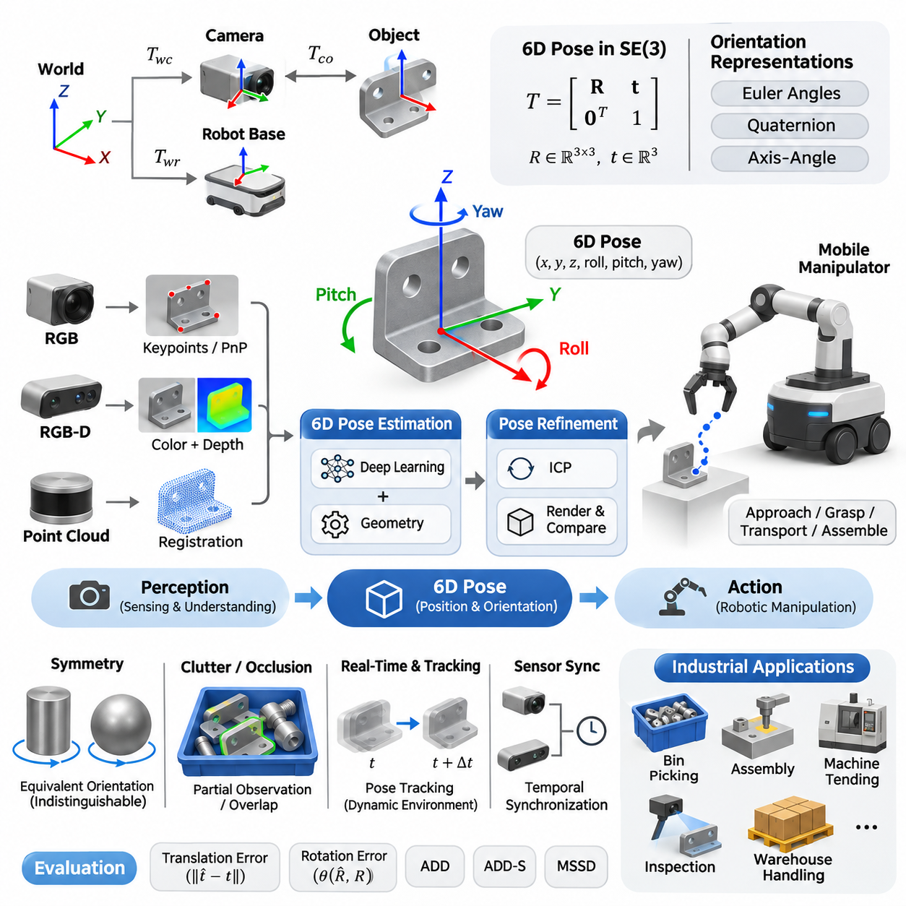
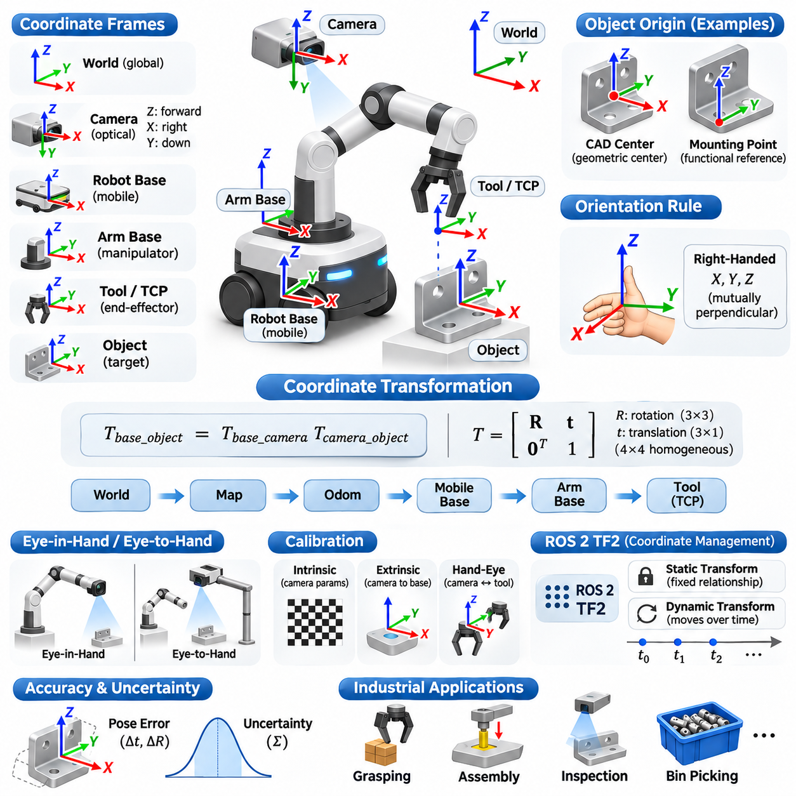
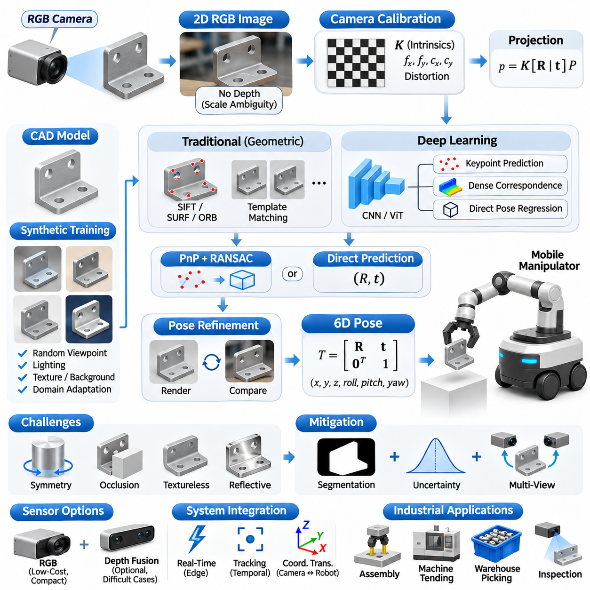
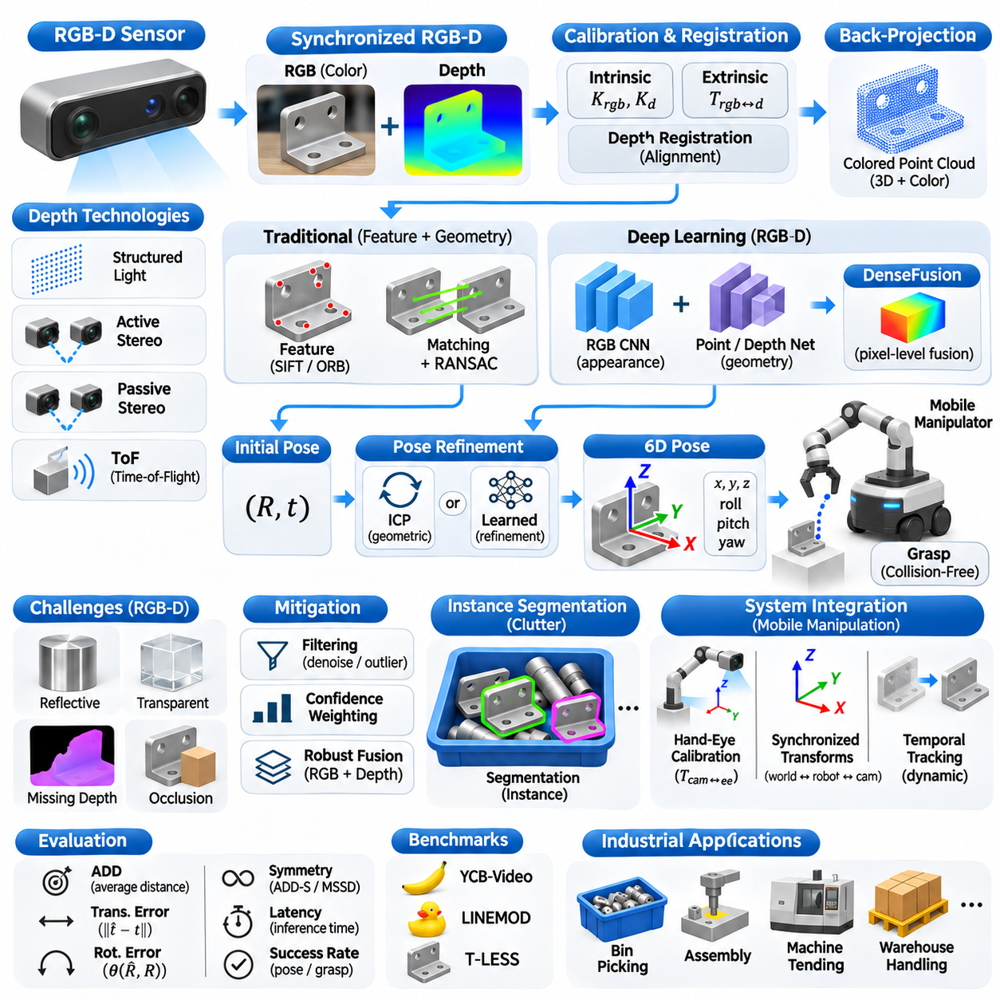
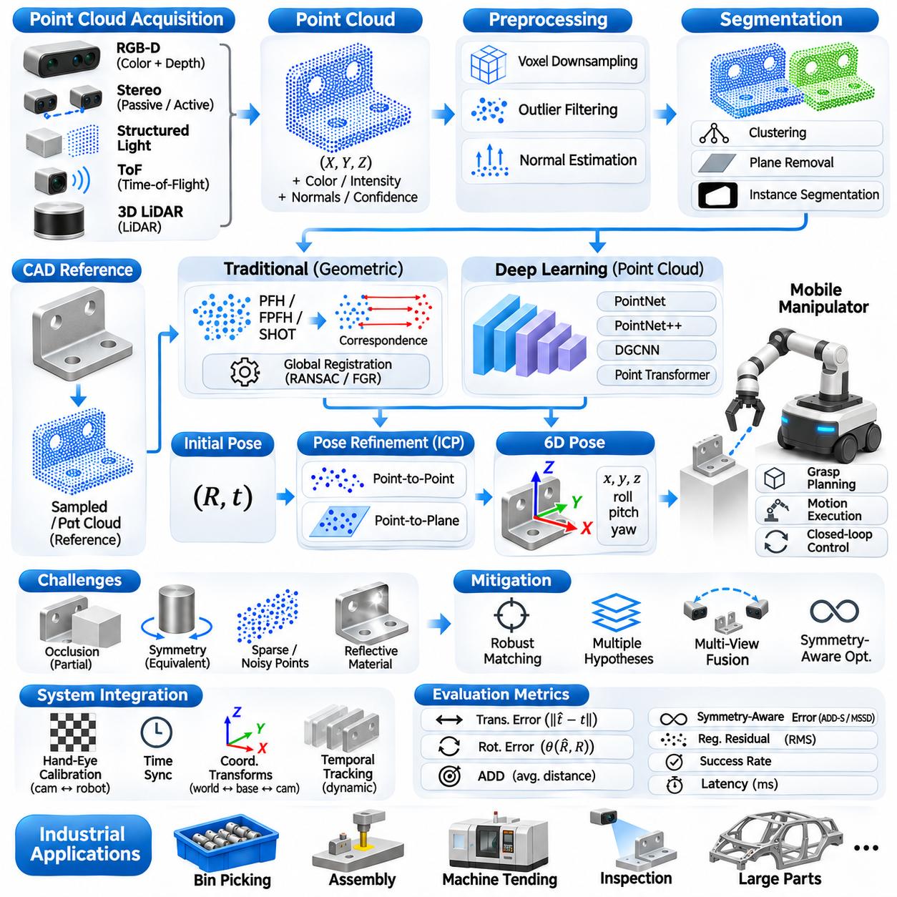
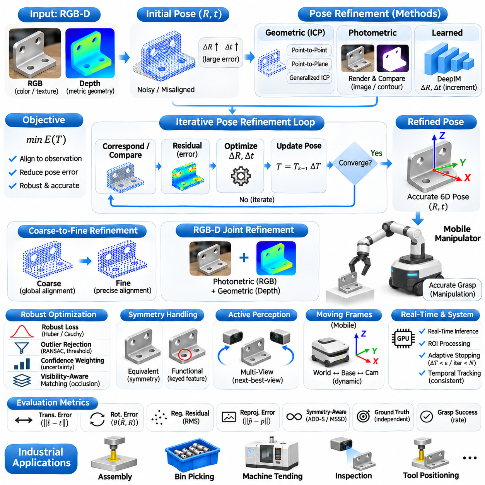
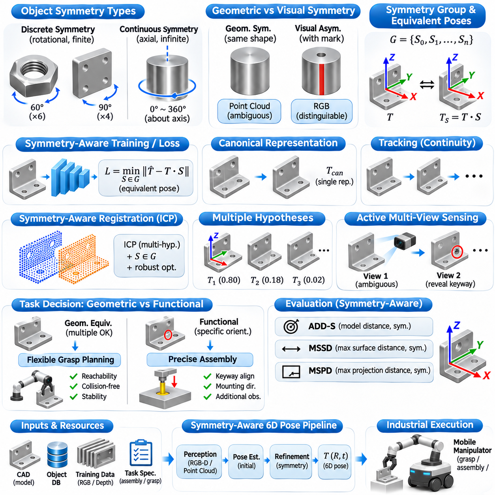
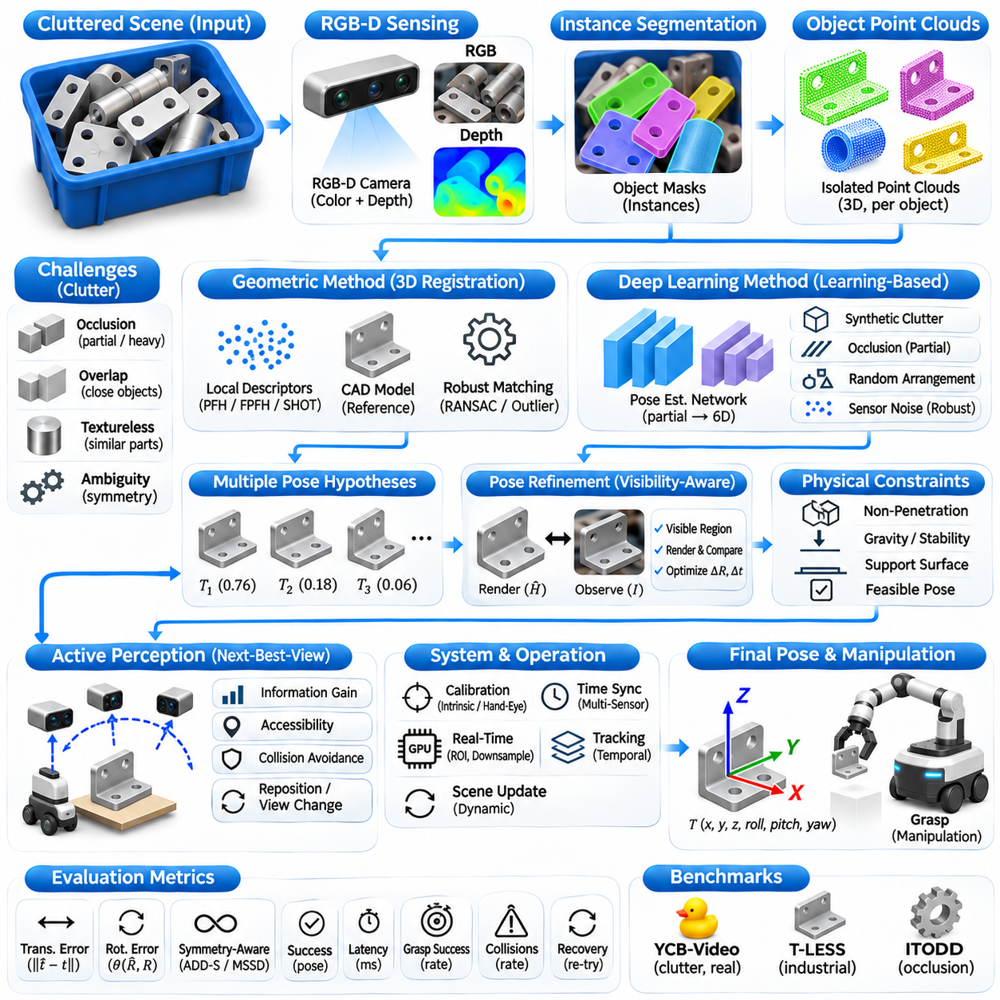
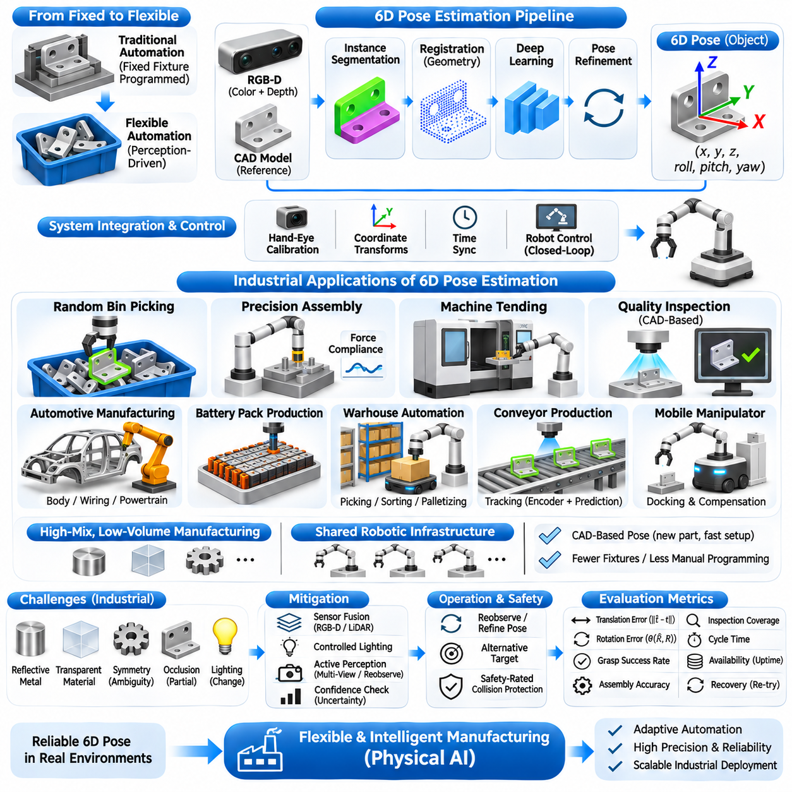

**Volume 03. Vision Manipulation and AI**

# Chapter 04. 6D Object Pose

## 01 6D Pose Overview

{width="7.268055555555556in" height="7.268055555555556in"}

Six-dimensional (6D) object pose estimation is a fundamental perception technology that enables robotic systems to determine the complete spatial position and orientation of physical objects within a three-dimensional environment. Unlike conventional object detection, which identifies object categories and locations within two-dimensional images, 6D pose estimation provides the geometric information necessary for precise physical interaction and autonomous manipulation.

The six dimensions of an object pose correspond to three translational degrees of freedom and three rotational degrees of freedom. Translation describes the position of an object along the X, Y, and Z axes, while rotation describes its orientation around these axes. Together, these components establish the spatial relationship between an object and a reference coordinate system, enabling robotic systems to understand how the object is positioned in physical space.

Mathematically, a 6D object pose is commonly represented using a rotation matrix and a translation vector within the Special Euclidean Group SE(3). These components can be combined into a 4 × 4 homogeneous transformation matrix. Alternative orientation representations include Euler angles, quaternions, and axis-angle representations. Each representation offers different computational characteristics regarding numerical stability, interpolation, and transformation operations.

In mobile manipulation, accurate 6D object pose estimation establishes a critical connection between visual perception and robotic motion control. A mobile manipulator must determine not only where a target object is located but also how it should approach, grasp, transport, or assemble that object. Even relatively small positional or rotational errors can result in unsuccessful grasping, mechanical interference, or inaccurate placement during precision operations.

Object coordinate systems provide a consistent geometric foundation for describing object poses. A local coordinate frame is typically defined relative to the physical geometry or CAD model of an object, while camera, robot base, and world coordinate frames describe its surrounding environment. Coordinate transformations convert estimated poses between these reference frames, allowing perception results to be directly utilized by robotic motion planning algorithms.

RGB-based 6D pose estimation determines object position and orientation using conventional color images. These approaches commonly identify geometric features, semantic keypoints, object contours, or learned correspondences between image observations and three-dimensional object models. Perspective-n-Point (PnP) algorithms can subsequently recover the spatial transformation when sufficient reliable correspondences and calibrated camera parameters are available.

RGB-D-based pose estimation combines color information with depth measurements to improve geometric understanding. Depth observations provide explicit distance information, reducing ambiguities associated with monocular images. By integrating visual appearance and spatial geometry, RGB-D perception systems can estimate object poses more robustly under challenging conditions involving complex backgrounds, limited texture, partial occlusion, and varying illumination.

Point cloud-based pose estimation operates directly on three-dimensional spatial measurements acquired through depth cameras, stereo vision systems, structured-light sensors, or LiDAR. These methods analyze geometric structures and establish correspondences between observed point clouds and reference object models. Registration algorithms align the observed and reference geometries to recover object translation and rotation, particularly in applications involving known industrial components.

Traditional pose estimation approaches rely extensively on handcrafted geometric features, template matching, feature correspondence, and model registration. Modern deep learning approaches utilize convolutional neural networks, transformers, and three-dimensional neural architectures to learn robust object representations directly from training data. Hybrid approaches combine learned representations with analytical geometric optimization to improve accuracy and reliability.

Pose refinement improves the accuracy of an initially estimated object pose through additional geometric or photometric optimization. Algorithms such as Iterative Closest Point (ICP) minimize spatial discrepancies between observed and reference surfaces. Other refinement methods compare rendered object models with captured images or employ neural networks to predict incremental pose corrections. These processes are particularly important for precision manipulation and assembly.

Object symmetry introduces fundamental challenges because multiple orientations may produce visually or geometrically equivalent observations. Cylindrical components, spherical objects, and rotationally symmetric mechanical parts frequently exhibit this ambiguity. Symmetry-aware pose estimation incorporates equivalent transformations into training, inference, and evaluation processes, preventing physically indistinguishable orientations from being incorrectly classified as estimation failures.

Cluttered environments introduce additional difficulties through occlusion, overlapping objects, complex backgrounds, and incomplete geometric observations. In industrial bin picking, objects frequently occupy irregular positions and partially obstruct one another. Reliable pose estimation requires effective instance segmentation, robust feature extraction, partial geometry matching, and uncertainty assessment to identify physically meaningful poses despite incomplete sensory information.

Real-time pose estimation is especially important for mobile manipulators operating in dynamic environments. As the mobile platform moves, the spatial relationship between the camera, robot arm, and target object changes continuously. Accurate sensor synchronization, calibrated coordinate transformations, efficient inference, and temporal pose tracking help maintain consistent object localization while reducing the effects of platform movement and computational latency.

Evaluation of 6D pose estimation involves translational error, rotational error, and geometric alignment metrics. The Average Distance of Model Points (ADD) measures the average spatial discrepancy between model points transformed by estimated and reference poses. ADD-S accommodates indistinguishable model orientations through nearest-point comparisons, while metrics such as Maximum Symmetry-Aware Surface Distance provide additional symmetry-aware evaluation capabilities.

Industrial applications of 6D object pose estimation include robotic bin picking, automated assembly, machine tending, component inspection, warehouse automation, and precision material handling. In these applications, estimated object poses support grasp candidate generation, collision-free motion planning, approach trajectory calculation, and accurate tool positioning. Reliable integration with robot control systems transforms geometric perception into executable physical actions.

Ultimately, 6D object pose estimation represents an essential geometric interface between computer vision and physical intelligence. By converting raw sensory observations into actionable spatial representations, it enables mobile manipulators to interact with objects beyond predefined fixtures and predetermined locations. Its integration with grasp planning, motion control, and learning-based decision-making establishes a foundation for adaptive and autonomous robotic manipulation.

## 02 Object Coordinate Systems

{width="7.268055555555556in" height="7.268055555555556in"}

Object coordinate systems provide the geometric foundation for representing the position and orientation of physical objects within three-dimensional environments. In six-dimensional (6D) object pose estimation, a coordinate system establishes a reference frame through which spatial relationships can be mathematically described. These representations enable robotic systems to convert visual observations into actionable geometric information for autonomous manipulation.

An object coordinate system typically consists of three mutually perpendicular axes, designated as X, Y, and Z, together with an origin that defines the reference position. The orientation of these axes determines how the object\'s geometry is represented in three-dimensional space. Most robotic systems adopt a right-handed coordinate system to maintain mathematical consistency across perception, kinematics, motion planning, and control operations.

The object coordinate frame is generally established according to the physical geometry, functional characteristics, or CAD model of a target object. Its origin may be located at the geometric center, center of mass, mounting surface, or designated assembly reference point. Selecting an appropriate origin and axis orientation simplifies spatial calculations and improves consistency between object recognition, grasp planning, and mechanical alignment.

Camera coordinate systems describe the spatial relationships between visual sensors and observed objects. In a conventional optical coordinate frame, the Z-axis extends forward along the optical axis, the X-axis extends horizontally toward the right, and the Y-axis extends vertically downward. Three-dimensional object positions obtained from calibrated vision systems are initially expressed relative to this camera coordinate frame.

The robot base coordinate system establishes a reference frame for robotic arm kinematics and manipulation operations. Joint configurations, end-effector positions, and motion trajectories are commonly calculated relative to this frame. For mobile manipulators, the robot base coordinate system is attached to the mobile platform or manipulator mounting structure, causing its relationship with external reference frames to change during navigation.

The world coordinate system provides a global spatial reference for representing objects, robots, workstations, and environmental structures. Unlike coordinate frames attached to moving components, the world coordinate frame generally remains fixed relative to the operational environment. Mobile robots utilize global reference frames to maintain spatial awareness and coordinate navigation, localization, mapping, and manipulation activities.

End-effector coordinate systems describe the position and orientation of robotic grippers, tools, and other manipulation devices. The Tool Center Point (TCP) defines a specific reference location associated with the functional portion of the end effector. By establishing spatial relationships between object coordinate frames and tool coordinate frames, robotic systems can calculate appropriate grasping orientations and approach trajectories.

Coordinate transformations enable spatial information to be converted between different reference frames. A rigid-body transformation consists of a three-dimensional translation vector and a three-dimensional rotation represented by a rotation matrix. These components are commonly combined into a 4 × 4 homogeneous transformation matrix, allowing position and orientation transformations to be performed within a unified mathematical framework.

Multiple coordinate transformations can be combined through matrix multiplication to establish spatial relationships across interconnected robotic subsystems. For example, an object pose initially estimated in the camera coordinate frame can be transformed into the robot base coordinate frame using calibrated camera-to-robot transformations. The multiplication order and transformation direction must remain consistent throughout the computational pipeline.

Camera calibration and hand-eye calibration are essential processes for establishing accurate relationships between visual sensors and robotic coordinate systems. Intrinsic calibration determines camera parameters such as focal length and optical center, while extrinsic calibration determines spatial relationships between reference frames. Hand-eye calibration specifically estimates the rigid transformation between the camera and the robot mounting frame.

Eye-in-hand and eye-to-hand configurations represent two common arrangements for integrating visual sensors with robotic manipulators. In an eye-in-hand configuration, the camera is mounted on the robot arm and changes its position and orientation during movement. In an eye-to-hand configuration, the camera is mounted externally to the manipulator, providing observations from a separate reference frame within the operational environment.

In mobile manipulation, coordinate frame management becomes more complex because the robotic arm and visual sensors may be mounted on a moving platform. The complete transformation chain can include world, map, odometry, mobile base, manipulator base, camera, object, and end-effector coordinate frames. Accurate management of these interconnected frames enables manipulation tasks to remain geometrically consistent despite changes in platform position.

ROS 2 provides a distributed coordinate transformation infrastructure through the TF2 framework. TF2 maintains relationships between coordinate frames over time and enables software components to retrieve transformations corresponding to specific timestamps. Static transformations describe fixed mechanical relationships, while dynamic transformations represent changing relationships caused by robot motion, platform navigation, or articulated mechanisms.

Coordinate system accuracy is influenced by calibration errors, mechanical tolerances, structural deformation, sensor noise, and synchronization discrepancies. Small angular errors can produce substantial positional deviations when transformations are applied over extended distances. Consequently, coordinate frame validation, uncertainty propagation, timestamp synchronization, and periodic calibration are important engineering considerations for precision robotic manipulation.

Industrial applications require consistent object coordinate definitions across CAD models, perception datasets, pose estimation algorithms, and robotic control systems. Standardized reference frames simplify automated assembly, machine tending, precision inspection, and bin picking. Even when objects exhibit geometric symmetry, their coordinate conventions should preserve functional requirements and distinguish orientations whenever physically necessary for successful task execution.

Ultimately, object coordinate systems establish a common geometric language connecting visual perception, spatial reasoning, robotic kinematics, and physical action. Accurate coordinate definitions and reliable transformations enable mobile manipulators to understand object poses, generate feasible manipulation trajectories, and execute precise operations. This geometric infrastructure forms the basis for subsequent 6D pose estimation and autonomous manipulation technologies.

## 03 RGB Based 6D Pose

{width="7.268055555555556in" height="7.268055555555556in"}

RGB-based six-dimensional (6D) object pose estimation is a computer vision technology that determines the three-dimensional position and orientation of physical objects using conventional color images. Unlike depth-based perception systems, RGB-based approaches rely primarily on visual appearance, geometric features, and learned representations to reconstruct spatial relationships between observed objects and the camera coordinate system.

The fundamental challenge of RGB-based pose estimation arises from the projection of three-dimensional objects onto two-dimensional image planes. During this projection, explicit depth information is lost, creating ambiguities regarding object distance, scale, and orientation. Recovering a complete 6D pose therefore requires additional geometric constraints, known object dimensions, reference models, or learned knowledge acquired from training datasets.

Camera calibration establishes the mathematical relationship between three-dimensional object coordinates and two-dimensional image coordinates. Intrinsic camera parameters include focal lengths, principal point coordinates, and lens distortion coefficients. Accurate calibration enables mathematical projection and reprojection operations, allowing pose estimation algorithms to determine the spatial transformation that best explains observed image features.

Traditional RGB-based pose estimation approaches utilize geometric features extracted from object images. Feature detectors and descriptors such as Scale-Invariant Feature Transform (SIFT), Speeded-Up Robust Features (SURF), and Oriented FAST and Rotated BRIEF (ORB) establish correspondences between observed image features and reference object models. These correspondences provide geometric constraints for subsequent pose calculations.

The Perspective-n-Point (PnP) algorithm is a widely used mathematical method for recovering object poses from corresponding three-dimensional model points and two-dimensional image points. Given calibrated camera parameters and sufficient reliable correspondences, PnP estimates the rotation matrix and translation vector describing the object relative to the camera. RANSAC can improve robustness by rejecting inconsistent feature correspondences.

Template matching represents another conventional approach to RGB-based pose estimation. Reference images are generated by observing or rendering an object from multiple known viewpoints. During inference, captured images are compared against these templates to identify the most probable object orientation and position. Although effective in controlled environments, template-based methods may be sensitive to illumination changes and partial occlusion.

Deep learning has significantly advanced RGB-based 6D pose estimation by enabling neural networks to learn discriminative visual representations directly from training data. Convolutional neural networks and vision transformers can extract object-specific features despite changes in viewpoint, background, and illumination. These learned representations support direct pose regression, keypoint prediction, and dense correspondence estimation.

Keypoint-based pose estimation predicts the two-dimensional locations of predefined three-dimensional object landmarks. These landmarks may correspond to geometric corners, bounding box vertices, or distinctive surface features. Once the image coordinates of these keypoints have been identified, geometric solvers recover the complete object pose. This approach combines the adaptability of deep learning with established mathematical constraints.

Dense correspondence methods establish relationships between individual image pixels and corresponding locations on three-dimensional object surfaces. Neural networks predict object-relative coordinates for visible regions, generating extensive geometric evidence for pose recovery. Compared with sparse keypoint approaches, dense correspondence estimation can provide greater robustness when individual landmarks are obscured or difficult to distinguish.

Direct pose regression approaches predict object translation and rotation directly from RGB images using neural networks. Translation may be represented through three-dimensional coordinates or decomposed into image-plane localization and estimated depth, while orientation can be expressed using quaternions or continuous rotation representations. Appropriate loss functions help maintain geometric consistency and reduce orientation ambiguities.

Synthetic training data plays an important role in developing RGB-based pose estimation systems. Photorealistic rendering engines generate images of CAD models under diverse viewpoints, lighting conditions, textures, and backgrounds while automatically producing accurate pose annotations. Domain randomization and domain adaptation reduce discrepancies between simulated and real-world observations, improving generalization without extensive manual labeling.

Pose refinement enhances initial RGB-based pose predictions by comparing rendered object appearances with actual image observations. Render-and-compare techniques iteratively adjust translation and rotation to minimize visual or geometric discrepancies. Learning-based refinement networks can also estimate incremental transformations, improving alignment accuracy for precision operations involving assembly, inspection, and robotic grasping.

Object symmetry, partial occlusion, textureless surfaces, and reflective materials remain significant challenges for RGB-based pose estimation. Visually indistinguishable orientations can produce multiple valid pose hypotheses, while incomplete observations reduce the available geometric evidence. Symmetry-aware training, instance segmentation, uncertainty estimation, and multi-view observations help mitigate these limitations and improve perception reliability.

In mobile manipulation, RGB-based pose estimation must operate under changing camera viewpoints, platform movement, and variable environmental conditions. Efficient neural network inference, temporal pose tracking, and synchronized coordinate transformations are essential for maintaining consistent object localization. Edge computing platforms can reduce communication latency and support real-time integration with robotic motion planning and grasp execution.

Industrial applications of RGB-based 6D pose estimation include automated assembly, machine tending, warehouse picking, component inspection, and flexible manufacturing. Conventional RGB cameras offer advantages in hardware cost, compact integration, and installation flexibility. However, applications requiring highly accurate metric depth or reliable perception under difficult optical conditions may benefit from additional depth sensing or multi-sensor fusion.

Ultimately, RGB-based 6D pose estimation transforms two-dimensional visual observations into actionable three-dimensional object representations. Its integration with geometric reasoning, deep learning, camera calibration, and robotic coordinate transformations enables mobile manipulators to perform autonomous physical interactions. Continued advances in vision foundation models and generalizable pose estimation further expand its potential within Physical AI systems.

## 04 RGBD Based 6D Pose

{width="7.268055555555556in" height="7.268055555555556in"}

RGB-D-based six-dimensional (6D) object pose estimation determines the three-dimensional position and orientation of physical objects by combining color images with depth measurements. Unlike conventional RGB-based approaches, RGB-D perception provides direct information about object distance and surface geometry. This combination enables robotic systems to recover spatial transformations with improved accuracy and robustness.

An RGB-D sensor captures synchronized color and depth images representing the same physical environment. The RGB image provides visual characteristics such as color, texture, boundaries, and semantic features, while the depth image describes the distance between the sensor and observed surfaces. Integrating these complementary observations allows perception algorithms to establish richer representations of objects and their surroundings.

Depth information can be acquired through structured-light technology, active stereo vision, passive stereo vision, or Time-of-Flight (ToF) sensing. Each technology exhibits different characteristics regarding measurement accuracy, operating range, spatial resolution, and environmental sensitivity. Selecting an appropriate depth sensing technology is essential for achieving reliable pose estimation under specific robotic operating conditions.

Accurate RGB-D perception requires calibration and spatial alignment between color and depth sensors. Intrinsic calibration determines the internal parameters of each camera, while extrinsic calibration establishes the geometric transformation between their coordinate systems. Depth registration aligns depth measurements with corresponding RGB pixels, enabling consistent associations between visual features and three-dimensional spatial information.

Depth images can be transformed into three-dimensional point clouds through back-projection using calibrated camera parameters. Each valid depth pixel is converted into a spatial point expressed in the camera coordinate system. When corresponding RGB information is associated with these points, the resulting colored point cloud provides a representation containing both geometric structure and visual appearance for object pose estimation.

Traditional RGB-D pose estimation methods combine image-based feature extraction with three-dimensional geometric matching. Visual descriptors identify corresponding object regions, while depth measurements establish spatial relationships between observed surfaces and reference models. Algorithms such as Random Sample Consensus (RANSAC) reject incorrect correspondences and estimate rigid transformations describing object translation and rotation.

Deep learning-based RGB-D pose estimation integrates visual and geometric features through specialized neural network architectures. Convolutional neural networks extract appearance information from RGB images, while point-based or depth-based networks analyze spatial geometry. Feature fusion combines these complementary representations to predict object coordinates, spatial correspondences, or complete six-dimensional transformation parameters.

DenseFusion represents an influential approach that combines RGB image features with corresponding three-dimensional point cloud features at the pixel level. This dense feature fusion enables object pose prediction using localized appearance and geometric information. Iterative refinement further improves initial pose estimates, demonstrating the effectiveness of combining complementary sensing modalities within an integrated learning architecture.

Pose refinement is particularly important in RGB-D systems because depth measurements provide explicit geometric constraints for correcting initial estimation errors. Iterative Closest Point (ICP) and related registration algorithms minimize discrepancies between observed object surfaces and transformed reference models. Learning-based refinement methods can additionally predict incremental pose corrections using integrated color and depth features.

Despite its advantages, RGB-D perception remains sensitive to reflective surfaces, transparent materials, depth discontinuities, and incomplete sensor measurements. Occlusion and environmental interference can introduce missing or inaccurate depth values. Depth filtering, outlier rejection, confidence weighting, and robust RGB-D feature fusion help reduce these effects, preventing unreliable geometric observations from dominating pose predictions.

In cluttered environments, RGB-D-based pose estimation benefits from the ability to distinguish objects through both appearance and spatial separation. Instance segmentation identifies individual objects within the RGB image, while depth measurements isolate their corresponding three-dimensional structures. These capabilities are particularly valuable in industrial bin picking, where partially overlapping components frequently obstruct one another.

For mobile manipulators, RGB-D pose estimation must account for changing sensor viewpoints, platform movement, and dynamic coordinate relationships. Accurate timestamp synchronization, hand-eye calibration, and coordinate transformations ensure that estimated object poses remain consistent with the robot base and end-effector reference frames. Temporal tracking and uncertainty estimation further improve operational reliability during movement.

Performance evaluation of RGB-D-based 6D pose estimation commonly involves translation error, rotation error, Average Distance of Model Points (ADD), and symmetry-aware geometric metrics. Benchmark datasets such as YCB-Video, LINEMOD, and T-LESS support comparative evaluation under different object geometries and environmental conditions. Inference latency and pose estimation success rates are also important for real-time robotic deployment.

Industrial applications of RGB-D-based pose estimation include automated assembly, random bin picking, machine tending, warehouse automation, and precision material handling. By providing explicit depth information and accurate object orientation estimates, RGB-D systems support grasp candidate generation, collision-free approach planning, and precise tool positioning. These capabilities reduce dependence on predefined object arrangements.

Ultimately, RGB-D-based 6D object pose estimation establishes a powerful geometric interface between multimodal perception and autonomous robotic manipulation. Its integration of visual appearance, depth measurements, geometric registration, and deep learning enables mobile manipulators to operate in complex and unstructured environments. Combined with grasp planning and closed-loop control, it forms an essential perception component of Physical AI systems.

## 05 Point Cloud Based 6D Pose

{width="7.268055555555556in" height="7.268055555555556in"}

Point cloud-based six-dimensional (6D) object pose estimation is a three-dimensional perception technology that determines the spatial position and orientation of physical objects by analyzing their geometric structures. Unlike RGB-based approaches that primarily rely on visual appearance, point cloud-based methods utilize explicit spatial measurements to estimate rigid-body transformations between observed objects and reference models.

A point cloud consists of a collection of discrete points distributed throughout three-dimensional space, with each point typically represented by X, Y, and Z coordinates. Additional attributes may include color, intensity, surface normals, and measurement confidence. These spatial representations enable robotic perception systems to analyze object dimensions, surface characteristics, geometric boundaries, and structural relationships within physical environments.

Point clouds can be acquired using RGB-D cameras, stereo vision systems, structured-light sensors, Time-of-Flight (ToF) cameras, and three-dimensional LiDAR systems. Each sensing technology provides different characteristics in terms of spatial resolution, measurement accuracy, operating distance, and acquisition frequency. Industrial manipulation applications generally require sufficient point density to distinguish fine geometric features and recover precise object poses.

Point cloud preprocessing is essential for improving the quality and computational efficiency of pose estimation. Common preprocessing operations include voxel-based downsampling, statistical outlier removal, radius-based filtering, background segmentation, and surface normal estimation. These operations reduce redundant measurements, eliminate unreliable observations, and preserve significant geometric structures required for subsequent object recognition and registration.

Object segmentation separates target objects from surrounding environmental structures and neighboring components within a point cloud. Geometric clustering, Euclidean distance-based segmentation, plane extraction, and deep learning-based instance segmentation can identify individual object regions. Accurate segmentation reduces irrelevant spatial information and improves the reliability of pose estimation in cluttered and unstructured environments.

Traditional point cloud-based pose estimation relies on geometric feature extraction and correspondence establishment between observed surfaces and reference object models. Local descriptors such as Point Feature Histograms (PFH), Fast Point Feature Histograms (FPFH), and Signature of Histograms of Orientations (SHOT) characterize neighborhoods within three-dimensional structures, enabling geometric matching across different viewpoints.

Global registration algorithms estimate initial object transformations without requiring highly accurate initial alignment. Random Sample Consensus (RANSAC), Fast Global Registration (FGR), and robust optimization approaches identify geometrically consistent correspondences while rejecting incorrect matches. These methods are particularly useful when objects appear in arbitrary positions and orientations within complex operational environments.

Iterative Closest Point (ICP) is a widely used registration algorithm that refines spatial alignment between observed point clouds and reference object models. ICP iteratively establishes point correspondences, calculates rigid transformations, and minimizes geometric alignment errors. Point-to-point and point-to-plane variants provide different convergence characteristics depending on surface geometry, measurement quality, and initial pose accuracy.

CAD-based pose estimation utilizes predefined three-dimensional object models as geometric references for recovering object transformations. CAD surfaces can be sampled into reference point clouds and subsequently aligned with observed measurements. This approach is particularly suitable for industrial manufacturing environments where mechanical components have known dimensions, standardized geometries, and predefined assembly coordinate systems.

Deep learning has expanded the capabilities of point cloud-based perception through neural architectures that directly process unordered spatial measurements. PointNet, PointNet++, Dynamic Graph Convolutional Neural Networks (DGCNN), and point cloud transformers extract local and global geometric representations. These learned features support object recognition, correspondence prediction, transformation regression, and robust six-dimensional pose estimation.

Partial observations and geometric symmetry introduce significant challenges because multiple spatial transformations may explain the same visible object surfaces. Occlusion, sparse measurements, reflective materials, and sensor noise further increase estimation uncertainty. Robust feature matching, symmetry-aware optimization, multiple pose hypotheses, and multi-view point cloud integration help address these limitations.

Mobile manipulators require point cloud-based pose estimation to remain consistent despite platform movement and changing sensor viewpoints. Accurate sensor synchronization, hand-eye calibration, and coordinate transformations allow estimated object poses to be expressed relative to the manipulator base or world coordinate system. Computational optimization and temporal tracking support real-time integration with robotic motion planning and control.

Performance evaluation typically considers translational error, rotational error, geometric registration residuals, Average Distance of Model Points (ADD), and symmetry-aware alignment metrics. Additional operational indicators include registration success rate, processing latency, robustness against occlusion, and sensitivity to point density. Industrial validation should also assess whether estimated poses satisfy actual grasping and assembly tolerances.

Industrial applications of point cloud-based 6D pose estimation include random bin picking, precision assembly, machine tending, automated inspection, and handling of large mechanical components. Explicit geometric information supports grasp candidate generation, surface alignment, collision avoidance, and accurate tool positioning. Integration with CAD models further enables flexible automation across high-mix manufacturing environments.

Ultimately, point cloud-based 6D object pose estimation establishes a geometric interface between three-dimensional perception and autonomous robotic manipulation. By converting spatial measurements into actionable object transformations, it enables mobile manipulators to understand physical structures and execute precise interactions. Its integration with multimodal perception, grasp planning, and closed-loop control strengthens the foundation of Physical AI systems.

## 06 Pose Refinement

{width="7.268055555555556in" height="7.268055555555556in"}

Pose refinement is a critical process in six-dimensional (6D) object pose estimation that improves the accuracy of an initially predicted object position and orientation. Initial pose estimates may contain errors resulting from sensor noise, incomplete observations, imperfect feature correspondences, or limitations of estimation algorithms. Pose refinement reduces these errors through additional geometric, photometric, or learning-based optimization.

The fundamental objective of pose refinement is to minimize discrepancies between an observed object and its reference representation. An initial rigid-body transformation provides an approximate alignment between the object model and sensor observations. Refinement algorithms progressively adjust the translation and rotation parameters until the estimated transformation achieves satisfactory alignment according to a predefined optimization criterion.

Geometric pose refinement commonly utilizes three-dimensional spatial information obtained from depth cameras, stereo vision systems, or point cloud sensors. The observed geometry is compared with a transformed reference object model to identify spatial discrepancies. Optimization algorithms then calculate corrective transformations that reduce surface alignment errors while preserving the rigid-body geometric properties of the object.

Iterative Closest Point (ICP) is one of the most widely used geometric pose refinement algorithms. ICP repeatedly establishes correspondences between points in an observed point cloud and a reference model, estimates an optimal rigid transformation, and updates the object pose. This iterative process continues until the alignment error converges, the transformation update becomes sufficiently small, or a predefined iteration limit is reached.

Different variants of ICP provide distinct characteristics for geometric optimization. Point-to-point ICP minimizes Euclidean distances between corresponding points, while point-to-plane ICP minimizes distances along reference surface normals. Generalized ICP incorporates local surface covariance information to improve alignment. Algorithm selection depends on geometric complexity, measurement quality, computational constraints, and initial pose accuracy.

Photometric pose refinement improves object alignment by comparing visual appearance rather than relying exclusively on three-dimensional geometry. A reference object model is rendered from the estimated camera viewpoint and compared with the captured RGB image. Differences in color, texture, contours, and image features provide optimization signals for correcting translation and rotation errors under suitable observation conditions.

Render-and-compare methods establish an iterative feedback mechanism between synthetic object representations and actual sensor observations. The object model is rendered according to the current pose estimate, and discrepancies between rendered and observed images are evaluated. Corrective transformations are subsequently calculated to improve alignment, allowing the system to progressively recover a more accurate spatial representation.

Learning-based pose refinement utilizes neural networks to predict corrective transformations directly from observed and rendered object representations. Architectures such as DeepIM estimate relative pose updates through iterative visual matching, while RGB-D approaches additionally incorporate geometric information. Learned refinement can improve robustness against imperfect correspondences and complex appearance variations when adequately trained.

RGB-D pose refinement combines photometric and geometric constraints within a unified optimization framework. Color information provides appearance-based correspondence evidence, while depth measurements establish metric spatial relationships. Joint optimization can reduce ambiguities associated with individual sensing modalities, especially when objects exhibit limited texture, repetitive geometric structures, or partially occluded surfaces.

Robust optimization techniques are essential when refinement operates with noisy measurements, inaccurate correspondences, and incomplete object observations. Robust loss functions, correspondence rejection, confidence weighting, and visibility-aware matching reduce the influence of unreliable measurements. These techniques prevent a limited number of erroneous observations from excessively distorting the estimated spatial transformation.

Object symmetry introduces additional challenges because several transformations may produce geometrically or visually equivalent alignments. Symmetry-aware refinement considers equivalent object orientations when calculating optimization errors and corrective transformations. However, functional asymmetries such as assembly features, electrical connectors, or designated grasping surfaces may require additional observations to resolve orientation ambiguities.

Multi-stage refinement strategies improve computational efficiency and convergence by progressively processing observations at different levels of resolution. Coarse alignment first reduces substantial positional and rotational discrepancies, while fine alignment subsequently optimizes detailed geometric relationships. This coarse-to-fine approach can improve convergence robustness and reduce unnecessary computation during precision manipulation tasks.

For mobile manipulators, pose refinement must account for platform movement, changing camera viewpoints, and accumulated coordinate transformation errors. Additional observations acquired from different viewpoints can improve alignment accuracy and reduce uncertainty. Active perception enables the robot to reposition its camera or mobile base when the available sensory information is insufficient for reliable manipulation.

Real-time refinement requires a balance between estimation accuracy and computational latency. Excessive optimization iterations can delay grasp execution and cause refined poses to become outdated in dynamic environments. Adaptive termination criteria, GPU acceleration, region-of-interest processing, and temporal pose tracking help maintain computational efficiency while satisfying the accuracy requirements of robotic operations.

Pose refinement performance is evaluated using translational error, rotational error, registration residuals, reprojection error, and symmetry-aware geometric metrics. A low optimization residual does not necessarily guarantee a correct object pose, particularly under partial observation or geometric ambiguity. Industrial validation should therefore include independent reference measurements, convergence reliability, and actual manipulation success rates.

In industrial robotic applications, pose refinement supports precision assembly, random bin picking, machine tending, component inspection, and accurate tool positioning. By reducing discrepancies between estimated and actual object poses, refinement improves grasp reliability and decreases the risk of mechanical interference. Its integration with multimodal perception and closed-loop control establishes an essential foundation for precise and adaptive Physical AI systems.

## 07 Symmetry Handling

{width="7.268055555555556in" height="7.268055555555556in"}

Symmetry handling is an essential aspect of six-dimensional (6D) object pose estimation that addresses ambiguities arising from geometrically or visually equivalent object orientations. Many industrial components exhibit symmetric structures that remain indistinguishable under specific rotations. Without appropriate symmetry handling, perception systems may incorrectly evaluate valid pose predictions or generate inconsistent manipulation commands.

Object symmetry can generally be classified into discrete symmetry and continuous symmetry. Discrete symmetry occurs when an object preserves its appearance or geometry under specific rotational transformations, as observed in hexagonal nuts and square components. Continuous symmetry occurs when an object remains geometrically unchanged under arbitrary rotations around a particular axis, as commonly observed in ideal cylindrical components.

Geometric symmetry and visual symmetry do not necessarily represent identical properties. An object may possess a symmetric geometric structure while exhibiting asymmetric colors, textures, identification labels, or surface markings. RGB-based perception can exploit these visual differences to distinguish otherwise equivalent orientations, whereas point cloud-based perception may remain ambiguous when relying exclusively on geometric information.

Mathematically, object symmetry can be represented using a symmetry group containing transformations that preserve the relevant object geometry or appearance. Multiple six-dimensional poses may therefore belong to the same equivalence class. Instead of treating every orientation as an independent solution, symmetry-aware pose estimation considers equivalent transformations when representing object poses, calculating estimation errors, and performing optimization.

Conventional pose estimation algorithms may encounter contradictory training signals when symmetric objects are assigned unique orientation labels despite having indistinguishable appearances. Neural networks trained under these conditions can produce unstable orientation predictions or physically incorrect intermediate rotations. Symmetry-aware training objectives address this problem by allowing predictions to match any valid equivalent orientation.

Symmetry-aware loss functions evaluate pose prediction errors by considering alternative transformations associated with object symmetry. Rather than penalizing differences from a single reference orientation, these functions minimize discrepancies across equivalent pose configurations. This approach improves learning stability and prevents neural networks from being penalized for predicting geometrically valid but differently represented object poses.

Canonical pose representation provides another approach to managing symmetric orientations by defining a consistent representative transformation for each equivalence class. This representation reduces redundant pose configurations and simplifies communication between perception and manipulation modules. However, transitions between canonical orientations must be carefully managed to prevent discontinuities during object tracking and motion execution.

Symmetry-aware geometric registration incorporates equivalent object transformations into point cloud matching and pose refinement procedures. Iterative Closest Point (ICP) and related optimization algorithms can evaluate multiple orientation hypotheses before selecting an appropriate alignment. This approach reduces the risk of rejecting valid solutions and improves registration reliability for rotationally symmetric industrial components.

Multi-view perception and active sensing help resolve apparent symmetry caused by incomplete observations rather than actual object geometry. Additional camera viewpoints may reveal hidden connectors, mounting holes, surface markings, or other asymmetric features. Mobile manipulators can exploit their mobility and articulated camera positioning capabilities to acquire supplementary observations when orientation ambiguity affects task execution.

Probabilistic pose estimation represents orientation ambiguity through probability distributions or multiple pose hypotheses instead of producing a single deterministic transformation. Each hypothesis describes a potentially valid object configuration together with its associated confidence. Maintaining multiple hypotheses enables robotic systems to postpone orientation decisions until additional observations or manipulation constraints become available.

Symmetry-aware grasp planning distinguishes between geometric equivalence and functional equivalence. Multiple object orientations may support equally valid grasp configurations, allowing manipulation systems to select candidates according to reachability, collision avoidance, joint limitations, and grasp stability. This flexibility can improve robotic operating efficiency without requiring unnecessary resolution of irrelevant orientation ambiguities.

Precision assembly tasks introduce functional constraints that may invalidate otherwise equivalent grasping or placement orientations. Mechanical keyways, electrical connectors, threaded interfaces, and designated mounting surfaces frequently require specific alignment conditions. Consequently, task-level reasoning must determine whether remaining pose ambiguities are acceptable or whether additional perception and refinement are necessary.

Performance evaluation of symmetric object pose estimation requires metrics that appropriately recognize equivalent transformations. Average Distance of Model Points for Symmetric Objects (ADD-S), Maximum Symmetry-Aware Surface Distance (MSSD), and Maximum Symmetry-Aware Projection Distance (MSPD) provide alternative evaluation approaches. These metrics reduce misleading error measurements caused by equivalent object orientations.

Industrial implementation requires accurate symmetry definitions within CAD models, object databases, training datasets, and manipulation specifications. These definitions should distinguish exact geometric symmetry, approximate symmetry, visual asymmetry, and task-dependent equivalence. Integrating symmetry information throughout the perception pipeline supports consistent pose prediction, refinement, tracking, grasp planning, and error recovery.

Ultimately, symmetry handling transforms orientation ambiguity from a perception limitation into a useful source of operational flexibility. By integrating geometric reasoning, symmetry-aware learning, probabilistic estimation, active perception, and task-dependent manipulation constraints, mobile manipulators can achieve more reliable physical interactions. These capabilities strengthen the adaptability and precision of autonomous Physical AI systems.

## 08 Cluttered Environment Pose Estimation

{width="7.268055555555556in" height="7.268055555555556in"}

Six-dimensional (6D) object pose estimation in cluttered environments is a challenging robotic perception task that determines the position and orientation of individual objects surrounded by overlapping components, obstacles, and other environmental structures. Unlike controlled environments with isolated objects, cluttered scenes introduce significant uncertainties associated with visibility, spatial relationships, and geometric interpretation.

Cluttered environments frequently contain objects arranged in irregular configurations with partial or substantial mutual occlusion. Industrial storage bins, warehouse containers, assembly stations, and manufacturing workspaces commonly exhibit these conditions. Reliable pose estimation requires perception systems to distinguish individual object instances while reconstructing their spatial configurations from incomplete sensory observations.

Object occlusion represents one of the most significant challenges in cluttered environment perception. When neighboring components obstruct portions of a target object, conventional feature extraction and geometric matching algorithms may fail to establish sufficient correspondences. Robust pose estimation must therefore utilize partially visible surfaces, local geometric characteristics, and prior knowledge of object structures.

Instance segmentation plays an essential role in separating individual objects from complex backgrounds and neighboring components. Deep learning-based segmentation networks identify object-specific image regions and generate corresponding masks for subsequent pose estimation. Combining segmentation results with depth measurements enables robotic systems to isolate individual three-dimensional object structures within densely occupied environments.

RGB-D perception provides complementary visual and geometric information that improves pose estimation under cluttered conditions. RGB images contribute appearance characteristics, semantic features, and object boundaries, while depth measurements establish spatial separation between overlapping structures. Multimodal feature fusion enables perception algorithms to recover object configurations that may be difficult to determine using individual sensing modalities.

Point cloud-based pose estimation is particularly valuable when cluttered environments contain textureless industrial components or visually similar objects. Local geometric descriptors, robust correspondence matching, and partial surface registration allow observed point clouds to be aligned with reference object models. Outlier rejection prevents neighboring objects and background structures from excessively influencing estimated transformations.

Deep learning-based pose estimation architectures improve object recognition and spatial prediction under challenging visibility conditions. Neural networks can learn relationships between partially observed object features and complete three-dimensional representations. Training with synthetic clutter, realistic occlusion patterns, randomized object arrangements, and sensor noise helps improve generalization across diverse operational environments.

Multiple pose hypotheses provide an effective mechanism for addressing uncertainties associated with incomplete observations and ambiguous object configurations. Instead of immediately selecting a single transformation, perception systems maintain several candidate poses with corresponding confidence scores. Geometric consistency, visibility constraints, and additional observations can subsequently be used to eliminate unreliable hypotheses.

Visibility-aware pose refinement improves alignment accuracy by considering which object surfaces should be observable from the current sensor viewpoint. Reference object models are rendered or geometrically projected according to candidate poses and compared with actual observations. Occluded model regions are excluded or assigned reduced importance, preventing invisible surfaces from introducing misleading optimization constraints.

Multi-view perception reduces uncertainties by combining observations acquired from different camera positions and viewing angles. Information hidden in one viewpoint may become visible from another, enabling more complete geometric reconstruction and reliable orientation estimation. Accurate camera calibration, coordinate transformations, and temporal synchronization are essential for maintaining consistency across multiple observations.

Active perception enables mobile manipulators to modify their observation configurations in response to insufficient sensory information. The robot can reposition its mobile base, adjust its manipulator-mounted camera, or select alternative viewing angles to improve object visibility. Next-best-view planning evaluates potential sensor positions according to expected information gain, accessibility, and collision avoidance constraints.

Spatial reasoning incorporates relationships between neighboring objects, supporting surfaces, containers, and environmental obstacles into pose estimation. Physical constraints such as object dimensions, gravitational stability, and non-penetration conditions help reject geometrically or physically implausible pose hypotheses. These constraints are particularly valuable when individual observations provide insufficient evidence for unique object configurations.

Integration with grasp planning requires pose estimation systems to consider both geometric accuracy and practical manipulation feasibility. A partially visible object may have an uncertain complete orientation while still providing accessible and reliable grasping surfaces. Task-dependent pose estimation enables robotic systems to prioritize information necessary for successful grasp execution without resolving every geometric ambiguity.

Real-time pose estimation in cluttered environments requires efficient processing of large sensory datasets and multiple object candidates. Region-of-interest processing, point cloud downsampling, GPU acceleration, and adaptive refinement strategies reduce computational requirements. Temporal tracking and continuous scene updates help maintain accurate object representations as neighboring components move during robotic interactions.

Performance evaluation should consider translational error, rotational error, symmetry-aware geometric metrics, pose estimation success rate, and processing latency across different clutter and occlusion levels. Benchmark datasets such as YCB-Video, T-LESS, and ITODD provide representative evaluation scenarios. Industrial validation must additionally measure grasp success, collision frequency, and recovery performance following incorrect pose predictions.

Ultimately, cluttered environment pose estimation establishes an essential perception capability for autonomous mobile manipulators operating in unstructured physical environments. By integrating instance segmentation, multimodal sensing, geometric registration, uncertainty estimation, and active perception, robotic systems can achieve reliable object localization and adaptive manipulation, strengthening the practical implementation of Physical AI.

## 09 Industrial Applications

{width="7.268055555555556in" height="7.268055555555556in"}

Six-dimensional (6D) object pose estimation is a fundamental perception technology for industrial robotic automation that enables machines to determine the spatial position and orientation of physical components. By providing accurate transformation information between objects and robotic coordinate systems, this technology supports autonomous manipulation, precision manufacturing, automated inspection, and flexible material handling in complex industrial environments.

Traditional industrial automation frequently relies on predefined object positions, mechanical fixtures, dedicated feeding mechanisms, and programmed motion sequences. Although these approaches provide high repeatability under controlled conditions, they limit operational flexibility. Six-dimensional pose estimation enables robotic systems to accommodate variations in object placement and orientation, reducing dependence on specialized mechanical infrastructure.

Random bin picking represents one of the most significant industrial applications of 6D object pose estimation. Mechanical components placed randomly inside storage containers must be individually identified, localized, and extracted without interfering with neighboring objects. RGB-D perception, instance segmentation, geometric registration, and pose refinement enable robotic systems to determine accessible object configurations and generate reliable grasping strategies.

Precision assembly requires accurate estimation of component positions and orientations to satisfy mechanical alignment and dimensional tolerance requirements. Industrial robots utilize 6D pose information to align connectors, bearings, gears, shafts, housings, and other mechanical interfaces. Integration with force sensing, compliance control, and closed-loop visual feedback further improves assembly reliability while reducing mechanical interference.

Machine tending applications utilize object pose estimation to automate the loading and unloading of CNC machines, injection molding machines, presses, and other manufacturing equipment. Components arriving in inconsistent configurations can be localized and reoriented according to predefined machine requirements. Accurate pose estimation supports reliable workpiece handling, fixture placement, and coordination between robotic systems and production equipment.

Automated quality inspection benefits from accurate object pose estimation when inspection targets are positioned differently during successive manufacturing cycles. CAD-based pose estimation establishes spatial correspondence between physical components and digital reference models. This correspondence enables robotic inspection systems to position cameras, optical sensors, laser scanners, and measurement instruments relative to designated inspection regions.

Automotive manufacturing provides numerous applications for pose estimation, including vehicle component assembly, body panel handling, wiring harness installation, powertrain manufacturing, and battery pack production. Variations in component positioning and manufacturing configurations require adaptable robotic perception. Six-dimensional pose estimation supports flexible production processes while maintaining alignment accuracy and operational consistency.

Warehouse automation utilizes 6D object pose estimation for autonomous picking, sorting, packaging, palletizing, and depalletizing operations. Products with different dimensions, orientations, packaging materials, and surface characteristics must be recognized within dynamic storage environments. Multimodal perception and symmetry-aware pose estimation improve handling reliability when objects are randomly arranged or partially obscured.

Conveyor-based manufacturing applications require continuous estimation and tracking of moving object poses. High-speed cameras, synchronized depth sensors, conveyor encoders, and motion prediction algorithms provide updated spatial information for robotic interception. Accurate temporal synchronization and low-latency inference enable robots to perform picking, sorting, inspection, and assembly without interrupting continuous production processes.

Mobile manipulators extend industrial pose estimation capabilities beyond conventional stationary robotic workcells. By integrating autonomous mobile robots with robotic manipulators and perception sensors, these systems can approach stationary production assets and perform localized manipulation or inspection. Pose estimation compensates for variations in mobile platform positioning, docking accuracy, and environmental coordinate relationships.

CAD-based industrial pose estimation is particularly valuable in high-mix, low-volume manufacturing environments where numerous component geometries must be handled using shared robotic infrastructure. Digital object models provide geometric references for localization, registration, and pose refinement. Introducing new products may therefore require fewer dedicated mechanical fixtures and less manual robot programming, depending on task complexity.

Industrial deployment requires robust handling of reflective metals, transparent materials, repetitive geometries, object symmetry, occlusion, and changing illumination conditions. Multimodal sensor fusion, controlled lighting, confidence estimation, symmetry-aware optimization, and active perception help mitigate these challenges. Sensor selection and perception architecture must be adapted to actual manufacturing conditions and accuracy requirements.

Integration with industrial robotic control systems requires consistent coordinate transformations between cameras, robot bases, end effectors, workpieces, and production equipment. Hand-eye calibration, timestamp synchronization, and standardized communication interfaces ensure that estimated object poses can be converted into executable manipulation commands. Continuous validation helps prevent calibration drift and accumulated transformation errors.

Industrial pose estimation must also incorporate uncertainty management and operational error recovery. When estimated object poses fail to satisfy confidence thresholds or manipulation feasibility requirements, robotic systems should acquire additional observations, perform pose refinement, or select alternative targets. Independent collision protection and safety-rated control mechanisms remain essential for preventing hazardous robotic behavior.

Performance evaluation should extend beyond conventional translation and rotation error metrics to include grasp success rates, assembly accuracy, inspection coverage, production cycle time, system availability, and recovery performance. Industrial validation must consider representative operating conditions, product variations, sensor degradation, and environmental disturbances to establish reliable long-term operational performance.

Ultimately, industrial applications of 6D object pose estimation demonstrate the transition from rigidly programmed automation toward perception-driven autonomous manufacturing. By integrating visual perception, geometric reasoning, deep learning, robotic manipulation, and closed-loop control, industrial robotic systems can achieve greater flexibility, precision, and adaptability, establishing an essential technological foundation for Physical AI and intelligent manufacturing.
