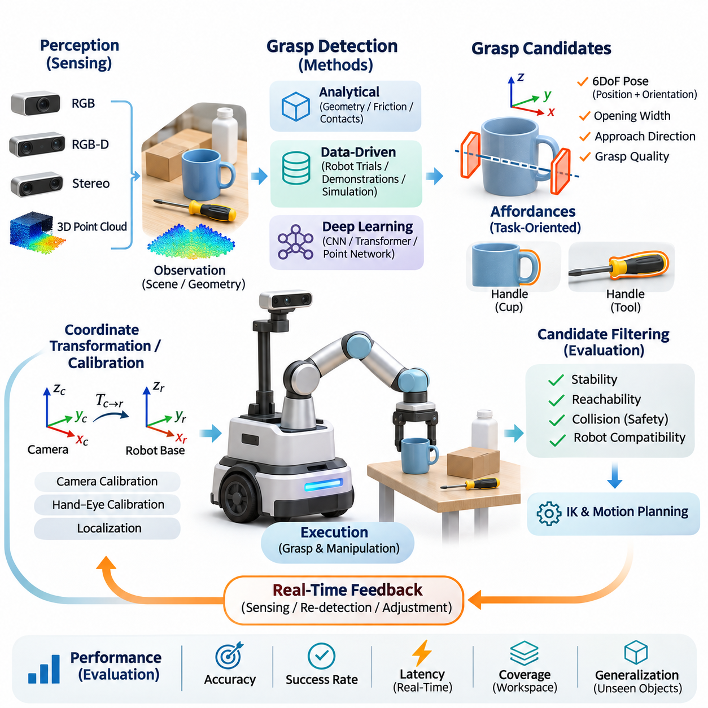
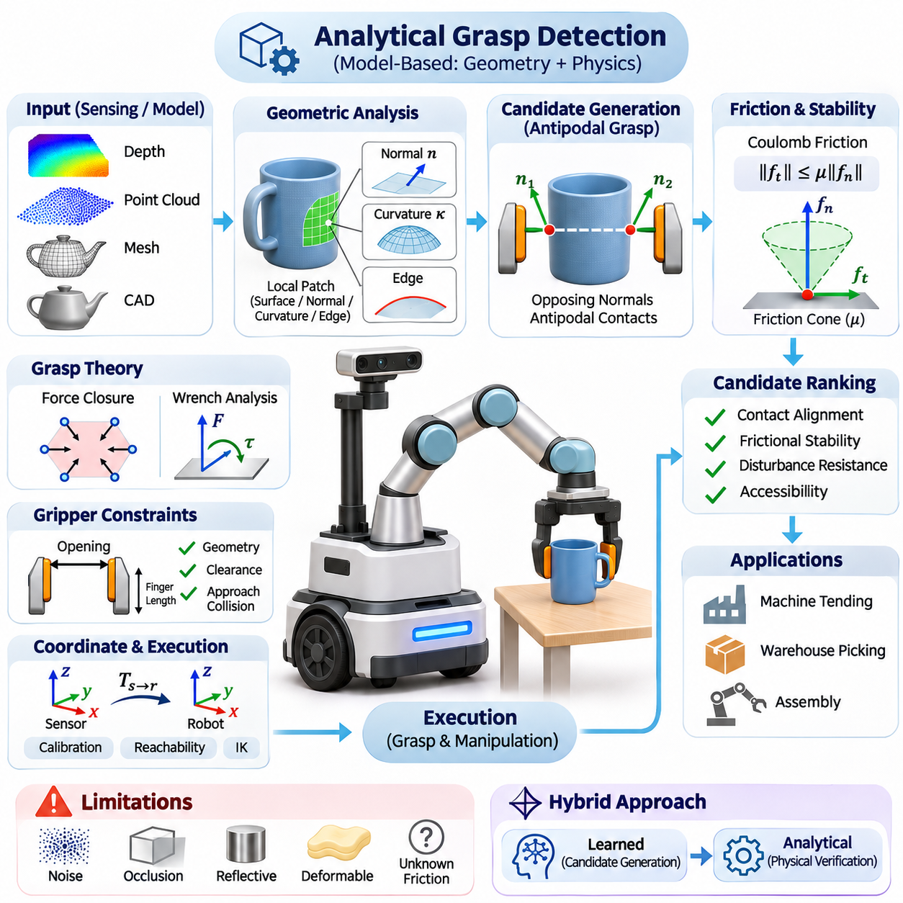
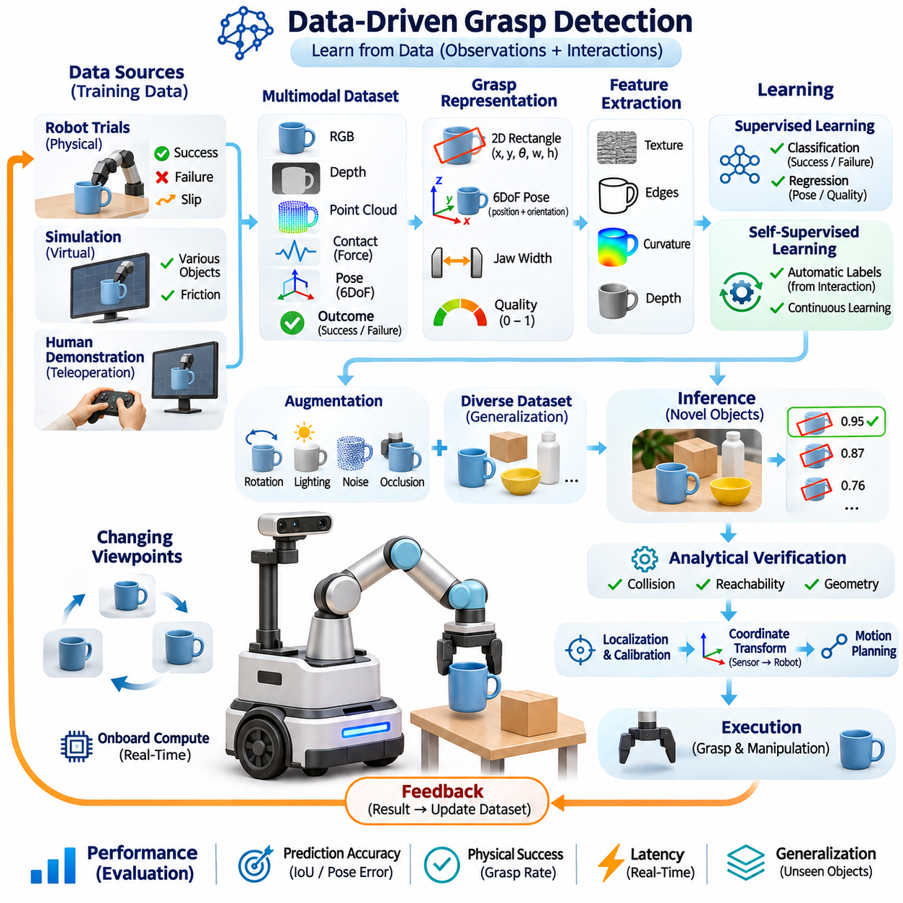
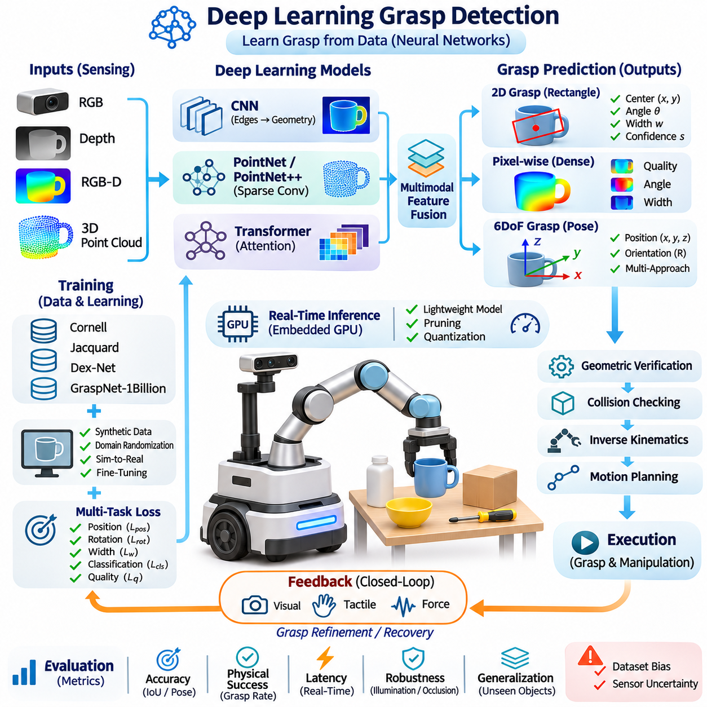
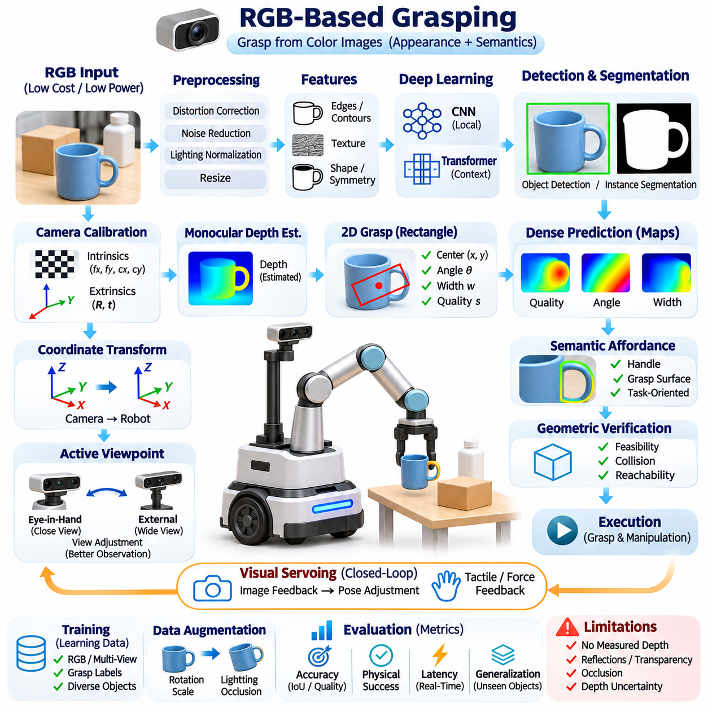
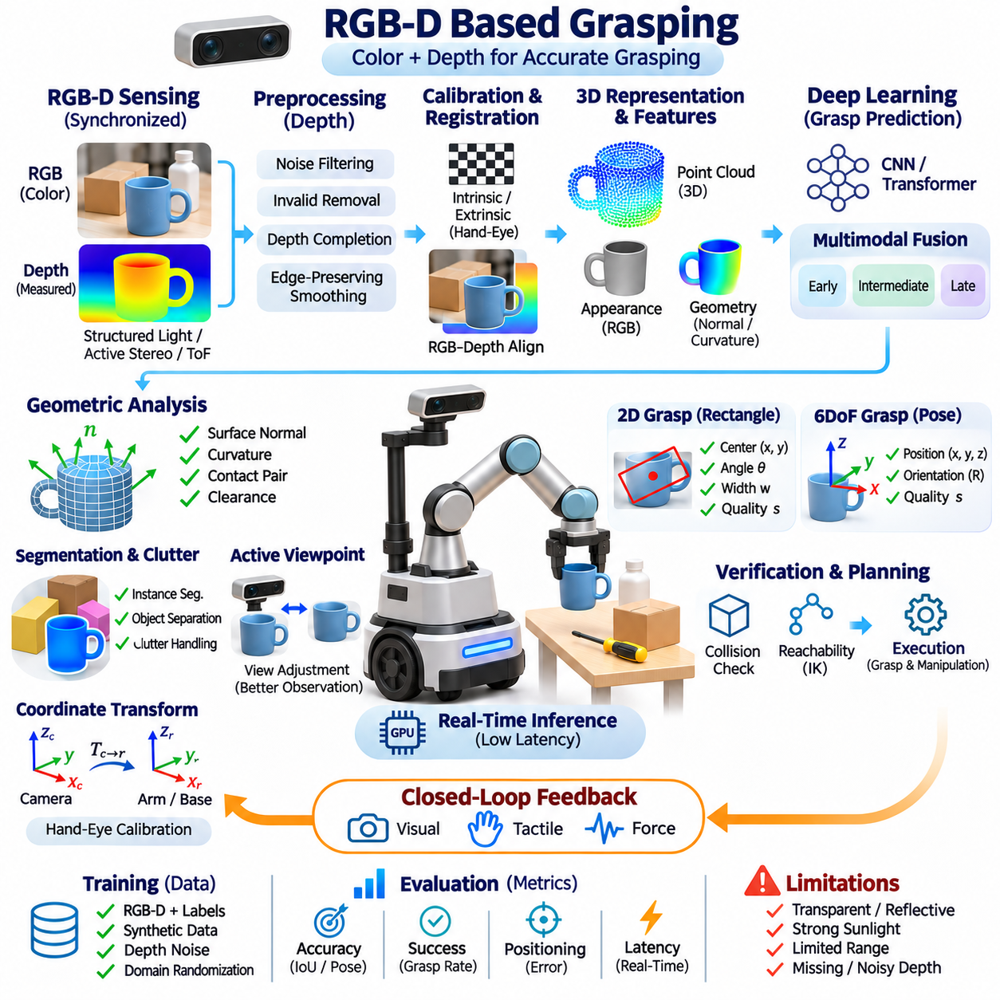
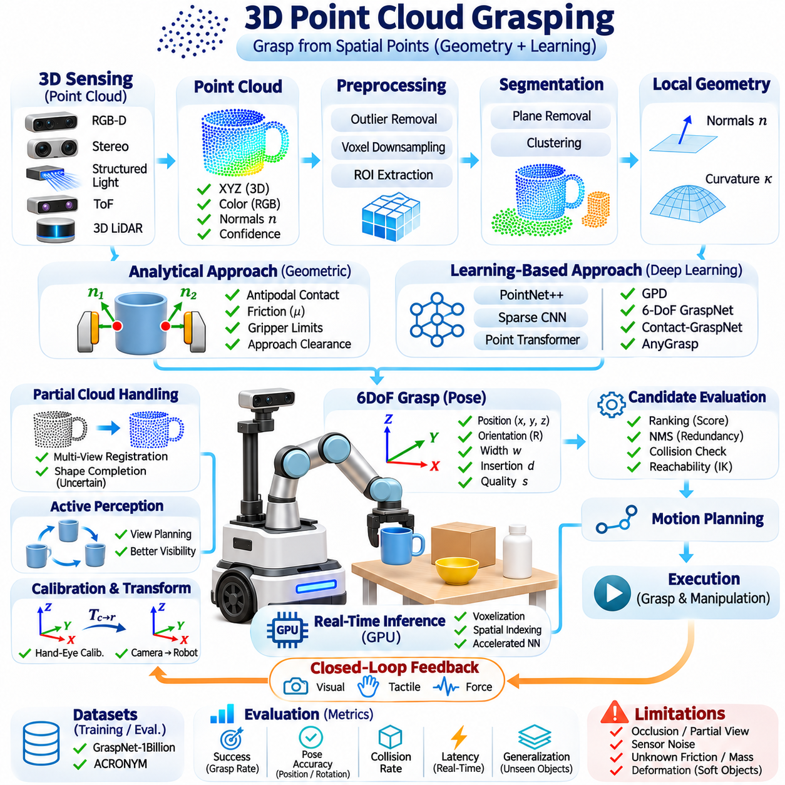
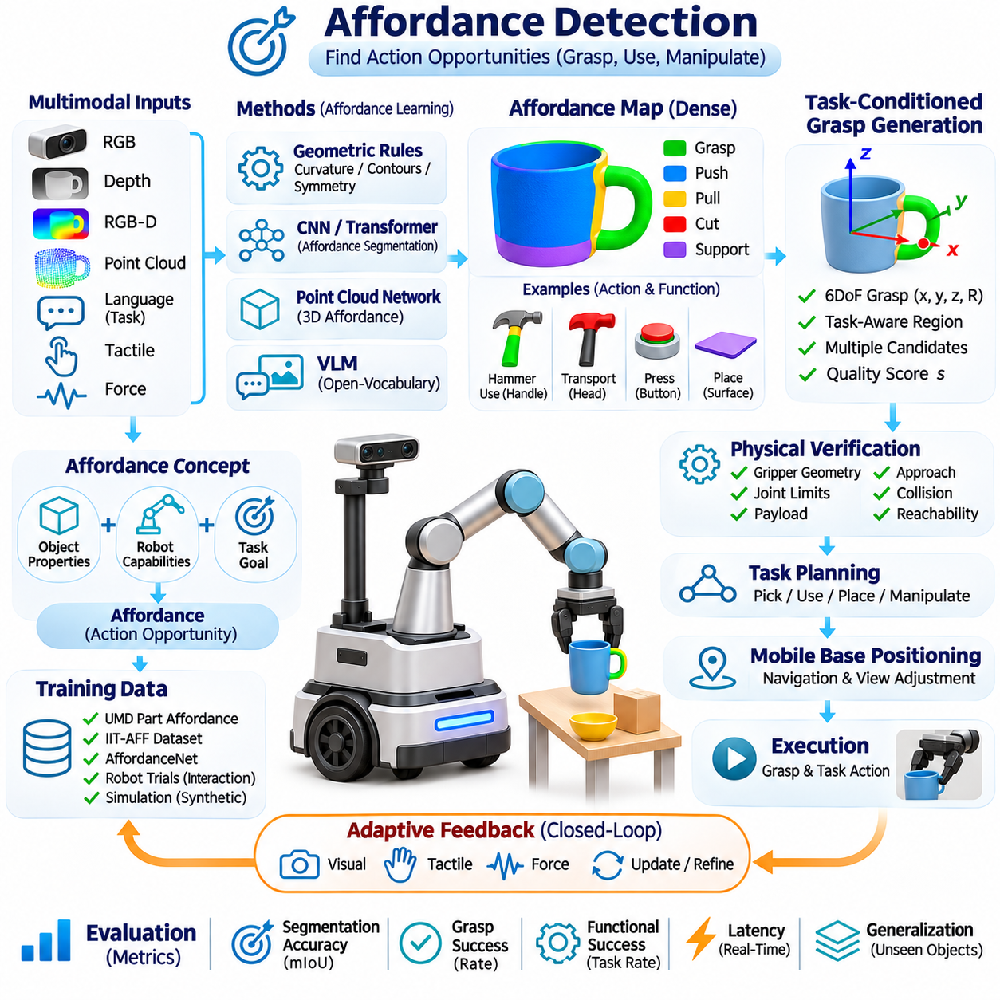
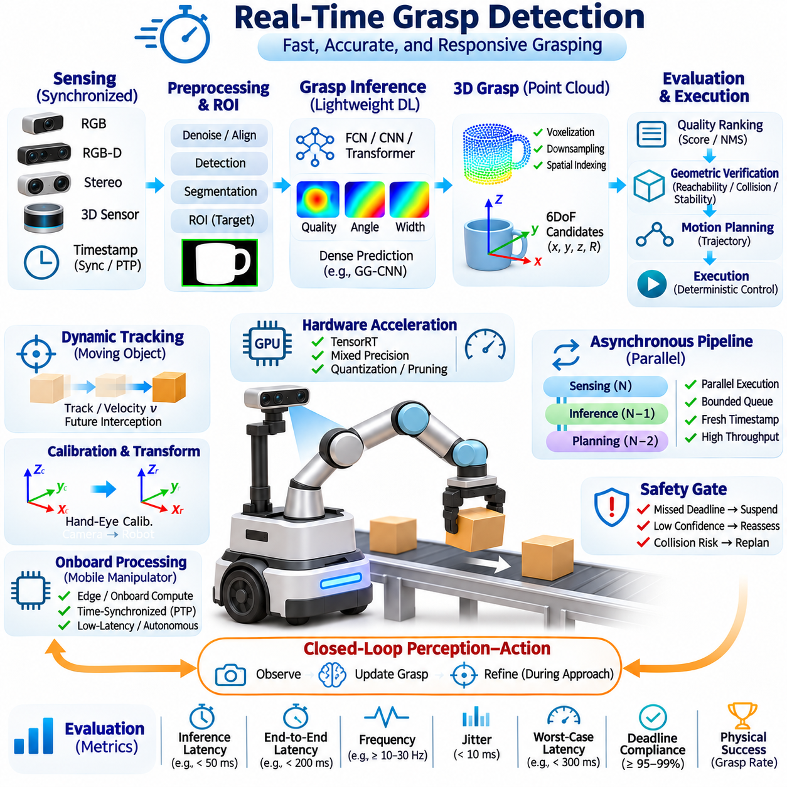
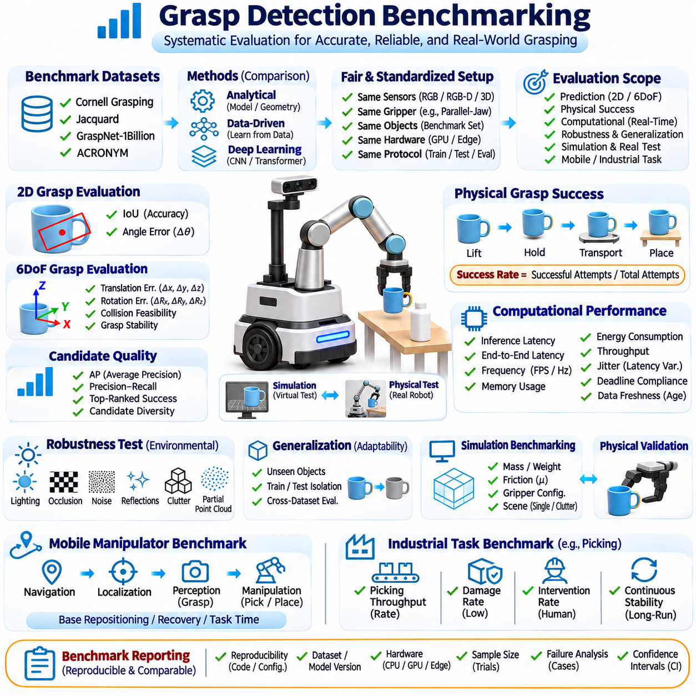

**Volume 03. Vision Manipulation and AI**


# Chapter 05. Grasp Detection

##  

## 01 Grasp Detection Overview

{width="7.268055555555556in" height="7.268055555555556in"}

Grasp detection is a fundamental capability in robotic manipulation that enables a robot to identify suitable positions and orientations for grasping physical objects. Unlike conventional object detection, which focuses on recognizing and locating objects, grasp detection determines how a robot can physically interact with them. It establishes a direct connection between visual perception and manipulation, transforming environmental observations into actionable grasp candidates.

In mobile manipulator systems, grasp detection is particularly important because robots operate in dynamic and unstructured environments. Objects may appear in different positions, orientations, and configurations, while the mobile platform continuously changes its location. The robot must interpret these variations and identify appropriate grasping opportunities without relying entirely on predefined object models, fixed coordinates, or manually programmed instructions.

A grasp is generally represented by a combination of spatial position, orientation, gripper configuration, and grasp quality. For a parallel-jaw gripper, a grasp representation may include the center position, approach direction, rotation angle, and required jaw opening. More advanced representations incorporate six degrees of freedom (6DoF), finger configurations, contact locations, and estimated grasp stability under expected external forces.

The grasp detection pipeline typically begins with environmental data acquisition using RGB cameras, depth cameras, stereo vision systems, or three-dimensional sensors. The acquired information is processed to identify objects, estimate surface geometry, and distinguish potential grasping regions. Multiple grasp candidates are then generated and evaluated according to their predicted stability, accessibility, collision risk, and compatibility with the robot\'s capabilities.

Analytical grasp detection relies on mathematical models, geometric reasoning, and physical principles to identify suitable contact positions. These methods examine surface normals, object boundaries, friction characteristics, and contact relationships to estimate grasp feasibility. Analytical approaches offer relatively high interpretability but may become computationally demanding when object geometry is complex, incomplete, or partially occluded.

Data-driven grasp detection uses previously collected observations and grasping experiences to predict suitable grasp configurations. Rather than explicitly modeling every physical interaction, these methods learn relationships between object appearance, geometric properties, and grasp outcomes. Training data can be collected through physical robot experiments, human demonstrations, synthetic simulations, or combinations of multiple acquisition strategies.

Deep learning has significantly expanded the capabilities of grasp detection by enabling automatic feature extraction from complex sensory inputs. Convolutional Neural Networks (CNNs), Transformer architectures, and point cloud neural networks can predict grasp positions, orientations, and confidence scores. These models can also generalize to previously unseen objects when trained using sufficiently diverse and representative datasets.

RGB-based grasp detection utilizes two-dimensional visual information to identify potential grasping regions from object appearance, texture, shape, and boundaries. This approach offers relatively low hardware costs and straightforward integration with conventional vision systems. However, estimating accurate three-dimensional grasp positions from RGB images alone remains challenging because depth, surface geometry, and physical dimensions are not directly measured.

RGB-D-based grasp detection combines color and depth information to improve spatial understanding and geometric accuracy. Depth measurements allow image coordinates to be transformed into three-dimensional positions using camera calibration parameters. By combining appearance features with surface geometry, robots can identify suitable grasping regions more robustly, particularly in cluttered environments where objects overlap or exhibit irregular shapes.

Three-dimensional point cloud grasp detection directly processes spatial representations of objects and surrounding environments. Point clouds provide geometric information about surface structures, object boundaries, and accessible contact regions. Grasp detection algorithms operating on these representations can generate six-dimensional grasp candidates without relying exclusively on predefined object categories or complete object models.

Affordance detection extends grasp detection by considering the functional characteristics of objects and their potential interactions. For example, a robot may identify the handle of a cup, the gripping surface of a tool, or the rim of a container. Task-oriented affordance information enables robots to select grasping regions that support subsequent manipulation objectives rather than merely maximizing the probability of successfully lifting an object.

Coordinate transformation is an essential component of practical grasp detection. Grasp candidates generated in the camera coordinate system must be transformed into the robot base or manipulator coordinate system before execution. Accurate camera calibration, hand-eye calibration, and mobile platform localization are therefore necessary. Errors in these transformations can cause grasp failures even when the underlying detection model generates accurate predictions.

Real-time grasp detection requires a balance between computational efficiency, prediction accuracy, and operational reliability. Mobile manipulators must respond to changing environmental conditions while operating within limited computational and electrical resources. Hardware acceleration, neural network optimization, efficient point cloud processing, and selective candidate generation can reduce inference latency and improve overall manipulation throughput.

Detected grasp candidates must subsequently be evaluated by grasp planning and motion planning modules. A visually promising grasp may be physically unreachable because of joint limitations, obstacles, singularities, or insufficient clearance around the target object. Integrating grasp detection with inverse kinematics, collision checking, and trajectory generation ensures that selected candidates satisfy the operational constraints of the robotic system.

Performance evaluation generally considers grasp detection accuracy, physical grasp success rate, inference latency, candidate coverage, and generalization to unfamiliar objects. Experimental validation should include variations in lighting, object materials, clutter density, sensor viewpoints, and environmental conditions. Reliable grasp detection ultimately requires consistent physical manipulation performance rather than high prediction accuracy under controlled conditions alone.

파지 검출(Grasp Detection)은 로봇이 물리적 객체를 파지하기에 적합한 위치와 방향을 식별할 수 있도록 하는 로봇 조작(Robotic Manipulation)의 핵심 기능이다. 객체를 인식하고 위치를 파악하는 데 중점을 두는 기존의 객체 검출(Object Detection)과 달리, 파지 검출은 로봇이 객체와 물리적으로 어떻게 상호작용할 수 있는지를 결정한다. 이를 통해 시각적 인식(Visual Perception)과 조작(Manipulation)을 직접 연결하고, 환경에서 관측된 정보를 실행 가능한 파지 후보(Grasp Candidate)로 변환한다.

이동형 매니퓰레이터(Mobile Manipulator) 시스템에서 파지 검출은 로봇이 동적이고 비정형화된 환경에서 작동하기 때문에 특히 중요하다. 이동 플랫폼(Mobile Platform)의 위치가 지속적으로 변화하는 동안 객체는 다양한 위치, 방향 및 배치 형태로 나타날 수 있다. 로봇은 사전에 정의된 객체 모델(Object Model), 고정 좌표(Fixed Coordinate) 또는 수동으로 프로그래밍된 명령에 전적으로 의존하지 않고 이러한 변화를 해석하고 적절한 파지 기회를 식별해야 한다.

파지(Grasp)는 일반적으로 공간적 위치(Spatial Position), 방향(Orientation), 그리퍼 구성(Gripper Configuration) 및 파지 품질(Grasp Quality)의 조합으로 표현된다. 평행형 그리퍼(Parallel-Jaw Gripper)의 경우 파지 표현(Grasp Representation)에는 중심 위치, 접근 방향, 회전 각도 및 필요한 그리퍼 개방 폭이 포함될 수 있다. 더욱 발전된 표현 방식은 6자유도(6 Degrees of Freedom, 6DoF), 손가락 구성(Finger Configuration), 접촉 위치(Contact Location) 및 예상되는 외력(External Force)에 대한 파지 안정성(Grasp Stability)의 추정치를 포함한다.

파지 검출 파이프라인(Grasp Detection Pipeline)은 일반적으로 RGB 카메라(RGB Camera), 깊이 카메라(Depth Camera), 스테레오 비전 시스템(Stereo Vision System) 또는 3차원 센서(3D Sensor)를 이용한 환경 데이터 획득으로 시작된다. 획득된 정보는 객체를 식별하고 표면 형상(Surface Geometry)을 추정하며 잠재적인 파지 영역을 구분하기 위해 처리된다. 이후 여러 파지 후보가 생성되고 예측된 안정성, 접근 가능성(Accessibility), 충돌 위험(Collision Risk) 및 로봇의 기능적 특성과의 적합성을 기준으로 평가된다.

해석적 파지 검출(Analytical Grasp Detection)은 적절한 접촉 위치를 식별하기 위해 수학적 모델(Mathematical Model), 기하학적 추론(Geometric Reasoning) 및 물리적 원리(Physical Principle)를 활용한다. 이러한 방법은 표면 법선(Surface Normal), 객체 경계(Object Boundary), 마찰 특성(Friction Characteristic) 및 접촉 관계(Contact Relationship)를 분석하여 파지 실현 가능성(Grasp Feasibility)을 추정한다. 해석적 접근 방식은 비교적 높은 해석 가능성(Interpretability)을 제공하지만, 객체 형상이 복잡하거나 불완전하거나 부분적으로 가려진 경우 높은 연산 비용이 요구될 수 있다.

데이터 기반 파지 검출(Data-Driven Grasp Detection)은 이전에 수집된 관측 데이터와 파지 경험을 활용하여 적절한 파지 구성을 예측한다. 모든 물리적 상호작용(Physical Interaction)을 명시적으로 모델링하는 대신, 이러한 방법은 객체의 외형(Appearance), 기하학적 특성(Geometric Property) 및 파지 결과(Grasp Outcome) 사이의 관계를 학습한다. 학습 데이터(Training Data)는 실제 로봇 실험, 인간 시연(Human Demonstration), 합성 시뮬레이션(Synthetic Simulation) 또는 여러 데이터 획득 전략을 조합하여 수집할 수 있다.

딥러닝(Deep Learning)은 복잡한 센서 입력(Sensory Input)으로부터 특징을 자동으로 추출할 수 있도록 함으로써 파지 검출의 기능을 크게 확장하였다. 합성곱 신경망(Convolutional Neural Network, CNN), 트랜스포머 아키텍처(Transformer Architecture) 및 점군 신경망(Point Cloud Neural Network)은 파지 위치, 방향 및 신뢰도 점수(Confidence Score)를 예측할 수 있다. 이러한 모델은 충분히 다양하고 대표성 있는 데이터셋(Dataset)을 이용하여 학습되었을 때 이전에 관측하지 못한 객체에 대해서도 일반화(Generalization)할 수 있다.

RGB 기반 파지 검출(RGB-Based Grasp Detection)은 2차원 시각 정보(2D Visual Information)를 활용하여 객체의 외형, 질감(Texture), 형태(Shape) 및 경계로부터 잠재적인 파지 영역을 식별한다. 이러한 접근 방식은 비교적 낮은 하드웨어 비용과 기존 비전 시스템(Vision System)과의 용이한 통합이라는 장점을 제공한다. 그러나 깊이(Depth), 표면 형상 및 물리적 치수(Physical Dimension)가 직접 측정되지 않기 때문에 RGB 영상만으로 정확한 3차원 파지 위치를 추정하는 것은 여전히 어려운 과제이다.

RGB-D 기반 파지 검출(RGB-D-Based Grasp Detection)은 색상 정보(Color Information)와 깊이 정보(Depth Information)를 결합하여 공간적 이해(Spatial Understanding)와 기하학적 정확도(Geometric Accuracy)를 향상시킨다. 깊이 측정값을 활용하면 카메라 보정 매개변수(Camera Calibration Parameter)를 이용하여 영상 좌표(Image Coordinate)를 3차원 위치로 변환할 수 있다. 외형 특징(Appearance Feature)과 표면 형상을 결합함으로써 객체가 서로 겹쳐 있거나 불규칙한 형태를 나타내는 복잡한 환경에서도 더욱 강건하게 적절한 파지 영역을 식별할 수 있다.

3차원 점군 기반 파지 검출(3D Point Cloud Grasp Detection)은 객체와 주변 환경의 공간적 표현(Spatial Representation)을 직접 처리한다. 점군(Point Cloud)은 표면 구조(Surface Structure), 객체 경계 및 접근 가능한 접촉 영역(Accessible Contact Region)에 대한 기하학적 정보를 제공한다. 이러한 표현을 기반으로 작동하는 파지 검출 알고리즘은 사전에 정의된 객체 범주(Object Category) 또는 완전한 객체 모델에 전적으로 의존하지 않고 6차원 파지 후보(6D Grasp Candidate)를 생성할 수 있다.

행동유도성 검출(Affordance Detection)은 객체의 기능적 특성(Functional Characteristic)과 잠재적인 상호작용을 고려함으로써 파지 검출의 개념을 확장한다. 예를 들어, 로봇은 컵의 손잡이, 도구의 파지 표면 또는 용기의 가장자리를 식별할 수 있다. 작업 지향적 행동유도성 정보(Task-Oriented Affordance Information)는 단순히 객체를 성공적으로 들어 올릴 확률을 최대화하는 것이 아니라 후속 조작 목표(Manipulation Objective)를 지원할 수 있는 파지 영역을 선택하도록 한다.

좌표 변환(Coordinate Transformation)은 실제 파지 검출 시스템의 필수 구성 요소이다. 카메라 좌표계(Camera Coordinate System)에서 생성된 파지 후보는 실행에 앞서 로봇 베이스 좌표계(Robot Base Coordinate System) 또는 매니퓰레이터 좌표계(Manipulator Coordinate System)로 변환되어야 한다. 따라서 정확한 카메라 보정(Camera Calibration), 핸드-아이 보정(Hand-Eye Calibration) 및 이동 플랫폼의 위치 추정(Localization)이 필요하다. 이러한 변환 과정에서 발생하는 오차는 파지 검출 모델이 정확한 예측 결과를 생성하더라도 파지 실패(Grasp Failure)를 유발할 수 있다.

실시간 파지 검출(Real-Time Grasp Detection)은 연산 효율성(Computational Efficiency), 예측 정확도(Prediction Accuracy) 및 운용 신뢰성(Operational Reliability) 사이의 균형을 요구한다. 이동형 매니퓰레이터는 제한된 연산 자원(Computational Resource)과 전력 자원(Electrical Resource) 내에서 작동하면서 변화하는 환경 조건에 대응해야 한다. 하드웨어 가속(Hardware Acceleration), 신경망 최적화(Neural Network Optimization), 효율적인 점군 처리(Point Cloud Processing) 및 선택적 후보 생성(Selective Candidate Generation)은 추론 지연시간(Inference Latency)을 줄이고 전체 조작 처리량(Manipulation Throughput)을 향상시킬 수 있다.

검출된 파지 후보는 후속 단계에서 파지 계획(Grasp Planning) 및 동작 계획(Motion Planning) 모듈에 의해 평가되어야 한다. 시각적으로 적합해 보이는 파지 후보라도 관절 제한(Joint Limit), 장애물(Obstacle), 특이점(Singularity) 또는 대상 객체 주변의 불충분한 여유 공간(Clearance)으로 인해 물리적으로 도달하지 못할 수 있다. 파지 검출을 역기구학(Inverse Kinematics), 충돌 검사(Collision Checking) 및 궤적 생성(Trajectory Generation)과 통합함으로써 선택된 파지 후보가 로봇 시스템의 운용 제약조건(Operational Constraint)을 충족하도록 할 수 있다.

성능 평가(Performance Evaluation)는 일반적으로 파지 검출 정확도(Grasp Detection Accuracy), 물리적 파지 성공률(Physical Grasp Success Rate), 추론 지연시간(Inference Latency), 후보 포괄성(Candidate Coverage) 및 새로운 객체에 대한 일반화 능력(Generalization Capability)을 고려한다. 실험적 검증(Experimental Validation)에는 조명, 객체 재질, 객체 혼잡도(Clutter Density), 센서 관측 시점(Sensor Viewpoint) 및 환경 조건의 변화가 포함되어야 한다. 궁극적으로 신뢰할 수 있는 파지 검출은 통제된 환경에서의 높은 예측 정확도뿐만 아니라 일관된 물리적 조작 성능(Physical Manipulation Performance)을 요구한다.

##  

## 02 Analytical Grasp Detection

{width="7.268055555555556in" height="7.268055555555556in"}

Analytical grasp detection is a model-based approach that identifies suitable robotic grasp configurations through mathematical reasoning, geometric analysis, and physical interaction principles. Unlike learning-based methods that derive grasping knowledge from training datasets, analytical methods explicitly evaluate the relationship between object geometry, contact mechanics, gripper characteristics, and environmental constraints to determine grasp feasibility.

The fundamental objective of analytical grasp detection is to identify contact positions and gripper orientations that enable stable object manipulation. A successful grasp must constrain undesirable object movement while resisting gravitational forces, inertial forces, and external disturbances. These requirements are evaluated using mathematical models that describe the mechanical relationships between the object and the contacting surfaces of the robotic gripper.

Geometric analysis provides the foundation for generating analytical grasp candidates. Object surfaces, edges, boundaries, curvature, and surface normals are extracted from depth images, three-dimensional point clouds, reconstructed meshes, or Computer-Aided Design (CAD) models. These geometric properties allow the detection algorithm to identify contact regions that are compatible with the mechanical structure and operational characteristics of the gripper.

Surface normal estimation is particularly important when detecting grasps for parallel-jaw grippers. Suitable contact regions are often located on opposing object surfaces whose normal vectors are approximately aligned with the gripper closing direction in opposite orientations. By examining the angular relationships between these vectors, the algorithm can identify contact pairs that provide favorable conditions for stable gripping and minimize undesirable sliding.

Antipodal grasp detection is a widely used analytical technique for identifying opposing contact configurations. An antipodal grasp occurs when two contact points satisfy geometric and frictional conditions that allow opposing forces to stabilize an object. The line connecting the contact points should lie within the friction cones associated with both contacts, considering the direction of the applicable contact forces and the assumed friction coefficient.

Friction modeling describes the ability of contact surfaces to resist relative movement between the gripper and the object. The Coulomb friction model is commonly used to represent the relationship between normal contact forces and allowable tangential forces. A higher friction coefficient generally expands the range of feasible contact force directions, whereas slippery materials require more careful contact selection and gripping force management.

Force closure is an important theoretical criterion for evaluating grasp stability. A grasp achieves force closure when its allowable contact forces can collectively resist arbitrary external forces and torques acting on the object, within the assumptions of the contact model. Analytical grasp detection can incorporate force closure tests to reject mechanically unstable candidates, although the validity of these tests depends on contact and friction assumptions.

Grasp wrench analysis provides a mathematical framework for representing the forces and torques generated by multiple contact points. Each contact contributes a force and an associated torque relative to an object reference frame. By examining the combined wrench space generated by allowable contact forces, analytical algorithms can estimate the ability of a grasp configuration to resist disturbances and maintain the desired object position and orientation.

Gripper geometry imposes additional constraints on analytical grasp detection. Maximum jaw opening, finger length, fingertip shape, contact surface dimensions, and mechanical interference must be considered during candidate generation. A geometrically favorable contact pair may remain unsuitable if the gripper cannot accommodate the object dimensions or if its fingers collide with surrounding structures during the approach and closing operations.

Three-dimensional point cloud processing enables analytical grasp detection without requiring complete predefined object models. Local surface patches are analyzed to estimate curvature, orientation, and potential contact relationships. Spatial filtering, neighborhood searches, and surface segmentation reduce computational complexity while improving candidate generation. However, incomplete observations and sensor noise can introduce uncertainty into estimated contact geometry.

Collision checking is necessary to eliminate grasp candidates that interfere with surrounding objects, supporting surfaces, or environmental structures. The volumetric geometry of the gripper must be evaluated at the target grasp configuration and along relevant approach paths. Integrating collision checking with geometric grasp analysis is particularly important in cluttered environments, where mechanically stable contact configurations may not be physically accessible.

Grasp candidate ranking combines multiple analytical criteria to identify configurations suitable for execution. Common evaluation factors include contact alignment, frictional stability, disturbance resistance, gripper clearance, and estimated accessibility. Weighted scoring functions can prioritize different characteristics according to application requirements, allowing the detection algorithm to distinguish mechanically robust candidates from less reliable alternatives.

In mobile manipulator systems, analytical grasp detection must also consider uncertainty introduced by mobile platform positioning and sensor calibration. Grasp candidates are transformed from sensor coordinates into the manipulator reference frame using calibrated spatial transformations. Reachability analysis and inverse kinematics subsequently determine whether the robot arm can achieve the detected grasp configuration from its current operating position.

Industrial applications of analytical grasp detection include machine tending, component handling, warehouse picking, assembly operations, and automated material transportation. Its deterministic geometric and mechanical evaluation provides useful interpretability when handling objects with known dimensions and material characteristics. Nevertheless, deformable objects, reflective surfaces, unknown friction properties, and severe occlusion remain significant challenges.

Modern robotic manipulation systems increasingly combine analytical grasp detection with data-driven and deep learning approaches. Learning-based models can generate promising grasp candidates from complex sensory observations, while analytical methods verify geometric compatibility, physical stability, and collision constraints. This hybrid architecture combines the adaptability of artificial intelligence with the interpretability of explicit physical reasoning, supporting more reliable autonomous manipulation.

해석적 파지 검출(Analytical Grasp Detection)은 수학적 추론(Mathematical Reasoning), 기하학적 분석(Geometric Analysis) 및 물리적 상호작용 원리(Physical Interaction Principle)를 통해 적절한 로봇 파지 구성을 식별하는 모델 기반 접근 방식(Model-Based Approach)이다. 학습 데이터셋(Training Dataset)으로부터 파지 지식을 획득하는 학습 기반 방법(Learning-Based Method)과 달리, 해석적 방법은 객체 형상(Object Geometry), 접촉 역학(Contact Mechanics), 그리퍼 특성(Gripper Characteristic) 및 환경적 제약조건(Environmental Constraint) 사이의 관계를 명시적으로 평가하여 파지 실현 가능성(Grasp Feasibility)을 결정한다.

해석적 파지 검출의 근본적인 목적은 안정적인 객체 조작(Object Manipulation)을 가능하게 하는 접촉 위치(Contact Position)와 그리퍼 방향(Gripper Orientation)을 식별하는 것이다. 성공적인 파지는 중력(Gravity Force), 관성력(Inertial Force) 및 외부 외란(External Disturbance)에 저항하면서 의도하지 않은 객체의 움직임을 제한할 수 있어야 한다. 이러한 요구사항은 객체와 로봇 그리퍼의 접촉 표면(Contact Surface) 사이의 기계적 관계(Mechanical Relationship)를 설명하는 수학적 모델(Mathematical Model)을 통해 평가된다.

기하학적 분석(Geometric Analysis)은 해석적 파지 후보(Analytical Grasp Candidate)를 생성하기 위한 기반을 제공한다. 객체 표면(Object Surface), 모서리(Edge), 경계(Boundary), 곡률(Curvature) 및 표면 법선(Surface Normal)은 깊이 영상(Depth Image), 3차원 점군(3D Point Cloud), 재구성된 메시(Reconstructed Mesh) 또는 컴퓨터 지원 설계(Computer-Aided Design, CAD) 모델로부터 추출된다. 이러한 기하학적 특성(Geometric Property)을 통해 검출 알고리즘은 그리퍼의 기계적 구조(Mechanical Structure)와 운용 특성(Operational Characteristic)에 적합한 접촉 영역(Contact Region)을 식별할 수 있다.

표면 법선 추정(Surface Normal Estimation)은 평행형 그리퍼(Parallel-Jaw Gripper)의 파지를 검출할 때 특히 중요하다. 적절한 접촉 영역은 일반적으로 서로 마주 보는 객체 표면에 위치하며, 각 표면의 법선 벡터(Normal Vector)는 그리퍼의 폐쇄 방향(Gripper Closing Direction)과 거의 평행하면서 서로 반대 방향을 향한다. 이러한 벡터 사이의 각도 관계(Angular Relationship)를 분석함으로써 알고리즘은 안정적인 파지에 유리한 조건을 제공하고 의도하지 않은 미끄러짐(Sliding)을 최소화할 수 있는 접촉점 쌍(Contact Pair)을 식별할 수 있다.

대향점 파지 검출(Antipodal Grasp Detection)은 서로 마주 보는 접촉 구성을 식별하기 위해 널리 사용되는 해석적 기법이다. 대향점 파지(Antipodal Grasp)는 두 접촉점(Contact Point)이 서로 반대 방향으로 작용하는 힘을 통해 객체를 안정화할 수 있는 기하학적 조건(Geometric Condition)과 마찰 조건(Frictional Condition)을 충족할 때 형성된다. 두 접촉점을 연결하는 직선은 적용 가능한 접촉력(Contact Force)의 방향과 가정된 마찰계수(Friction Coefficient)를 고려하여 두 접촉점에 해당하는 마찰 원뿔(Friction Cone) 내부에 위치해야 한다.

마찰 모델링(Friction Modeling)은 그리퍼와 객체 사이의 상대 운동(Relative Motion)에 저항하는 접촉 표면의 능력을 설명한다. 쿨롱 마찰 모델(Coulomb Friction Model)은 일반적으로 법선 접촉력(Normal Contact Force)과 허용 가능한 접선 방향 힘(Tangential Force) 사이의 관계를 표현하는 데 사용된다. 높은 마찰계수는 일반적으로 실현 가능한 접촉력 방향의 범위를 확장하는 반면, 미끄러운 재질(Slippery Material)은 더욱 신중한 접촉점 선택(Contact Selection)과 파지력 관리(Gripping Force Management)를 요구한다.

힘 폐쇄(Force Closure)는 파지 안정성(Grasp Stability)을 평가하기 위한 중요한 이론적 기준이다. 접촉 모델(Contact Model)의 가정 범위 내에서 허용 가능한 접촉력의 조합이 객체에 작용하는 임의의 외력(External Force)과 외부 토크(External Torque)에 저항할 수 있을 때 해당 파지는 힘 폐쇄를 달성한 것으로 판단한다. 해석적 파지 검출은 기계적으로 불안정한 후보를 제거하기 위해 힘 폐쇄 검사(Force Closure Test)를 통합할 수 있지만, 이러한 검사의 유효성은 접촉 및 마찰에 대한 가정에 따라 달라진다.

파지 렌치 분석(Grasp Wrench Analysis)은 여러 접촉점에서 생성되는 힘(Force)과 토크(Torque)를 표현하기 위한 수학적 프레임워크(Mathematical Framework)를 제공한다. 각 접촉점은 객체 기준 좌표계(Object Reference Frame)에 대한 힘과 이에 대응하는 토크를 생성한다. 허용 가능한 접촉력에 의해 형성되는 결합 렌치 공간(Combined Wrench Space)을 분석함으로써 해석적 알고리즘은 파지 구성이 외란에 저항하고 목표 객체 위치(Object Position)와 방향(Object Orientation)을 유지할 수 있는 능력을 추정할 수 있다.

그리퍼 형상(Gripper Geometry)은 해석적 파지 검출에 추가적인 제약조건을 부여한다. 최대 그리퍼 개방 폭(Maximum Jaw Opening), 손가락 길이(Finger Length), 손가락 끝 형상(Fingertip Shape), 접촉 표면의 치수(Contact Surface Dimension) 및 기계적 간섭(Mechanical Interference)은 후보 생성(Candidate Generation) 과정에서 고려되어야 한다. 기하학적으로 적합한 접촉점 쌍이라도 그리퍼가 객체의 치수를 수용할 수 없거나 접근 및 폐쇄 동작 중에 손가락이 주변 구조물과 충돌하는 경우 부적합한 파지 후보가 될 수 있다.

3차원 점군 처리(3D Point Cloud Processing)는 사전에 정의된 완전한 객체 모델 없이도 해석적 파지 검출을 가능하게 한다. 국부 표면 패치(Local Surface Patch)를 분석하여 곡률, 방향 및 잠재적인 접촉 관계(Contact Relationship)를 추정한다. 공간 필터링(Spatial Filtering), 이웃점 탐색(Neighborhood Search) 및 표면 분할(Surface Segmentation)은 후보 생성 성능을 향상시키면서 연산 복잡도(Computational Complexity)를 감소시킨다. 그러나 불완전한 관측 정보(Incomplete Observation)와 센서 잡음(Sensor Noise)은 추정된 접촉 형상(Contact Geometry)에 불확실성(Uncertainty)을 유발할 수 있다.

충돌 검사(Collision Checking)는 주변 객체, 지지 표면(Supporting Surface) 또는 환경 구조물(Environmental Structure)과 간섭을 일으키는 파지 후보를 제거하기 위해 필요하다. 그리퍼의 체적 형상(Volumetric Geometry)은 목표 파지 구성(Target Grasp Configuration)뿐만 아니라 관련 접근 경로(Approach Path)를 따라 평가되어야 한다. 충돌 검사와 기하학적 파지 분석(Geometric Grasp Analysis)의 통합은 기계적으로 안정적인 접촉 구성이라도 물리적으로 접근하지 못할 수 있는 복잡한 환경(Cluttered Environment)에서 특히 중요하다.

파지 후보 순위 결정(Grasp Candidate Ranking)은 실행에 적합한 파지 구성을 식별하기 위해 여러 해석적 평가 기준(Analytical Criterion)을 결합한다. 일반적인 평가 요소에는 접촉 정렬(Contact Alignment), 마찰 안정성(Frictional Stability), 외란 저항성(Disturbance Resistance), 그리퍼 여유 공간(Gripper Clearance) 및 추정된 접근 가능성(Accessibility)이 포함된다. 가중치 기반 점수 함수(Weighted Scoring Function)는 응용 분야의 요구사항에 따라 서로 다른 특성에 우선순위를 부여함으로써 검출 알고리즘이 기계적으로 강건한 후보와 상대적으로 신뢰성이 낮은 후보를 구분할 수 있도록 한다.

이동형 매니퓰레이터(Mobile Manipulator) 시스템에서 해석적 파지 검출은 이동 플랫폼의 위치 결정(Mobile Platform Positioning)과 센서 보정(Sensor Calibration) 과정에서 발생하는 불확실성도 고려해야 한다. 파지 후보는 보정된 공간 변환(Calibrated Spatial Transformation)을 이용하여 센서 좌표계(Sensor Coordinate System)에서 매니퓰레이터 기준 좌표계(Manipulator Reference Frame)로 변환된다. 이후 도달 가능성 분석(Reachability Analysis)과 역기구학(Inverse Kinematics)을 통해 로봇 팔이 현재 운용 위치에서 검출된 파지 구성에 도달할 수 있는지를 결정한다.

해석적 파지 검출의 산업적 응용 분야(Industrial Application)에는 공작기계 자동화(Machine Tending), 부품 취급(Component Handling), 창고 피킹(Warehouse Picking), 조립 작업(Assembly Operation) 및 자동화된 자재 운송(Automated Material Transportation)이 포함된다. 결정론적 기하학 및 기계적 평가(Deterministic Geometric and Mechanical Evaluation)는 치수와 재질 특성(Material Characteristic)이 알려진 객체를 취급할 때 유용한 해석 가능성(Interpretability)을 제공한다. 그럼에도 불구하고 변형 가능한 객체(Deformable Object), 반사 표면(Reflective Surface), 알려지지 않은 마찰 특성 및 심각한 가림 현상(Severe Occlusion)은 여전히 중요한 해결 과제로 남아 있다.

현대의 로봇 조작 시스템(Robotic Manipulation System)은 해석적 파지 검출과 데이터 기반 접근 방식(Data-Driven Approach) 및 딥러닝(Deep Learning) 접근 방식을 점차 결합하고 있다. 학습 기반 모델(Learning-Based Model)은 복잡한 센서 관측 정보로부터 유망한 파지 후보를 생성할 수 있으며, 해석적 방법은 기하학적 적합성(Geometric Compatibility), 물리적 안정성(Physical Stability) 및 충돌 제약조건(Collision Constraint)을 검증한다. 이러한 하이브리드 아키텍처(Hybrid Architecture)는 인공지능(Artificial Intelligence)의 적응성(Adaptability)과 명시적 물리 추론(Explicit Physical Reasoning)의 해석 가능성을 결합하여 더욱 신뢰성 높은 자율 조작(Autonomous Manipulation)을 지원한다.

##  

## 03 Data Driven Grasp Detection

{width="7.268055555555556in" height="7.268055555555556in"}

Data-driven grasp detection is an approach to robotic manipulation that identifies suitable grasp configurations by learning from previously collected observations, experimental results, and interaction experiences. Unlike analytical grasp detection, which relies primarily on explicit geometric and mechanical models, data-driven methods discover relationships between sensory information, grasp configurations, and successful manipulation outcomes through statistical learning.

The fundamental principle of data-driven grasp detection is that successful grasping strategies can be learned from representative examples. By observing numerous interactions between robotic grippers and physical objects, a detection system can identify patterns associated with stable and reliable grasps. These learned relationships allow robots to estimate grasp feasibility even when complete object geometry, material properties, and contact characteristics are unavailable.

Data acquisition is a critical component of developing data-driven grasp detection systems. Training datasets may contain RGB images, depth images, three-dimensional point clouds, gripper configurations, contact positions, and recorded manipulation outcomes. Each observation provides information about the relationship between environmental conditions, physical object characteristics, executed grasp actions, and the resulting success or failure of the manipulation attempt.

Physical robotic experiments provide valuable training data because they capture actual interactions between grippers and objects. During automated data collection, a robot repeatedly executes grasp attempts using different positions, orientations, and gripping parameters. Sensors and monitoring systems record whether each attempt results in successful lifting, stable holding, object displacement, slippage, or complete failure, creating examples for subsequent learning.

Simulation-based data generation provides an alternative to expensive and time-consuming physical experiments. Virtual environments allow robots to perform large numbers of grasp attempts involving diverse object geometries, material properties, friction coefficients, and environmental configurations. Physics engines calculate interaction outcomes, enabling the generation of extensive labeled datasets while reducing hardware wear and operational costs.

Human demonstrations provide another source of data-driven grasping knowledge. Human operators can demonstrate suitable grasp positions, approach directions, and object handling strategies through teleoperation, motion capture, or interactive teaching interfaces. These demonstrations are particularly valuable for task-oriented manipulation, where grasp selection must consider an object\'s intended use and subsequent manipulation requirements rather than lifting success alone.

Grasp representation determines how collected manipulation experiences are organized and interpreted by learning algorithms. Common representations include two-dimensional grasp rectangles, three-dimensional contact points, six-degree-of-freedom grasp poses, gripper opening widths, and grasp quality scores. The selected representation must adequately describe feasible manipulation actions while remaining compatible with the robotic gripper and available sensory information.

Feature extraction enables data-driven algorithms to identify relevant characteristics associated with successful grasping. Traditional approaches manually define features describing object boundaries, surface curvature, depth discontinuities, texture patterns, and local geometric structures. Statistical learning algorithms then evaluate relationships between these features and recorded grasping outcomes to estimate the suitability of previously unobserved grasp configurations.

Supervised learning is a widely used method for developing data-driven grasp detection models. Training examples contain sensory observations and corresponding grasp annotations or success labels. Classification models estimate whether a candidate grasp is likely to succeed, whereas regression models predict continuous grasp parameters or quality scores. Both approaches support the systematic evaluation and ranking of potential manipulation actions.

Self-supervised learning reduces dependence on manually annotated grasp datasets by allowing robots to generate training labels through physical interaction. A robot can execute grasp attempts and automatically evaluate their outcomes using gripper sensors, force measurements, camera observations, or object displacement detection. This process enables continuous accumulation of manipulation experience and incremental improvement of grasp prediction capabilities.

Generalization is a central objective of data-driven grasp detection because robotic systems frequently encounter objects that were not included in their training datasets. Effective models must learn transferable relationships between object characteristics and successful grasp configurations rather than memorizing specific examples. Dataset diversity, representative sampling, and carefully designed validation procedures are essential for achieving reliable generalization.

Data augmentation improves model robustness by introducing controlled variations into existing training examples. Image rotation, translation, illumination adjustment, depth noise injection, point cloud perturbation, and simulated occlusion can expose learning algorithms to different environmental conditions. Geometric transformations must preserve the correspondence between sensory observations and grasp annotations to maintain physically meaningful training samples.

Grasp candidate evaluation in data-driven systems commonly involves predicting the probability or quality of successful execution. Multiple candidates are generated from environmental observations and ranked according to learned performance estimates. Additional geometric constraints, collision checking, and reachability analysis can be applied to eliminate candidates that appear statistically promising but remain physically inaccessible or mechanically unsuitable.

In mobile manipulator systems, data-driven grasp detection must accommodate changing camera viewpoints, mobile platform positioning errors, environmental variability, and limited onboard computational resources. Detection models should therefore be trained and evaluated under conditions representative of actual deployment environments. Integration with robot localization, coordinate transformation, and motion planning remains essential for reliable execution.

The effectiveness of data-driven grasp detection depends strongly on dataset quality, prediction reliability, computational efficiency, and adaptability to unfamiliar environments. Performance evaluation should distinguish between prediction accuracy and actual physical grasp success. Combining empirical learning with analytical verification can reduce the influence of dataset bias and uncertain predictions, providing a practical foundation for scalable autonomous manipulation.

데이터 기반 파지 검출(Data-Driven Grasp Detection)은 이전에 수집된 관측 정보(Observation), 실험 결과(Experimental Result) 및 상호작용 경험(Interaction Experience)으로부터 학습하여 적절한 파지 구성(Grasp Configuration)을 식별하는 로봇 조작(Robotic Manipulation) 접근 방식이다. 명시적인 기하학적 모델(Geometric Model)과 기계적 모델(Mechanical Model)에 주로 의존하는 해석적 파지 검출(Analytical Grasp Detection)과 달리, 데이터 기반 방법은 통계적 학습(Statistical Learning)을 통해 센서 정보, 파지 구성 및 성공적인 조작 결과 사이의 관계를 발견한다.

데이터 기반 파지 검출의 근본적인 원리는 성공적인 파지 전략(Grasp Strategy)을 대표적인 사례(Representative Example)로부터 학습할 수 있다는 것이다. 로봇 그리퍼(Robotic Gripper)와 물리적 객체(Physical Object) 사이의 수많은 상호작용을 관찰함으로써 검출 시스템은 안정적이고 신뢰성 높은 파지와 관련된 패턴(Pattern)을 식별할 수 있다. 이러한 학습된 관계(Learned Relationship)를 통해 로봇은 완전한 객체 형상(Object Geometry), 재질 특성(Material Property) 및 접촉 특성(Contact Characteristic)에 대한 정보가 없는 경우에도 파지 실현 가능성(Grasp Feasibility)을 추정할 수 있다.

데이터 획득(Data Acquisition)은 데이터 기반 파지 검출 시스템 개발의 핵심 구성 요소이다. 학습 데이터셋(Training Dataset)에는 RGB 영상(RGB Image), 깊이 영상(Depth Image), 3차원 점군(3D Point Cloud), 그리퍼 구성(Gripper Configuration), 접촉 위치(Contact Position) 및 기록된 조작 결과(Manipulation Outcome)가 포함될 수 있다. 각각의 관측 정보는 환경 조건(Environmental Condition), 물리적 객체 특성, 실행된 파지 행동(Grasp Action) 및 해당 조작 시도의 성공 또는 실패 사이의 관계에 대한 정보를 제공한다.

실제 로봇 실험(Physical Robotic Experiment)은 그리퍼와 객체 사이의 실제 상호작용을 포착하기 때문에 가치 있는 학습 데이터(Training Data)를 제공한다. 자동화된 데이터 수집(Automated Data Collection) 과정에서 로봇은 다양한 위치, 방향 및 파지 매개변수(Grasping Parameter)를 이용하여 파지 시도(Grasp Attempt)를 반복적으로 실행한다. 센서와 모니터링 시스템(Monitoring System)은 각각의 시도가 성공적인 들어 올리기(Successful Lifting), 안정적인 유지(Stable Holding), 객체 변위(Object Displacement), 미끄러짐(Slippage) 또는 완전한 실패(Complete Failure)로 이어지는지 기록하여 후속 학습에 필요한 사례를 생성한다.

시뮬레이션 기반 데이터 생성(Simulation-Based Data Generation)은 높은 비용과 많은 시간이 소요되는 실제 실험의 대안을 제공한다. 가상 환경(Virtual Environment)에서는 로봇이 다양한 객체 형상, 재질 특성, 마찰계수(Friction Coefficient) 및 환경 구성(Environmental Configuration)을 대상으로 대규모 파지 시도를 수행할 수 있다. 물리 엔진(Physics Engine)은 상호작용 결과를 계산하여 하드웨어 마모(Hardware Wear)와 운용 비용(Operational Cost)을 줄이면서 대규모 레이블링 데이터셋(Labeled Dataset)을 생성할 수 있도록 한다.

인간 시연(Human Demonstration)은 데이터 기반 파지 지식(Grasping Knowledge)을 획득하기 위한 또 다른 데이터 소스(Data Source)를 제공한다. 인간 작업자(Human Operator)는 원격 조작(Teleoperation), 모션 캡처(Motion Capture) 또는 대화형 교시 인터페이스(Interactive Teaching Interface)를 통해 적절한 파지 위치, 접근 방향(Approach Direction) 및 객체 취급 전략(Object Handling Strategy)을 시연할 수 있다. 이러한 시연은 단순히 객체를 들어 올리는 성공 여부뿐만 아니라 객체의 의도된 용도와 후속 조작 요구사항을 고려하여 파지를 선택해야 하는 작업 지향적 조작(Task-Oriented Manipulation)에서 특히 중요하다.

파지 표현(Grasp Representation)은 수집된 조작 경험(Manipulation Experience)이 학습 알고리즘(Learning Algorithm)에 의해 어떻게 구성되고 해석되는지를 결정한다. 일반적인 표현 방식에는 2차원 파지 사각형(2D Grasp Rectangle), 3차원 접촉점(3D Contact Point), 6자유도 파지 자세(6DoF Grasp Pose), 그리퍼 개방 폭(Gripper Opening Width) 및 파지 품질 점수(Grasp Quality Score)가 포함된다. 선택된 표현 방식은 로봇 그리퍼 및 활용 가능한 센서 정보와 호환성을 유지하면서 실현 가능한 조작 행동(Manipulation Action)을 충분히 표현할 수 있어야 한다.

특징 추출(Feature Extraction)은 데이터 기반 알고리즘(Data-Driven Algorithm)이 성공적인 파지와 관련된 주요 특성을 식별할 수 있도록 한다. 전통적인 접근 방식은 객체 경계(Object Boundary), 표면 곡률(Surface Curvature), 깊이 불연속성(Depth Discontinuity), 질감 패턴(Texture Pattern) 및 국부 기하학적 구조(Local Geometric Structure)를 설명하는 특징을 수동으로 정의한다. 이후 통계적 학습 알고리즘(Statistical Learning Algorithm)은 이러한 특징과 기록된 파지 결과 사이의 관계를 평가하여 이전에 관측하지 못한 파지 구성의 적합성(Suitability)을 추정한다.

지도학습(Supervised Learning)은 데이터 기반 파지 검출 모델(Grasp Detection Model)을 개발하기 위해 널리 사용되는 방법이다. 학습 사례(Training Example)는 센서 관측 정보와 이에 대응하는 파지 주석(Grasp Annotation) 또는 성공 레이블(Success Label)을 포함한다. 분류 모델(Classification Model)은 특정 파지 후보가 성공할 가능성을 추정하는 반면, 회귀 모델(Regression Model)은 연속적인 파지 매개변수(Continuous Grasp Parameter) 또는 품질 점수(Quality Score)를 예측한다. 두 접근 방식 모두 잠재적인 조작 행동에 대한 체계적인 평가(Systematic Evaluation)와 순위 결정(Ranking)을 지원한다.

자기지도학습(Self-Supervised Learning)은 로봇이 물리적 상호작용을 통해 학습 레이블(Training Label)을 직접 생성하도록 함으로써 수동으로 주석이 지정된 파지 데이터셋(Manually Annotated Grasp Dataset)에 대한 의존성을 감소시킨다. 로봇은 파지 시도를 실행하고 그리퍼 센서(Gripper Sensor), 힘 측정(Force Measurement), 카메라 관측(Camera Observation) 또는 객체 변위 검출(Object Displacement Detection)을 이용하여 그 결과를 자동으로 평가할 수 있다. 이러한 과정은 조작 경험의 지속적인 축적(Continuous Accumulation)과 파지 예측 능력(Grasp Prediction Capability)의 점진적인 향상(Incremental Improvement)을 가능하게 한다.

일반화(Generalization)는 로봇 시스템이 학습 데이터셋에 포함되지 않은 객체를 빈번하게 접하기 때문에 데이터 기반 파지 검출의 핵심 목표이다. 효과적인 모델은 특정 사례를 단순히 암기(Memorization)하는 대신 객체 특성과 성공적인 파지 구성 사이의 전이 가능한 관계(Transferable Relationship)를 학습해야 한다. 데이터셋 다양성(Dataset Diversity), 대표성 있는 샘플링(Representative Sampling) 및 신중하게 설계된 검증 절차(Validation Procedure)는 신뢰성 높은 일반화 성능(Generalization Performance)을 확보하기 위해 필수적이다.

데이터 증강(Data Augmentation)은 기존 학습 사례에 통제된 변화를 적용하여 모델의 강건성(Model Robustness)을 향상시킨다. 영상 회전(Image Rotation), 영상 이동(Image Translation), 조명 조정(Illumination Adjustment), 깊이 잡음 주입(Depth Noise Injection), 점군 교란(Point Cloud Perturbation) 및 모의 가림 현상(Simulated Occlusion)은 학습 알고리즘이 다양한 환경 조건을 경험할 수 있도록 한다. 물리적으로 의미 있는 학습 샘플(Training Sample)을 유지하기 위해 기하학적 변환(Geometric Transformation)은 센서 관측 정보와 파지 주석 사이의 대응 관계(Correspondence)를 보존해야 한다.

데이터 기반 시스템에서의 파지 후보 평가(Grasp Candidate Evaluation)는 일반적으로 성공적인 실행의 확률(Probability) 또는 품질(Quality)을 예측하는 과정으로 구성된다. 환경 관측 정보(Environmental Observation)로부터 여러 파지 후보(Grasp Candidate)가 생성되며, 학습된 성능 추정치(Learned Performance Estimate)에 따라 순위가 결정된다. 통계적으로 유망해 보이지만 물리적으로 접근할 수 없거나 기계적으로 부적합한 후보를 제거하기 위해 추가적인 기하학적 제약조건(Geometric Constraint), 충돌 검사(Collision Checking) 및 도달 가능성 분석(Reachability Analysis)을 적용할 수 있다.

이동형 매니퓰레이터(Mobile Manipulator) 시스템에서 데이터 기반 파지 검출은 변화하는 카메라 관측 시점(Camera Viewpoint), 이동 플랫폼 위치 결정 오차(Mobile Platform Positioning Error), 환경 변동성(Environmental Variability) 및 제한된 온보드 연산 자원(Onboard Computational Resource)을 고려해야 한다. 따라서 검출 모델은 실제 배치 환경(Deployment Environment)을 대표하는 조건에서 학습되고 평가되어야 한다. 신뢰성 높은 실행을 위해서는 로봇 위치 추정(Robot Localization), 좌표 변환(Coordinate Transformation) 및 동작 계획(Motion Planning)과의 통합이 필수적이다.

데이터 기반 파지 검출의 효과성(Effectiveness)은 데이터셋 품질(Dataset Quality), 예측 신뢰성(Prediction Reliability), 연산 효율성(Computational Efficiency) 및 익숙하지 않은 환경에 대한 적응성(Adaptability)에 크게 의존한다. 성능 평가(Performance Evaluation)는 예측 정확도(Prediction Accuracy)와 실제 물리적 파지 성공(Physical Grasp Success)을 구분하여 수행되어야 한다. 경험적 학습(Empirical Learning)과 해석적 검증(Analytical Verification)을 결합하면 데이터셋 편향(Dataset Bias)과 불확실한 예측(Uncertain Prediction)의 영향을 감소시킬 수 있으며, 확장 가능한 자율 조작(Scalable Autonomous Manipulation)을 위한 실용적인 기반을 제공할 수 있다.

##  

## 04 Deep Learning Grasp Detection

{width="7.268055555555556in" height="7.268055555555556in"}

Deep learning-based grasp detection is an advanced approach to robotic manipulation that utilizes neural networks to identify feasible grasp configurations directly from sensory observations. Unlike conventional analytical methods that depend on explicitly defined geometric and physical models, deep learning enables robots to automatically extract relevant features and predict grasping opportunities in complex and unstructured environments.

The fundamental objective of deep learning-based grasp detection is to establish a mapping between sensory inputs and executable grasp representations. Neural networks process RGB images, depth images, RGB-D observations, or three-dimensional point clouds to predict grasp positions, orientations, gripper opening widths, and quality scores. These predictions provide the perception foundation for autonomous robotic manipulation.

Convolutional Neural Networks (CNNs) are widely used in grasp detection because of their ability to extract hierarchical spatial features from visual observations. Early network layers identify basic characteristics such as edges, textures, and boundaries, while deeper layers capture complex geometric structures and object relationships. These learned representations enable the detection of promising grasping regions without manually designed features.

Two-dimensional grasp detection commonly represents a grasp configuration using an oriented rectangular region within an image. This representation includes the grasp center, rotation angle, gripper opening width, and an associated confidence score. Neural networks can directly regress these parameters or generate multiple candidate rectangles, allowing robots to identify suitable planar grasp configurations from visual observations.

Pixel-wise grasp detection generates dense predictions across an input image rather than evaluating only a limited number of predefined candidates. Each pixel may be associated with a grasp quality score, orientation, and gripper opening width. Fully convolutional architectures support efficient generation of these grasp maps, making them particularly useful for real-time manipulation and closed-loop visual feedback applications.

Six-degree-of-freedom grasp detection extends conventional planar grasp representations by estimating complete three-dimensional gripper positions and orientations. This capability allows robots to approach objects from different directions rather than being restricted to top-down grasping. Deep neural networks operating on spatial observations can generate diverse grasp candidates in cluttered and geometrically complex environments.

Point cloud neural networks directly process three-dimensional spatial information acquired from depth cameras, stereo vision systems, or other 3D sensors. Architectures such as PointNet, PointNet++, and sparse convolutional networks extract geometric features from irregularly distributed spatial points. These features support grasp candidate generation based on local surface structures, contact regions, and surrounding obstacles.

Transformer-based grasp detection introduces attention mechanisms to capture relationships between spatial regions, object features, and potential grasp configurations. Self-attention enables neural networks to integrate information from both local and distant observations. This capability is particularly valuable when objects are partially occluded, surrounded by clutter, or characterized by complex geometric relationships.

Multimodal deep learning combines complementary sensory information to improve grasp prediction reliability. RGB observations provide appearance, texture, and semantic information, while depth measurements and point clouds describe spatial geometry. Feature fusion architectures integrate these representations at different network stages, enabling more comprehensive environmental understanding and robust grasp candidate generation.

Training deep learning-based grasp detection models requires datasets containing diverse objects, sensor observations, grasp configurations, and corresponding quality annotations. Datasets such as the Cornell Grasping Dataset, Jacquard, Dex-Net, and GraspNet-1Billion provide resources for different grasp representations and evaluation methods. Dataset selection should reflect the intended gripper configuration and deployment environment.

Loss functions guide neural network optimization by measuring differences between predicted grasp parameters and reference annotations. Depending on the grasp representation, training objectives may include position regression, orientation estimation, gripper width prediction, grasp classification, and quality score estimation. Multi-task learning combines these objectives to improve consistency across different aspects of grasp prediction.

Synthetic training data and domain randomization can improve generalization by exposing neural networks to diverse object geometries, textures, lighting conditions, camera viewpoints, and physical properties. Simulation-to-real transfer techniques reduce discrepancies between virtual training environments and physical robotic systems. Nevertheless, experimental fine-tuning and physical validation remain necessary to address residual domain differences.

Real-time deployment requires deep learning models to achieve sufficient prediction accuracy within operational latency and computational constraints. Lightweight network architectures, model pruning, quantization, and accelerated inference frameworks reduce processing requirements. Embedded GPU platforms enable mobile manipulators to execute grasp detection locally without continuously depending on remote computing infrastructure.

Deep learning predictions must be integrated with geometric verification, collision checking, inverse kinematics, and motion planning before physical execution. A high-confidence grasp candidate does not necessarily guarantee mechanical stability, collision-free accessibility, or successful manipulation. Closed-loop feedback from visual, tactile, and force sensors can support grasp refinement, execution monitoring, and recovery from unsuccessful attempts.

Performance evaluation should consider grasp detection accuracy, physical grasp success rate, inference latency, robustness, and generalization to unfamiliar objects. Particular attention must be given to dataset bias, sensor uncertainty, and unpredictable environmental conditions. Combining deep learning-based perception with analytical verification and adaptive feedback provides a practical foundation for reliable autonomous manipulation in mobile robotic systems.

딥러닝 기반 파지 검출(Deep Learning-Based Grasp Detection)은 신경망(Neural Network)을 활용하여 센서 관측 정보(Sensory Observation)로부터 실현 가능한 파지 구성(Grasp Configuration)을 직접 식별하는 고도화된 로봇 조작(Robotic Manipulation) 접근 방식이다. 명시적으로 정의된 기하학적 모델(Geometric Model)과 물리적 모델(Physical Model)에 의존하는 기존의 해석적 방법(Analytical Method)과 달리, 딥러닝은 로봇이 관련 특징을 자동으로 추출하고 복잡하고 비정형화된 환경에서 파지 기회(Grasping Opportunity)를 예측할 수 있도록 한다.

딥러닝 기반 파지 검출의 근본적인 목적은 센서 입력(Sensory Input)과 실행 가능한 파지 표현(Executable Grasp Representation) 사이의 매핑(Mapping)을 구축하는 것이다. 신경망은 RGB 영상(RGB Image), 깊이 영상(Depth Image), RGB-D 관측 정보(RGB-D Observation) 또는 3차원 점군(3D Point Cloud)을 처리하여 파지 위치(Grasp Position), 방향(Orientation), 그리퍼 개방 폭(Gripper Opening Width) 및 품질 점수(Quality Score)를 예측한다. 이러한 예측 결과는 자율 로봇 조작(Autonomous Robotic Manipulation)을 위한 인식 기반(Perception Foundation)을 제공한다.

합성곱 신경망(Convolutional Neural Network, CNN)은 시각적 관측 정보(Visual Observation)로부터 계층적 공간 특징(Hierarchical Spatial Feature)을 추출할 수 있기 때문에 파지 검출에 널리 사용된다. 신경망의 초기 계층(Early Network Layer)은 모서리(Edge), 질감(Texture) 및 경계(Boundary)와 같은 기본적인 특성을 식별하며, 심층 계층(Deeper Layer)은 복잡한 기하학적 구조(Geometric Structure)와 객체 관계(Object Relationship)를 포착한다. 이러한 학습된 표현(Learned Representation)은 수동으로 설계된 특징(Manually Designed Feature) 없이도 유망한 파지 영역(Grasping Region)을 검출할 수 있도록 한다.

2차원 파지 검출(2D Grasp Detection)은 일반적으로 영상 내에서 방향성을 갖는 사각형 영역(Oriented Rectangular Region)을 이용하여 파지 구성을 표현한다. 이러한 표현에는 파지 중심(Grasp Center), 회전 각도(Rotation Angle), 그리퍼 개방 폭 및 이에 대응하는 신뢰도 점수(Confidence Score)가 포함된다. 신경망은 이러한 매개변수를 직접 회귀(Regression)하거나 여러 후보 사각형(Candidate Rectangle)을 생성함으로써 로봇이 시각적 관측 정보로부터 적절한 평면 파지 구성(Planar Grasp Configuration)을 식별할 수 있도록 한다.

픽셀 단위 파지 검출(Pixel-Wise Grasp Detection)은 제한된 수의 사전 정의된 후보(Predefined Candidate)만을 평가하는 대신 입력 영상(Input Image) 전체에 걸쳐 밀집 예측(Dense Prediction)을 생성한다. 각각의 픽셀(Pixel)은 파지 품질 점수(Grasp Quality Score), 방향 및 그리퍼 개방 폭과 연관될 수 있다. 완전 합성곱 아키텍처(Fully Convolutional Architecture)는 이러한 파지 맵(Grasp Map)의 효율적인 생성을 지원하기 때문에 실시간 조작(Real-Time Manipulation)과 폐루프 시각 피드백(Closed-Loop Visual Feedback) 응용 분야에서 특히 유용하다.

6자유도 파지 검출(Six-Degree-of-Freedom Grasp Detection, 6DoF Grasp Detection)은 완전한 3차원 그리퍼 위치와 방향을 추정함으로써 기존의 평면 파지 표현(Planar Grasp Representation)을 확장한다. 이러한 기능을 통해 로봇은 하향식 파지(Top-Down Grasping)에 제한되지 않고 다양한 방향에서 객체에 접근할 수 있다. 공간적 관측 정보(Spatial Observation)를 처리하는 심층 신경망(Deep Neural Network)은 객체가 혼재되어 있거나 기하학적으로 복잡한 환경에서 다양한 파지 후보(Grasp Candidate)를 생성할 수 있다.

점군 신경망(Point Cloud Neural Network)은 깊이 카메라(Depth Camera), 스테레오 비전 시스템(Stereo Vision System) 또는 기타 3차원 센서(3D Sensor)로부터 획득한 3차원 공간 정보(3D Spatial Information)를 직접 처리한다. PointNet, PointNet++ 및 희소 합성곱 신경망(Sparse Convolutional Network)과 같은 아키텍처는 불규칙하게 분포된 공간 점(Spatial Point)으로부터 기하학적 특징(Geometric Feature)을 추출한다. 이러한 특징은 국부 표면 구조(Local Surface Structure), 접촉 영역(Contact Region) 및 주변 장애물(Surrounding Obstacle)을 기반으로 하는 파지 후보 생성을 지원한다.

트랜스포머 기반 파지 검출(Transformer-Based Grasp Detection)은 공간 영역(Spatial Region), 객체 특징(Object Feature) 및 잠재적인 파지 구성 사이의 관계를 포착하기 위해 어텐션 메커니즘(Attention Mechanism)을 도입한다. 셀프 어텐션(Self-Attention)은 신경망이 국부적 관측 정보(Local Observation)와 원거리 관측 정보(Distant Observation)를 모두 통합할 수 있도록 한다. 이러한 기능은 객체가 부분적으로 가려져 있거나 주변에 여러 객체가 혼재되어 있거나 복잡한 기하학적 관계(Geometric Relationship)를 나타내는 경우에 특히 유용하다.

멀티모달 딥러닝(Multimodal Deep Learning)은 상호 보완적인 센서 정보를 결합하여 파지 예측 신뢰성(Grasp Prediction Reliability)을 향상시킨다. RGB 관측 정보는 외형(Appearance), 질감 및 의미론적 정보(Semantic Information)를 제공하는 반면, 깊이 측정값(Depth Measurement)과 점군은 공간 형상(Spatial Geometry)을 설명한다. 특징 융합 아키텍처(Feature Fusion Architecture)는 서로 다른 신경망 처리 단계에서 이러한 표현을 통합함으로써 더욱 포괄적인 환경 이해(Environmental Understanding)와 강건한 파지 후보 생성(Robust Grasp Candidate Generation)을 가능하게 한다.

딥러닝 기반 파지 검출 모델(Grasp Detection Model)을 학습하기 위해서는 다양한 객체, 센서 관측 정보, 파지 구성 및 이에 대응하는 품질 주석(Quality Annotation)을 포함하는 데이터셋(Dataset)이 필요하다. Cornell Grasping Dataset, Jacquard, Dex-Net 및 GraspNet-1Billion과 같은 데이터셋은 다양한 파지 표현 방식과 평가 방법(Evaluation Method)을 위한 학습 및 검증 자원을 제공한다. 데이터셋 선택(Dataset Selection)은 적용 대상 그리퍼 구성(Gripper Configuration)과 실제 배치 환경(Deployment Environment)을 반영해야 한다.

손실 함수(Loss Function)는 예측된 파지 매개변수(Predicted Grasp Parameter)와 기준 주석(Reference Annotation) 사이의 차이를 측정함으로써 신경망 최적화(Neural Network Optimization)를 유도한다. 파지 표현 방식에 따라 학습 목표(Training Objective)에는 위치 회귀(Position Regression), 방향 추정(Orientation Estimation), 그리퍼 개방 폭 예측(Gripper Width Prediction), 파지 분류(Grasp Classification) 및 품질 점수 추정(Quality Score Estimation)이 포함될 수 있다. 다중 작업 학습(Multi-Task Learning)은 이러한 목표를 결합하여 파지 예측의 다양한 측면에서 일관성(Consistency)을 향상시킨다.

합성 학습 데이터(Synthetic Training Data)와 도메인 무작위화(Domain Randomization)는 신경망이 다양한 객체 형상(Object Geometry), 질감, 조명 조건(Lighting Condition), 카메라 관측 시점(Camera Viewpoint) 및 물리적 특성(Physical Property)을 경험하도록 함으로써 일반화 성능(Generalization Performance)을 향상시킬 수 있다. 시뮬레이션-현실 전이(Simulation-to-Real Transfer, Sim2Real) 기법은 가상 학습 환경(Virtual Training Environment)과 실제 로봇 시스템(Physical Robotic System) 사이의 차이를 감소시킨다. 그럼에도 불구하고 잔존하는 도메인 차이(Domain Difference)를 해결하기 위해서는 실험적 미세조정(Experimental Fine-Tuning)과 물리적 검증(Physical Validation)이 여전히 필요하다.

실시간 배치(Real-Time Deployment)는 딥러닝 모델이 운용 지연시간(Operational Latency)과 연산 제약조건(Computational Constraint) 내에서 충분한 예측 정확도(Prediction Accuracy)를 달성할 것을 요구한다. 경량 신경망 아키텍처(Lightweight Network Architecture), 모델 가지치기(Model Pruning), 양자화(Quantization) 및 가속 추론 프레임워크(Accelerated Inference Framework)는 연산 요구량(Processing Requirement)을 감소시킨다. 임베디드 GPU 플랫폼(Embedded GPU Platform)은 이동형 매니퓰레이터(Mobile Manipulator)가 원격 연산 인프라(Remote Computing Infrastructure)에 지속적으로 의존하지 않고 자체적으로 파지 검출을 수행할 수 있도록 한다.

딥러닝 예측 결과(Deep Learning Prediction)는 물리적 실행(Physical Execution)에 앞서 기하학적 검증(Geometric Verification), 충돌 검사(Collision Checking), 역기구학(Inverse Kinematics) 및 동작 계획(Motion Planning)과 통합되어야 한다. 높은 신뢰도를 갖는 파지 후보(High-Confidence Grasp Candidate)가 반드시 기계적 안정성(Mechanical Stability), 충돌 없는 접근 가능성(Collision-Free Accessibility) 또는 성공적인 조작을 보장하는 것은 아니다. 시각 센서(Visual Sensor), 촉각 센서(Tactile Sensor) 및 힘 센서(Force Sensor)로부터 제공되는 폐루프 피드백(Closed-Loop Feedback)은 파지 정밀화(Grasp Refinement), 실행 모니터링(Execution Monitoring) 및 실패한 파지 시도로부터의 복구(Failure Recovery)를 지원할 수 있다.

성능 평가(Performance Evaluation)는 파지 검출 정확도(Grasp Detection Accuracy), 물리적 파지 성공률(Physical Grasp Success Rate), 추론 지연시간(Inference Latency), 강건성(Robustness) 및 익숙하지 않은 객체에 대한 일반화 능력(Generalization Capability)을 고려해야 한다. 특히 데이터셋 편향(Dataset Bias), 센서 불확실성(Sensor Uncertainty) 및 예측 불가능한 환경 조건(Unpredictable Environmental Condition)에 주의를 기울여야 한다. 딥러닝 기반 인식(Deep Learning-Based Perception)과 해석적 검증(Analytical Verification), 적응형 피드백(Adaptive Feedback)을 결합함으로써 이동형 로봇 시스템(Mobile Robotic System)에서 신뢰성 높은 자율 조작(Autonomous Manipulation)을 구현하기 위한 실용적인 기반을 마련할 수 있다.

##  

## 05 RGB Based Grasping

{width="7.268055555555556in" height="7.268055555555556in"}

RGB-based grasping is a robotic manipulation approach that utilizes conventional color images to identify suitable grasp positions, orientations, and contact regions. Unlike depth-based grasping methods, which directly acquire three-dimensional spatial information, RGB-based approaches primarily rely on visual appearance, texture, shape, and semantic characteristics to estimate feasible grasp configurations from two-dimensional observations.

The fundamental advantage of RGB-based grasping is its compatibility with relatively inexpensive and widely available camera systems. Conventional RGB cameras offer high-resolution visual information while maintaining low power consumption and straightforward hardware integration. These characteristics make RGB-based grasping attractive for mobile manipulators, service robots, warehouse automation systems, and resource-constrained robotic platforms.

The RGB-based grasping pipeline typically begins with image acquisition, followed by image preprocessing, feature extraction, grasp candidate generation, and grasp quality estimation. Image preprocessing may involve distortion correction, noise reduction, illumination normalization, and image resizing. These operations improve the consistency of visual observations and prepare input data for subsequent geometric or learning-based grasp detection algorithms.

Camera calibration is essential for establishing the relationship between image coordinates and physical workspace coordinates. Intrinsic camera parameters describe focal length, principal point, and lens distortion, while extrinsic parameters define the spatial relationship between the camera and robot. Although RGB images do not directly provide depth measurements, calibrated camera models support spatial reconstruction when additional geometric constraints are available.

Traditional RGB-based grasping methods utilize manually designed visual features to identify potential grasping regions. Object contours, edges, corners, symmetry, and texture patterns provide information about object structure and accessible contact surfaces. These features can generate grasp candidates for objects with relatively simple geometries, although their effectiveness may decrease under complex backgrounds, varying illumination, and partial occlusion.

Deep learning has significantly improved RGB-based grasping by enabling automatic feature extraction and grasp prediction directly from visual observations. Convolutional Neural Networks (CNNs) learn hierarchical representations of object appearance and spatial relationships. Transformer-based architectures additionally capture broader contextual information, supporting grasp detection in cluttered environments and among unfamiliar objects.

Two-dimensional grasp representations are commonly adopted in RGB-based grasp detection. A grasp candidate is described using an oriented rectangle containing the grasp center, rotation angle, gripper opening width in image coordinates, and an estimated quality score. This representation is particularly suitable for planar grasping applications in which a robotic gripper approaches objects from a predefined direction relative to a known supporting surface.

Dense grasp prediction generates pixel-level grasp information across an entire RGB image. Neural networks can produce grasp quality maps, orientation maps, and gripper width maps simultaneously, allowing multiple potential grasping regions to be evaluated efficiently. These representations support continuous visual feedback and rapid grasp candidate updates when object positions or camera viewpoints change during robotic manipulation.

Monocular depth estimation extends RGB-based grasping by predicting spatial information from individual color images. Deep learning models infer relative or metric depth using learned relationships between visual appearance, perspective, and scene structure. However, scale ambiguity and prediction uncertainty may introduce significant positioning errors, making additional calibration, geometric verification, or physical feedback necessary for precise manipulation.

Object detection and instance segmentation improve RGB-based grasping by identifying target objects and separating them from surrounding structures. Bounding boxes provide approximate object locations, while segmentation masks describe visible object boundaries more precisely. Integrating these representations with grasp detection allows robots to restrict candidate generation to specific objects and reduce interference from irrelevant background features.

Semantic information and visual affordance detection enable RGB-based grasping systems to identify functionally meaningful contact regions. Rather than selecting grasp positions solely according to geometric appearance, robots can recognize handles, gripping surfaces, and object components associated with intended tasks. This capability is particularly valuable for tool handling, object placement, and manipulation involving functional requirements.

Visual servoing supports closed-loop RGB-based grasping by continuously monitoring the relative position of the target object and robotic gripper. Image-based visual servoing calculates control commands from differences between observed and desired image features. Repeated visual observations allow the manipulator to compensate for moderate positioning errors, camera motion, and target displacement during the grasp approach.

In mobile manipulator systems, RGB-based grasping must accommodate changing camera viewpoints and uncertainty associated with mobile platform positioning. Eye-in-hand cameras provide close-range observations, while externally mounted cameras offer broader workspace visibility. Combining calibrated coordinate transformations with active viewpoint adjustment enables robots to improve observation quality and reduce uncertainty before executing a grasp.

Training and evaluating RGB-based grasp detection models requires diverse datasets containing representative objects, lighting conditions, backgrounds, camera viewpoints, and grasp annotations. Data augmentation techniques such as image rotation, brightness adjustment, contrast modification, and simulated occlusion improve model robustness. Evaluation should consider detection accuracy, physical grasp success rate, inference latency, and generalization.

Despite its hardware simplicity, RGB-based grasping remains limited by the absence of directly measured depth and surface geometry. Reflective materials, transparent objects, severe occlusion, and unfamiliar appearances can further reduce prediction reliability. Combining RGB-based perception with geometric constraints, analytical verification, tactile sensing, and force feedback provides a practical foundation for more reliable autonomous grasping.

RGB 기반 파지(RGB-Based Grasping)는 일반적인 컬러 영상(Color Image)을 활용하여 적절한 파지 위치(Grasp Position), 방향(Orientation) 및 접촉 영역(Contact Region)을 식별하는 로봇 조작(Robotic Manipulation) 접근 방식이다. 3차원 공간 정보(3D Spatial Information)를 직접 획득하는 깊이 기반 파지(Depth-Based Grasping) 방법과 달리, RGB 기반 접근 방식은 주로 시각적 외형(Visual Appearance), 질감(Texture), 형태(Shape) 및 의미론적 특성(Semantic Characteristic)에 의존하여 2차원 관측 정보(2D Observation)로부터 실현 가능한 파지 구성(Grasp Configuration)을 추정한다.

RGB 기반 파지의 근본적인 장점은 비교적 저렴하고 널리 보급된 카메라 시스템(Camera System)과의 호환성(Compatibility)이다. 일반적인 RGB 카메라(RGB Camera)는 낮은 전력 소비(Power Consumption)와 용이한 하드웨어 통합(Hardware Integration)을 유지하면서 고해상도 시각 정보(High-Resolution Visual Information)를 제공한다. 이러한 특성으로 인해 RGB 기반 파지는 이동형 매니퓰레이터(Mobile Manipulator), 서비스 로봇(Service Robot), 창고 자동화 시스템(Warehouse Automation System) 및 자원이 제한된 로봇 플랫폼(Resource-Constrained Robotic Platform)에 적합하다.

RGB 기반 파지 파이프라인(RGB-Based Grasping Pipeline)은 일반적으로 영상 획득(Image Acquisition)으로 시작하여 영상 전처리(Image Preprocessing), 특징 추출(Feature Extraction), 파지 후보 생성(Grasp Candidate Generation) 및 파지 품질 추정(Grasp Quality Estimation)으로 이어진다. 영상 전처리에는 왜곡 보정(Distortion Correction), 잡음 제거(Noise Reduction), 조명 정규화(Illumination Normalization) 및 영상 크기 조정(Image Resizing)이 포함될 수 있다. 이러한 작업은 시각적 관측 정보의 일관성(Consistency)을 향상시키고 후속 기하학적 또는 학습 기반 파지 검출 알고리즘(Grasp Detection Algorithm)을 위한 입력 데이터를 준비한다.

카메라 보정(Camera Calibration)은 영상 좌표계(Image Coordinate System)와 물리적 작업공간 좌표계(Physical Workspace Coordinate System) 사이의 관계를 구축하기 위해 필수적이다. 카메라 내부 매개변수(Intrinsic Camera Parameter)는 초점 거리(Focal Length), 주점(Principal Point) 및 렌즈 왜곡(Lens Distortion)을 설명하며, 외부 매개변수(Extrinsic Parameter)는 카메라와 로봇 사이의 공간적 관계(Spatial Relationship)를 정의한다. RGB 영상은 깊이 측정값(Depth Measurement)을 직접 제공하지 않지만, 추가적인 기하학적 제약조건(Geometric Constraint)이 존재하는 경우 보정된 카메라 모델(Calibrated Camera Model)을 통해 공간 재구성(Spatial Reconstruction)을 수행할 수 있다.

전통적인 RGB 기반 파지 방법은 잠재적인 파지 영역(Grasping Region)을 식별하기 위해 수동으로 설계된 시각적 특징(Manually Designed Visual Feature)을 활용한다. 객체 윤곽선(Object Contour), 모서리(Edge), 코너(Corner), 대칭성(Symmetry) 및 질감 패턴(Texture Pattern)은 객체 구조(Object Structure)와 접근 가능한 접촉 표면(Accessible Contact Surface)에 대한 정보를 제공한다. 이러한 특징은 비교적 단순한 형상을 갖는 객체에 대한 파지 후보(Grasp Candidate)를 생성할 수 있지만, 복잡한 배경(Complex Background), 변화하는 조명(Variable Illumination) 및 부분적 가림 현상(Partial Occlusion)에서는 그 효과성이 감소할 수 있다.

딥러닝(Deep Learning)은 시각적 관측 정보로부터 자동 특징 추출(Automatic Feature Extraction)과 직접적인 파지 예측(Grasp Prediction)을 가능하게 함으로써 RGB 기반 파지 성능을 크게 향상시켰다. 합성곱 신경망(Convolutional Neural Network, CNN)은 객체의 외형과 공간적 관계에 대한 계층적 표현(Hierarchical Representation)을 학습한다. 트랜스포머 기반 아키텍처(Transformer-Based Architecture)는 추가적으로 더욱 광범위한 문맥 정보(Contextual Information)를 포착하여 객체가 혼재된 환경(Cluttered Environment)과 익숙하지 않은 객체(Unfamiliar Object)에 대한 파지 검출을 지원한다.

2차원 파지 표현(2D Grasp Representation)은 RGB 기반 파지 검출에서 일반적으로 채택된다. 파지 후보는 파지 중심(Grasp Center), 회전 각도(Rotation Angle), 영상 좌표상에서의 그리퍼 개방 폭(Gripper Opening Width) 및 추정된 품질 점수(Quality Score)를 포함하는 방향성 사각형(Oriented Rectangle)을 이용하여 표현된다. 이러한 표현 방식은 로봇 그리퍼(Robotic Gripper)가 알려진 지지 표면(Supporting Surface)을 기준으로 사전에 정의된 방향에서 객체에 접근하는 평면 파지(Planar Grasping) 응용 분야에 특히 적합하다.

밀집 파지 예측(Dense Grasp Prediction)은 전체 RGB 영상에 걸쳐 픽셀 수준의 파지 정보(Pixel-Level Grasp Information)를 생성한다. 신경망(Neural Network)은 파지 품질 맵(Grasp Quality Map), 방향 맵(Orientation Map) 및 그리퍼 개방 폭 맵(Gripper Width Map)을 동시에 생성하여 여러 잠재적인 파지 영역을 효율적으로 평가할 수 있도록 한다. 이러한 표현 방식은 로봇 조작 과정에서 객체 위치(Object Position) 또는 카메라 관측 시점(Camera Viewpoint)이 변화할 때 지속적인 시각 피드백(Continuous Visual Feedback)과 신속한 파지 후보 갱신(Grasp Candidate Update)을 지원한다.

단안 깊이 추정(Monocular Depth Estimation)은 개별 컬러 영상으로부터 공간 정보를 예측함으로써 RGB 기반 파지의 기능을 확장한다. 딥러닝 모델(Deep Learning Model)은 시각적 외형, 원근법(Perspective) 및 장면 구조(Scene Structure) 사이의 학습된 관계를 활용하여 상대적 깊이(Relative Depth) 또는 실제 거리 단위의 깊이(Metric Depth)를 추론한다. 그러나 스케일 모호성(Scale Ambiguity)과 예측 불확실성(Prediction Uncertainty)은 상당한 위치 결정 오차(Positioning Error)를 유발할 수 있으므로 정밀 조작(Precision Manipulation)을 위해서는 추가적인 보정, 기하학적 검증(Geometric Verification) 또는 물리적 피드백(Physical Feedback)이 필요하다.

객체 검출(Object Detection)과 인스턴스 분할(Instance Segmentation)은 대상 객체(Target Object)를 식별하고 주변 구조물(Surrounding Structure)로부터 분리함으로써 RGB 기반 파지 성능을 향상시킨다. 경계 상자(Bounding Box)는 대략적인 객체 위치를 제공하는 반면, 분할 마스크(Segmentation Mask)는 가시적인 객체 경계(Visible Object Boundary)를 더욱 정밀하게 표현한다. 이러한 표현을 파지 검출과 통합하면 로봇은 특정 객체로 후보 생성 범위를 제한하고 관련성이 낮은 배경 특징(Background Feature)으로부터 발생하는 간섭(Interference)을 감소시킬 수 있다.

의미론적 정보(Semantic Information)와 시각적 행동유도성 검출(Visual Affordance Detection)은 RGB 기반 파지 시스템이 기능적으로 의미 있는 접촉 영역(Functionally Meaningful Contact Region)을 식별할 수 있도록 한다. 로봇은 단순히 기하학적 외형(Geometric Appearance)에 따라 파지 위치를 선택하는 대신 의도된 작업(Intended Task)과 관련된 손잡이(Handle), 파지 표면(Gripping Surface) 및 객체 구성 요소(Object Component)를 인식할 수 있다. 이러한 기능은 도구 취급(Tool Handling), 객체 배치(Object Placement) 및 기능적 요구사항(Functional Requirement)을 포함하는 조작 작업에서 특히 중요하다.

시각 서보잉(Visual Servoing)은 대상 객체와 로봇 그리퍼 사이의 상대 위치(Relative Position)를 지속적으로 모니터링함으로써 폐루프 RGB 기반 파지(Closed-Loop RGB-Based Grasping)를 지원한다. 영상 기반 시각 서보잉(Image-Based Visual Servoing, IBVS)은 관측된 영상 특징(Observed Image Feature)과 목표 영상 특징(Desired Image Feature) 사이의 차이로부터 제어 명령(Control Command)을 계산한다. 반복적인 시각 관측(Visual Observation)을 통해 매니퓰레이터는 파지 접근(Grasp Approach) 과정에서 발생하는 일정 수준의 위치 결정 오차, 카메라 움직임(Camera Motion) 및 대상 객체의 변위(Target Displacement)를 보상할 수 있다.

이동형 매니퓰레이터 시스템에서 RGB 기반 파지는 변화하는 카메라 관측 시점과 이동 플랫폼 위치 결정(Mobile Platform Positioning)에 따른 불확실성(Uncertainty)을 고려해야 한다. 핸드 장착형 카메라(Eye-in-Hand Camera)는 근거리 관측 정보(Close-Range Observation)를 제공하는 반면, 외부 장착형 카메라(Externally Mounted Camera)는 더욱 광범위한 작업공간 가시성(Workspace Visibility)을 제공한다. 보정된 좌표 변환(Calibrated Coordinate Transformation)과 능동적 관측 시점 조정(Active Viewpoint Adjustment)을 결합함으로써 로봇은 파지를 실행하기 전에 관측 품질(Observation Quality)을 향상시키고 불확실성을 감소시킬 수 있다.

RGB 기반 파지 검출 모델(Grasp Detection Model)의 학습과 평가에는 대표성 있는 객체, 조명 조건(Lighting Condition), 배경(Background), 카메라 관측 시점 및 파지 주석(Grasp Annotation)을 포함하는 다양한 데이터셋(Dataset)이 필요하다. 영상 회전(Image Rotation), 밝기 조정(Brightness Adjustment), 대비 변경(Contrast Modification) 및 모의 가림 현상(Simulated Occlusion)과 같은 데이터 증강(Data Augmentation) 기법은 모델의 강건성(Model Robustness)을 향상시킨다. 성능 평가(Performance Evaluation)는 검출 정확도(Detection Accuracy), 물리적 파지 성공률(Physical Grasp Success Rate), 추론 지연시간(Inference Latency) 및 일반화 능력(Generalization Capability)을 고려해야 한다.

하드웨어의 단순성(Hardware Simplicity)에도 불구하고 RGB 기반 파지는 직접적으로 측정된 깊이 정보(Depth Information)와 표면 형상(Surface Geometry)이 없다는 근본적인 한계(Limitation)를 갖는다. 반사성 재질(Reflective Material), 투명 객체(Transparent Object), 심각한 가림 현상(Severe Occlusion) 및 익숙하지 않은 외형(Unfamiliar Appearance)은 예측 신뢰성(Prediction Reliability)을 더욱 저하시킬 수 있다. RGB 기반 인식(RGB-Based Perception)을 기하학적 제약조건, 해석적 검증(Analytical Verification), 촉각 센싱(Tactile Sensing) 및 힘 피드백(Force Feedback)과 결합함으로써 더욱 신뢰성 높은 자율 파지(Autonomous Grasping)를 구현하기 위한 실용적인 기반을 마련할 수 있다.

##  

## 06 RGBD Based Grasping

{width="7.268055555555556in" height="7.268055555555556in"}

RGB-D-based grasping is a robotic manipulation approach that combines color images and depth measurements to identify suitable grasp positions, orientations, and contact regions. Unlike RGB-based grasping, which primarily relies on visual appearance, RGB-D-based methods incorporate directly measured spatial information, enabling more accurate reconstruction of object geometry and more reliable grasp detection in complex environments.

RGB-D cameras simultaneously acquire color information and depth measurements using technologies such as structured light, active stereo vision, or Time-of-Flight (ToF) sensing. Color images describe object appearance, texture, and semantic characteristics, while depth images provide spatial distances between the sensor and observed surfaces. Combining these complementary observations establishes a richer representation of the robotic workspace.

The RGB-D-based grasping pipeline generally begins with synchronized color and depth image acquisition, followed by image registration, sensor data preprocessing, feature extraction, grasp candidate generation, and quality evaluation. Accurate alignment between color and depth observations is essential because misregistration may introduce discrepancies between detected visual features and their corresponding physical positions.

Depth image preprocessing improves the reliability of geometric information before grasp detection. Common operations include noise filtering, invalid depth removal, depth completion, and edge-preserving smoothing. Missing or inaccurate depth measurements frequently occur near object boundaries, reflective surfaces, and occluded regions. Appropriate preprocessing reduces these errors while preserving geometric features relevant to grasping.

Camera calibration enables the transformation of RGB-D observations into physically meaningful spatial coordinates. Intrinsic camera parameters establish the relationship between image pixels and three-dimensional positions, while extrinsic parameters describe spatial relationships between sensors and robotic components. Using calibrated camera models, depth measurements can be converted into point clouds expressed within the camera coordinate system.

Two-dimensional grasp detection using RGB-D observations commonly represents grasp candidates as oriented rectangles within an image. Each candidate describes a grasp center, rotation angle, gripper opening width, and predicted quality score. Depth information enables the conversion of these image-based grasp representations into physical positions and dimensions, supporting accurate execution within the robotic workspace.

Six-degree-of-freedom grasp detection extends RGB-D-based grasping beyond conventional planar manipulation. By interpreting depth-derived geometry and color features, detection algorithms estimate complete three-dimensional gripper positions and orientations. This approach enables robots to approach objects from multiple directions, improving manipulation flexibility in cluttered environments and geometrically constrained workspaces.

Deep learning-based RGB-D grasp detection utilizes neural networks to extract complementary appearance and geometric features. Convolutional Neural Networks (CNNs), Transformer architectures, and hybrid neural networks can process color and depth information to predict grasp candidates. Learned representations enable robots to identify suitable grasping regions without requiring complete predefined geometric models of every target object.

Multimodal feature fusion is a central component of RGB-D-based grasp detection. Early fusion combines color and depth channels directly at the network input, while intermediate fusion integrates features extracted by separate processing branches. Late fusion combines independently generated predictions. The selected fusion architecture influences computational complexity, prediction accuracy, and robustness against unreliable sensor observations.

Surface geometry analysis uses depth information to estimate surface normals, curvature, object dimensions, and local contact relationships. These geometric characteristics support the identification of opposing surfaces, accessible contact regions, and potential gripper approach directions. Combining analytical geometric evaluation with learned grasp predictions can improve candidate selection and reduce mechanically unsuitable grasp configurations.

RGB-D-based grasping is particularly effective in cluttered environments such as industrial bins, warehouse containers, and mixed-object storage areas. Depth measurements help distinguish overlapping objects, estimate their relative positions, and identify available clearance around potential grasping regions. Instance segmentation and geometric filtering can further reduce interference from neighboring objects and supporting structures.

In mobile manipulator systems, RGB-D-based grasping must accommodate changing sensor viewpoints, mobile platform positioning errors, and variations in environmental conditions. Hand-eye calibration and coordinate transformations establish relationships between the RGB-D camera, robot arm, and mobile base. Active viewpoint adjustment can improve visibility and reduce uncertainty when initial observations contain incomplete geometric information.

Real-time RGB-D-based grasping requires efficient processing of both visual and geometric information within operational latency constraints. Lightweight neural network architectures, hardware-accelerated inference, selective region processing, and optimized depth reconstruction reduce computational requirements. Closed-loop perception enables continuous grasp refinement by updating target positions and candidate configurations during the approach.

Training and evaluating RGB-D grasp detection models requires datasets containing synchronized color images, depth measurements, grasp annotations, and representative object configurations. Synthetic data generation, depth noise simulation, and domain randomization improve robustness against environmental variations. Performance evaluation should consider grasp detection accuracy, physical grasp success rate, spatial positioning accuracy, and inference latency.

Despite its geometric advantages, RGB-D-based grasping remains sensitive to transparent objects, reflective materials, direct sunlight, limited sensor range, and missing depth measurements. High-confidence predictions must therefore be verified through collision checking, reachability analysis, and physical feedback. Integrating RGB-D perception with analytical reasoning, tactile sensing, and force control supports reliable autonomous manipulation.

RGB-D 기반 파지(RGB-D-Based Grasping)는 컬러 영상(Color Image)과 깊이 측정값(Depth Measurement)을 결합하여 적절한 파지 위치(Grasp Position), 방향(Orientation) 및 접촉 영역(Contact Region)을 식별하는 로봇 조작(Robotic Manipulation) 접근 방식이다. 주로 시각적 외형(Visual Appearance)에 의존하는 RGB 기반 파지(RGB-Based Grasping)와 달리, RGB-D 기반 방법은 직접 측정된 공간 정보(Spatial Information)를 활용함으로써 객체 형상(Object Geometry)을 더욱 정확하게 재구성하고 복잡한 환경에서 더욱 신뢰성 높은 파지 검출(Grasp Detection)을 가능하게 한다.

RGB-D 카메라(RGB-D Camera)는 구조광(Structured Light), 능동 스테레오 비전(Active Stereo Vision) 또는 비행시간 센싱(Time-of-Flight Sensing, ToF)과 같은 기술을 이용하여 색상 정보(Color Information)와 깊이 측정값을 동시에 획득한다. 컬러 영상은 객체의 외형, 질감(Texture) 및 의미론적 특성(Semantic Characteristic)을 설명하는 반면, 깊이 영상(Depth Image)은 센서와 관측된 표면 사이의 공간적 거리(Spatial Distance)를 제공한다. 이러한 상호 보완적 관측 정보(Complementary Observation)를 결합함으로써 로봇 작업공간(Robotic Workspace)에 대한 더욱 풍부한 표현(Representation)을 구축할 수 있다.

RGB-D 기반 파지 파이프라인(RGB-D-Based Grasping Pipeline)은 일반적으로 동기화된 컬러 및 깊이 영상 획득(Synchronized Color and Depth Image Acquisition)으로 시작하여 영상 정합(Image Registration), 센서 데이터 전처리(Sensor Data Preprocessing), 특징 추출(Feature Extraction), 파지 후보 생성(Grasp Candidate Generation) 및 품질 평가(Quality Evaluation)로 이어진다. 색상 정보와 깊이 관측 정보 사이의 정확한 정렬(Alignment)은 필수적이다. 정합 오차(Misregistration)가 발생하면 검출된 시각적 특징(Visual Feature)과 이에 대응하는 물리적 위치(Physical Position) 사이에 불일치가 발생할 수 있기 때문이다.

깊이 영상 전처리(Depth Image Preprocessing)는 파지 검출 이전에 기하학적 정보(Geometric Information)의 신뢰성을 향상시킨다. 일반적인 처리 작업에는 잡음 필터링(Noise Filtering), 유효하지 않은 깊이값 제거(Invalid Depth Removal), 깊이 보완(Depth Completion) 및 경계 보존 평활화(Edge-Preserving Smoothing)가 포함된다. 누락되거나 부정확한 깊이 측정값은 객체 경계(Object Boundary), 반사 표면(Reflective Surface) 및 가려진 영역(Occluded Region)에서 빈번하게 발생한다. 적절한 전처리는 파지와 관련된 기하학적 특징(Geometric Feature)을 보존하면서 이러한 오차를 감소시킨다.

카메라 보정(Camera Calibration)은 RGB-D 관측 정보를 물리적으로 의미 있는 공간 좌표(Spatial Coordinate)로 변환할 수 있도록 한다. 카메라 내부 매개변수(Intrinsic Camera Parameter)는 영상 픽셀(Image Pixel)과 3차원 위치(3D Position) 사이의 관계를 구축하며, 외부 매개변수(Extrinsic Parameter)는 센서와 로봇 구성 요소(Robotic Component) 사이의 공간적 관계(Spatial Relationship)를 설명한다. 보정된 카메라 모델(Calibrated Camera Model)을 이용하면 깊이 측정값을 카메라 좌표계(Camera Coordinate System) 내에서 표현되는 점군(Point Cloud)으로 변환할 수 있다.

RGB-D 관측 정보를 이용한 2차원 파지 검출(2D Grasp Detection)은 일반적으로 영상 내에서 방향성을 갖는 사각형(Oriented Rectangle)을 이용하여 파지 후보(Grasp Candidate)를 표현한다. 각각의 후보는 파지 중심(Grasp Center), 회전 각도(Rotation Angle), 그리퍼 개방 폭(Gripper Opening Width) 및 예측된 품질 점수(Predicted Quality Score)를 나타낸다. 깊이 정보(Depth Information)는 이러한 영상 기반 파지 표현(Image-Based Grasp Representation)을 실제 물리적 위치와 치수(Physical Dimension)로 변환할 수 있도록 하여 로봇 작업공간 내에서 정확한 파지 실행(Grasp Execution)을 지원한다.

6자유도 파지 검출(Six-Degree-of-Freedom Grasp Detection, 6DoF Grasp Detection)은 RGB-D 기반 파지의 기능을 기존의 평면 조작(Planar Manipulation) 범위 이상으로 확장한다. 깊이 정보로부터 획득한 형상(Depth-Derived Geometry)과 색상 특징(Color Feature)을 해석함으로써 검출 알고리즘(Detection Algorithm)은 완전한 3차원 그리퍼 위치와 방향을 추정한다. 이러한 접근 방식은 로봇이 다양한 방향에서 객체에 접근할 수 있도록 하여 객체가 혼재된 환경(Cluttered Environment)과 기하학적으로 제약된 작업공간(Geometrically Constrained Workspace)에서 조작 유연성(Manipulation Flexibility)을 향상시킨다.

딥러닝 기반 RGB-D 파지 검출(Deep Learning-Based RGB-D Grasp Detection)은 상호 보완적인 외형 특징(Appearance Feature)과 기하학적 특징을 추출하기 위해 신경망(Neural Network)을 활용한다. 합성곱 신경망(Convolutional Neural Network, CNN), 트랜스포머 아키텍처(Transformer Architecture) 및 하이브리드 신경망(Hybrid Neural Network)은 색상 및 깊이 정보를 처리하여 파지 후보를 예측할 수 있다. 이러한 학습된 표현(Learned Representation)은 모든 대상 객체(Target Object)에 대해 사전에 정의된 완전한 기하학적 모델(Geometric Model)을 요구하지 않고도 로봇이 적절한 파지 영역(Grasping Region)을 식별할 수 있도록 한다.

멀티모달 특징 융합(Multimodal Feature Fusion)은 RGB-D 기반 파지 검출의 핵심 구성 요소이다. 초기 융합(Early Fusion)은 신경망 입력 단계에서 색상 채널(Color Channel)과 깊이 채널(Depth Channel)을 직접 결합하는 반면, 중간 융합(Intermediate Fusion)은 별도의 처리 분기(Processing Branch)에서 추출된 특징을 통합한다. 후기 융합(Late Fusion)은 독립적으로 생성된 예측 결과를 결합한다. 선택된 융합 아키텍처(Fusion Architecture)는 연산 복잡도(Computational Complexity), 예측 정확도(Prediction Accuracy) 및 신뢰성이 낮은 센서 관측 정보에 대한 강건성(Robustness)에 영향을 미친다.

표면 형상 분석(Surface Geometry Analysis)은 깊이 정보를 활용하여 표면 법선(Surface Normal), 곡률(Curvature), 객체 치수(Object Dimension) 및 국부 접촉 관계(Local Contact Relationship)를 추정한다. 이러한 기하학적 특성(Geometric Characteristic)은 서로 마주 보는 표면(Opposing Surface), 접근 가능한 접촉 영역(Accessible Contact Region) 및 잠재적인 그리퍼 접근 방향(Gripper Approach Direction)의 식별을 지원한다. 해석적 기하학 평가(Analytical Geometric Evaluation)와 학습 기반 파지 예측(Learned Grasp Prediction)을 결합하면 후보 선택(Candidate Selection) 성능을 향상시키고 기계적으로 부적합한 파지 구성을 감소시킬 수 있다.

RGB-D 기반 파지는 산업용 부품 적재함(Industrial Bin), 창고용 컨테이너(Warehouse Container) 및 혼합 객체 보관 영역(Mixed-Object Storage Area)과 같이 여러 객체가 혼재된 환경에서 특히 효과적이다. 깊이 측정값은 서로 겹쳐 있는 객체(Overlapping Object)를 구분하고 상대 위치(Relative Position)를 추정하며 잠재적인 파지 영역 주변의 가용 여유 공간(Available Clearance)을 식별하는 데 도움을 준다. 인스턴스 분할(Instance Segmentation)과 기하학적 필터링(Geometric Filtering)은 주변 객체 및 지지 구조물(Supporting Structure)로부터 발생하는 간섭(Interference)을 더욱 감소시킬 수 있다.

이동형 매니퓰레이터(Mobile Manipulator) 시스템에서 RGB-D 기반 파지는 변화하는 센서 관측 시점(Sensor Viewpoint), 이동 플랫폼 위치 결정 오차(Mobile Platform Positioning Error) 및 환경 조건(Environmental Condition)의 변화를 고려해야 한다. 핸드-아이 보정(Hand-Eye Calibration)과 좌표 변환(Coordinate Transformation)은 RGB-D 카메라, 로봇 팔(Robot Arm) 및 이동형 베이스(Mobile Base) 사이의 관계를 구축한다. 초기 관측 정보가 불완전한 기하학적 정보를 포함하는 경우 능동적 관측 시점 조정(Active Viewpoint Adjustment)을 통해 가시성(Visibility)을 향상시키고 불확실성(Uncertainty)을 감소시킬 수 있다.

실시간 RGB-D 기반 파지(Real-Time RGB-D-Based Grasping)는 운용 지연시간 제약조건(Operational Latency Constraint) 내에서 시각적 정보(Visual Information)와 기하학적 정보를 모두 효율적으로 처리해야 한다. 경량 신경망 아키텍처(Lightweight Neural Network Architecture), 하드웨어 가속 추론(Hardware-Accelerated Inference), 선택적 영역 처리(Selective Region Processing) 및 최적화된 깊이 재구성(Optimized Depth Reconstruction)은 연산 요구량(Computational Requirement)을 감소시킨다. 폐루프 인식(Closed-Loop Perception)은 접근 과정에서 대상 위치와 후보 구성을 갱신함으로써 지속적인 파지 정밀화(Continuous Grasp Refinement)를 가능하게 한다.

RGB-D 파지 검출 모델(RGB-D Grasp Detection Model)의 학습과 평가에는 동기화된 컬러 영상, 깊이 측정값, 파지 주석(Grasp Annotation) 및 대표성 있는 객체 배치 구성(Object Configuration)을 포함하는 데이터셋(Dataset)이 필요하다. 합성 데이터 생성(Synthetic Data Generation), 깊이 잡음 시뮬레이션(Depth Noise Simulation) 및 도메인 무작위화(Domain Randomization)는 환경 변화(Environmental Variation)에 대한 강건성을 향상시킨다. 성능 평가(Performance Evaluation)는 파지 검출 정확도(Grasp Detection Accuracy), 물리적 파지 성공률(Physical Grasp Success Rate), 공간적 위치 결정 정확도(Spatial Positioning Accuracy) 및 추론 지연시간(Inference Latency)을 고려해야 한다.

기하학적 장점(Geometric Advantage)에도 불구하고 RGB-D 기반 파지는 투명 객체(Transparent Object), 반사성 재질(Reflective Material), 직사광선(Direct Sunlight), 제한된 센서 측정 범위(Limited Sensor Range) 및 누락된 깊이 측정값(Missing Depth Measurement)에 여전히 민감하다. 따라서 높은 신뢰도를 갖는 예측 결과(High-Confidence Prediction)는 충돌 검사(Collision Checking), 도달 가능성 분석(Reachability Analysis) 및 물리적 피드백(Physical Feedback)을 통해 검증되어야 한다. RGB-D 인식(RGB-D Perception)을 해석적 추론(Analytical Reasoning), 촉각 센싱(Tactile Sensing) 및 힘 제어(Force Control)와 통합함으로써 신뢰성 높은 자율 조작(Autonomous Manipulation)을 구현할 수 있다.

##  

## 07 3D Point Cloud Grasping

{width="7.268055555555556in" height="7.268055555555556in"}

Three-dimensional point cloud grasping is a robotic manipulation approach that utilizes spatially distributed points to identify feasible grasp positions, orientations, and contact regions. Unlike conventional image-based grasping methods, point cloud-based approaches directly represent the three-dimensional geometry of observed surfaces, enabling robots to detect grasping opportunities in complex and unstructured environments.

A three-dimensional point cloud consists of spatial points represented by Cartesian coordinates along the X, Y, and Z axes. Individual points may additionally contain color information, surface normals, intensity values, or confidence measurements. These attributes describe the spatial structure of objects and surrounding environments, providing essential information for geometric reasoning and grasp configuration estimation.

Point clouds can be acquired using RGB-D cameras, stereo vision systems, structured light scanners, Time-of-Flight sensors, and three-dimensional LiDAR systems. Sensor selection depends on measurement accuracy, spatial resolution, operating distance, acquisition frequency, and environmental conditions. High-resolution depth sensors are particularly suitable for capturing detailed object surfaces required for precise robotic grasping.

Point cloud preprocessing improves the quality and computational efficiency of spatial observations before grasp detection. Common operations include statistical outlier removal, voxel grid downsampling, region-of-interest extraction, and background filtering. These operations reduce measurement noise and unnecessary data while preserving geometric structures important for identifying contact surfaces and accessible grasping regions.

Point cloud segmentation separates target objects from surrounding structures and other objects within the robotic workspace. Plane segmentation can remove supporting surfaces, while Euclidean clustering and learning-based segmentation identify individual object regions. Accurate segmentation improves grasp candidate generation by reducing interference from neighboring objects and restricting geometric analysis to relevant spatial regions.

Surface normal estimation and local geometric analysis provide important information for identifying physically feasible grasp configurations. Surface normals describe local surface orientations, while curvature measurements characterize variations in surface geometry. These properties support the identification of opposing contact surfaces, stable gripping regions, and suitable gripper approach directions for objects with diverse shapes.

Analytical point cloud grasp detection generates potential grasp configurations by evaluating geometric relationships between candidate contact points. Antipodal grasp detection identifies opposing contact regions whose surface normals and connecting directions satisfy appropriate friction constraints. Gripper dimensions, opening limits, and approach clearance are additionally considered to eliminate geometrically unsuitable grasp candidates.

Six-degree-of-freedom grasp detection is a major advantage of three-dimensional point cloud-based approaches. A grasp configuration includes three translational and three rotational components defining the gripper pose within a spatial coordinate system. Additional parameters may specify gripper opening width, insertion depth, and grasp quality, enabling manipulation from diverse approach directions rather than predefined planar trajectories.

Deep learning-based point cloud grasp detection utilizes neural networks designed to process irregularly distributed spatial data. Architectures such as PointNet, PointNet++, sparse convolutional networks, and Point Transformers extract local and global geometric features. These learned representations enable robots to predict suitable grasp configurations without requiring predefined CAD models of every target object.

Learning-based grasp detection frameworks such as Grasp Pose Detection (GPD), 6-DoF GraspNet, Contact-GraspNet, and AnyGrasp demonstrate different approaches to spatial grasp candidate generation and evaluation. Depending on the architecture, grasp candidates can be sampled, generated, or directly predicted from observed scene geometry, supporting manipulation of unfamiliar objects and objects arranged in complex configurations.

Grasp candidate evaluation determines whether predicted configurations are geometrically accessible and potentially stable during physical execution. Evaluation criteria may include contact geometry, gripper compatibility, predicted grasp quality, approach clearance, and collision probability. Non-Maximum Suppression (NMS) can eliminate redundant spatial grasp candidates while preserving diverse alternatives for subsequent motion planning.

Partial point clouds represent a significant challenge because individual sensors typically observe only visible object surfaces. Occlusion, limited viewing angles, reflective materials, and sensor noise can produce incomplete geometric representations. Multi-view point cloud registration, active perception, and learning-based shape completion can improve geometric coverage, although reconstructed surfaces must be treated as uncertain estimates.

In mobile manipulator systems, point cloud-based grasp detection must account for mobile platform positioning errors and changing sensor viewpoints. Hand-eye calibration, spatial coordinate transformations, and point cloud registration establish consistent relationships between the sensor, robot arm, and mobile base. Active viewpoint adjustment can improve geometric visibility before selecting and executing a grasp configuration.

Real-time point cloud grasping requires efficient processing of large spatial datasets within operational latency constraints. Voxelization, spatial indexing, neighborhood sampling, lightweight neural networks, and GPU-accelerated inference reduce computational requirements. Adaptive processing strategies can prioritize relevant object regions and update grasp predictions when the target object or robotic platform changes position.

Training and performance evaluation require representative point cloud datasets containing diverse object geometries, grasp poses, and quality annotations. Resources such as GraspNet-1Billion and ACRONYM support the development of learning-based grasp detection methods. Evaluation should consider physical grasp success rate, pose accuracy, collision rate, inference latency, and generalization to previously unseen objects.

Despite its advanced spatial perception capabilities, point cloud-based grasping cannot directly determine all physical properties, including friction, mass distribution, and material deformation. Predicted grasp configurations must therefore be verified through reachability analysis, collision checking, and motion planning. Integrating point cloud perception with tactile sensing, force feedback, and closed-loop control supports reliable autonomous robotic manipulation.

3차원 점군 기반 파지(3D Point Cloud Grasping)는 공간적으로 분포된 점(Spatially Distributed Point)을 활용하여 실현 가능한 파지 위치(Grasp Position), 방향(Orientation) 및 접촉 영역(Contact Region)을 식별하는 로봇 조작(Robotic Manipulation) 접근 방식이다. 기존의 영상 기반 파지(Image-Based Grasping) 방법과 달리, 점군 기반 접근 방식(Point Cloud-Based Approach)은 관측된 표면의 3차원 형상(3D Geometry)을 직접 표현함으로써 로봇이 복잡하고 비정형화된 환경(Unstructured Environment)에서 파지 기회(Grasping Opportunity)를 검출할 수 있도록 한다.

3차원 점군(3D Point Cloud)은 X, Y, Z축을 따라 데카르트 좌표(Cartesian Coordinate)로 표현되는 공간 점(Spatial Point)으로 구성된다. 개별 점은 추가적으로 색상 정보(Color Information), 표면 법선(Surface Normal), 강도값(Intensity Value) 또는 신뢰도 측정값(Confidence Measurement)을 포함할 수 있다. 이러한 속성(Attribute)은 객체와 주변 환경의 공간 구조(Spatial Structure)를 설명하며, 기하학적 추론(Geometric Reasoning)과 파지 구성 추정(Grasp Configuration Estimation)에 필요한 핵심 정보를 제공한다.

점군은 RGB-D 카메라(RGB-D Camera), 스테레오 비전 시스템(Stereo Vision System), 구조광 스캐너(Structured Light Scanner), 비행시간 센서(Time-of-Flight Sensor, ToF) 및 3차원 라이다 시스템(3D LiDAR System)을 이용하여 획득할 수 있다. 센서 선택(Sensor Selection)은 측정 정확도(Measurement Accuracy), 공간 해상도(Spatial Resolution), 운용 거리(Operating Distance), 획득 주파수(Acquisition Frequency) 및 환경 조건(Environmental Condition)에 따라 결정된다. 고해상도 깊이 센서(High-Resolution Depth Sensor)는 정밀 로봇 파지(Precision Robotic Grasping)에 필요한 상세한 객체 표면(Object Surface)을 획득하는 데 특히 적합하다.

점군 전처리(Point Cloud Preprocessing)는 파지 검출(Grasp Detection)에 앞서 공간적 관측 정보(Spatial Observation)의 품질과 연산 효율성(Computational Efficiency)을 향상시킨다. 일반적인 처리 작업에는 통계적 이상점 제거(Statistical Outlier Removal), 복셀 격자 다운샘플링(Voxel Grid Downsampling), 관심 영역 추출(Region-of-Interest Extraction) 및 배경 필터링(Background Filtering)이 포함된다. 이러한 작업은 접촉 표면(Contact Surface)과 접근 가능한 파지 영역(Accessible Grasping Region)을 식별하는 데 중요한 기하학적 구조(Geometric Structure)를 보존하면서 측정 잡음(Measurement Noise)과 불필요한 데이터를 감소시킨다.

점군 분할(Point Cloud Segmentation)은 로봇 작업공간(Robotic Workspace) 내에서 대상 객체(Target Object)를 주변 구조물(Surrounding Structure) 및 다른 객체로부터 분리한다. 평면 분할(Plane Segmentation)은 지지 표면(Supporting Surface)을 제거할 수 있으며, 유클리드 군집화(Euclidean Clustering)와 학습 기반 분할(Learning-Based Segmentation)은 개별 객체 영역(Individual Object Region)을 식별한다. 정확한 분할은 주변 객체(Neighboring Object)로부터 발생하는 간섭(Interference)을 감소시키고 기하학적 분석(Geometric Analysis)을 관련 공간 영역으로 제한함으로써 파지 후보 생성(Grasp Candidate Generation) 성능을 향상시킨다.

표면 법선 추정(Surface Normal Estimation)과 국부 기하학적 분석(Local Geometric Analysis)은 물리적으로 실현 가능한 파지 구성(Physically Feasible Grasp Configuration)을 식별하는 데 중요한 정보를 제공한다. 표면 법선은 국부 표면 방향(Local Surface Orientation)을 설명하는 반면, 곡률 측정값(Curvature Measurement)은 표면 형상(Surface Geometry)의 변화를 특성화한다. 이러한 특성은 다양한 형상의 객체에 대해 서로 마주 보는 접촉 표면(Opposing Contact Surface), 안정적인 파지 영역(Stable Gripping Region) 및 적절한 그리퍼 접근 방향(Gripper Approach Direction)의 식별을 지원한다.

해석적 점군 기반 파지 검출(Analytical Point Cloud Grasp Detection)은 후보 접촉점(Candidate Contact Point) 사이의 기하학적 관계(Geometric Relationship)를 평가함으로써 잠재적인 파지 구성을 생성한다. 대향 파지 검출(Antipodal Grasp Detection)은 표면 법선과 접촉점을 연결하는 방향이 적절한 마찰 제약조건(Friction Constraint)을 충족하는 서로 마주 보는 접촉 영역(Opposing Contact Region)을 식별한다. 또한 그리퍼 치수(Gripper Dimension), 개방 한계(Opening Limit) 및 접근 여유 공간(Approach Clearance)을 고려하여 기하학적으로 부적합한 파지 후보(Grasp Candidate)를 제거한다.

6자유도 파지 검출(Six-Degree-of-Freedom Grasp Detection, 6DoF Grasp Detection)은 3차원 점군 기반 접근 방식의 주요 장점이다. 파지 구성에는 공간 좌표계(Spatial Coordinate System) 내에서 그리퍼 자세(Gripper Pose)를 정의하는 세 개의 병진 운동 성분(Translational Component)과 세 개의 회전 운동 성분(Rotational Component)이 포함된다. 추가적인 매개변수(Parameter)는 그리퍼 개방 폭(Gripper Opening Width), 삽입 깊이(Insertion Depth) 및 파지 품질(Grasp Quality)을 지정할 수 있으며, 이를 통해 사전에 정의된 평면 궤적(Planar Trajectory)에 제한되지 않고 다양한 접근 방향(Approach Direction)에서 조작을 수행할 수 있다.

딥러닝 기반 점군 파지 검출(Deep Learning-Based Point Cloud Grasp Detection)은 불규칙하게 분포된 공간 데이터(Spatial Data)를 처리하도록 설계된 신경망(Neural Network)을 활용한다. PointNet, PointNet++, 희소 합성곱 신경망(Sparse Convolutional Network) 및 점군 트랜스포머(Point Transformer)와 같은 아키텍처는 국부적 및 전역적 기하학적 특징(Local and Global Geometric Feature)을 추출한다. 이러한 학습된 표현(Learned Representation)은 모든 대상 객체에 대해 사전에 정의된 CAD 모델(CAD Model)을 요구하지 않고도 로봇이 적절한 파지 구성을 예측할 수 있도록 한다.

파지 자세 검출(Grasp Pose Detection, GPD), 6-DoF GraspNet, Contact-GraspNet 및 AnyGrasp와 같은 학습 기반 파지 검출 프레임워크(Learning-Based Grasp Detection Framework)는 공간적 파지 후보 생성(Spatial Grasp Candidate Generation)과 평가를 위한 다양한 접근 방식을 보여준다. 아키텍처(Architecture)에 따라 관측된 장면 형상(Observed Scene Geometry)으로부터 파지 후보를 샘플링(Sampling), 생성(Generation) 또는 직접 예측(Direct Prediction)할 수 있으며, 이를 통해 익숙하지 않은 객체(Unfamiliar Object)와 복잡하게 배치된 객체에 대한 조작을 지원한다.

파지 후보 평가(Grasp Candidate Evaluation)는 예측된 구성이 기하학적으로 접근 가능하며 물리적 실행(Physical Execution) 과정에서 잠재적으로 안정적인지를 판단한다. 평가 기준(Evaluation Criteria)에는 접촉 형상(Contact Geometry), 그리퍼 호환성(Gripper Compatibility), 예측된 파지 품질(Predicted Grasp Quality), 접근 여유 공간 및 충돌 확률(Collision Probability)이 포함될 수 있다. 비최대 억제(Non-Maximum Suppression, NMS)는 후속 동작 계획(Motion Planning)을 위한 다양한 대안(Alternative)을 유지하면서 중복된 공간적 파지 후보(Redundant Spatial Grasp Candidate)를 제거할 수 있다.

부분 점군(Partial Point Cloud)은 개별 센서가 일반적으로 가시적인 객체 표면(Visible Object Surface)만을 관측하기 때문에 중요한 해결 과제가 된다. 가림 현상(Occlusion), 제한된 관측 각도(Limited Viewing Angle), 반사성 재질(Reflective Material) 및 센서 잡음(Sensor Noise)은 불완전한 기하학적 표현(Incomplete Geometric Representation)을 생성할 수 있다. 다중 시점 점군 정합(Multi-View Point Cloud Registration), 능동적 인식(Active Perception) 및 학습 기반 형상 완성(Learning-Based Shape Completion)은 기하학적 관측 범위(Geometric Coverage)를 향상시킬 수 있지만, 재구성된 표면(Reconstructed Surface)은 불확실성을 포함하는 추정값(Uncertain Estimate)으로 취급해야 한다.

이동형 매니퓰레이터(Mobile Manipulator) 시스템에서 점군 기반 파지 검출은 이동 플랫폼 위치 결정 오차(Mobile Platform Positioning Error)와 변화하는 센서 관측 시점(Sensor Viewpoint)을 고려해야 한다. 핸드-아이 보정(Hand-Eye Calibration), 공간 좌표 변환(Spatial Coordinate Transformation) 및 점군 정합(Point Cloud Registration)은 센서, 로봇 팔(Robot Arm) 및 이동형 베이스(Mobile Base) 사이의 일관된 공간적 관계를 구축한다. 능동적 관측 시점 조정(Active Viewpoint Adjustment)은 파지 구성을 선택하고 실행하기 전에 기하학적 가시성(Geometric Visibility)을 향상시킬 수 있다.

실시간 점군 기반 파지(Real-Time Point Cloud Grasping)는 운용 지연시간 제약조건(Operational Latency Constraint) 내에서 대규모 공간 데이터셋(Large-Scale Spatial Dataset)을 효율적으로 처리해야 한다. 복셀화(Voxelization), 공간 인덱싱(Spatial Indexing), 이웃 영역 샘플링(Neighborhood Sampling), 경량 신경망(Lightweight Neural Network) 및 GPU 가속 추론(GPU-Accelerated Inference)은 연산 요구량(Computational Requirement)을 감소시킨다. 적응형 처리 전략(Adaptive Processing Strategy)은 관련 객체 영역의 처리 우선순위를 높이고 대상 객체 또는 로봇 플랫폼(Robotic Platform)의 위치가 변화할 때 파지 예측(Grasp Prediction)을 갱신할 수 있다.

학습(Training)과 성능 평가(Performance Evaluation)에는 다양한 객체 형상(Object Geometry), 파지 자세(Grasp Pose) 및 품질 주석(Quality Annotation)을 포함하는 대표성 있는 점군 데이터셋(Point Cloud Dataset)이 필요하다. GraspNet-1Billion 및 ACRONYM과 같은 데이터셋 자원은 학습 기반 파지 검출 방법의 개발을 지원한다. 성능 평가는 물리적 파지 성공률(Physical Grasp Success Rate), 자세 정확도(Pose Accuracy), 충돌 발생률(Collision Rate), 추론 지연시간(Inference Latency) 및 이전에 관측하지 않은 객체에 대한 일반화 능력(Generalization Capability)을 고려해야 한다.

고도화된 공간 인식 능력(Spatial Perception Capability)에도 불구하고 점군 기반 파지는 마찰(Friction), 질량 분포(Mass Distribution) 및 재질 변형(Material Deformation)을 포함하는 모든 물리적 특성(Physical Property)을 직접적으로 판단할 수는 없다. 따라서 예측된 파지 구성은 도달 가능성 분석(Reachability Analysis), 충돌 검사(Collision Checking) 및 동작 계획을 통해 검증되어야 한다. 점군 인식(Point Cloud Perception)을 촉각 센싱(Tactile Sensing), 힘 피드백(Force Feedback) 및 폐루프 제어(Closed-Loop Control)와 통합함으로써 신뢰성 높은 자율 로봇 조작(Autonomous Robotic Manipulation)을 구현할 수 있다.

##  

## 08 Affordance Detection

{width="7.268055555555556in" height="7.268055555555556in"}

Affordance detection is a robotic perception approach that identifies possible actions associated with objects, surfaces, and environmental structures. In robotic grasping, affordances describe which regions of an object can be grasped and how those regions support intended manipulation tasks. Unlike conventional grasp detection focused primarily on geometric feasibility, affordance detection incorporates functional meaning and task-specific relationships.

The concept of affordance originates from ecological psychology, where it describes opportunities for interaction between an agent and its environment. In robotics, affordances depend on object properties, robot capabilities, and operational objectives. A handle may afford pulling or grasping, a button may afford pressing, and a flat surface may afford supporting or placing another object, depending on the interaction context.

Grasping affordances characterize object regions that provide suitable contact opportunities for robotic grippers. These regions are influenced by surface geometry, material properties, accessibility, and the mechanical characteristics of the end effector. Identifying grasping affordances enables robots to select contact regions that are not only physically accessible but also appropriate for subsequent manipulation requirements.

Functional affordance detection extends geometric grasping by considering the intended purpose of an object and the desired outcome of an action. For example, a robot handling a hammer should distinguish between its handle and striking head. Selecting a mechanically feasible grasp on the striking head may be sufficient for transportation but unsuitable for using the hammer to perform its intended function.

Visual affordance detection utilizes RGB images, depth images, RGB-D observations, and three-dimensional point clouds to identify interaction opportunities. Color information provides appearance and semantic characteristics, while depth measurements describe spatial geometry and surface orientations. Combining these observations enables robots to recognize functionally meaningful regions and estimate their physical accessibility.

Traditional affordance detection methods rely on manually designed geometric features, object recognition algorithms, and predefined interaction rules. Surface curvature, object contours, symmetry, and dimensional characteristics can provide indications of suitable grasping regions. However, rule-based methods often exhibit limited adaptability when objects have unfamiliar shapes, complex structures, or previously unseen functional characteristics.

Deep learning-based affordance detection enables neural networks to learn relationships between sensory observations, object characteristics, and possible manipulation actions. Convolutional Neural Networks (CNNs), Transformer architectures, and segmentation networks can identify functional regions directly from visual data. Learned representations improve adaptability to diverse objects without requiring manually defined rules for every configuration.

Pixel-wise affordance segmentation assigns interaction-related labels or confidence scores to individual image pixels. A single object may contain multiple affordance regions associated with grasping, pushing, pulling, cutting, or supporting. Dense affordance maps provide spatially detailed representations that allow robotic systems to identify task-relevant contact regions and restrict grasp candidate generation to appropriate object components.

Three-dimensional affordance detection extends image-based approaches by associating interaction opportunities with spatial positions and surface geometry. Point cloud neural networks can identify functional regions directly within three-dimensional representations. Integrating affordance predictions with surface normal estimation and spatial grasp detection supports the generation of six-degree-of-freedom grasp configurations for task-oriented manipulation.

Multimodal affordance detection combines visual information with tactile measurements, force feedback, language instructions, and geometric observations. Vision-Language Models (VLMs) can associate natural language descriptions with functional object regions, while tactile sensing provides information about contact conditions and material behavior. Combining complementary modalities improves interaction understanding and task-specific grasp selection.

Open-vocabulary affordance detection enables robots to reason about interaction opportunities beyond predefined object categories and action labels. Pretrained visual and language representations can support the identification of functional regions on unfamiliar objects through semantic similarities. Nevertheless, predicted affordances must be validated against physical constraints because semantic understanding alone does not guarantee executable robotic actions.

Training affordance detection models requires datasets containing object observations, functional region annotations, action descriptions, and interaction outcomes. Resources such as the UMD Part Affordance Dataset, IIT-AFF Dataset, and AffordanceNet-related benchmarks support supervised affordance learning. Robot-generated interaction data and simulation environments can provide additional information about successful and unsuccessful actions.

In mobile manipulator systems, affordance detection supports interaction with diverse objects and environmental structures across changing operational environments. Robots can identify graspable handles, movable containers, accessible tools, and suitable placement surfaces while navigating unfamiliar workspaces. Integrating affordance detection with spatial perception, task planning, and mobile base positioning improves autonomous manipulation flexibility.

Affordance-based grasp selection must consider robot-specific capabilities, including gripper geometry, joint limits, payload capacity, and available approach directions. A region that affords grasping for a human hand may not be accessible to a parallel-jaw gripper or suction-based end effector. Combining affordance predictions with collision checking, reachability analysis, and grasp quality evaluation ensures more appropriate candidate selection.

Performance evaluation should consider affordance segmentation accuracy, task-conditioned grasp success rate, functional manipulation success, inference latency, and generalization to unfamiliar objects. Evaluation must distinguish between correctly identifying a functional region and successfully completing the associated physical action. Integrating affordance detection with analytical verification, adaptive feedback, and embodied reasoning improves autonomous robotic manipulation.

행동유도성 검출(Affordance Detection)은 객체(Object), 표면(Surface) 및 환경 구조물(Environmental Structure)과 관련된 가능한 행동(Possible Action)을 식별하는 로봇 인식(Robotic Perception) 접근 방식이다. 로봇 파지(Robotic Grasping)에서 행동유도성(Affordance)은 객체의 어떤 영역을 파지할 수 있으며, 이러한 영역이 의도된 조작 작업(Intended Manipulation Task)을 어떻게 지원하는지를 설명한다. 주로 기하학적 실현 가능성(Geometric Feasibility)에 초점을 맞추는 기존의 파지 검출(Grasp Detection)과 달리, 행동유도성 검출은 기능적 의미(Functional Meaning)와 작업별 관계(Task-Specific Relationship)를 함께 고려한다.

행동유도성의 개념은 생태심리학(Ecological Psychology)에서 유래하였으며, 에이전트(Agent)와 주변 환경(Environment) 사이의 상호작용 기회(Interaction Opportunity)를 설명한다. 로봇공학(Robotics)에서 행동유도성은 객체 특성(Object Property), 로봇 능력(Robot Capability) 및 운용 목표(Operational Objective)에 따라 결정된다. 상호작용 문맥(Interaction Context)에 따라 손잡이(Handle)는 당기기(Pulling) 또는 파지(Grasping)를, 버튼(Button)은 누르기(Pressing)를, 평평한 표면(Flat Surface)은 다른 객체를 지지하기(Supporting) 또는 배치하기(Placing)를 가능하게 할 수 있다.

파지 행동유도성(Grasping Affordance)은 로봇 그리퍼(Robotic Gripper)에 적절한 접촉 기회(Contact Opportunity)를 제공하는 객체 영역(Object Region)의 특성을 설명한다. 이러한 영역은 표면 형상(Surface Geometry), 재질 특성(Material Property), 접근 가능성(Accessibility) 및 말단장치(End Effector)의 기계적 특성(Mechanical Characteristic)에 영향을 받는다. 파지 행동유도성을 식별함으로써 로봇은 물리적으로 접근 가능할 뿐만 아니라 후속 조작 요구사항(Subsequent Manipulation Requirement)에도 적합한 접촉 영역(Contact Region)을 선택할 수 있다.

기능적 행동유도성 검출(Functional Affordance Detection)은 객체의 의도된 용도(Intended Purpose)와 행동의 목표 결과(Desired Outcome)를 고려함으로써 기하학적 파지(Geometric Grasping)의 기능을 확장한다. 예를 들어, 망치(Hammer)를 취급하는 로봇은 손잡이(Handle)와 타격 헤드(Striking Head)를 구분해야 한다. 타격 헤드에서 기계적으로 실현 가능한 파지(Mechanically Feasible Grasp)를 선택하는 것은 운반(Transportation)에는 충분할 수 있지만, 망치의 본래 기능(Intended Function)을 수행하는 데에는 적합하지 않을 수 있다.

시각적 행동유도성 검출(Visual Affordance Detection)은 RGB 영상(RGB Image), 깊이 영상(Depth Image), RGB-D 관측 정보(RGB-D Observation) 및 3차원 점군(3D Point Cloud)을 활용하여 상호작용 기회를 식별한다. 색상 정보(Color Information)는 외형(Appearance)과 의미론적 특성(Semantic Characteristic)을 제공하는 반면, 깊이 측정값(Depth Measurement)은 공간 형상(Spatial Geometry)과 표면 방향(Surface Orientation)을 설명한다. 이러한 관측 정보를 결합함으로써 로봇은 기능적으로 의미 있는 영역(Functionally Meaningful Region)을 인식하고 물리적 접근 가능성(Physical Accessibility)을 추정할 수 있다.

전통적인 행동유도성 검출 방법(Traditional Affordance Detection Method)은 수동으로 설계된 기하학적 특징(Manually Designed Geometric Feature), 객체 인식 알고리즘(Object Recognition Algorithm) 및 사전에 정의된 상호작용 규칙(Predefined Interaction Rule)에 의존한다. 표면 곡률(Surface Curvature), 객체 윤곽선(Object Contour), 대칭성(Symmetry) 및 치수 특성(Dimensional Characteristic)은 적절한 파지 영역(Grasping Region)을 식별하기 위한 단서를 제공할 수 있다. 그러나 규칙 기반 방법(Rule-Based Method)은 객체가 익숙하지 않은 형상, 복잡한 구조 또는 이전에 관측하지 않은 기능적 특성(Functional Characteristic)을 갖는 경우 제한적인 적응성(Adaptability)을 나타내는 경우가 많다.

딥러닝 기반 행동유도성 검출(Deep Learning-Based Affordance Detection)은 신경망(Neural Network)이 센서 관측 정보(Sensory Observation), 객체 특성(Object Characteristic) 및 가능한 조작 행동(Manipulation Action) 사이의 관계를 학습할 수 있도록 한다. 합성곱 신경망(Convolutional Neural Network, CNN), 트랜스포머 아키텍처(Transformer Architecture) 및 분할 신경망(Segmentation Network)은 시각 데이터(Visual Data)로부터 기능적 영역(Functional Region)을 직접 식별할 수 있다. 이러한 학습된 표현(Learned Representation)은 모든 구성에 대해 수동으로 정의된 규칙을 요구하지 않고도 다양한 객체에 대한 적응성을 향상시킨다.

픽셀 단위 행동유도성 분할(Pixel-Wise Affordance Segmentation)은 개별 영상 픽셀(Image Pixel)에 상호작용 관련 레이블(Interaction-Related Label) 또는 신뢰도 점수(Confidence Score)를 할당한다. 하나의 객체는 파지(Grasping), 밀기(Pushing), 당기기(Pulling), 절단(Cutting) 또는 지지(Supporting)와 관련된 여러 행동유도성 영역(Affordance Region)을 포함할 수 있다. 밀집 행동유도성 맵(Dense Affordance Map)은 공간적으로 상세한 표현을 제공하여 로봇 시스템이 작업 관련 접촉 영역(Task-Relevant Contact Region)을 식별하고 파지 후보 생성(Grasp Candidate Generation)을 적절한 객체 구성 요소(Object Component)로 제한할 수 있도록 한다.

3차원 행동유도성 검출(3D Affordance Detection)은 상호작용 기회를 공간 위치(Spatial Position) 및 표면 형상과 연관시킴으로써 영상 기반 접근 방식(Image-Based Approach)의 기능을 확장한다. 점군 신경망(Point Cloud Neural Network)은 3차원 표현(3D Representation) 내에서 기능적 영역을 직접 식별할 수 있다. 행동유도성 예측(Affordance Prediction)을 표면 법선 추정(Surface Normal Estimation) 및 공간적 파지 검출(Spatial Grasp Detection)과 통합함으로써 작업 지향적 조작(Task-Oriented Manipulation)을 위한 6자유도 파지 구성(Six-Degree-of-Freedom Grasp Configuration, 6DoF Grasp Configuration)의 생성을 지원할 수 있다.

멀티모달 행동유도성 검출(Multimodal Affordance Detection)은 시각 정보(Visual Information)를 촉각 측정값(Tactile Measurement), 힘 피드백(Force Feedback), 언어 명령(Language Instruction) 및 기하학적 관측 정보(Geometric Observation)와 결합한다. 비전-언어 모델(Vision-Language Model, VLM)은 자연어 설명(Natural Language Description)을 객체의 기능적 영역과 연관시킬 수 있으며, 촉각 센싱(Tactile Sensing)은 접촉 조건(Contact Condition)과 재질 거동(Material Behavior)에 대한 정보를 제공한다. 상호 보완적인 모달리티(Complementary Modality)를 결합함으로써 상호작용 이해(Interaction Understanding)와 작업별 파지 선택(Task-Specific Grasp Selection) 능력을 향상시킬 수 있다.

개방형 어휘 행동유도성 검출(Open-Vocabulary Affordance Detection)은 로봇이 사전에 정의된 객체 범주(Object Category)와 행동 레이블(Action Label)을 넘어 다양한 상호작용 기회를 추론할 수 있도록 한다. 사전 학습된 시각 및 언어 표현(Pretrained Visual and Language Representation)은 의미론적 유사성(Semantic Similarity)을 통해 익숙하지 않은 객체의 기능적 영역을 식별하는 데 도움을 줄 수 있다. 그럼에도 불구하고 의미론적 이해(Semantic Understanding)만으로는 실행 가능한 로봇 행동(Executable Robotic Action)을 보장할 수 없으므로 예측된 행동유도성은 물리적 제약조건(Physical Constraint)을 기준으로 검증되어야 한다.

행동유도성 검출 모델(Affordance Detection Model)의 학습에는 객체 관측 정보(Object Observation), 기능적 영역 주석(Functional Region Annotation), 행동 설명(Action Description) 및 상호작용 결과(Interaction Outcome)를 포함하는 데이터셋(Dataset)이 필요하다. UMD Part Affordance Dataset, IIT-AFF Dataset 및 AffordanceNet 관련 벤치마크(Benchmark)와 같은 자원은 지도형 행동유도성 학습(Supervised Affordance Learning)을 지원한다. 로봇 생성 상호작용 데이터(Robot-Generated Interaction Data)와 시뮬레이션 환경(Simulation Environment)은 성공적인 행동(Successful Action)과 실패한 행동(Unsuccessful Action)에 대한 추가 정보를 제공할 수 있다.

이동형 매니퓰레이터(Mobile Manipulator) 시스템에서 행동유도성 검출은 변화하는 운용 환경(Operational Environment) 전반에 걸쳐 다양한 객체 및 환경 구조물과의 상호작용을 지원한다. 로봇은 익숙하지 않은 작업공간(Unfamiliar Workspace)을 주행하면서 파지 가능한 손잡이(Graspable Handle), 이동 가능한 용기(Movable Container), 접근 가능한 도구(Accessible Tool) 및 적절한 배치 표면(Suitable Placement Surface)을 식별할 수 있다. 행동유도성 검출을 공간 인식(Spatial Perception), 작업 계획(Task Planning) 및 이동형 베이스 위치 결정(Mobile Base Positioning)과 통합함으로써 자율 조작 유연성(Autonomous Manipulation Flexibility)을 향상시킬 수 있다.

행동유도성 기반 파지 선택(Affordance-Based Grasp Selection)은 그리퍼 형상(Gripper Geometry), 관절 한계(Joint Limit), 가반하중 용량(Payload Capacity) 및 가용 접근 방향(Available Approach Direction)을 포함하는 로봇별 능력(Robot-Specific Capability)을 고려해야 한다. 사람의 손(Human Hand)으로 파지할 수 있는 영역이라도 평행 조 그리퍼(Parallel-Jaw Gripper) 또는 흡착 기반 말단장치(Suction-Based End Effector)로는 접근하지 못할 수 있다. 행동유도성 예측을 충돌 검사(Collision Checking), 도달 가능성 분석(Reachability Analysis) 및 파지 품질 평가(Grasp Quality Evaluation)와 결합함으로써 더욱 적절한 파지 후보 선택(Grasp Candidate Selection)이 가능해진다.

성능 평가(Performance Evaluation)는 행동유도성 분할 정확도(Affordance Segmentation Accuracy), 작업 조건부 파지 성공률(Task-Conditioned Grasp Success Rate), 기능적 조작 성공률(Functional Manipulation Success Rate), 추론 지연시간(Inference Latency) 및 익숙하지 않은 객체에 대한 일반화 능력(Generalization Capability)을 고려해야 한다. 성능 평가에서는 기능적 영역을 정확하게 식별하는 것과 관련된 물리적 행동(Physical Action)을 성공적으로 완료하는 것을 구분해야 한다. 행동유도성 검출을 해석적 검증(Analytical Verification), 적응형 피드백(Adaptive Feedback) 및 체화 추론(Embodied Reasoning)과 통합함으로써 자율 로봇 조작(Autonomous Robotic Manipulation) 능력을 향상시킬 수 있다.

##  

## 09 Real Time Grasp Detection

{width="7.268055555555556in" height="7.268055555555556in"}

Real-time grasp detection is a robotic perception capability that identifies feasible grasp configurations within the timing constraints of ongoing manipulation tasks. Unlike offline grasp detection, which can perform extensive computational analysis before execution, real-time approaches must continuously process sensory observations, generate grasp candidates, and evaluate their feasibility while maintaining operational responsiveness.

The fundamental objective of real-time grasp detection is to establish an efficient connection between environmental perception and physical manipulation. Robots must identify suitable grasp positions, orientations, and contact regions sufficiently quickly to respond to changing object configurations and environmental conditions. This capability is particularly important for mobile manipulators, conveyor picking systems, and dynamic industrial environments.

The real-time grasp detection pipeline typically includes sensor data acquisition, preprocessing, feature extraction, grasp candidate generation, quality estimation, and candidate selection. Each processing stage contributes to overall system latency. Efficient pipeline design minimizes unnecessary computation while ensuring that the information delivered to motion planning and control modules accurately represents the current workspace conditions.

Sensor acquisition frequency directly influences the responsiveness of real-time grasp detection. RGB cameras, RGB-D cameras, stereo vision systems, and three-dimensional sensors provide observations at different acquisition rates and spatial resolutions. Accurate timestamping and sensor synchronization are essential for maintaining temporal consistency, particularly when objects, robotic manipulators, or mobile platforms are moving during perception.

Lightweight deep learning architectures play an important role in reducing grasp detection latency. Fully Convolutional Networks (FCNs), compact Convolutional Neural Networks (CNNs), and efficient Transformer architectures can generate grasp predictions directly from sensory observations. Network architecture selection must balance prediction accuracy, computational complexity, memory consumption, and the available processing resources.

Dense grasp prediction supports real-time operation by simultaneously estimating grasp quality, orientation, and gripper opening width across an input image. Rather than independently evaluating numerous predefined grasp candidates, dense prediction networks generate spatial grasp maps in a single inference process. Architectures such as GG-CNN demonstrate how efficient pixel-wise prediction can support closed-loop robotic grasping.

Real-time three-dimensional grasp detection introduces additional computational challenges because point clouds contain irregularly distributed spatial information. Voxelization, point cloud downsampling, spatial indexing, and selective neighborhood processing reduce the computational burden. Efficient point cloud neural networks can generate six-degree-of-freedom grasp configurations while preserving geometric information required for manipulation.

Hardware acceleration is essential for computationally demanding real-time grasp detection applications. GPUs, embedded AI accelerators, and optimized inference engines enable parallel processing of visual and geometric information. Technologies such as TensorRT, mixed-precision inference, model quantization, and network pruning can reduce inference latency, although their effects on prediction accuracy must be carefully evaluated.

Region-of-interest processing improves computational efficiency by restricting grasp detection to relevant objects or workspace regions. Object detection, instance segmentation, and spatial filtering can reduce the amount of sensory information requiring detailed analysis. Adaptive region selection allows robotic systems to allocate processing resources according to task priorities, object movement, and environmental complexity.

Closed-loop grasp detection continuously updates grasp predictions during manipulator movement and object interaction. Instead of relying exclusively on an initial observation, the robot periodically acquires new sensor measurements and refines the selected grasp configuration. This perception-action loop compensates for moderate localization errors, object displacement, and changing camera viewpoints before physical contact occurs.

Dynamic grasp detection requires the integration of object tracking, motion estimation, and predictive modeling. In conveyor picking and moving-object manipulation, the object position may change significantly between observation and grasp execution. Estimating object velocity and predicting future positions allows robots to compensate for perception, planning, communication, and actuator delays when determining interception points.

In mobile manipulator systems, real-time grasp detection must accommodate simultaneous changes in mobile base position, manipulator configuration, and sensor orientation. Time-synchronized coordinate transformations and hand-eye calibration maintain spatial consistency between perception and execution modules. Onboard processing reduces dependence on external communication infrastructure and supports autonomous operation across distributed workspaces.

Asynchronous processing and parallel execution can improve system throughput by allowing sensor acquisition, neural network inference, grasp evaluation, and motion planning to operate concurrently. However, excessive buffering may result in outdated predictions and increased response latency. Timestamp-based data management, bounded queues, and appropriate scheduling policies help maintain the freshness of grasp information.

Real-time grasp detection must be integrated with reachability analysis, collision checking, and motion planning without exceeding operational timing requirements. Rapid grasp predictions alone do not guarantee executable or mechanically stable configurations. Efficient geometric verification and hierarchical candidate filtering enable robots to reject unsuitable grasp candidates before committing to physical execution.

Performance evaluation should consider inference latency, end-to-end response time, processing frequency, latency variation, deadline compliance, and physical grasp success rate. Average inference speed alone is insufficient because occasional processing delays may disrupt dynamic manipulation. Measuring worst-case latency and performance under varying computational loads provides a more comprehensive assessment of operational reliability.

Reliable real-time grasp detection requires a coordinated balance between prediction accuracy, computational efficiency, temporal consistency, and physical execution safety. When processing deadlines are missed or perception confidence becomes insufficient, robotic systems should suspend or reassess the intended action. Integrating accelerated perception with adaptive feedback and deterministic control supports dependable autonomous manipulation.

실시간 파지 검출(Real-Time Grasp Detection)은 진행 중인 조작 작업(Manipulation Task)의 시간 제약조건(Timing Constraint) 내에서 실현 가능한 파지 구성(Grasp Configuration)을 식별하는 로봇 인식 능력(Robotic Perception Capability)이다. 실행 전에 광범위한 연산 분석(Computational Analysis)을 수행할 수 있는 오프라인 파지 검출(Offline Grasp Detection)과 달리, 실시간 접근 방식(Real-Time Approach)은 운용 응답성(Operational Responsiveness)을 유지하면서 센서 관측 정보(Sensory Observation)를 지속적으로 처리하고, 파지 후보(Grasp Candidate)를 생성하며, 실현 가능성(Feasibility)을 평가해야 한다.

실시간 파지 검출의 기본 목표는 환경 인식(Environmental Perception)과 물리적 조작(Physical Manipulation) 사이에 효율적인 연결 관계를 구축하는 것이다. 로봇은 변화하는 객체 구성(Object Configuration)과 환경 조건(Environmental Condition)에 대응할 수 있도록 적절한 파지 위치(Grasp Position), 방향(Orientation) 및 접촉 영역(Contact Region)을 충분히 신속하게 식별해야 한다. 이러한 능력은 이동형 매니퓰레이터(Mobile Manipulator), 컨베이어 피킹 시스템(Conveyor Picking System) 및 동적 산업 환경(Dynamic Industrial Environment)에서 특히 중요하다.

실시간 파지 검출 파이프라인(Real-Time Grasp Detection Pipeline)은 일반적으로 센서 데이터 획득(Sensor Data Acquisition), 전처리(Preprocessing), 특징 추출(Feature Extraction), 파지 후보 생성(Grasp Candidate Generation), 품질 추정(Quality Estimation) 및 후보 선택(Candidate Selection)을 포함한다. 각각의 처리 단계(Processing Stage)는 전체 시스템 지연시간(System Latency)에 영향을 미친다. 효율적인 파이프라인 설계(Pipeline Design)는 동작 계획(Motion Planning)과 제어 모듈(Control Module)에 전달되는 정보가 현재 작업공간 조건(Workspace Condition)을 정확하게 표현하도록 보장하면서 불필요한 연산을 최소화한다.

센서 데이터 획득 주파수(Sensor Acquisition Frequency)는 실시간 파지 검출의 응답성(Responsiveness)에 직접적인 영향을 미친다. RGB 카메라(RGB Camera), RGB-D 카메라(RGB-D Camera), 스테레오 비전 시스템(Stereo Vision System) 및 3차원 센서(3D Sensor)는 서로 다른 획득 주파수(Acquisition Rate)와 공간 해상도(Spatial Resolution)로 관측 정보를 제공한다. 정확한 타임스탬프 부여(Timestamping)와 센서 동기화(Sensor Synchronization)는 시간적 일관성(Temporal Consistency)을 유지하는 데 필수적이며, 특히 인식 과정에서 객체, 로봇 매니퓰레이터(Robotic Manipulator) 또는 이동 플랫폼(Mobile Platform)이 움직이는 경우 더욱 중요하다.

경량 딥러닝 아키텍처(Lightweight Deep Learning Architecture)는 파지 검출 지연시간(Grasp Detection Latency)을 감소시키는 데 중요한 역할을 한다. 완전 합성곱 신경망(Fully Convolutional Network, FCN), 경량 합성곱 신경망(Compact Convolutional Neural Network, CNN) 및 효율적인 트랜스포머 아키텍처(Efficient Transformer Architecture)는 센서 관측 정보로부터 파지 예측(Grasp Prediction)을 직접 생성할 수 있다. 신경망 아키텍처 선택(Network Architecture Selection)은 예측 정확도(Prediction Accuracy), 연산 복잡도(Computational Complexity), 메모리 사용량(Memory Consumption) 및 가용 처리 자원(Available Processing Resource) 사이의 균형을 고려해야 한다.

밀집 파지 예측(Dense Grasp Prediction)은 입력 영상(Input Image) 전체에 걸쳐 파지 품질(Grasp Quality), 방향 및 그리퍼 개방 폭(Gripper Opening Width)을 동시에 추정함으로써 실시간 운용(Real-Time Operation)을 지원한다. 밀집 예측 신경망(Dense Prediction Network)은 사전에 정의된 다수의 파지 후보를 개별적으로 평가하는 대신 단일 추론 과정(Single Inference Process)을 통해 공간적 파지 맵(Spatial Grasp Map)을 생성한다. GG-CNN과 같은 아키텍처는 효율적인 픽셀 단위 예측(Pixel-Wise Prediction)이 폐루프 로봇 파지(Closed-Loop Robotic Grasping)를 어떻게 지원할 수 있는지를 보여준다.

실시간 3차원 파지 검출(Real-Time 3D Grasp Detection)은 점군(Point Cloud)이 불규칙하게 분포된 공간 정보(Spatial Information)를 포함하기 때문에 추가적인 연산 과제(Computational Challenge)를 수반한다. 복셀화(Voxelization), 점군 다운샘플링(Point Cloud Downsampling), 공간 인덱싱(Spatial Indexing) 및 선택적 이웃 영역 처리(Selective Neighborhood Processing)는 연산 부담(Computational Burden)을 감소시킨다. 효율적인 점군 신경망(Point Cloud Neural Network)은 조작에 필요한 기하학적 정보(Geometric Information)를 보존하면서 6자유도 파지 구성(Six-Degree-of-Freedom Grasp Configuration, 6DoF Grasp Configuration)을 생성할 수 있다.

하드웨어 가속(Hardware Acceleration)은 높은 연산 성능이 요구되는 실시간 파지 검출 응용 분야에서 필수적이다. 그래픽 처리 장치(Graphics Processing Unit, GPU), 임베디드 AI 가속기(Embedded AI Accelerator) 및 최적화된 추론 엔진(Optimized Inference Engine)은 시각 정보(Visual Information)와 기하학적 정보의 병렬 처리(Parallel Processing)를 가능하게 한다. TensorRT, 혼합 정밀도 추론(Mixed-Precision Inference), 모델 양자화(Model Quantization) 및 신경망 가지치기(Network Pruning)와 같은 기술은 추론 지연시간(Inference Latency)을 감소시킬 수 있지만, 이러한 기술이 예측 정확도에 미치는 영향은 신중하게 평가되어야 한다.

관심 영역 처리(Region-of-Interest Processing, ROI Processing)는 파지 검출 범위를 관련 객체 또는 작업공간 영역(Workspace Region)으로 제한함으로써 연산 효율성(Computational Efficiency)을 향상시킨다. 객체 검출(Object Detection), 인스턴스 분할(Instance Segmentation) 및 공간 필터링(Spatial Filtering)은 상세한 분석이 필요한 센서 정보(Sensory Information)의 양을 감소시킬 수 있다. 적응형 영역 선택(Adaptive Region Selection)은 로봇 시스템이 작업 우선순위(Task Priority), 객체 움직임(Object Movement) 및 환경 복잡도(Environmental Complexity)에 따라 처리 자원(Processing Resource)을 할당할 수 있도록 한다.

폐루프 파지 검출(Closed-Loop Grasp Detection)은 매니퓰레이터 이동(Manipulator Movement)과 객체 상호작용(Object Interaction) 과정에서 파지 예측을 지속적으로 갱신한다. 로봇은 초기 관측 정보(Initial Observation)에만 의존하는 대신 새로운 센서 측정값(Sensor Measurement)을 주기적으로 획득하고 선택된 파지 구성을 정밀화(Refinement)한다. 이러한 인식-행동 루프(Perception-Action Loop)는 물리적 접촉(Physical Contact)이 발생하기 전에 일정 범위의 위치 추정 오차(Localization Error), 객체 변위(Object Displacement) 및 변화하는 카메라 관측 시점(Camera Viewpoint)을 보상한다.

동적 파지 검출(Dynamic Grasp Detection)은 객체 추적(Object Tracking), 운동 추정(Motion Estimation) 및 예측 모델링(Predictive Modeling)의 통합을 요구한다. 컨베이어 피킹(Conveyor Picking)과 이동 객체 조작(Moving-Object Manipulation)에서는 관측 시점과 파지 실행(Grasp Execution) 시점 사이에 객체 위치(Object Position)가 크게 변화할 수 있다. 객체 속도(Object Velocity)를 추정하고 미래 위치(Future Position)를 예측함으로써 로봇은 포착 지점(Interception Point)을 결정할 때 인식(Perception), 계획(Planning), 통신(Communication) 및 구동기 지연시간(Actuator Delay)을 보상할 수 있다.

이동형 매니퓰레이터 시스템에서 실시간 파지 검출은 이동형 베이스 위치(Mobile Base Position), 매니퓰레이터 구성(Manipulator Configuration) 및 센서 방향(Sensor Orientation)의 동시 변화에 대응해야 한다. 시간 동기화된 좌표 변환(Time-Synchronized Coordinate Transformation)과 핸드-아이 보정(Hand-Eye Calibration)은 인식 모듈(Perception Module)과 실행 모듈(Execution Module) 사이의 공간적 일관성(Spatial Consistency)을 유지한다. 온보드 처리(Onboard Processing)는 외부 통신 인프라(External Communication Infrastructure)에 대한 의존성을 감소시키고 분산된 작업공간(Distributed Workspace) 전반에서 자율 운용(Autonomous Operation)을 지원한다.

비동기 처리(Asynchronous Processing)와 병렬 실행(Parallel Execution)은 센서 데이터 획득, 신경망 추론(Neural Network Inference), 파지 평가(Grasp Evaluation) 및 동작 계획이 동시에 수행되도록 함으로써 시스템 처리량(System Throughput)을 향상시킬 수 있다. 그러나 과도한 버퍼링(Excessive Buffering)은 최신 상태를 반영하지 못하는 예측(Outdated Prediction)과 응답 지연시간(Response Latency)의 증가를 초래할 수 있다. 타임스탬프 기반 데이터 관리(Timestamp-Based Data Management), 크기가 제한된 큐(Bounded Queue) 및 적절한 스케줄링 정책(Scheduling Policy)은 파지 정보(Grasp Information)의 최신성(Data Freshness)을 유지하는 데 도움을 준다.

실시간 파지 검출은 운용 시간 요구사항(Operational Timing Requirement)을 초과하지 않으면서 도달 가능성 분석(Reachability Analysis), 충돌 검사(Collision Checking) 및 동작 계획과 통합되어야 한다. 신속한 파지 예측만으로는 실행 가능하거나 기계적으로 안정적인 파지 구성(Mechanically Stable Grasp Configuration)을 보장할 수 없다. 효율적인 기하학적 검증(Geometric Verification)과 계층적 후보 필터링(Hierarchical Candidate Filtering)은 로봇이 물리적 실행(Physical Execution)에 착수하기 전에 부적합한 파지 후보를 제거할 수 있도록 한다.

성능 평가(Performance Evaluation)는 추론 지연시간, 종단 간 응답시간(End-to-End Response Time), 처리 주파수(Processing Frequency), 지연시간 변동(Latency Variation), 처리 기한 준수(Deadline Compliance) 및 물리적 파지 성공률(Physical Grasp Success Rate)을 고려해야 한다. 간헐적으로 발생하는 처리 지연(Processing Delay)이 동적 조작(Dynamic Manipulation)을 방해할 수 있기 때문에 평균 추론 속도(Average Inference Speed)만으로는 충분하지 않다. 최악 조건 지연시간(Worst-Case Latency)과 다양한 연산 부하(Computational Load)에서의 성능을 측정함으로써 운용 신뢰성(Operational Reliability)을 더욱 종합적으로 평가할 수 있다.

신뢰성 높은 실시간 파지 검출은 예측 정확도, 연산 효율성, 시간적 일관성 및 물리적 실행 안전성(Physical Execution Safety) 사이의 조화로운 균형을 요구한다. 처리 기한(Processing Deadline)을 준수하지 못하거나 인식 신뢰도(Perception Confidence)가 충분하지 않은 경우, 로봇 시스템은 의도된 행동(Intended Action)을 일시 중단하거나 재평가(Reassessment)해야 한다. 가속화된 인식(Accelerated Perception)을 적응형 피드백(Adaptive Feedback) 및 결정론적 제어(Deterministic Control)와 통합함으로써 신뢰성 높은 자율 로봇 조작(Autonomous Robotic Manipulation)을 구현할 수 있다.

##  

## 10 Benchmarking

{width="7.268055555555556in" height="7.268055555555556in"}

Benchmarking in robotic grasp detection is a systematic evaluation process used to measure and compare the performance of different grasp detection algorithms, perception architectures, and robotic manipulation systems. Standardized evaluation procedures enable researchers and engineers to assess prediction accuracy, physical grasping reliability, computational efficiency, robustness, and generalization under comparable experimental conditions.

The primary objective of grasp detection benchmarking is to establish quantitative criteria for evaluating the relationship between predicted grasp configurations and successful physical manipulation. A detection algorithm may achieve high prediction accuracy without demonstrating reliable execution in real environments. Comprehensive benchmarking must therefore evaluate both perception-level performance and physical grasping outcomes.

Standardized benchmark datasets provide consistent sensory observations, object models, grasp annotations, and evaluation protocols. Representative resources include the Cornell Grasping Dataset, Jacquard Dataset, GraspNet-1Billion, and ACRONYM. These resources support different evaluation objectives, including planar grasp detection, three-dimensional grasp prediction, grasp quality estimation, and generalization across diverse object geometries.

Two-dimensional grasp detection benchmarks commonly represent grasp configurations using oriented rectangles defined by image coordinates, orientation, width, and height. Evaluation frequently considers the Intersection over Union (IoU) between predicted and annotated grasp rectangles together with angular differences. These metrics provide standardized measures of prediction accuracy but do not directly guarantee physical grasp stability.

Three-dimensional grasp detection benchmarks evaluate spatial grasp configurations containing translational and rotational components. Evaluation metrics may include translation error, orientation error, collision feasibility, and estimated grasp stability under specified friction conditions. Six-degree-of-freedom grasp evaluation provides a more comprehensive assessment of manipulation capabilities than conventional planar grasp evaluation.

Physical grasp success rate represents one of the most important performance indicators for robotic grasp detection. It is generally calculated as the proportion of successful grasp attempts relative to the total number of executed attempts. Success criteria may include lifting an object, maintaining stable contact, transporting the object without slippage, and completing the intended placement or manipulation task.

Grasp candidate quality evaluation measures the ability of an algorithm to generate and prioritize physically meaningful grasp configurations. Metrics such as Average Precision (AP), precision-recall characteristics, top-ranked grasp success rate, and candidate diversity can assess different aspects of prediction performance. Evaluation protocols should define how grasp correctness is determined and how multiple valid configurations are treated.

Computational performance benchmarking evaluates the processing resources and timing characteristics required for grasp detection. Important indicators include inference latency, end-to-end processing time, memory consumption, processing frequency, computational throughput, and energy consumption. These measurements are particularly important when deploying grasp detection algorithms on resource-constrained embedded computing platforms.

Real-time performance evaluation must consider not only average processing speed but also latency variation, processing deadlines, and the freshness of sensory observations. An algorithm with high average throughput may still produce unsuitable results when occasional delays cause grasp predictions to become outdated. Benchmarking under continuous operation provides a more realistic assessment of dynamic manipulation capabilities.

Robustness benchmarking examines grasp detection performance under challenging environmental and sensing conditions. Experimental scenarios may include varying illumination, partial occlusion, sensor noise, reflective surfaces, complex object arrangements, and incomplete point clouds. Controlled variations in individual environmental parameters help identify performance limitations and determine the operational boundaries of perception algorithms.

Generalization benchmarking evaluates the ability of grasp detection algorithms to operate on previously unseen objects and unfamiliar environments. Training and testing datasets should maintain appropriate separation at the object, category, and scene levels to prevent data leakage. Cross-dataset evaluation and controlled experiments involving novel object geometries provide additional evidence of algorithmic adaptability.

Simulation-based benchmarking enables large-scale evaluation of grasp configurations using virtual objects, robotic models, and physics engines. Simulation environments support repeatable experiments involving different friction coefficients, object masses, gripper configurations, and environmental arrangements. However, simulation results should be complemented by physical experiments because simulated contact behavior may differ from real-world conditions.

Comparative benchmarking between analytical, data-driven, and deep learning-based grasp detection methods requires consistent experimental configurations. Sensor characteristics, gripper dimensions, object arrangements, computational hardware, and evaluation procedures should be documented and controlled. Such comparisons reveal trade-offs between geometric feasibility, prediction reliability, computational requirements, and adaptation to unfamiliar objects.

In mobile manipulator systems, benchmarking must extend beyond stationary robotic grasping experiments to evaluate the combined effects of navigation, localization, perception, and manipulation. Relevant indicators include grasp success after mobile base repositioning, sensitivity to localization errors, recovery performance, and total task completion time. Integrated evaluation provides insight into end-to-end operational reliability.

Industrial grasp detection benchmarking should reflect practical operational requirements, including picking throughput, object damage rate, failed grasp recovery, intervention frequency, and continuous operating stability. Performance testing should incorporate representative production objects and realistic workspace conditions. These application-oriented measurements help determine whether experimental detection capabilities translate into productive robotic operations.

Reliable benchmarking requires reproducible experimental procedures, transparent reporting, and statistically meaningful sample sizes. Hardware configurations, dataset versions, evaluation criteria, model parameters, and failure conditions should be documented. Reporting confidence intervals and unsuccessful attempts alongside average performance supports objective comparison and continuous improvement of autonomous robotic grasp detection systems.

로봇 파지 검출(Robotic Grasp Detection)에서 벤치마킹(Benchmarking)은 다양한 파지 검출 알고리즘(Grasp Detection Algorithm), 인식 아키텍처(Perception Architecture) 및 로봇 조작 시스템(Robotic Manipulation System)의 성능을 측정하고 비교하는 체계적인 평가 과정(Systematic Evaluation Process)이다. 표준화된 평가 절차(Standardized Evaluation Procedure)는 연구자와 엔지니어가 비교 가능한 실험 조건(Experimental Condition)에서 예측 정확도(Prediction Accuracy), 물리적 파지 신뢰성(Physical Grasping Reliability), 연산 효율성(Computational Efficiency), 강건성(Robustness) 및 일반화 능력(Generalization Capability)을 평가할 수 있도록 한다.

파지 검출 벤치마킹(Grasp Detection Benchmarking)의 주요 목표는 예측된 파지 구성(Predicted Grasp Configuration)과 성공적인 물리적 조작(Physical Manipulation) 사이의 관계를 평가하기 위한 정량적 기준(Quantitative Criteria)을 확립하는 것이다. 검출 알고리즘(Detection Algorithm)은 높은 예측 정확도를 달성하더라도 실제 환경(Real Environment)에서 신뢰성 높은 실행 능력을 보여주지 못할 수 있다. 따라서 종합적인 벤치마킹(Comprehensive Benchmarking)은 인식 수준의 성능(Perception-Level Performance)과 물리적 파지 결과(Physical Grasping Outcome)를 모두 평가해야 한다.

표준화된 벤치마크 데이터셋(Standardized Benchmark Dataset)은 일관된 센서 관측 정보(Sensory Observation), 객체 모델(Object Model), 파지 주석(Grasp Annotation) 및 평가 프로토콜(Evaluation Protocol)을 제공한다. 대표적인 자원에는 Cornell Grasping Dataset, Jacquard Dataset, GraspNet-1Billion 및 ACRONYM이 포함된다. 이러한 자원은 평면 파지 검출(Planar Grasp Detection), 3차원 파지 예측(3D Grasp Prediction), 파지 품질 추정(Grasp Quality Estimation) 및 다양한 객체 형상(Object Geometry)에 대한 일반화를 포함하는 서로 다른 평가 목표(Evaluation Objective)를 지원한다.

2차원 파지 검출 벤치마크(2D Grasp Detection Benchmark)는 일반적으로 영상 좌표(Image Coordinate), 방향(Orientation), 너비(Width) 및 높이(Height)로 정의되는 방향성 직사각형(Oriented Rectangle)을 사용하여 파지 구성을 표현한다. 성능 평가에서는 예측된 파지 직사각형(Predicted Grasp Rectangle)과 주석이 지정된 파지 직사각형(Annotated Grasp Rectangle) 사이의 교집합 대비 합집합 비율(Intersection over Union, IoU)과 각도 차이(Angular Difference)를 함께 고려하는 경우가 많다. 이러한 지표(Metric)는 예측 정확도에 대한 표준화된 측정 기준을 제공하지만 물리적 파지 안정성(Physical Grasp Stability)을 직접적으로 보장하지는 않는다.

3차원 파지 검출 벤치마크(3D Grasp Detection Benchmark)는 병진 운동 성분(Translational Component)과 회전 운동 성분(Rotational Component)을 포함하는 공간적 파지 구성(Spatial Grasp Configuration)을 평가한다. 평가 지표(Evaluation Metric)에는 병진 오차(Translation Error), 방향 오차(Orientation Error), 충돌 측면의 실현 가능성(Collision Feasibility) 및 지정된 마찰 조건(Friction Condition)에서 추정된 파지 안정성(Estimated Grasp Stability)이 포함될 수 있다. 6자유도 파지 평가(Six-Degree-of-Freedom Grasp Evaluation)는 기존의 평면 파지 평가(Planar Grasp Evaluation)보다 더욱 종합적인 조작 능력(Manipulation Capability) 평가를 제공한다.

물리적 파지 성공률(Physical Grasp Success Rate)은 로봇 파지 검출에서 가장 중요한 성능 지표(Performance Indicator) 중 하나이다. 일반적으로 전체 실행 시도 횟수(Total Number of Executed Attempts)에 대한 성공적인 파지 시도 횟수(Successful Grasp Attempts)의 비율로 계산된다. 성공 기준(Success Criteria)에는 객체 들어 올리기(Object Lifting), 안정적인 접촉 유지(Stable Contact Maintenance), 미끄러짐 없는 객체 운반(Slip-Free Object Transportation) 및 의도된 배치 작업(Placement Task) 또는 조작 작업(Manipulation Task)의 완료가 포함될 수 있다.

파지 후보 품질 평가(Grasp Candidate Quality Evaluation)는 물리적으로 의미 있는 파지 구성을 생성하고 우선순위를 지정하는 알고리즘의 능력을 측정한다. 평균 정밀도(Average Precision, AP), 정밀도-재현율 특성(Precision-Recall Characteristic), 최상위 파지 성공률(Top-Ranked Grasp Success Rate) 및 후보 다양성(Candidate Diversity)과 같은 지표는 예측 성능(Prediction Performance)의 다양한 측면을 평가할 수 있다. 평가 프로토콜은 파지의 정답 여부(Grasp Correctness)를 어떻게 판단하고 여러 개의 유효한 파지 구성(Multiple Valid Configurations)을 어떻게 처리할 것인지 정의해야 한다.

연산 성능 벤치마킹(Computational Performance Benchmarking)은 파지 검출에 필요한 처리 자원(Processing Resource)과 시간적 특성(Timing Characteristic)을 평가한다. 주요 지표에는 추론 지연시간(Inference Latency), 종단 간 처리시간(End-to-End Processing Time), 메모리 사용량(Memory Consumption), 처리 주파수(Processing Frequency), 연산 처리량(Computational Throughput) 및 에너지 소비량(Energy Consumption)이 포함된다. 이러한 측정값은 자원이 제한된 임베디드 컴퓨팅 플랫폼(Resource-Constrained Embedded Computing Platform)에 파지 검출 알고리즘을 배포(Deployment)하는 경우 특히 중요하다.

실시간 성능 평가(Real-Time Performance Evaluation)는 평균 처리 속도(Average Processing Speed)뿐만 아니라 지연시간 변동(Latency Variation), 처리 기한(Processing Deadline) 및 센서 관측 정보의 최신성(Data Freshness)을 고려해야 한다. 평균 처리량(Average Throughput)이 높은 알고리즘이라도 간헐적인 지연으로 인해 파지 예측(Grasp Prediction)이 최신 상태를 반영하지 못하게 되면 부적합한 결과를 생성할 수 있다. 연속 운용(Continuous Operation) 조건에서의 벤치마킹은 동적 조작 능력(Dynamic Manipulation Capability)에 대한 더욱 현실적인 평가를 제공한다.

강건성 벤치마킹(Robustness Benchmarking)은 까다로운 환경 조건(Environmental Condition)과 센싱 조건(Sensing Condition)에서 파지 검출 성능을 평가한다. 실험 시나리오(Experimental Scenario)에는 변화하는 조명 조건(Varying Illumination), 부분 가림(Partial Occlusion), 센서 잡음(Sensor Noise), 반사 표면(Reflective Surface), 복잡한 객체 배치(Complex Object Arrangement) 및 불완전한 점군(Incomplete Point Cloud)이 포함될 수 있다. 개별 환경 매개변수(Environmental Parameter)를 통제된 방식으로 변화시키는 것은 성능 한계(Performance Limitation)를 식별하고 인식 알고리즘(Perception Algorithm)의 운용 한계 범위(Operational Boundary)를 결정하는 데 도움을 준다.

일반화 벤치마킹(Generalization Benchmarking)은 파지 검출 알고리즘이 이전에 관측하지 않은 객체(Unseen Object)와 익숙하지 않은 환경(Unfamiliar Environment)에서 동작할 수 있는 능력을 평가한다. 학습 데이터셋(Training Dataset)과 테스트 데이터셋(Test Dataset)은 데이터 누출(Data Leakage)을 방지하기 위해 객체(Object), 범주(Category) 및 장면(Scene) 수준에서 적절하게 분리되어야 한다. 교차 데이터셋 평가(Cross-Dataset Evaluation)와 새로운 객체 형상(Novel Object Geometry)을 포함하는 통제된 실험(Controlled Experiment)은 알고리즘 적응성(Algorithmic Adaptability)에 대한 추가적인 근거를 제공한다.

시뮬레이션 기반 벤치마킹(Simulation-Based Benchmarking)은 가상 객체(Virtual Object), 로봇 모델(Robotic Model) 및 물리 엔진(Physics Engine)을 활용하여 파지 구성에 대한 대규모 평가(Large-Scale Evaluation)를 수행할 수 있도록 한다. 시뮬레이션 환경(Simulation Environment)은 다양한 마찰 계수(Friction Coefficient), 객체 질량(Object Mass), 그리퍼 구성(Gripper Configuration) 및 환경 배치(Environmental Arrangement)를 포함하는 반복 가능한 실험(Repeatable Experiment)을 지원한다. 그러나 시뮬레이션된 접촉 거동(Simulated Contact Behavior)은 실제 환경 조건(Real-World Condition)과 다를 수 있으므로 시뮬레이션 결과는 물리적 실험(Physical Experiment)을 통해 보완되어야 한다.

해석적 파지 검출(Analytical Grasp Detection), 데이터 기반 파지 검출(Data-Driven Grasp Detection) 및 딥러닝 기반 파지 검출(Deep Learning-Based Grasp Detection) 방법 사이의 비교 벤치마킹(Comparative Benchmarking)은 일관된 실험 구성(Experimental Configuration)을 요구한다. 센서 특성(Sensor Characteristic), 그리퍼 치수(Gripper Dimension), 객체 배치(Object Arrangement), 연산 하드웨어(Computational Hardware) 및 평가 절차는 문서화되고 통제되어야 한다. 이러한 비교는 기하학적 실현 가능성(Geometric Feasibility), 예측 신뢰성(Prediction Reliability), 연산 요구사항(Computational Requirement) 및 익숙하지 않은 객체에 대한 적응성(Adaptability) 사이의 상충 관계(Trade-Off)를 보여준다.

이동형 매니퓰레이터(Mobile Manipulator) 시스템에서 벤치마킹은 고정형 로봇 파지 실험(Stationary Robotic Grasping Experiment)을 넘어 자율 주행(Navigation), 위치 추정(Localization), 인식(Perception) 및 조작(Manipulation)의 복합적인 영향을 평가하도록 확장되어야 한다. 관련 지표에는 이동형 베이스 재배치(Mobile Base Repositioning) 이후의 파지 성공률, 위치 추정 오차에 대한 민감도(Sensitivity to Localization Error), 복구 성능(Recovery Performance) 및 전체 작업 완료 시간(Total Task Completion Time)이 포함된다. 통합 평가(Integrated Evaluation)는 종단 간 운용 신뢰성(End-to-End Operational Reliability)에 대한 이해를 제공한다.

산업용 파지 검출 벤치마킹(Industrial Grasp Detection Benchmarking)은 피킹 처리량(Picking Throughput), 객체 손상률(Object Damage Rate), 파지 실패 복구(Failed Grasp Recovery), 개입 빈도(Intervention Frequency) 및 연속 운용 안정성(Continuous Operating Stability)을 포함하는 실제 운용 요구사항(Practical Operational Requirement)을 반영해야 한다. 성능 시험(Performance Testing)은 대표적인 생산 대상 객체(Representative Production Object)와 현실적인 작업공간 조건(Realistic Workspace Condition)을 포함해야 한다. 이러한 응용 지향적 측정(Application-Oriented Measurement)은 실험적인 검출 능력(Experimental Detection Capability)이 생산성 높은 로봇 운용(Productive Robotic Operation)으로 이어질 수 있는지를 판단하는 데 도움을 준다.

신뢰성 높은 벤치마킹(Reliable Benchmarking)은 재현 가능한 실험 절차(Reproducible Experimental Procedure), 투명한 결과 보고(Transparent Reporting) 및 통계적으로 유의미한 표본 크기(Statistically Meaningful Sample Size)를 요구한다. 하드웨어 구성(Hardware Configuration), 데이터셋 버전(Dataset Version), 평가 기준(Evaluation Criteria), 모델 매개변수(Model Parameter) 및 실패 조건(Failure Condition)은 문서화되어야 한다. 평균 성능(Average Performance)과 함께 신뢰구간(Confidence Interval) 및 실패한 시도(Unsuccessful Attempt)를 보고함으로써 자율 로봇 파지 검출 시스템(Autonomous Robotic Grasp Detection System)의 객관적 비교(Objective Comparison)와 지속적인 개선(Continuous Improvement)을 지원할 수 있다.
