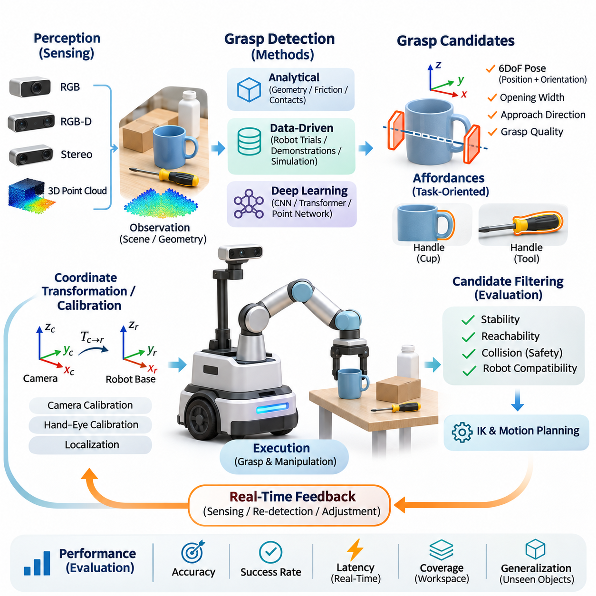
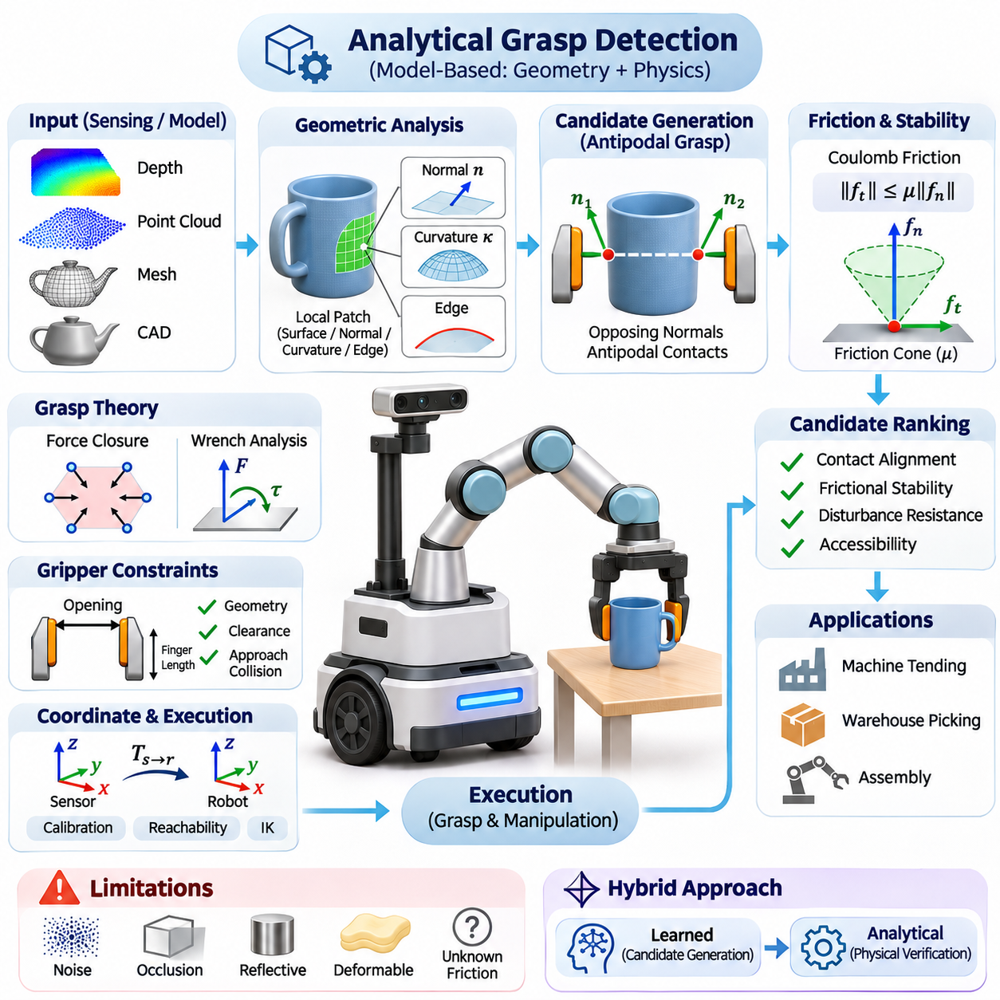
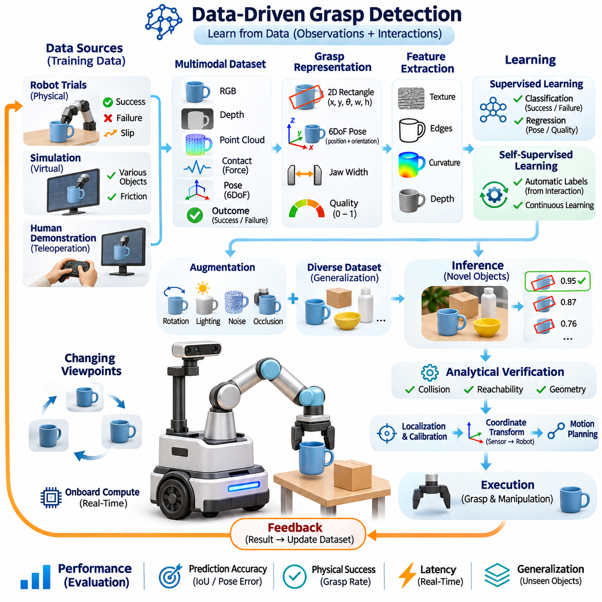
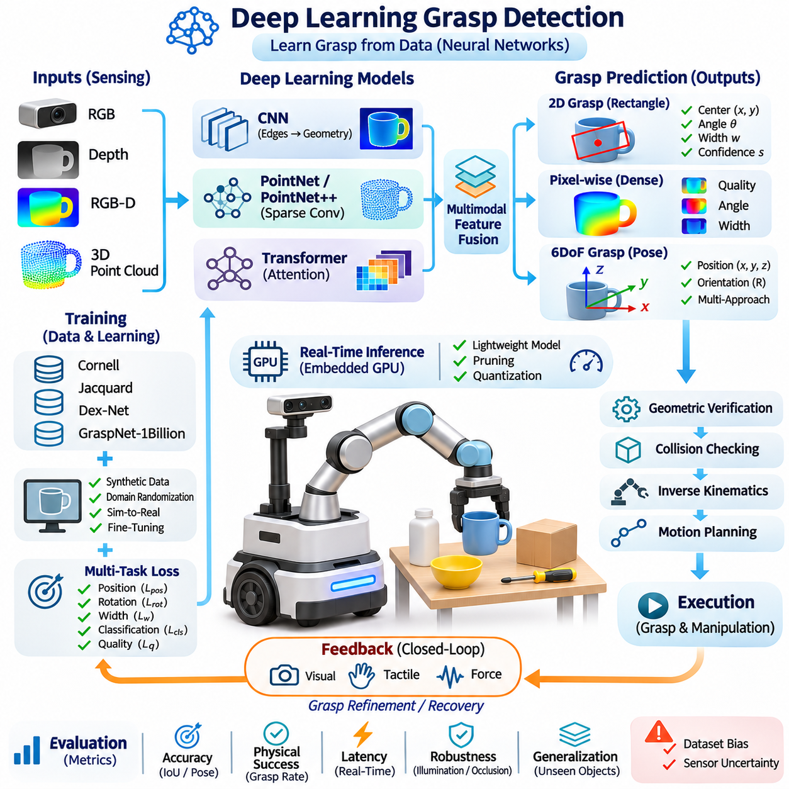
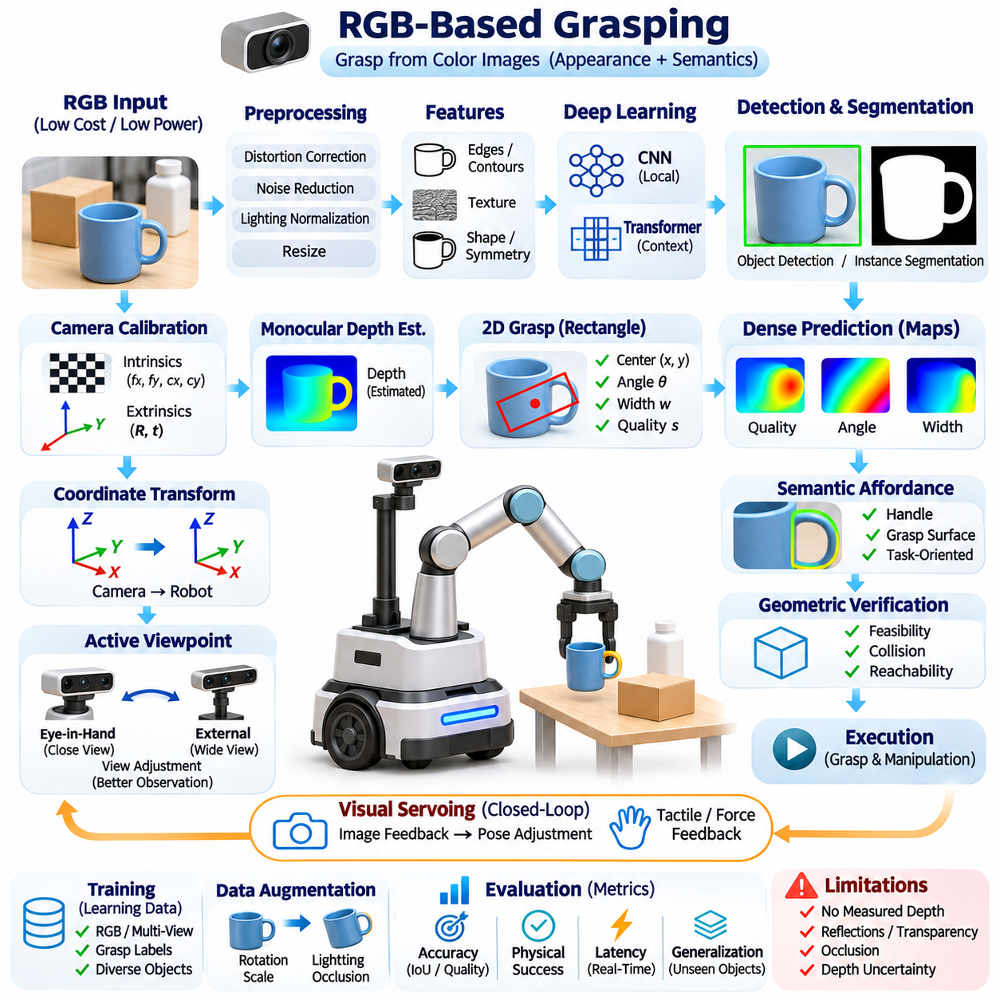
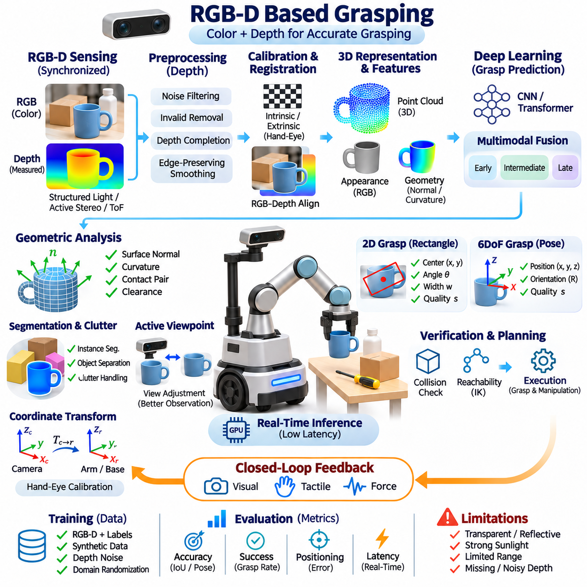
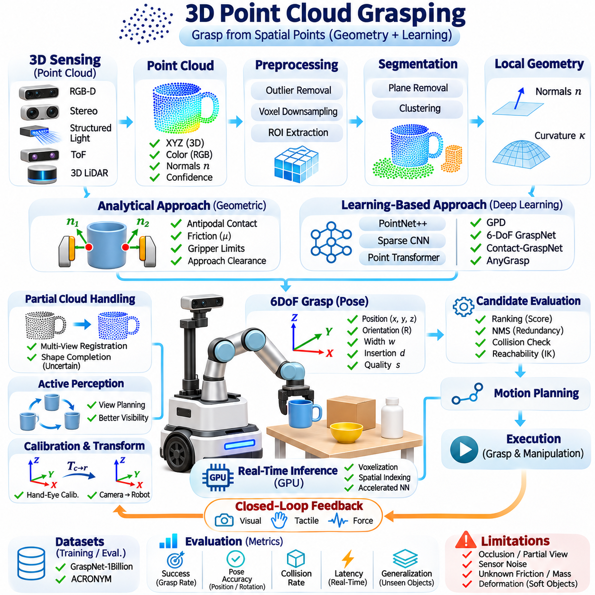
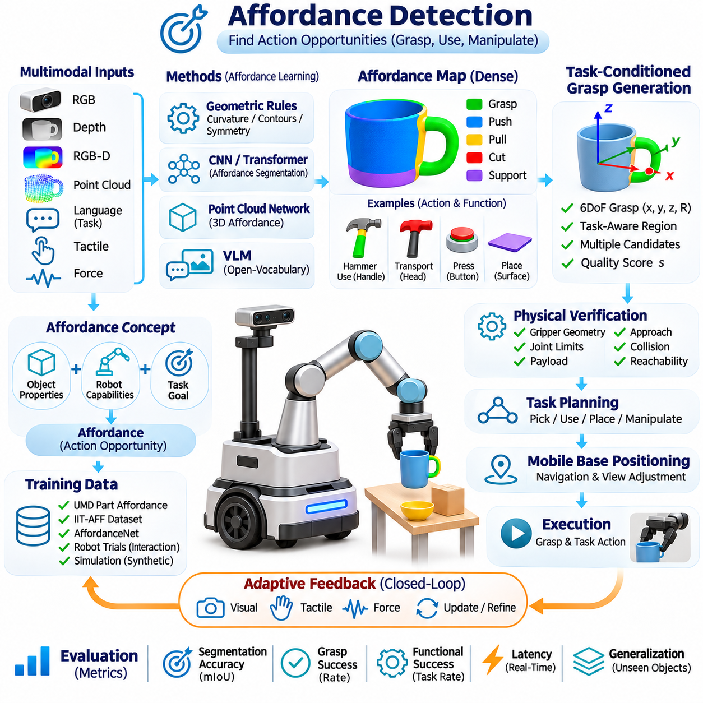
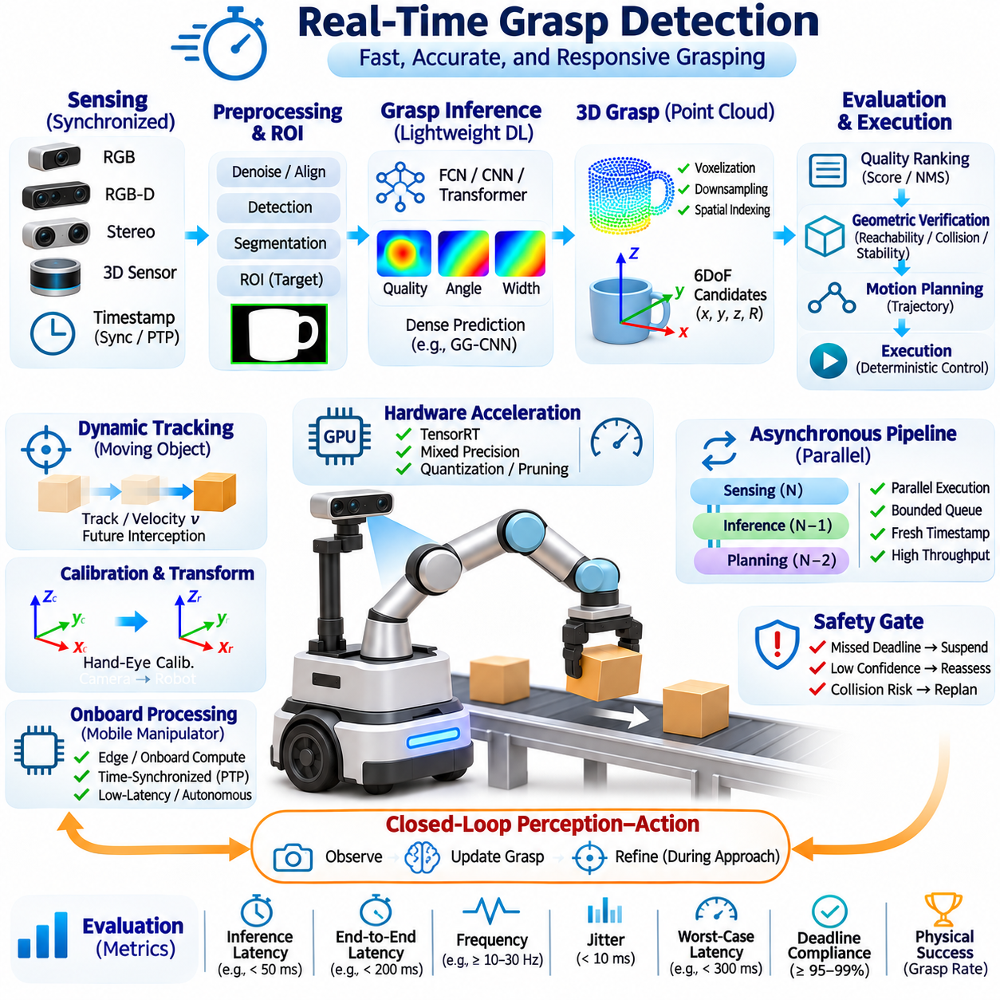
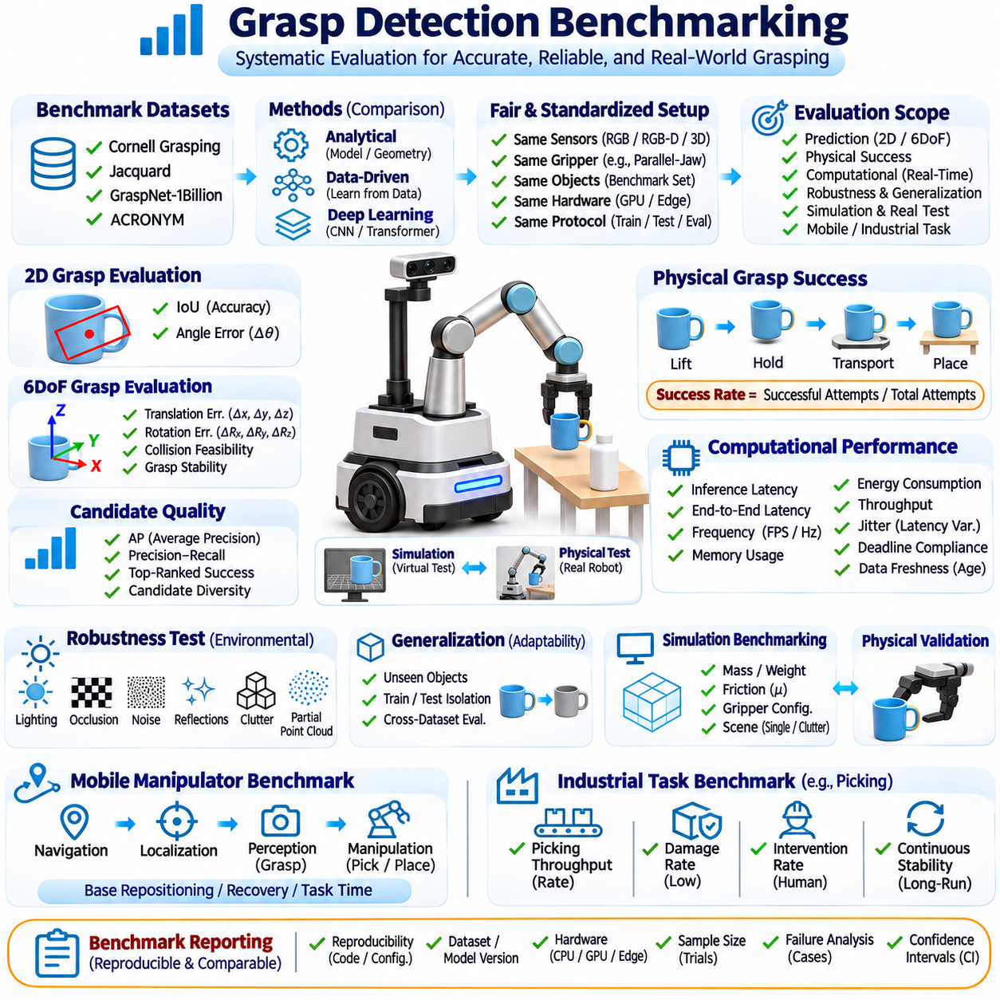

**Volume 03. Vision Manipulation and AI**

# Chapter 05. Grasp Detection

## 01 Grasp Detection Overview

{width="7.268055555555556in" height="7.268055555555556in"}

Grasp detection is a fundamental capability in robotic manipulation that enables a robot to identify suitable positions and orientations for grasping physical objects. Unlike conventional object detection, which focuses on recognizing and locating objects, grasp detection determines how a robot can physically interact with them. It establishes a direct connection between visual perception and manipulation, transforming environmental observations into actionable grasp candidates.

In mobile manipulator systems, grasp detection is particularly important because robots operate in dynamic and unstructured environments. Objects may appear in different positions, orientations, and configurations, while the mobile platform continuously changes its location. The robot must interpret these variations and identify appropriate grasping opportunities without relying entirely on predefined object models, fixed coordinates, or manually programmed instructions.

A grasp is generally represented by a combination of spatial position, orientation, gripper configuration, and grasp quality. For a parallel-jaw gripper, a grasp representation may include the center position, approach direction, rotation angle, and required jaw opening. More advanced representations incorporate six degrees of freedom (6DoF), finger configurations, contact locations, and estimated grasp stability under expected external forces.

The grasp detection pipeline typically begins with environmental data acquisition using RGB cameras, depth cameras, stereo vision systems, or three-dimensional sensors. The acquired information is processed to identify objects, estimate surface geometry, and distinguish potential grasping regions. Multiple grasp candidates are then generated and evaluated according to their predicted stability, accessibility, collision risk, and compatibility with the robot\'s capabilities.

Analytical grasp detection relies on mathematical models, geometric reasoning, and physical principles to identify suitable contact positions. These methods examine surface normals, object boundaries, friction characteristics, and contact relationships to estimate grasp feasibility. Analytical approaches offer relatively high interpretability but may become computationally demanding when object geometry is complex, incomplete, or partially occluded.

Data-driven grasp detection uses previously collected observations and grasping experiences to predict suitable grasp configurations. Rather than explicitly modeling every physical interaction, these methods learn relationships between object appearance, geometric properties, and grasp outcomes. Training data can be collected through physical robot experiments, human demonstrations, synthetic simulations, or combinations of multiple acquisition strategies.

Deep learning has significantly expanded the capabilities of grasp detection by enabling automatic feature extraction from complex sensory inputs. Convolutional Neural Networks (CNNs), Transformer architectures, and point cloud neural networks can predict grasp positions, orientations, and confidence scores. These models can also generalize to previously unseen objects when trained using sufficiently diverse and representative datasets.

RGB-based grasp detection utilizes two-dimensional visual information to identify potential grasping regions from object appearance, texture, shape, and boundaries. This approach offers relatively low hardware costs and straightforward integration with conventional vision systems. However, estimating accurate three-dimensional grasp positions from RGB images alone remains challenging because depth, surface geometry, and physical dimensions are not directly measured.

RGB-D-based grasp detection combines color and depth information to improve spatial understanding and geometric accuracy. Depth measurements allow image coordinates to be transformed into three-dimensional positions using camera calibration parameters. By combining appearance features with surface geometry, robots can identify suitable grasping regions more robustly, particularly in cluttered environments where objects overlap or exhibit irregular shapes.

Three-dimensional point cloud grasp detection directly processes spatial representations of objects and surrounding environments. Point clouds provide geometric information about surface structures, object boundaries, and accessible contact regions. Grasp detection algorithms operating on these representations can generate six-dimensional grasp candidates without relying exclusively on predefined object categories or complete object models.

Affordance detection extends grasp detection by considering the functional characteristics of objects and their potential interactions. For example, a robot may identify the handle of a cup, the gripping surface of a tool, or the rim of a container. Task-oriented affordance information enables robots to select grasping regions that support subsequent manipulation objectives rather than merely maximizing the probability of successfully lifting an object.

Coordinate transformation is an essential component of practical grasp detection. Grasp candidates generated in the camera coordinate system must be transformed into the robot base or manipulator coordinate system before execution. Accurate camera calibration, hand-eye calibration, and mobile platform localization are therefore necessary. Errors in these transformations can cause grasp failures even when the underlying detection model generates accurate predictions.

Real-time grasp detection requires a balance between computational efficiency, prediction accuracy, and operational reliability. Mobile manipulators must respond to changing environmental conditions while operating within limited computational and electrical resources. Hardware acceleration, neural network optimization, efficient point cloud processing, and selective candidate generation can reduce inference latency and improve overall manipulation throughput.

Detected grasp candidates must subsequently be evaluated by grasp planning and motion planning modules. A visually promising grasp may be physically unreachable because of joint limitations, obstacles, singularities, or insufficient clearance around the target object. Integrating grasp detection with inverse kinematics, collision checking, and trajectory generation ensures that selected candidates satisfy the operational constraints of the robotic system.

Performance evaluation generally considers grasp detection accuracy, physical grasp success rate, inference latency, candidate coverage, and generalization to unfamiliar objects. Experimental validation should include variations in lighting, object materials, clutter density, sensor viewpoints, and environmental conditions. Reliable grasp detection ultimately requires consistent physical manipulation performance rather than high prediction accuracy under controlled conditions alone.

## 02 Analytical Grasp Detection

{width="7.268055555555556in" height="7.268055555555556in"}

Analytical grasp detection is a model-based approach that identifies suitable robotic grasp configurations through mathematical reasoning, geometric analysis, and physical interaction principles. Unlike learning-based methods that derive grasping knowledge from training datasets, analytical methods explicitly evaluate the relationship between object geometry, contact mechanics, gripper characteristics, and environmental constraints to determine grasp feasibility.

The fundamental objective of analytical grasp detection is to identify contact positions and gripper orientations that enable stable object manipulation. A successful grasp must constrain undesirable object movement while resisting gravitational forces, inertial forces, and external disturbances. These requirements are evaluated using mathematical models that describe the mechanical relationships between the object and the contacting surfaces of the robotic gripper.

Geometric analysis provides the foundation for generating analytical grasp candidates. Object surfaces, edges, boundaries, curvature, and surface normals are extracted from depth images, three-dimensional point clouds, reconstructed meshes, or Computer-Aided Design (CAD) models. These geometric properties allow the detection algorithm to identify contact regions that are compatible with the mechanical structure and operational characteristics of the gripper.

Surface normal estimation is particularly important when detecting grasps for parallel-jaw grippers. Suitable contact regions are often located on opposing object surfaces whose normal vectors are approximately aligned with the gripper closing direction in opposite orientations. By examining the angular relationships between these vectors, the algorithm can identify contact pairs that provide favorable conditions for stable gripping and minimize undesirable sliding.

Antipodal grasp detection is a widely used analytical technique for identifying opposing contact configurations. An antipodal grasp occurs when two contact points satisfy geometric and frictional conditions that allow opposing forces to stabilize an object. The line connecting the contact points should lie within the friction cones associated with both contacts, considering the direction of the applicable contact forces and the assumed friction coefficient.

Friction modeling describes the ability of contact surfaces to resist relative movement between the gripper and the object. The Coulomb friction model is commonly used to represent the relationship between normal contact forces and allowable tangential forces. A higher friction coefficient generally expands the range of feasible contact force directions, whereas slippery materials require more careful contact selection and gripping force management.

Force closure is an important theoretical criterion for evaluating grasp stability. A grasp achieves force closure when its allowable contact forces can collectively resist arbitrary external forces and torques acting on the object, within the assumptions of the contact model. Analytical grasp detection can incorporate force closure tests to reject mechanically unstable candidates, although the validity of these tests depends on contact and friction assumptions.

Grasp wrench analysis provides a mathematical framework for representing the forces and torques generated by multiple contact points. Each contact contributes a force and an associated torque relative to an object reference frame. By examining the combined wrench space generated by allowable contact forces, analytical algorithms can estimate the ability of a grasp configuration to resist disturbances and maintain the desired object position and orientation.

Gripper geometry imposes additional constraints on analytical grasp detection. Maximum jaw opening, finger length, fingertip shape, contact surface dimensions, and mechanical interference must be considered during candidate generation. A geometrically favorable contact pair may remain unsuitable if the gripper cannot accommodate the object dimensions or if its fingers collide with surrounding structures during the approach and closing operations.

Three-dimensional point cloud processing enables analytical grasp detection without requiring complete predefined object models. Local surface patches are analyzed to estimate curvature, orientation, and potential contact relationships. Spatial filtering, neighborhood searches, and surface segmentation reduce computational complexity while improving candidate generation. However, incomplete observations and sensor noise can introduce uncertainty into estimated contact geometry.

Collision checking is necessary to eliminate grasp candidates that interfere with surrounding objects, supporting surfaces, or environmental structures. The volumetric geometry of the gripper must be evaluated at the target grasp configuration and along relevant approach paths. Integrating collision checking with geometric grasp analysis is particularly important in cluttered environments, where mechanically stable contact configurations may not be physically accessible.

Grasp candidate ranking combines multiple analytical criteria to identify configurations suitable for execution. Common evaluation factors include contact alignment, frictional stability, disturbance resistance, gripper clearance, and estimated accessibility. Weighted scoring functions can prioritize different characteristics according to application requirements, allowing the detection algorithm to distinguish mechanically robust candidates from less reliable alternatives.

In mobile manipulator systems, analytical grasp detection must also consider uncertainty introduced by mobile platform positioning and sensor calibration. Grasp candidates are transformed from sensor coordinates into the manipulator reference frame using calibrated spatial transformations. Reachability analysis and inverse kinematics subsequently determine whether the robot arm can achieve the detected grasp configuration from its current operating position.

Industrial applications of analytical grasp detection include machine tending, component handling, warehouse picking, assembly operations, and automated material transportation. Its deterministic geometric and mechanical evaluation provides useful interpretability when handling objects with known dimensions and material characteristics. Nevertheless, deformable objects, reflective surfaces, unknown friction properties, and severe occlusion remain significant challenges.

Modern robotic manipulation systems increasingly combine analytical grasp detection with data-driven and deep learning approaches. Learning-based models can generate promising grasp candidates from complex sensory observations, while analytical methods verify geometric compatibility, physical stability, and collision constraints. This hybrid architecture combines the adaptability of artificial intelligence with the interpretability of explicit physical reasoning, supporting more reliable autonomous manipulation.

## 03 Data Driven Grasp Detection

{width="7.268055555555556in" height="7.268055555555556in"}

Data-driven grasp detection is an approach to robotic manipulation that identifies suitable grasp configurations by learning from previously collected observations, experimental results, and interaction experiences. Unlike analytical grasp detection, which relies primarily on explicit geometric and mechanical models, data-driven methods discover relationships between sensory information, grasp configurations, and successful manipulation outcomes through statistical learning.

The fundamental principle of data-driven grasp detection is that successful grasping strategies can be learned from representative examples. By observing numerous interactions between robotic grippers and physical objects, a detection system can identify patterns associated with stable and reliable grasps. These learned relationships allow robots to estimate grasp feasibility even when complete object geometry, material properties, and contact characteristics are unavailable.

Data acquisition is a critical component of developing data-driven grasp detection systems. Training datasets may contain RGB images, depth images, three-dimensional point clouds, gripper configurations, contact positions, and recorded manipulation outcomes. Each observation provides information about the relationship between environmental conditions, physical object characteristics, executed grasp actions, and the resulting success or failure of the manipulation attempt.

Physical robotic experiments provide valuable training data because they capture actual interactions between grippers and objects. During automated data collection, a robot repeatedly executes grasp attempts using different positions, orientations, and gripping parameters. Sensors and monitoring systems record whether each attempt results in successful lifting, stable holding, object displacement, slippage, or complete failure, creating examples for subsequent learning.

Simulation-based data generation provides an alternative to expensive and time-consuming physical experiments. Virtual environments allow robots to perform large numbers of grasp attempts involving diverse object geometries, material properties, friction coefficients, and environmental configurations. Physics engines calculate interaction outcomes, enabling the generation of extensive labeled datasets while reducing hardware wear and operational costs.

Human demonstrations provide another source of data-driven grasping knowledge. Human operators can demonstrate suitable grasp positions, approach directions, and object handling strategies through teleoperation, motion capture, or interactive teaching interfaces. These demonstrations are particularly valuable for task-oriented manipulation, where grasp selection must consider an object\'s intended use and subsequent manipulation requirements rather than lifting success alone.

Grasp representation determines how collected manipulation experiences are organized and interpreted by learning algorithms. Common representations include two-dimensional grasp rectangles, three-dimensional contact points, six-degree-of-freedom grasp poses, gripper opening widths, and grasp quality scores. The selected representation must adequately describe feasible manipulation actions while remaining compatible with the robotic gripper and available sensory information.

Feature extraction enables data-driven algorithms to identify relevant characteristics associated with successful grasping. Traditional approaches manually define features describing object boundaries, surface curvature, depth discontinuities, texture patterns, and local geometric structures. Statistical learning algorithms then evaluate relationships between these features and recorded grasping outcomes to estimate the suitability of previously unobserved grasp configurations.

Supervised learning is a widely used method for developing data-driven grasp detection models. Training examples contain sensory observations and corresponding grasp annotations or success labels. Classification models estimate whether a candidate grasp is likely to succeed, whereas regression models predict continuous grasp parameters or quality scores. Both approaches support the systematic evaluation and ranking of potential manipulation actions.

Self-supervised learning reduces dependence on manually annotated grasp datasets by allowing robots to generate training labels through physical interaction. A robot can execute grasp attempts and automatically evaluate their outcomes using gripper sensors, force measurements, camera observations, or object displacement detection. This process enables continuous accumulation of manipulation experience and incremental improvement of grasp prediction capabilities.

Generalization is a central objective of data-driven grasp detection because robotic systems frequently encounter objects that were not included in their training datasets. Effective models must learn transferable relationships between object characteristics and successful grasp configurations rather than memorizing specific examples. Dataset diversity, representative sampling, and carefully designed validation procedures are essential for achieving reliable generalization.

Data augmentation improves model robustness by introducing controlled variations into existing training examples. Image rotation, translation, illumination adjustment, depth noise injection, point cloud perturbation, and simulated occlusion can expose learning algorithms to different environmental conditions. Geometric transformations must preserve the correspondence between sensory observations and grasp annotations to maintain physically meaningful training samples.

Grasp candidate evaluation in data-driven systems commonly involves predicting the probability or quality of successful execution. Multiple candidates are generated from environmental observations and ranked according to learned performance estimates. Additional geometric constraints, collision checking, and reachability analysis can be applied to eliminate candidates that appear statistically promising but remain physically inaccessible or mechanically unsuitable.

In mobile manipulator systems, data-driven grasp detection must accommodate changing camera viewpoints, mobile platform positioning errors, environmental variability, and limited onboard computational resources. Detection models should therefore be trained and evaluated under conditions representative of actual deployment environments. Integration with robot localization, coordinate transformation, and motion planning remains essential for reliable execution.

The effectiveness of data-driven grasp detection depends strongly on dataset quality, prediction reliability, computational efficiency, and adaptability to unfamiliar environments. Performance evaluation should distinguish between prediction accuracy and actual physical grasp success. Combining empirical learning with analytical verification can reduce the influence of dataset bias and uncertain predictions, providing a practical foundation for scalable autonomous manipulation.

## 04 Deep Learning Grasp Detection

{width="7.268055555555556in" height="7.268055555555556in"}

Deep learning-based grasp detection is an advanced approach to robotic manipulation that utilizes neural networks to identify feasible grasp configurations directly from sensory observations. Unlike conventional analytical methods that depend on explicitly defined geometric and physical models, deep learning enables robots to automatically extract relevant features and predict grasping opportunities in complex and unstructured environments.

The fundamental objective of deep learning-based grasp detection is to establish a mapping between sensory inputs and executable grasp representations. Neural networks process RGB images, depth images, RGB-D observations, or three-dimensional point clouds to predict grasp positions, orientations, gripper opening widths, and quality scores. These predictions provide the perception foundation for autonomous robotic manipulation.

Convolutional Neural Networks (CNNs) are widely used in grasp detection because of their ability to extract hierarchical spatial features from visual observations. Early network layers identify basic characteristics such as edges, textures, and boundaries, while deeper layers capture complex geometric structures and object relationships. These learned representations enable the detection of promising grasping regions without manually designed features.

Two-dimensional grasp detection commonly represents a grasp configuration using an oriented rectangular region within an image. This representation includes the grasp center, rotation angle, gripper opening width, and an associated confidence score. Neural networks can directly regress these parameters or generate multiple candidate rectangles, allowing robots to identify suitable planar grasp configurations from visual observations.

Pixel-wise grasp detection generates dense predictions across an input image rather than evaluating only a limited number of predefined candidates. Each pixel may be associated with a grasp quality score, orientation, and gripper opening width. Fully convolutional architectures support efficient generation of these grasp maps, making them particularly useful for real-time manipulation and closed-loop visual feedback applications.

Six-degree-of-freedom grasp detection extends conventional planar grasp representations by estimating complete three-dimensional gripper positions and orientations. This capability allows robots to approach objects from different directions rather than being restricted to top-down grasping. Deep neural networks operating on spatial observations can generate diverse grasp candidates in cluttered and geometrically complex environments.

Point cloud neural networks directly process three-dimensional spatial information acquired from depth cameras, stereo vision systems, or other 3D sensors. Architectures such as PointNet, PointNet++, and sparse convolutional networks extract geometric features from irregularly distributed spatial points. These features support grasp candidate generation based on local surface structures, contact regions, and surrounding obstacles.

Transformer-based grasp detection introduces attention mechanisms to capture relationships between spatial regions, object features, and potential grasp configurations. Self-attention enables neural networks to integrate information from both local and distant observations. This capability is particularly valuable when objects are partially occluded, surrounded by clutter, or characterized by complex geometric relationships.

Multimodal deep learning combines complementary sensory information to improve grasp prediction reliability. RGB observations provide appearance, texture, and semantic information, while depth measurements and point clouds describe spatial geometry. Feature fusion architectures integrate these representations at different network stages, enabling more comprehensive environmental understanding and robust grasp candidate generation.

Training deep learning-based grasp detection models requires datasets containing diverse objects, sensor observations, grasp configurations, and corresponding quality annotations. Datasets such as the Cornell Grasping Dataset, Jacquard, Dex-Net, and GraspNet-1Billion provide resources for different grasp representations and evaluation methods. Dataset selection should reflect the intended gripper configuration and deployment environment.

Loss functions guide neural network optimization by measuring differences between predicted grasp parameters and reference annotations. Depending on the grasp representation, training objectives may include position regression, orientation estimation, gripper width prediction, grasp classification, and quality score estimation. Multi-task learning combines these objectives to improve consistency across different aspects of grasp prediction.

Synthetic training data and domain randomization can improve generalization by exposing neural networks to diverse object geometries, textures, lighting conditions, camera viewpoints, and physical properties. Simulation-to-real transfer techniques reduce discrepancies between virtual training environments and physical robotic systems. Nevertheless, experimental fine-tuning and physical validation remain necessary to address residual domain differences.

Real-time deployment requires deep learning models to achieve sufficient prediction accuracy within operational latency and computational constraints. Lightweight network architectures, model pruning, quantization, and accelerated inference frameworks reduce processing requirements. Embedded GPU platforms enable mobile manipulators to execute grasp detection locally without continuously depending on remote computing infrastructure.

Deep learning predictions must be integrated with geometric verification, collision checking, inverse kinematics, and motion planning before physical execution. A high-confidence grasp candidate does not necessarily guarantee mechanical stability, collision-free accessibility, or successful manipulation. Closed-loop feedback from visual, tactile, and force sensors can support grasp refinement, execution monitoring, and recovery from unsuccessful attempts.

Performance evaluation should consider grasp detection accuracy, physical grasp success rate, inference latency, robustness, and generalization to unfamiliar objects. Particular attention must be given to dataset bias, sensor uncertainty, and unpredictable environmental conditions. Combining deep learning-based perception with analytical verification and adaptive feedback provides a practical foundation for reliable autonomous manipulation in mobile robotic systems.

## 05 RGB Based Grasping

{width="7.268055555555556in" height="7.268055555555556in"}

RGB-based grasping is a robotic manipulation approach that utilizes conventional color images to identify suitable grasp positions, orientations, and contact regions. Unlike depth-based grasping methods, which directly acquire three-dimensional spatial information, RGB-based approaches primarily rely on visual appearance, texture, shape, and semantic characteristics to estimate feasible grasp configurations from two-dimensional observations.

The fundamental advantage of RGB-based grasping is its compatibility with relatively inexpensive and widely available camera systems. Conventional RGB cameras offer high-resolution visual information while maintaining low power consumption and straightforward hardware integration. These characteristics make RGB-based grasping attractive for mobile manipulators, service robots, warehouse automation systems, and resource-constrained robotic platforms.

The RGB-based grasping pipeline typically begins with image acquisition, followed by image preprocessing, feature extraction, grasp candidate generation, and grasp quality estimation. Image preprocessing may involve distortion correction, noise reduction, illumination normalization, and image resizing. These operations improve the consistency of visual observations and prepare input data for subsequent geometric or learning-based grasp detection algorithms.

Camera calibration is essential for establishing the relationship between image coordinates and physical workspace coordinates. Intrinsic camera parameters describe focal length, principal point, and lens distortion, while extrinsic parameters define the spatial relationship between the camera and robot. Although RGB images do not directly provide depth measurements, calibrated camera models support spatial reconstruction when additional geometric constraints are available.

Traditional RGB-based grasping methods utilize manually designed visual features to identify potential grasping regions. Object contours, edges, corners, symmetry, and texture patterns provide information about object structure and accessible contact surfaces. These features can generate grasp candidates for objects with relatively simple geometries, although their effectiveness may decrease under complex backgrounds, varying illumination, and partial occlusion.

Deep learning has significantly improved RGB-based grasping by enabling automatic feature extraction and grasp prediction directly from visual observations. Convolutional Neural Networks (CNNs) learn hierarchical representations of object appearance and spatial relationships. Transformer-based architectures additionally capture broader contextual information, supporting grasp detection in cluttered environments and among unfamiliar objects.

Two-dimensional grasp representations are commonly adopted in RGB-based grasp detection. A grasp candidate is described using an oriented rectangle containing the grasp center, rotation angle, gripper opening width in image coordinates, and an estimated quality score. This representation is particularly suitable for planar grasping applications in which a robotic gripper approaches objects from a predefined direction relative to a known supporting surface.

Dense grasp prediction generates pixel-level grasp information across an entire RGB image. Neural networks can produce grasp quality maps, orientation maps, and gripper width maps simultaneously, allowing multiple potential grasping regions to be evaluated efficiently. These representations support continuous visual feedback and rapid grasp candidate updates when object positions or camera viewpoints change during robotic manipulation.

Monocular depth estimation extends RGB-based grasping by predicting spatial information from individual color images. Deep learning models infer relative or metric depth using learned relationships between visual appearance, perspective, and scene structure. However, scale ambiguity and prediction uncertainty may introduce significant positioning errors, making additional calibration, geometric verification, or physical feedback necessary for precise manipulation.

Object detection and instance segmentation improve RGB-based grasping by identifying target objects and separating them from surrounding structures. Bounding boxes provide approximate object locations, while segmentation masks describe visible object boundaries more precisely. Integrating these representations with grasp detection allows robots to restrict candidate generation to specific objects and reduce interference from irrelevant background features.

Semantic information and visual affordance detection enable RGB-based grasping systems to identify functionally meaningful contact regions. Rather than selecting grasp positions solely according to geometric appearance, robots can recognize handles, gripping surfaces, and object components associated with intended tasks. This capability is particularly valuable for tool handling, object placement, and manipulation involving functional requirements.

Visual servoing supports closed-loop RGB-based grasping by continuously monitoring the relative position of the target object and robotic gripper. Image-based visual servoing calculates control commands from differences between observed and desired image features. Repeated visual observations allow the manipulator to compensate for moderate positioning errors, camera motion, and target displacement during the grasp approach.

In mobile manipulator systems, RGB-based grasping must accommodate changing camera viewpoints and uncertainty associated with mobile platform positioning. Eye-in-hand cameras provide close-range observations, while externally mounted cameras offer broader workspace visibility. Combining calibrated coordinate transformations with active viewpoint adjustment enables robots to improve observation quality and reduce uncertainty before executing a grasp.

Training and evaluating RGB-based grasp detection models requires diverse datasets containing representative objects, lighting conditions, backgrounds, camera viewpoints, and grasp annotations. Data augmentation techniques such as image rotation, brightness adjustment, contrast modification, and simulated occlusion improve model robustness. Evaluation should consider detection accuracy, physical grasp success rate, inference latency, and generalization.

Despite its hardware simplicity, RGB-based grasping remains limited by the absence of directly measured depth and surface geometry. Reflective materials, transparent objects, severe occlusion, and unfamiliar appearances can further reduce prediction reliability. Combining RGB-based perception with geometric constraints, analytical verification, tactile sensing, and force feedback provides a practical foundation for more reliable autonomous grasping.

## 06 RGBD Based Grasping

{width="7.268055555555556in" height="7.268055555555556in"}

RGB-D-based grasping is a robotic manipulation approach that combines color images and depth measurements to identify suitable grasp positions, orientations, and contact regions. Unlike RGB-based grasping, which primarily relies on visual appearance, RGB-D-based methods incorporate directly measured spatial information, enabling more accurate reconstruction of object geometry and more reliable grasp detection in complex environments.

RGB-D cameras simultaneously acquire color information and depth measurements using technologies such as structured light, active stereo vision, or Time-of-Flight (ToF) sensing. Color images describe object appearance, texture, and semantic characteristics, while depth images provide spatial distances between the sensor and observed surfaces. Combining these complementary observations establishes a richer representation of the robotic workspace.

The RGB-D-based grasping pipeline generally begins with synchronized color and depth image acquisition, followed by image registration, sensor data preprocessing, feature extraction, grasp candidate generation, and quality evaluation. Accurate alignment between color and depth observations is essential because misregistration may introduce discrepancies between detected visual features and their corresponding physical positions.

Depth image preprocessing improves the reliability of geometric information before grasp detection. Common operations include noise filtering, invalid depth removal, depth completion, and edge-preserving smoothing. Missing or inaccurate depth measurements frequently occur near object boundaries, reflective surfaces, and occluded regions. Appropriate preprocessing reduces these errors while preserving geometric features relevant to grasping.

Camera calibration enables the transformation of RGB-D observations into physically meaningful spatial coordinates. Intrinsic camera parameters establish the relationship between image pixels and three-dimensional positions, while extrinsic parameters describe spatial relationships between sensors and robotic components. Using calibrated camera models, depth measurements can be converted into point clouds expressed within the camera coordinate system.

Two-dimensional grasp detection using RGB-D observations commonly represents grasp candidates as oriented rectangles within an image. Each candidate describes a grasp center, rotation angle, gripper opening width, and predicted quality score. Depth information enables the conversion of these image-based grasp representations into physical positions and dimensions, supporting accurate execution within the robotic workspace.

Six-degree-of-freedom grasp detection extends RGB-D-based grasping beyond conventional planar manipulation. By interpreting depth-derived geometry and color features, detection algorithms estimate complete three-dimensional gripper positions and orientations. This approach enables robots to approach objects from multiple directions, improving manipulation flexibility in cluttered environments and geometrically constrained workspaces.

Deep learning-based RGB-D grasp detection utilizes neural networks to extract complementary appearance and geometric features. Convolutional Neural Networks (CNNs), Transformer architectures, and hybrid neural networks can process color and depth information to predict grasp candidates. Learned representations enable robots to identify suitable grasping regions without requiring complete predefined geometric models of every target object.

Multimodal feature fusion is a central component of RGB-D-based grasp detection. Early fusion combines color and depth channels directly at the network input, while intermediate fusion integrates features extracted by separate processing branches. Late fusion combines independently generated predictions. The selected fusion architecture influences computational complexity, prediction accuracy, and robustness against unreliable sensor observations.

Surface geometry analysis uses depth information to estimate surface normals, curvature, object dimensions, and local contact relationships. These geometric characteristics support the identification of opposing surfaces, accessible contact regions, and potential gripper approach directions. Combining analytical geometric evaluation with learned grasp predictions can improve candidate selection and reduce mechanically unsuitable grasp configurations.

RGB-D-based grasping is particularly effective in cluttered environments such as industrial bins, warehouse containers, and mixed-object storage areas. Depth measurements help distinguish overlapping objects, estimate their relative positions, and identify available clearance around potential grasping regions. Instance segmentation and geometric filtering can further reduce interference from neighboring objects and supporting structures.

In mobile manipulator systems, RGB-D-based grasping must accommodate changing sensor viewpoints, mobile platform positioning errors, and variations in environmental conditions. Hand-eye calibration and coordinate transformations establish relationships between the RGB-D camera, robot arm, and mobile base. Active viewpoint adjustment can improve visibility and reduce uncertainty when initial observations contain incomplete geometric information.

Real-time RGB-D-based grasping requires efficient processing of both visual and geometric information within operational latency constraints. Lightweight neural network architectures, hardware-accelerated inference, selective region processing, and optimized depth reconstruction reduce computational requirements. Closed-loop perception enables continuous grasp refinement by updating target positions and candidate configurations during the approach.

Training and evaluating RGB-D grasp detection models requires datasets containing synchronized color images, depth measurements, grasp annotations, and representative object configurations. Synthetic data generation, depth noise simulation, and domain randomization improve robustness against environmental variations. Performance evaluation should consider grasp detection accuracy, physical grasp success rate, spatial positioning accuracy, and inference latency.

Despite its geometric advantages, RGB-D-based grasping remains sensitive to transparent objects, reflective materials, direct sunlight, limited sensor range, and missing depth measurements. High-confidence predictions must therefore be verified through collision checking, reachability analysis, and physical feedback. Integrating RGB-D perception with analytical reasoning, tactile sensing, and force control supports reliable autonomous manipulation.

## 07 3D Point Cloud Grasping

{width="7.268055555555556in" height="7.268055555555556in"}

Three-dimensional point cloud grasping is a robotic manipulation approach that utilizes spatially distributed points to identify feasible grasp positions, orientations, and contact regions. Unlike conventional image-based grasping methods, point cloud-based approaches directly represent the three-dimensional geometry of observed surfaces, enabling robots to detect grasping opportunities in complex and unstructured environments.

A three-dimensional point cloud consists of spatial points represented by Cartesian coordinates along the X, Y, and Z axes. Individual points may additionally contain color information, surface normals, intensity values, or confidence measurements. These attributes describe the spatial structure of objects and surrounding environments, providing essential information for geometric reasoning and grasp configuration estimation.

Point clouds can be acquired using RGB-D cameras, stereo vision systems, structured light scanners, Time-of-Flight sensors, and three-dimensional LiDAR systems. Sensor selection depends on measurement accuracy, spatial resolution, operating distance, acquisition frequency, and environmental conditions. High-resolution depth sensors are particularly suitable for capturing detailed object surfaces required for precise robotic grasping.

Point cloud preprocessing improves the quality and computational efficiency of spatial observations before grasp detection. Common operations include statistical outlier removal, voxel grid downsampling, region-of-interest extraction, and background filtering. These operations reduce measurement noise and unnecessary data while preserving geometric structures important for identifying contact surfaces and accessible grasping regions.

Point cloud segmentation separates target objects from surrounding structures and other objects within the robotic workspace. Plane segmentation can remove supporting surfaces, while Euclidean clustering and learning-based segmentation identify individual object regions. Accurate segmentation improves grasp candidate generation by reducing interference from neighboring objects and restricting geometric analysis to relevant spatial regions.

Surface normal estimation and local geometric analysis provide important information for identifying physically feasible grasp configurations. Surface normals describe local surface orientations, while curvature measurements characterize variations in surface geometry. These properties support the identification of opposing contact surfaces, stable gripping regions, and suitable gripper approach directions for objects with diverse shapes.

Analytical point cloud grasp detection generates potential grasp configurations by evaluating geometric relationships between candidate contact points. Antipodal grasp detection identifies opposing contact regions whose surface normals and connecting directions satisfy appropriate friction constraints. Gripper dimensions, opening limits, and approach clearance are additionally considered to eliminate geometrically unsuitable grasp candidates.

Six-degree-of-freedom grasp detection is a major advantage of three-dimensional point cloud-based approaches. A grasp configuration includes three translational and three rotational components defining the gripper pose within a spatial coordinate system. Additional parameters may specify gripper opening width, insertion depth, and grasp quality, enabling manipulation from diverse approach directions rather than predefined planar trajectories.

Deep learning-based point cloud grasp detection utilizes neural networks designed to process irregularly distributed spatial data. Architectures such as PointNet, PointNet++, sparse convolutional networks, and Point Transformers extract local and global geometric features. These learned representations enable robots to predict suitable grasp configurations without requiring predefined CAD models of every target object.

Learning-based grasp detection frameworks such as Grasp Pose Detection (GPD), 6-DoF GraspNet, Contact-GraspNet, and AnyGrasp demonstrate different approaches to spatial grasp candidate generation and evaluation. Depending on the architecture, grasp candidates can be sampled, generated, or directly predicted from observed scene geometry, supporting manipulation of unfamiliar objects and objects arranged in complex configurations.

Grasp candidate evaluation determines whether predicted configurations are geometrically accessible and potentially stable during physical execution. Evaluation criteria may include contact geometry, gripper compatibility, predicted grasp quality, approach clearance, and collision probability. Non-Maximum Suppression (NMS) can eliminate redundant spatial grasp candidates while preserving diverse alternatives for subsequent motion planning.

Partial point clouds represent a significant challenge because individual sensors typically observe only visible object surfaces. Occlusion, limited viewing angles, reflective materials, and sensor noise can produce incomplete geometric representations. Multi-view point cloud registration, active perception, and learning-based shape completion can improve geometric coverage, although reconstructed surfaces must be treated as uncertain estimates.

In mobile manipulator systems, point cloud-based grasp detection must account for mobile platform positioning errors and changing sensor viewpoints. Hand-eye calibration, spatial coordinate transformations, and point cloud registration establish consistent relationships between the sensor, robot arm, and mobile base. Active viewpoint adjustment can improve geometric visibility before selecting and executing a grasp configuration.

Real-time point cloud grasping requires efficient processing of large spatial datasets within operational latency constraints. Voxelization, spatial indexing, neighborhood sampling, lightweight neural networks, and GPU-accelerated inference reduce computational requirements. Adaptive processing strategies can prioritize relevant object regions and update grasp predictions when the target object or robotic platform changes position.

Training and performance evaluation require representative point cloud datasets containing diverse object geometries, grasp poses, and quality annotations. Resources such as GraspNet-1Billion and ACRONYM support the development of learning-based grasp detection methods. Evaluation should consider physical grasp success rate, pose accuracy, collision rate, inference latency, and generalization to previously unseen objects.

Despite its advanced spatial perception capabilities, point cloud-based grasping cannot directly determine all physical properties, including friction, mass distribution, and material deformation. Predicted grasp configurations must therefore be verified through reachability analysis, collision checking, and motion planning. Integrating point cloud perception with tactile sensing, force feedback, and closed-loop control supports reliable autonomous robotic manipulation.

## 08 Affordance Detection

{width="7.268055555555556in" height="7.268055555555556in"}

Affordance detection is a robotic perception approach that identifies possible actions associated with objects, surfaces, and environmental structures. In robotic grasping, affordances describe which regions of an object can be grasped and how those regions support intended manipulation tasks. Unlike conventional grasp detection focused primarily on geometric feasibility, affordance detection incorporates functional meaning and task-specific relationships.

The concept of affordance originates from ecological psychology, where it describes opportunities for interaction between an agent and its environment. In robotics, affordances depend on object properties, robot capabilities, and operational objectives. A handle may afford pulling or grasping, a button may afford pressing, and a flat surface may afford supporting or placing another object, depending on the interaction context.

Grasping affordances characterize object regions that provide suitable contact opportunities for robotic grippers. These regions are influenced by surface geometry, material properties, accessibility, and the mechanical characteristics of the end effector. Identifying grasping affordances enables robots to select contact regions that are not only physically accessible but also appropriate for subsequent manipulation requirements.

Functional affordance detection extends geometric grasping by considering the intended purpose of an object and the desired outcome of an action. For example, a robot handling a hammer should distinguish between its handle and striking head. Selecting a mechanically feasible grasp on the striking head may be sufficient for transportation but unsuitable for using the hammer to perform its intended function.

Visual affordance detection utilizes RGB images, depth images, RGB-D observations, and three-dimensional point clouds to identify interaction opportunities. Color information provides appearance and semantic characteristics, while depth measurements describe spatial geometry and surface orientations. Combining these observations enables robots to recognize functionally meaningful regions and estimate their physical accessibility.

Traditional affordance detection methods rely on manually designed geometric features, object recognition algorithms, and predefined interaction rules. Surface curvature, object contours, symmetry, and dimensional characteristics can provide indications of suitable grasping regions. However, rule-based methods often exhibit limited adaptability when objects have unfamiliar shapes, complex structures, or previously unseen functional characteristics.

Deep learning-based affordance detection enables neural networks to learn relationships between sensory observations, object characteristics, and possible manipulation actions. Convolutional Neural Networks (CNNs), Transformer architectures, and segmentation networks can identify functional regions directly from visual data. Learned representations improve adaptability to diverse objects without requiring manually defined rules for every configuration.

Pixel-wise affordance segmentation assigns interaction-related labels or confidence scores to individual image pixels. A single object may contain multiple affordance regions associated with grasping, pushing, pulling, cutting, or supporting. Dense affordance maps provide spatially detailed representations that allow robotic systems to identify task-relevant contact regions and restrict grasp candidate generation to appropriate object components.

Three-dimensional affordance detection extends image-based approaches by associating interaction opportunities with spatial positions and surface geometry. Point cloud neural networks can identify functional regions directly within three-dimensional representations. Integrating affordance predictions with surface normal estimation and spatial grasp detection supports the generation of six-degree-of-freedom grasp configurations for task-oriented manipulation.

Multimodal affordance detection combines visual information with tactile measurements, force feedback, language instructions, and geometric observations. Vision-Language Models (VLMs) can associate natural language descriptions with functional object regions, while tactile sensing provides information about contact conditions and material behavior. Combining complementary modalities improves interaction understanding and task-specific grasp selection.

Open-vocabulary affordance detection enables robots to reason about interaction opportunities beyond predefined object categories and action labels. Pretrained visual and language representations can support the identification of functional regions on unfamiliar objects through semantic similarities. Nevertheless, predicted affordances must be validated against physical constraints because semantic understanding alone does not guarantee executable robotic actions.

Training affordance detection models requires datasets containing object observations, functional region annotations, action descriptions, and interaction outcomes. Resources such as the UMD Part Affordance Dataset, IIT-AFF Dataset, and AffordanceNet-related benchmarks support supervised affordance learning. Robot-generated interaction data and simulation environments can provide additional information about successful and unsuccessful actions.

In mobile manipulator systems, affordance detection supports interaction with diverse objects and environmental structures across changing operational environments. Robots can identify graspable handles, movable containers, accessible tools, and suitable placement surfaces while navigating unfamiliar workspaces. Integrating affordance detection with spatial perception, task planning, and mobile base positioning improves autonomous manipulation flexibility.

Affordance-based grasp selection must consider robot-specific capabilities, including gripper geometry, joint limits, payload capacity, and available approach directions. A region that affords grasping for a human hand may not be accessible to a parallel-jaw gripper or suction-based end effector. Combining affordance predictions with collision checking, reachability analysis, and grasp quality evaluation ensures more appropriate candidate selection.

Performance evaluation should consider affordance segmentation accuracy, task-conditioned grasp success rate, functional manipulation success, inference latency, and generalization to unfamiliar objects. Evaluation must distinguish between correctly identifying a functional region and successfully completing the associated physical action. Integrating affordance detection with analytical verification, adaptive feedback, and embodied reasoning improves autonomous robotic manipulation.

## 09 Real Time Grasp Detection

{width="7.268055555555556in" height="7.268055555555556in"}

Real-time grasp detection is a robotic perception capability that identifies feasible grasp configurations within the timing constraints of ongoing manipulation tasks. Unlike offline grasp detection, which can perform extensive computational analysis before execution, real-time approaches must continuously process sensory observations, generate grasp candidates, and evaluate their feasibility while maintaining operational responsiveness.

The fundamental objective of real-time grasp detection is to establish an efficient connection between environmental perception and physical manipulation. Robots must identify suitable grasp positions, orientations, and contact regions sufficiently quickly to respond to changing object configurations and environmental conditions. This capability is particularly important for mobile manipulators, conveyor picking systems, and dynamic industrial environments.

The real-time grasp detection pipeline typically includes sensor data acquisition, preprocessing, feature extraction, grasp candidate generation, quality estimation, and candidate selection. Each processing stage contributes to overall system latency. Efficient pipeline design minimizes unnecessary computation while ensuring that the information delivered to motion planning and control modules accurately represents the current workspace conditions.

Sensor acquisition frequency directly influences the responsiveness of real-time grasp detection. RGB cameras, RGB-D cameras, stereo vision systems, and three-dimensional sensors provide observations at different acquisition rates and spatial resolutions. Accurate timestamping and sensor synchronization are essential for maintaining temporal consistency, particularly when objects, robotic manipulators, or mobile platforms are moving during perception.

Lightweight deep learning architectures play an important role in reducing grasp detection latency. Fully Convolutional Networks (FCNs), compact Convolutional Neural Networks (CNNs), and efficient Transformer architectures can generate grasp predictions directly from sensory observations. Network architecture selection must balance prediction accuracy, computational complexity, memory consumption, and the available processing resources.

Dense grasp prediction supports real-time operation by simultaneously estimating grasp quality, orientation, and gripper opening width across an input image. Rather than independently evaluating numerous predefined grasp candidates, dense prediction networks generate spatial grasp maps in a single inference process. Architectures such as GG-CNN demonstrate how efficient pixel-wise prediction can support closed-loop robotic grasping.

Real-time three-dimensional grasp detection introduces additional computational challenges because point clouds contain irregularly distributed spatial information. Voxelization, point cloud downsampling, spatial indexing, and selective neighborhood processing reduce the computational burden. Efficient point cloud neural networks can generate six-degree-of-freedom grasp configurations while preserving geometric information required for manipulation.

Hardware acceleration is essential for computationally demanding real-time grasp detection applications. GPUs, embedded AI accelerators, and optimized inference engines enable parallel processing of visual and geometric information. Technologies such as TensorRT, mixed-precision inference, model quantization, and network pruning can reduce inference latency, although their effects on prediction accuracy must be carefully evaluated.

Region-of-interest processing improves computational efficiency by restricting grasp detection to relevant objects or workspace regions. Object detection, instance segmentation, and spatial filtering can reduce the amount of sensory information requiring detailed analysis. Adaptive region selection allows robotic systems to allocate processing resources according to task priorities, object movement, and environmental complexity.

Closed-loop grasp detection continuously updates grasp predictions during manipulator movement and object interaction. Instead of relying exclusively on an initial observation, the robot periodically acquires new sensor measurements and refines the selected grasp configuration. This perception-action loop compensates for moderate localization errors, object displacement, and changing camera viewpoints before physical contact occurs.

Dynamic grasp detection requires the integration of object tracking, motion estimation, and predictive modeling. In conveyor picking and moving-object manipulation, the object position may change significantly between observation and grasp execution. Estimating object velocity and predicting future positions allows robots to compensate for perception, planning, communication, and actuator delays when determining interception points.

In mobile manipulator systems, real-time grasp detection must accommodate simultaneous changes in mobile base position, manipulator configuration, and sensor orientation. Time-synchronized coordinate transformations and hand-eye calibration maintain spatial consistency between perception and execution modules. Onboard processing reduces dependence on external communication infrastructure and supports autonomous operation across distributed workspaces.

Asynchronous processing and parallel execution can improve system throughput by allowing sensor acquisition, neural network inference, grasp evaluation, and motion planning to operate concurrently. However, excessive buffering may result in outdated predictions and increased response latency. Timestamp-based data management, bounded queues, and appropriate scheduling policies help maintain the freshness of grasp information.

Real-time grasp detection must be integrated with reachability analysis, collision checking, and motion planning without exceeding operational timing requirements. Rapid grasp predictions alone do not guarantee executable or mechanically stable configurations. Efficient geometric verification and hierarchical candidate filtering enable robots to reject unsuitable grasp candidates before committing to physical execution.

Performance evaluation should consider inference latency, end-to-end response time, processing frequency, latency variation, deadline compliance, and physical grasp success rate. Average inference speed alone is insufficient because occasional processing delays may disrupt dynamic manipulation. Measuring worst-case latency and performance under varying computational loads provides a more comprehensive assessment of operational reliability.

Reliable real-time grasp detection requires a coordinated balance between prediction accuracy, computational efficiency, temporal consistency, and physical execution safety. When processing deadlines are missed or perception confidence becomes insufficient, robotic systems should suspend or reassess the intended action. Integrating accelerated perception with adaptive feedback and deterministic control supports dependable autonomous manipulation.

## 10 Benchmarking

{width="7.268055555555556in" height="7.268055555555556in"}

Benchmarking in robotic grasp detection is a systematic evaluation process used to measure and compare the performance of different grasp detection algorithms, perception architectures, and robotic manipulation systems. Standardized evaluation procedures enable researchers and engineers to assess prediction accuracy, physical grasping reliability, computational efficiency, robustness, and generalization under comparable experimental conditions.

The primary objective of grasp detection benchmarking is to establish quantitative criteria for evaluating the relationship between predicted grasp configurations and successful physical manipulation. A detection algorithm may achieve high prediction accuracy without demonstrating reliable execution in real environments. Comprehensive benchmarking must therefore evaluate both perception-level performance and physical grasping outcomes.

Standardized benchmark datasets provide consistent sensory observations, object models, grasp annotations, and evaluation protocols. Representative resources include the Cornell Grasping Dataset, Jacquard Dataset, GraspNet-1Billion, and ACRONYM. These resources support different evaluation objectives, including planar grasp detection, three-dimensional grasp prediction, grasp quality estimation, and generalization across diverse object geometries.

Two-dimensional grasp detection benchmarks commonly represent grasp configurations using oriented rectangles defined by image coordinates, orientation, width, and height. Evaluation frequently considers the Intersection over Union (IoU) between predicted and annotated grasp rectangles together with angular differences. These metrics provide standardized measures of prediction accuracy but do not directly guarantee physical grasp stability.

Three-dimensional grasp detection benchmarks evaluate spatial grasp configurations containing translational and rotational components. Evaluation metrics may include translation error, orientation error, collision feasibility, and estimated grasp stability under specified friction conditions. Six-degree-of-freedom grasp evaluation provides a more comprehensive assessment of manipulation capabilities than conventional planar grasp evaluation.

Physical grasp success rate represents one of the most important performance indicators for robotic grasp detection. It is generally calculated as the proportion of successful grasp attempts relative to the total number of executed attempts. Success criteria may include lifting an object, maintaining stable contact, transporting the object without slippage, and completing the intended placement or manipulation task.

Grasp candidate quality evaluation measures the ability of an algorithm to generate and prioritize physically meaningful grasp configurations. Metrics such as Average Precision (AP), precision-recall characteristics, top-ranked grasp success rate, and candidate diversity can assess different aspects of prediction performance. Evaluation protocols should define how grasp correctness is determined and how multiple valid configurations are treated.

Computational performance benchmarking evaluates the processing resources and timing characteristics required for grasp detection. Important indicators include inference latency, end-to-end processing time, memory consumption, processing frequency, computational throughput, and energy consumption. These measurements are particularly important when deploying grasp detection algorithms on resource-constrained embedded computing platforms.

Real-time performance evaluation must consider not only average processing speed but also latency variation, processing deadlines, and the freshness of sensory observations. An algorithm with high average throughput may still produce unsuitable results when occasional delays cause grasp predictions to become outdated. Benchmarking under continuous operation provides a more realistic assessment of dynamic manipulation capabilities.

Robustness benchmarking examines grasp detection performance under challenging environmental and sensing conditions. Experimental scenarios may include varying illumination, partial occlusion, sensor noise, reflective surfaces, complex object arrangements, and incomplete point clouds. Controlled variations in individual environmental parameters help identify performance limitations and determine the operational boundaries of perception algorithms.

Generalization benchmarking evaluates the ability of grasp detection algorithms to operate on previously unseen objects and unfamiliar environments. Training and testing datasets should maintain appropriate separation at the object, category, and scene levels to prevent data leakage. Cross-dataset evaluation and controlled experiments involving novel object geometries provide additional evidence of algorithmic adaptability.

Simulation-based benchmarking enables large-scale evaluation of grasp configurations using virtual objects, robotic models, and physics engines. Simulation environments support repeatable experiments involving different friction coefficients, object masses, gripper configurations, and environmental arrangements. However, simulation results should be complemented by physical experiments because simulated contact behavior may differ from real-world conditions.

Comparative benchmarking between analytical, data-driven, and deep learning-based grasp detection methods requires consistent experimental configurations. Sensor characteristics, gripper dimensions, object arrangements, computational hardware, and evaluation procedures should be documented and controlled. Such comparisons reveal trade-offs between geometric feasibility, prediction reliability, computational requirements, and adaptation to unfamiliar objects.

In mobile manipulator systems, benchmarking must extend beyond stationary robotic grasping experiments to evaluate the combined effects of navigation, localization, perception, and manipulation. Relevant indicators include grasp success after mobile base repositioning, sensitivity to localization errors, recovery performance, and total task completion time. Integrated evaluation provides insight into end-to-end operational reliability.

Industrial grasp detection benchmarking should reflect practical operational requirements, including picking throughput, object damage rate, failed grasp recovery, intervention frequency, and continuous operating stability. Performance testing should incorporate representative production objects and realistic workspace conditions. These application-oriented measurements help determine whether experimental detection capabilities translate into productive robotic operations.

Reliable benchmarking requires reproducible experimental procedures, transparent reporting, and statistically meaningful sample sizes. Hardware configurations, dataset versions, evaluation criteria, model parameters, and failure conditions should be documented. Reporting confidence intervals and unsuccessful attempts alongside average performance supports objective comparison and continuous improvement of autonomous robotic grasp detection systems.
