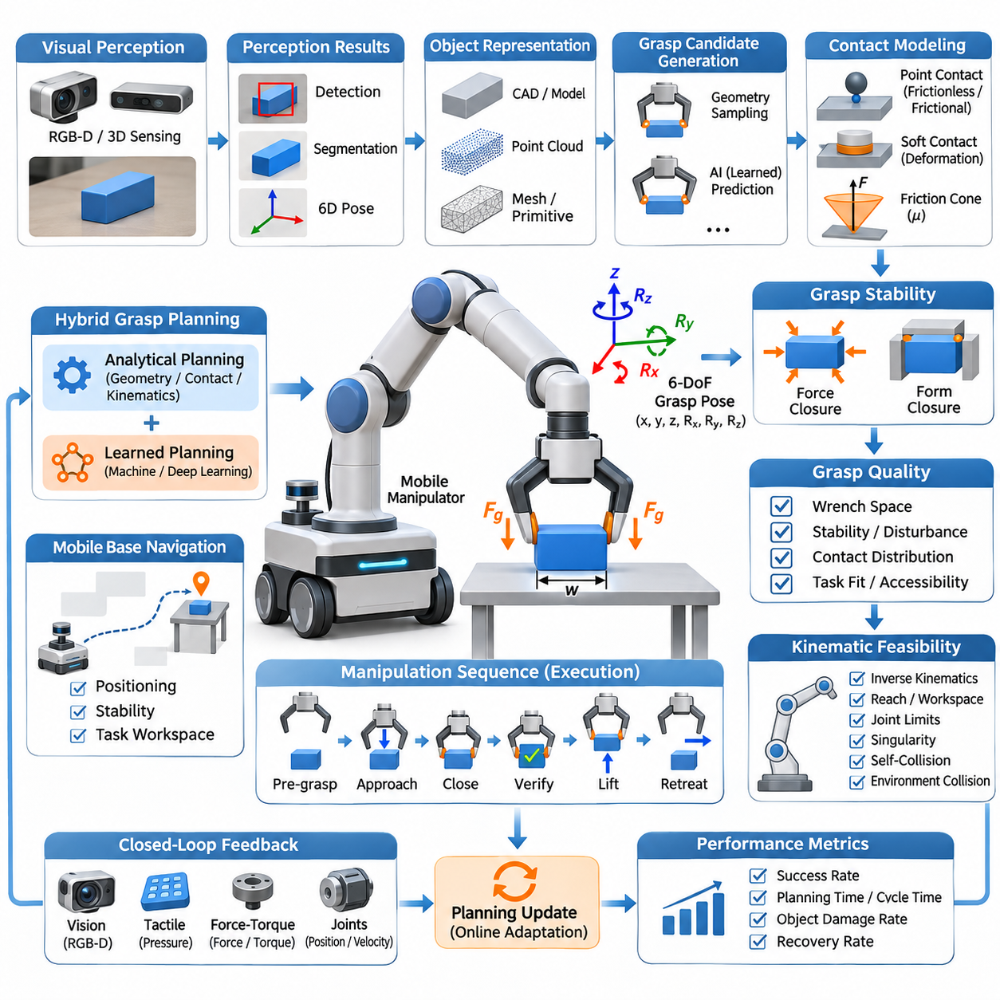
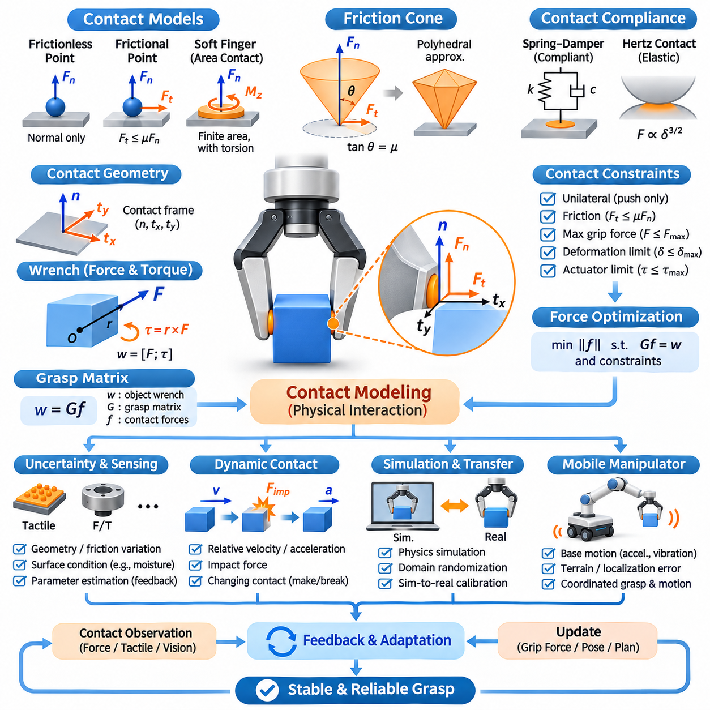
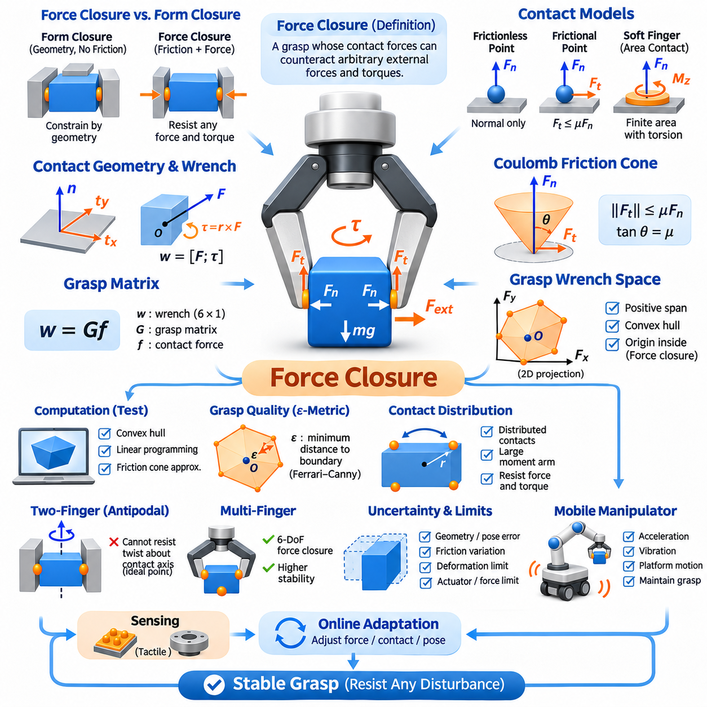
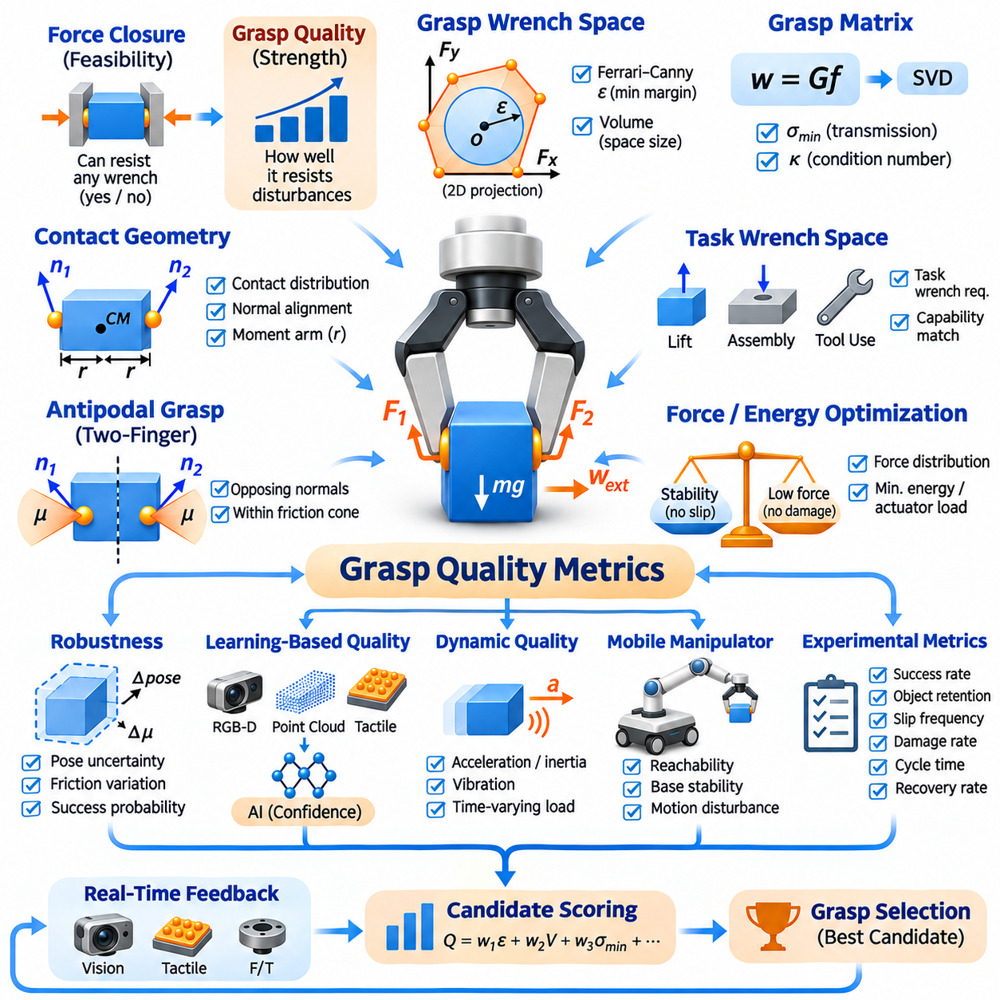
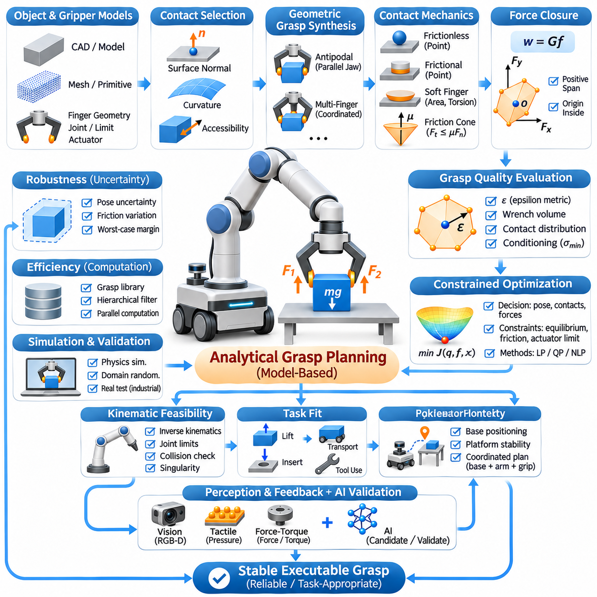
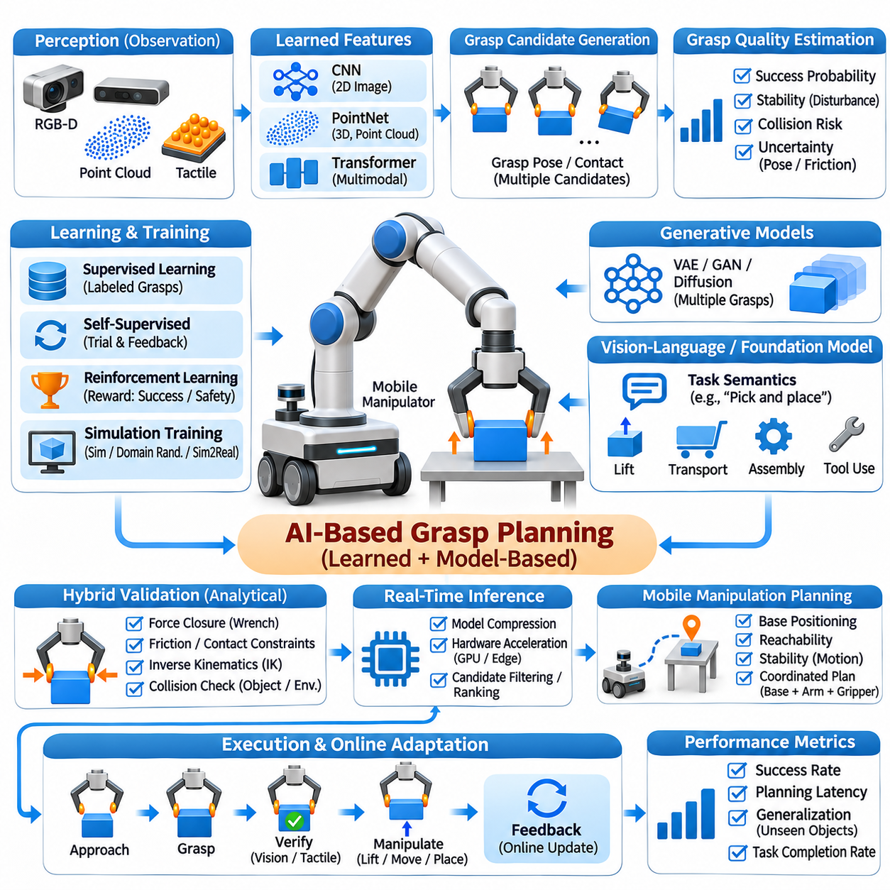
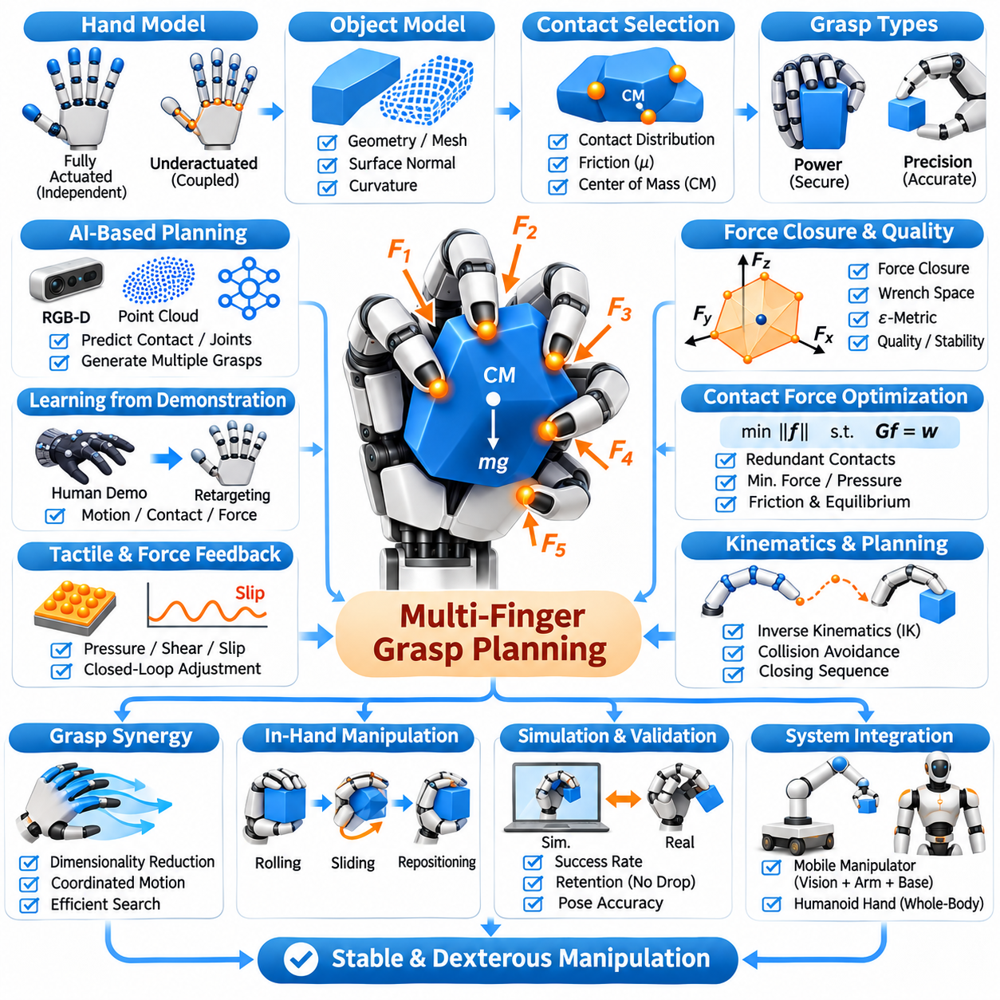
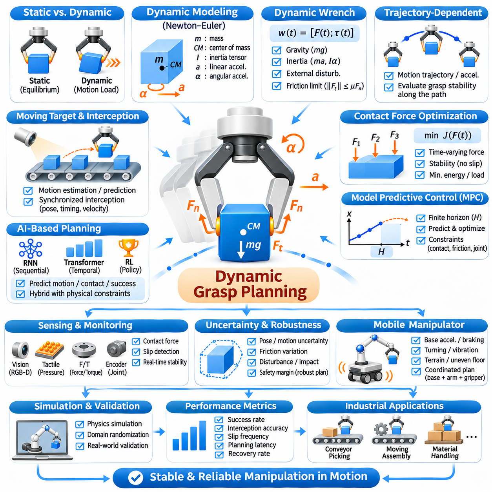
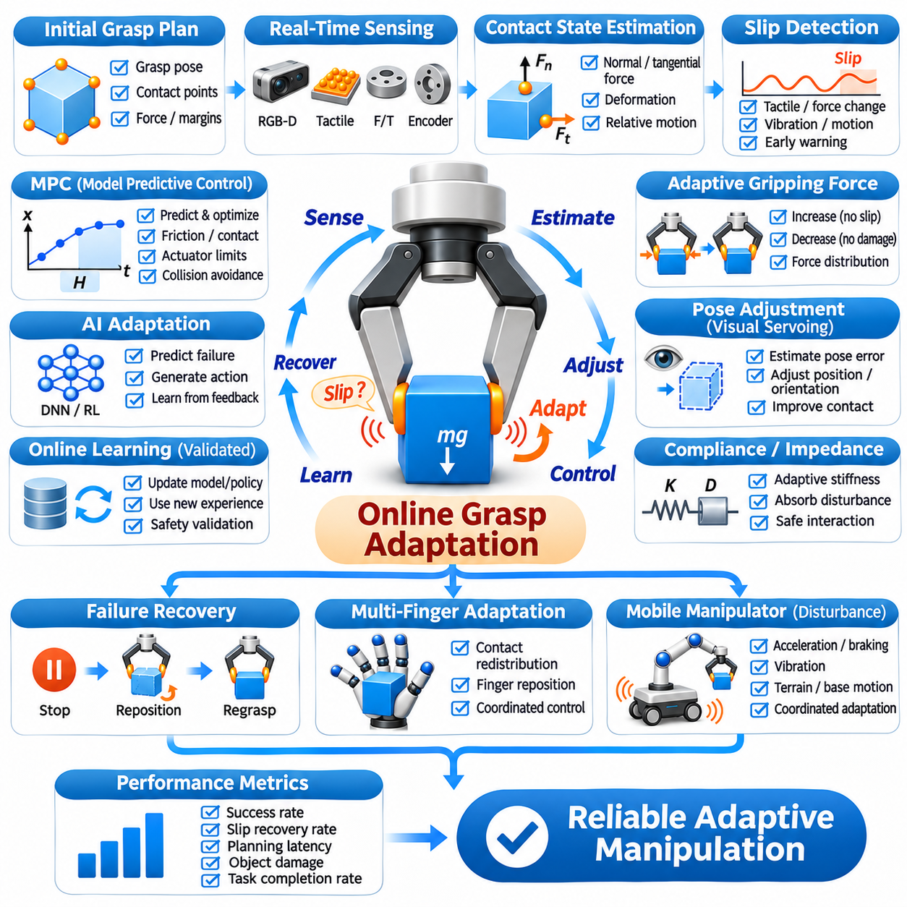
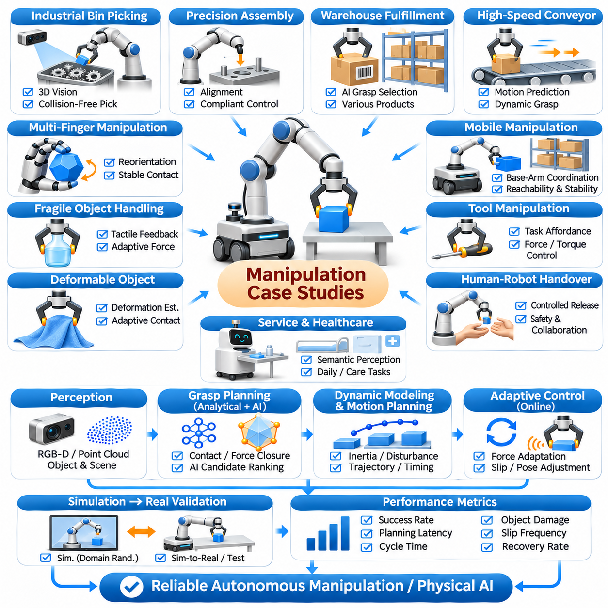

**Volume 03. Vision Manipulation and AI**


# Chapter 06. Grasp Planning

##  

## 01 Grasp Planning Fundamentals

{width="7.268055555555556in" height="7.268055555555556in"}

Grasp planning is a fundamental process in robotic manipulation that determines how a robot should approach, contact, grasp, and securely hold an object to accomplish a specific task. While grasp detection identifies potential grasping opportunities from sensory information, grasp planning evaluates these opportunities and determines physically feasible actions. It establishes an essential connection between visual perception, robotic motion, and physical interaction.

The primary objective of grasp planning is to generate a stable, reliable, and executable grasp that satisfies task requirements and physical constraints. A successful grasp must prevent unintended object movement, resist external disturbances, and support subsequent manipulation operations. The planning process must consider object geometry, material properties, weight distribution, environmental conditions, and the mechanical capabilities of the robotic gripper.

A grasp is generally represented by the position and orientation of the end effector relative to the target object, together with the configuration of individual fingers or gripping mechanisms. In three-dimensional environments, a grasp pose typically includes six degrees of freedom, consisting of three translational and three rotational components. Additional parameters may describe finger positions, gripper opening width, approach direction, and gripping force.

Grasp planning begins with acquiring environmental information through visual perception systems. RGB cameras, depth cameras, stereo vision systems, and three-dimensional sensors provide information about object locations, orientations, dimensions, and surrounding obstacles. Object detection, instance segmentation, and six-dimensional pose estimation transform raw sensory observations into structured representations suitable for manipulation planning.

Object representation significantly influences the effectiveness of grasp planning. Known objects can be described using computer-aided design models, geometric primitives, surface meshes, or predefined grasp configurations. Unknown objects may instead be represented through point clouds, depth images, or learned geometric features. These representations enable the planning system to identify accessible surfaces, potential contact regions, and suitable grasping directions.

Grasp candidate generation identifies multiple potential configurations that the robotic gripper could execute. Candidate grasps may be generated through geometric sampling, surface normal analysis, contact point estimation, or artificial intelligence models. Generating multiple alternatives allows the robot to evaluate different approaches rather than depending on a single prediction, improving operational flexibility in cluttered and uncertain environments.

Contact modeling provides the physical foundation for understanding interactions between the gripper and the target object. Contact forces depend on surface geometry, friction coefficients, material deformation, and applied gripping pressure. Different contact models, including frictionless point contact, frictional point contact, and soft finger contact, describe how forces and moments can be transmitted between the gripper and the object.

Force closure is an important concept for evaluating grasp stability. A grasp achieves force closure when its contact configuration can theoretically resist external forces and torques in arbitrary directions through admissible contact forces. Form closure, in contrast, relies on geometric constraints to prevent object motion. These principles provide analytical foundations for determining whether a grasp configuration can securely constrain an object.

Grasp quality metrics provide quantitative methods for comparing candidate grasps. Common evaluation criteria include force closure capability, resistance to external disturbances, contact distribution, grasp wrench space, and sensitivity to positioning errors. Practical evaluation also considers accessibility, collision probability, required gripping force, and compatibility with subsequent manipulation tasks. High theoretical quality alone does not guarantee successful execution.

Kinematic feasibility determines whether the robotic manipulator can physically reach and execute a proposed grasp. Inverse kinematics calculates joint configurations corresponding to the desired end-effector pose. Joint limits, workspace boundaries, singularities, self-collisions, and environmental obstacles must be considered during this evaluation. A mechanically stable grasp may still be rejected when the manipulator cannot safely achieve the required configuration.

Grasp planning must also consider the complete manipulation sequence rather than only the final contact configuration. A typical sequence includes movement toward a pre-grasp pose, controlled approach, gripper closure, grasp verification, object lifting, and retreat. Each stage must satisfy collision avoidance and motion constraints. Integration with motion planning ensures that selected grasp configurations can be reached through executable robot trajectories.

Analytical grasp planning uses mathematical models of object geometry, contact mechanics, friction, and robotic kinematics to generate and evaluate grasp configurations. These methods provide physically interpretable results and are particularly effective when accurate object models are available. However, their computational requirements and dependence on reliable physical parameters may limit their effectiveness in highly variable or unstructured environments.

Artificial intelligence-based grasp planning uses machine learning and deep learning to predict suitable grasp configurations directly from sensory observations. Neural networks can learn relationships between object geometry, visual appearance, contact locations, and grasp success. Training data may be collected through physical experiments, human demonstrations, or robotic simulation. Hybrid approaches combine learned predictions with analytical feasibility and stability checks.

Mobile manipulators introduce additional planning challenges because grasp feasibility depends on both the robot arm and the mobile platform configuration. Base positioning, localization uncertainty, platform stability, and manipulator reachability must be evaluated together. When a target cannot be grasped from the current location, the system may reposition the mobile platform to obtain a better viewing angle, improve accessibility, or increase manipulation stability.

Grasp planning becomes more reliable when integrated with closed-loop feedback and online adaptation. Visual feedback, tactile sensors, force-torque sensors, and joint measurements allow the robot to detect unexpected contact, object displacement, or slipping. Performance should be evaluated using grasp success rate, execution time, object damage rate, and recovery capability. Together, these mechanisms support safe, adaptive, and autonomous manipulation in real-world environments.

파지 계획(Grasp Planning)은 로봇 조작(Robotic Manipulation)의 기본적인 프로세스로, 특정 작업을 수행하기 위해 로봇이 물체에 접근하고, 접촉하며, 파지하고, 안정적으로 유지하는 방법을 결정한다. 파지 검출(Grasp Detection)이 센서 정보로부터 잠재적인 파지 가능성을 식별하는 반면, 파지 계획은 이러한 가능성을 평가하고 물리적으로 실행 가능한 동작을 결정한다. 이는 시각 인식(Visual Perception), 로봇 동작(Robotic Motion), 물리적 상호작용(Physical Interaction)을 연결하는 핵심적인 역할을 수행한다.

파지 계획의 주요 목적은 작업 요구사항(Task Requirements)과 물리적 제약조건(Physical Constraints)을 충족하는 안정적이고 신뢰성이 높으며 실행 가능한 파지를 생성하는 것이다. 성공적인 파지는 의도하지 않은 물체의 움직임을 방지하고, 외부 교란(External Disturbances)에 저항하며, 후속 조작 작업을 지원해야 한다. 계획 과정에서는 물체의 기하학적 형상(Object Geometry), 재료 특성(Material Properties), 무게 분포(Weight Distribution), 환경 조건(Environmental Conditions), 로봇 그리퍼의 기계적 성능을 고려해야 한다.

파지는 일반적으로 대상 물체에 대한 말단장치(End Effector)의 위치(Position)와 방향(Orientation), 개별 손가락 또는 파지 메커니즘(Gripping Mechanism)의 구성으로 표현된다. 3차원 환경에서 파지 자세(Grasp Pose)는 일반적으로 세 개의 병진 성분(Translational Components)과 세 개의 회전 성분(Rotational Components)으로 구성되는 6자유도(6 Degrees of Freedom, 6-DoF)를 포함한다. 추가적인 매개변수에는 손가락 위치(Finger Position), 그리퍼 개방 폭(Gripper Opening Width), 접근 방향(Approach Direction), 파지력(Gripping Force) 등이 포함될 수 있다.

파지 계획은 시각 인식 시스템(Visual Perception System)을 통해 환경 정보를 획득하는 과정에서 시작된다. RGB 카메라(RGB Camera), 깊이 카메라(Depth Camera), 스테레오 비전 시스템(Stereo Vision System), 3차원 센서(3D Sensor)는 물체의 위치, 방향, 크기 및 주변 장애물에 대한 정보를 제공한다. 객체 검출(Object Detection), 인스턴스 분할(Instance Segmentation), 6차원 자세 추정(6D Pose Estimation)은 원시 센서 관측 데이터를 조작 계획에 적합한 구조화된 표현(Structured Representation)으로 변환한다.

물체 표현(Object Representation)은 파지 계획의 효율성에 상당한 영향을 미친다. 알려진 물체는 컴퓨터 지원 설계 모델(Computer-Aided Design Model, CAD Model), 기본 기하학적 형상(Geometric Primitives), 표면 메시(Surface Mesh), 사전 정의된 파지 구성(Predefined Grasp Configuration)을 사용하여 표현할 수 있다. 반면, 알려지지 않은 물체는 점군(Point Cloud), 깊이 영상(Depth Image), 학습된 기하학적 특징(Learned Geometric Features)을 통해 표현할 수 있다. 이러한 표현은 계획 시스템이 접근 가능한 표면, 잠재적인 접촉 영역, 적절한 파지 방향을 식별할 수 있도록 한다.

파지 후보 생성(Grasp Candidate Generation)은 로봇 그리퍼가 실행할 수 있는 여러 잠재적 파지 구성을 식별하는 과정이다. 파지 후보는 기하학적 샘플링(Geometric Sampling), 표면 법선 분석(Surface Normal Analysis), 접촉점 추정(Contact Point Estimation), 인공지능 모델(Artificial Intelligence Model) 등을 통해 생성할 수 있다. 여러 대안을 생성함으로써 로봇은 단일 예측에 의존하지 않고 다양한 접근 방법을 평가할 수 있으며, 복잡하고 불확실한 환경에서 운용 유연성(Operational Flexibility)을 향상시킬 수 있다.

접촉 모델링(Contact Modeling)은 그리퍼와 대상 물체 사이의 상호작용을 이해하기 위한 물리적 기반을 제공한다. 접촉력(Contact Force)은 표면 형상(Surface Geometry), 마찰계수(Friction Coefficient), 재료 변형(Material Deformation), 가해지는 파지 압력(Gripping Pressure)에 따라 달라진다. 무마찰 점 접촉(Frictionless Point Contact), 마찰 점 접촉(Frictional Point Contact), 연성 손가락 접촉(Soft Finger Contact) 등 다양한 접촉 모델은 그리퍼와 물체 사이에서 힘(Force)과 모멘트(Moment)가 전달되는 방식을 설명한다.

힘 폐쇄(Force Closure)는 파지 안정성(Grasp Stability)을 평가하기 위한 중요한 개념이다. 파지의 접촉 구성이 허용 가능한 접촉력을 통해 이론적으로 임의의 방향에서 작용하는 외력(External Force)과 외부 토크(External Torque)에 저항할 수 있을 때 힘 폐쇄가 성립한다. 반면, 형상 폐쇄(Form Closure)는 기하학적 제약조건(Geometric Constraints)을 통해 물체의 움직임을 방지한다. 이러한 원리는 특정 파지 구성이 물체의 움직임을 안정적으로 제한할 수 있는지를 판단하기 위한 해석적 기반(Analytical Foundation)을 제공한다.

파지 품질 지표(Grasp Quality Metrics)는 파지 후보를 비교하기 위한 정량적 평가 방법을 제공한다. 일반적인 평가 기준에는 힘 폐쇄 능력(Force Closure Capability), 외부 교란에 대한 저항성(Disturbance Resistance), 접촉점 분포(Contact Distribution), 파지 렌치 공간(Grasp Wrench Space), 위치 오차에 대한 민감도(Sensitivity to Positioning Errors)가 포함된다. 실제 평가에서는 접근성(Accessibility), 충돌 가능성(Collision Probability), 요구 파지력, 후속 조작 작업과의 적합성도 고려한다. 높은 이론적 파지 품질만으로 성공적인 실행이 보장되는 것은 아니다.

기구학적 실행 가능성(Kinematic Feasibility)은 로봇 매니퓰레이터가 제안된 파지에 물리적으로 도달하고 이를 실행할 수 있는지를 결정한다. 역기구학(Inverse Kinematics, IK)은 목표 말단장치 자세(Desired End-Effector Pose)에 대응하는 관절 구성(Joint Configuration)을 계산한다. 이러한 평가 과정에서는 관절 한계(Joint Limits), 작업공간 경계(Workspace Boundaries), 특이점(Singularities), 자기 충돌(Self-Collision), 환경 장애물(Environmental Obstacles)을 고려해야 한다. 기계적으로 안정적인 파지라도 매니퓰레이터가 요구되는 구성에 안전하게 도달할 수 없다면 해당 파지는 제외될 수 있다.

파지 계획은 최종 접촉 구성뿐만 아니라 전체 조작 시퀀스(Manipulation Sequence)를 고려해야 한다. 일반적인 시퀀스에는 사전 파지 자세(Pre-Grasp Pose)로의 이동, 제어된 접근(Controlled Approach), 그리퍼 닫기(Gripper Closure), 파지 검증(Grasp Verification), 물체 들어 올리기(Object Lifting), 후퇴(Retreat)가 포함된다. 각 단계는 충돌 회피(Collision Avoidance) 및 동작 제약조건(Motion Constraints)을 충족해야 한다. 동작 계획(Motion Planning)과의 통합을 통해 선택된 파지 구성에 실행 가능한 로봇 궤적(Robot Trajectory)으로 도달할 수 있도록 한다.

해석적 파지 계획(Analytical Grasp Planning)은 물체의 기하학적 형상, 접촉 역학(Contact Mechanics), 마찰(Friction), 로봇 기구학(Robot Kinematics)에 대한 수학적 모델(Mathematical Model)을 사용하여 파지 구성을 생성하고 평가한다. 이러한 방법은 물리적으로 해석 가능한 결과(Physically Interpretable Results)를 제공하며, 정확한 물체 모델(Object Model)을 사용할 수 있는 경우 특히 효과적이다. 그러나 계산 요구사항(Computational Requirements)과 신뢰성 높은 물리적 매개변수에 대한 의존성으로 인해 변화가 심하거나 비정형적인 환경(Unstructured Environment)에서는 그 효과가 제한될 수 있다.

인공지능 기반 파지 계획(AI-Based Grasp Planning)은 기계학습(Machine Learning)과 딥러닝(Deep Learning)을 활용하여 센서 관측 데이터로부터 적절한 파지 구성을 직접 예측한다. 신경망(Neural Network)은 물체의 기하학적 형상, 시각적 외관(Visual Appearance), 접촉 위치(Contact Location), 파지 성공(Grasp Success) 사이의 관계를 학습할 수 있다. 학습 데이터(Training Data)는 실제 물리적 실험, 인간 시연(Human Demonstration), 로봇 시뮬레이션(Robot Simulation)을 통해 수집할 수 있다. 하이브리드 접근법(Hybrid Approach)은 학습 기반 예측과 해석적 실행 가능성 및 안정성 검증을 결합한다.

모바일 매니퓰레이터(Mobile Manipulator)는 파지 실행 가능성이 로봇 팔(Robot Arm)과 이동 플랫폼(Mobile Platform)의 구성 모두에 의존하기 때문에 추가적인 계획상의 문제를 발생시킨다. 이동 베이스 위치 설정(Base Positioning), 위치 추정 불확실성(Localization Uncertainty), 플랫폼 안정성(Platform Stability), 매니퓰레이터 도달 가능성(Manipulator Reachability)을 종합적으로 평가해야 한다. 현재 위치에서 대상 물체를 파지할 수 없는 경우, 시스템은 더 나은 관측 각도(Viewing Angle)를 확보하고, 접근성을 개선하거나, 조작 안정성(Manipulation Stability)을 향상시키기 위해 이동 플랫폼의 위치를 재조정할 수 있다.

파지 계획은 폐루프 피드백(Closed-Loop Feedback) 및 온라인 적응(Online Adaptation)과 통합될 때 더욱 높은 신뢰성을 확보할 수 있다. 시각 피드백(Visual Feedback), 촉각 센서(Tactile Sensor), 힘·토크 센서(Force-Torque Sensor), 관절 측정값(Joint Measurements)을 통해 로봇은 예기치 않은 접촉, 물체 변위(Object Displacement), 미끄러짐(Slip)을 감지할 수 있다. 성능은 파지 성공률(Grasp Success Rate), 실행 시간(Execution Time), 물체 손상률(Object Damage Rate), 복구 능력(Recovery Capability)을 사용하여 평가해야 한다. 이러한 메커니즘은 실제 환경에서 안전하고 적응적이며 자율적인 로봇 조작(Autonomous Robotic Manipulation)을 지원한다.

##  

## 02 Contact Modeling

{width="7.268055555555556in" height="7.268055555555556in"}

Contact modeling is a fundamental component of robotic grasp planning that describes the physical interactions between a robotic gripper and an object during manipulation. When a robot establishes contact with an object, forces and moments are transmitted through the contact interface. Accurate contact models enable the robotic system to predict object behavior, evaluate grasp stability, determine appropriate gripping forces, and prevent unintended motion or damage.

A contact occurs when two physical surfaces interact at a specific location or region. In robotic manipulation, contact may occur between a gripper finger and an object, between an object and an environmental surface, or between multiple objects. Each contact is characterized by its position, surface orientation, contact normal, frictional properties, and mechanical compliance. These characteristics determine the types of forces and moments that can be transmitted.

Contact geometry provides the mathematical foundation for representing physical interactions. A contact coordinate system is typically established at each contact location, with one axis aligned with the surface normal and the remaining axes positioned along the tangential plane. Contact forces can therefore be decomposed into normal and tangential components. This representation simplifies the analysis of friction, force distribution, and object equilibrium.

The frictionless point contact model represents an idealized interaction in which a gripper finger applies a compressive force perpendicular to the object surface. Tangential forces and contact moments cannot be transmitted under this assumption. Although frictionless contact simplifies mathematical analysis, it provides limited grasping capabilities. Stable manipulation with frictionless contacts requires carefully arranged geometric constraints that restrict object movement.

The frictional point contact model extends the frictionless model by allowing tangential forces to be transmitted through friction. The magnitude of the tangential force is constrained by the normal contact force and the coefficient of friction according to Coulomb\'s friction law. This model more accurately represents conventional robotic gripping mechanisms and is widely used in analytical grasp planning, grasp stability assessment, and contact force optimization.

The friction cone describes the set of contact force directions that can be supported without sliding under the Coulomb friction model. Its opening angle depends on the coefficient of friction. Contact forces located within the friction cone satisfy the static friction constraint, while forces exceeding its boundary cannot be maintained without slipping. Computational implementations frequently approximate friction cones using polyhedral structures to simplify optimization.

The soft finger contact model accounts for the finite contact area created when a compliant finger presses against an object. Unlike the idealized frictional point contact model, soft finger contact can additionally transmit a torsional moment around the contact normal. This capability improves resistance to rotational disturbances and provides greater grasp stability. The model is especially relevant to rubber-coated grippers, adaptive fingers, and soft robotic hands.

Contact compliance describes the relationship between applied forces and the resulting deformation of contacting surfaces. Real objects and gripper materials exhibit varying degrees of stiffness, elasticity, and damping. Linear spring-damper models provide simplified representations of compliant contact, while nonlinear models can describe more complex deformation behavior. Hertzian contact theory is useful for modeling certain non-adhesive elastic contacts.

Contact forces contribute to both translational and rotational effects on a grasped object. The combined representation of force and torque is known as a wrench. The rotational contribution of a contact force depends on its position relative to a chosen object reference point. By transforming individual contact forces and moments into a common coordinate system, the planning algorithm can calculate their combined influence on object equilibrium and stability.

The grasp matrix establishes a mathematical relationship between individual contact forces and the resultant wrench acting on the object. It incorporates contact locations, orientations, and the force transmission capabilities of each contact model. This representation supports the analysis of force closure, internal gripping forces, and external disturbance compensation. It also enables the formulation of constrained optimization problems for distributing contact forces.

Contact constraints ensure that calculated interaction forces remain physically feasible. A conventional unilateral contact can push against an object but cannot pull it without adhesion or another attachment mechanism. Additional constraints include friction limits, maximum gripping forces, material deformation limits, and actuator capabilities. Contact force optimization must satisfy these restrictions while maintaining object equilibrium and preventing excessive pressure.

Contact modeling becomes more challenging when objects possess uncertain geometry, variable friction characteristics, or deformable structures. Surface contamination, moisture, manufacturing tolerances, and material differences can significantly influence contact behavior. Robust grasp planning therefore incorporates uncertainty margins, conservative friction estimates, and feedback mechanisms. Tactile sensing and force-torque measurements can improve contact parameter estimation.

Dynamic contact modeling extends static analysis by considering relative velocity, acceleration, impact forces, and changing contact configurations. During object acquisition, unexpected collisions or rapid gripper closure may generate transient forces that exceed acceptable limits. Contact dynamics can be represented using penalty-based methods or constraint-based formulations. These approaches support simulation, impact analysis, and the development of compliant manipulation strategies.

Physics-based simulation provides an effective environment for evaluating contact models before deploying grasping algorithms on physical robots. Simulation platforms reproduce friction, collision, material deformation, and contact force interactions with varying levels of fidelity. However, differences between simulated and actual contact behavior create a simulation-to-reality gap. Experimental calibration and parameter randomization can reduce modeling errors and improve transfer reliability.

For mobile manipulators, contact modeling must account for disturbances generated by platform acceleration, vibration, localization errors, and structural compliance. Integrating contact models with visual perception, tactile feedback, force control, and motion planning enables the robot to adapt its grasp during execution. Accurate contact representation provides the physical foundation for force closure analysis, grasp quality evaluation, and reliable autonomous manipulation.

접촉 모델링(Contact Modeling)은 조작 과정에서 로봇 그리퍼(Robotic Gripper)와 물체 사이에 발생하는 물리적 상호작용(Physical Interaction)을 설명하는 로봇 파지 계획(Robotic Grasp Planning)의 기본 구성 요소이다. 로봇이 물체와 접촉하면 접촉 인터페이스(Contact Interface)를 통해 힘(Force)과 모멘트(Moment)가 전달된다. 정확한 접촉 모델(Contact Model)은 로봇 시스템이 물체의 거동을 예측하고, 파지 안정성(Grasp Stability)을 평가하며, 적절한 파지력(Gripping Force)을 결정하고, 의도하지 않은 움직임이나 손상을 방지할 수 있도록 한다.

접촉(Contact)은 두 물리적 표면이 특정 위치 또는 영역에서 상호작용할 때 발생한다. 로봇 조작(Robotic Manipulation)에서 접촉은 그리퍼의 손가락과 물체 사이, 물체와 환경 표면(Environmental Surface) 사이 또는 여러 물체 사이에서 발생할 수 있다. 각각의 접촉은 위치(Position), 표면 방향(Surface Orientation), 접촉 법선(Contact Normal), 마찰 특성(Frictional Properties), 기계적 유연성(Mechanical Compliance)으로 특징지어진다. 이러한 특성은 전달될 수 있는 힘과 모멘트의 유형을 결정한다.

접촉 기하학(Contact Geometry)은 물리적 상호작용을 표현하기 위한 수학적 기반을 제공한다. 일반적으로 각 접촉 위치에는 접촉 좌표계(Contact Coordinate System)가 설정되며, 하나의 축은 표면 법선(Surface Normal)과 정렬되고 나머지 축은 접평면(Tangential Plane)을 따라 배치된다. 따라서 접촉력(Contact Force)은 법선 성분(Normal Component)과 접선 성분(Tangential Component)으로 분해할 수 있다. 이러한 표현은 마찰(Friction), 힘 분포(Force Distribution), 물체 평형(Object Equilibrium)에 대한 분석을 단순화한다.

무마찰 점 접촉 모델(Frictionless Point Contact Model)은 그리퍼의 손가락이 물체 표면에 수직인 압축력(Compressive Force)을 가하는 이상적인 상호작용을 표현한다. 이러한 가정에서는 접선력(Tangential Force)과 접촉 모멘트(Contact Moment)가 전달될 수 없다. 무마찰 접촉(Frictionless Contact)은 수학적 분석을 단순화하지만 제한적인 파지 능력을 제공한다. 무마찰 접촉을 이용한 안정적인 조작을 위해서는 물체의 움직임을 제한하도록 정밀하게 배치된 기하학적 제약조건(Geometric Constraints)이 필요하다.

마찰 점 접촉 모델(Frictional Point Contact Model)은 마찰을 통해 접선력을 전달할 수 있도록 무마찰 모델을 확장한 것이다. 접선력의 크기는 쿨롱 마찰 법칙(Coulomb\'s Friction Law)에 따라 법선 접촉력(Normal Contact Force)과 마찰계수(Coefficient of Friction)에 의해 제한된다. 이 모델은 일반적인 로봇 파지 메커니즘(Robotic Gripping Mechanism)을 더욱 정확하게 표현하며, 해석적 파지 계획(Analytical Grasp Planning), 파지 안정성 평가(Grasp Stability Assessment), 접촉력 최적화(Contact Force Optimization)에 널리 활용된다.

마찰 원뿔(Friction Cone)은 쿨롱 마찰 모델(Coulomb Friction Model)에서 미끄러짐 없이 유지될 수 있는 접촉력 방향의 집합을 설명한다. 마찰 원뿔의 개방각(Opening Angle)은 마찰계수에 따라 결정된다. 마찰 원뿔 내부에 위치하는 접촉력은 정지 마찰 제약조건(Static Friction Constraint)을 충족하지만, 경계를 벗어나는 힘은 미끄러짐(Slip) 없이 유지될 수 없다. 계산 기반 구현(Computational Implementation)에서는 최적화 과정을 단순화하기 위해 마찰 원뿔을 다면체 구조(Polyhedral Structure)로 근사하는 방법이 자주 사용된다.

연성 손가락 접촉 모델(Soft Finger Contact Model)은 유연한 손가락(Compliant Finger)이 물체를 누를 때 형성되는 유한한 접촉 면적(Finite Contact Area)을 고려한다. 이상적인 마찰 점 접촉 모델과 달리 연성 손가락 접촉은 접촉 법선을 중심으로 하는 비틀림 모멘트(Torsional Moment)를 추가로 전달할 수 있다. 이러한 능력은 회전 교란(Rotational Disturbance)에 대한 저항성을 향상시키고 더욱 높은 파지 안정성을 제공한다. 이 모델은 특히 고무 코팅 그리퍼(Rubber-Coated Gripper), 적응형 손가락(Adaptive Finger), 소프트 로봇 핸드(Soft Robotic Hand)에 적합하다.

접촉 유연성(Contact Compliance)은 가해진 힘과 그 결과로 발생하는 접촉 표면의 변형(Deformation) 사이의 관계를 설명한다. 실제 물체와 그리퍼의 재료는 다양한 수준의 강성(Stiffness), 탄성(Elasticity), 감쇠(Damping) 특성을 나타낸다. 선형 스프링·댐퍼 모델(Linear Spring-Damper Model)은 유연한 접촉을 단순화하여 표현하며, 비선형 모델(Nonlinear Model)은 더욱 복잡한 변형 거동(Deformation Behavior)을 설명할 수 있다. 헤르츠 접촉 이론(Hertzian Contact Theory)은 특정 비접착성 탄성 접촉(Non-Adhesive Elastic Contact)을 모델링하는 데 유용하다.

접촉력은 파지된 물체에 병진 효과(Translational Effect)와 회전 효과(Rotational Effect)를 모두 발생시킨다. 힘과 토크(Torque)를 결합한 표현을 렌치(Wrench)라고 한다. 접촉력의 회전 성분은 선택된 물체 기준점(Object Reference Point)에 대한 접촉 위치에 따라 결정된다. 개별 접촉력과 모멘트를 공통 좌표계(Common Coordinate System)로 변환함으로써 계획 알고리즘(Planning Algorithm)은 이러한 힘과 모멘트가 물체의 평형 및 안정성에 미치는 종합적인 영향을 계산할 수 있다.

파지 행렬(Grasp Matrix)은 개별 접촉력과 물체에 작용하는 합성 렌치(Resultant Wrench) 사이의 수학적 관계를 정의한다. 파지 행렬은 접촉 위치(Contact Location), 방향(Orientation), 각 접촉 모델의 힘 전달 능력(Force Transmission Capability)을 포함한다. 이러한 표현은 힘 폐쇄(Force Closure), 내부 파지력(Internal Gripping Force), 외부 교란 보상(External Disturbance Compensation)에 대한 분석을 지원한다. 또한 접촉력을 분배하기 위한 제약조건 기반 최적화 문제(Constrained Optimization Problem)를 정식화할 수 있도록 한다.

접촉 제약조건(Contact Constraints)은 계산된 상호작용력(Interaction Force)이 물리적으로 실현 가능한 범위 내에 유지되도록 한다. 일반적인 단방향 접촉(Unilateral Contact)은 물체를 밀 수 있지만 접착(Adhesion)이나 다른 부착 메커니즘(Attachment Mechanism) 없이는 물체를 당길 수 없다. 추가적인 제약조건에는 마찰 한계(Friction Limits), 최대 파지력(Maximum Gripping Force), 재료 변형 한계(Material Deformation Limits), 액추에이터 성능(Actuator Capability)이 포함된다. 접촉력 최적화는 물체의 평형을 유지하고 과도한 압력을 방지하면서 이러한 제약조건을 충족해야 한다.

물체가 불확실한 기하학적 형상(Uncertain Geometry), 가변적인 마찰 특성(Variable Friction Characteristics), 변형 가능한 구조(Deformable Structure)를 가지는 경우 접촉 모델링은 더욱 복잡해진다. 표면 오염(Surface Contamination), 수분(Moisture), 제조 공차(Manufacturing Tolerance), 재료의 차이는 접촉 거동(Contact Behavior)에 상당한 영향을 미칠 수 있다. 따라서 강건한 파지 계획(Robust Grasp Planning)은 불확실성 여유(Uncertainty Margin), 보수적인 마찰 추정(Conservative Friction Estimation), 피드백 메커니즘(Feedback Mechanism)을 포함한다. 촉각 센싱(Tactile Sensing)과 힘·토크 측정(Force-Torque Measurement)은 접촉 매개변수 추정(Contact Parameter Estimation)의 정확도를 향상시킬 수 있다.

동적 접촉 모델링(Dynamic Contact Modeling)은 상대 속도(Relative Velocity), 가속도(Acceleration), 충격력(Impact Force), 변화하는 접촉 구성(Contact Configuration)을 고려함으로써 정적 분석(Static Analysis)을 확장한다. 물체 파지 과정에서 예기치 않은 충돌이나 급격한 그리퍼 닫힘(Gripper Closure)은 허용 한계를 초과하는 과도 힘(Transient Force)을 발생시킬 수 있다. 접촉 동역학(Contact Dynamics)은 페널티 기반 방법(Penalty-Based Method) 또는 제약조건 기반 정식화(Constraint-Based Formulation)를 사용하여 표현할 수 있다. 이러한 접근법은 시뮬레이션, 충격 분석(Impact Analysis), 유연한 조작 전략(Compliant Manipulation Strategy)의 개발을 지원한다.

물리 기반 시뮬레이션(Physics-Based Simulation)은 실제 로봇에 파지 알고리즘(Grasping Algorithm)을 배포하기 전에 접촉 모델을 평가할 수 있는 효과적인 환경을 제공한다. 시뮬레이션 플랫폼(Simulation Platform)은 다양한 수준의 재현 충실도(Fidelity)로 마찰, 충돌(Collision), 재료 변형, 접촉력 상호작용을 재현한다. 그러나 시뮬레이션과 실제 접촉 거동의 차이는 시뮬레이션과 현실 사이의 격차(Simulation-to-Reality Gap, Sim2Real Gap)를 발생시킨다. 실험적 보정(Experimental Calibration)과 매개변수 무작위화(Parameter Randomization)는 모델링 오차(Modeling Error)를 줄이고 실제 환경으로의 전이 신뢰성(Transfer Reliability)을 향상시킬 수 있다.

모바일 매니퓰레이터(Mobile Manipulator)의 접촉 모델링은 이동 플랫폼의 가속도(Platform Acceleration), 진동(Vibration), 위치 추정 오차(Localization Error), 구조적 유연성(Structural Compliance)에 의해 발생하는 교란을 고려해야 한다. 접촉 모델을 시각 인식(Visual Perception), 촉각 피드백(Tactile Feedback), 힘 제어(Force Control), 동작 계획(Motion Planning)과 통합함으로써 로봇은 실행 과정에서 파지 상태를 적응적으로 조정할 수 있다. 정확한 접촉 표현(Contact Representation)은 힘 폐쇄 분석(Force Closure Analysis), 파지 품질 평가(Grasp Quality Evaluation), 신뢰성 높은 자율 조작(Autonomous Manipulation)을 위한 물리적 기반을 제공한다.

##  

## 03 Force Closure

{width="7.268055555555556in" height="7.268055555555556in"}

Force closure is a fundamental concept in robotic grasp planning that describes the ability of a grasp configuration to resist arbitrary external forces and torques acting on an object. A grasp achieves force closure when its contact forces can theoretically counteract disturbances in every direction within the assumed contact model. This principle provides an essential mathematical and physical foundation for evaluating grasp stability and designing reliable manipulation strategies.

The fundamental objective of force closure is to constrain object motion through appropriately distributed contact forces. During robotic manipulation, an object may experience gravitational forces, inertial forces, external impacts, and rotational disturbances. A force closure grasp enables the robotic gripper to generate opposing forces and moments that maintain object equilibrium, provided that sufficient contact forces are available within the physical limitations of the gripping system.

Force closure differs from form closure in the mechanisms used to constrain object movement. Form closure relies on geometric arrangements of contact points that prevent object motion without depending on friction. Force closure, however, generally utilizes contact geometry and frictional forces to resist external disturbances. Consequently, force closure can often be achieved with fewer contact points, making it particularly useful for conventional robotic grippers and multi-fingered robotic hands.

Contact mechanics establishes the physical conditions necessary for force closure. Each contact between a gripper finger and an object can transmit forces according to its contact model, surface orientation, and friction coefficient. Frictionless point contacts transmit only normal forces, while frictional point contacts additionally support tangential forces. Soft finger contacts can also transmit torsional moments, increasing the range of disturbances that a grasp can resist.

The friction cone plays an important role in determining whether contact forces are physically admissible. Under Coulomb\'s friction law, tangential contact forces must remain within limits determined by the normal force and the coefficient of friction. A larger friction coefficient generally expands the range of admissible force directions. Grasp configurations must therefore be evaluated using realistic friction constraints rather than assuming unrestricted force transmission.

Force closure analysis requires a mathematical representation of the combined effects of contact forces on an object. The wrench represents a combination of force and torque acting relative to a selected reference point. In three-dimensional space, a wrench contains six components corresponding to three translational and three rotational directions. Each contact generates a set of admissible wrenches that depends on its location, orientation, and force transmission capabilities.

The grasp matrix maps individual contact forces and moments into the resultant wrench acting on the object. It incorporates the spatial distribution of contact points and the characteristics of their associated contact models. By analyzing the grasp matrix together with friction and unilateral contact constraints, the planning system can determine whether the available contact wrenches can collectively oppose external disturbances in arbitrary directions.

The grasp wrench space represents the collection of wrenches that a grasp can generate under specified contact force constraints. For a grasp to achieve force closure, its admissible contact wrenches must positively span the entire wrench space. When the space is constructed as a normalized convex set of achievable wrenches, force closure is indicated by the origin lying strictly within its interior. This geometric interpretation supports computational grasp evaluation.

Computational force closure testing frequently uses convex hull analysis, linear programming, and constrained optimization. Friction cones are commonly approximated using a finite number of representative force directions to simplify numerical calculations. The resulting primitive contact wrenches are evaluated to determine whether their combinations span the required wrench space. These methods allow planning algorithms to reject unstable configurations before physical execution.

Force closure is fundamentally a qualitative property that indicates whether a grasp can theoretically resist disturbances in all directions. However, different force closure grasps may exhibit significantly different levels of practical stability. Quantitative evaluation methods, such as the Ferrari-Canny epsilon metric, estimate the magnitude of the smallest disturbance that a grasp can resist under normalized force constraints, enabling more reliable comparison of grasp candidates.

Contact point distribution significantly influences force closure capability. Contacts that are distributed around an object generally provide better opportunities for generating opposing forces and moments than contacts concentrated within a narrow region. Object geometry, surface normals, contact separation, and rotational moment arms must therefore be considered together. Poorly positioned contacts may provide adequate resistance to translation but insufficient resistance to rotation.

Two-finger parallel-jaw grippers frequently utilize antipodal grasp configurations in which opposing contact points are arranged so that the connecting line lies within both inward friction cones. Such configurations provide favorable conditions for resisting sliding and certain external disturbances. However, two ideal frictional point contacts cannot achieve full six-dimensional force closure because they cannot independently resist torque about the line connecting the contacts.

Multi-fingered robotic hands provide additional opportunities for achieving force closure through redundant contact configurations. Multiple fingers can distribute gripping forces across different object surfaces and generate more diverse combinations of forces and torques. This redundancy improves manipulation flexibility and disturbance resistance, although it also increases computational complexity and requires coordinated finger positioning, contact force distribution, and actuator control.

Practical force closure evaluation must account for uncertainties in object geometry, friction coefficients, contact locations, and external loading conditions. A theoretically valid grasp may fail when surface properties differ from assumed values or positioning errors alter the actual contact configuration. Robust grasp planning incorporates conservative friction estimates, uncertainty margins, and sensory feedback to improve the reliability of force closure during execution.

For mobile manipulators, force closure must be considered together with platform acceleration, structural vibration, manipulator motion, and payload dynamics. Even when a grasp satisfies theoretical force closure conditions, excessive disturbances may exceed available gripping forces or actuator limits. Integrating force closure analysis with tactile sensing, force control, motion planning, and online grasp adaptation supports reliable object handling throughout autonomous mobile manipulation.

힘 폐쇄(Force Closure)는 물체에 작용하는 임의의 외력(External Force)과 토크(Torque)에 저항할 수 있는 파지 구성(Grasp Configuration)의 능력을 설명하는 로봇 파지 계획(Robotic Grasp Planning)의 기본 개념이다. 가정된 접촉 모델(Contact Model) 내에서 접촉력(Contact Force)이 이론적으로 모든 방향의 교란(Disturbance)을 상쇄할 수 있을 때 힘 폐쇄가 성립한다. 이러한 원리는 파지 안정성(Grasp Stability)을 평가하고 신뢰성 높은 조작 전략(Manipulation Strategy)을 설계하기 위한 핵심적인 수학적·물리적 기반을 제공한다.

힘 폐쇄의 기본 목적은 적절하게 분포된 접촉력을 통해 물체의 움직임(Object Motion)을 제한하는 것이다. 로봇 조작(Robotic Manipulation) 과정에서 물체에는 중력(Gravitational Force), 관성력(Inertial Force), 외부 충격(External Impact), 회전 교란(Rotational Disturbance)이 작용할 수 있다. 힘 폐쇄 파지(Force Closure Grasp)는 파지 시스템(Gripping System)의 물리적 한계 내에서 충분한 접촉력을 확보할 수 있다는 조건하에 물체의 평형(Object Equilibrium)을 유지하기 위한 반대 방향의 힘과 모멘트(Moment)를 생성할 수 있도록 한다.

힘 폐쇄는 물체의 움직임을 제한하는 메커니즘 측면에서 형상 폐쇄(Form Closure)와 차이가 있다. 형상 폐쇄는 마찰(Friction)에 의존하지 않고 물체의 움직임을 방지하는 접촉점(Contact Point)의 기하학적 배치(Geometric Arrangement)를 기반으로 한다. 반면, 힘 폐쇄는 일반적으로 접촉 기하학(Contact Geometry)과 마찰력(Frictional Force)을 활용하여 외부 교란에 저항한다. 따라서 힘 폐쇄는 상대적으로 적은 수의 접촉점으로 구현할 수 있는 경우가 많으며, 일반적인 로봇 그리퍼(Robotic Gripper)와 다중 손가락 로봇 핸드(Multi-Fingered Robotic Hand)에 특히 유용하다.

접촉 역학(Contact Mechanics)은 힘 폐쇄에 필요한 물리적 조건을 정의한다. 그리퍼의 손가락과 물체 사이의 각 접촉은 접촉 모델, 표면 방향(Surface Orientation), 마찰계수(Friction Coefficient)에 따라 힘을 전달할 수 있다. 무마찰 점 접촉(Frictionless Point Contact)은 법선력(Normal Force)만 전달하는 반면, 마찰 점 접촉(Frictional Point Contact)은 접선력(Tangential Force)도 추가로 전달할 수 있다. 연성 손가락 접촉(Soft Finger Contact)은 비틀림 모멘트(Torsional Moment)까지 전달할 수 있으므로 파지가 저항할 수 있는 교란의 범위를 확장한다.

마찰 원뿔(Friction Cone)은 접촉력이 물리적으로 허용 가능한지를 판단하는 데 중요한 역할을 한다. 쿨롱 마찰 법칙(Coulomb\'s Friction Law)에 따르면 접선 접촉력(Tangential Contact Force)은 법선력과 마찰계수에 의해 결정되는 한계 내에 유지되어야 한다. 일반적으로 마찰계수가 클수록 허용 가능한 힘의 방향(Admissible Force Direction) 범위가 확대된다. 따라서 파지 구성은 제한 없는 힘 전달(Force Transmission)을 가정하는 대신 실제적인 마찰 제약조건(Friction Constraints)을 기반으로 평가해야 한다.

힘 폐쇄 분석(Force Closure Analysis)을 위해서는 물체에 작용하는 접촉력의 복합적인 효과를 수학적으로 표현해야 한다. 렌치(Wrench)는 선택된 기준점(Reference Point)에 대해 작용하는 힘과 토크의 결합을 표현한다. 3차원 공간(Three-Dimensional Space)에서 렌치는 세 개의 병진 방향(Translational Direction)과 세 개의 회전 방향(Rotational Direction)에 대응하는 총 여섯 개의 성분으로 구성된다. 각 접촉은 접촉 위치(Contact Location), 방향(Orientation), 힘 전달 능력(Force Transmission Capability)에 따라 허용 가능한 렌치(Admissible Wrench)의 집합을 생성한다.

파지 행렬(Grasp Matrix)은 개별 접촉력과 모멘트를 물체에 작용하는 합성 렌치(Resultant Wrench)로 매핑한다. 파지 행렬은 접촉점의 공간적 분포(Spatial Distribution)와 각 접촉점에 적용되는 접촉 모델의 특성을 포함한다. 파지 행렬을 마찰 제약조건 및 단방향 접촉 제약조건(Unilateral Contact Constraints)과 함께 분석함으로써 계획 시스템(Planning System)은 사용 가능한 접촉 렌치(Contact Wrench)가 종합적으로 임의의 방향에서 작용하는 외부 교란에 저항할 수 있는지를 판단할 수 있다.

파지 렌치 공간(Grasp Wrench Space, GWS)은 지정된 접촉력 제약조건(Contact Force Constraints)에서 파지가 생성할 수 있는 렌치의 집합을 나타낸다. 힘 폐쇄가 성립하기 위해서는 허용 가능한 접촉 렌치가 전체 렌치 공간(Wrench Space)을 양의 선형 결합으로 생성(Positive Span)할 수 있어야 한다. 해당 공간이 생성 가능한 렌치의 정규화된 볼록 집합(Normalized Convex Set)으로 구성될 때, 원점(Origin)이 그 집합의 내부에 엄밀하게 포함되면 힘 폐쇄가 성립한다. 이러한 기하학적 해석(Geometric Interpretation)은 계산 기반 파지 평가(Computational Grasp Evaluation)를 지원한다.

계산 기반 힘 폐쇄 검사(Computational Force Closure Testing)는 일반적으로 볼록 껍질 분석(Convex Hull Analysis), 선형 계획법(Linear Programming), 제약조건 기반 최적화(Constrained Optimization)를 활용한다. 마찰 원뿔은 수치 계산(Numerical Computation)을 단순화하기 위해 유한한 수의 대표적인 힘 방향(Representative Force Direction)을 사용하여 근사하는 경우가 많다. 이렇게 생성된 기본 접촉 렌치(Primitive Contact Wrench)를 평가하여 이들의 조합이 요구되는 렌치 공간 전체를 생성할 수 있는지를 판단한다. 이러한 방법을 통해 계획 알고리즘(Planning Algorithm)은 물리적 실행(Physical Execution) 이전에 불안정한 파지 구성을 제외할 수 있다.

힘 폐쇄는 기본적으로 파지가 이론적으로 모든 방향의 교란에 저항할 수 있는지를 나타내는 정성적 특성(Qualitative Property)이다. 그러나 힘 폐쇄를 충족하는 서로 다른 파지 구성은 실제 안정성(Practical Stability) 측면에서 상당한 차이를 나타낼 수 있다. 페라리-캐니 엡실론 지표(Ferrari-Canny Epsilon Metric)와 같은 정량적 평가 방법(Quantitative Evaluation Method)은 정규화된 힘 제약조건(Normalized Force Constraints)에서 파지가 저항할 수 있는 방향별 최대 교란 크기 중 최솟값을 추정함으로써 파지 후보(Grasp Candidate)를 더욱 신뢰성 있게 비교할 수 있도록 한다.

접촉점 분포(Contact Point Distribution)는 힘 폐쇄 능력(Force Closure Capability)에 상당한 영향을 미친다. 일반적으로 물체 주변에 분산된 접촉점은 좁은 영역에 집중된 접촉점보다 반대 방향의 힘과 모멘트를 생성하는 데 유리하다. 따라서 물체의 기하학적 형상(Object Geometry), 표면 법선(Surface Normal), 접촉점 간 거리(Contact Separation), 회전 모멘트 암(Rotational Moment Arm)을 종합적으로 고려해야 한다. 부적절하게 배치된 접촉점은 병진 운동(Translational Motion)에 대해서는 충분한 저항성을 제공하더라도 회전 운동(Rotational Motion)에 대해서는 충분한 저항성을 제공하지 못할 수 있다.

두 손가락 평행 조 그리퍼(Two-Finger Parallel-Jaw Gripper)는 마주 보는 접촉점을 연결하는 선이 양쪽의 내부 방향 마찰 원뿔(Inward Friction Cone)에 모두 포함되도록 배치하는 대향 파지 구성(Antipodal Grasp Configuration)을 자주 활용한다. 이러한 구성은 미끄러짐(Slip)과 특정 외부 교란에 저항하기 위한 유리한 조건을 제공한다. 그러나 두 개의 이상적인 마찰 점 접촉은 접촉점을 연결하는 축을 중심으로 작용하는 토크에 독립적으로 저항할 수 없기 때문에 완전한 6차원 힘 폐쇄(Six-Dimensional Force Closure)를 달성할 수 없다.

다중 손가락 로봇 핸드(Multi-Fingered Robotic Hand)는 여유 접촉 구성(Redundant Contact Configuration)을 통해 힘 폐쇄를 달성할 수 있는 추가적인 가능성을 제공한다. 여러 손가락은 물체의 다양한 표면에 파지력(Gripping Force)을 분산시키고 더욱 다양한 힘과 토크의 조합을 생성할 수 있다. 이러한 여유성(Redundancy)은 조작 유연성(Manipulation Flexibility)과 교란 저항성(Disturbance Resistance)을 향상시키지만, 동시에 계산 복잡도(Computational Complexity)를 증가시키며 손가락 위치 설정(Finger Positioning), 접촉력 분배(Contact Force Distribution), 액추에이터 제어(Actuator Control)의 협조적인 수행을 요구한다.

실제적인 힘 폐쇄 평가(Practical Force Closure Evaluation)는 물체의 기하학적 형상, 마찰계수, 접촉 위치, 외부 하중 조건(External Loading Conditions)에 존재하는 불확실성(Uncertainty)을 고려해야 한다. 이론적으로 유효한 파지라도 실제 표면 특성(Surface Properties)이 가정된 값과 다르거나 위치 오차(Positioning Error)로 인해 실제 접촉 구성이 변경되면 실패할 수 있다. 강건한 파지 계획(Robust Grasp Planning)은 보수적인 마찰 추정(Conservative Friction Estimation), 불확실성 여유(Uncertainty Margin), 센서 피드백(Sensory Feedback)을 통합하여 실행 과정에서 힘 폐쇄의 신뢰성을 향상시킨다.

모바일 매니퓰레이터(Mobile Manipulator)의 경우 힘 폐쇄는 이동 플랫폼의 가속도(Platform Acceleration), 구조적 진동(Structural Vibration), 매니퓰레이터 동작(Manipulator Motion), 적재하중 동역학(Payload Dynamics)과 함께 고려해야 한다. 파지가 이론적인 힘 폐쇄 조건(Force Closure Conditions)을 충족하더라도 과도한 교란은 사용 가능한 파지력이나 액추에이터 한계(Actuator Limits)를 초과할 수 있다. 힘 폐쇄 분석을 촉각 센싱(Tactile Sensing), 힘 제어(Force Control), 동작 계획(Motion Planning), 온라인 파지 적응(Online Grasp Adaptation)과 통합함으로써 자율 모바일 조작(Autonomous Mobile Manipulation)의 전체 과정에서 신뢰성 높은 물체 취급(Object Handling)을 수행할 수 있다.

##  

## 04 Grasp Quality Metrics

{width="7.268055555555556in" height="7.268055555555556in"}

Grasp quality metrics provide quantitative methods for evaluating the effectiveness, stability, and reliability of robotic grasp configurations. While force closure determines whether a grasp can theoretically resist disturbances in arbitrary directions, grasp quality metrics measure how effectively a particular grasp performs under specified conditions. These metrics enable robotic systems to compare multiple grasp candidates and select configurations suitable for manipulation.

The quality of a robotic grasp depends on several interconnected physical and operational factors. Contact locations, surface geometry, friction coefficients, gripping forces, object mass distribution, and external disturbances all influence grasp performance. Practical evaluation must also consider manipulator reachability, collision avoidance, actuator limitations, and task requirements. Consequently, grasp quality cannot always be represented adequately by a single numerical indicator.

The grasp wrench space provides a mathematical foundation for evaluating the ability of a grasp to resist external forces and torques. Contact forces and moments generated by individual fingers are transformed into a common object coordinate system. The resulting set of achievable wrenches describes the disturbance resistance capabilities of the grasp under specified force constraints. Its geometric properties can be analyzed to quantify grasp stability.

The Ferrari-Canny epsilon metric is one of the most widely recognized analytical grasp quality measures. It evaluates the radius of the largest origin-centered hypersphere that can be contained within the grasp wrench space. A larger epsilon value indicates greater resistance to disturbances in the weakest wrench direction. Meaningful comparison requires consistent contact force constraints, torque scaling, and wrench normalization across candidate grasps.

The volume of the grasp wrench space provides another quantitative measure of grasp quality. A larger volume generally indicates that the grasp can generate a wider range of forces and torques. However, a large wrench space does not necessarily guarantee strong disturbance resistance in every direction. Combining wrench space volume with the epsilon metric provides a more comprehensive assessment of overall grasp capability and worst-case stability.

Grasp matrix-based metrics evaluate the mathematical relationship between individual contact forces and the resultant wrench acting on an object. Singular value decomposition can identify directions in which contact forces are transmitted more or less effectively. Metrics derived from minimum singular values and condition numbers help characterize wrench transmission capabilities, although they must be interpreted together with friction and unilateral contact constraints.

Contact geometry-based metrics evaluate the spatial distribution and orientation of contact points around an object. Widely distributed contacts generally improve the ability to generate opposing forces and rotational moments. Contact separation, surface normal alignment, moment arm lengths, and the relationship between contact locations and the object\'s center of mass provide useful indicators of potential grasp stability and mechanical effectiveness.

Antipodal grasp quality metrics are particularly relevant to two-finger parallel-jaw grippers. These metrics evaluate whether opposing contact points and their associated surface normals satisfy favorable frictional conditions. Alignment between the contact directions and friction cones influences resistance to slipping. Additional evaluation of gripper width, contact surface accessibility, and finger placement improves the practical reliability of antipodal grasp selection.

Task-oriented grasp quality metrics evaluate grasp configurations according to the requirements of a specific manipulation operation. A grasp suitable for lifting an object may not be appropriate for precision assembly, tool operation, or controlled placement. Task wrench spaces describe the forces and torques expected during execution. Comparing these requirements with available grasp capabilities enables the selection of task-specific grasp configurations.

Energy and gripping force metrics evaluate the efficiency with which a robotic system maintains a stable grasp. Excessive gripping forces can damage fragile objects, increase actuator loading, and accelerate mechanical wear. Insufficient forces may cause slipping or object loss. Optimization methods seek contact force distributions that satisfy equilibrium and friction constraints while minimizing unnecessary force expenditure and actuator energy consumption.

Robustness metrics quantify the sensitivity of grasp performance to uncertainties in object geometry, contact positions, friction coefficients, and pose estimation. Small deviations between predicted and actual contact configurations may significantly reduce grasp stability. Probabilistic evaluation, uncertainty sampling, and worst-case analysis can estimate the likelihood of successful grasping across a range of realistic environmental and mechanical conditions.

Learning-based grasp quality metrics use artificial intelligence models to predict grasp success directly from sensory observations and previous manipulation experience. Deep neural networks can assign confidence scores to candidate grasps using RGB images, depth images, point clouds, or tactile measurements. These predictions can improve planning efficiency, although their reliability depends on training data quality, model calibration, and environmental generalization.

Dynamic grasp quality metrics extend conventional static evaluation by considering acceleration, inertia, vibration, and time-varying external loads. A grasp that remains stable under stationary conditions may fail during rapid movement or abrupt changes in orientation. Evaluating expected dynamic wrenches along manipulation trajectories enables the planning system to identify configurations that maintain sufficient stability throughout the complete operation.

Experimental grasp quality assessment measures actual robotic performance through repeated manipulation trials. Common indicators include grasp success rate, object retention rate, slip frequency, object damage rate, execution time, and recovery success rate. Standardized testing across different object categories, orientations, and environmental conditions helps validate analytical metrics and learning-based predictions while identifying limitations in practical deployment.

For mobile manipulators, grasp quality evaluation must integrate mechanical stability, visual perception accuracy, manipulator reachability, and mobile platform dynamics. A comprehensive evaluation framework combines analytical metrics, task-specific requirements, learning-based confidence scores, and real-time sensory feedback. Such integration supports adaptive grasp selection, reliable autonomous manipulation, and continuous performance improvement in industrial environments.

파지 품질 지표(Grasp Quality Metrics)는 로봇의 파지 구성(Grasp Configuration)에 대한 효과성(Effectiveness), 안정성(Stability), 신뢰성(Reliability)을 평가하기 위한 정량적 방법(Quantitative Method)을 제공한다. 힘 폐쇄(Force Closure)가 파지가 이론적으로 임의의 방향에서 발생하는 교란에 저항할 수 있는지를 판단하는 반면, 파지 품질 지표는 특정 파지가 주어진 조건에서 얼마나 효과적으로 수행되는지를 측정한다. 이러한 지표는 로봇 시스템이 여러 파지 후보(Grasp Candidate)를 비교하고 조작 작업에 적합한 구성을 선택할 수 있도록 한다.

로봇의 파지 품질(Grasp Quality)은 상호 연관된 여러 물리적·운용적 요소(Physical and Operational Factors)에 의해 결정된다. 접촉 위치(Contact Location), 표면 기하학(Surface Geometry), 마찰계수(Friction Coefficient), 파지력(Gripping Force), 물체 질량 분포(Object Mass Distribution), 외부 교란(External Disturbance)은 모두 파지 성능(Grasp Performance)에 영향을 미친다. 실제 평가에서는 매니퓰레이터 도달 가능성(Manipulator Reachability), 충돌 회피(Collision Avoidance), 액추에이터 한계(Actuator Limitations), 작업 요구사항(Task Requirements)도 고려해야 한다. 따라서 파지 품질을 항상 하나의 수치적 지표(Numerical Indicator)만으로 충분하게 표현할 수 있는 것은 아니다.

파지 렌치 공간(Grasp Wrench Space, GWS)은 외력(External Force)과 외부 토크(External Torque)에 저항하는 파지 능력을 평가하기 위한 수학적 기반을 제공한다. 개별 손가락에서 생성되는 접촉력(Contact Force)과 모멘트(Moment)는 공통 물체 좌표계(Common Object Coordinate System)로 변환된다. 이렇게 생성된 실현 가능한 렌치(Achievable Wrench)의 집합은 지정된 힘 제약조건(Force Constraints)에서 파지가 가지는 교란 저항 능력(Disturbance Resistance Capability)을 나타낸다. 이러한 공간의 기하학적 특성(Geometric Properties)을 분석하여 파지 안정성(Grasp Stability)을 정량화할 수 있다.

페라리-캐니 엡실론 지표(Ferrari-Canny Epsilon Metric)는 가장 널리 알려진 해석적 파지 품질 측정 방법(Analytical Grasp Quality Measure) 중 하나이다. 이 지표는 파지 렌치 공간 내부에 포함될 수 있는 원점 중심의 최대 초구(Origin-Centered Hypersphere)의 반지름을 평가한다. 엡실론 값(Epsilon Value)이 클수록 가장 취약한 렌치 방향(Weakest Wrench Direction)에서 교란에 대한 저항성이 높다는 것을 의미한다. 파지 후보 간에 의미 있는 비교를 수행하려면 일관된 접촉력 제약조건(Contact Force Constraints), 토크 스케일링(Torque Scaling), 렌치 정규화(Wrench Normalization)가 필요하다.

파지 렌치 공간의 부피(Grasp Wrench Space Volume)는 파지 품질을 정량적으로 측정하는 또 다른 방법을 제공한다. 일반적으로 부피가 클수록 해당 파지가 더욱 다양한 범위의 힘과 토크를 생성할 수 있음을 의미한다. 그러나 큰 렌치 공간이 반드시 모든 방향에서 높은 교란 저항성을 보장하는 것은 아니다. 렌치 공간 부피(Wrench Space Volume)와 엡실론 지표(Epsilon Metric)를 결합하면 전체적인 파지 능력(Overall Grasp Capability)과 최악 조건 안정성(Worst-Case Stability)을 더욱 종합적으로 평가할 수 있다.

파지 행렬 기반 지표(Grasp Matrix-Based Metrics)는 개별 접촉력과 물체에 작용하는 합성 렌치(Resultant Wrench) 사이의 수학적 관계를 평가한다. 특이값 분해(Singular Value Decomposition, SVD)는 접촉력이 상대적으로 효과적으로 전달되거나 비효율적으로 전달되는 방향을 식별할 수 있다. 최소 특이값(Minimum Singular Value)과 조건수(Condition Number)에서 도출된 지표는 렌치 전달 능력(Wrench Transmission Capability)의 특성을 분석하는 데 유용하다. 다만 이러한 지표는 마찰 제약조건(Friction Constraints) 및 단방향 접촉 제약조건(Unilateral Contact Constraints)과 함께 해석해야 한다.

접촉 기하학 기반 지표(Contact Geometry-Based Metrics)는 물체 주변에 위치한 접촉점(Contact Point)의 공간적 분포(Spatial Distribution)와 방향(Orientation)을 평가한다. 일반적으로 넓게 분산된 접촉점은 반대 방향의 힘과 회전 모멘트(Rotational Moment)를 생성하는 능력을 향상시킨다. 접촉점 간 거리(Contact Separation), 표면 법선 정렬(Surface Normal Alignment), 모멘트 암 길이(Moment Arm Length), 접촉 위치와 물체의 질량 중심(Center of Mass) 사이의 관계는 잠재적인 파지 안정성과 기계적 효과성(Mechanical Effectiveness)을 평가하기 위한 유용한 지표를 제공한다.

대향 파지 품질 지표(Antipodal Grasp Quality Metrics)는 특히 두 손가락 평행 조 그리퍼(Two-Finger Parallel-Jaw Gripper)와 밀접한 관련이 있다. 이러한 지표는 서로 마주 보는 접촉점과 해당 표면 법선(Surface Normal)이 유리한 마찰 조건(Frictional Conditions)을 충족하는지를 평가한다. 접촉 방향(Contact Direction)과 마찰 원뿔(Friction Cone) 사이의 정렬 관계는 미끄러짐 저항성(Slip Resistance)에 영향을 미친다. 그리퍼 개방 폭(Gripper Width), 접촉 표면 접근성(Contact Surface Accessibility), 손가락 배치(Finger Placement)를 추가로 평가함으로써 대향 파지 선택(Antipodal Grasp Selection)의 실제 신뢰성을 향상시킬 수 있다.

작업 지향적 파지 품질 지표(Task-Oriented Grasp Quality Metrics)는 특정 조작 작업(Manipulation Operation)의 요구사항에 따라 파지 구성을 평가한다. 물체를 들어 올리는 작업(Object Lifting)에 적합한 파지가 반드시 정밀 조립(Precision Assembly), 도구 조작(Tool Operation), 제어된 배치(Controlled Placement)에 적합한 것은 아니다. 작업 렌치 공간(Task Wrench Space)은 작업 실행 과정에서 예상되는 힘과 토크를 나타낸다. 이러한 요구사항을 사용 가능한 파지 능력과 비교함으로써 작업 특화 파지 구성(Task-Specific Grasp Configuration)을 선택할 수 있다.

에너지 및 파지력 지표(Energy and Gripping Force Metrics)는 로봇 시스템이 안정적인 파지를 얼마나 효율적으로 유지하는지를 평가한다. 과도한 파지력은 취약한 물체(Fragile Object)를 손상시키고, 액추에이터 부하(Actuator Loading)를 증가시키며, 기계적 마모(Mechanical Wear)를 가속할 수 있다. 반면, 불충분한 파지력은 미끄러짐(Slip)이나 물체 유실(Object Loss)을 발생시킬 수 있다. 최적화 방법(Optimization Method)은 불필요한 힘의 소모와 액추에이터 에너지 소비(Actuator Energy Consumption)를 최소화하면서 평형 제약조건(Equilibrium Constraints) 및 마찰 제약조건을 충족하는 접촉력 분포(Contact Force Distribution)를 탐색한다.

강건성 지표(Robustness Metrics)는 물체의 기하학적 형상(Object Geometry), 접촉 위치, 마찰계수, 자세 추정(Pose Estimation)에 존재하는 불확실성(Uncertainty)에 대한 파지 성능의 민감도(Sensitivity)를 정량화한다. 예측된 접촉 구성과 실제 접촉 구성 사이의 작은 편차도 파지 안정성을 상당히 저하시킬 수 있다. 확률적 평가(Probabilistic Evaluation), 불확실성 샘플링(Uncertainty Sampling), 최악 조건 분석(Worst-Case Analysis)은 다양한 실제 환경 조건(Environmental Conditions)과 기계적 조건(Mechanical Conditions)에서 성공적으로 파지할 수 있는 가능성을 추정하는 데 활용된다.

학습 기반 파지 품질 지표(Learning-Based Grasp Quality Metrics)는 인공지능 모델(Artificial Intelligence Model)을 활용하여 센서 관측 데이터(Sensory Observation)와 이전 조작 경험(Manipulation Experience)으로부터 파지 성공 여부를 직접 예측한다. 심층 신경망(Deep Neural Network, DNN)은 RGB 영상(RGB Image), 깊이 영상(Depth Image), 점군(Point Cloud), 촉각 측정값(Tactile Measurement)을 사용하여 파지 후보에 신뢰도 점수(Confidence Score)를 부여할 수 있다. 이러한 예측은 계획 효율성(Planning Efficiency)을 향상시킬 수 있지만, 그 신뢰성은 학습 데이터 품질(Training Data Quality), 모델 보정(Model Calibration), 환경 일반화 능력(Environmental Generalization)에 따라 달라진다.

동적 파지 품질 지표(Dynamic Grasp Quality Metrics)는 가속도(Acceleration), 관성(Inertia), 진동(Vibration), 시간에 따라 변화하는 외부 하중(Time-Varying External Load)을 고려함으로써 기존의 정적 평가(Static Evaluation)를 확장한다. 정지 상태(Stationary Condition)에서 안정적으로 유지되는 파지라도 빠른 이동이나 급격한 방향 변화 과정에서는 실패할 수 있다. 조작 궤적(Manipulation Trajectory)을 따라 예상되는 동적 렌치(Dynamic Wrench)를 평가함으로써 계획 시스템은 전체 작업 과정에서 충분한 안정성을 유지할 수 있는 파지 구성을 식별할 수 있다.

실험적 파지 품질 평가(Experimental Grasp Quality Assessment)는 반복적인 조작 실험(Manipulation Trial)을 통해 실제 로봇의 성능을 측정한다. 일반적인 평가 지표에는 파지 성공률(Grasp Success Rate), 물체 유지율(Object Retention Rate), 미끄러짐 발생 빈도(Slip Frequency), 물체 손상률(Object Damage Rate), 실행 시간(Execution Time), 복구 성공률(Recovery Success Rate)이 포함된다. 다양한 물체 범주(Object Category), 방향, 환경 조건에 대한 표준화된 시험(Standardized Testing)은 해석적 지표와 학습 기반 예측(Learning-Based Prediction)을 검증하는 동시에 실제 배포(Practical Deployment) 과정에서의 한계를 식별하는 데 기여한다.

모바일 매니퓰레이터(Mobile Manipulator)의 파지 품질 평가(Grasp Quality Evaluation)는 기계적 안정성(Mechanical Stability), 시각 인식 정확도(Visual Perception Accuracy), 매니퓰레이터 도달 가능성, 이동 플랫폼 동역학(Mobile Platform Dynamics)을 통합적으로 고려해야 한다. 종합적인 평가 프레임워크(Comprehensive Evaluation Framework)는 해석적 지표(Analytical Metrics), 작업 특화 요구사항(Task-Specific Requirements), 학습 기반 신뢰도 점수(Learning-Based Confidence Score), 실시간 센서 피드백(Real-Time Sensory Feedback)을 결합한다. 이러한 통합은 산업 환경(Industrial Environment)에서 적응형 파지 선택(Adaptive Grasp Selection), 신뢰성 높은 자율 조작(Autonomous Manipulation), 지속적인 성능 개선(Continuous Performance Improvement)을 지원한다.

##  

## 05 Analytical Grasp Planning

{width="7.268055555555556in" height="7.268055555555556in"}

Analytical grasp planning is a model-based approach to robotic manipulation that uses mathematical principles, physical laws, and geometric reasoning to determine suitable grasp configurations. Unlike purely data-driven methods, analytical approaches explicitly evaluate the mechanical interactions between a robotic gripper and an object. The objective is to generate stable, physically feasible, and task-appropriate grasps under specified operating conditions.

The analytical grasp planning process begins with constructing a mathematical representation of the target object and the robotic gripping mechanism. Object geometry may be represented using CAD models, polygonal meshes, geometric primitives, or reconstructed surface models. Gripper representations include finger geometry, joint configurations, opening limits, and actuator capabilities. These models establish the physical and geometric constraints of the planning problem.

Contact point selection is a fundamental operation in analytical grasp planning. Potential contact locations are identified by analyzing object surfaces, local curvature, surface normals, and geometric accessibility. The selected contact points must allow the gripper to apply forces in appropriate directions while avoiding undesirable interactions with surrounding objects. Multiple contact configurations are generally generated to explore alternative grasping possibilities.

Geometric grasp synthesis determines candidate grasp configurations based on the spatial relationships between object surfaces and gripper components. For parallel-jaw grippers, candidate generation frequently involves identifying opposing surfaces that satisfy antipodal grasp conditions. For multi-fingered robotic hands, the process requires coordinated selection of several contact points and corresponding finger configurations within their reachable workspaces.

Contact mechanics provides the mathematical foundation for evaluating the physical interactions associated with each candidate grasp. Frictionless point contact, frictional point contact, and soft finger contact models describe different force and moment transmission capabilities. By incorporating friction coefficients, surface orientations, and material characteristics, analytical methods determine whether proposed contact configurations can support stable manipulation.

Force closure analysis evaluates whether a candidate grasp can theoretically resist arbitrary external forces and torques. Contact forces and moments are represented as wrenches within a common object coordinate system. The grasp matrix maps individual contact contributions into the resultant object wrench. Analytical algorithms examine whether admissible contact wrenches positively span the required wrench space, thereby establishing force closure.

Grasp quality evaluation enables the analytical planning system to distinguish between mechanically feasible grasp configurations. Common analytical metrics include the Ferrari-Canny epsilon metric, grasp wrench space volume, contact distribution quality, and grasp matrix conditioning. These measurements provide complementary information about disturbance resistance, force transmission efficiency, and sensitivity to uncertainties in contact configurations.

Optimization-based grasp planning formulates grasp selection as a mathematical optimization problem. Decision variables may include contact positions, gripper orientation, finger configurations, and contact forces. Objective functions are designed to maximize grasp stability, improve mechanical efficiency, or minimize execution complexity. Constraints ensure that the selected solution satisfies friction limits, object equilibrium, joint boundaries, and actuator capabilities.

Contact force optimization determines the distribution of forces required to maintain a selected grasp under expected external loading conditions. Linear programming, quadratic programming, and nonlinear optimization are frequently employed to solve these problems. Appropriate force distributions reduce unnecessary actuator loading, prevent excessive contact pressure, and improve object retention while satisfying the mechanical requirements of the manipulation task.

Kinematic feasibility analysis ensures that a mechanically suitable grasp can be executed by the robotic manipulator. Inverse kinematics determines whether the robot can achieve the desired end-effector position and orientation. Candidate configurations must satisfy joint limits, workspace restrictions, and collision avoidance requirements. Manipulator singularities and unfavorable joint configurations should also be considered during grasp selection.

Task-oriented analytical grasp planning incorporates the requirements of subsequent manipulation operations into the selection process. Object lifting, transportation, insertion, assembly, and tool operation impose different force, torque, and orientation requirements. By evaluating anticipated task wrenches and environmental constraints, the planning algorithm can select grasp configurations that remain effective throughout the intended manipulation sequence.

Robust analytical grasp planning addresses uncertainties in object geometry, pose estimation, friction coefficients, and contact locations. Deterministic models may produce unreliable results when actual operating conditions differ from their assumptions. Sensitivity analysis, probabilistic sampling, and worst-case optimization enable the planning system to evaluate alternative scenarios and select configurations with sufficient stability margins.

Computational efficiency remains an important challenge because analytical grasp planning may require extensive geometric sampling, collision checking, and numerical optimization. Precomputed grasp libraries, hierarchical candidate filtering, parallel computation, and simplified contact models can reduce processing time. These techniques are particularly valuable when manipulation tasks require frequent replanning in changing industrial environments.

Analytical grasp planning is especially suitable for structured industrial applications involving known objects and well-defined operating conditions. Manufacturing components, mechanical assemblies, and standardized logistics containers can often be represented using accurate geometric models. Integrating analytical methods with robot simulation and experimental validation enables engineers to establish repeatable and physically interpretable grasping strategies.

For mobile manipulators, analytical grasp planning must consider mobile platform positioning, manipulator reachability, payload distribution, and dynamic stability. Its integration with visual perception, motion planning, force control, and tactile feedback enables reliable execution under changing conditions. Analytical methods also provide physically interpretable constraints for validating AI-generated grasps within hybrid manipulation architectures.

해석적 파지 계획(Analytical Grasp Planning)은 적절한 파지 구성(Grasp Configuration)을 결정하기 위해 수학적 원리(Mathematical Principles), 물리 법칙(Physical Laws), 기하학적 추론(Geometric Reasoning)을 활용하는 모델 기반 로봇 조작(Model-Based Robotic Manipulation) 접근법이다. 순수한 데이터 기반 방법(Data-Driven Method)과 달리 해석적 접근법은 로봇 그리퍼(Robotic Gripper)와 물체 사이의 기계적 상호작용(Mechanical Interaction)을 명시적으로 평가한다. 주요 목적은 지정된 운용 조건(Operating Conditions)에서 안정적이고 물리적으로 실행 가능하며 작업에 적합한 파지를 생성하는 것이다.

해석적 파지 계획 프로세스는 대상 물체(Target Object)와 로봇 파지 메커니즘(Robotic Gripping Mechanism)에 대한 수학적 표현(Mathematical Representation)을 구성하는 과정에서 시작된다. 물체의 기하학적 형상(Object Geometry)은 CAD 모델(CAD Model), 다각형 메시(Polygonal Mesh), 기본 기하학적 형상(Geometric Primitives), 재구성된 표면 모델(Reconstructed Surface Model)을 사용하여 표현할 수 있다. 그리퍼 표현(Gripper Representation)에는 손가락 형상(Finger Geometry), 관절 구성(Joint Configuration), 개방 한계(Opening Limits), 액추에이터 성능(Actuator Capability)이 포함된다. 이러한 모델은 계획 문제의 물리적·기하학적 제약조건(Physical and Geometric Constraints)을 정의한다.

접촉점 선택(Contact Point Selection)은 해석적 파지 계획의 기본적인 연산이다. 물체 표면(Object Surface), 국부 곡률(Local Curvature), 표면 법선(Surface Normal), 기하학적 접근성(Geometric Accessibility)을 분석하여 잠재적인 접촉 위치(Contact Location)를 식별한다. 선택된 접촉점은 그리퍼가 주변 물체와의 바람직하지 않은 상호작용을 방지하면서 적절한 방향으로 힘을 가할 수 있도록 해야 한다. 일반적으로 다양한 파지 가능성을 탐색하기 위해 여러 접촉 구성(Contact Configuration)을 생성한다.

기하학적 파지 합성(Geometric Grasp Synthesis)은 물체 표면과 그리퍼 구성 요소(Gripper Components) 사이의 공간적 관계(Spatial Relationship)를 기반으로 파지 후보 구성을 결정한다. 평행 조 그리퍼(Parallel-Jaw Gripper)의 경우 파지 후보 생성(Grasp Candidate Generation)은 대향 파지 조건(Antipodal Grasp Conditions)을 충족하는 서로 마주 보는 표면을 식별하는 과정을 주로 포함한다. 다중 손가락 로봇 핸드(Multi-Fingered Robotic Hand)의 경우 도달 가능한 작업공간(Reachable Workspace) 내에서 여러 접촉점과 이에 대응하는 손가락 구성(Finger Configuration)을 협조적으로 선택해야 한다.

접촉 역학(Contact Mechanics)은 각 파지 후보와 관련된 물리적 상호작용(Physical Interaction)을 평가하기 위한 수학적 기반을 제공한다. 무마찰 점 접촉(Frictionless Point Contact), 마찰 점 접촉(Frictional Point Contact), 연성 손가락 접촉(Soft Finger Contact) 모델은 서로 다른 힘과 모멘트 전달 능력(Force and Moment Transmission Capability)을 설명한다. 해석적 방법은 마찰계수(Friction Coefficient), 표면 방향(Surface Orientation), 재료 특성(Material Characteristics)을 고려함으로써 제안된 접촉 구성이 안정적인 조작을 지원할 수 있는지를 판단한다.

힘 폐쇄 분석(Force Closure Analysis)은 파지 후보가 이론적으로 임의의 외력(External Force)과 토크(Torque)에 저항할 수 있는지를 평가한다. 접촉력(Contact Force)과 모멘트(Moment)는 공통 물체 좌표계(Common Object Coordinate System) 내에서 렌치(Wrench)로 표현된다. 파지 행렬(Grasp Matrix)은 개별 접촉의 기여도를 물체에 작용하는 합성 렌치(Resultant Object Wrench)로 매핑한다. 해석적 알고리즘(Analytical Algorithm)은 허용 가능한 접촉 렌치(Admissible Contact Wrench)가 요구되는 렌치 공간(Wrench Space) 전체를 양의 선형 결합(Positive Linear Combination)으로 생성할 수 있는지를 검사하여 힘 폐쇄(Force Closure)의 성립 여부를 판단한다.

파지 품질 평가(Grasp Quality Evaluation)는 해석적 계획 시스템(Analytical Planning System)이 기계적으로 실행 가능한 여러 파지 구성을 구분할 수 있도록 한다. 일반적인 해석적 지표(Analytical Metrics)에는 페라리-캐니 엡실론 지표(Ferrari-Canny Epsilon Metric), 파지 렌치 공간 부피(Grasp Wrench Space Volume), 접촉점 분포 품질(Contact Distribution Quality), 파지 행렬의 조건 특성(Grasp Matrix Conditioning)이 포함된다. 이러한 측정 방법은 교란 저항성(Disturbance Resistance), 힘 전달 효율성(Force Transmission Efficiency), 접촉 구성의 불확실성에 대한 민감도(Sensitivity to Uncertainty)에 관한 상호 보완적인 정보를 제공한다.

최적화 기반 파지 계획(Optimization-Based Grasp Planning)은 파지 선택(Grasp Selection)을 수학적 최적화 문제(Mathematical Optimization Problem)로 정식화한다. 결정 변수(Decision Variables)에는 접촉 위치, 그리퍼 방향(Gripper Orientation), 손가락 구성, 접촉력이 포함될 수 있다. 목적 함수(Objective Function)는 파지 안정성(Grasp Stability)을 최대화하고, 기계적 효율성(Mechanical Efficiency)을 향상시키거나, 실행 복잡도(Execution Complexity)를 최소화하도록 설계된다. 제약조건(Constraints)은 선택된 해가 마찰 한계(Friction Limits), 물체 평형(Object Equilibrium), 관절 경계(Joint Boundaries), 액추에이터 성능을 충족하도록 한다.

접촉력 최적화(Contact Force Optimization)는 예상되는 외부 하중 조건(External Loading Conditions)에서 선택된 파지를 유지하는 데 필요한 힘의 분포(Force Distribution)를 결정한다. 이러한 문제를 해결하기 위해 선형 계획법(Linear Programming, LP), 이차 계획법(Quadratic Programming, QP), 비선형 최적화(Nonlinear Optimization)가 자주 활용된다. 적절한 힘 분포는 조작 작업의 기계적 요구사항(Mechanical Requirements)을 충족하면서 불필요한 액추에이터 부하(Actuator Loading)를 줄이고, 과도한 접촉 압력(Contact Pressure)을 방지하며, 물체 유지 능력(Object Retention)을 향상시킨다.

기구학적 실행 가능성 분석(Kinematic Feasibility Analysis)은 기계적으로 적합한 파지를 로봇 매니퓰레이터(Robotic Manipulator)가 실제로 실행할 수 있도록 한다. 역기구학(Inverse Kinematics, IK)은 로봇이 요구되는 말단장치(End Effector)의 위치와 방향에 도달할 수 있는지를 판단한다. 파지 후보 구성은 관절 한계(Joint Limits), 작업공간 제한(Workspace Restrictions), 충돌 회피 요구사항(Collision Avoidance Requirements)을 충족해야 한다. 매니퓰레이터 특이점(Manipulator Singularity)과 불리한 관절 구성(Unfavorable Joint Configuration)도 파지 선택 과정에서 고려해야 한다.

작업 지향적 해석적 파지 계획(Task-Oriented Analytical Grasp Planning)은 후속 조작 작업(Subsequent Manipulation Operation)의 요구사항을 파지 선택 과정에 반영한다. 물체 들어 올리기(Object Lifting), 운반(Transportation), 삽입(Insertion), 조립(Assembly), 도구 조작(Tool Operation)은 서로 다른 힘, 토크 및 방향 요구사항(Orientation Requirements)을 가진다. 예상되는 작업 렌치(Task Wrench)와 환경 제약조건(Environmental Constraints)을 평가함으로써 계획 알고리즘(Planning Algorithm)은 의도된 전체 조작 시퀀스(Manipulation Sequence)에서 효과적으로 유지될 수 있는 파지 구성을 선택할 수 있다.

강건한 해석적 파지 계획(Robust Analytical Grasp Planning)은 물체의 기하학적 형상, 자세 추정(Pose Estimation), 마찰계수, 접촉 위치에 존재하는 불확실성(Uncertainty)을 처리한다. 결정론적 모델(Deterministic Model)은 실제 운용 조건이 모델의 가정과 달라질 경우 신뢰성이 낮은 결과를 생성할 수 있다. 민감도 분석(Sensitivity Analysis), 확률적 샘플링(Probabilistic Sampling), 최악 조건 최적화(Worst-Case Optimization)는 계획 시스템이 다양한 대안 시나리오(Alternative Scenario)를 평가하고 충분한 안정성 여유(Stability Margin)를 가진 파지 구성을 선택할 수 있도록 한다.

계산 효율성(Computational Efficiency)은 해석적 파지 계획에서 광범위한 기하학적 샘플링(Geometric Sampling), 충돌 검사(Collision Checking), 수치 최적화(Numerical Optimization)가 필요할 수 있기 때문에 여전히 중요한 기술적 과제로 남아 있다. 사전 계산된 파지 라이브러리(Precomputed Grasp Library), 계층적 후보 필터링(Hierarchical Candidate Filtering), 병렬 계산(Parallel Computation), 단순화된 접촉 모델(Simplified Contact Model)을 통해 처리 시간을 단축할 수 있다. 이러한 기술은 변화하는 산업 환경(Industrial Environment)에서 조작 작업이 빈번한 재계획(Replanning)을 요구할 때 특히 유용하다.

해석적 파지 계획은 알려진 물체(Known Object)와 명확하게 정의된 운용 조건을 포함하는 정형화된 산업 응용 분야(Structured Industrial Application)에 특히 적합하다. 제조 부품(Manufacturing Component), 기계 조립체(Mechanical Assembly), 표준화된 물류 용기(Standardized Logistics Container)는 정확한 기하학적 모델(Geometric Model)을 사용하여 표현할 수 있는 경우가 많다. 해석적 방법을 로봇 시뮬레이션(Robot Simulation) 및 실험적 검증(Experimental Validation)과 통합함으로써 엔지니어는 반복 가능하고 물리적으로 해석 가능한 파지 전략(Physically Interpretable Grasping Strategy)을 수립할 수 있다.

모바일 매니퓰레이터(Mobile Manipulator)의 해석적 파지 계획은 이동 플랫폼 위치 설정(Mobile Platform Positioning), 매니퓰레이터 도달 가능성(Manipulator Reachability), 적재하중 분포(Payload Distribution), 동적 안정성(Dynamic Stability)을 고려해야 한다. 해석적 파지 계획을 시각 인식(Visual Perception), 동작 계획(Motion Planning), 힘 제어(Force Control), 촉각 피드백(Tactile Feedback)과 통합하면 변화하는 조건에서도 신뢰성 높은 실행이 가능하다. 또한 해석적 방법은 하이브리드 조작 아키텍처(Hybrid Manipulation Architecture)에서 인공지능이 생성한 파지(AI-Generated Grasp)를 검증하기 위한 물리적으로 해석 가능한 제약조건(Physically Interpretable Constraints)을 제공한다.

##  

## 06 AI Based Grasp Planning

{width="7.268055555555556in" height="7.268055555555556in"}

Artificial intelligence-based grasp planning is an approach to robotic manipulation that uses machine learning, deep learning, and experience-driven optimization to generate effective grasp configurations. Unlike conventional analytical methods that depend primarily on explicit geometric and physical models, AI-based approaches learn relationships between sensory observations, object characteristics, grasping actions, and manipulation outcomes.

The primary objective of AI-based grasp planning is to enable robots to manipulate diverse objects under uncertain and dynamically changing environmental conditions. Traditional planning methods often require accurate object models and predefined physical parameters, which may be unavailable in practical applications. Artificial intelligence enables robots to estimate suitable grasp configurations from incomplete observations and previous manipulation experience.

The planning process begins with collecting sensory information through RGB cameras, depth cameras, three-dimensional sensors, and tactile sensing systems. These observations are processed to extract relevant information about object geometry, surface characteristics, spatial relationships, and surrounding obstacles. Learned feature representations allow the planning system to identify potential grasping regions even when complete geometric models are unavailable.

Deep learning-based grasp planning employs neural networks to predict grasp poses, contact locations, gripper configurations, and expected grasp quality. Convolutional neural networks are commonly used to process RGB and depth images, while point cloud networks and transformer architectures support three-dimensional spatial reasoning. These models can generate multiple grasp candidates with associated confidence scores and estimated success probabilities.

Supervised learning is a widely used approach in which grasp planning models are trained using labeled examples of successful and unsuccessful grasps. Training datasets may contain object images, point clouds, grasp poses, gripper configurations, and execution outcomes. The model learns to associate sensory features with effective grasping actions, reducing the computational burden of evaluating every possible contact configuration during operation.

Self-supervised learning enables robotic systems to acquire grasp planning capabilities through autonomous interaction with physical or simulated environments. The robot performs grasping attempts and evaluates outcomes using sensory feedback, object retention, or task completion signals. These experiences provide automatically generated training data, reducing dependence on manual annotation and supporting continuous improvement through repeated interaction.

Reinforcement learning formulates grasp planning as a sequential decision-making problem in which a robotic agent learns actions through interaction with its environment. Reward functions may encourage successful grasping, stable object retention, collision avoidance, and efficient motion. Through repeated exploration and policy optimization, the agent can develop adaptive grasping strategies that account for the consequences of its actions.

Generative artificial intelligence provides additional capabilities for producing diverse grasp configurations. Variational autoencoders, generative adversarial networks, and diffusion models can learn probability distributions over feasible grasp poses. Instead of producing a single deterministic prediction, generative models can create multiple alternatives, allowing the planning system to select configurations according to physical constraints and task requirements.

Learning-based grasp quality estimation predicts the expected effectiveness of candidate grasps without requiring complete analytical evaluation for every configuration. Neural networks can estimate grasp success probabilities, stability, collision risks, and sensitivity to environmental uncertainty. These estimates support efficient candidate ranking, although prediction confidence must be calibrated and validated against actual robotic performance.

Task-conditioned grasp planning incorporates information about the intended manipulation task into the learning and decision-making process. A robot may select different grasp configurations for lifting, transportation, precision assembly, or tool operation. Task descriptions, semantic object features, and anticipated physical interactions enable AI models to prioritize grasps that support successful completion of subsequent manipulation operations.

Vision-language models and foundation models extend grasp planning beyond conventional geometric reasoning by incorporating semantic understanding and contextual knowledge. These models can help identify functional object regions, interpret natural language instructions, and determine task-relevant grasping opportunities. However, their semantic predictions must be translated into physically executable grasp poses through geometric and mechanical validation.

Hybrid grasp planning combines artificial intelligence with analytical methods to exploit the advantages of both approaches. AI models rapidly generate and rank promising grasp candidates, while analytical algorithms verify force closure, contact constraints, kinematic feasibility, and collision avoidance. This architecture improves computational efficiency while reducing the risk of executing mechanically unstable or physically infeasible grasp configurations.

Simulation-based training enables AI grasp planning models to acquire extensive manipulation experience without requiring equally large numbers of physical experiments. Physics simulators generate diverse object configurations, contact interactions, and environmental conditions. Domain randomization and simulation-to-reality adaptation techniques help reduce discrepancies between simulated training environments and actual robotic operating conditions.

Real-time implementation of AI-based grasp planning requires efficient inference, reliable perception, and integration with robotic motion control. Model compression, hardware acceleration, and hierarchical candidate filtering can reduce computational latency. Closed-loop visual and tactile feedback enables the system to update grasp decisions when object displacement, unexpected contact, or environmental changes invalidate previously generated plans.

For mobile manipulators, AI-based grasp planning must integrate object perception, mobile platform positioning, manipulator reachability, and physical stability. Performance should be evaluated through grasp success rate, planning latency, generalization capability, and task completion rate. Combining learned intelligence with physical constraints and continuous feedback establishes a foundation for reliable, adaptive, and autonomous manipulation.

인공지능 기반 파지 계획(AI-Based Grasp Planning)은 효과적인 파지 구성(Grasp Configuration)을 생성하기 위해 기계학습(Machine Learning), 딥러닝(Deep Learning), 경험 기반 최적화(Experience-Driven Optimization)를 활용하는 로봇 조작(Robotic Manipulation) 접근법이다. 명시적인 기하학적 모델(Geometric Model)과 물리적 모델(Physical Model)에 주로 의존하는 기존의 해석적 방법(Analytical Method)과 달리, 인공지능 기반 접근법은 센서 관측 데이터(Sensory Observation), 물체 특성(Object Characteristics), 파지 동작(Grasping Action), 조작 결과(Manipulation Outcome) 사이의 관계를 학습한다.

인공지능 기반 파지 계획의 주요 목적은 불확실하고 동적으로 변화하는 환경 조건(Environmental Conditions)에서 로봇이 다양한 물체를 조작할 수 있도록 하는 것이다. 기존의 계획 방법(Traditional Planning Method)은 정확한 물체 모델(Object Model)과 사전 정의된 물리적 매개변수(Predefined Physical Parameters)를 요구하는 경우가 많지만, 실제 응용 환경에서는 이러한 정보를 확보하기 어려울 수 있다. 인공지능(Artificial Intelligence)은 로봇이 불완전한 관측 데이터(Incomplete Observation)와 이전 조작 경험(Previous Manipulation Experience)을 기반으로 적절한 파지 구성을 추정할 수 있도록 한다.

계획 프로세스(Planning Process)는 RGB 카메라(RGB Camera), 깊이 카메라(Depth Camera), 3차원 센서(3D Sensor), 촉각 센싱 시스템(Tactile Sensing System)을 통해 센서 정보를 수집하는 과정에서 시작된다. 이러한 관측 데이터는 물체의 기하학적 형상(Object Geometry), 표면 특성(Surface Characteristics), 공간적 관계(Spatial Relationship), 주변 장애물(Surrounding Obstacles)에 관한 정보를 추출하기 위해 처리된다. 학습된 특징 표현(Learned Feature Representation)은 완전한 기하학적 모델을 확보할 수 없는 경우에도 계획 시스템이 잠재적인 파지 영역(Potential Grasping Region)을 식별할 수 있도록 한다.

딥러닝 기반 파지 계획(Deep Learning-Based Grasp Planning)은 신경망(Neural Network)을 활용하여 파지 자세(Grasp Pose), 접촉 위치(Contact Location), 그리퍼 구성(Gripper Configuration), 예상 파지 품질(Expected Grasp Quality)을 예측한다. 합성곱 신경망(Convolutional Neural Network, CNN)은 RGB 영상(RGB Image)과 깊이 영상(Depth Image)을 처리하는 데 일반적으로 사용되며, 점군 신경망(Point Cloud Network)과 트랜스포머 아키텍처(Transformer Architecture)는 3차원 공간 추론(3D Spatial Reasoning)을 지원한다. 이러한 모델은 관련 신뢰도 점수(Confidence Score)와 추정 성공 확률(Estimated Success Probability)을 포함하는 여러 파지 후보(Grasp Candidate)를 생성할 수 있다.

지도학습(Supervised Learning)은 성공 및 실패 파지에 대한 레이블이 지정된 사례(Labeled Example)를 사용하여 파지 계획 모델(Grasp Planning Model)을 학습시키는 널리 활용되는 접근법이다. 학습 데이터셋(Training Dataset)에는 물체 영상(Object Image), 점군(Point Cloud), 파지 자세, 그리퍼 구성, 실행 결과(Execution Outcome)가 포함될 수 있다. 모델은 센서 특징(Sensory Features)과 효과적인 파지 동작 사이의 관계를 학습함으로써 운용 과정에서 가능한 모든 접촉 구성(Contact Configuration)을 평가하는 데 필요한 계산 부담(Computational Burden)을 감소시킨다.

자기지도학습(Self-Supervised Learning)은 로봇 시스템이 실제 또는 시뮬레이션 환경(Simulated Environment)과의 자율적 상호작용(Autonomous Interaction)을 통해 파지 계획 능력을 획득할 수 있도록 한다. 로봇은 파지 시도(Grasping Attempt)를 수행하고 센서 피드백(Sensory Feedback), 물체 유지(Object Retention), 작업 완료 신호(Task Completion Signal)를 활용하여 결과를 평가한다. 이러한 경험은 자동 생성 학습 데이터(Automatically Generated Training Data)를 제공하여 수동 레이블링(Manual Annotation)에 대한 의존성을 줄이고 반복적인 상호작용을 통한 지속적인 성능 개선(Continuous Improvement)을 지원한다.

강화학습(Reinforcement Learning, RL)은 파지 계획을 로봇 에이전트(Robotic Agent)가 환경과의 상호작용을 통해 동작을 학습하는 순차적 의사결정 문제(Sequential Decision-Making Problem)로 정식화한다. 보상 함수(Reward Function)는 성공적인 파지(Successful Grasping), 안정적인 물체 유지(Stable Object Retention), 충돌 회피(Collision Avoidance), 효율적인 동작(Efficient Motion)을 유도하도록 설계할 수 있다. 반복적인 탐색(Exploration)과 정책 최적화(Policy Optimization)를 통해 에이전트는 자신의 동작에 따른 결과를 고려하는 적응형 파지 전략(Adaptive Grasping Strategy)을 개발할 수 있다.

생성형 인공지능(Generative Artificial Intelligence)은 다양한 파지 구성을 생성하기 위한 추가적인 능력을 제공한다. 변분 오토인코더(Variational Autoencoder, VAE), 생성적 적대 신경망(Generative Adversarial Network, GAN), 확산 모델(Diffusion Model)은 실행 가능한 파지 자세(Feasible Grasp Pose)에 대한 확률 분포(Probability Distribution)를 학습할 수 있다. 생성 모델(Generative Model)은 단일 결정론적 예측(Deterministic Prediction)을 생성하는 대신 여러 대안을 생성함으로써 계획 시스템이 물리적 제약조건(Physical Constraints)과 작업 요구사항(Task Requirements)에 따라 적절한 파지 구성을 선택할 수 있도록 한다.

학습 기반 파지 품질 추정(Learning-Based Grasp Quality Estimation)은 모든 파지 구성에 대한 완전한 해석적 평가(Analytical Evaluation)를 수행하지 않고도 파지 후보의 예상 효과성(Expected Effectiveness)을 예측한다. 신경망은 파지 성공 확률(Grasp Success Probability), 안정성(Stability), 충돌 위험(Collision Risk), 환경적 불확실성(Environmental Uncertainty)에 대한 민감도(Sensitivity)를 추정할 수 있다. 이러한 추정 결과는 효율적인 후보 순위 결정(Candidate Ranking)을 지원하지만, 예측 신뢰도(Prediction Confidence)는 실제 로봇 성능(Robotic Performance)을 기준으로 보정하고 검증해야 한다.

작업 조건 기반 파지 계획(Task-Conditioned Grasp Planning)은 의도된 조작 작업(Manipulation Task)에 관한 정보를 학습 및 의사결정 과정(Decision-Making Process)에 반영한다. 로봇은 물체 들어 올리기(Object Lifting), 운반(Transportation), 정밀 조립(Precision Assembly), 도구 조작(Tool Operation)에 따라 서로 다른 파지 구성을 선택할 수 있다. 작업 설명(Task Description), 의미론적 물체 특징(Semantic Object Features), 예상되는 물리적 상호작용(Physical Interaction)은 인공지능 모델이 후속 조작 작업(Subsequent Manipulation Operation)의 성공적인 완료를 지원하는 파지 구성에 우선순위를 부여할 수 있도록 한다.

비전 언어 모델(Vision-Language Model, VLM)과 기반 모델(Foundation Model)은 의미론적 이해(Semantic Understanding)와 맥락적 지식(Contextual Knowledge)을 통합함으로써 파지 계획을 기존의 기하학적 추론(Geometric Reasoning) 범위 이상으로 확장한다. 이러한 모델은 물체의 기능적 영역(Functional Object Region)을 식별하고, 자연어 명령(Natural Language Instruction)을 해석하며, 작업 관련 파지 가능성(Task-Relevant Grasping Opportunity)을 결정하는 데 도움을 줄 수 있다. 그러나 이러한 의미론적 예측(Semantic Prediction)은 기하학적·기계적 검증(Geometric and Mechanical Validation)을 통해 물리적으로 실행 가능한 파지 자세(Physically Executable Grasp Pose)로 변환되어야 한다.

하이브리드 파지 계획(Hybrid Grasp Planning)은 두 접근법의 장점을 활용하기 위해 인공지능과 해석적 방법을 결합한다. 인공지능 모델은 유망한 파지 후보를 신속하게 생성하고 순위를 결정하며, 해석적 알고리즘(Analytical Algorithm)은 힘 폐쇄(Force Closure), 접촉 제약조건(Contact Constraints), 기구학적 실행 가능성(Kinematic Feasibility), 충돌 회피를 검증한다. 이러한 아키텍처(Architecture)는 계산 효율성(Computational Efficiency)을 향상시키는 동시에 기계적으로 불안정하거나 물리적으로 실행 불가능한 파지 구성을 실행할 위험을 감소시킨다.

시뮬레이션 기반 학습(Simulation-Based Training)은 인공지능 파지 계획 모델이 동일한 규모의 실제 물리적 실험(Physical Experiment)을 수행하지 않고도 광범위한 조작 경험(Manipulation Experience)을 획득할 수 있도록 한다. 물리 시뮬레이터(Physics Simulator)는 다양한 물체 구성(Object Configuration), 접촉 상호작용(Contact Interaction), 환경 조건을 생성한다. 도메인 무작위화(Domain Randomization)와 시뮬레이션-현실 적응(Simulation-to-Reality Adaptation, Sim2Real Adaptation) 기술은 시뮬레이션 학습 환경과 실제 로봇 운용 조건(Actual Robotic Operating Conditions) 사이의 차이를 줄이는 데 기여한다.

인공지능 기반 파지 계획의 실시간 구현(Real-Time Implementation)은 효율적인 추론(Efficient Inference), 신뢰성 높은 인식(Reliable Perception), 로봇 동작 제어(Robotic Motion Control)와의 통합을 요구한다. 모델 압축(Model Compression), 하드웨어 가속(Hardware Acceleration), 계층적 후보 필터링(Hierarchical Candidate Filtering)은 계산 지연시간(Computational Latency)을 감소시킬 수 있다. 폐루프 시각 및 촉각 피드백(Closed-Loop Visual and Tactile Feedback)은 물체 변위(Object Displacement), 예기치 않은 접촉(Unexpected Contact), 환경 변화(Environmental Change)로 인해 이전에 생성된 계획이 유효하지 않게 되는 경우 시스템이 파지 결정을 갱신할 수 있도록 한다.

모바일 매니퓰레이터(Mobile Manipulator)의 인공지능 기반 파지 계획은 물체 인식(Object Perception), 이동 플랫폼 위치 설정(Mobile Platform Positioning), 매니퓰레이터 도달 가능성(Manipulator Reachability), 물리적 안정성(Physical Stability)을 통합해야 한다. 성능은 파지 성공률(Grasp Success Rate), 계획 지연시간(Planning Latency), 일반화 능력(Generalization Capability), 작업 완료율(Task Completion Rate)을 통해 평가해야 한다. 학습된 지능(Learned Intelligence)을 물리적 제약조건 및 지속적인 피드백(Continuous Feedback)과 결합함으로써 신뢰성 높고 적응적이며 자율적인 로봇 조작(Autonomous Robotic Manipulation)을 위한 기반을 구축할 수 있다.

##  

## 07 Multi Finger Grasp Planning

{width="7.268055555555556in" height="7.268055555555556in"}

Multi-finger grasp planning is an advanced robotic manipulation approach that coordinates multiple fingers to establish stable and task-appropriate contact configurations around an object. Unlike conventional two-finger grippers, multi-finger robotic hands provide greater flexibility in contact placement, force distribution, and object orientation control. These capabilities support dexterous manipulation across diverse operational environments.

The mechanical structure of a multi-finger robotic hand significantly influences the grasp planning process. Each finger typically consists of multiple articulated joints, links, and actuators that collectively determine its degrees of freedom. Fully actuated hands provide independent joint control, while underactuated hands exploit mechanical coupling and passive adaptation to accommodate different object geometries with fewer actuators.

Multi-finger grasp planning requires comprehensive geometric representations of both the robotic hand and the target object. Object surface models provide information about geometry, curvature, surface normals, and potential contact regions. Hand models describe finger kinematics, joint limits, reachable workspaces, and mechanical constraints. These representations establish the foundation for generating physically feasible grasp configurations.

Contact point selection involves identifying suitable locations where individual fingers can interact with the target object. The planning system must consider the spatial distribution of contact points, frictional properties, accessibility, and the relationship between contact locations and the object\'s center of mass. Coordinated contact placement improves resistance to external disturbances while supporting effective force and torque generation.

Grasp configurations are commonly classified into power grasps and precision grasps according to their mechanical characteristics and intended functions. Power grasps distribute contact forces across multiple fingers and potentially the palm to achieve secure object retention. Precision grasps primarily utilize fingertip contacts to enable accurate positioning, controlled orientation adjustments, and delicate manipulation of small objects.

Force closure analysis plays an important role in evaluating the stability of multi-finger grasp configurations. Individual finger contact forces and moments are represented as wrenches within a common object coordinate system. The combined wrench generation capability determines whether the grasp can theoretically resist disturbances in arbitrary directions. Grasp quality metrics provide additional quantitative measures of stability margins.

Multi-finger contact force optimization determines how gripping forces should be distributed among individual fingers. Because multiple contacts can provide redundant force generation capabilities, different contact force distributions may produce equivalent resultant object wrenches. Optimization algorithms exploit this redundancy to minimize actuator loading, reduce excessive contact pressure, and maintain adequate frictional stability.

Kinematic coordination is essential because each finger must achieve its desired contact position and orientation without violating mechanical constraints. Inverse kinematics algorithms calculate suitable finger joint configurations, while collision detection prevents undesirable contact between fingers, the palm, and surrounding objects. Coordinated motion planning also establishes appropriate finger approach directions and closing sequences.

The high dimensionality of multi-finger robotic hands creates significant computational challenges during grasp planning. Evaluating every possible combination of finger joint configurations and contact locations is generally impractical. Grasp synergies, dimensionality reduction, and hierarchical optimization simplify the search space by representing coordinated finger movements through a smaller number of control variables.

Artificial intelligence-based multi-finger grasp planning employs learned models to predict suitable hand configurations directly from sensory observations. Deep neural networks can analyze object images, depth measurements, and three-dimensional point clouds to estimate contact locations and finger joint configurations. Generative models provide multiple grasp alternatives that can subsequently be evaluated using physical and kinematic constraints.

Learning from demonstration enables multi-finger robotic hands to acquire grasping strategies from human manipulation behavior. Motion capture systems, instrumented gloves, and visual tracking technologies can record human hand movements and contact patterns. Retargeting algorithms transform these demonstrations into robotic hand configurations while accounting for differences in finger geometry, degrees of freedom, and mechanical capabilities.

Tactile sensing and force feedback improve the reliability of multi-finger grasp execution by providing information about local contact conditions. Individual finger sensors can detect contact pressure, shear forces, slipping, and unexpected object displacement. Closed-loop control enables the robotic hand to adjust finger positions and contact forces during execution, compensating for uncertainties in the original grasp plan.

Multi-finger grasp planning also provides the foundation for in-hand manipulation, in which an object is repositioned or reoriented without completely releasing it. Such operations may involve controlled rolling, sliding, finger repositioning, and sequential contact transitions. Planning algorithms must maintain sufficient object stability while coordinating changing contact configurations throughout the manipulation process.

Simulation and experimental validation are essential for evaluating multi-finger grasp planning performance. Physics-based simulation provides opportunities to analyze contact dynamics, frictional interactions, and finger coordination under diverse conditions. Physical experiments evaluate grasp success rates, object retention, positioning accuracy, contact force distribution, and the reliability of manipulation across different object categories.

For mobile manipulators and humanoid robots, multi-finger grasp planning must integrate visual perception, arm motion planning, platform stability, and coordinated finger control. Combining analytical mechanics, artificial intelligence, tactile feedback, and real-time optimization supports reliable handling of complex objects and establishes a foundation for autonomous dexterous manipulation in industrial and service environments.

다중 손가락 파지 계획(Multi-Finger Grasp Planning)은 물체 주변에 안정적이고 작업에 적합한 접촉 구성(Contact Configuration)을 형성하기 위해 여러 손가락을 협조적으로 제어하는 고급 로봇 조작(Advanced Robotic Manipulation) 접근법이다. 기존의 두 손가락 그리퍼(Two-Finger Gripper)와 달리 다중 손가락 로봇 핸드(Multi-Finger Robotic Hand)는 접촉점 배치(Contact Placement), 힘 분포(Force Distribution), 물체 방향 제어(Object Orientation Control)에서 더욱 높은 유연성을 제공한다. 이러한 능력은 다양한 운용 환경(Operational Environment)에서 정교한 조작(Dexterous Manipulation)을 지원한다.

다중 손가락 로봇 핸드의 기계적 구조(Mechanical Structure)는 파지 계획 프로세스(Grasp Planning Process)에 상당한 영향을 미친다. 각 손가락은 일반적으로 여러 개의 관절(Articulated Joint), 링크(Link), 액추에이터(Actuator)로 구성되며, 이러한 구성 요소는 전체 자유도(Degrees of Freedom, DoF)를 결정한다. 완전 구동형 로봇 핸드(Fully Actuated Robotic Hand)는 독립적인 관절 제어(Independent Joint Control)를 제공하는 반면, 저구동형 로봇 핸드(Underactuated Robotic Hand)는 기계적 결합(Mechanical Coupling)과 수동적 적응(Passive Adaptation)을 활용하여 적은 수의 액추에이터로 다양한 물체 형상에 대응한다.

다중 손가락 파지 계획은 로봇 핸드와 대상 물체(Target Object)에 대한 종합적인 기하학적 표현(Geometric Representation)을 요구한다. 물체 표면 모델(Object Surface Model)은 기하학적 형상(Geometry), 곡률(Curvature), 표면 법선(Surface Normal), 잠재적 접촉 영역(Potential Contact Region)에 관한 정보를 제공한다. 로봇 핸드 모델(Hand Model)은 손가락 기구학(Finger Kinematics), 관절 한계(Joint Limits), 도달 가능한 작업공간(Reachable Workspace), 기계적 제약조건(Mechanical Constraints)을 설명한다. 이러한 표현은 물리적으로 실행 가능한 파지 구성(Physically Feasible Grasp Configuration)을 생성하기 위한 기반을 제공한다.

접촉점 선택(Contact Point Selection)은 개별 손가락이 대상 물체와 상호작용할 수 있는 적절한 위치를 식별하는 과정이다. 계획 시스템(Planning System)은 접촉점의 공간적 분포(Spatial Distribution), 마찰 특성(Frictional Properties), 접근성(Accessibility), 접촉 위치와 물체의 질량 중심(Center of Mass) 사이의 관계를 고려해야 한다. 협조적 접촉점 배치(Coordinated Contact Placement)는 효과적인 힘 및 토크 생성(Force and Torque Generation)을 지원하는 동시에 외부 교란(External Disturbance)에 대한 저항성을 향상시킨다.

파지 구성(Grasp Configuration)은 일반적으로 기계적 특성(Mechanical Characteristics)과 의도된 기능(Intended Function)에 따라 힘 파지(Power Grasp)와 정밀 파지(Precision Grasp)로 분류된다. 힘 파지는 안정적인 물체 유지(Secure Object Retention)를 달성하기 위해 여러 손가락과 필요에 따라 손바닥(Palm)에 접촉력을 분산시킨다. 정밀 파지는 주로 손가락 끝 접촉(Fingertip Contact)을 활용하여 정확한 위치 설정(Accurate Positioning), 제어된 방향 조정(Controlled Orientation Adjustment), 작은 물체의 섬세한 조작(Delicate Manipulation)을 가능하게 한다.

힘 폐쇄 분석(Force Closure Analysis)은 다중 손가락 파지 구성의 안정성(Stability)을 평가하는 데 중요한 역할을 한다. 개별 손가락의 접촉력(Contact Force)과 모멘트(Moment)는 공통 물체 좌표계(Common Object Coordinate System) 내에서 렌치(Wrench)로 표현된다. 결합된 렌치 생성 능력(Combined Wrench Generation Capability)은 해당 파지가 이론적으로 임의의 방향에서 발생하는 교란에 저항할 수 있는지를 결정한다. 파지 품질 지표(Grasp Quality Metrics)는 안정성 여유(Stability Margin)에 대한 추가적인 정량적 측정 방법을 제공한다.

다중 손가락 접촉력 최적화(Multi-Finger Contact Force Optimization)는 개별 손가락 사이에 파지력(Gripping Force)을 어떻게 분배해야 하는지를 결정한다. 다중 접촉(Multiple Contacts)은 힘 생성의 중복성(Redundancy)을 제공할 수 있기 때문에 서로 다른 접촉력 분포(Contact Force Distribution)가 동일한 합성 물체 렌치(Resultant Object Wrench)를 생성할 수 있다. 최적화 알고리즘(Optimization Algorithm)은 이러한 중복성을 활용하여 액추에이터 부하(Actuator Loading)를 최소화하고, 과도한 접촉 압력(Contact Pressure)을 감소시키며, 충분한 마찰 안정성(Frictional Stability)을 유지한다.

기구학적 협조 제어(Kinematic Coordination)는 각 손가락이 기계적 제약조건을 위반하지 않으면서 목표 접촉 위치(Contact Position)와 방향(Contact Orientation)에 도달해야 하므로 필수적이다. 역기구학 알고리즘(Inverse Kinematics Algorithm)은 적절한 손가락 관절 구성(Finger Joint Configuration)을 계산하며, 충돌 검출(Collision Detection)은 손가락, 손바닥, 주변 물체 사이에서 발생할 수 있는 바람직하지 않은 접촉을 방지한다. 협조적 동작 계획(Coordinated Motion Planning)은 적절한 손가락 접근 방향(Finger Approach Direction)과 닫힘 순서(Closing Sequence)도 결정한다.

다중 손가락 로봇 핸드의 높은 차원성(High Dimensionality)은 파지 계획 과정에서 상당한 계산적 문제(Computational Challenge)를 발생시킨다. 가능한 모든 손가락 관절 구성과 접촉 위치의 조합을 평가하는 것은 일반적으로 현실적이지 않다. 파지 시너지(Grasp Synergy), 차원 축소(Dimensionality Reduction), 계층적 최적화(Hierarchical Optimization)는 협조적인 손가락 동작(Coordinated Finger Movement)을 적은 수의 제어 변수(Control Variable)로 표현함으로써 탐색 공간(Search Space)을 단순화한다.

인공지능 기반 다중 손가락 파지 계획(AI-Based Multi-Finger Grasp Planning)은 학습된 모델(Learned Model)을 활용하여 센서 관측 데이터(Sensory Observation)로부터 적절한 로봇 핸드 구성을 직접 예측한다. 심층 신경망(Deep Neural Network, DNN)은 물체 영상(Object Image), 깊이 측정값(Depth Measurement), 3차원 점군(3D Point Cloud)을 분석하여 접촉 위치와 손가락 관절 구성을 추정할 수 있다. 생성 모델(Generative Model)은 여러 파지 대안(Grasp Alternative)을 제공하며, 이러한 대안은 이후 물리적·기구학적 제약조건(Physical and Kinematic Constraints)을 사용하여 평가할 수 있다.

시연 기반 학습(Learning from Demonstration, LfD)은 다중 손가락 로봇 핸드가 인간의 조작 행동(Human Manipulation Behavior)으로부터 파지 전략(Grasping Strategy)을 획득할 수 있도록 한다. 동작 캡처 시스템(Motion Capture System), 센서가 장착된 장갑(Instrumented Glove), 시각 추적 기술(Visual Tracking Technology)은 인간의 손동작(Hand Movement)과 접촉 패턴(Contact Pattern)을 기록할 수 있다. 리타게팅 알고리즘(Retargeting Algorithm)은 손가락 형상(Finger Geometry), 자유도, 기계적 성능(Mechanical Capability)의 차이를 고려하면서 이러한 시연 데이터를 로봇 핸드 구성으로 변환한다.

촉각 센싱(Tactile Sensing)과 힘 피드백(Force Feedback)은 국부 접촉 조건(Local Contact Conditions)에 관한 정보를 제공함으로써 다중 손가락 파지 실행(Multi-Finger Grasp Execution)의 신뢰성을 향상시킨다. 개별 손가락 센서(Finger Sensor)는 접촉 압력, 전단력(Shear Force), 미끄러짐(Slip), 예상하지 못한 물체 변위(Unexpected Object Displacement)를 검출할 수 있다. 폐루프 제어(Closed-Loop Control)는 로봇 핸드가 실행 과정에서 손가락 위치와 접촉력을 조정함으로써 초기 파지 계획(Original Grasp Plan)에 포함된 불확실성(Uncertainty)을 보상할 수 있도록 한다.

다중 손가락 파지 계획은 물체를 완전히 놓지 않고 위치나 방향을 변경하는 손 내부 조작(In-Hand Manipulation)의 기반도 제공한다. 이러한 작업에는 제어된 구름 운동(Controlled Rolling), 미끄럼 운동(Sliding), 손가락 위치 재조정(Finger Repositioning), 순차적 접촉 전환(Sequential Contact Transition)이 포함될 수 있다. 계획 알고리즘(Planning Algorithm)은 전체 조작 과정에서 변화하는 접촉 구성을 협조적으로 제어하면서 충분한 물체 안정성(Object Stability)을 유지해야 한다.

시뮬레이션(Simulation)과 실험적 검증(Experimental Validation)은 다중 손가락 파지 계획의 성능을 평가하는 데 필수적이다. 물리 기반 시뮬레이션(Physics-Based Simulation)은 다양한 조건에서 접촉 동역학(Contact Dynamics), 마찰 상호작용(Frictional Interaction), 손가락 협조 제어(Finger Coordination)를 분석할 수 있는 기회를 제공한다. 실제 물리적 실험(Physical Experiment)은 파지 성공률(Grasp Success Rate), 물체 유지(Object Retention), 위치 설정 정확도(Positioning Accuracy), 접촉력 분포, 다양한 물체 범주(Object Category)에 대한 조작 신뢰성(Manipulation Reliability)을 평가한다.

모바일 매니퓰레이터(Mobile Manipulator)와 휴머노이드 로봇(Humanoid Robot)의 다중 손가락 파지 계획은 시각 인식(Visual Perception), 로봇 팔 동작 계획(Arm Motion Planning), 플랫폼 안정성(Platform Stability), 협조적 손가락 제어(Coordinated Finger Control)를 통합해야 한다. 해석적 역학(Analytical Mechanics), 인공지능(Artificial Intelligence), 촉각 피드백(Tactile Feedback), 실시간 최적화(Real-Time Optimization)를 결합함으로써 복잡한 물체를 신뢰성 높게 취급할 수 있으며, 산업 및 서비스 환경(Industrial and Service Environment)에서 자율적 정교 조작(Autonomous Dexterous Manipulation)을 구현하기 위한 기반을 구축할 수 있다.

##  

## 08 Dynamic Grasp Planning

{width="7.268055555555556in" height="7.268055555555556in"}

Dynamic grasp planning is an advanced approach to robotic manipulation that considers time-dependent changes in object motion, contact forces, and environmental conditions during grasp execution. Unlike static grasp planning, which primarily evaluates equilibrium under stationary conditions, dynamic approaches incorporate acceleration, inertia, momentum, and changing external disturbances into the planning process.

The fundamental objective of dynamic grasp planning is to maintain stable and reliable object manipulation throughout a complete motion trajectory. A grasp configuration that satisfies static stability requirements may become unstable when the robot accelerates, decelerates, or changes its movement direction. Dynamic planning therefore evaluates grasp feasibility according to both instantaneous and anticipated physical conditions.

Dynamic modeling provides the mathematical foundation for analyzing interactions between robotic manipulators and grasped objects. Object mass, center of mass, inertia tensor, linear acceleration, and angular acceleration determine the forces and torques required during manipulation. Newton-Euler equations describe these relationships and enable the planning system to estimate dynamic loads acting on individual contact points.

Dynamic wrench analysis extends conventional grasp wrench evaluation by incorporating time-varying forces and torques. Gravitational forces, inertial effects, rotational moments, and external disturbances collectively determine the required object wrench at each instant. The available contact wrenches must satisfy these changing requirements without violating friction constraints or exceeding actuator capabilities.

Trajectory-dependent grasp planning evaluates candidate grasp configurations in relation to the intended manipulation trajectory. Different movement paths can produce substantially different acceleration profiles and mechanical loads. By analyzing expected dynamic conditions along candidate trajectories, the planning system can identify grasp configurations that maintain sufficient stability throughout the operation.

Contact force optimization under dynamic conditions determines appropriate force distributions as manipulation progresses. The required gripping forces may increase during rapid acceleration or decrease during relatively stable motion. Time-dependent optimization enables robotic systems to maintain object stability while minimizing unnecessary actuator loading, energy consumption, and potential damage to fragile objects.

Dynamic grasp planning must also consider the movement of target objects before initial contact. Conveyor systems, moving platforms, and freely moving objects require the robot to predict future object positions and orientations. Motion estimation and trajectory prediction algorithms enable the manipulator to synchronize its approach movement with the target and establish contact under appropriate relative velocity conditions.

Interception-based grasp planning determines suitable contact locations and execution times for capturing moving objects. The planning system must simultaneously evaluate object trajectory predictions, manipulator reachability, end-effector velocity, and available reaction time. Matching the gripper\'s motion with the target object\'s movement reduces impact forces and improves the probability of successful grasp establishment.

Model predictive control provides an effective framework for integrating dynamic grasp planning with real-time motion control. The controller predicts future system behavior over a finite time horizon and continuously optimizes control commands according to updated state estimates. Contact stability, friction limits, joint constraints, and trajectory tracking requirements can be incorporated into the optimization process.

Dynamic grasp stability monitoring relies on continuous sensory feedback from force-torque sensors, tactile sensors, cameras, and joint encoders. These measurements provide information about changing contact forces, object displacement, unexpected vibration, and potential slipping. Early identification of unstable conditions allows the robot to adjust gripping forces, modify its motion trajectory, or initiate controlled recovery procedures.

Artificial intelligence-based dynamic grasp planning uses learned models to predict object motion, contact behavior, and manipulation outcomes under changing conditions. Recurrent neural networks, temporal transformers, and reinforcement learning policies can process sequential sensory observations and generate adaptive grasping actions. Hybrid architectures combine learned predictions with physically grounded stability constraints.

Uncertainty management is particularly important because dynamic manipulation involves imperfect predictions of object motion, frictional properties, and external disturbances. Robust optimization, probabilistic state estimation, and uncertainty-aware trajectory prediction help the planning system evaluate potential deviations from expected conditions. Appropriate safety margins reduce the risk of grasp failure during execution.

Dynamic grasp planning for mobile manipulators introduces additional complexity because mobile platform motion influences the mechanical stability of the entire robotic system. Platform acceleration, braking, turning, vibration, and uneven terrain can generate additional loads on grasped objects. Coordinated planning between the mobile base, robotic arm, and gripper helps maintain both object retention and overall platform stability.

Simulation and experimental validation enable engineers to assess dynamic grasp planning under controlled and repeatable operating conditions. Physics-based simulators reproduce contact interactions, inertial effects, moving targets, and external disturbances. Experimental performance can be evaluated through grasp success rate, interception accuracy, slip frequency, object retention, response latency, and recovery success rate.

Industrial applications of dynamic grasp planning include high-speed conveyor picking, moving assembly operations, automated material handling, and mobile robotic manipulation. Successful implementation requires synchronized perception, accurate dynamic modeling, efficient trajectory optimization, and responsive feedback control. Combining these capabilities establishes a foundation for reliable autonomous manipulation in continuously changing physical environments.

동적 파지 계획(Dynamic Grasp Planning)은 파지 실행(Grasp Execution) 과정에서 물체의 움직임(Object Motion), 접촉력(Contact Force), 환경 조건(Environmental Conditions)의 시간 의존적 변화(Time-Dependent Change)를 고려하는 고급 로봇 조작(Advanced Robotic Manipulation) 접근법이다. 정지 상태에서의 평형(Equilibrium)을 주로 평가하는 정적 파지 계획(Static Grasp Planning)과 달리, 동적 접근법은 가속도(Acceleration), 관성(Inertia), 운동량(Momentum), 변화하는 외부 교란(External Disturbance)을 계획 프로세스에 반영한다.

동적 파지 계획의 근본적인 목적은 전체 동작 궤적(Motion Trajectory)에 걸쳐 안정적이고 신뢰성 높은 물체 조작(Object Manipulation)을 유지하는 것이다. 정적 안정성 요구사항(Static Stability Requirements)을 충족하는 파지 구성(Grasp Configuration)이라도 로봇이 가속(Acceleration), 감속(Deceleration)하거나 이동 방향(Movement Direction)을 변경할 때 불안정해질 수 있다. 따라서 동적 파지 계획은 순간적인 물리적 조건(Instantaneous Physical Conditions)과 예상되는 물리적 조건(Anticipated Physical Conditions)을 모두 고려하여 파지 실행 가능성(Grasp Feasibility)을 평가한다.

동적 모델링(Dynamic Modeling)은 로봇 매니퓰레이터(Robotic Manipulator)와 파지된 물체(Grasped Object) 사이의 상호작용을 분석하기 위한 수학적 기반을 제공한다. 물체 질량(Object Mass), 질량 중심(Center of Mass), 관성 텐서(Inertia Tensor), 선형 가속도(Linear Acceleration), 각가속도(Angular Acceleration)는 조작 과정에서 요구되는 힘(Force)과 토크(Torque)를 결정한다. 뉴턴-오일러 방정식(Newton-Euler Equations)은 이러한 관계를 설명하며 계획 시스템(Planning System)이 개별 접촉점(Contact Point)에 작용하는 동적 하중(Dynamic Load)을 추정할 수 있도록 한다.

동적 렌치 분석(Dynamic Wrench Analysis)은 시간에 따라 변화하는 힘과 토크(Time-Varying Forces and Torques)를 고려함으로써 기존의 파지 렌치 평가(Grasp Wrench Evaluation)를 확장한다. 중력(Gravity Force), 관성 효과(Inertial Effect), 회전 모멘트(Rotational Moment), 외부 교란은 각 순간에 요구되는 물체 렌치(Object Wrench)를 종합적으로 결정한다. 사용 가능한 접촉 렌치(Contact Wrench)는 마찰 제약조건(Friction Constraints)을 위반하거나 액추에이터 성능(Actuator Capability)을 초과하지 않으면서 이러한 변화하는 요구사항을 충족해야 한다.

궤적 의존적 파지 계획(Trajectory-Dependent Grasp Planning)은 의도된 조작 궤적(Manipulation Trajectory)과의 관계를 기반으로 파지 후보 구성(Grasp Candidate Configuration)을 평가한다. 서로 다른 이동 경로(Movement Path)는 상당히 다른 가속도 프로파일(Acceleration Profile)과 기계적 하중(Mechanical Load)을 발생시킬 수 있다. 계획 시스템은 후보 궤적(Candidate Trajectory)을 따라 예상되는 동적 조건(Dynamic Conditions)을 분석함으로써 전체 작업 과정에서 충분한 안정성을 유지할 수 있는 파지 구성을 식별할 수 있다.

동적 조건에서의 접촉력 최적화(Contact Force Optimization)는 조작 작업이 진행됨에 따라 적절한 힘 분포(Force Distribution)를 결정한다. 요구되는 파지력(Gripping Force)은 급격한 가속(Rapid Acceleration) 과정에서 증가하거나 상대적으로 안정적인 동작(Stable Motion) 과정에서 감소할 수 있다. 시간 의존적 최적화(Time-Dependent Optimization)는 로봇 시스템이 불필요한 액추에이터 부하(Actuator Loading), 에너지 소비(Energy Consumption), 취약한 물체(Fragile Object)에 대한 잠재적 손상을 최소화하면서 물체 안정성(Object Stability)을 유지할 수 있도록 한다.

동적 파지 계획은 초기 접촉(Initial Contact) 이전에 발생하는 대상 물체(Target Object)의 움직임도 고려해야 한다. 컨베이어 시스템(Conveyor System), 이동 플랫폼(Moving Platform), 자유롭게 움직이는 물체(Freely Moving Object)를 처리하기 위해 로봇은 물체의 미래 위치(Future Position)와 방향(Orientation)을 예측해야 한다. 동작 추정(Motion Estimation) 및 궤적 예측 알고리즘(Trajectory Prediction Algorithm)은 매니퓰레이터가 대상 물체의 움직임과 접근 동작(Approach Motion)을 동기화하고 적절한 상대 속도 조건(Relative Velocity Conditions)에서 접촉을 형성할 수 있도록 한다.

가로채기 기반 파지 계획(Interception-Based Grasp Planning)은 움직이는 물체를 포착하기 위한 적절한 접촉 위치(Contact Location)와 실행 시점(Execution Time)을 결정한다. 계획 시스템은 물체 궤적 예측(Object Trajectory Prediction), 매니퓰레이터 도달 가능성(Manipulator Reachability), 말단장치 속도(End-Effector Velocity), 가용 반응 시간(Available Reaction Time)을 동시에 평가해야 한다. 그리퍼의 움직임을 대상 물체의 움직임과 일치시킴으로써 충격력(Impact Force)을 감소시키고 성공적인 파지 형성(Grasp Establishment)의 가능성을 향상시킬 수 있다.

모델 예측 제어(Model Predictive Control, MPC)는 동적 파지 계획을 실시간 동작 제어(Real-Time Motion Control)와 통합하기 위한 효과적인 프레임워크(Framework)를 제공한다. 제어기(Controller)는 유한 시간 구간(Finite Time Horizon)에 걸쳐 미래의 시스템 거동(System Behavior)을 예측하고 갱신된 상태 추정값(State Estimate)에 따라 제어 명령(Control Command)을 지속적으로 최적화한다. 접촉 안정성(Contact Stability), 마찰 한계(Friction Limits), 관절 제약조건(Joint Constraints), 궤적 추종 요구사항(Trajectory Tracking Requirements)을 최적화 프로세스(Optimization Process)에 통합할 수 있다.

동적 파지 안정성 모니터링(Dynamic Grasp Stability Monitoring)은 힘-토크 센서(Force-Torque Sensor), 촉각 센서(Tactile Sensor), 카메라(Camera), 관절 엔코더(Joint Encoder)로부터 제공되는 지속적인 센서 피드백(Sensory Feedback)에 의존한다. 이러한 측정값은 변화하는 접촉력, 물체 변위(Object Displacement), 예상하지 못한 진동(Unexpected Vibration), 잠재적 미끄러짐(Potential Slipping)에 관한 정보를 제공한다. 불안정한 조건을 조기에 식별함으로써 로봇은 파지력을 조정하거나 동작 궤적을 수정하고, 제어된 복구 절차(Controlled Recovery Procedure)를 시작할 수 있다.

인공지능 기반 동적 파지 계획(AI-Based Dynamic Grasp Planning)은 학습된 모델(Learned Model)을 활용하여 변화하는 조건에서 물체의 움직임, 접촉 거동(Contact Behavior), 조작 결과(Manipulation Outcome)를 예측한다. 순환 신경망(Recurrent Neural Network, RNN), 시간적 트랜스포머(Temporal Transformer), 강화학습 정책(Reinforcement Learning Policy)은 순차적 센서 관측 데이터(Sequential Sensory Observation)를 처리하고 적응형 파지 동작(Adaptive Grasping Action)을 생성할 수 있다. 하이브리드 아키텍처(Hybrid Architecture)는 학습된 예측(Learned Prediction)과 물리적 원리에 기반한 안정성 제약조건(Physically Grounded Stability Constraints)을 결합한다.

불확실성 관리(Uncertainty Management)는 동적 조작(Dynamic Manipulation)이 물체의 움직임, 마찰 특성(Frictional Properties), 외부 교란에 대한 불완전한 예측(Imperfect Prediction)을 포함하기 때문에 특히 중요하다. 강건 최적화(Robust Optimization), 확률적 상태 추정(Probabilistic State Estimation), 불확실성 인지형 궤적 예측(Uncertainty-Aware Trajectory Prediction)은 계획 시스템이 예상 조건에서 발생할 수 있는 잠재적 편차(Potential Deviation)를 평가할 수 있도록 한다. 적절한 안전 여유(Safety Margin)는 실행 과정에서 발생할 수 있는 파지 실패(Grasp Failure)의 위험을 감소시킨다.

모바일 매니퓰레이터(Mobile Manipulator)의 동적 파지 계획은 이동 플랫폼의 움직임(Mobile Platform Motion)이 전체 로봇 시스템의 기계적 안정성(Mechanical Stability)에 영향을 미치기 때문에 추가적인 복잡성(Complexity)을 수반한다. 플랫폼 가속(Platform Acceleration), 제동(Braking), 선회(Turning), 진동(Vibration), 불균일한 지형(Uneven Terrain)은 파지된 물체에 추가적인 하중을 발생시킬 수 있다. 이동 베이스(Mobile Base), 로봇 팔(Robotic Arm), 그리퍼(Gripper) 사이의 협조적 계획(Coordinated Planning)은 물체 유지(Object Retention)와 전체 플랫폼 안정성(Overall Platform Stability)을 동시에 유지하는 데 기여한다.

시뮬레이션(Simulation)과 실험적 검증(Experimental Validation)은 엔지니어가 제어되고 반복 가능한 운용 조건(Repeatable Operating Conditions)에서 동적 파지 계획의 성능을 평가할 수 있도록 한다. 물리 기반 시뮬레이터(Physics-Based Simulator)는 접촉 상호작용(Contact Interaction), 관성 효과(Inertial Effect), 이동 대상 물체(Moving Target), 외부 교란을 재현한다. 실험 성능(Experimental Performance)은 파지 성공률(Grasp Success Rate), 가로채기 정확도(Interception Accuracy), 미끄러짐 발생 빈도(Slip Frequency), 물체 유지(Object Retention), 응답 지연시간(Response Latency), 복구 성공률(Recovery Success Rate)을 통해 평가할 수 있다.

동적 파지 계획의 산업 응용 분야(Industrial Applications)에는 고속 컨베이어 피킹(High-Speed Conveyor Picking), 이동 중 조립 작업(Moving Assembly Operation), 자동화된 자재 취급(Automated Material Handling), 모바일 로봇 조작(Mobile Robotic Manipulation)이 포함된다. 성공적인 구현을 위해서는 동기화된 인식(Synchronized Perception), 정확한 동적 모델링(Accurate Dynamic Modeling), 효율적인 궤적 최적화(Efficient Trajectory Optimization), 신속한 응답이 가능한 피드백 제어(Responsive Feedback Control)가 필요하다. 이러한 능력을 결합함으로써 지속적으로 변화하는 물리적 환경(Physical Environment)에서 신뢰성 높은 자율 조작(Autonomous Manipulation)을 구현하기 위한 기반을 구축할 수 있다.

##  

## 09 Online Grasp Adaptation

{width="7.268055555555556in" height="7.268055555555556in"}

Online grasp adaptation is an advanced robotic manipulation approach that continuously adjusts grasp configurations and control strategies in response to changing physical conditions during task execution. Unlike conventional grasp planning, which primarily determines suitable configurations before execution, online adaptation enables robotic systems to modify their actions using real-time sensory observations and feedback.

The primary objective of online grasp adaptation is to maintain reliable manipulation despite uncertainties in object geometry, material properties, contact conditions, and environmental disturbances. A grasp configuration generated during the initial planning stage may become unsuitable when actual operating conditions differ from predicted conditions. Online adaptation compensates for these discrepancies without necessarily restarting the entire planning process.

Closed-loop perception and control provide the fundamental architecture for implementing online grasp adaptation. Cameras, depth sensors, tactile sensors, force-torque sensors, and joint encoders continuously measure the physical state of the robotic system and the target object. The adaptation algorithm processes these measurements to identify deviations from expected grasp conditions and determine appropriate corrective actions.

Real-time contact state estimation enables the robotic system to understand the physical interactions occurring between the gripper and the grasped object. Contact locations, normal forces, tangential forces, surface deformation, and relative motion provide important information about grasp stability. Accurate contact state estimation allows the system to distinguish stable contact conditions from emerging manipulation failures.

Slip detection is one of the most important capabilities in online grasp adaptation. Variations in tactile pressure, shear forces, vibration patterns, and relative object motion can indicate incipient or ongoing slipping. Early detection enables the controller to increase gripping forces, redistribute contact forces, or reduce manipulation speed before the object becomes unstable or completely escapes from the gripper.

Adaptive gripping force control dynamically adjusts the magnitude and distribution of contact forces according to observed manipulation conditions. Excessive gripping forces may damage fragile objects, while insufficient forces may cause slipping or object loss. Feedback-based force regulation enables the robotic system to maintain sufficient frictional stability while minimizing unnecessary mechanical stress and actuator energy consumption.

Online grasp pose adjustment modifies the position and orientation of the gripper when the actual object pose differs from its initial estimation. Visual servoing and continuous object pose tracking provide updated spatial information during approach and manipulation. Small corrective movements can improve contact alignment, compensate for localization errors, and reduce the probability of unsuccessful grasp establishment.

Compliance and impedance control support online grasp adaptation by allowing the robotic manipulator to respond appropriately to unexpected physical interactions. Instead of rigidly maintaining predefined positions, compliant control modifies robot behavior according to measured contact forces. This capability is particularly valuable when handling deformable objects, performing precision assembly, or interacting with uncertain surfaces.

For multi-finger robotic hands, online grasp adaptation involves coordinated adjustments of individual finger positions and contact forces. Changes in one contact location may require compensatory actions from other fingers to maintain overall object equilibrium. Contact redistribution, finger repositioning, and controlled contact transitions enable dexterous robotic hands to preserve grasp stability under changing conditions.

Artificial intelligence-based adaptation uses learned models to recognize contact conditions, predict potential grasp failures, and generate corrective actions. Deep neural networks can process multimodal sensory observations, while reinforcement learning policies can determine appropriate responses to unexpected disturbances. These learned capabilities complement analytical contact models and physically grounded stability constraints.

Online learning extends grasp adaptation by allowing robotic systems to refine their internal models or control policies using newly acquired manipulation experience. Observed failures, successful corrections, and changing object properties provide valuable learning signals. However, online model updates must be carefully constrained and validated to prevent unstable behavior, performance degradation, and violations of operational safety requirements.

Model predictive control provides a systematic framework for integrating online grasp adaptation with real-time optimization. The controller predicts future manipulation states over a finite time horizon and updates control commands according to the latest sensory measurements. Grasp stability, friction constraints, actuator limitations, collision avoidance, and motion objectives can be considered simultaneously during optimization.

Failure detection and recovery mechanisms are essential when local grasp adjustments cannot restore sufficient stability. Depending on the observed conditions, the robotic system may stop its movement, reposition the object, modify the grasp configuration, or initiate a complete regrasping operation. Hierarchical recovery strategies enable the robot to select corrective actions according to failure severity and available operational resources.

For mobile manipulators, online grasp adaptation must account for disturbances introduced by mobile platform acceleration, braking, vibration, localization errors, and uneven terrain. Coordinated feedback between the mobile base, robotic arm, and gripper enables the system to adjust gripping forces and manipulation trajectories. Such integration improves object retention while maintaining the mechanical stability of the overall robotic system.

The effectiveness of online grasp adaptation can be evaluated through grasp success rate, slip recovery rate, adaptation latency, object damage rate, and task completion rate. Experimental validation should include variations in object properties, unexpected disturbances, and changing environmental conditions. Integrating continuous perception, adaptive control, physical reasoning, and artificial intelligence establishes a foundation for reliable autonomous manipulation.

온라인 파지 적응(Online Grasp Adaptation)은 작업 실행(Task Execution) 과정에서 변화하는 물리적 조건(Physical Conditions)에 대응하여 파지 구성(Grasp Configuration)과 제어 전략(Control Strategy)을 지속적으로 조정하는 고급 로봇 조작(Advanced Robotic Manipulation) 접근법이다. 실행 이전에 적절한 파지 구성을 결정하는 기존의 파지 계획(Conventional Grasp Planning)과 달리, 온라인 적응은 로봇 시스템이 실시간 센서 관측(Real-Time Sensory Observation)과 피드백(Feedback)을 활용하여 동작을 수정할 수 있도록 한다.

온라인 파지 적응의 주요 목적은 물체의 기하학적 형상(Object Geometry), 재료 특성(Material Properties), 접촉 조건(Contact Conditions), 환경적 교란(Environmental Disturbance)에 대한 불확실성(Uncertainty)에도 불구하고 신뢰성 높은 조작을 유지하는 것이다. 초기 계획 단계(Initial Planning Stage)에서 생성된 파지 구성은 실제 운용 조건(Actual Operating Conditions)이 예측된 조건(Predicted Conditions)과 다를 경우 부적합해질 수 있다. 온라인 적응은 전체 계획 프로세스(Planning Process)를 반드시 다시 시작하지 않고도 이러한 불일치(Discrepancy)를 보상한다.

폐루프 인식 및 제어(Closed-Loop Perception and Control)는 온라인 파지 적응을 구현하기 위한 기본 아키텍처(Fundamental Architecture)를 제공한다. 카메라(Camera), 깊이 센서(Depth Sensor), 촉각 센서(Tactile Sensor), 힘-토크 센서(Force-Torque Sensor), 관절 엔코더(Joint Encoder)는 로봇 시스템과 대상 물체(Target Object)의 물리적 상태(Physical State)를 지속적으로 측정한다. 적응 알고리즘(Adaptation Algorithm)은 이러한 측정값을 처리하여 예상된 파지 조건(Grasp Conditions)으로부터의 편차(Deviation)를 식별하고 적절한 보정 동작(Corrective Action)을 결정한다.

실시간 접촉 상태 추정(Real-Time Contact State Estimation)은 로봇 시스템이 그리퍼(Gripper)와 파지된 물체(Grasped Object) 사이에서 발생하는 물리적 상호작용(Physical Interaction)을 이해할 수 있도록 한다. 접촉 위치(Contact Location), 수직력(Normal Force), 접선력(Tangential Force), 표면 변형(Surface Deformation), 상대 운동(Relative Motion)은 파지 안정성(Grasp Stability)에 관한 중요한 정보를 제공한다. 정확한 접촉 상태 추정은 시스템이 안정적인 접촉 조건과 발생하기 시작하는 조작 실패(Manipulation Failure)를 구분할 수 있도록 한다.

미끄러짐 검출(Slip Detection)은 온라인 파지 적응에서 가장 중요한 기능 중 하나이다. 촉각 압력(Tactile Pressure), 전단력(Shear Force), 진동 패턴(Vibration Pattern), 물체의 상대 운동(Relative Object Motion)의 변화는 초기 미끄러짐(Incipient Slip) 또는 진행 중인 미끄러짐(Ongoing Slip)을 나타낼 수 있다. 조기 검출(Early Detection)은 물체가 불안정해지거나 그리퍼에서 완전히 이탈하기 전에 제어기(Controller)가 파지력(Gripping Force)을 증가시키거나 접촉력(Contact Force)을 재분배하고, 조작 속도(Manipulation Speed)를 감소시킬 수 있도록 한다.

적응형 파지력 제어(Adaptive Gripping Force Control)는 관측된 조작 조건(Observed Manipulation Conditions)에 따라 접촉력의 크기와 분포(Magnitude and Distribution)를 동적으로 조정한다. 과도한 파지력(Excessive Gripping Force)은 취약한 물체(Fragile Object)를 손상시킬 수 있으며, 불충분한 파지력(Insufficient Gripping Force)은 미끄러짐이나 물체 이탈(Object Loss)을 발생시킬 수 있다. 피드백 기반 힘 조절(Feedback-Based Force Regulation)은 불필요한 기계적 응력(Mechanical Stress)과 액추에이터 에너지 소비(Actuator Energy Consumption)를 최소화하면서 충분한 마찰 안정성(Frictional Stability)을 유지할 수 있도록 한다.

온라인 파지 자세 조정(Online Grasp Pose Adjustment)은 실제 물체 자세(Actual Object Pose)가 초기 추정값(Initial Estimation)과 다를 경우 그리퍼의 위치(Position)와 방향(Orientation)을 수정한다. 비주얼 서보잉(Visual Servoing)과 지속적인 물체 자세 추적(Continuous Object Pose Tracking)은 접근 및 조작 과정에서 갱신된 공간 정보(Updated Spatial Information)를 제공한다. 미세한 보정 동작(Small Corrective Movement)은 접촉 정렬(Contact Alignment)을 개선하고 위치 추정 오차(Localization Error)를 보상하며 파지 형성 실패(Unsuccessful Grasp Establishment)의 가능성을 감소시킨다.

순응 제어(Compliance Control)와 임피던스 제어(Impedance Control)는 로봇 매니퓰레이터(Robotic Manipulator)가 예상하지 못한 물리적 상호작용에 적절하게 대응할 수 있도록 함으로써 온라인 파지 적응을 지원한다. 사전에 정의된 위치(Predefined Position)를 강체처럼 유지하는 대신, 순응 제어는 측정된 접촉력에 따라 로봇의 거동(Robot Behavior)을 수정한다. 이러한 기능은 변형 가능한 물체(Deformable Object)를 취급하거나 정밀 조립(Precision Assembly)을 수행하고, 불확실한 표면(Uncertain Surface)과 상호작용할 때 특히 유용하다.

다중 손가락 로봇 핸드(Multi-Finger Robotic Hand)의 온라인 파지 적응은 개별 손가락 위치(Finger Position)와 접촉력에 대한 협조적 조정(Coordinated Adjustment)을 포함한다. 하나의 접촉 위치에서 발생하는 변화는 전체 물체의 평형(Object Equilibrium)을 유지하기 위해 다른 손가락의 보상 동작(Compensatory Action)을 요구할 수 있다. 접촉 재분배(Contact Redistribution), 손가락 위치 재조정(Finger Repositioning), 제어된 접촉 전환(Controlled Contact Transition)은 정교한 로봇 핸드(Dexterous Robotic Hand)가 변화하는 조건에서도 파지 안정성을 유지할 수 있도록 한다.

인공지능 기반 적응(AI-Based Adaptation)은 학습된 모델(Learned Model)을 활용하여 접촉 조건을 인식하고 잠재적 파지 실패(Potential Grasp Failure)를 예측하며 보정 동작을 생성한다. 심층 신경망(Deep Neural Network, DNN)은 다중 모달 센서 관측 데이터(Multimodal Sensory Observation)를 처리할 수 있으며, 강화학습 정책(Reinforcement Learning Policy)은 예상하지 못한 교란(Unexpected Disturbance)에 대한 적절한 대응 동작을 결정할 수 있다. 이러한 학습 기반 능력(Learned Capability)은 해석적 접촉 모델(Analytical Contact Model)과 물리적 원리에 기반한 안정성 제약조건(Physically Grounded Stability Constraints)을 보완한다.

온라인 학습(Online Learning)은 로봇 시스템이 새롭게 획득한 조작 경험(Manipulation Experience)을 활용하여 내부 모델(Internal Model)이나 제어 정책(Control Policy)을 개선할 수 있도록 함으로써 파지 적응의 개념을 확장한다. 관측된 실패(Observed Failure), 성공적인 보정(Successful Correction), 변화하는 물체 특성(Changing Object Properties)은 중요한 학습 신호(Learning Signal)를 제공한다. 그러나 불안정한 거동(Unstable Behavior), 성능 저하(Performance Degradation), 운용 안전 요구사항(Operational Safety Requirements)의 위반을 방지하기 위해 온라인 모델 갱신(Online Model Update)은 신중하게 제한되고 검증되어야 한다.

모델 예측 제어(Model Predictive Control, MPC)는 온라인 파지 적응을 실시간 최적화(Real-Time Optimization)와 통합하기 위한 체계적인 프레임워크(Systematic Framework)를 제공한다. 제어기는 유한 시간 구간(Finite Time Horizon)에 걸쳐 미래의 조작 상태(Future Manipulation State)를 예측하고 최신 센서 측정값(Latest Sensory Measurement)에 따라 제어 명령(Control Command)을 갱신한다. 파지 안정성, 마찰 제약조건(Friction Constraints), 액추에이터 한계(Actuator Limitations), 충돌 회피(Collision Avoidance), 동작 목표(Motion Objective)를 최적화 과정에서 동시에 고려할 수 있다.

실패 검출 및 복구 메커니즘(Failure Detection and Recovery Mechanism)은 국부적 파지 조정(Local Grasp Adjustment)만으로 충분한 안정성을 복원할 수 없을 때 필수적이다. 관측된 조건에 따라 로봇 시스템은 움직임을 정지하거나 물체의 위치를 재조정하고, 파지 구성을 수정하거나 완전한 재파지 작업(Regrasping Operation)을 시작할 수 있다. 계층적 복구 전략(Hierarchical Recovery Strategy)은 로봇이 실패 심각도(Failure Severity)와 가용 운용 자원(Available Operational Resources)에 따라 적절한 보정 동작을 선택할 수 있도록 한다.

모바일 매니퓰레이터(Mobile Manipulator)의 온라인 파지 적응은 이동 플랫폼 가속(Mobile Platform Acceleration), 제동(Braking), 진동(Vibration), 위치 추정 오차(Localization Error), 불균일한 지형(Uneven Terrain)에 의해 발생하는 교란을 고려해야 한다. 이동 베이스(Mobile Base), 로봇 팔(Robotic Arm), 그리퍼 사이의 협조적 피드백(Coordinated Feedback)은 시스템이 파지력과 조작 궤적(Manipulation Trajectory)을 조정할 수 있도록 한다. 이러한 통합(Integration)은 전체 로봇 시스템의 기계적 안정성(Mechanical Stability)을 유지하면서 물체 유지 능력(Object Retention)을 향상시킨다.

온라인 파지 적응의 효과성(Effectiveness)은 파지 성공률(Grasp Success Rate), 미끄러짐 복구율(Slip Recovery Rate), 적응 지연시간(Adaptation Latency), 물체 손상률(Object Damage Rate), 작업 완료율(Task Completion Rate)을 통해 평가할 수 있다. 실험적 검증(Experimental Validation)에는 물체 특성의 변화, 예상하지 못한 교란, 변화하는 환경 조건이 포함되어야 한다. 지속적 인식(Continuous Perception), 적응 제어(Adaptive Control), 물리적 추론(Physical Reasoning), 인공지능(Artificial Intelligence)을 통합함으로써 신뢰성 높은 자율 조작(Autonomous Manipulation)을 구현하기 위한 기반을 구축할 수 있다.

##  

## 10 Manipulation Case Studies

{width="7.268055555555556in" height="7.268055555555556in"}

Manipulation case studies demonstrate how grasp planning techniques can be applied to practical robotic systems operating under diverse physical and environmental conditions. The following representative application scenarios illustrate the integration of visual perception, contact modeling, grasp stability analysis, motion planning, and adaptive control rather than reporting experimentally verified results from specific commercial installations.

Industrial bin picking represents a common application of robotic grasp planning in manufacturing environments. Randomly distributed components create challenges associated with irregular orientations, partial occlusion, and restricted accessibility. Three-dimensional vision systems generate object representations, while grasp planning algorithms evaluate candidate contact configurations and collision-free extraction trajectories.

Automated assembly operations require grasp configurations that support accurate component positioning and controlled physical interaction. When inserting a mechanical component into a designated fixture, the robot must select a grasp that preserves access to the assembly interface. Task-oriented grasp planning combines geometric constraints, force closure analysis, and compliant control to accommodate positioning errors and contact uncertainty.

Warehouse order fulfillment presents significant challenges because products exhibit considerable variation in size, shape, weight, packaging materials, and surface properties. Robotic picking systems can combine object detection, affordance estimation, and learning-based grasp planning to identify suitable contact regions. Adaptive gripping force regulation helps maintain reliable handling while reducing potential product damage.

High-speed conveyor picking illustrates the importance of dynamic grasp planning in continuously changing environments. Vision systems estimate the position, orientation, and velocity of moving products, while predictive algorithms calculate suitable interception points. The robot coordinates its approach trajectory, gripper closing sequence, and subsequent transfer motion to maintain grasp stability under dynamic operating conditions.

Multi-finger robotic manipulation is particularly valuable when handling objects that require complex contact configurations and precise orientation control. A robotic hand manipulating an irregular mechanical component must coordinate individual finger positions and contact forces. Grasp quality evaluation, kinematic optimization, and tactile feedback enable the system to establish stable configurations and perform controlled object reorientation.

Fragile object handling demonstrates the importance of balancing grasp stability with material protection. Delicate electronic components, glass containers, and agricultural products may be damaged by excessive contact pressure. Grasp planning systems must consider surface geometry, material characteristics, and allowable gripping forces. Tactile sensing and adaptive force control support stable manipulation without unnecessary mechanical stress.

Deformable object manipulation introduces additional complexity because the geometry of the target object changes during physical interaction. Flexible packaging, textiles, cables, and rubber components cannot always be represented accurately using rigid-body models. Learning-based perception, deformation estimation, and compliant grasping strategies help robotic systems adapt to changing contact configurations and object shapes.

Mobile manipulation in manufacturing facilities requires coordinated planning between the autonomous mobile robot, robotic arm, and end effector. A mobile manipulator retrieving components from multiple workstations must evaluate platform positioning, arm reachability, object accessibility, and grasp stability. Coordinated planning reduces unnecessary platform movements while maintaining sufficient manipulation accuracy and operational efficiency.

Tool manipulation represents an application in which grasp selection depends strongly on the intended function of the object. A robot handling a screwdriver, wrench, or inspection instrument must select contact regions that permit effective tool operation. Task-conditioned grasp planning incorporates functional affordances, required force and torque capabilities, and the expected movement trajectory into grasp configuration evaluation.

Human-robot collaborative manipulation requires grasp planning systems to consider both operational effectiveness and human safety. During object handover, the robot must select a grasp configuration that leaves sufficient space for human contact and supports controlled release. Force feedback, human motion estimation, and compliant control contribute to reliable transfer operations under appropriate safety supervision.

Autonomous service robots operating in domestic and healthcare environments encounter unfamiliar objects and frequently changing environmental conditions. Generalized grasp planning approaches can integrate semantic perception, vision-language models, and three-dimensional geometric reasoning to identify task-appropriate grasp configurations. Online adaptation helps compensate for perception errors and unexpected physical interactions.

Simulation-based manipulation case studies provide a practical methodology for developing and evaluating grasp planning algorithms before physical deployment. Virtual environments allow engineers to reproduce diverse object geometries, friction conditions, contact dynamics, and environmental disturbances. Domain randomization and simulation-to-reality adaptation can improve the transferability of learned grasping strategies to physical robotic systems.

Comparative performance evaluation across manipulation scenarios should consider grasp success rate, planning latency, cycle time, object damage rate, slip frequency, and recovery success rate. Controlled experiments should incorporate variations in object geometry, surface properties, environmental conditions, and robot configurations. These measurements help identify the strengths and limitations of different grasp planning methodologies.

The integration of analytical grasp planning, artificial intelligence, dynamic modeling, and online grasp adaptation establishes a comprehensive foundation for autonomous robotic manipulation. Practical system development requires balancing computational efficiency, physical feasibility, operational reliability, and task-specific requirements. These capabilities support the development of versatile mobile manipulators and future Physical AI systems.

조작 사례 연구(Manipulation Case Studies)는 다양한 물리적 및 환경적 조건(Physical and Environmental Conditions)에서 운용되는 실제 로봇 시스템(Robotic System)에 파지 계획 기술(Grasp Planning Techniques)을 어떻게 적용할 수 있는지를 보여준다. 다음의 대표적인 응용 시나리오(Application Scenario)는 특정 상용 설비(Commercial Installation)에서 실험적으로 검증된 결과를 제시하기보다는 시각 인식(Visual Perception), 접촉 모델링(Contact Modeling), 파지 안정성 분석(Grasp Stability Analysis), 동작 계획(Motion Planning), 적응 제어(Adaptive Control)의 통합을 설명한다.

산업용 빈 피킹(Industrial Bin Picking)은 제조 환경(Manufacturing Environment)에서 로봇 파지 계획(Robotic Grasp Planning)이 적용되는 대표적인 응용 분야이다. 무작위로 분포된 부품(Randomly Distributed Components)은 불규칙한 방향(Irregular Orientation), 부분적 가려짐(Partial Occlusion), 제한된 접근성(Restricted Accessibility)과 관련된 문제를 발생시킨다. 3차원 비전 시스템(3D Vision System)은 물체 표현(Object Representation)을 생성하며, 파지 계획 알고리즘(Grasp Planning Algorithm)은 후보 접촉 구성(Candidate Contact Configuration)과 충돌 없는 추출 궤적(Collision-Free Extraction Trajectory)을 평가한다.

자동화 조립 작업(Automated Assembly Operation)은 정확한 부품 위치 설정(Accurate Component Positioning)과 제어된 물리적 상호작용(Controlled Physical Interaction)을 지원하는 파지 구성(Grasp Configuration)을 요구한다. 기계 부품(Mechanical Component)을 지정된 지그(Designated Fixture)에 삽입할 때 로봇은 조립 인터페이스(Assembly Interface)에 대한 접근성을 유지할 수 있는 파지를 선택해야 한다. 작업 지향적 파지 계획(Task-Oriented Grasp Planning)은 기하학적 제약조건(Geometric Constraints), 힘 폐쇄 분석(Force Closure Analysis), 순응 제어(Compliance Control)를 결합하여 위치 설정 오차(Positioning Error)와 접촉 불확실성(Contact Uncertainty)에 대응한다.

물류창고 주문 이행(Warehouse Order Fulfillment)은 제품의 크기(Size), 형상(Shape), 무게(Weight), 포장 재료(Packaging Material), 표면 특성(Surface Properties)이 상당히 다양하기 때문에 중요한 기술적 문제를 제기한다. 로봇 피킹 시스템(Robotic Picking System)은 물체 검출(Object Detection), 행동유도성 추정(Affordance Estimation), 학습 기반 파지 계획(Learning-Based Grasp Planning)을 결합하여 적절한 접촉 영역(Contact Region)을 식별할 수 있다. 적응형 파지력 조절(Adaptive Gripping Force Regulation)은 잠재적인 제품 손상(Product Damage)을 감소시키면서 신뢰성 높은 물체 취급(Object Handling)을 유지하는 데 기여한다.

고속 컨베이어 피킹(High-Speed Conveyor Picking)은 지속적으로 변화하는 환경에서 동적 파지 계획(Dynamic Grasp Planning)의 중요성을 보여준다. 비전 시스템(Vision System)은 이동하는 제품의 위치(Position), 방향(Orientation), 속도(Velocity)를 추정하며, 예측 알고리즘(Predictive Algorithm)은 적절한 가로채기 지점(Interception Point)을 계산한다. 로봇은 동적 운용 조건(Dynamic Operating Conditions)에서 파지 안정성을 유지하기 위해 접근 궤적(Approach Trajectory), 그리퍼 닫힘 순서(Gripper Closing Sequence), 후속 이송 동작(Subsequent Transfer Motion)을 협조적으로 제어한다.

다중 손가락 로봇 조작(Multi-Finger Robotic Manipulation)은 복잡한 접촉 구성(Complex Contact Configuration)과 정밀한 방향 제어(Precise Orientation Control)가 요구되는 물체를 취급할 때 특히 유용하다. 불규칙한 기계 부품(Irregular Mechanical Component)을 조작하는 로봇 핸드(Robotic Hand)는 개별 손가락 위치(Finger Position)와 접촉력(Contact Force)을 협조적으로 제어해야 한다. 파지 품질 평가(Grasp Quality Evaluation), 기구학적 최적화(Kinematic Optimization), 촉각 피드백(Tactile Feedback)은 시스템이 안정적인 파지 구성을 형성하고 제어된 물체 방향 재조정(Controlled Object Reorientation)을 수행할 수 있도록 한다.

취약 물체 취급(Fragile Object Handling)은 파지 안정성과 재료 보호(Material Protection) 사이의 균형을 유지하는 것이 중요함을 보여준다. 섬세한 전자 부품(Delicate Electronic Component), 유리 용기(Glass Container), 농산물(Agricultural Product)은 과도한 접촉 압력(Contact Pressure)에 의해 손상될 수 있다. 파지 계획 시스템(Grasp Planning System)은 표면 형상(Surface Geometry), 재료 특성(Material Characteristics), 허용 파지력(Allowable Gripping Force)을 고려해야 한다. 촉각 센싱(Tactile Sensing)과 적응형 힘 제어(Adaptive Force Control)는 불필요한 기계적 응력(Mechanical Stress) 없이 안정적인 조작을 지원한다.

변형 가능 물체 조작(Deformable Object Manipulation)은 물리적 상호작용 과정에서 대상 물체의 기하학적 형상(Object Geometry)이 변화하기 때문에 추가적인 복잡성을 수반한다. 유연한 포장재(Flexible Packaging), 직물(Textile), 케이블(Cable), 고무 부품(Rubber Component)은 강체 모델(Rigid-Body Model)을 사용하여 항상 정확하게 표현할 수 있는 것은 아니다. 학습 기반 인식(Learning-Based Perception), 변형 추정(Deformation Estimation), 순응형 파지 전략(Compliant Grasping Strategy)은 로봇 시스템이 변화하는 접촉 구성과 물체 형상에 적응하도록 지원한다.

제조 시설(Manufacturing Facility)에서의 모바일 조작(Mobile Manipulation)은 자율 이동 로봇(Autonomous Mobile Robot, AMR), 로봇 팔(Robotic Arm), 말단장치(End Effector) 사이의 협조적 계획(Coordinated Planning)을 요구한다. 여러 작업 스테이션(Workstation)에서 부품을 회수하는 모바일 매니퓰레이터(Mobile Manipulator)는 플랫폼 위치 설정(Platform Positioning), 로봇 팔 도달 가능성(Arm Reachability), 물체 접근성(Object Accessibility), 파지 안정성을 평가해야 한다. 협조적 계획은 충분한 조작 정확도(Manipulation Accuracy)와 운용 효율성(Operational Efficiency)을 유지하면서 불필요한 플랫폼 이동(Platform Movement)을 감소시킨다.

도구 조작(Tool Manipulation)은 파지 선택(Grasp Selection)이 물체의 의도된 기능(Intended Function)에 크게 의존하는 응용 분야이다. 드라이버(Screwdriver), 렌치(Wrench), 검사 장비(Inspection Instrument)를 취급하는 로봇은 효과적인 도구 운용(Tool Operation)을 가능하게 하는 접촉 영역을 선택해야 한다. 작업 조건 기반 파지 계획(Task-Conditioned Grasp Planning)은 기능적 행동유도성(Functional Affordance), 요구되는 힘 및 토크 생성 능력(Required Force and Torque Capability), 예상 동작 궤적(Expected Motion Trajectory)을 파지 구성 평가(Grasp Configuration Evaluation)에 반영한다.

인간-로봇 협업 조작(Human-Robot Collaborative Manipulation)은 파지 계획 시스템이 운용 효과성(Operational Effectiveness)과 인간 안전(Human Safety)을 모두 고려하도록 요구한다. 물체 전달(Object Handover) 과정에서 로봇은 인간이 물체에 접촉할 수 있는 충분한 공간을 확보하고 제어된 파지 해제(Controlled Release)를 지원하는 파지 구성을 선택해야 한다. 힘 피드백(Force Feedback), 인간 동작 추정(Human Motion Estimation), 순응 제어는 적절한 안전 감독(Safety Supervision)하에서 신뢰성 높은 전달 작업(Transfer Operation)을 수행하는 데 기여한다.

가정 및 의료 환경(Domestic and Healthcare Environment)에서 운용되는 자율 서비스 로봇(Autonomous Service Robot)은 익숙하지 않은 물체(Unfamiliar Object)와 빈번하게 변화하는 환경 조건(Environmental Conditions)에 직면한다. 일반화된 파지 계획 접근법(Generalized Grasp Planning Approach)은 의미론적 인식(Semantic Perception), 비전-언어 모델(Vision-Language Model, VLM), 3차원 기하학적 추론(3D Geometric Reasoning)을 통합하여 작업에 적합한 파지 구성을 식별할 수 있다. 온라인 적응(Online Adaptation)은 인식 오차(Perception Error)와 예상하지 못한 물리적 상호작용(Unexpected Physical Interaction)을 보상하는 데 기여한다.

시뮬레이션 기반 조작 사례 연구(Simulation-Based Manipulation Case Studies)는 실제 시스템 배치(Physical Deployment) 이전에 파지 계획 알고리즘을 개발하고 평가하기 위한 실용적인 방법론(Practical Methodology)을 제공한다. 가상 환경(Virtual Environment)은 엔지니어가 다양한 물체 형상, 마찰 조건(Friction Conditions), 접촉 동역학(Contact Dynamics), 환경적 교란(Environmental Disturbance)을 재현할 수 있도록 한다. 도메인 무작위화(Domain Randomization)와 시뮬레이션-현실 적응(Simulation-to-Reality Adaptation, Sim2Real Adaptation)은 학습된 파지 전략(Learned Grasping Strategy)을 실제 로봇 시스템으로 이전하는 능력(Transferability)을 향상시킬 수 있다.

다양한 조작 시나리오에 대한 비교 성능 평가(Comparative Performance Evaluation)는 파지 성공률(Grasp Success Rate), 계획 지연시간(Planning Latency), 사이클 시간(Cycle Time), 물체 손상률(Object Damage Rate), 미끄러짐 발생 빈도(Slip Frequency), 복구 성공률(Recovery Success Rate)을 고려해야 한다. 통제된 실험(Controlled Experiment)에는 물체 형상, 표면 특성, 환경 조건, 로봇 구성(Robot Configuration)의 변화가 포함되어야 한다. 이러한 측정값은 다양한 파지 계획 방법론(Grasp Planning Methodology)의 강점(Strength)과 한계(Limitation)를 식별하는 데 기여한다.

해석적 파지 계획(Analytical Grasp Planning), 인공지능(Artificial Intelligence, AI), 동적 모델링(Dynamic Modeling), 온라인 파지 적응(Online Grasp Adaptation)의 통합은 자율 로봇 조작(Autonomous Robotic Manipulation)을 위한 종합적인 기반을 구축한다. 실용적인 시스템 개발(Practical System Development)을 위해서는 계산 효율성(Computational Efficiency), 물리적 실행 가능성(Physical Feasibility), 운용 신뢰성(Operational Reliability), 작업별 요구사항(Task-Specific Requirements) 사이의 균형을 유지해야 한다. 이러한 기술적 능력은 다목적 모바일 매니퓰레이터(Versatile Mobile Manipulator)와 미래의 물리적 인공지능 시스템(Physical AI System) 개발을 지원한다.
