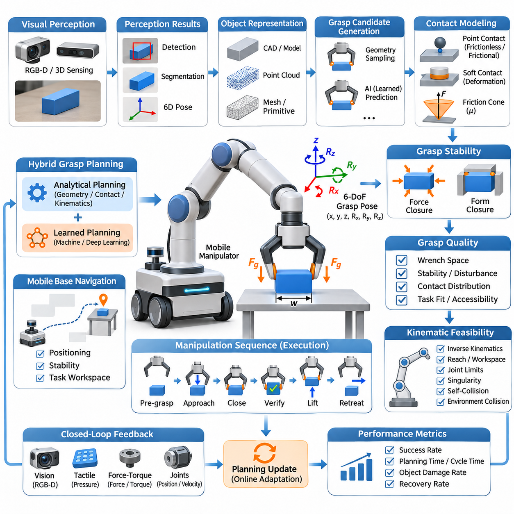
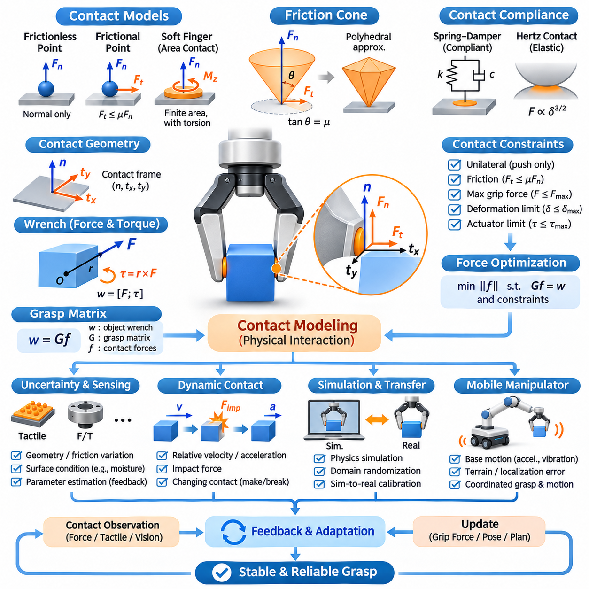
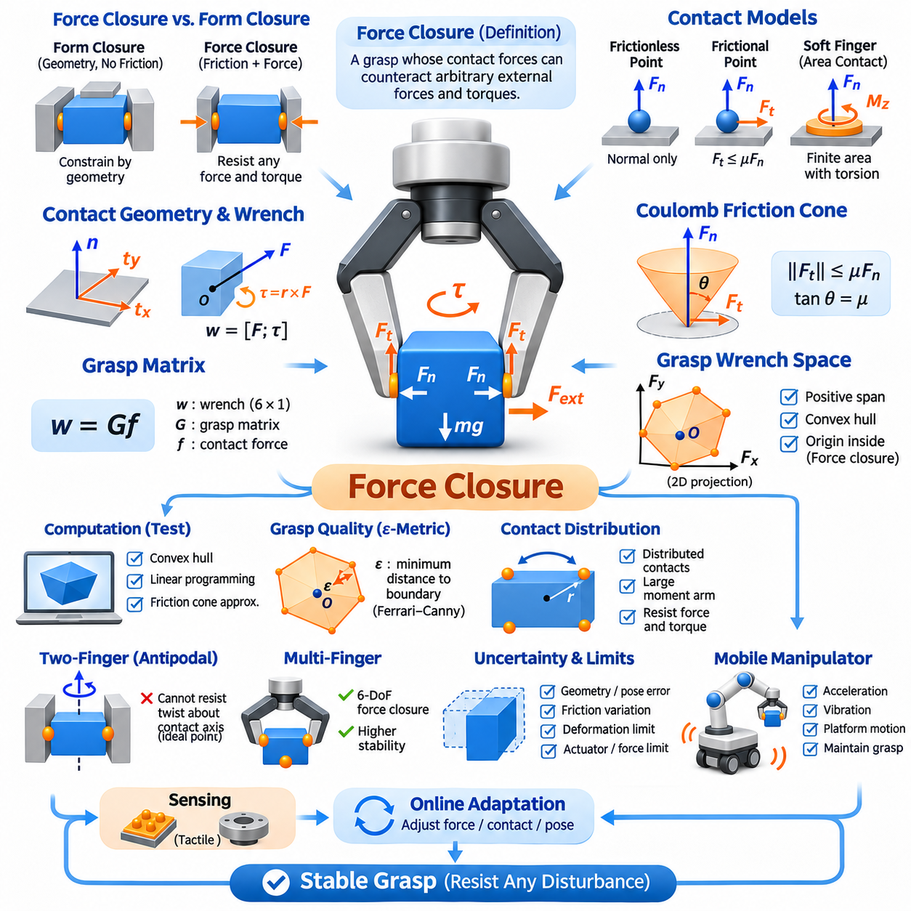
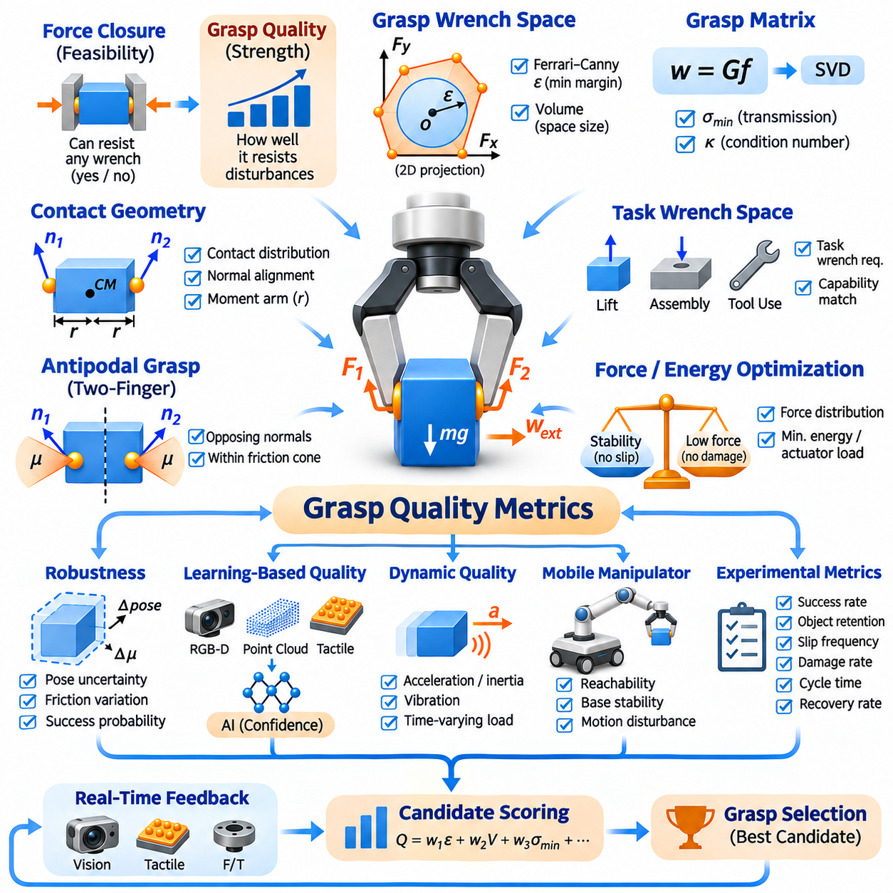
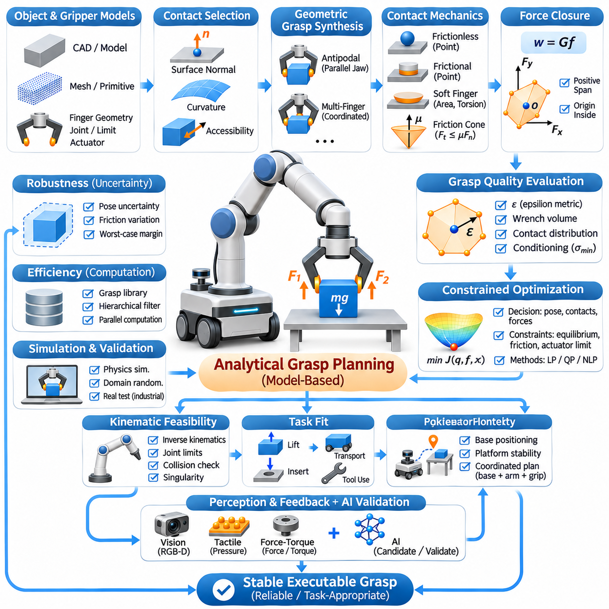
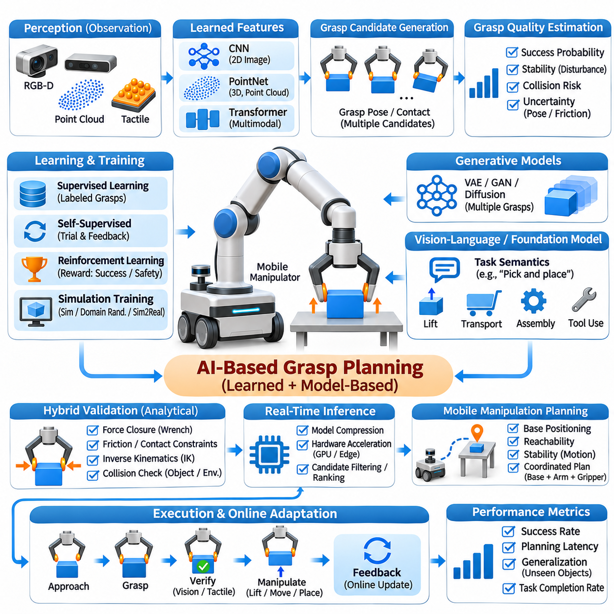
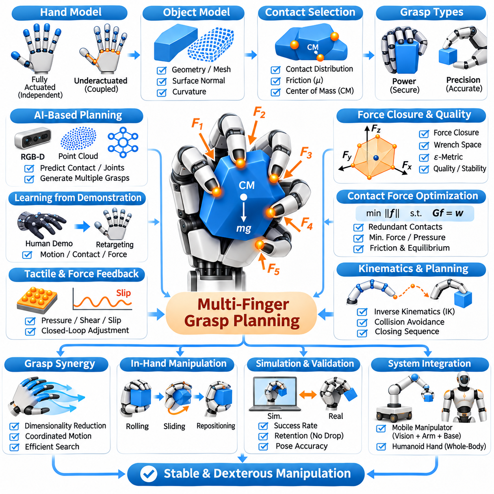
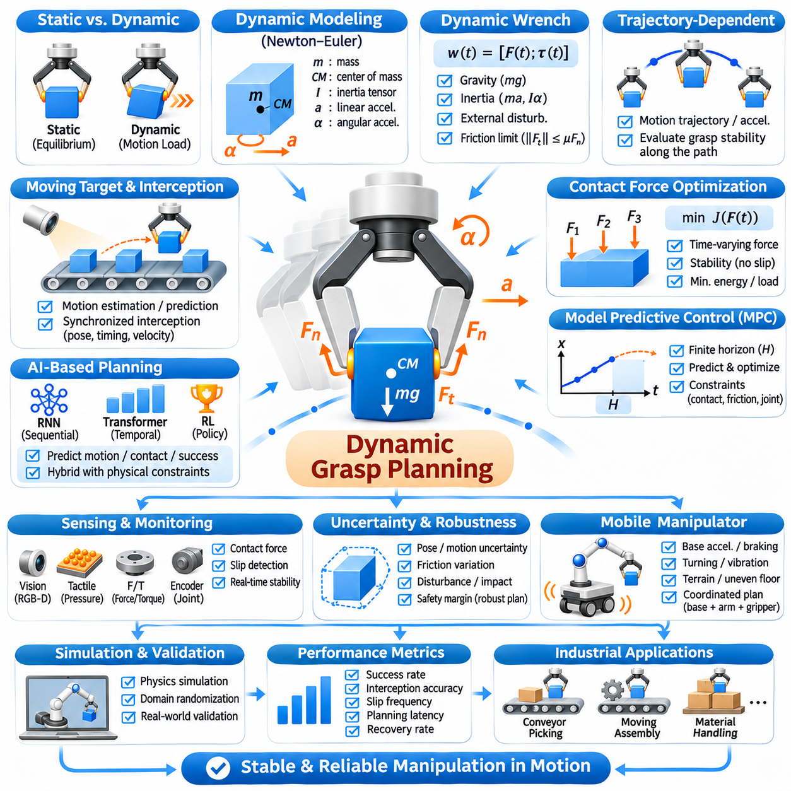
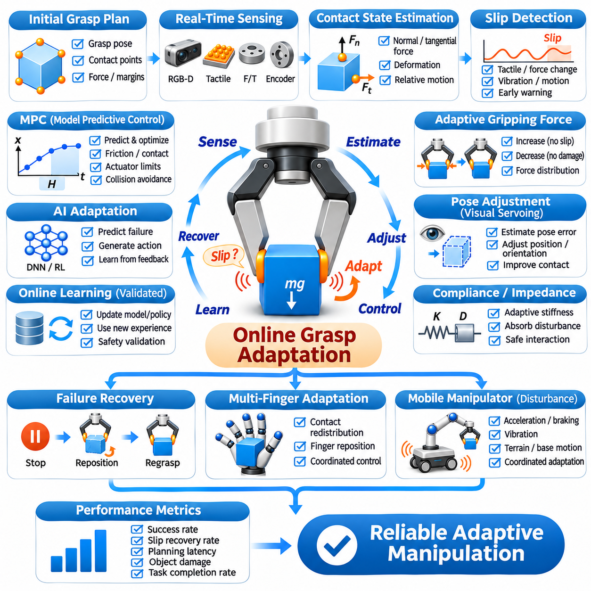
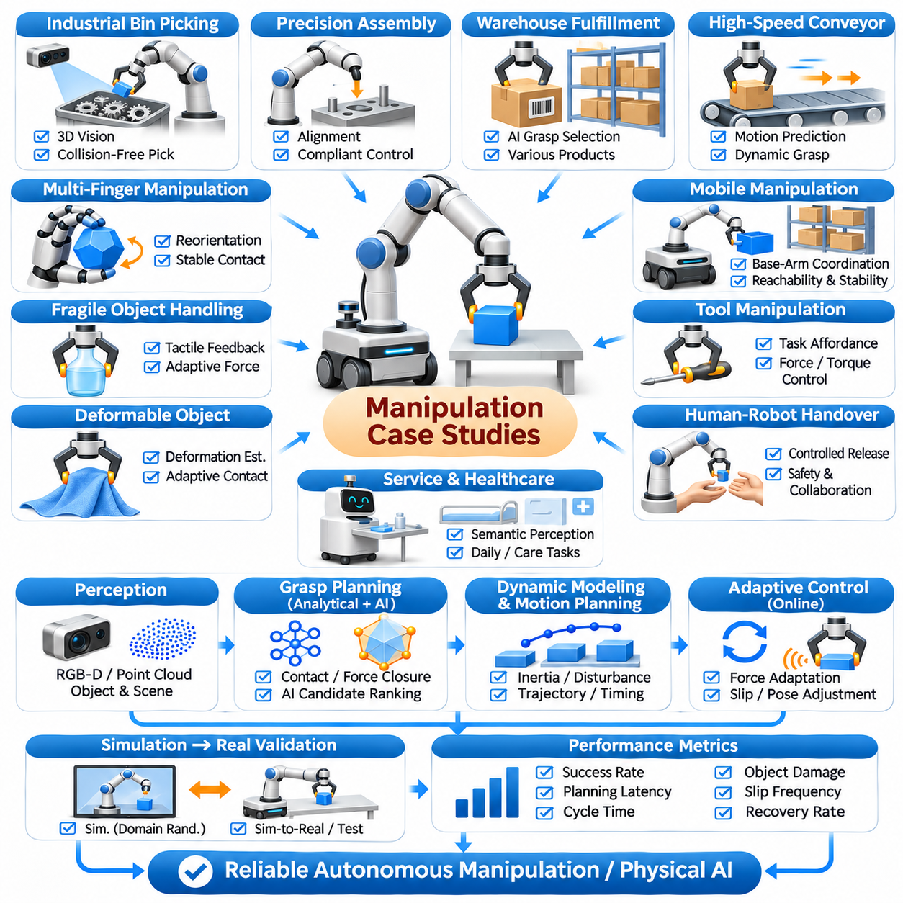

**Volume 03. Vision Manipulation and AI**

# Chapter 06. Grasp Planning

## 01 Grasp Planning Fundamentals

{width="7.268055555555556in" height="7.268055555555556in"}

Grasp planning is a fundamental process in robotic manipulation that determines how a robot should approach, contact, grasp, and securely hold an object to accomplish a specific task. While grasp detection identifies potential grasping opportunities from sensory information, grasp planning evaluates these opportunities and determines physically feasible actions. It establishes an essential connection between visual perception, robotic motion, and physical interaction.

The primary objective of grasp planning is to generate a stable, reliable, and executable grasp that satisfies task requirements and physical constraints. A successful grasp must prevent unintended object movement, resist external disturbances, and support subsequent manipulation operations. The planning process must consider object geometry, material properties, weight distribution, environmental conditions, and the mechanical capabilities of the robotic gripper.

A grasp is generally represented by the position and orientation of the end effector relative to the target object, together with the configuration of individual fingers or gripping mechanisms. In three-dimensional environments, a grasp pose typically includes six degrees of freedom, consisting of three translational and three rotational components. Additional parameters may describe finger positions, gripper opening width, approach direction, and gripping force.

Grasp planning begins with acquiring environmental information through visual perception systems. RGB cameras, depth cameras, stereo vision systems, and three-dimensional sensors provide information about object locations, orientations, dimensions, and surrounding obstacles. Object detection, instance segmentation, and six-dimensional pose estimation transform raw sensory observations into structured representations suitable for manipulation planning.

Object representation significantly influences the effectiveness of grasp planning. Known objects can be described using computer-aided design models, geometric primitives, surface meshes, or predefined grasp configurations. Unknown objects may instead be represented through point clouds, depth images, or learned geometric features. These representations enable the planning system to identify accessible surfaces, potential contact regions, and suitable grasping directions.

Grasp candidate generation identifies multiple potential configurations that the robotic gripper could execute. Candidate grasps may be generated through geometric sampling, surface normal analysis, contact point estimation, or artificial intelligence models. Generating multiple alternatives allows the robot to evaluate different approaches rather than depending on a single prediction, improving operational flexibility in cluttered and uncertain environments.

Contact modeling provides the physical foundation for understanding interactions between the gripper and the target object. Contact forces depend on surface geometry, friction coefficients, material deformation, and applied gripping pressure. Different contact models, including frictionless point contact, frictional point contact, and soft finger contact, describe how forces and moments can be transmitted between the gripper and the object.

Force closure is an important concept for evaluating grasp stability. A grasp achieves force closure when its contact configuration can theoretically resist external forces and torques in arbitrary directions through admissible contact forces. Form closure, in contrast, relies on geometric constraints to prevent object motion. These principles provide analytical foundations for determining whether a grasp configuration can securely constrain an object.

Grasp quality metrics provide quantitative methods for comparing candidate grasps. Common evaluation criteria include force closure capability, resistance to external disturbances, contact distribution, grasp wrench space, and sensitivity to positioning errors. Practical evaluation also considers accessibility, collision probability, required gripping force, and compatibility with subsequent manipulation tasks. High theoretical quality alone does not guarantee successful execution.

Kinematic feasibility determines whether the robotic manipulator can physically reach and execute a proposed grasp. Inverse kinematics calculates joint configurations corresponding to the desired end-effector pose. Joint limits, workspace boundaries, singularities, self-collisions, and environmental obstacles must be considered during this evaluation. A mechanically stable grasp may still be rejected when the manipulator cannot safely achieve the required configuration.

Grasp planning must also consider the complete manipulation sequence rather than only the final contact configuration. A typical sequence includes movement toward a pre-grasp pose, controlled approach, gripper closure, grasp verification, object lifting, and retreat. Each stage must satisfy collision avoidance and motion constraints. Integration with motion planning ensures that selected grasp configurations can be reached through executable robot trajectories.

Analytical grasp planning uses mathematical models of object geometry, contact mechanics, friction, and robotic kinematics to generate and evaluate grasp configurations. These methods provide physically interpretable results and are particularly effective when accurate object models are available. However, their computational requirements and dependence on reliable physical parameters may limit their effectiveness in highly variable or unstructured environments.

Artificial intelligence-based grasp planning uses machine learning and deep learning to predict suitable grasp configurations directly from sensory observations. Neural networks can learn relationships between object geometry, visual appearance, contact locations, and grasp success. Training data may be collected through physical experiments, human demonstrations, or robotic simulation. Hybrid approaches combine learned predictions with analytical feasibility and stability checks.

Mobile manipulators introduce additional planning challenges because grasp feasibility depends on both the robot arm and the mobile platform configuration. Base positioning, localization uncertainty, platform stability, and manipulator reachability must be evaluated together. When a target cannot be grasped from the current location, the system may reposition the mobile platform to obtain a better viewing angle, improve accessibility, or increase manipulation stability.

Grasp planning becomes more reliable when integrated with closed-loop feedback and online adaptation. Visual feedback, tactile sensors, force-torque sensors, and joint measurements allow the robot to detect unexpected contact, object displacement, or slipping. Performance should be evaluated using grasp success rate, execution time, object damage rate, and recovery capability. Together, these mechanisms support safe, adaptive, and autonomous manipulation in real-world environments.

## 02 Contact Modeling

{width="7.268055555555556in" height="7.268055555555556in"}

Contact modeling is a fundamental component of robotic grasp planning that describes the physical interactions between a robotic gripper and an object during manipulation. When a robot establishes contact with an object, forces and moments are transmitted through the contact interface. Accurate contact models enable the robotic system to predict object behavior, evaluate grasp stability, determine appropriate gripping forces, and prevent unintended motion or damage.

A contact occurs when two physical surfaces interact at a specific location or region. In robotic manipulation, contact may occur between a gripper finger and an object, between an object and an environmental surface, or between multiple objects. Each contact is characterized by its position, surface orientation, contact normal, frictional properties, and mechanical compliance. These characteristics determine the types of forces and moments that can be transmitted.

Contact geometry provides the mathematical foundation for representing physical interactions. A contact coordinate system is typically established at each contact location, with one axis aligned with the surface normal and the remaining axes positioned along the tangential plane. Contact forces can therefore be decomposed into normal and tangential components. This representation simplifies the analysis of friction, force distribution, and object equilibrium.

The frictionless point contact model represents an idealized interaction in which a gripper finger applies a compressive force perpendicular to the object surface. Tangential forces and contact moments cannot be transmitted under this assumption. Although frictionless contact simplifies mathematical analysis, it provides limited grasping capabilities. Stable manipulation with frictionless contacts requires carefully arranged geometric constraints that restrict object movement.

The frictional point contact model extends the frictionless model by allowing tangential forces to be transmitted through friction. The magnitude of the tangential force is constrained by the normal contact force and the coefficient of friction according to Coulomb\'s friction law. This model more accurately represents conventional robotic gripping mechanisms and is widely used in analytical grasp planning, grasp stability assessment, and contact force optimization.

The friction cone describes the set of contact force directions that can be supported without sliding under the Coulomb friction model. Its opening angle depends on the coefficient of friction. Contact forces located within the friction cone satisfy the static friction constraint, while forces exceeding its boundary cannot be maintained without slipping. Computational implementations frequently approximate friction cones using polyhedral structures to simplify optimization.

The soft finger contact model accounts for the finite contact area created when a compliant finger presses against an object. Unlike the idealized frictional point contact model, soft finger contact can additionally transmit a torsional moment around the contact normal. This capability improves resistance to rotational disturbances and provides greater grasp stability. The model is especially relevant to rubber-coated grippers, adaptive fingers, and soft robotic hands.

Contact compliance describes the relationship between applied forces and the resulting deformation of contacting surfaces. Real objects and gripper materials exhibit varying degrees of stiffness, elasticity, and damping. Linear spring-damper models provide simplified representations of compliant contact, while nonlinear models can describe more complex deformation behavior. Hertzian contact theory is useful for modeling certain non-adhesive elastic contacts.

Contact forces contribute to both translational and rotational effects on a grasped object. The combined representation of force and torque is known as a wrench. The rotational contribution of a contact force depends on its position relative to a chosen object reference point. By transforming individual contact forces and moments into a common coordinate system, the planning algorithm can calculate their combined influence on object equilibrium and stability.

The grasp matrix establishes a mathematical relationship between individual contact forces and the resultant wrench acting on the object. It incorporates contact locations, orientations, and the force transmission capabilities of each contact model. This representation supports the analysis of force closure, internal gripping forces, and external disturbance compensation. It also enables the formulation of constrained optimization problems for distributing contact forces.

Contact constraints ensure that calculated interaction forces remain physically feasible. A conventional unilateral contact can push against an object but cannot pull it without adhesion or another attachment mechanism. Additional constraints include friction limits, maximum gripping forces, material deformation limits, and actuator capabilities. Contact force optimization must satisfy these restrictions while maintaining object equilibrium and preventing excessive pressure.

Contact modeling becomes more challenging when objects possess uncertain geometry, variable friction characteristics, or deformable structures. Surface contamination, moisture, manufacturing tolerances, and material differences can significantly influence contact behavior. Robust grasp planning therefore incorporates uncertainty margins, conservative friction estimates, and feedback mechanisms. Tactile sensing and force-torque measurements can improve contact parameter estimation.

Dynamic contact modeling extends static analysis by considering relative velocity, acceleration, impact forces, and changing contact configurations. During object acquisition, unexpected collisions or rapid gripper closure may generate transient forces that exceed acceptable limits. Contact dynamics can be represented using penalty-based methods or constraint-based formulations. These approaches support simulation, impact analysis, and the development of compliant manipulation strategies.

Physics-based simulation provides an effective environment for evaluating contact models before deploying grasping algorithms on physical robots. Simulation platforms reproduce friction, collision, material deformation, and contact force interactions with varying levels of fidelity. However, differences between simulated and actual contact behavior create a simulation-to-reality gap. Experimental calibration and parameter randomization can reduce modeling errors and improve transfer reliability.

For mobile manipulators, contact modeling must account for disturbances generated by platform acceleration, vibration, localization errors, and structural compliance. Integrating contact models with visual perception, tactile feedback, force control, and motion planning enables the robot to adapt its grasp during execution. Accurate contact representation provides the physical foundation for force closure analysis, grasp quality evaluation, and reliable autonomous manipulation.

## 03 Force Closure

{width="7.268055555555556in" height="7.268055555555556in"}

Force closure is a fundamental concept in robotic grasp planning that describes the ability of a grasp configuration to resist arbitrary external forces and torques acting on an object. A grasp achieves force closure when its contact forces can theoretically counteract disturbances in every direction within the assumed contact model. This principle provides an essential mathematical and physical foundation for evaluating grasp stability and designing reliable manipulation strategies.

The fundamental objective of force closure is to constrain object motion through appropriately distributed contact forces. During robotic manipulation, an object may experience gravitational forces, inertial forces, external impacts, and rotational disturbances. A force closure grasp enables the robotic gripper to generate opposing forces and moments that maintain object equilibrium, provided that sufficient contact forces are available within the physical limitations of the gripping system.

Force closure differs from form closure in the mechanisms used to constrain object movement. Form closure relies on geometric arrangements of contact points that prevent object motion without depending on friction. Force closure, however, generally utilizes contact geometry and frictional forces to resist external disturbances. Consequently, force closure can often be achieved with fewer contact points, making it particularly useful for conventional robotic grippers and multi-fingered robotic hands.

Contact mechanics establishes the physical conditions necessary for force closure. Each contact between a gripper finger and an object can transmit forces according to its contact model, surface orientation, and friction coefficient. Frictionless point contacts transmit only normal forces, while frictional point contacts additionally support tangential forces. Soft finger contacts can also transmit torsional moments, increasing the range of disturbances that a grasp can resist.

The friction cone plays an important role in determining whether contact forces are physically admissible. Under Coulomb\'s friction law, tangential contact forces must remain within limits determined by the normal force and the coefficient of friction. A larger friction coefficient generally expands the range of admissible force directions. Grasp configurations must therefore be evaluated using realistic friction constraints rather than assuming unrestricted force transmission.

Force closure analysis requires a mathematical representation of the combined effects of contact forces on an object. The wrench represents a combination of force and torque acting relative to a selected reference point. In three-dimensional space, a wrench contains six components corresponding to three translational and three rotational directions. Each contact generates a set of admissible wrenches that depends on its location, orientation, and force transmission capabilities.

The grasp matrix maps individual contact forces and moments into the resultant wrench acting on the object. It incorporates the spatial distribution of contact points and the characteristics of their associated contact models. By analyzing the grasp matrix together with friction and unilateral contact constraints, the planning system can determine whether the available contact wrenches can collectively oppose external disturbances in arbitrary directions.

The grasp wrench space represents the collection of wrenches that a grasp can generate under specified contact force constraints. For a grasp to achieve force closure, its admissible contact wrenches must positively span the entire wrench space. When the space is constructed as a normalized convex set of achievable wrenches, force closure is indicated by the origin lying strictly within its interior. This geometric interpretation supports computational grasp evaluation.

Computational force closure testing frequently uses convex hull analysis, linear programming, and constrained optimization. Friction cones are commonly approximated using a finite number of representative force directions to simplify numerical calculations. The resulting primitive contact wrenches are evaluated to determine whether their combinations span the required wrench space. These methods allow planning algorithms to reject unstable configurations before physical execution.

Force closure is fundamentally a qualitative property that indicates whether a grasp can theoretically resist disturbances in all directions. However, different force closure grasps may exhibit significantly different levels of practical stability. Quantitative evaluation methods, such as the Ferrari-Canny epsilon metric, estimate the magnitude of the smallest disturbance that a grasp can resist under normalized force constraints, enabling more reliable comparison of grasp candidates.

Contact point distribution significantly influences force closure capability. Contacts that are distributed around an object generally provide better opportunities for generating opposing forces and moments than contacts concentrated within a narrow region. Object geometry, surface normals, contact separation, and rotational moment arms must therefore be considered together. Poorly positioned contacts may provide adequate resistance to translation but insufficient resistance to rotation.

Two-finger parallel-jaw grippers frequently utilize antipodal grasp configurations in which opposing contact points are arranged so that the connecting line lies within both inward friction cones. Such configurations provide favorable conditions for resisting sliding and certain external disturbances. However, two ideal frictional point contacts cannot achieve full six-dimensional force closure because they cannot independently resist torque about the line connecting the contacts.

Multi-fingered robotic hands provide additional opportunities for achieving force closure through redundant contact configurations. Multiple fingers can distribute gripping forces across different object surfaces and generate more diverse combinations of forces and torques. This redundancy improves manipulation flexibility and disturbance resistance, although it also increases computational complexity and requires coordinated finger positioning, contact force distribution, and actuator control.

Practical force closure evaluation must account for uncertainties in object geometry, friction coefficients, contact locations, and external loading conditions. A theoretically valid grasp may fail when surface properties differ from assumed values or positioning errors alter the actual contact configuration. Robust grasp planning incorporates conservative friction estimates, uncertainty margins, and sensory feedback to improve the reliability of force closure during execution.

For mobile manipulators, force closure must be considered together with platform acceleration, structural vibration, manipulator motion, and payload dynamics. Even when a grasp satisfies theoretical force closure conditions, excessive disturbances may exceed available gripping forces or actuator limits. Integrating force closure analysis with tactile sensing, force control, motion planning, and online grasp adaptation supports reliable object handling throughout autonomous mobile manipulation.

## 04 Grasp Quality Metrics

{width="7.268055555555556in" height="7.268055555555556in"}

Grasp quality metrics provide quantitative methods for evaluating the effectiveness, stability, and reliability of robotic grasp configurations. While force closure determines whether a grasp can theoretically resist disturbances in arbitrary directions, grasp quality metrics measure how effectively a particular grasp performs under specified conditions. These metrics enable robotic systems to compare multiple grasp candidates and select configurations suitable for manipulation.

The quality of a robotic grasp depends on several interconnected physical and operational factors. Contact locations, surface geometry, friction coefficients, gripping forces, object mass distribution, and external disturbances all influence grasp performance. Practical evaluation must also consider manipulator reachability, collision avoidance, actuator limitations, and task requirements. Consequently, grasp quality cannot always be represented adequately by a single numerical indicator.

The grasp wrench space provides a mathematical foundation for evaluating the ability of a grasp to resist external forces and torques. Contact forces and moments generated by individual fingers are transformed into a common object coordinate system. The resulting set of achievable wrenches describes the disturbance resistance capabilities of the grasp under specified force constraints. Its geometric properties can be analyzed to quantify grasp stability.

The Ferrari-Canny epsilon metric is one of the most widely recognized analytical grasp quality measures. It evaluates the radius of the largest origin-centered hypersphere that can be contained within the grasp wrench space. A larger epsilon value indicates greater resistance to disturbances in the weakest wrench direction. Meaningful comparison requires consistent contact force constraints, torque scaling, and wrench normalization across candidate grasps.

The volume of the grasp wrench space provides another quantitative measure of grasp quality. A larger volume generally indicates that the grasp can generate a wider range of forces and torques. However, a large wrench space does not necessarily guarantee strong disturbance resistance in every direction. Combining wrench space volume with the epsilon metric provides a more comprehensive assessment of overall grasp capability and worst-case stability.

Grasp matrix-based metrics evaluate the mathematical relationship between individual contact forces and the resultant wrench acting on an object. Singular value decomposition can identify directions in which contact forces are transmitted more or less effectively. Metrics derived from minimum singular values and condition numbers help characterize wrench transmission capabilities, although they must be interpreted together with friction and unilateral contact constraints.

Contact geometry-based metrics evaluate the spatial distribution and orientation of contact points around an object. Widely distributed contacts generally improve the ability to generate opposing forces and rotational moments. Contact separation, surface normal alignment, moment arm lengths, and the relationship between contact locations and the object\'s center of mass provide useful indicators of potential grasp stability and mechanical effectiveness.

Antipodal grasp quality metrics are particularly relevant to two-finger parallel-jaw grippers. These metrics evaluate whether opposing contact points and their associated surface normals satisfy favorable frictional conditions. Alignment between the contact directions and friction cones influences resistance to slipping. Additional evaluation of gripper width, contact surface accessibility, and finger placement improves the practical reliability of antipodal grasp selection.

Task-oriented grasp quality metrics evaluate grasp configurations according to the requirements of a specific manipulation operation. A grasp suitable for lifting an object may not be appropriate for precision assembly, tool operation, or controlled placement. Task wrench spaces describe the forces and torques expected during execution. Comparing these requirements with available grasp capabilities enables the selection of task-specific grasp configurations.

Energy and gripping force metrics evaluate the efficiency with which a robotic system maintains a stable grasp. Excessive gripping forces can damage fragile objects, increase actuator loading, and accelerate mechanical wear. Insufficient forces may cause slipping or object loss. Optimization methods seek contact force distributions that satisfy equilibrium and friction constraints while minimizing unnecessary force expenditure and actuator energy consumption.

Robustness metrics quantify the sensitivity of grasp performance to uncertainties in object geometry, contact positions, friction coefficients, and pose estimation. Small deviations between predicted and actual contact configurations may significantly reduce grasp stability. Probabilistic evaluation, uncertainty sampling, and worst-case analysis can estimate the likelihood of successful grasping across a range of realistic environmental and mechanical conditions.

Learning-based grasp quality metrics use artificial intelligence models to predict grasp success directly from sensory observations and previous manipulation experience. Deep neural networks can assign confidence scores to candidate grasps using RGB images, depth images, point clouds, or tactile measurements. These predictions can improve planning efficiency, although their reliability depends on training data quality, model calibration, and environmental generalization.

Dynamic grasp quality metrics extend conventional static evaluation by considering acceleration, inertia, vibration, and time-varying external loads. A grasp that remains stable under stationary conditions may fail during rapid movement or abrupt changes in orientation. Evaluating expected dynamic wrenches along manipulation trajectories enables the planning system to identify configurations that maintain sufficient stability throughout the complete operation.

Experimental grasp quality assessment measures actual robotic performance through repeated manipulation trials. Common indicators include grasp success rate, object retention rate, slip frequency, object damage rate, execution time, and recovery success rate. Standardized testing across different object categories, orientations, and environmental conditions helps validate analytical metrics and learning-based predictions while identifying limitations in practical deployment.

For mobile manipulators, grasp quality evaluation must integrate mechanical stability, visual perception accuracy, manipulator reachability, and mobile platform dynamics. A comprehensive evaluation framework combines analytical metrics, task-specific requirements, learning-based confidence scores, and real-time sensory feedback. Such integration supports adaptive grasp selection, reliable autonomous manipulation, and continuous performance improvement in industrial environments.

## 05 Analytical Grasp Planning

{width="7.268055555555556in" height="7.268055555555556in"}

Analytical grasp planning is a model-based approach to robotic manipulation that uses mathematical principles, physical laws, and geometric reasoning to determine suitable grasp configurations. Unlike purely data-driven methods, analytical approaches explicitly evaluate the mechanical interactions between a robotic gripper and an object. The objective is to generate stable, physically feasible, and task-appropriate grasps under specified operating conditions.

The analytical grasp planning process begins with constructing a mathematical representation of the target object and the robotic gripping mechanism. Object geometry may be represented using CAD models, polygonal meshes, geometric primitives, or reconstructed surface models. Gripper representations include finger geometry, joint configurations, opening limits, and actuator capabilities. These models establish the physical and geometric constraints of the planning problem.

Contact point selection is a fundamental operation in analytical grasp planning. Potential contact locations are identified by analyzing object surfaces, local curvature, surface normals, and geometric accessibility. The selected contact points must allow the gripper to apply forces in appropriate directions while avoiding undesirable interactions with surrounding objects. Multiple contact configurations are generally generated to explore alternative grasping possibilities.

Geometric grasp synthesis determines candidate grasp configurations based on the spatial relationships between object surfaces and gripper components. For parallel-jaw grippers, candidate generation frequently involves identifying opposing surfaces that satisfy antipodal grasp conditions. For multi-fingered robotic hands, the process requires coordinated selection of several contact points and corresponding finger configurations within their reachable workspaces.

Contact mechanics provides the mathematical foundation for evaluating the physical interactions associated with each candidate grasp. Frictionless point contact, frictional point contact, and soft finger contact models describe different force and moment transmission capabilities. By incorporating friction coefficients, surface orientations, and material characteristics, analytical methods determine whether proposed contact configurations can support stable manipulation.

Force closure analysis evaluates whether a candidate grasp can theoretically resist arbitrary external forces and torques. Contact forces and moments are represented as wrenches within a common object coordinate system. The grasp matrix maps individual contact contributions into the resultant object wrench. Analytical algorithms examine whether admissible contact wrenches positively span the required wrench space, thereby establishing force closure.

Grasp quality evaluation enables the analytical planning system to distinguish between mechanically feasible grasp configurations. Common analytical metrics include the Ferrari-Canny epsilon metric, grasp wrench space volume, contact distribution quality, and grasp matrix conditioning. These measurements provide complementary information about disturbance resistance, force transmission efficiency, and sensitivity to uncertainties in contact configurations.

Optimization-based grasp planning formulates grasp selection as a mathematical optimization problem. Decision variables may include contact positions, gripper orientation, finger configurations, and contact forces. Objective functions are designed to maximize grasp stability, improve mechanical efficiency, or minimize execution complexity. Constraints ensure that the selected solution satisfies friction limits, object equilibrium, joint boundaries, and actuator capabilities.

Contact force optimization determines the distribution of forces required to maintain a selected grasp under expected external loading conditions. Linear programming, quadratic programming, and nonlinear optimization are frequently employed to solve these problems. Appropriate force distributions reduce unnecessary actuator loading, prevent excessive contact pressure, and improve object retention while satisfying the mechanical requirements of the manipulation task.

Kinematic feasibility analysis ensures that a mechanically suitable grasp can be executed by the robotic manipulator. Inverse kinematics determines whether the robot can achieve the desired end-effector position and orientation. Candidate configurations must satisfy joint limits, workspace restrictions, and collision avoidance requirements. Manipulator singularities and unfavorable joint configurations should also be considered during grasp selection.

Task-oriented analytical grasp planning incorporates the requirements of subsequent manipulation operations into the selection process. Object lifting, transportation, insertion, assembly, and tool operation impose different force, torque, and orientation requirements. By evaluating anticipated task wrenches and environmental constraints, the planning algorithm can select grasp configurations that remain effective throughout the intended manipulation sequence.

Robust analytical grasp planning addresses uncertainties in object geometry, pose estimation, friction coefficients, and contact locations. Deterministic models may produce unreliable results when actual operating conditions differ from their assumptions. Sensitivity analysis, probabilistic sampling, and worst-case optimization enable the planning system to evaluate alternative scenarios and select configurations with sufficient stability margins.

Computational efficiency remains an important challenge because analytical grasp planning may require extensive geometric sampling, collision checking, and numerical optimization. Precomputed grasp libraries, hierarchical candidate filtering, parallel computation, and simplified contact models can reduce processing time. These techniques are particularly valuable when manipulation tasks require frequent replanning in changing industrial environments.

Analytical grasp planning is especially suitable for structured industrial applications involving known objects and well-defined operating conditions. Manufacturing components, mechanical assemblies, and standardized logistics containers can often be represented using accurate geometric models. Integrating analytical methods with robot simulation and experimental validation enables engineers to establish repeatable and physically interpretable grasping strategies.

For mobile manipulators, analytical grasp planning must consider mobile platform positioning, manipulator reachability, payload distribution, and dynamic stability. Its integration with visual perception, motion planning, force control, and tactile feedback enables reliable execution under changing conditions. Analytical methods also provide physically interpretable constraints for validating AI-generated grasps within hybrid manipulation architectures.

## 06 AI Based Grasp Planning

{width="7.268055555555556in" height="7.268055555555556in"}

Artificial intelligence-based grasp planning is an approach to robotic manipulation that uses machine learning, deep learning, and experience-driven optimization to generate effective grasp configurations. Unlike conventional analytical methods that depend primarily on explicit geometric and physical models, AI-based approaches learn relationships between sensory observations, object characteristics, grasping actions, and manipulation outcomes.

The primary objective of AI-based grasp planning is to enable robots to manipulate diverse objects under uncertain and dynamically changing environmental conditions. Traditional planning methods often require accurate object models and predefined physical parameters, which may be unavailable in practical applications. Artificial intelligence enables robots to estimate suitable grasp configurations from incomplete observations and previous manipulation experience.

The planning process begins with collecting sensory information through RGB cameras, depth cameras, three-dimensional sensors, and tactile sensing systems. These observations are processed to extract relevant information about object geometry, surface characteristics, spatial relationships, and surrounding obstacles. Learned feature representations allow the planning system to identify potential grasping regions even when complete geometric models are unavailable.

Deep learning-based grasp planning employs neural networks to predict grasp poses, contact locations, gripper configurations, and expected grasp quality. Convolutional neural networks are commonly used to process RGB and depth images, while point cloud networks and transformer architectures support three-dimensional spatial reasoning. These models can generate multiple grasp candidates with associated confidence scores and estimated success probabilities.

Supervised learning is a widely used approach in which grasp planning models are trained using labeled examples of successful and unsuccessful grasps. Training datasets may contain object images, point clouds, grasp poses, gripper configurations, and execution outcomes. The model learns to associate sensory features with effective grasping actions, reducing the computational burden of evaluating every possible contact configuration during operation.

Self-supervised learning enables robotic systems to acquire grasp planning capabilities through autonomous interaction with physical or simulated environments. The robot performs grasping attempts and evaluates outcomes using sensory feedback, object retention, or task completion signals. These experiences provide automatically generated training data, reducing dependence on manual annotation and supporting continuous improvement through repeated interaction.

Reinforcement learning formulates grasp planning as a sequential decision-making problem in which a robotic agent learns actions through interaction with its environment. Reward functions may encourage successful grasping, stable object retention, collision avoidance, and efficient motion. Through repeated exploration and policy optimization, the agent can develop adaptive grasping strategies that account for the consequences of its actions.

Generative artificial intelligence provides additional capabilities for producing diverse grasp configurations. Variational autoencoders, generative adversarial networks, and diffusion models can learn probability distributions over feasible grasp poses. Instead of producing a single deterministic prediction, generative models can create multiple alternatives, allowing the planning system to select configurations according to physical constraints and task requirements.

Learning-based grasp quality estimation predicts the expected effectiveness of candidate grasps without requiring complete analytical evaluation for every configuration. Neural networks can estimate grasp success probabilities, stability, collision risks, and sensitivity to environmental uncertainty. These estimates support efficient candidate ranking, although prediction confidence must be calibrated and validated against actual robotic performance.

Task-conditioned grasp planning incorporates information about the intended manipulation task into the learning and decision-making process. A robot may select different grasp configurations for lifting, transportation, precision assembly, or tool operation. Task descriptions, semantic object features, and anticipated physical interactions enable AI models to prioritize grasps that support successful completion of subsequent manipulation operations.

Vision-language models and foundation models extend grasp planning beyond conventional geometric reasoning by incorporating semantic understanding and contextual knowledge. These models can help identify functional object regions, interpret natural language instructions, and determine task-relevant grasping opportunities. However, their semantic predictions must be translated into physically executable grasp poses through geometric and mechanical validation.

Hybrid grasp planning combines artificial intelligence with analytical methods to exploit the advantages of both approaches. AI models rapidly generate and rank promising grasp candidates, while analytical algorithms verify force closure, contact constraints, kinematic feasibility, and collision avoidance. This architecture improves computational efficiency while reducing the risk of executing mechanically unstable or physically infeasible grasp configurations.

Simulation-based training enables AI grasp planning models to acquire extensive manipulation experience without requiring equally large numbers of physical experiments. Physics simulators generate diverse object configurations, contact interactions, and environmental conditions. Domain randomization and simulation-to-reality adaptation techniques help reduce discrepancies between simulated training environments and actual robotic operating conditions.

Real-time implementation of AI-based grasp planning requires efficient inference, reliable perception, and integration with robotic motion control. Model compression, hardware acceleration, and hierarchical candidate filtering can reduce computational latency. Closed-loop visual and tactile feedback enables the system to update grasp decisions when object displacement, unexpected contact, or environmental changes invalidate previously generated plans.

For mobile manipulators, AI-based grasp planning must integrate object perception, mobile platform positioning, manipulator reachability, and physical stability. Performance should be evaluated through grasp success rate, planning latency, generalization capability, and task completion rate. Combining learned intelligence with physical constraints and continuous feedback establishes a foundation for reliable, adaptive, and autonomous manipulation.

## 07 Multi Finger Grasp Planning

{width="7.268055555555556in" height="7.268055555555556in"}

Multi-finger grasp planning is an advanced robotic manipulation approach that coordinates multiple fingers to establish stable and task-appropriate contact configurations around an object. Unlike conventional two-finger grippers, multi-finger robotic hands provide greater flexibility in contact placement, force distribution, and object orientation control. These capabilities support dexterous manipulation across diverse operational environments.

The mechanical structure of a multi-finger robotic hand significantly influences the grasp planning process. Each finger typically consists of multiple articulated joints, links, and actuators that collectively determine its degrees of freedom. Fully actuated hands provide independent joint control, while underactuated hands exploit mechanical coupling and passive adaptation to accommodate different object geometries with fewer actuators.

Multi-finger grasp planning requires comprehensive geometric representations of both the robotic hand and the target object. Object surface models provide information about geometry, curvature, surface normals, and potential contact regions. Hand models describe finger kinematics, joint limits, reachable workspaces, and mechanical constraints. These representations establish the foundation for generating physically feasible grasp configurations.

Contact point selection involves identifying suitable locations where individual fingers can interact with the target object. The planning system must consider the spatial distribution of contact points, frictional properties, accessibility, and the relationship between contact locations and the object\'s center of mass. Coordinated contact placement improves resistance to external disturbances while supporting effective force and torque generation.

Grasp configurations are commonly classified into power grasps and precision grasps according to their mechanical characteristics and intended functions. Power grasps distribute contact forces across multiple fingers and potentially the palm to achieve secure object retention. Precision grasps primarily utilize fingertip contacts to enable accurate positioning, controlled orientation adjustments, and delicate manipulation of small objects.

Force closure analysis plays an important role in evaluating the stability of multi-finger grasp configurations. Individual finger contact forces and moments are represented as wrenches within a common object coordinate system. The combined wrench generation capability determines whether the grasp can theoretically resist disturbances in arbitrary directions. Grasp quality metrics provide additional quantitative measures of stability margins.

Multi-finger contact force optimization determines how gripping forces should be distributed among individual fingers. Because multiple contacts can provide redundant force generation capabilities, different contact force distributions may produce equivalent resultant object wrenches. Optimization algorithms exploit this redundancy to minimize actuator loading, reduce excessive contact pressure, and maintain adequate frictional stability.

Kinematic coordination is essential because each finger must achieve its desired contact position and orientation without violating mechanical constraints. Inverse kinematics algorithms calculate suitable finger joint configurations, while collision detection prevents undesirable contact between fingers, the palm, and surrounding objects. Coordinated motion planning also establishes appropriate finger approach directions and closing sequences.

The high dimensionality of multi-finger robotic hands creates significant computational challenges during grasp planning. Evaluating every possible combination of finger joint configurations and contact locations is generally impractical. Grasp synergies, dimensionality reduction, and hierarchical optimization simplify the search space by representing coordinated finger movements through a smaller number of control variables.

Artificial intelligence-based multi-finger grasp planning employs learned models to predict suitable hand configurations directly from sensory observations. Deep neural networks can analyze object images, depth measurements, and three-dimensional point clouds to estimate contact locations and finger joint configurations. Generative models provide multiple grasp alternatives that can subsequently be evaluated using physical and kinematic constraints.

Learning from demonstration enables multi-finger robotic hands to acquire grasping strategies from human manipulation behavior. Motion capture systems, instrumented gloves, and visual tracking technologies can record human hand movements and contact patterns. Retargeting algorithms transform these demonstrations into robotic hand configurations while accounting for differences in finger geometry, degrees of freedom, and mechanical capabilities.

Tactile sensing and force feedback improve the reliability of multi-finger grasp execution by providing information about local contact conditions. Individual finger sensors can detect contact pressure, shear forces, slipping, and unexpected object displacement. Closed-loop control enables the robotic hand to adjust finger positions and contact forces during execution, compensating for uncertainties in the original grasp plan.

Multi-finger grasp planning also provides the foundation for in-hand manipulation, in which an object is repositioned or reoriented without completely releasing it. Such operations may involve controlled rolling, sliding, finger repositioning, and sequential contact transitions. Planning algorithms must maintain sufficient object stability while coordinating changing contact configurations throughout the manipulation process.

Simulation and experimental validation are essential for evaluating multi-finger grasp planning performance. Physics-based simulation provides opportunities to analyze contact dynamics, frictional interactions, and finger coordination under diverse conditions. Physical experiments evaluate grasp success rates, object retention, positioning accuracy, contact force distribution, and the reliability of manipulation across different object categories.

For mobile manipulators and humanoid robots, multi-finger grasp planning must integrate visual perception, arm motion planning, platform stability, and coordinated finger control. Combining analytical mechanics, artificial intelligence, tactile feedback, and real-time optimization supports reliable handling of complex objects and establishes a foundation for autonomous dexterous manipulation in industrial and service environments.

## 08 Dynamic Grasp Planning

{width="7.268055555555556in" height="7.268055555555556in"}

Dynamic grasp planning is an advanced approach to robotic manipulation that considers time-dependent changes in object motion, contact forces, and environmental conditions during grasp execution. Unlike static grasp planning, which primarily evaluates equilibrium under stationary conditions, dynamic approaches incorporate acceleration, inertia, momentum, and changing external disturbances into the planning process.

The fundamental objective of dynamic grasp planning is to maintain stable and reliable object manipulation throughout a complete motion trajectory. A grasp configuration that satisfies static stability requirements may become unstable when the robot accelerates, decelerates, or changes its movement direction. Dynamic planning therefore evaluates grasp feasibility according to both instantaneous and anticipated physical conditions.

Dynamic modeling provides the mathematical foundation for analyzing interactions between robotic manipulators and grasped objects. Object mass, center of mass, inertia tensor, linear acceleration, and angular acceleration determine the forces and torques required during manipulation. Newton-Euler equations describe these relationships and enable the planning system to estimate dynamic loads acting on individual contact points.

Dynamic wrench analysis extends conventional grasp wrench evaluation by incorporating time-varying forces and torques. Gravitational forces, inertial effects, rotational moments, and external disturbances collectively determine the required object wrench at each instant. The available contact wrenches must satisfy these changing requirements without violating friction constraints or exceeding actuator capabilities.

Trajectory-dependent grasp planning evaluates candidate grasp configurations in relation to the intended manipulation trajectory. Different movement paths can produce substantially different acceleration profiles and mechanical loads. By analyzing expected dynamic conditions along candidate trajectories, the planning system can identify grasp configurations that maintain sufficient stability throughout the operation.

Contact force optimization under dynamic conditions determines appropriate force distributions as manipulation progresses. The required gripping forces may increase during rapid acceleration or decrease during relatively stable motion. Time-dependent optimization enables robotic systems to maintain object stability while minimizing unnecessary actuator loading, energy consumption, and potential damage to fragile objects.

Dynamic grasp planning must also consider the movement of target objects before initial contact. Conveyor systems, moving platforms, and freely moving objects require the robot to predict future object positions and orientations. Motion estimation and trajectory prediction algorithms enable the manipulator to synchronize its approach movement with the target and establish contact under appropriate relative velocity conditions.

Interception-based grasp planning determines suitable contact locations and execution times for capturing moving objects. The planning system must simultaneously evaluate object trajectory predictions, manipulator reachability, end-effector velocity, and available reaction time. Matching the gripper\'s motion with the target object\'s movement reduces impact forces and improves the probability of successful grasp establishment.

Model predictive control provides an effective framework for integrating dynamic grasp planning with real-time motion control. The controller predicts future system behavior over a finite time horizon and continuously optimizes control commands according to updated state estimates. Contact stability, friction limits, joint constraints, and trajectory tracking requirements can be incorporated into the optimization process.

Dynamic grasp stability monitoring relies on continuous sensory feedback from force-torque sensors, tactile sensors, cameras, and joint encoders. These measurements provide information about changing contact forces, object displacement, unexpected vibration, and potential slipping. Early identification of unstable conditions allows the robot to adjust gripping forces, modify its motion trajectory, or initiate controlled recovery procedures.

Artificial intelligence-based dynamic grasp planning uses learned models to predict object motion, contact behavior, and manipulation outcomes under changing conditions. Recurrent neural networks, temporal transformers, and reinforcement learning policies can process sequential sensory observations and generate adaptive grasping actions. Hybrid architectures combine learned predictions with physically grounded stability constraints.

Uncertainty management is particularly important because dynamic manipulation involves imperfect predictions of object motion, frictional properties, and external disturbances. Robust optimization, probabilistic state estimation, and uncertainty-aware trajectory prediction help the planning system evaluate potential deviations from expected conditions. Appropriate safety margins reduce the risk of grasp failure during execution.

Dynamic grasp planning for mobile manipulators introduces additional complexity because mobile platform motion influences the mechanical stability of the entire robotic system. Platform acceleration, braking, turning, vibration, and uneven terrain can generate additional loads on grasped objects. Coordinated planning between the mobile base, robotic arm, and gripper helps maintain both object retention and overall platform stability.

Simulation and experimental validation enable engineers to assess dynamic grasp planning under controlled and repeatable operating conditions. Physics-based simulators reproduce contact interactions, inertial effects, moving targets, and external disturbances. Experimental performance can be evaluated through grasp success rate, interception accuracy, slip frequency, object retention, response latency, and recovery success rate.

Industrial applications of dynamic grasp planning include high-speed conveyor picking, moving assembly operations, automated material handling, and mobile robotic manipulation. Successful implementation requires synchronized perception, accurate dynamic modeling, efficient trajectory optimization, and responsive feedback control. Combining these capabilities establishes a foundation for reliable autonomous manipulation in continuously changing physical environments.

## 09 Online Grasp Adaptation

{width="7.268055555555556in" height="7.268055555555556in"}

Online grasp adaptation is an advanced robotic manipulation approach that continuously adjusts grasp configurations and control strategies in response to changing physical conditions during task execution. Unlike conventional grasp planning, which primarily determines suitable configurations before execution, online adaptation enables robotic systems to modify their actions using real-time sensory observations and feedback.

The primary objective of online grasp adaptation is to maintain reliable manipulation despite uncertainties in object geometry, material properties, contact conditions, and environmental disturbances. A grasp configuration generated during the initial planning stage may become unsuitable when actual operating conditions differ from predicted conditions. Online adaptation compensates for these discrepancies without necessarily restarting the entire planning process.

Closed-loop perception and control provide the fundamental architecture for implementing online grasp adaptation. Cameras, depth sensors, tactile sensors, force-torque sensors, and joint encoders continuously measure the physical state of the robotic system and the target object. The adaptation algorithm processes these measurements to identify deviations from expected grasp conditions and determine appropriate corrective actions.

Real-time contact state estimation enables the robotic system to understand the physical interactions occurring between the gripper and the grasped object. Contact locations, normal forces, tangential forces, surface deformation, and relative motion provide important information about grasp stability. Accurate contact state estimation allows the system to distinguish stable contact conditions from emerging manipulation failures.

Slip detection is one of the most important capabilities in online grasp adaptation. Variations in tactile pressure, shear forces, vibration patterns, and relative object motion can indicate incipient or ongoing slipping. Early detection enables the controller to increase gripping forces, redistribute contact forces, or reduce manipulation speed before the object becomes unstable or completely escapes from the gripper.

Adaptive gripping force control dynamically adjusts the magnitude and distribution of contact forces according to observed manipulation conditions. Excessive gripping forces may damage fragile objects, while insufficient forces may cause slipping or object loss. Feedback-based force regulation enables the robotic system to maintain sufficient frictional stability while minimizing unnecessary mechanical stress and actuator energy consumption.

Online grasp pose adjustment modifies the position and orientation of the gripper when the actual object pose differs from its initial estimation. Visual servoing and continuous object pose tracking provide updated spatial information during approach and manipulation. Small corrective movements can improve contact alignment, compensate for localization errors, and reduce the probability of unsuccessful grasp establishment.

Compliance and impedance control support online grasp adaptation by allowing the robotic manipulator to respond appropriately to unexpected physical interactions. Instead of rigidly maintaining predefined positions, compliant control modifies robot behavior according to measured contact forces. This capability is particularly valuable when handling deformable objects, performing precision assembly, or interacting with uncertain surfaces.

For multi-finger robotic hands, online grasp adaptation involves coordinated adjustments of individual finger positions and contact forces. Changes in one contact location may require compensatory actions from other fingers to maintain overall object equilibrium. Contact redistribution, finger repositioning, and controlled contact transitions enable dexterous robotic hands to preserve grasp stability under changing conditions.

Artificial intelligence-based adaptation uses learned models to recognize contact conditions, predict potential grasp failures, and generate corrective actions. Deep neural networks can process multimodal sensory observations, while reinforcement learning policies can determine appropriate responses to unexpected disturbances. These learned capabilities complement analytical contact models and physically grounded stability constraints.

Online learning extends grasp adaptation by allowing robotic systems to refine their internal models or control policies using newly acquired manipulation experience. Observed failures, successful corrections, and changing object properties provide valuable learning signals. However, online model updates must be carefully constrained and validated to prevent unstable behavior, performance degradation, and violations of operational safety requirements.

Model predictive control provides a systematic framework for integrating online grasp adaptation with real-time optimization. The controller predicts future manipulation states over a finite time horizon and updates control commands according to the latest sensory measurements. Grasp stability, friction constraints, actuator limitations, collision avoidance, and motion objectives can be considered simultaneously during optimization.

Failure detection and recovery mechanisms are essential when local grasp adjustments cannot restore sufficient stability. Depending on the observed conditions, the robotic system may stop its movement, reposition the object, modify the grasp configuration, or initiate a complete regrasping operation. Hierarchical recovery strategies enable the robot to select corrective actions according to failure severity and available operational resources.

For mobile manipulators, online grasp adaptation must account for disturbances introduced by mobile platform acceleration, braking, vibration, localization errors, and uneven terrain. Coordinated feedback between the mobile base, robotic arm, and gripper enables the system to adjust gripping forces and manipulation trajectories. Such integration improves object retention while maintaining the mechanical stability of the overall robotic system.

The effectiveness of online grasp adaptation can be evaluated through grasp success rate, slip recovery rate, adaptation latency, object damage rate, and task completion rate. Experimental validation should include variations in object properties, unexpected disturbances, and changing environmental conditions. Integrating continuous perception, adaptive control, physical reasoning, and artificial intelligence establishes a foundation for reliable autonomous manipulation.

## 10 Manipulation Case Studies

{width="7.268055555555556in" height="7.268055555555556in"}

Manipulation case studies demonstrate how grasp planning techniques can be applied to practical robotic systems operating under diverse physical and environmental conditions. The following representative application scenarios illustrate the integration of visual perception, contact modeling, grasp stability analysis, motion planning, and adaptive control rather than reporting experimentally verified results from specific commercial installations.

Industrial bin picking represents a common application of robotic grasp planning in manufacturing environments. Randomly distributed components create challenges associated with irregular orientations, partial occlusion, and restricted accessibility. Three-dimensional vision systems generate object representations, while grasp planning algorithms evaluate candidate contact configurations and collision-free extraction trajectories.

Automated assembly operations require grasp configurations that support accurate component positioning and controlled physical interaction. When inserting a mechanical component into a designated fixture, the robot must select a grasp that preserves access to the assembly interface. Task-oriented grasp planning combines geometric constraints, force closure analysis, and compliant control to accommodate positioning errors and contact uncertainty.

Warehouse order fulfillment presents significant challenges because products exhibit considerable variation in size, shape, weight, packaging materials, and surface properties. Robotic picking systems can combine object detection, affordance estimation, and learning-based grasp planning to identify suitable contact regions. Adaptive gripping force regulation helps maintain reliable handling while reducing potential product damage.

High-speed conveyor picking illustrates the importance of dynamic grasp planning in continuously changing environments. Vision systems estimate the position, orientation, and velocity of moving products, while predictive algorithms calculate suitable interception points. The robot coordinates its approach trajectory, gripper closing sequence, and subsequent transfer motion to maintain grasp stability under dynamic operating conditions.

Multi-finger robotic manipulation is particularly valuable when handling objects that require complex contact configurations and precise orientation control. A robotic hand manipulating an irregular mechanical component must coordinate individual finger positions and contact forces. Grasp quality evaluation, kinematic optimization, and tactile feedback enable the system to establish stable configurations and perform controlled object reorientation.

Fragile object handling demonstrates the importance of balancing grasp stability with material protection. Delicate electronic components, glass containers, and agricultural products may be damaged by excessive contact pressure. Grasp planning systems must consider surface geometry, material characteristics, and allowable gripping forces. Tactile sensing and adaptive force control support stable manipulation without unnecessary mechanical stress.

Deformable object manipulation introduces additional complexity because the geometry of the target object changes during physical interaction. Flexible packaging, textiles, cables, and rubber components cannot always be represented accurately using rigid-body models. Learning-based perception, deformation estimation, and compliant grasping strategies help robotic systems adapt to changing contact configurations and object shapes.

Mobile manipulation in manufacturing facilities requires coordinated planning between the autonomous mobile robot, robotic arm, and end effector. A mobile manipulator retrieving components from multiple workstations must evaluate platform positioning, arm reachability, object accessibility, and grasp stability. Coordinated planning reduces unnecessary platform movements while maintaining sufficient manipulation accuracy and operational efficiency.

Tool manipulation represents an application in which grasp selection depends strongly on the intended function of the object. A robot handling a screwdriver, wrench, or inspection instrument must select contact regions that permit effective tool operation. Task-conditioned grasp planning incorporates functional affordances, required force and torque capabilities, and the expected movement trajectory into grasp configuration evaluation.

Human-robot collaborative manipulation requires grasp planning systems to consider both operational effectiveness and human safety. During object handover, the robot must select a grasp configuration that leaves sufficient space for human contact and supports controlled release. Force feedback, human motion estimation, and compliant control contribute to reliable transfer operations under appropriate safety supervision.

Autonomous service robots operating in domestic and healthcare environments encounter unfamiliar objects and frequently changing environmental conditions. Generalized grasp planning approaches can integrate semantic perception, vision-language models, and three-dimensional geometric reasoning to identify task-appropriate grasp configurations. Online adaptation helps compensate for perception errors and unexpected physical interactions.

Simulation-based manipulation case studies provide a practical methodology for developing and evaluating grasp planning algorithms before physical deployment. Virtual environments allow engineers to reproduce diverse object geometries, friction conditions, contact dynamics, and environmental disturbances. Domain randomization and simulation-to-reality adaptation can improve the transferability of learned grasping strategies to physical robotic systems.

Comparative performance evaluation across manipulation scenarios should consider grasp success rate, planning latency, cycle time, object damage rate, slip frequency, and recovery success rate. Controlled experiments should incorporate variations in object geometry, surface properties, environmental conditions, and robot configurations. These measurements help identify the strengths and limitations of different grasp planning methodologies.

The integration of analytical grasp planning, artificial intelligence, dynamic modeling, and online grasp adaptation establishes a comprehensive foundation for autonomous robotic manipulation. Practical system development requires balancing computational efficiency, physical feasibility, operational reliability, and task-specific requirements. These capabilities support the development of versatile mobile manipulators and future Physical AI systems.
