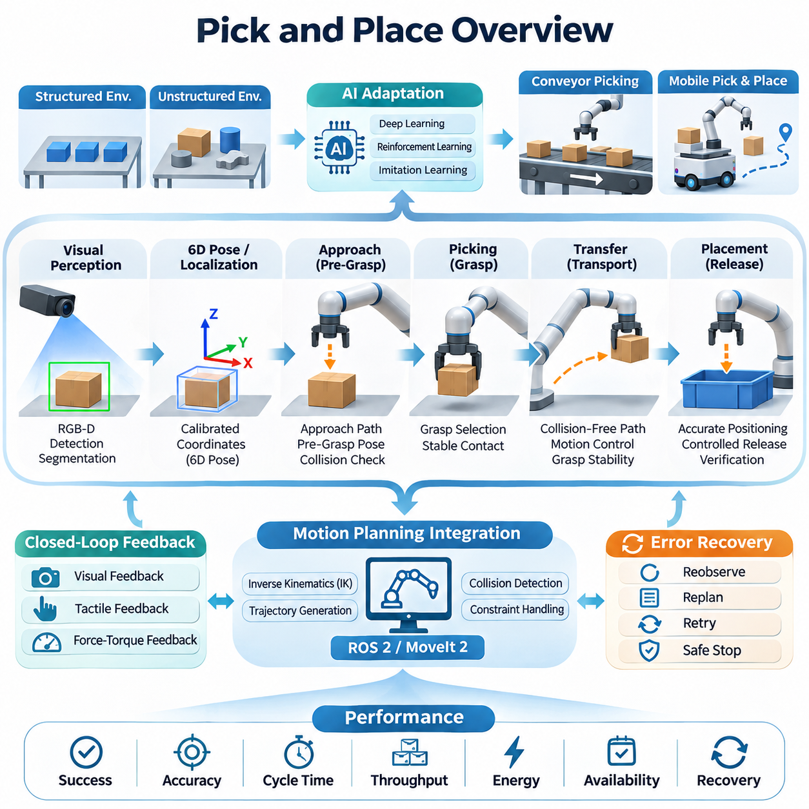
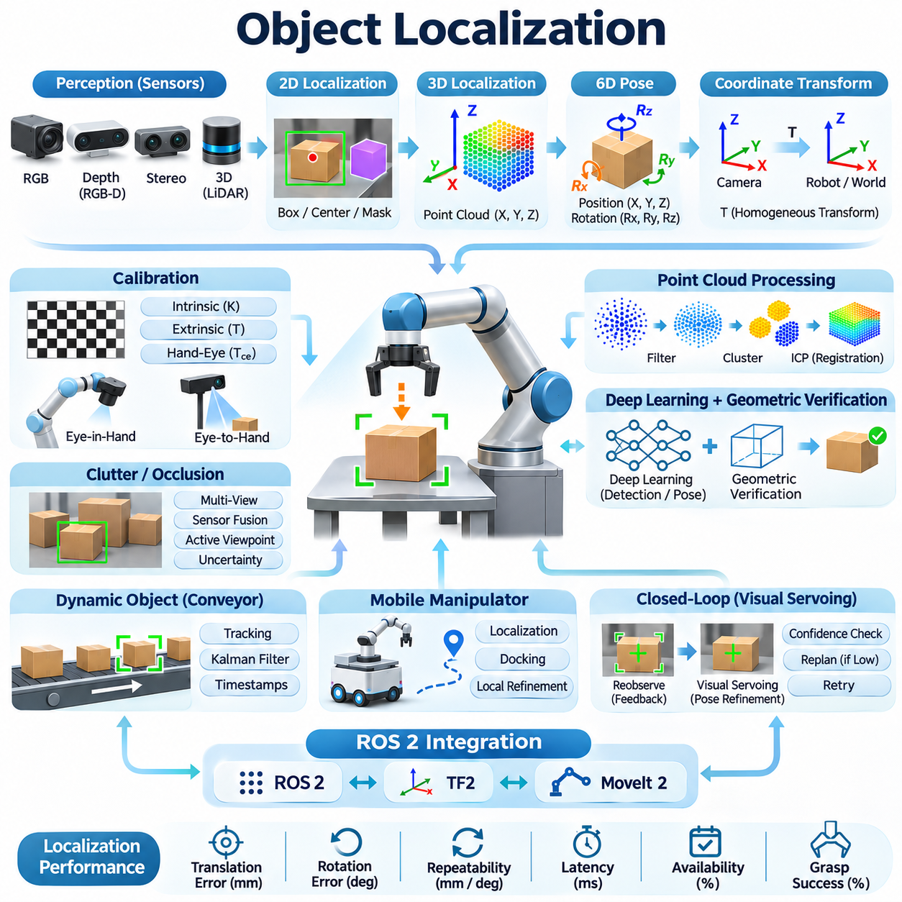
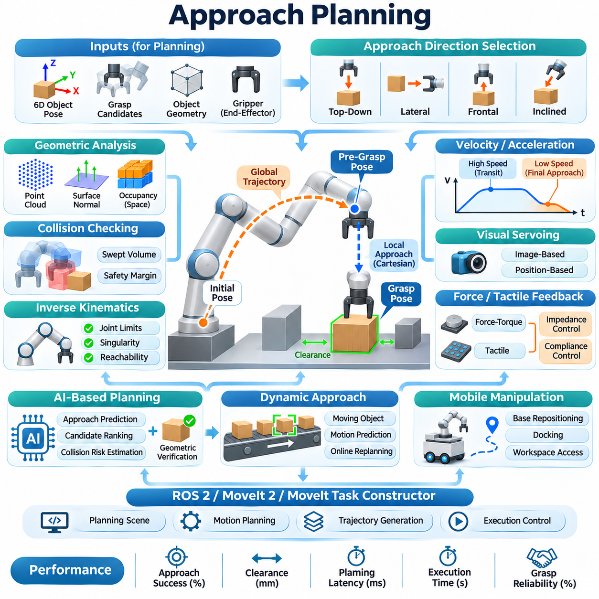
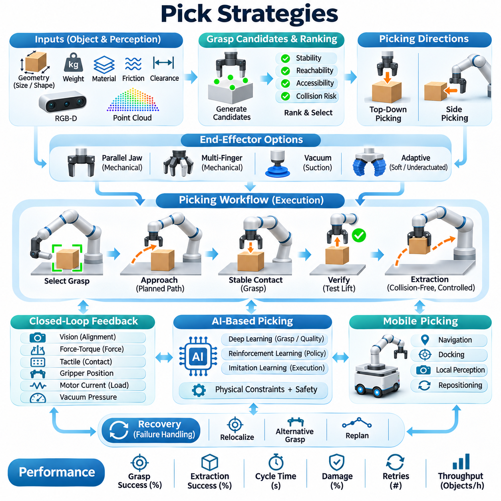
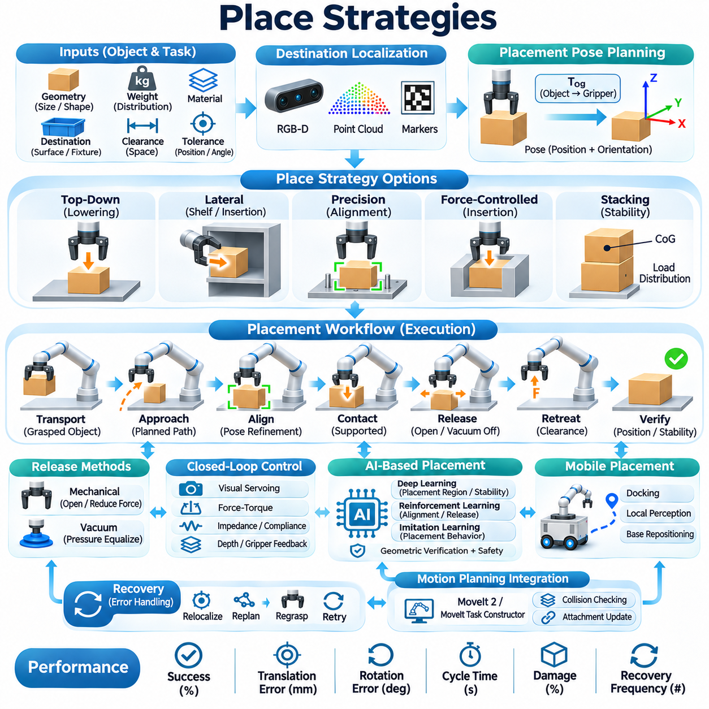
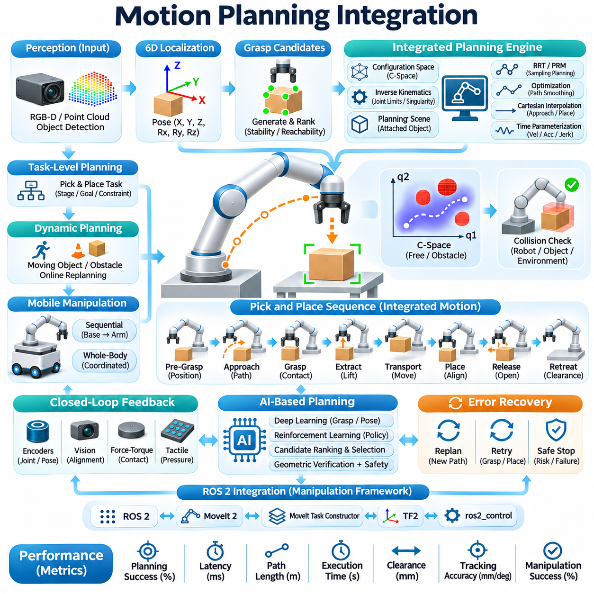
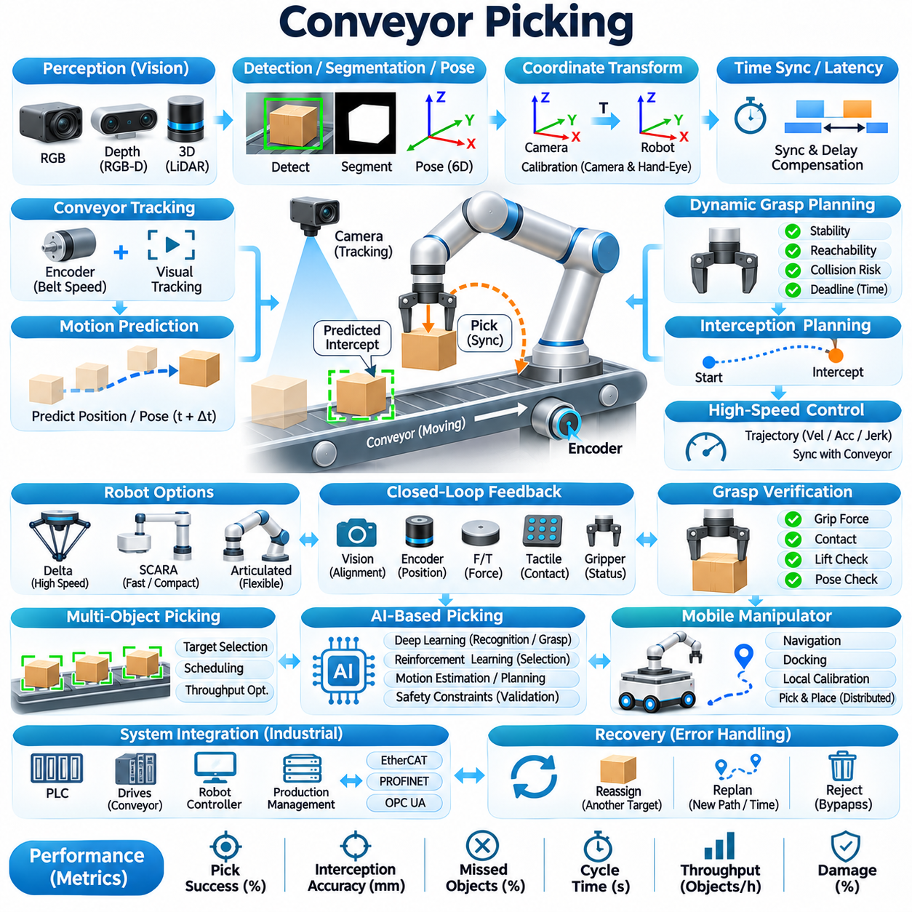
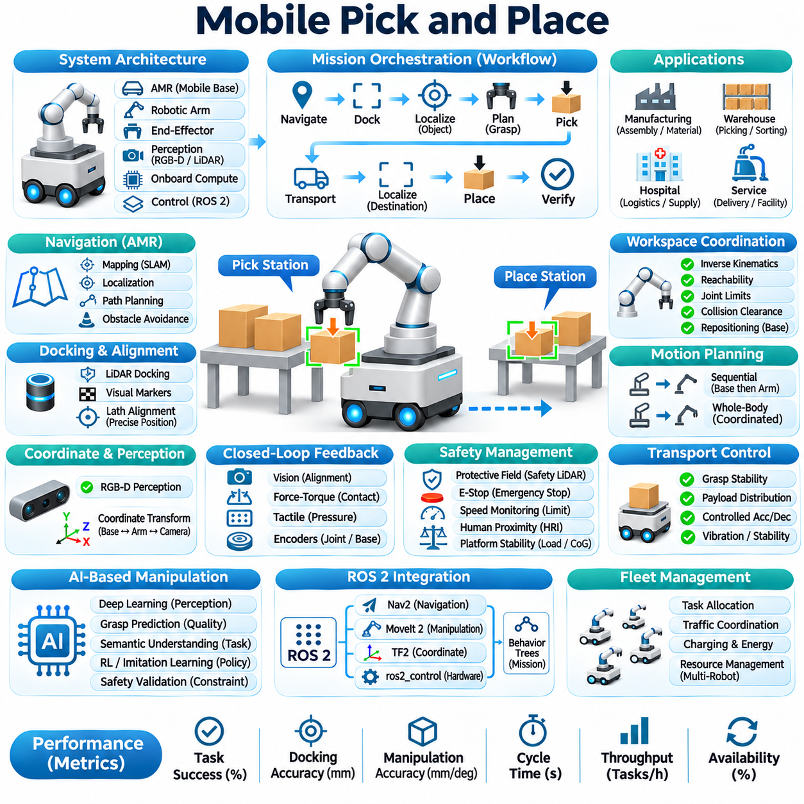
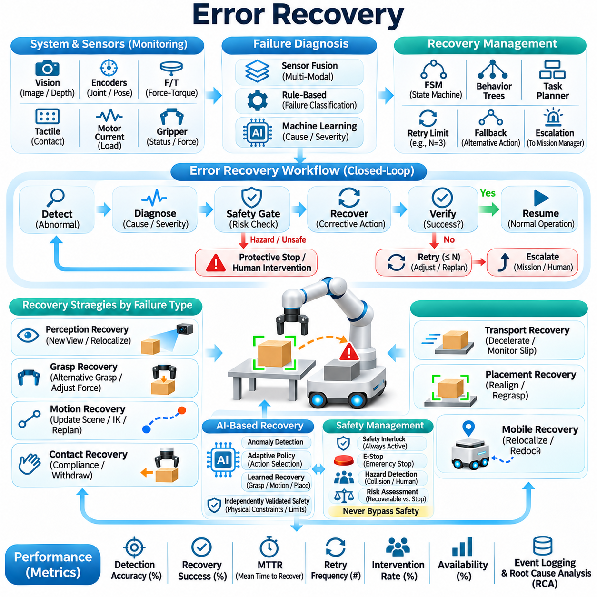

**Volume 03. Vision Manipulation and AI**


# Chapter 07. Pick and Place

##  

## 01 Pick and Place Overview

{width="7.268055555555556in" height="7.268055555555556in"}

Pick and place is a fundamental robotic manipulation operation in which a robot identifies an object, grasps it, transfers it to a designated location, and releases it in a controlled manner. Although the operation appears conceptually simple, successful execution requires the integration of visual perception, object localization, grasp planning, motion planning, and real-time control. It represents a foundational capability of autonomous manipulation systems.

Traditional pick and place systems operate in structured environments where object positions, orientations, and destinations are predetermined. Industrial robots execute repetitive movements using predefined trajectories and programmed coordinates. Modern AI-driven manipulation systems extend this capability to unstructured environments by dynamically identifying objects, estimating their spatial configurations, and adapting movement strategies according to environmental conditions.

A complete pick and place pipeline begins with visual perception. RGB cameras, depth cameras, stereo vision systems, and three-dimensional sensors collect information about objects and their surrounding environments. Object detection and instance segmentation algorithms identify target objects, while pose estimation determines their positions and orientations. This information establishes the spatial foundation required for subsequent manipulation decisions.

Object localization transforms perception results into coordinates that can be interpreted by the robotic manipulation system. Camera coordinates must be accurately converted into robot base coordinates or world coordinates through calibrated transformation relationships. Six-dimensional pose estimation provides both three-dimensional position and rotational orientation, allowing the robot to interact with objects from geometrically appropriate directions.

Approach planning determines how the robotic end effector moves toward the target object before establishing physical contact. The approach trajectory must consider object geometry, surrounding obstacles, gripper dimensions, joint limitations, and available workspace. An appropriate pre-grasp pose provides sufficient clearance and establishes a favorable orientation for grasp execution while reducing the probability of unintended collisions.

The picking phase involves establishing stable physical contact between the end effector and the target object. Mechanical grippers, vacuum grippers, magnetic grippers, and dexterous robotic hands provide different picking capabilities according to object characteristics. Grasp selection must consider material properties, weight distribution, surface geometry, friction, and mechanical stability to prevent object deformation, slippage, or accidental dropping.

After establishing a grasp, the robot lifts and transports the object toward its intended destination. Motion planning generates collision-free trajectories while satisfying kinematic, dynamic, and operational constraints. During transportation, the system must maintain grasp stability by controlling acceleration, deceleration, velocity, and orientation. Excessive inertial forces may compromise grasp quality, particularly when handling heavy or irregularly shaped objects.

The placing phase requires accurate positioning and controlled release of the transported object. Placement strategies depend on destination geometry, positioning tolerances, object orientation, and environmental constraints. Applications such as assembly, packaging, stacking, and precision material handling may require additional visual servoing, force feedback, or compliance control to achieve reliable placement without damaging objects or surrounding equipment.

Motion planning integration connects individual manipulation stages into a continuous and executable operational sequence. Inverse kinematics calculates feasible joint configurations, while trajectory generation determines coordinated joint movements. Collision detection evaluates the robot, attached objects, and surrounding structures. Integrated planning frameworks such as MoveIt 2 support these functions within ROS 2-based robotic manipulation architectures.

Conveyor picking introduces additional complexity because target objects continuously change their positions during operation. The robotic system must estimate object velocity, predict future positions, and synchronize grasp execution with conveyor movement. Perception latency, communication delays, processing time, and robot acceleration directly influence picking accuracy. Effective conveyor synchronization enables continuous material handling and high-throughput industrial automation.

Mobile pick and place extends manipulation capabilities beyond the fixed workspace of conventional industrial robots. An autonomous mobile robot transports a robotic arm between different operational locations, allowing objects to be collected and delivered across distributed environments. Successful execution requires synchronized navigation, mobile base positioning, arm workspace optimization, environmental perception, and manipulation planning within a unified control architecture.

AI-based pick and place systems improve operational flexibility through learned perception and manipulation strategies. Deep learning models can identify previously unseen object configurations, predict grasp candidates, and estimate manipulation success probabilities. Reinforcement learning and imitation learning can further improve action selection and adaptation. However, learned policies must operate within verified physical constraints and reliable safety mechanisms.

Closed-loop feedback is essential for maintaining manipulation reliability under environmental uncertainty. Visual feedback enables target position refinement, tactile sensors detect contact conditions, and force-torque sensors measure interaction forces. These feedback mechanisms allow the robot to adjust its movements during approach, grasping, transportation, and placement rather than relying exclusively on predetermined trajectories.

Error recovery mechanisms enable robotic systems to respond to unsuccessful grasps, object slippage, localization errors, unreachable poses, and unexpected obstacles. Depending on the detected failure, the system may reacquire perception data, generate alternative grasp candidates, modify approach trajectories, or reposition the mobile platform. Persistent or safety-critical failures require controlled interruption and appropriate supervisory intervention.

Performance evaluation considers picking success rate, placement accuracy, cycle time, throughput, recovery rate, energy consumption, and operational availability. These metrics must be evaluated under representative environmental conditions rather than exclusively through controlled laboratory experiments. Ultimately, autonomous pick and place provides a practical foundation for industrial automation, warehouse robotics, mobile manipulation, and increasingly intelligent Physical AI systems.

픽 앤 플레이스(Pick and Place)는 로봇이 대상 물체를 식별하고, 파지하고, 지정된 위치로 이동시킨 후 제어된 방식으로 놓는 기본적인 로봇 조작(Robotic Manipulation) 작업이다. 개념적으로는 단순한 작업처럼 보이지만, 성공적인 수행을 위해서는 시각 인식(Visual Perception), 물체 위치 추정(Object Localization), 파지 계획(Grasp Planning), 모션 계획(Motion Planning), 실시간 제어(Real-Time Control)의 통합이 필요하다. 이는 자율 조작 시스템(Autonomous Manipulation System)의 핵심적인 기반 기능에 해당한다.

전통적인 픽 앤 플레이스 시스템은 물체의 위치, 방향 및 목적지가 사전에 정의된 정형 환경(Structured Environment)에서 작동한다. 산업용 로봇(Industrial Robot)은 사전에 정의된 궤적과 프로그래밍된 좌표를 사용하여 반복적인 동작을 수행한다. 현대의 인공지능 기반 조작 시스템(AI-Driven Manipulation System)은 물체를 동적으로 식별하고, 공간적 배치 상태를 추정하며, 환경 조건에 따라 동작 전략을 적응시킴으로써 이러한 기능을 비정형 환경(Unstructured Environment)으로 확장한다.

완전한 픽 앤 플레이스 파이프라인(Pick and Place Pipeline)은 시각 인식(Visual Perception)에서 시작된다. RGB 카메라(RGB Camera), 깊이 카메라(Depth Camera), 스테레오 비전 시스템(Stereo Vision System), 3차원 센서(3D Sensor)는 물체와 주변 환경에 대한 정보를 수집한다. 객체 감지(Object Detection)와 인스턴스 분할(Instance Segmentation) 알고리즘은 대상 물체를 식별하며, 자세 추정(Pose Estimation)은 물체의 위치와 방향을 결정한다. 이러한 정보는 후속 조작 의사결정에 필요한 공간적 기반을 형성한다.

물체 위치 추정(Object Localization)은 인식 결과를 로봇 조작 시스템이 해석할 수 있는 좌표로 변환하는 과정이다. 카메라 좌표(Camera Coordinates)는 보정된 좌표 변환 관계(Coordinate Transformation Relationship)를 통해 로봇 베이스 좌표(Robot Base Coordinates) 또는 월드 좌표(World Coordinates)로 정확하게 변환되어야 한다. 6차원 자세 추정(6D Pose Estimation)은 3차원 위치와 회전 방향을 모두 제공함으로써 로봇이 기하학적으로 적절한 방향에서 물체와 상호작용할 수 있도록 한다.

접근 계획(Approach Planning)은 로봇의 말단 장치(End Effector)가 물리적 접촉을 형성하기 전에 대상 물체에 어떻게 접근할 것인지를 결정한다. 접근 궤적(Approach Trajectory)은 물체의 형상, 주변 장애물, 그리퍼의 크기, 관절 제한(Joint Limitations), 가용 작업 공간(Workspace)을 고려해야 한다. 적절한 사전 파지 자세(Pre-Grasp Pose)는 충분한 여유 공간을 확보하고 파지 수행에 유리한 방향을 형성하는 동시에 의도하지 않은 충돌의 발생 가능성을 감소시킨다.

픽킹 단계(Picking Phase)는 말단 장치와 대상 물체 사이에 안정적인 물리적 접촉을 형성하는 과정이다. 기계식 그리퍼(Mechanical Gripper), 진공 그리퍼(Vacuum Gripper), 자기식 그리퍼(Magnetic Gripper), 다기능 로봇 핸드(Dexterous Robotic Hand)는 물체의 특성에 따라 서로 다른 픽킹 기능을 제공한다. 파지 선택(Grasp Selection)은 물체의 변형, 미끄러짐 또는 우발적인 낙하를 방지하기 위해 재료 특성, 무게 분포, 표면 형상, 마찰력 및 기계적 안정성을 고려해야 한다.

파지가 형성되면 로봇은 물체를 들어 올리고 지정된 목적지로 운반한다. 모션 계획(Motion Planning)은 기구학적 제약조건(Kinematic Constraints), 동역학적 제약조건(Dynamic Constraints), 운용 제약조건(Operational Constraints)을 충족하면서 충돌 없는 궤적(Collision-Free Trajectory)을 생성한다. 운반 과정에서 시스템은 가속도, 감속도, 속도 및 방향을 제어하여 파지 안정성(Grasp Stability)을 유지해야 한다. 과도한 관성력(Inertial Force)은 특히 무겁거나 불규칙한 형상의 물체를 취급할 때 파지 품질(Grasp Quality)을 저하시킬 수 있다.

플레이스 단계(Placing Phase)는 운반된 물체를 정확하게 위치시키고 제어된 방식으로 놓는 과정이다. 배치 전략(Placement Strategy)은 목적지의 형상, 위치 허용오차(Positioning Tolerance), 물체의 방향 및 환경적 제약조건에 따라 결정된다. 조립(Assembly), 포장(Packaging), 적재(Stacking), 정밀 자재 취급(Precision Material Handling)과 같은 응용 분야에서는 물체나 주변 장비를 손상시키지 않고 신뢰성 있는 배치를 수행하기 위해 추가적인 시각 서보 제어(Visual Servoing), 힘 피드백(Force Feedback) 또는 순응 제어(Compliance Control)가 필요할 수 있다.

모션 계획 통합(Motion Planning Integration)은 개별 조작 단계를 연속적이고 실행 가능한 작업 시퀀스(Operational Sequence)로 연결한다. 역기구학(Inverse Kinematics)은 실행 가능한 관절 구성을 계산하며, 궤적 생성(Trajectory Generation)은 조율된 관절 움직임을 결정한다. 충돌 감지(Collision Detection)는 로봇과 파지된 물체 및 주변 구조물 사이의 충돌 가능성을 평가한다. MoveIt 2와 같은 통합 계획 프레임워크(Integrated Planning Framework)는 ROS 2 기반 로봇 조작 아키텍처에서 이러한 기능을 지원한다.

컨베이어 픽킹(Conveyor Picking)은 작업 중 대상 물체의 위치가 지속적으로 변화하기 때문에 추가적인 복잡성을 수반한다. 로봇 시스템은 물체의 이동 속도를 추정하고, 미래 위치를 예측하며, 컨베이어의 움직임과 파지 수행을 동기화해야 한다. 인식 지연시간(Perception Latency), 통신 지연(Communication Delay), 처리 시간(Processing Time), 로봇의 가속도는 픽킹 정확도(Picking Accuracy)에 직접적인 영향을 미친다. 효과적인 컨베이어 동기화(Conveyor Synchronization)는 연속적인 자재 취급과 높은 처리량을 갖는 산업 자동화(Industrial Automation)를 가능하게 한다.

모바일 픽 앤 플레이스(Mobile Pick and Place)는 기존 산업용 로봇의 고정된 작업 공간을 넘어 조작 기능을 확장한다. 자율이동로봇(Autonomous Mobile Robot, AMR)은 로봇 팔을 서로 다른 작업 위치로 이동시켜 분산된 환경에서 물체를 수집하고 전달할 수 있도록 한다. 성공적인 작업 수행을 위해서는 통합 제어 아키텍처(Unified Control Architecture) 내에서 자율주행(Navigation), 모바일 베이스 위치 결정(Mobile Base Positioning), 로봇 팔 작업 공간 최적화(Arm Workspace Optimization), 환경 인식(Environmental Perception), 조작 계획(Manipulation Planning)이 동기화되어야 한다.

인공지능 기반 픽 앤 플레이스 시스템(AI-Based Pick and Place System)은 학습된 인식 및 조작 전략을 통해 운용 유연성(Operational Flexibility)을 향상시킨다. 딥러닝 모델(Deep Learning Model)은 이전에 관찰하지 못한 물체의 배치 상태를 식별하고, 파지 후보(Grasp Candidate)를 예측하며, 조작 성공 확률(Manipulation Success Probability)을 추정할 수 있다. 강화학습(Reinforcement Learning)과 모방학습(Imitation Learning)은 행동 선택(Action Selection) 및 적응 능력을 더욱 향상시킬 수 있다. 그러나 학습된 정책(Learned Policy)은 검증된 물리적 제약조건과 신뢰성 있는 안전 메커니즘 내에서 작동해야 한다.

폐루프 피드백(Closed-Loop Feedback)은 환경적 불확실성(Environmental Uncertainty) 속에서 조작 신뢰성(Manipulation Reliability)을 유지하는 데 필수적이다. 시각 피드백(Visual Feedback)은 대상 물체의 위치를 정밀하게 보정할 수 있도록 하며, 촉각 센서(Tactile Sensor)는 접촉 상태를 감지하고, 힘·토크 센서(Force-Torque Sensor)는 상호작용력을 측정한다. 이러한 피드백 메커니즘은 로봇이 사전에 정의된 궤적에만 의존하지 않고 접근, 파지, 운반 및 배치 과정에서 자신의 움직임을 조정할 수 있도록 한다.

오류 복구 메커니즘(Error Recovery Mechanism)은 로봇 시스템이 파지 실패(Grasp Failure), 물체 미끄러짐(Object Slippage), 위치 추정 오류(Localization Error), 도달 불가능한 자세(Unreachable Pose), 예상하지 못한 장애물에 대응할 수 있도록 한다. 감지된 오류에 따라 시스템은 인식 데이터를 다시 획득하거나, 대체 파지 후보를 생성하거나, 접근 궤적을 수정하거나, 모바일 플랫폼의 위치를 재조정할 수 있다. 지속적으로 발생하는 오류 또는 안전에 중대한 영향을 미치는 오류는 제어된 작업 중단과 적절한 감독 수준의 개입(Supervisory Intervention)을 필요로 한다.

성능 평가(Performance Evaluation)는 픽킹 성공률(Picking Success Rate), 배치 정확도(Placement Accuracy), 사이클 타임(Cycle Time), 처리량(Throughput), 복구율(Recovery Rate), 에너지 소비량(Energy Consumption), 운용 가용성(Operational Availability)을 고려한다. 이러한 성능 지표는 통제된 실험실 환경에서만 평가하는 것이 아니라 실제 운용 환경을 대표하는 조건에서 평가되어야 한다. 궁극적으로 자율 픽 앤 플레이스(Autonomous Pick and Place)는 산업 자동화(Industrial Automation), 물류창고 로보틱스(Warehouse Robotics), 모바일 조작(Mobile Manipulation), 그리고 점차 지능화되는 물리적 인공지능(Physical AI) 시스템을 위한 실질적인 기술적 기반을 제공한다.

##  

## 02 Object Localization

{width="7.268055555555556in" height="7.268055555555556in"}

Object localization is the process of determining the spatial position of a target object within the operational environment of a robotic manipulation system. In pick and place applications, recognizing an object is insufficient unless the robot can accurately determine where the object is located and how it is oriented. Object localization establishes the geometric relationship between visual perception and physical manipulation, enabling reliable interaction with target objects.

The localization process begins with environmental data acquisition through RGB cameras, depth cameras, stereo vision systems, or three-dimensional sensors. These sensors capture information about object appearance, distance, geometry, and surrounding structures. The selection of sensing technologies depends on operational distance, environmental lighting, object surface characteristics, required positioning accuracy, and the computational resources available within the robotic platform.

Two-dimensional object localization determines the position of an object within an image coordinate system. Object detection algorithms typically generate bounding boxes, center points, or segmentation masks representing the visible regions of target objects. Although two-dimensional localization is useful for identifying objects and guiding preliminary movements, additional depth information or geometric assumptions are generally required to determine physical positions within three-dimensional space.

Three-dimensional object localization extends image-based detection by estimating spatial coordinates along the X, Y, and Z axes. RGB-D cameras provide synchronized color and depth information, allowing image pixels to be projected into three-dimensional camera coordinates using intrinsic calibration parameters. Stereo vision estimates depth through disparity measurements, while point cloud processing enables direct analysis of object geometry and spatial distribution.

Six-dimensional pose estimation provides a more comprehensive representation by determining both three-dimensional position and three-dimensional rotational orientation. This information is particularly important when objects must be grasped from specific directions or placed according to predefined orientation requirements. Rotation matrices, quaternions, and homogeneous transformation matrices are commonly used to represent object poses and support geometric calculations throughout the manipulation pipeline.

Coordinate transformation connects perception results with robotic motion execution. Objects detected within the camera coordinate system must be transformed into the robot base coordinate system, end-effector coordinate system, or global coordinate system. Homogeneous transformation matrices describe the translation and rotation between these reference frames. Incorrect transformations can introduce systematic positioning errors even when the underlying object detection algorithms perform accurately.

Camera calibration is essential for maintaining localization accuracy. Intrinsic calibration determines parameters such as focal length, principal point, and lens distortion, while extrinsic calibration establishes the spatial relationship between cameras and external reference frames. Hand-eye calibration determines the transformation between a camera and the robotic manipulator, supporting both eye-in-hand and eye-to-hand configurations in industrial and mobile manipulation systems.

Point cloud processing improves object localization by providing detailed three-dimensional geometric information. Background removal, voxel downsampling, outlier filtering, plane segmentation, and clustering can isolate target objects from surrounding structures. Registration algorithms such as Iterative Closest Point can refine estimated poses by aligning observed point clouds with reference geometric models, provided that sufficient geometric information and suitable initial estimates are available.

Deep learning-based localization methods improve adaptability when objects exhibit significant variations in shape, appearance, orientation, or environmental conditions. Neural networks can estimate object centers, keypoints, segmentation masks, depth information, and complete six-dimensional poses. Combining learned predictions with geometric verification can improve localization robustness while reducing dependence on manually designed visual features and application-specific recognition rules.

Object localization becomes more challenging in cluttered environments where neighboring objects partially obscure target surfaces. Occlusion, overlapping boundaries, reflective materials, transparent surfaces, and incomplete depth measurements can reduce estimation reliability. Multi-view perception, sensor fusion, active viewpoint selection, and uncertainty estimation help recover missing spatial information and improve object localization under difficult operating conditions.

Dynamic object localization is required when target objects move during perception and manipulation. Conveyor picking systems must continuously estimate object positions, orientations, and velocities to predict future grasp locations. Tracking algorithms, Kalman filters, synchronized sensor timestamps, and motion prediction compensate for processing delays. Accurate temporal alignment is necessary to prevent the robot from executing movements based on outdated object coordinates.

Mobile manipulators introduce additional localization requirements because the robot base itself can change position and orientation. Base localization errors, docking inaccuracies, structural vibration, and sensor calibration deviations influence the relationship between perceived objects and the robotic arm. Local visual measurements can refine target positions after navigation is completed, reducing dependence on global localization accuracy and supporting precise manipulation within operational workspaces.

Closed-loop localization enables continuous refinement of object positions throughout the approach and grasping stages. Visual servoing uses updated image or spatial measurements to correct deviations between desired and observed relative poses. Confidence thresholds and geometric consistency checks determine whether available estimates are sufficiently reliable for manipulation. When uncertainty exceeds acceptable limits, the system should reacquire sensor data or select an alternative observation position.

Within a ROS 2-based manipulation architecture, localization results are communicated through timestamped pose messages, coordinate transformation services, and perception interfaces. Frameworks such as TF2 maintain spatial relationships between robot components, while MoveIt 2 uses transformed object information to support motion planning and collision avoidance. Consistent reference frames, synchronized timestamps, and validated data interfaces are fundamental requirements for reliable system integration.

Localization performance is evaluated through translational error, rotational error, repeatability, estimation latency, detection availability, and downstream grasp success rates. Evaluation should include variations in lighting, object orientation, occlusion, sensor distance, and mobile base positioning. Ultimately, accurate and robust object localization provides the spatial intelligence required to connect visual perception with reliable physical action in autonomous pick and place systems.

물체 위치 추정(Object Localization)은 로봇 조작 시스템(Robotic Manipulation System)의 운용 환경 내에서 대상 물체의 공간적 위치를 결정하는 과정이다. 픽 앤 플레이스(Pick and Place) 응용 분야에서는 로봇이 물체의 위치와 방향을 정확하게 결정할 수 없다면 단순히 물체를 인식하는 것만으로는 충분하지 않다. 물체 위치 추정은 시각 인식(Visual Perception)과 물리적 조작(Physical Manipulation) 사이의 기하학적 관계를 확립하여 대상 물체와의 신뢰성 있는 상호작용을 가능하게 한다.

위치 추정 과정은 RGB 카메라(RGB Camera), 깊이 카메라(Depth Camera), 스테레오 비전 시스템(Stereo Vision System) 또는 3차원 센서(3D Sensor)를 통한 환경 데이터 획득(Environmental Data Acquisition)에서 시작된다. 이러한 센서는 물체의 외관, 거리, 형상 및 주변 구조물에 대한 정보를 수집한다. 센싱 기술(Sensing Technology)의 선택은 작업 거리, 환경 조명, 물체의 표면 특성, 요구되는 위치 결정 정확도 및 로봇 플랫폼에서 사용할 수 있는 연산 자원(Computational Resources)에 따라 결정된다.

2차원 물체 위치 추정(2D Object Localization)은 이미지 좌표계(Image Coordinate System) 내에서 물체의 위치를 결정한다. 객체 감지(Object Detection) 알고리즘은 일반적으로 대상 물체의 가시 영역을 나타내는 경계 상자(Bounding Box), 중심점(Center Point) 또는 분할 마스크(Segmentation Mask)를 생성한다. 2차원 위치 추정은 물체를 식별하고 초기 움직임을 유도하는 데 유용하지만, 3차원 공간 내에서 물리적 위치를 결정하기 위해서는 일반적으로 추가적인 깊이 정보(Depth Information) 또는 기하학적 가정(Geometric Assumption)이 필요하다.

3차원 물체 위치 추정(3D Object Localization)은 X, Y, Z축을 따라 공간 좌표를 추정함으로써 이미지 기반 감지(Image-Based Detection)를 확장한다. RGB-D 카메라(RGB-D Camera)는 동기화된 색상 및 깊이 정보를 제공하여 내부 보정 매개변수(Intrinsic Calibration Parameters)를 사용해 이미지 픽셀을 3차원 카메라 좌표로 투영할 수 있도록 한다. 스테레오 비전(Stereo Vision)은 시차 측정(Disparity Measurement)을 통해 깊이를 추정하며, 포인트 클라우드 처리(Point Cloud Processing)는 물체의 형상과 공간적 분포를 직접 분석할 수 있도록 한다.

6차원 자세 추정(6D Pose Estimation)은 3차원 위치와 3차원 회전 방향을 모두 결정함으로써 더욱 포괄적인 공간 표현을 제공한다. 이러한 정보는 물체를 특정 방향에서 파지하거나 사전에 정의된 방향 요구사항에 따라 배치해야 하는 경우에 특히 중요하다. 회전 행렬(Rotation Matrix), 쿼터니언(Quaternion), 동차 변환 행렬(Homogeneous Transformation Matrix)은 일반적으로 물체의 자세를 표현하고 전체 조작 파이프라인(Manipulation Pipeline)에서 기하학적 연산을 지원하는 데 사용된다.

좌표 변환(Coordinate Transformation)은 인식 결과와 로봇의 모션 실행(Motion Execution)을 연결한다. 카메라 좌표계(Camera Coordinate System)에서 감지된 물체는 로봇 베이스 좌표계(Robot Base Coordinate System), 말단 장치 좌표계(End-Effector Coordinate System) 또는 전역 좌표계(Global Coordinate System)로 변환되어야 한다. 동차 변환 행렬(Homogeneous Transformation Matrix)은 이러한 기준 좌표계 사이의 병진 이동(Translation)과 회전(Rotation)을 표현한다. 잘못된 좌표 변환은 기본 객체 감지 알고리즘이 정확하게 작동하더라도 체계적인 위치 결정 오류(Systematic Positioning Error)를 발생시킬 수 있다.

카메라 보정(Camera Calibration)은 위치 추정 정확도를 유지하는 데 필수적이다. 내부 보정(Intrinsic Calibration)은 초점 거리(Focal Length), 주점(Principal Point), 렌즈 왜곡(Lens Distortion)과 같은 매개변수를 결정하며, 외부 보정(Extrinsic Calibration)은 카메라와 외부 기준 좌표계 사이의 공간적 관계를 확립한다. 핸드-아이 보정(Hand-Eye Calibration)은 카메라와 로봇 매니퓰레이터 사이의 좌표 변환 관계를 결정하며, 산업용 및 모바일 조작 시스템에서 말단 장치 장착형(Eye-in-Hand)과 외부 고정형(Eye-to-Hand) 구성을 모두 지원한다.

포인트 클라우드 처리(Point Cloud Processing)는 상세한 3차원 기하학적 정보를 제공함으로써 물체 위치 추정 성능을 향상시킨다. 배경 제거(Background Removal), 복셀 다운샘플링(Voxel Downsampling), 이상치 필터링(Outlier Filtering), 평면 분할(Plane Segmentation), 군집화(Clustering)는 주변 구조물로부터 대상 물체를 분리할 수 있도록 한다. 반복 최근접점(Iterative Closest Point, ICP)과 같은 정합 알고리즘(Registration Algorithm)은 충분한 기하학적 정보와 적절한 초기 추정값이 확보된 경우, 관측된 포인트 클라우드를 기준 형상 모델과 정렬함으로써 추정된 자세를 정밀하게 보정할 수 있다.

딥러닝 기반 위치 추정(Deep Learning-Based Localization) 방법은 물체의 형상, 외관, 방향 또는 환경 조건에 상당한 변화가 존재하는 경우 적응성을 향상시킨다. 신경망(Neural Network)은 물체의 중심점, 특징점(Keypoint), 분할 마스크(Segmentation Mask), 깊이 정보 및 완전한 6차원 자세를 추정할 수 있다. 학습된 예측 결과와 기하학적 검증(Geometric Verification)을 결합하면 수동으로 설계된 시각적 특징(Visual Feature)과 응용 분야별 인식 규칙에 대한 의존도를 줄이면서 위치 추정 강건성(Localization Robustness)을 향상시킬 수 있다.

물체 위치 추정은 주변 물체가 대상 물체의 표면을 부분적으로 가리는 혼잡 환경(Cluttered Environment)에서 더욱 어려워진다. 가림 현상(Occlusion), 중첩된 경계(Overlapping Boundary), 반사성 재료(Reflective Material), 투명 표면(Transparent Surface), 불완전한 깊이 측정(Incomplete Depth Measurement)은 추정 신뢰성을 저하시킬 수 있다. 다중 시점 인식(Multi-View Perception), 센서 융합(Sensor Fusion), 능동 시점 선택(Active Viewpoint Selection), 불확실성 추정(Uncertainty Estimation)은 누락된 공간 정보를 복원하고 어려운 운용 조건에서 물체 위치 추정 성능을 향상시키는 데 도움을 준다.

동적 물체 위치 추정(Dynamic Object Localization)은 인식 및 조작 과정에서 대상 물체가 이동하는 경우에 필요하다. 컨베이어 픽킹 시스템(Conveyor Picking System)은 미래의 파지 위치를 예측하기 위해 물체의 위치, 방향 및 속도를 지속적으로 추정해야 한다. 추적 알고리즘(Tracking Algorithm), 칼만 필터(Kalman Filter), 동기화된 센서 타임스탬프(Synchronized Sensor Timestamp), 모션 예측(Motion Prediction)은 처리 지연(Processing Delay)을 보상한다. 로봇이 오래된 물체 좌표를 기반으로 움직임을 수행하는 것을 방지하기 위해서는 정확한 시간적 정렬(Temporal Alignment)이 필요하다.

모바일 매니퓰레이터(Mobile Manipulator)는 로봇 베이스 자체의 위치와 방향이 변화할 수 있기 때문에 추가적인 위치 추정 요구사항을 수반한다. 베이스 위치 추정 오류(Base Localization Error), 도킹 부정확성(Docking Inaccuracy), 구조적 진동(Structural Vibration), 센서 보정 편차(Sensor Calibration Deviation)는 인식된 물체와 로봇 팔 사이의 공간적 관계에 영향을 미친다. 자율주행이 완료된 후 국부적인 시각 측정(Local Visual Measurement)을 통해 대상 물체의 위치를 정밀하게 보정할 수 있으며, 이를 통해 전역 위치 추정 정확도(Global Localization Accuracy)에 대한 의존성을 줄이고 작업 공간 내에서 정밀한 조작을 지원할 수 있다.

폐루프 위치 추정(Closed-Loop Localization)은 접근 및 파지 단계 전반에 걸쳐 물체의 위치를 지속적으로 정밀하게 보정할 수 있도록 한다. 시각 서보 제어(Visual Servoing)는 갱신된 이미지 또는 공간 측정 정보를 사용하여 목표 상대 자세와 관측된 상대 자세 사이의 편차를 보정한다. 신뢰도 임계값(Confidence Threshold)과 기하학적 일관성 검사(Geometric Consistency Check)는 현재의 추정 결과가 조작 작업을 수행하기에 충분히 신뢰할 수 있는지를 결정한다. 불확실성이 허용 한계를 초과하는 경우 시스템은 센서 데이터를 다시 획득하거나 대체 관측 위치(Alternative Observation Position)를 선택해야 한다.

ROS 2 기반 조작 아키텍처(ROS 2-Based Manipulation Architecture) 내에서 위치 추정 결과는 타임스탬프가 포함된 자세 메시지(Timestamped Pose Message), 좌표 변환 서비스(Coordinate Transformation Service), 인식 인터페이스(Perception Interface)를 통해 전달된다. TF2와 같은 프레임워크는 로봇 구성요소 사이의 공간적 관계를 유지하며, MoveIt 2는 좌표 변환된 물체 정보를 사용하여 모션 계획(Motion Planning)과 충돌 회피(Collision Avoidance)를 지원한다. 일관된 기준 좌표계(Reference Frame), 동기화된 타임스탬프(Synchronized Timestamp), 검증된 데이터 인터페이스(Validated Data Interface)는 신뢰성 있는 시스템 통합(System Integration)을 위한 기본적인 요구사항이다.

위치 추정 성능(Localization Performance)은 병진 오차(Translational Error), 회전 오차(Rotational Error), 반복 정밀도(Repeatability), 추정 지연시간(Estimation Latency), 감지 가용성(Detection Availability), 후속 파지 성공률(Downstream Grasp Success Rate)을 통해 평가된다. 성능 평가에는 조명, 물체의 방향, 가림 현상, 센서 거리 및 모바일 베이스 위치의 변화가 포함되어야 한다. 궁극적으로 정확하고 강건한 물체 위치 추정은 자율 픽 앤 플레이스 시스템(Autonomous Pick and Place System)에서 시각 인식과 신뢰성 있는 물리적 행동(Physical Action)을 연결하는 데 필요한 공간 지능(Spatial Intelligence)을 제공한다.

##  

## 03 Approach Planning

{width="7.268055555555556in" height="7.268055555555556in"}

Approach planning is the process of determining how a robotic manipulator moves its end effector toward a target object before executing a grasp. It establishes a connection between object localization, grasp planning, and physical manipulation. An effective approach strategy positions the end effector at an appropriate location and orientation while minimizing collision risks, respecting mechanical constraints, and maintaining favorable conditions for successful grasp execution.

The approach planning process begins with the estimated position and orientation of the target object. Object localization and six-dimensional pose estimation provide spatial information within a defined coordinate system. This information is combined with grasp candidates, object geometry, and end-effector characteristics to determine suitable approach directions. The selected direction must support stable physical contact without interfering with surrounding objects or structures.

A pre-grasp pose represents an intermediate end-effector configuration located at a specified distance from the intended grasp pose. It allows the manipulator to prepare for the final approach while maintaining sufficient clearance from the target object. The distance between the pre-grasp and grasp poses depends on gripper dimensions, object geometry, localization uncertainty, and environmental constraints. Appropriate pre-grasp positioning improves execution reliability.

Approach direction selection significantly influences the feasibility and stability of robotic grasping. Common strategies include top-down, lateral, frontal, and inclined approaches. Top-down approaches are frequently suitable for objects placed on horizontal surfaces, while lateral approaches may be necessary for vertically arranged objects or restricted workspaces. The selected approach direction must satisfy both grasping requirements and environmental accessibility.

Geometric analysis provides the foundation for determining feasible approach trajectories. Three-dimensional object models, point clouds, surface normals, and occupancy representations describe the spatial relationships between the target object and surrounding obstacles. These representations allow the planning system to estimate available clearance, identify accessible contact regions, and reject approach directions that may result in unintended physical interference.

Collision avoidance is a critical requirement throughout the approach planning process. The planner must evaluate potential collisions involving the gripper, robotic arm, target object, neighboring objects, and environmental structures. Collision checking should consider the complete swept volume of the manipulator rather than exclusively examining the final grasp configuration. Additional safety margins can compensate for geometric inaccuracies and perception uncertainty.

Kinematic feasibility determines whether the robotic manipulator can physically achieve the desired pre-grasp and grasp configurations. Inverse kinematics calculates joint configurations corresponding to candidate end-effector poses. Joint position limits, singularities, workspace boundaries, and manipulator redundancy must be considered. A geometrically attractive approach may still be unsuitable if it produces unstable or mechanically infeasible joint configurations.

Approach trajectory generation converts selected spatial configurations into executable robotic movements. The global approach trajectory connects the initial robot configuration to the pre-grasp pose, while the local approach trajectory guides the end effector toward the final grasp pose. Cartesian interpolation is frequently used during the final approach because it provides predictable movement directions and simplifies the management of environmental clearance.

Velocity and acceleration profiles influence both operational efficiency and interaction safety during approach execution. Higher movement speeds may be appropriate when the manipulator travels through obstacle-free regions, whereas reduced speeds are generally required near the target object. Smooth acceleration and deceleration reduce mechanical vibration, minimize positioning errors, and provide additional time for perception updates and corrective control actions.

Visual servoing enables closed-loop approach execution by continuously refining the relative position between the end effector and the target object. Updated camera measurements allow the control system to compensate for localization errors, calibration deviations, and unexpected object movements. Position-based and image-based visual servoing provide complementary approaches for maintaining alignment and improving positioning accuracy during the final approach.

Force and tactile feedback become increasingly important as the end effector approaches physical contact. Force-torque sensors and tactile sensing systems can identify unexpected contact, excessive interaction forces, and deviations from intended movement conditions. Impedance control and compliance control allow the manipulator to respond appropriately to minor positioning errors while reducing the probability of damaging the target object or surrounding equipment.

AI-based approach planning improves adaptability in environments where predefined geometric rules may be insufficient. Deep learning models can predict accessible approach directions, estimate collision risks, and rank candidate trajectories according to expected grasp success. Learning-based strategies can be combined with conventional motion planning and geometric verification to improve flexibility while maintaining explicit physical and operational constraints.

Dynamic approach planning is necessary when the target object or surrounding environment changes during manipulation. Conveyor picking, moving obstacles, and human-robot collaboration require continuous perception updates and trajectory adjustments. Motion prediction and synchronized sensor measurements help estimate future target configurations. Online replanning enables the system to modify its approach when previously selected trajectories become invalid.

Mobile manipulators require coordinated approach planning between the mobile base and robotic arm. Base positioning influences object accessibility, manipulator reachability, sensor visibility, and collision-free workspace availability. When feasible arm configurations cannot be identified, the system may reposition the mobile platform before attempting another approach. Coordinated planning improves manipulation coverage while reducing unnecessary arm movements.

Within ROS 2-based manipulation architectures, MoveIt 2 and the MoveIt Task Constructor can integrate approach planning with grasp generation, inverse kinematics, collision checking, and trajectory execution. Planning scenes represent environmental geometry and robot configurations, while task stages organize movements toward pre-grasp and grasp poses. Performance evaluation considers approach success rate, minimum clearance, planning latency, execution time, and subsequent grasp reliability.

접근 계획(Approach Planning)은 로봇 매니퓰레이터가 파지를 수행하기 전에 말단 장치(End Effector)를 대상 물체를 향해 어떻게 이동시킬 것인지를 결정하는 과정이다. 이는 물체 위치 추정(Object Localization), 파지 계획(Grasp Planning), 물리적 조작(Physical Manipulation) 사이의 연결 관계를 확립한다. 효과적인 접근 전략(Approach Strategy)은 충돌 위험을 최소화하고 기계적 제약조건(Mechanical Constraints)을 준수하면서 성공적인 파지 수행에 유리한 조건을 유지하도록 말단 장치를 적절한 위치와 방향에 배치한다.

접근 계획 과정은 대상 물체의 추정된 위치와 방향에서 시작된다. 물체 위치 추정(Object Localization)과 6차원 자세 추정(6D Pose Estimation)은 정의된 좌표계 내에서 공간적 정보를 제공한다. 이러한 정보는 파지 후보(Grasp Candidate), 물체 형상(Object Geometry), 말단 장치 특성(End-Effector Characteristics)과 결합되어 적절한 접근 방향을 결정하는 데 사용된다. 선택된 접근 방향은 주변 물체나 구조물과의 간섭 없이 안정적인 물리적 접촉을 형성할 수 있어야 한다.

사전 파지 자세(Pre-Grasp Pose)는 목표 파지 자세(Grasp Pose)로부터 지정된 거리만큼 떨어진 위치에 설정되는 말단 장치의 중간 구성을 의미한다. 이를 통해 매니퓰레이터는 대상 물체와 충분한 여유 공간을 유지하면서 최종 접근을 준비할 수 있다. 사전 파지 자세와 파지 자세 사이의 거리는 그리퍼의 크기, 물체 형상, 위치 추정 불확실성(Localization Uncertainty), 환경적 제약조건(Environmental Constraints)에 따라 결정된다. 적절한 사전 파지 위치 설정은 작업 수행 신뢰성을 향상시킨다.

접근 방향 선택(Approach Direction Selection)은 로봇 파지의 실행 가능성(Feasibility)과 안정성(Stability)에 상당한 영향을 미친다. 일반적인 접근 전략에는 하향 접근(Top-Down Approach), 측면 접근(Lateral Approach), 정면 접근(Frontal Approach), 경사 접근(Inclined Approach)이 포함된다. 하향 접근은 수평면에 놓인 물체에 적합한 경우가 많으며, 측면 접근은 수직으로 배치된 물체나 제한된 작업 공간에서 필요할 수 있다. 선택된 접근 방향은 파지 요구사항과 환경적 접근성(Environmental Accessibility)을 모두 충족해야 한다.

기하학적 분석(Geometric Analysis)은 실행 가능한 접근 궤적(Approach Trajectory)을 결정하기 위한 기반을 제공한다. 3차원 물체 모델(3D Object Model), 포인트 클라우드(Point Cloud), 표면 법선 벡터(Surface Normal), 점유 공간 표현(Occupancy Representation)은 대상 물체와 주변 장애물 사이의 공간적 관계를 설명한다. 이러한 표현을 통해 계획 시스템은 가용 여유 공간(Clearance)을 추정하고, 접근 가능한 접촉 영역(Contact Region)을 식별하며, 의도하지 않은 물리적 간섭을 발생시킬 수 있는 접근 방향을 제외할 수 있다.

충돌 회피(Collision Avoidance)는 전체 접근 계획 과정에서 핵심적인 요구사항이다. 계획기(Planner)는 그리퍼, 로봇 팔, 대상 물체, 주변 물체 및 환경 구조물과 관련된 잠재적 충돌 가능성을 평가해야 한다. 충돌 검사(Collision Checking)는 최종 파지 구성만을 검사하는 것이 아니라 매니퓰레이터가 이동하면서 점유하는 전체 스윕 체적(Swept Volume)을 고려해야 한다. 추가적인 안전 여유(Safety Margin)를 확보함으로써 기하학적 부정확성과 인식 불확실성(Perception Uncertainty)을 보상할 수 있다.

기구학적 실행 가능성(Kinematic Feasibility)은 로봇 매니퓰레이터가 목표 사전 파지 구성과 파지 구성에 물리적으로 도달할 수 있는지를 결정한다. 역기구학(Inverse Kinematics)은 후보 말단 장치 자세에 대응하는 관절 구성(Joint Configuration)을 계산한다. 관절 위치 제한(Joint Position Limit), 특이점(Singularity), 작업 공간 경계(Workspace Boundary), 매니퓰레이터 여유 자유도(Manipulator Redundancy)를 고려해야 한다. 기하학적으로 유리한 접근 방향이라도 불안정하거나 기계적으로 실행 불가능한 관절 구성을 형성한다면 적절하지 않을 수 있다.

접근 궤적 생성(Approach Trajectory Generation)은 선택된 공간적 구성을 실행 가능한 로봇 움직임으로 변환하는 과정이다. 전역 접근 궤적(Global Approach Trajectory)은 로봇의 초기 구성과 사전 파지 자세를 연결하는 반면, 국부 접근 궤적(Local Approach Trajectory)은 말단 장치를 최종 파지 자세로 유도한다. 최종 접근 과정에서는 예측 가능한 이동 방향을 제공하고 주변 환경과의 여유 공간 관리를 단순화할 수 있기 때문에 직교 좌표 보간(Cartesian Interpolation)이 자주 사용된다.

속도 및 가속도 프로파일(Velocity and Acceleration Profile)은 접근 수행 과정에서 운용 효율성(Operational Efficiency)과 상호작용 안전성(Interaction Safety) 모두에 영향을 미친다. 매니퓰레이터가 장애물이 없는 영역을 통과하는 경우에는 높은 이동 속도가 적절할 수 있지만, 대상 물체에 근접할수록 일반적으로 이동 속도를 감소시켜야 한다. 부드러운 가속과 감속은 기계적 진동(Mechanical Vibration)을 감소시키고, 위치 결정 오류(Positioning Error)를 최소화하며, 인식 정보 갱신과 보정 제어 동작(Corrective Control Action)을 위한 추가적인 시간을 확보한다.

시각 서보 제어(Visual Servoing)는 말단 장치와 대상 물체 사이의 상대 위치를 지속적으로 정밀하게 보정함으로써 폐루프 접근 수행(Closed-Loop Approach Execution)을 가능하게 한다. 갱신된 카메라 측정값을 통해 제어 시스템은 위치 추정 오류(Localization Error), 보정 편차(Calibration Deviation), 예상하지 못한 물체의 움직임을 보상할 수 있다. 위치 기반 시각 서보 제어(Position-Based Visual Servoing, PBVS)와 이미지 기반 시각 서보 제어(Image-Based Visual Servoing, IBVS)는 최종 접근 과정에서 정렬 상태를 유지하고 위치 결정 정확도를 향상시키기 위한 상호 보완적인 접근 방식을 제공한다.

말단 장치가 물리적 접촉에 가까워질수록 힘 피드백(Force Feedback)과 촉각 피드백(Tactile Feedback)의 중요성이 증가한다. 힘·토크 센서(Force-Torque Sensor)와 촉각 센싱 시스템(Tactile Sensing System)은 예상하지 못한 접촉, 과도한 상호작용력(Interaction Force), 의도된 이동 조건으로부터의 편차를 식별할 수 있다. 임피던스 제어(Impedance Control)와 순응 제어(Compliance Control)는 매니퓰레이터가 경미한 위치 결정 오류에 적절하게 대응하도록 하면서 대상 물체나 주변 장비가 손상될 가능성을 감소시킨다.

인공지능 기반 접근 계획(AI-Based Approach Planning)은 사전에 정의된 기하학적 규칙만으로는 충분하지 않은 환경에서 적응성을 향상시킨다. 딥러닝 모델(Deep Learning Model)은 접근 가능한 방향을 예측하고, 충돌 위험을 추정하며, 예상되는 파지 성공 가능성에 따라 후보 궤적(Candidate Trajectory)의 우선순위를 결정할 수 있다. 학습 기반 전략(Learning-Based Strategy)은 기존의 모션 계획(Motion Planning) 및 기하학적 검증(Geometric Verification)과 결합되어 명시적인 물리적 제약조건과 운용 제약조건을 유지하면서 조작 유연성을 향상시킬 수 있다.

동적 접근 계획(Dynamic Approach Planning)은 조작 과정에서 대상 물체 또는 주변 환경이 변화하는 경우에 필요하다. 컨베이어 픽킹(Conveyor Picking), 이동 장애물(Moving Obstacle), 인간-로봇 협업(Human-Robot Collaboration)은 지속적인 인식 정보 갱신과 궤적 조정(Trajectory Adjustment)을 요구한다. 모션 예측(Motion Prediction)과 동기화된 센서 측정값(Synchronized Sensor Measurement)은 미래의 대상 물체 구성을 추정하는 데 도움을 준다. 온라인 재계획(Online Replanning)은 이전에 선택된 궤적이 더 이상 유효하지 않은 경우 시스템이 접근 전략을 수정할 수 있도록 한다.

모바일 매니퓰레이터(Mobile Manipulator)는 모바일 베이스와 로봇 팔 사이의 협조 접근 계획(Coordinated Approach Planning)을 필요로 한다. 베이스 위치 결정(Base Positioning)은 물체 접근성(Object Accessibility), 매니퓰레이터 도달 가능성(Manipulator Reachability), 센서 가시성(Sensor Visibility), 충돌 없는 작업 공간(Collision-Free Workspace)의 가용성에 영향을 미친다. 실행 가능한 로봇 팔 구성을 식별할 수 없는 경우 시스템은 새로운 접근을 시도하기 전에 모바일 플랫폼의 위치를 재조정할 수 있다. 협조 계획(Coordinated Planning)은 불필요한 로봇 팔의 움직임을 감소시키면서 조작 가능 범위(Manipulation Coverage)를 확장한다.

ROS 2 기반 조작 아키텍처(ROS 2-Based Manipulation Architecture)에서 MoveIt 2와 MoveIt Task Constructor는 접근 계획을 파지 생성(Grasp Generation), 역기구학(Inverse Kinematics), 충돌 검사(Collision Checking), 궤적 실행(Trajectory Execution)과 통합할 수 있다. 계획 장면(Planning Scene)은 환경의 기하학적 형상과 로봇 구성을 표현하며, 작업 단계(Task Stage)는 사전 파지 자세와 파지 자세를 향한 움직임을 체계적으로 구성한다. 성능 평가(Performance Evaluation)는 접근 성공률(Approach Success Rate), 최소 여유 거리(Minimum Clearance), 계획 지연시간(Planning Latency), 실행 시간(Execution Time), 후속 파지 신뢰성(Subsequent Grasp Reliability)을 고려한다.

##  

## 04 Pick Strategies

{width="7.268055555555556in" height="7.268055555555556in"}

Pick strategies define the methods and operational decisions used by a robotic manipulator to acquire a target object from its initial position. While grasp planning determines suitable contact configurations, a pick strategy establishes how the grasp is selected, executed, verified, and maintained during object extraction. Effective picking requires the integration of visual perception, grasp intelligence, motion control, and physical interaction management.

The selection of an appropriate pick strategy depends on object geometry, dimensions, weight, material properties, surface characteristics, and environmental conditions. Rigid objects with predictable geometries can often be handled using predefined picking procedures, whereas deformable or irregularly shaped objects require adaptive strategies. The operational environment also determines accessibility, available clearance, and suitable end-effector configurations.

Top-down picking is one of the most common strategies in industrial automation and warehouse robotics. The end effector approaches the target object vertically from above, establishes a grasp, and lifts the object away from its supporting surface. This strategy simplifies trajectory generation and is particularly effective for objects arranged on horizontal surfaces, conveyor belts, and within containers that provide sufficient vertical clearance.

Side picking involves approaching the target object from a horizontal or lateral direction. This strategy is appropriate for objects stored on shelves, vertically arranged components, and applications where overhead access is restricted. Successful side picking requires careful evaluation of lateral clearance, gripper orientation, contact geometry, and gravitational effects to ensure that the object remains stable during extraction and subsequent transportation.

Mechanical gripping strategies rely on physical contact between gripper fingers and object surfaces. Parallel-jaw grippers are widely used because of their mechanical simplicity and predictable closing behavior, while multi-finger robotic hands support more complex grasp configurations. Gripping force must be adjusted according to object weight, friction, and structural strength to prevent excessive deformation, unstable contact, or unintended slippage.

Vacuum picking uses suction forces generated through pressure differences between suction cups and object surfaces. This strategy is particularly effective for cartons, flat components, packaging materials, and objects with relatively smooth, nonporous surfaces. Vacuum pressure monitoring helps verify successful attachment, while suction cup selection and contact position optimization improve handling reliability across different object geometries.

Adaptive picking strategies allow robotic systems to modify their behavior according to variations in object geometry, positioning, and contact conditions. Underactuated grippers, soft robotic grippers, and compliant mechanisms can accommodate irregular shapes without requiring precisely predefined contact configurations. These capabilities are particularly valuable when handling delicate products, mixed inventory, and objects with uncertain physical properties.

Grasp candidate selection is an essential component of intelligent picking. Multiple candidate configurations can be generated from object models, RGB-D images, point clouds, or learned grasp representations. Each candidate is evaluated according to grasp stability, accessibility, collision probability, manipulator reachability, and expected execution success. Candidate ranking enables the system to select a picking configuration that balances these requirements.

Force-controlled picking improves manipulation reliability when physical contact conditions cannot be accurately predicted from visual information alone. Force-torque sensors and tactile sensors provide real-time measurements of contact forces, pressure distributions, and object movement. These measurements enable the controller to adjust gripping force and extraction movements while maintaining contact stability and reducing the risk of object damage.

Closed-loop picking continuously incorporates sensory feedback throughout grasp execution and object extraction. Visual feedback corrects residual alignment errors, while tactile and force feedback detect unstable contact or unexpected resistance. Gripper position measurements, motor current, and vacuum pressure can provide additional evidence of grasp completion. Combining these signals improves picking reliability compared with purely open-loop execution.

Grasp verification determines whether the target object has been successfully acquired before the system proceeds to transportation. Verification methods include monitoring gripper opening distance, measured gripping force, vacuum pressure, and visual observations of the lifted object. A short, controlled test lift can reveal unstable grasps or unintended attachment to neighboring objects, enabling corrective action before larger movements are executed.

Object extraction requires coordinated movement after the initial grasp has been established. The extraction trajectory must consider surrounding obstacles, supporting surfaces, frictional resistance, and possible mechanical interference. Controlled acceleration and appropriate lifting directions help maintain grasp stability. In cluttered environments, extraction may require additional manipulation movements to separate the target object from adjacent components.

AI-based picking strategies use learned models to improve grasp selection and execution across diverse object categories. Deep learning can predict grasp quality, identify suitable contact regions, and estimate successful picking configurations directly from sensory observations. Reinforcement learning and imitation learning can further optimize manipulation behavior through interaction experience, provided that actions remain within validated physical and safety constraints.

Mobile picking introduces additional requirements because the positioning accuracy of the mobile base influences manipulator accessibility and grasp execution. The system must coordinate navigation, local object localization, base positioning, and robotic arm movement. Local perception after arrival can compensate for docking deviations, while mobile base repositioning provides alternative picking configurations when the initial target is outside the feasible arm workspace.

Picking performance is evaluated through grasp success rate, extraction success rate, cycle time, damage rate, retry frequency, and operational throughput. Failed picking attempts should trigger structured recovery procedures such as object relocalization, alternative grasp selection, or approach replanning. Ultimately, robust pick strategies combine geometric reasoning, sensory feedback, adaptive control, and AI-driven decision-making to achieve reliable autonomous object acquisition.

픽킹 전략(Pick Strategy)은 로봇 매니퓰레이터가 초기 위치에 있는 대상 물체를 획득하기 위해 사용하는 방법과 운용 의사결정을 정의한다. 파지 계획(Grasp Planning)이 적절한 접촉 구성을 결정하는 반면, 픽킹 전략은 물체를 추출하는 과정에서 파지를 어떻게 선택하고, 실행하고, 검증하며, 유지할 것인지를 결정한다. 효과적인 픽킹을 위해서는 시각 인식(Visual Perception), 파지 지능(Grasp Intelligence), 모션 제어(Motion Control), 물리적 상호작용 관리(Physical Interaction Management)의 통합이 필요하다.

적절한 픽킹 전략의 선택은 물체의 형상, 치수, 무게, 재료 특성, 표면 특성 및 환경 조건에 따라 결정된다. 예측 가능한 형상을 가진 강체 물체(Rigid Object)는 사전에 정의된 픽킹 절차를 사용하여 취급할 수 있는 경우가 많지만, 변형 가능한 물체(Deformable Object)나 불규칙한 형상의 물체는 적응형 전략(Adaptive Strategy)을 필요로 한다. 또한 운용 환경(Operational Environment)은 물체 접근성(Accessibility), 가용 여유 공간(Clearance), 적절한 말단 장치 구성(End-Effector Configuration)을 결정한다.

하향 픽킹(Top-Down Picking)은 산업 자동화(Industrial Automation)와 물류창고 로보틱스(Warehouse Robotics)에서 가장 일반적으로 사용되는 전략 중 하나이다. 말단 장치(End Effector)는 대상 물체의 위쪽에서 수직으로 접근하고, 파지를 형성한 후 지지 표면(Supporting Surface)으로부터 물체를 들어 올린다. 이러한 전략은 궤적 생성(Trajectory Generation)을 단순화하며, 수평면이나 컨베이어 벨트 위에 배치된 물체 또는 충분한 수직 여유 공간(Vertical Clearance)을 제공하는 용기 내부의 물체를 취급하는 데 특히 효과적이다.

측면 픽킹(Side Picking)은 수평 또는 측면 방향에서 대상 물체에 접근하는 방식이다. 이러한 전략은 선반에 보관된 물체, 수직으로 배치된 구성요소, 상부 접근(Overhead Access)이 제한된 응용 분야에 적합하다. 성공적인 측면 픽킹을 위해서는 물체의 추출 및 후속 운반 과정에서 안정성을 유지할 수 있도록 측면 여유 공간(Lateral Clearance), 그리퍼 방향(Gripper Orientation), 접촉 형상(Contact Geometry), 중력의 영향(Gravitational Effect)을 신중하게 평가해야 한다.

기계식 파지 전략(Mechanical Gripping Strategy)은 그리퍼 손가락과 물체 표면 사이의 물리적 접촉(Physical Contact)에 의존한다. 평행 조 그리퍼(Parallel-Jaw Gripper)는 기계적 구조가 단순하고 닫힘 동작(Closing Behavior)을 예측할 수 있기 때문에 널리 사용되며, 다지형 로봇 핸드(Multi-Finger Robotic Hand)는 더욱 복잡한 파지 구성을 지원한다. 과도한 변형, 불안정한 접촉 또는 의도하지 않은 미끄러짐을 방지하기 위해서는 물체의 무게, 마찰력(Friction), 구조적 강도(Structural Strength)에 따라 파지력(Gripping Force)을 조정해야 한다.

진공 픽킹(Vacuum Picking)은 흡착컵(Suction Cup)과 물체 표면 사이의 압력 차이에 의해 생성되는 흡착력(Suction Force)을 이용한다. 이러한 전략은 골판지 상자(Carton), 평면 부품(Flat Component), 포장재(Packaging Material), 비교적 매끄럽고 비다공성 표면(Nonporous Surface)을 가진 물체에 특히 효과적이다. 진공 압력 모니터링(Vacuum Pressure Monitoring)은 성공적인 흡착 여부를 검증하는 데 도움을 주며, 흡착컵 선택(Suction Cup Selection)과 접촉 위치 최적화(Contact Position Optimization)는 다양한 물체 형상에 대한 취급 신뢰성을 향상시킨다.

적응형 픽킹 전략(Adaptive Picking Strategy)은 로봇 시스템이 물체의 형상, 위치 및 접촉 조건의 변화에 따라 자신의 동작을 수정할 수 있도록 한다. 부족 구동 그리퍼(Underactuated Gripper), 소프트 로봇 그리퍼(Soft Robotic Gripper), 순응형 메커니즘(Compliant Mechanism)은 정밀하게 사전 정의된 접촉 구성 없이도 불규칙한 형상에 적응할 수 있다. 이러한 기능은 손상되기 쉬운 제품(Delicate Product), 혼합 재고(Mixed Inventory), 불확실한 물리적 특성을 가진 물체를 취급할 때 특히 유용하다.

파지 후보 선택(Grasp Candidate Selection)은 지능형 픽킹(Intelligent Picking)의 핵심 구성요소이다. 물체 모델(Object Model), RGB-D 이미지(RGB-D Image), 포인트 클라우드(Point Cloud), 학습된 파지 표현(Learned Grasp Representation)으로부터 다수의 후보 구성을 생성할 수 있다. 각 후보는 파지 안정성(Grasp Stability), 접근성(Accessibility), 충돌 확률(Collision Probability), 매니퓰레이터 도달 가능성(Manipulator Reachability), 예상 실행 성공 가능성(Expected Execution Success)에 따라 평가된다. 후보 순위 결정(Candidate Ranking)은 시스템이 이러한 요구사항 사이의 균형을 유지하는 픽킹 구성을 선택할 수 있도록 한다.

힘 제어 기반 픽킹(Force-Controlled Picking)은 시각 정보만으로 물리적 접촉 조건을 정확하게 예측하기 어려운 경우 조작 신뢰성(Manipulation Reliability)을 향상시킨다. 힘·토크 센서(Force-Torque Sensor)와 촉각 센서(Tactile Sensor)는 접촉력(Contact Force), 압력 분포(Pressure Distribution), 물체의 움직임에 대한 실시간 측정값을 제공한다. 이러한 측정값은 제어기가 접촉 안정성(Contact Stability)을 유지하고 물체의 손상 위험을 감소시키면서 파지력과 추출 동작(Extraction Movement)을 조정할 수 있도록 한다.

폐루프 픽킹(Closed-Loop Picking)은 파지 수행과 물체 추출 과정 전반에 걸쳐 센서 피드백(Sensory Feedback)을 지속적으로 반영한다. 시각 피드백(Visual Feedback)은 잔여 정렬 오차(Residual Alignment Error)를 보정하며, 촉각 및 힘 피드백(Tactile and Force Feedback)은 불안정한 접촉이나 예상하지 못한 저항을 감지한다. 그리퍼 위치 측정(Gripper Position Measurement), 모터 전류(Motor Current), 진공 압력(Vacuum Pressure)은 파지 완료 여부를 판단하기 위한 추가적인 정보를 제공할 수 있다. 이러한 신호를 결합하면 순수한 개루프 실행(Open-Loop Execution)에 비해 픽킹 신뢰성을 향상시킬 수 있다.

파지 검증(Grasp Verification)은 시스템이 운반 단계로 진행하기 전에 대상 물체가 성공적으로 획득되었는지를 결정하는 과정이다. 검증 방법에는 그리퍼 개방 거리(Gripper Opening Distance), 측정된 파지력, 진공 압력, 들어 올린 물체에 대한 시각적 관측(Visual Observation)의 모니터링이 포함된다. 짧고 제어된 시험 리프팅(Test Lift)은 불안정한 파지나 인접 물체의 의도하지 않은 동반 부착을 확인할 수 있도록 하며, 더 큰 움직임을 수행하기 전에 보정 조치(Corrective Action)를 실행할 수 있도록 한다.

물체 추출(Object Extraction)은 초기 파지가 형성된 이후 조율된 움직임(Coordinated Movement)을 필요로 한다. 추출 궤적(Extraction Trajectory)은 주변 장애물, 지지 표면, 마찰 저항(Frictional Resistance), 발생 가능한 기계적 간섭(Mechanical Interference)을 고려해야 한다. 제어된 가속도(Controlled Acceleration)와 적절한 리프팅 방향(Lifting Direction)은 파지 안정성을 유지하는 데 도움을 준다. 혼잡 환경(Cluttered Environment)에서는 대상 물체를 인접 구성요소로부터 분리하기 위해 추가적인 조작 동작(Manipulation Movement)이 필요할 수 있다.

인공지능 기반 픽킹 전략(AI-Based Picking Strategy)은 다양한 물체 범주에 대한 파지 선택과 실행을 개선하기 위해 학습된 모델(Learned Model)을 사용한다. 딥러닝(Deep Learning)은 센서 관측 정보(Sensory Observation)로부터 파지 품질(Grasp Quality)을 예측하고, 적절한 접촉 영역(Contact Region)을 식별하며, 성공 가능성이 높은 픽킹 구성을 직접 추정할 수 있다. 강화학습(Reinforcement Learning)과 모방학습(Imitation Learning)은 상호작용 경험(Interaction Experience)을 통해 조작 행동을 더욱 최적화할 수 있다. 단, 이러한 행동은 검증된 물리적 제약조건(Physical Constraints)과 안전 제약조건(Safety Constraints) 내에서 수행되어야 한다.

모바일 픽킹(Mobile Picking)은 모바일 베이스의 위치 결정 정확도가 매니퓰레이터의 접근성과 파지 수행에 영향을 미치기 때문에 추가적인 요구사항을 수반한다. 시스템은 자율주행(Navigation), 국부 물체 위치 추정(Local Object Localization), 베이스 위치 결정(Base Positioning), 로봇 팔 움직임(Robotic Arm Movement)을 조율해야 한다. 작업 위치에 도착한 이후의 국부 인식(Local Perception)은 도킹 편차(Docking Deviation)를 보상할 수 있으며, 모바일 베이스 위치 재조정(Mobile Base Repositioning)은 초기 대상 물체가 로봇 팔의 실행 가능한 작업 공간(Feasible Arm Workspace)을 벗어나는 경우 대체 픽킹 구성을 제공한다.

픽킹 성능(Picking Performance)은 파지 성공률(Grasp Success Rate), 추출 성공률(Extraction Success Rate), 사이클 타임(Cycle Time), 손상률(Damage Rate), 재시도 빈도(Retry Frequency), 운용 처리량(Operational Throughput)을 통해 평가된다. 픽킹 시도가 실패하면 물체 위치 재추정(Object Relocalization), 대체 파지 선택(Alternative Grasp Selection), 접근 재계획(Approach Replanning)과 같은 체계적인 복구 절차(Structured Recovery Procedure)가 실행되어야 한다. 궁극적으로 강건한 픽킹 전략(Robust Pick Strategy)은 기하학적 추론(Geometric Reasoning), 센서 피드백(Sensory Feedback), 적응 제어(Adaptive Control), 인공지능 기반 의사결정(AI-Driven Decision-Making)을 결합하여 신뢰성 있는 자율 물체 획득(Autonomous Object Acquisition)을 실현한다.

##  

## 05 Place Strategies

{width="7.268055555555556in" height="7.268055555555556in"}

Place strategies define the methods and operational decisions used by a robotic manipulator to position and release a grasped object at a designated destination. While picking focuses on acquiring and securing an object, placing emphasizes positional accuracy, orientation control, release stability, and environmental compatibility. Effective placement requires coordinated integration of perception, motion planning, interaction control, and task verification.

The selection of an appropriate place strategy depends on object geometry, weight distribution, material properties, destination characteristics, and operational requirements. Objects placed on open surfaces generally require simpler movements than objects inserted into fixtures, stacked within containers, or positioned in confined spaces. The robot must consider physical stability, available clearance, placement tolerances, and potential interactions with surrounding structures.

Destination localization establishes the spatial relationship between the robotic manipulator and the intended placement location. RGB cameras, depth sensors, point clouds, and reference markers can identify supporting surfaces, containers, assembly fixtures, and available placement regions. Accurate localization enables the system to determine the target position and orientation while compensating for environmental variations and positioning uncertainties.

Placement pose planning determines the desired position and orientation of an object after it has been released. The relationship between the grasped object and the end effector must be considered when calculating the corresponding robot configuration. Coordinate transformations convert the desired object pose into an achievable end-effector pose. Incorrect grasp transformation estimates may introduce placement errors even when robot motion is accurately controlled.

Top-down placement is commonly used in packaging, material handling, and warehouse automation. The robotic manipulator positions the object above its destination and gradually lowers it until the required placement condition is achieved. This strategy benefits from gravitational support and relatively predictable release behavior. Appropriate vertical clearance and controlled lowering speeds help prevent collisions and excessive contact forces.

Lateral placement involves transferring an object into its destination through horizontal or inclined movements. This strategy is frequently required when loading shelves, positioning components inside machines, or inserting objects into restricted spaces. The planning system must evaluate lateral clearance, insertion depth, object orientation, and surrounding geometry. Controlled withdrawal of the gripper is necessary to avoid disturbing the placed object.

Precision placement is required in applications where objects must satisfy strict positional and rotational tolerances. Industrial assembly, electronic component handling, and precision manufacturing frequently depend on accurate alignment between objects and receiving structures. Visual servoing, high-resolution perception, force-torque feedback, and fine motion control can reduce residual positioning errors during the final placement stage.

Force-controlled placement enables the robot to manage physical interactions between an object and its destination. Force-torque sensors detect contact with supporting surfaces, assembly fixtures, or neighboring components. Impedance control and compliance control allow the manipulator to accommodate minor alignment errors and regulate interaction forces. These capabilities are particularly important when handling fragile objects or performing insertion tasks.

Stacking strategies require additional consideration of object stability, center of gravity, load distribution, and supporting surface conditions. The robotic system must estimate whether the intended arrangement can remain stable after the object is released. Three-dimensional scene analysis helps identify suitable stacking regions and detect geometric interference. Placement sequences should also consider the stability of previously stacked objects.

Release planning determines when and how the robotic end effector disengages from the transported object. Mechanical grippers gradually reduce gripping force or increase finger separation, while vacuum grippers release objects by equalizing pressure. The timing and dynamics of release must be coordinated with object support conditions. Premature release, excessive contact forces, or abrupt disengagement may cause displacement, damage, or instability.

Post-placement verification determines whether the object has been successfully positioned according to task requirements. Visual inspection, depth measurements, gripper feedback, and force measurements can provide evidence of placement completion. The system may evaluate final object position, orientation, stability, and separation from the end effector. Unexpected deviations should trigger corrective actions before subsequent operations are initiated.

AI-based placement strategies improve adaptability in environments where destination configurations and object characteristics are not fully predetermined. Deep learning models can identify available placement regions, estimate spatial compatibility, and predict placement stability. Reinforcement learning and imitation learning can optimize alignment and release behavior, while geometric verification and safety constraints ensure physically feasible execution.

Mobile placement requires coordination between the autonomous mobile robot and the robotic manipulator. Base positioning influences destination accessibility, arm reachability, sensor visibility, and achievable placement accuracy. After arriving at the destination, local perception can compensate for navigation and docking errors. Mobile base repositioning may be necessary when the intended placement pose cannot be achieved within the available arm workspace.

Placement motion planning integrates approach trajectories, object transportation, final alignment, release execution, and end-effector retreat. Frameworks such as MoveIt 2 and MoveIt Task Constructor support collision checking and coordinated execution of these manipulation stages. The planning scene must represent both the transported object and destination geometry, with object attachment states updated after successful release to support subsequent movements.

Placement performance is evaluated through placement success rate, translational error, rotational error, cycle time, object damage rate, and recovery frequency. Failed placement attempts may require destination relocalization, trajectory replanning, object regrasping, or controlled retry procedures. Ultimately, robust place strategies combine spatial reasoning, sensory feedback, adaptive control, and AI-driven decision-making to complete autonomous pick and place operations.

배치 전략(Place Strategy)은 로봇 매니퓰레이터가 파지한 물체를 지정된 목적지에 위치시키고 놓기 위해 사용하는 방법과 운용 의사결정을 정의한다. 픽킹(Picking)이 물체의 획득과 안정적인 파지에 중점을 두는 반면, 배치(Placing)는 위치 정확도(Positioning Accuracy), 방향 제어(Orientation Control), 해제 안정성(Release Stability), 환경 적합성(Environmental Compatibility)을 강조한다. 효과적인 배치를 위해서는 인식(Perception), 모션 계획(Motion Planning), 상호작용 제어(Interaction Control), 작업 검증(Task Verification)의 유기적인 통합이 필요하다.

적절한 배치 전략의 선택은 물체의 형상, 무게 분포(Weight Distribution), 재료 특성, 목적지 특성 및 운용 요구사항에 따라 결정된다. 개방된 표면에 물체를 배치하는 작업은 일반적으로 물체를 고정구에 삽입하거나, 용기 내부에 적재하거나, 제한된 공간에 위치시키는 작업보다 단순한 움직임을 요구한다. 로봇은 물리적 안정성(Physical Stability), 가용 여유 공간(Clearance), 배치 허용오차(Placement Tolerance), 주변 구조물과의 잠재적인 상호작용을 고려해야 한다.

목적지 위치 추정(Destination Localization)은 로봇 매니퓰레이터와 목표 배치 위치 사이의 공간적 관계를 확립한다. RGB 카메라(RGB Camera), 깊이 센서(Depth Sensor), 포인트 클라우드(Point Cloud), 기준 마커(Reference Marker)는 지지 표면(Supporting Surface), 용기(Container), 조립 고정구(Assembly Fixture), 가용 배치 영역(Available Placement Region)을 식별할 수 있다. 정확한 위치 추정은 시스템이 환경적 변화와 위치 결정 불확실성(Positioning Uncertainty)을 보상하면서 목표 위치와 방향을 결정할 수 있도록 한다.

배치 자세 계획(Placement Pose Planning)은 물체가 해제된 이후에 가져야 할 목표 위치와 방향을 결정하는 과정이다. 이에 대응하는 로봇 구성을 계산할 때는 파지된 물체와 말단 장치(End Effector) 사이의 공간적 관계를 고려해야 한다. 좌표 변환(Coordinate Transformation)은 목표 물체 자세(Desired Object Pose)를 도달 가능한 말단 장치 자세(End-Effector Pose)로 변환한다. 잘못된 파지 좌표 변환 추정(Grasp Transformation Estimation)은 로봇의 움직임이 정확하게 제어되더라도 배치 오류(Placement Error)를 발생시킬 수 있다.

하향 배치(Top-Down Placement)는 포장(Packaging), 자재 취급(Material Handling), 물류창고 자동화(Warehouse Automation)에서 일반적으로 사용된다. 로봇 매니퓰레이터는 물체를 목적지 위쪽에 위치시키고, 요구되는 배치 조건이 충족될 때까지 점진적으로 하강시킨다. 이러한 전략은 중력에 의한 지지(Gravitational Support)와 비교적 예측 가능한 해제 동작(Release Behavior)의 이점을 활용한다. 적절한 수직 여유 공간(Vertical Clearance)과 제어된 하강 속도(Lowering Speed)는 충돌과 과도한 접촉력(Contact Force)을 방지하는 데 도움을 준다.

측면 배치(Lateral Placement)는 수평 또는 경사진 움직임을 통해 물체를 목적지로 이동시키는 방식이다. 이러한 전략은 선반 적재(Shelf Loading), 기계 내부의 부품 배치(Component Positioning), 제한된 공간으로의 물체 삽입(Object Insertion)과 같은 작업에서 자주 요구된다. 계획 시스템은 측면 여유 공간(Lateral Clearance), 삽입 깊이(Insertion Depth), 물체 방향(Object Orientation), 주변 형상(Surrounding Geometry)을 평가해야 한다. 배치된 물체의 위치나 안정성을 저해하지 않도록 그리퍼의 제어된 후퇴(Controlled Withdrawal)가 필요하다.

정밀 배치(Precision Placement)는 물체가 엄격한 위치 및 회전 허용오차(Positional and Rotational Tolerance)를 충족해야 하는 응용 분야에서 요구된다. 산업용 조립(Industrial Assembly), 전자부품 취급(Electronic Component Handling), 정밀 제조(Precision Manufacturing)는 물체와 수용 구조물(Receiving Structure) 사이의 정확한 정렬(Alignment)에 의존하는 경우가 많다. 시각 서보 제어(Visual Servoing), 고해상도 인식(High-Resolution Perception), 힘·토크 피드백(Force-Torque Feedback), 정밀 모션 제어(Fine Motion Control)는 최종 배치 단계에서 잔여 위치 결정 오류(Residual Positioning Error)를 감소시킬 수 있다.

힘 제어 기반 배치(Force-Controlled Placement)는 로봇이 물체와 목적지 사이의 물리적 상호작용(Physical Interaction)을 관리할 수 있도록 한다. 힘·토크 센서(Force-Torque Sensor)는 지지 표면, 조립 고정구 또는 인접 구성요소와의 접촉을 감지한다. 임피던스 제어(Impedance Control)와 순응 제어(Compliance Control)는 매니퓰레이터가 경미한 정렬 오류(Alignment Error)에 적응하고 상호작용력(Interaction Force)을 조절할 수 있도록 한다. 이러한 기능은 손상되기 쉬운 물체(Fragile Object)를 취급하거나 삽입 작업(Insertion Task)을 수행하는 경우에 특히 중요하다.

적재 전략(Stacking Strategy)은 물체의 안정성(Object Stability), 무게중심(Center of Gravity), 하중 분포(Load Distribution), 지지 표면의 상태에 대한 추가적인 고려를 필요로 한다. 로봇 시스템은 물체가 해제된 이후에도 목표 배치 구성이 안정적으로 유지될 수 있는지를 추정해야 한다. 3차원 장면 분석(3D Scene Analysis)은 적절한 적재 영역(Stacking Region)을 식별하고 기하학적 간섭(Geometric Interference)을 감지하는 데 도움을 준다. 배치 시퀀스(Placement Sequence)는 이전에 적재된 물체들의 안정성도 함께 고려해야 한다.

해제 계획(Release Planning)은 로봇의 말단 장치가 운반된 물체를 언제, 어떻게 놓을 것인지를 결정하는 과정이다. 기계식 그리퍼(Mechanical Gripper)는 파지력을 점진적으로 감소시키거나 손가락 사이의 간격을 증가시키는 반면, 진공 그리퍼(Vacuum Gripper)는 압력 평형(Pressure Equalization)을 통해 물체를 해제한다. 해제 시점(Release Timing)과 해제 동역학(Release Dynamics)은 물체의 지지 조건과 조율되어야 한다. 조기 해제(Premature Release), 과도한 접촉력 또는 급격한 분리(Abrupt Disengagement)는 물체의 위치 변위, 손상 또는 불안정성을 발생시킬 수 있다.

배치 후 검증(Post-Placement Verification)은 물체가 작업 요구사항에 따라 성공적으로 배치되었는지를 결정하는 과정이다. 시각 검사(Visual Inspection), 깊이 측정(Depth Measurement), 그리퍼 피드백(Gripper Feedback), 힘 측정(Force Measurement)은 배치 완료 여부를 판단하기 위한 정보를 제공할 수 있다. 시스템은 물체의 최종 위치, 방향, 안정성 및 말단 장치로부터의 분리 상태(Separation Status)를 평가할 수 있다. 예상하지 못한 편차가 발생한 경우에는 후속 작업이 시작되기 전에 보정 조치(Corrective Action)가 수행되어야 한다.

인공지능 기반 배치 전략(AI-Based Placement Strategy)은 목적지의 구성과 물체의 특성이 완전히 사전 정의되지 않은 환경에서 적응성(Adaptability)을 향상시킨다. 딥러닝 모델(Deep Learning Model)은 가용 배치 영역을 식별하고, 공간적 적합성(Spatial Compatibility)을 추정하며, 배치 안정성(Placement Stability)을 예측할 수 있다. 강화학습(Reinforcement Learning)과 모방학습(Imitation Learning)은 정렬 및 해제 동작을 최적화할 수 있으며, 기하학적 검증(Geometric Verification)과 안전 제약조건(Safety Constraints)은 물리적으로 실행 가능한 작업 수행을 보장하는 데 활용된다.

모바일 배치(Mobile Placement)는 자율이동로봇(Autonomous Mobile Robot, AMR)과 로봇 매니퓰레이터 사이의 협조를 필요로 한다. 베이스 위치 결정(Base Positioning)은 목적지 접근성(Destination Accessibility), 로봇 팔의 도달 가능성(Arm Reachability), 센서 가시성(Sensor Visibility), 달성 가능한 배치 정확도(Placement Accuracy)에 영향을 미친다. 목적지에 도착한 이후 국부 인식(Local Perception)을 통해 자율주행 및 도킹 오류(Navigation and Docking Error)를 보상할 수 있다. 목표 배치 자세가 가용 로봇 팔 작업 공간 내에서 달성될 수 없는 경우에는 모바일 베이스 위치 재조정(Mobile Base Repositioning)이 필요할 수 있다.

배치 모션 계획(Placement Motion Planning)은 접근 궤적(Approach Trajectory), 물체 운반(Object Transportation), 최종 정렬(Final Alignment), 해제 실행(Release Execution), 말단 장치 후퇴(End-Effector Retreat)를 통합한다. MoveIt 2와 MoveIt Task Constructor와 같은 프레임워크는 이러한 조작 단계에 대한 충돌 검사(Collision Checking)와 협조 실행(Coordinated Execution)을 지원한다. 계획 장면(Planning Scene)은 운반되는 물체와 목적지의 기하학적 형상을 모두 표현해야 하며, 성공적인 해제 이후에는 후속 움직임을 지원하기 위해 물체 부착 상태(Object Attachment State)를 갱신해야 한다.

배치 성능(Placement Performance)은 배치 성공률(Placement Success Rate), 병진 오차(Translational Error), 회전 오차(Rotational Error), 사이클 타임(Cycle Time), 물체 손상률(Object Damage Rate), 복구 빈도(Recovery Frequency)를 통해 평가된다. 배치 시도가 실패한 경우 목적지 위치 재추정(Destination Relocalization), 궤적 재계획(Trajectory Replanning), 물체 재파지(Object Regrasping) 또는 제어된 재시도 절차(Controlled Retry Procedure)가 필요할 수 있다. 궁극적으로 강건한 배치 전략(Robust Place Strategy)은 공간적 추론(Spatial Reasoning), 센서 피드백(Sensory Feedback), 적응 제어(Adaptive Control), 인공지능 기반 의사결정(AI-Driven Decision-Making)을 결합하여 자율 픽 앤 플레이스(Autonomous Pick and Place) 작업을 완성한다.

##  

## 06 Motion Planning Integration

{width="7.268055555555556in" height="7.268055555555556in"}

Motion planning integration establishes a coordinated framework that connects visual perception, object localization, grasp planning, and robotic motion execution within a complete pick and place operation. Rather than treating individual manipulation stages as independent processes, an integrated planning architecture ensures that spatial information, mechanical constraints, operational objectives, and sensory feedback are consistently maintained throughout task execution.

The motion planning pipeline begins with the acquisition of environmental information and the identification of target objects. Perception algorithms estimate object positions, orientations, and surrounding geometry, while grasp planning generates feasible end-effector configurations. These results are transferred to the motion planning system, which determines whether the proposed manipulation actions can be executed within the physical constraints of the robot.

Task-level planning decomposes a pick and place operation into sequential manipulation stages, including pre-grasp positioning, final approach, grasp execution, object extraction, transportation, placement, release, and retreat. Each stage defines specific objectives, initial conditions, and execution constraints. Coordinating these stages ensures that the final state of one manipulation action provides a valid initial state for the subsequent action.

Configuration space provides a mathematical representation of possible robotic manipulator configurations. Each configuration describes the positions of individual robot joints, while obstacles and mechanical constraints define regions that cannot be occupied. Motion planning algorithms search for feasible paths through this configuration space, connecting initial and desired robot configurations without violating established operational constraints.

Inverse kinematics integration enables the motion planning system to convert desired end-effector poses into corresponding joint configurations. Multiple inverse kinematic solutions may exist for a single target pose, particularly in manipulators with redundant degrees of freedom. Candidate solutions must be evaluated according to joint limits, singularity avoidance, collision clearance, manipulability, and compatibility with subsequent manipulation stages.

Collision checking evaluates potential interference between the robotic manipulator, target objects, surrounding obstacles, and environmental structures. The planning scene represents these elements through geometric models and spatial occupancy information. After a successful grasp, the transported object must be represented as an attached collision object so that its dimensions and orientation are considered during motion planning and trajectory validation.

Sampling-based motion planning algorithms such as Rapidly-exploring Random Trees and Probabilistic Roadmaps are widely used for robotic manipulation in complex environments. These algorithms explore feasible regions of configuration space to identify collision-free paths. Optimization-based methods can subsequently improve path smoothness, reduce unnecessary movements, and satisfy additional requirements related to clearance, execution efficiency, and mechanical performance.

Cartesian motion planning is particularly important during final approach, object extraction, precision placement, and end-effector retreat. These manipulation stages frequently require predictable movement directions within physical space. Cartesian interpolation generates intermediate end-effector poses along a specified path, while inverse kinematics and collision checking determine whether the corresponding movements remain mechanically feasible and safe.

Trajectory generation converts geometric paths into time-dependent motion commands that can be executed by robotic controllers. Time parameterization assigns velocities and accelerations while respecting joint-level limitations and dynamic capabilities. Smooth trajectories reduce mechanical vibration, excessive inertial forces, and grasp instability. Jerk-limited motion profiles can further improve transportation reliability when handling fragile or heavy objects.

Closed-loop motion execution integrates real-time sensory feedback with planned manipulation trajectories. Joint encoders, visual sensors, force-torque sensors, and tactile sensors provide information about actual robot configurations and environmental interactions. Feedback controllers compensate for tracking errors and minor disturbances, while significant deviations may require trajectory modification, motion replanning, or controlled interruption of task execution.

Dynamic motion planning enables robotic systems to respond to environmental changes occurring after the initial planning process. Moving objects, unexpected obstacles, human activity, and changes in target positions may invalidate previously generated trajectories. Continuous planning scene updates, motion prediction, and online replanning allow the system to adapt its movements without compromising established physical and operational constraints.

Mobile manipulation introduces additional complexity because the mobile base and robotic arm share responsibility for achieving task objectives. Sequential planning positions the mobile base before arm manipulation, whereas whole-body planning considers coordinated base and arm movements. Integrated planning must evaluate navigation feasibility, manipulator reachability, platform stability, collision constraints, and localization uncertainty across the combined system.

Within ROS 2-based robotic architectures, MoveIt 2 provides an integration framework for inverse kinematics, collision detection, motion planning, trajectory processing, and execution management. MoveIt Task Constructor supports the decomposition of complex manipulation tasks into interconnected planning stages. TF2 and ros2_control contribute coordinate transformation management and hardware control interfaces within the overall manipulation pipeline.

AI-based motion planning integration extends conventional planning capabilities through learned representations, trajectory prediction, and adaptive action selection. Neural networks can generate promising motion candidates or estimate planning feasibility, while reinforcement learning can optimize policies for recurring manipulation tasks. Learned outputs should be validated against explicit collision constraints, mechanical limitations, and independent safety mechanisms before execution.

Integrated motion planning performance is evaluated through planning success rate, computational latency, trajectory length, execution time, minimum collision clearance, tracking accuracy, and overall manipulation success rate. Structured error recovery should address invalid trajectories, unreachable poses, unexpected contact, and execution failures. Ultimately, motion planning integration transforms perception and grasp intelligence into coordinated, reliable physical actions within autonomous pick and place systems.

모션 계획 통합(Motion Planning Integration)은 완전한 픽 앤 플레이스(Pick and Place) 작업 내에서 시각 인식(Visual Perception), 물체 위치 추정(Object Localization), 파지 계획(Grasp Planning), 로봇 모션 실행(Robotic Motion Execution)을 연결하는 협조적 프레임워크(Coordinated Framework)를 구축한다. 개별 조작 단계를 독립적인 프로세스로 취급하는 대신, 통합 계획 아키텍처(Integrated Planning Architecture)는 공간 정보, 기계적 제약조건, 운용 목표 및 센서 피드백이 전체 작업 수행 과정에서 일관되게 유지되도록 한다.

모션 계획 파이프라인(Motion Planning Pipeline)은 환경 정보의 획득과 대상 물체의 식별에서 시작된다. 인식 알고리즘(Perception Algorithm)은 물체의 위치, 방향 및 주변 형상을 추정하며, 파지 계획(Grasp Planning)은 실행 가능한 말단 장치 구성(End-Effector Configuration)을 생성한다. 이러한 결과는 모션 계획 시스템(Motion Planning System)으로 전달되며, 시스템은 제안된 조작 행동이 로봇의 물리적 제약조건(Physical Constraints) 내에서 실행될 수 있는지를 결정한다.

작업 수준 계획(Task-Level Planning)은 픽 앤 플레이스 작업을 사전 파지 위치 결정(Pre-Grasp Positioning), 최종 접근(Final Approach), 파지 실행(Grasp Execution), 물체 추출(Object Extraction), 운반(Transportation), 배치(Placement), 해제(Release), 후퇴(Retreat)를 포함하는 순차적인 조작 단계로 분해한다. 각 단계는 구체적인 목표, 초기 조건(Initial Condition), 실행 제약조건(Execution Constraints)을 정의한다. 이러한 단계들을 조율함으로써 하나의 조작 행동의 최종 상태(Final State)가 후속 행동의 유효한 초기 상태(Initial State)를 제공하도록 한다.

구성 공간(Configuration Space, C-Space)은 로봇 매니퓰레이터가 가질 수 있는 구성에 대한 수학적 표현(Mathematical Representation)을 제공한다. 각각의 구성은 개별 로봇 관절의 위치를 나타내며, 장애물과 기계적 제약조건은 로봇이 점유할 수 없는 영역을 정의한다. 모션 계획 알고리즘(Motion Planning Algorithm)은 이러한 구성 공간 내에서 실행 가능한 경로(Feasible Path)를 탐색하여 설정된 운용 제약조건(Operational Constraints)을 위반하지 않으면서 로봇의 초기 구성과 목표 구성을 연결한다.

역기구학 통합(Inverse Kinematics Integration)은 모션 계획 시스템이 목표 말단 장치 자세(Desired End-Effector Pose)를 이에 대응하는 관절 구성(Joint Configuration)으로 변환할 수 있도록 한다. 특히 여유 자유도(Redundant Degrees of Freedom)를 가진 매니퓰레이터에서는 하나의 목표 자세에 대해 여러 개의 역기구학 해(Inverse Kinematic Solution)가 존재할 수 있다. 후보 해는 관절 제한(Joint Limit), 특이점 회피(Singularity Avoidance), 충돌 여유 거리(Collision Clearance), 조작성(Manipulability), 후속 조작 단계와의 호환성(Compatibility)에 따라 평가되어야 한다.

충돌 검사(Collision Checking)는 로봇 매니퓰레이터, 대상 물체, 주변 장애물 및 환경 구조물 사이에서 발생할 수 있는 잠재적 간섭(Potential Interference)을 평가한다. 계획 장면(Planning Scene)은 기하학적 모델(Geometric Model)과 공간 점유 정보(Spatial Occupancy Information)를 통해 이러한 요소들을 표현한다. 성공적인 파지 이후에는 운반되는 물체를 부착된 충돌 객체(Attached Collision Object)로 표현하여 모션 계획 및 궤적 검증(Trajectory Validation) 과정에서 해당 물체의 크기와 방향을 고려할 수 있도록 해야 한다.

신속 탐색 무작위 트리(Rapidly-Exploring Random Tree, RRT)와 확률적 로드맵(Probabilistic Roadmap, PRM)과 같은 샘플링 기반 모션 계획 알고리즘(Sampling-Based Motion Planning Algorithm)은 복잡한 환경에서의 로봇 조작에 널리 사용된다. 이러한 알고리즘은 충돌 없는 경로(Collision-Free Path)를 식별하기 위해 구성 공간 내의 실행 가능한 영역을 탐색한다. 이후 최적화 기반 방법(Optimization-Based Method)을 적용하여 경로 평활성(Path Smoothness)을 향상시키고, 불필요한 움직임을 감소시키며, 여유 거리, 실행 효율성 및 기계적 성능과 관련된 추가 요구사항을 충족할 수 있다.

직교 좌표 모션 계획(Cartesian Motion Planning)은 최종 접근, 물체 추출, 정밀 배치(Precision Placement), 말단 장치 후퇴(End-Effector Retreat) 과정에서 특히 중요하다. 이러한 조작 단계는 물리적 공간 내에서 예측 가능한 이동 방향을 요구하는 경우가 많다. 직교 좌표 보간(Cartesian Interpolation)은 지정된 경로를 따라 중간 말단 장치 자세(Intermediate End-Effector Pose)를 생성하며, 역기구학과 충돌 검사는 이에 대응하는 움직임이 기계적으로 실행 가능하고 안전한지를 결정한다.

궤적 생성(Trajectory Generation)은 기하학적 경로(Geometric Path)를 로봇 제어기가 실행할 수 있는 시간 의존적 모션 명령(Time-Dependent Motion Command)으로 변환한다. 시간 매개변수화(Time Parameterization)는 관절 수준의 제한과 동역학적 능력(Dynamic Capability)을 준수하면서 속도와 가속도를 할당한다. 부드러운 궤적(Smooth Trajectory)은 기계적 진동(Mechanical Vibration), 과도한 관성력(Inertial Force), 파지 불안정성(Grasp Instability)을 감소시킨다. 저크 제한 모션 프로파일(Jerk-Limited Motion Profile)은 손상되기 쉬운 물체나 무거운 물체를 취급할 때 운반 신뢰성을 더욱 향상시킬 수 있다.

폐루프 모션 실행(Closed-Loop Motion Execution)은 실시간 센서 피드백(Real-Time Sensory Feedback)을 계획된 조작 궤적과 통합한다. 관절 엔코더(Joint Encoder), 시각 센서(Visual Sensor), 힘·토크 센서(Force-Torque Sensor), 촉각 센서(Tactile Sensor)는 실제 로봇 구성과 환경적 상호작용에 대한 정보를 제공한다. 피드백 제어기(Feedback Controller)는 추종 오차(Tracking Error)와 경미한 외란(Disturbance)을 보상하며, 상당한 편차가 발생하는 경우에는 궤적 수정(Trajectory Modification), 모션 재계획(Motion Replanning) 또는 제어된 작업 실행 중단(Controlled Interruption)이 필요할 수 있다.

동적 모션 계획(Dynamic Motion Planning)은 초기 계획 과정 이후에 발생하는 환경 변화에 로봇 시스템이 대응할 수 있도록 한다. 이동 물체(Moving Object), 예상하지 못한 장애물, 인간의 활동 및 대상 물체의 위치 변화는 이전에 생성된 궤적을 무효화할 수 있다. 지속적인 계획 장면 갱신(Planning Scene Update), 모션 예측(Motion Prediction), 온라인 재계획(Online Replanning)은 시스템이 설정된 물리적 제약조건과 운용 제약조건을 위반하지 않으면서 환경 변화에 따라 움직임을 적응시킬 수 있도록 한다.

모바일 조작(Mobile Manipulation)은 모바일 베이스와 로봇 팔이 작업 목표 달성에 대한 역할을 분담하기 때문에 추가적인 복잡성을 수반한다. 순차적 계획(Sequential Planning)은 로봇 팔의 조작에 앞서 모바일 베이스를 위치시키는 반면, 전신 모션 계획(Whole-Body Planning)은 모바일 베이스와 로봇 팔의 협조 움직임(Coordinated Movement)을 고려한다. 통합 계획(Integrated Planning)은 결합된 전체 시스템에 걸쳐 자율주행 실행 가능성(Navigation Feasibility), 매니퓰레이터 도달 가능성(Manipulator Reachability), 플랫폼 안정성(Platform Stability), 충돌 제약조건(Collision Constraints), 위치 추정 불확실성(Localization Uncertainty)을 평가해야 한다.

ROS 2 기반 로봇 아키텍처(ROS 2-Based Robotic Architecture)에서 MoveIt 2는 역기구학(Inverse Kinematics), 충돌 감지(Collision Detection), 모션 계획(Motion Planning), 궤적 처리(Trajectory Processing), 실행 관리(Execution Management)를 위한 통합 프레임워크(Integration Framework)를 제공한다. MoveIt Task Constructor는 복잡한 조작 작업을 상호 연결된 계획 단계(Planning Stage)로 분해하는 것을 지원한다. TF2와 ros2_control은 전체 조작 파이프라인 내에서 각각 좌표 변환 관리(Coordinate Transformation Management)와 하드웨어 제어 인터페이스(Hardware Control Interface)를 지원한다.

인공지능 기반 모션 계획 통합(AI-Based Motion Planning Integration)은 학습된 표현(Learned Representation), 궤적 예측(Trajectory Prediction), 적응형 행동 선택(Adaptive Action Selection)을 통해 기존의 계획 기능을 확장한다. 신경망(Neural Network)은 실행 가능성이 높은 모션 후보(Motion Candidate)를 생성하거나 계획 실행 가능성(Planning Feasibility)을 추정할 수 있으며, 강화학습(Reinforcement Learning)은 반복적으로 수행되는 조작 작업에 대한 정책(Policy)을 최적화할 수 있다. 학습 모델의 출력은 실행에 앞서 명시적인 충돌 제약조건, 기계적 제한(Mechanical Limitation), 독립적인 안전 메커니즘(Independent Safety Mechanism)을 기준으로 검증되어야 한다.

통합 모션 계획 성능(Integrated Motion Planning Performance)은 계획 성공률(Planning Success Rate), 연산 지연시간(Computational Latency), 궤적 길이(Trajectory Length), 실행 시간(Execution Time), 최소 충돌 여유 거리(Minimum Collision Clearance), 추종 정확도(Tracking Accuracy), 전체 조작 성공률(Overall Manipulation Success Rate)을 통해 평가된다. 체계적인 오류 복구(Structured Error Recovery)는 유효하지 않은 궤적, 도달 불가능한 자세, 예상하지 못한 접촉 및 실행 실패에 대응해야 한다. 궁극적으로 모션 계획 통합은 인식 지능(Perception Intelligence)과 파지 지능(Grasp Intelligence)을 자율 픽 앤 플레이스 시스템(Autonomous Pick and Place System) 내에서 협조적이고 신뢰성 있는 물리적 행동(Physical Action)으로 변환한다.

##  

## 07 Conveyor Picking

{width="7.268055555555556in" height="7.268055555555556in"}

Conveyor picking is a robotic manipulation technique used to identify, track, and acquire objects moving along a conveyor system. Unlike conventional picking operations involving stationary objects, conveyor picking requires continuous coordination between perception, motion prediction, grasp planning, and robotic control. The primary objective is to achieve reliable object acquisition without interrupting the material transportation process.

Conveyor picking systems are widely used in manufacturing, warehouse automation, food processing, packaging, sorting, and distribution facilities. Objects transported by conveyors may vary in size, geometry, orientation, material properties, and spacing. The robotic system must accommodate these variations while maintaining operational throughput, grasp reliability, and synchronization with upstream and downstream production equipment.

Visual perception provides the foundation for identifying objects moving along the conveyor. RGB cameras, depth cameras, and three-dimensional vision systems capture information about object appearance, position, orientation, and surrounding geometry. Object detection and instance segmentation algorithms distinguish individual objects, while pose estimation determines their spatial configurations for subsequent grasp planning and execution.

Conveyor tracking establishes the relationship between object movement and conveyor displacement over time. Rotary encoders installed on conveyor drive mechanisms can measure belt velocity and traveled distance, while visual tracking provides independent observations of object movement. Combining encoder measurements with visual feedback improves tracking accuracy and helps compensate for conveyor speed variations, object slippage, and accumulated positioning errors.

Coordinate transformation is essential for maintaining consistent spatial information between cameras, conveyor systems, and robotic manipulators. Camera calibration and hand-eye calibration establish the geometric relationships between these coordinate frames. Time-dependent transformations convert detected object positions into predicted robot-relative positions, enabling the manipulator to approach moving objects within its operational workspace.

Motion prediction estimates the future position and orientation of a target object based on its current state, conveyor velocity, and expected movement characteristics. The robotic system must account for image acquisition latency, perception processing time, planning delays, communication latency, and manipulator response time. Accurate temporal synchronization ensures that the end effector reaches the predicted interception position at the appropriate moment.

Dynamic grasp planning generates suitable grasp configurations for objects whose positions continuously change during transportation. Candidate grasps must be evaluated according to object geometry, grasp stability, manipulator reachability, collision constraints, and available interception time. The selected grasp configuration should remain feasible throughout the approach movement and accommodate variations in object orientation and conveyor velocity.

Interception planning determines where and when the robotic manipulator should establish contact with a moving target. The planning system calculates feasible interception points within the accessible picking region by considering conveyor movement, robot acceleration limits, and trajectory execution time. Synchronizing end-effector velocity with target velocity before contact reduces relative motion and improves grasp stability during object acquisition.

High-speed motion control is particularly important when conveyor systems operate continuously at elevated transportation speeds. Delta robots, SCARA robots, and articulated robotic manipulators provide different combinations of acceleration capability, workspace coverage, and manipulation flexibility. Appropriate trajectory optimization minimizes unnecessary movements while respecting joint velocity, acceleration, jerk, payload, and structural limitations.

Closed-loop conveyor picking continuously incorporates updated sensory information during target tracking and grasp execution. Visual servoing can compensate for unexpected object displacement, while conveyor encoder feedback updates predicted interception positions. Force-torque sensors, tactile sensors, and gripper feedback provide additional information about contact conditions and grasp completion, improving reliability under variable operating conditions.

Multi-object picking requires intelligent target selection when several objects simultaneously enter the accessible conveyor region. The system must prioritize candidates according to interception deadlines, grasp feasibility, object classification, destination requirements, and overall throughput. Scheduling algorithms can optimize picking sequences and reduce missed objects by balancing the available processing time against manipulator movement requirements.

AI-based conveyor picking enhances adaptability through learned object recognition, grasp prediction, motion estimation, and task scheduling. Deep learning models can identify irregularly shaped objects and predict suitable grasp configurations directly from visual observations. Reinforcement learning can optimize target selection and interception policies, provided that learned actions remain subject to validated mechanical and safety constraints.

Industrial conveyor picking requires integration with programmable logic controllers, conveyor drives, robotic controllers, and production management systems. Communication interfaces such as EtherCAT, PROFINET, and OPC UA support different requirements for synchronization, control, and information exchange. Coordinated system operation enables production monitoring, object routing, conveyor speed adjustment, and structured exception handling.

Mobile manipulators can extend conveyor picking capabilities by servicing multiple conveyor stations without requiring permanently installed robotic equipment. The mobile base navigates to a designated station, establishes an appropriate docking position, and performs local calibration or localization before manipulation begins. Accurate base positioning and continuous conveyor tracking are necessary to maintain consistent interception accuracy across different operating locations.

Conveyor picking performance is evaluated through picking success rate, interception accuracy, missed-object rate, cycle time, operational throughput, and object damage rate. Failed attempts may require target reassignment, grasp replanning, or controlled rejection procedures. Ultimately, reliable conveyor picking combines real-time perception, motion prediction, dynamic grasp planning, synchronized control, and intelligent scheduling.

컨베이어 픽킹(Conveyor Picking)은 컨베이어 시스템(Conveyor System)을 따라 이동하는 물체를 식별하고, 추적하며, 획득하기 위해 사용되는 로봇 조작 기술(Robotic Manipulation Technique)이다. 정지된 물체를 대상으로 하는 기존의 픽킹 작업과 달리, 컨베이어 픽킹은 인식(Perception), 모션 예측(Motion Prediction), 파지 계획(Grasp Planning), 로봇 제어(Robotic Control) 사이의 지속적인 협조를 필요로 한다. 주요 목표는 자재 운송 프로세스(Material Transportation Process)를 중단하지 않으면서 신뢰성 있는 물체 획득(Object Acquisition)을 실현하는 것이다.

컨베이어 픽킹 시스템(Conveyor Picking System)은 제조(Manufacturing), 물류창고 자동화(Warehouse Automation), 식품 가공(Food Processing), 포장(Packaging), 분류(Sorting), 물류 유통 시설(Distribution Facility)에서 널리 사용된다. 컨베이어를 통해 운송되는 물체는 크기, 형상, 방향, 재료 특성 및 물체 간 간격이 다양할 수 있다. 로봇 시스템은 운용 처리량(Operational Throughput), 파지 신뢰성(Grasp Reliability), 전후 공정 생산 설비(Upstream and Downstream Production Equipment)와의 동기화(Synchronization)를 유지하면서 이러한 변화에 대응해야 한다.

시각 인식(Visual Perception)은 컨베이어를 따라 이동하는 물체를 식별하기 위한 기반을 제공한다. RGB 카메라(RGB Camera), 깊이 카메라(Depth Camera), 3차원 비전 시스템(3D Vision System)은 물체의 외관, 위치, 방향 및 주변 형상에 대한 정보를 획득한다. 객체 검출(Object Detection)과 인스턴스 분할(Instance Segmentation) 알고리즘은 개별 물체를 구분하며, 자세 추정(Pose Estimation)은 후속 파지 계획과 실행을 위한 물체의 공간적 구성(Spatial Configuration)을 결정한다.

컨베이어 추적(Conveyor Tracking)은 시간에 따른 물체의 움직임과 컨베이어 변위(Conveyor Displacement) 사이의 관계를 확립한다. 컨베이어 구동 메커니즘(Conveyor Drive Mechanism)에 설치된 회전형 엔코더(Rotary Encoder)는 벨트의 이동 속도와 이동 거리를 측정할 수 있으며, 시각 추적(Visual Tracking)은 물체의 움직임에 대한 독립적인 관측 정보를 제공한다. 엔코더 측정값과 시각 피드백(Visual Feedback)을 결합하면 추적 정확도(Tracking Accuracy)를 향상시키고, 컨베이어 속도 변화, 물체 미끄러짐(Object Slippage), 누적 위치 결정 오차(Accumulated Positioning Error)를 보상하는 데 도움을 준다.

좌표 변환(Coordinate Transformation)은 카메라, 컨베이어 시스템, 로봇 매니퓰레이터 사이에서 일관된 공간 정보를 유지하기 위해 필수적이다. 카메라 보정(Camera Calibration)과 핸드아이 보정(Hand-Eye Calibration)은 이러한 좌표계(Coordinate Frame) 사이의 기하학적 관계를 확립한다. 시간 의존적 좌표 변환(Time-Dependent Transformation)은 검출된 물체의 위치를 예측된 로봇 기준 상대 위치(Robot-Relative Position)로 변환하여 매니퓰레이터가 운용 작업 공간(Operational Workspace) 내에서 이동하는 물체에 접근할 수 있도록 한다.

모션 예측(Motion Prediction)은 대상 물체의 현재 상태, 컨베이어 속도 및 예상 이동 특성을 기반으로 물체의 미래 위치와 방향을 추정한다. 로봇 시스템은 이미지 획득 지연시간(Image Acquisition Latency), 인식 처리 시간(Perception Processing Time), 계획 지연시간(Planning Delay), 통신 지연시간(Communication Latency), 매니퓰레이터 응답 시간(Manipulator Response Time)을 고려해야 한다. 정확한 시간 동기화(Temporal Synchronization)는 말단 장치(End Effector)가 적절한 시점에 예측된 포착 위치(Predicted Interception Position)에 도달할 수 있도록 한다.

동적 파지 계획(Dynamic Grasp Planning)은 운송 과정에서 위치가 지속적으로 변화하는 물체에 적합한 파지 구성(Grasp Configuration)을 생성한다. 파지 후보(Grasp Candidate)는 물체의 형상, 파지 안정성(Grasp Stability), 매니퓰레이터 도달 가능성(Manipulator Reachability), 충돌 제약조건(Collision Constraints), 가용 포착 시간(Available Interception Time)에 따라 평가되어야 한다. 선택된 파지 구성은 전체 접근 동작(Approach Movement) 과정에서 실행 가능성을 유지해야 하며, 물체의 방향과 컨베이어 속도 변화에도 대응할 수 있어야 한다.

포착 계획(Interception Planning)은 로봇 매니퓰레이터가 이동하는 대상 물체와 어디에서, 언제 접촉해야 하는지를 결정하는 과정이다. 계획 시스템은 컨베이어의 움직임, 로봇의 가속도 제한(Acceleration Limit), 궤적 실행 시간(Trajectory Execution Time)을 고려하여 접근 가능한 픽킹 영역(Accessible Picking Region) 내에서 실행 가능한 포착 지점(Feasible Interception Point)을 계산한다. 접촉 이전에 말단 장치의 속도와 대상 물체의 속도를 동기화하면 상대 운동(Relative Motion)을 감소시키고 물체 획득 과정에서 파지 안정성을 향상시킬 수 있다.

고속 모션 제어(High-Speed Motion Control)는 컨베이어 시스템이 높은 운송 속도로 지속적으로 작동하는 경우에 특히 중요하다. 델타 로봇(Delta Robot), 스카라 로봇(SCARA Robot), 다관절 로봇 매니퓰레이터(Articulated Robotic Manipulator)는 가속 능력(Acceleration Capability), 작업 공간 범위(Workspace Coverage), 조작 유연성(Manipulation Flexibility)에 대해 서로 다른 특성의 조합을 제공한다. 적절한 궤적 최적화(Trajectory Optimization)는 관절 속도, 가속도, 저크(Jerk), 가반하중(Payload), 구조적 제한(Structural Limitation)을 준수하면서 불필요한 움직임을 최소화한다.

폐루프 컨베이어 픽킹(Closed-Loop Conveyor Picking)은 대상 물체 추적과 파지 실행 과정에서 갱신된 센서 정보를 지속적으로 반영한다. 시각 서보 제어(Visual Servoing)는 예상하지 못한 물체의 위치 변위(Object Displacement)를 보상할 수 있으며, 컨베이어 엔코더 피드백(Conveyor Encoder Feedback)은 예측된 포착 위치를 갱신한다. 힘·토크 센서(Force-Torque Sensor), 촉각 센서(Tactile Sensor), 그리퍼 피드백(Gripper Feedback)은 접촉 조건과 파지 완료 상태에 대한 추가적인 정보를 제공하여 다양한 운용 조건에서의 신뢰성을 향상시킨다.

다중 물체 픽킹(Multi-Object Picking)은 여러 물체가 동시에 접근 가능한 컨베이어 영역에 진입할 때 지능형 대상 선택(Intelligent Target Selection)을 필요로 한다. 시스템은 포착 가능 기한(Interception Deadline), 파지 실행 가능성(Grasp Feasibility), 물체 분류(Object Classification), 목적지 요구사항(Destination Requirement), 전체 처리량(Overall Throughput)에 따라 대상 후보의 우선순위를 결정해야 한다. 스케줄링 알고리즘(Scheduling Algorithm)은 가용 처리 시간과 매니퓰레이터의 이동 요구사항 사이의 균형을 유지함으로써 픽킹 시퀀스(Picking Sequence)를 최적화하고 미획득 물체(Missed Object)의 수를 감소시킬 수 있다.

인공지능 기반 컨베이어 픽킹(AI-Based Conveyor Picking)은 학습 기반 물체 인식(Learned Object Recognition), 파지 예측(Grasp Prediction), 모션 추정(Motion Estimation), 작업 스케줄링(Task Scheduling)을 통해 적응성(Adaptability)을 향상시킨다. 딥러닝 모델(Deep Learning Model)은 불규칙한 형상의 물체를 식별하고 시각 관측 정보(Visual Observation)로부터 적절한 파지 구성을 직접 예측할 수 있다. 강화학습(Reinforcement Learning)은 대상 선택 및 포착 정책(Interception Policy)을 최적화할 수 있으며, 학습된 행동은 검증된 기계적 제약조건(Mechanical Constraints)과 안전 제약조건(Safety Constraints)을 준수해야 한다.

산업용 컨베이어 픽킹(Industrial Conveyor Picking)은 프로그래머블 로직 제어기(Programmable Logic Controller, PLC), 컨베이어 구동 장치(Conveyor Drive), 로봇 제어기(Robotic Controller), 생산 관리 시스템(Production Management System)과의 통합을 필요로 한다. EtherCAT, PROFINET, OPC UA와 같은 통신 인터페이스(Communication Interface)는 동기화, 제어 및 정보 교환(Information Exchange)에 대한 다양한 요구사항을 지원한다. 협조적 시스템 운용(Coordinated System Operation)은 생산 모니터링(Production Monitoring), 물체 경로 지정(Object Routing), 컨베이어 속도 조정(Conveyor Speed Adjustment), 체계적인 예외 처리(Structured Exception Handling)를 가능하게 한다.

모바일 매니퓰레이터(Mobile Manipulator)는 영구적으로 설치된 로봇 설비 없이도 여러 컨베이어 작업 스테이션(Conveyor Station)을 지원함으로써 컨베이어 픽킹 기능을 확장할 수 있다. 모바일 베이스(Mobile Base)는 지정된 스테이션으로 자율주행하고, 적절한 도킹 위치(Docking Position)를 확립한 후 조작 작업을 시작하기 전에 국부 보정(Local Calibration) 또는 국부 위치 추정(Local Localization)을 수행한다. 정확한 베이스 위치 결정(Base Positioning)과 지속적인 컨베이어 추적은 서로 다른 운용 위치에서도 일관된 포착 정확도(Interception Accuracy)를 유지하기 위해 필요하다.

컨베이어 픽킹 성능(Conveyor Picking Performance)은 픽킹 성공률(Picking Success Rate), 포착 정확도(Interception Accuracy), 물체 미획득률(Missed-Object Rate), 사이클 타임(Cycle Time), 운용 처리량(Operational Throughput), 물체 손상률(Object Damage Rate)을 통해 평가된다. 픽킹 시도가 실패한 경우 대상 재할당(Target Reassignment), 파지 재계획(Grasp Replanning) 또는 제어된 배출 절차(Controlled Rejection Procedure)가 필요할 수 있다. 궁극적으로 신뢰성 있는 컨베이어 픽킹은 실시간 인식(Real-Time Perception), 모션 예측(Motion Prediction), 동적 파지 계획(Dynamic Grasp Planning), 동기화 제어(Synchronized Control), 지능형 스케줄링(Intelligent Scheduling)을 결합하여 실현된다.

##  

## 08 Mobile Pick and Place

{width="7.268055555555556in" height="7.268055555555556in"}

Mobile pick and place extends conventional robotic manipulation by integrating an autonomous mobile platform with a robotic arm capable of acquiring, transporting, and positioning objects across multiple operational locations. Unlike stationary manipulators operating within fixed workspaces, mobile manipulators dynamically expand their accessible workspace through navigation, enabling flexible material handling and distributed task execution.

The architecture of a mobile pick and place system typically consists of an autonomous mobile robot, a robotic manipulator, an end effector, perception sensors, onboard computing resources, and an integrated control system. The mobile platform provides transportation and global positioning capabilities, while the manipulator performs localized physical interactions. Coordination between these subsystems is essential for reliable autonomous operation.

Task-level planning decomposes mobile pick and place operations into navigation, docking, object localization, grasp planning, picking, transportation, destination localization, placement, and verification. Each operational stage establishes specific execution conditions and completion criteria. A mission orchestration system manages transitions between these stages while monitoring robot status, environmental conditions, and task progress.

Mobile navigation enables the robotic platform to travel between object acquisition locations and placement destinations. Localization, mapping, path planning, and obstacle avoidance provide the foundation for autonomous movement. Navigation objectives must consider not only destination coordinates but also manipulator accessibility, approach direction, available maneuvering space, and environmental conditions at the intended manipulation location.

Base positioning and docking directly influence the accuracy and reliability of subsequent manipulation tasks. Although autonomous mobile robots can achieve repeatable navigation performance, residual positioning errors may exceed the tolerances required for precise object manipulation. Visual markers, LiDAR-based localization, depth perception, and local alignment procedures can improve positioning consistency and establish suitable manipulation conditions.

Local object localization compensates for uncertainties associated with mobile base positioning and environmental variations. After arriving at the designated station, onboard or external perception systems estimate the target object\'s position and orientation relative to the manipulator. Coordinate transformations between the mobile base, robotic arm, cameras, and target object enable accurate estimation of feasible grasp and placement poses.

Workspace coordination determines whether a manipulation task can be completed from the current mobile base configuration. The system evaluates object accessibility, inverse kinematic feasibility, joint limitations, singularities, collision clearance, and end-effector orientation. If no suitable manipulation configuration exists, the mobile platform can adjust its position to establish a more favorable relationship between the robot and the target object.

Sequential motion planning separates mobile navigation from robotic arm manipulation. The mobile base first reaches an appropriate operating position and remains stationary while the robotic arm performs the required picking or placement operation. This architecture simplifies system integration, reduces mechanical coupling, and improves operational predictability, making it suitable for many industrial mobile manipulation applications.

Whole-body motion planning considers the mobile platform and robotic arm as a combined kinematic system. Coordinated base and arm movements can expand effective reachability, improve obstacle avoidance, and support manipulation tasks that cannot be completed from a stationary configuration. However, simultaneous movement requires more sophisticated control, dynamic modeling, localization, collision checking, and stability management.

Object transportation requires careful management of grasp stability, payload distribution, and mobile platform dynamics. Acceleration, deceleration, turning movements, floor irregularities, and mechanical vibration can introduce unexpected forces on the transported object. Appropriate arm configurations, secure grasping mechanisms, controlled driving profiles, and continuous grasp monitoring help maintain stability throughout transportation.

Closed-loop mobile manipulation integrates sensory feedback across navigation, picking, transportation, and placement. Visual sensors provide information about object alignment, while force-torque and tactile sensors monitor physical contact and grasp conditions. Feedback from mobile base localization and joint encoders supports coordinated state estimation, allowing the system to detect deviations and perform corrective actions when necessary.

Safety management must address the combined risks associated with autonomous movement and robotic manipulation. Safety LiDAR, protective fields, emergency stop mechanisms, speed monitoring, and collision detection help reduce operational hazards. The system must also consider manipulator extension, payload dimensions, platform stability, and human proximity when defining permissible movements and transitions between operational states.

ROS 2-based architectures support mobile pick and place integration through modular communication and control frameworks. Nav2 provides autonomous navigation capabilities, while MoveIt 2 supports manipulator motion planning and collision checking. TF2 manages coordinate relationships, and ros2_control provides hardware control interfaces. Behavior trees and mission management software can coordinate these components across complete operational workflows.

AI-based mobile pick and place improves adaptability through learned perception, grasp prediction, semantic understanding, and task-level decision-making. Deep learning models can recognize objects and estimate manipulation opportunities in unfamiliar environments. Reinforcement learning and imitation learning can optimize coordinated actions, while explicit geometric constraints and independent safety mechanisms remain necessary for reliable deployment.

Fleet-level integration enables multiple mobile manipulators to perform distributed pick and place tasks across manufacturing facilities, warehouses, hospitals, and service environments. Fleet management systems coordinate task allocation, traffic management, resource availability, charging schedules, and operational priorities. Performance is evaluated through task success rate, docking accuracy, manipulation accuracy, cycle time, throughput, and operational availability.

모바일 픽 앤 플레이스(Mobile Pick and Place)는 자율이동 플랫폼(Autonomous Mobile Platform)과 로봇 팔(Robotic Arm)을 통합하여 여러 운용 위치에서 물체를 획득하고, 운반하며, 배치할 수 있도록 기존의 로봇 조작(Robotic Manipulation) 기능을 확장한다. 고정된 작업 공간 내에서 작동하는 고정형 매니퓰레이터(Stationary Manipulator)와 달리, 모바일 매니퓰레이터(Mobile Manipulator)는 자율주행(Navigation)을 통해 접근 가능한 작업 공간을 동적으로 확장함으로써 유연한 자재 취급(Flexible Material Handling)과 분산 작업 실행(Distributed Task Execution)을 가능하게 한다.

모바일 픽 앤 플레이스 시스템(Mobile Pick and Place System)의 아키텍처는 일반적으로 자율이동로봇(Autonomous Mobile Robot, AMR), 로봇 매니퓰레이터(Robotic Manipulator), 말단 장치(End Effector), 인식 센서(Perception Sensor), 온보드 연산 자원(Onboard Computing Resource), 통합 제어 시스템(Integrated Control System)으로 구성된다. 모바일 플랫폼(Mobile Platform)은 운반 및 전역 위치 결정(Global Positioning) 기능을 제공하며, 매니퓰레이터는 국부적인 물리적 상호작용(Local Physical Interaction)을 수행한다. 이러한 하위 시스템 사이의 협조는 신뢰성 있는 자율 운용(Autonomous Operation)을 위해 필수적이다.

작업 수준 계획(Task-Level Planning)은 모바일 픽 앤 플레이스 작업을 자율주행(Navigation), 도킹(Docking), 물체 위치 추정(Object Localization), 파지 계획(Grasp Planning), 픽킹(Picking), 운반(Transportation), 목적지 위치 추정(Destination Localization), 배치(Placement), 검증(Verification)으로 분해한다. 각각의 운용 단계는 구체적인 실행 조건(Execution Condition)과 완료 기준(Completion Criteria)을 설정한다. 미션 오케스트레이션 시스템(Mission Orchestration System)은 로봇 상태, 환경 조건 및 작업 진행 상황을 모니터링하면서 이러한 단계 사이의 전환(Transition)을 관리한다.

모바일 자율주행(Mobile Navigation)은 로봇 플랫폼이 물체 획득 위치와 배치 목적지 사이를 이동할 수 있도록 한다. 위치 추정(Localization), 지도 작성(Mapping), 경로 계획(Path Planning), 장애물 회피(Obstacle Avoidance)는 자율 이동(Autonomous Movement)을 위한 기반을 제공한다. 자율주행 목표(Navigation Objective)는 목적지 좌표뿐만 아니라 매니퓰레이터 접근성(Manipulator Accessibility), 접근 방향(Approach Direction), 가용 기동 공간(Available Maneuvering Space), 목표 조작 위치에서의 환경 조건까지 고려해야 한다.

베이스 위치 결정(Base Positioning)과 도킹(Docking)은 후속 조작 작업의 정확도와 신뢰성에 직접적인 영향을 미친다. 자율이동로봇이 반복성 있는 자율주행 성능(Repeatable Navigation Performance)을 달성할 수 있더라도, 잔여 위치 결정 오차(Residual Positioning Error)는 정밀한 물체 조작에 요구되는 허용오차를 초과할 수 있다. 시각 마커(Visual Marker), LiDAR 기반 위치 추정(LiDAR-Based Localization), 깊이 인식(Depth Perception), 국부 정렬 절차(Local Alignment Procedure)는 위치 결정의 일관성을 향상시키고 적절한 조작 조건을 확립할 수 있다.

국부 물체 위치 추정(Local Object Localization)은 모바일 베이스의 위치 결정 및 환경 변화와 관련된 불확실성(Uncertainty)을 보상한다. 지정된 스테이션에 도착한 이후, 온보드 또는 외부 인식 시스템(Onboard or External Perception System)은 매니퓰레이터를 기준으로 대상 물체의 상대적인 위치와 방향을 추정한다. 모바일 베이스, 로봇 팔, 카메라 및 대상 물체 사이의 좌표 변환(Coordinate Transformation)은 실행 가능한 파지 자세(Grasp Pose)와 배치 자세(Placement Pose)를 정확하게 추정할 수 있도록 한다.

작업 공간 협조(Workspace Coordination)는 현재의 모바일 베이스 구성(Mobile Base Configuration)에서 조작 작업을 완료할 수 있는지를 결정한다. 시스템은 물체 접근성(Object Accessibility), 역기구학적 실행 가능성(Inverse Kinematic Feasibility), 관절 제한(Joint Limitation), 특이점(Singularity), 충돌 여유 거리(Collision Clearance), 말단 장치 방향(End-Effector Orientation)을 평가한다. 적절한 조작 구성이 존재하지 않는 경우 모바일 플랫폼은 로봇과 대상 물체 사이에 더욱 유리한 공간적 관계를 형성하기 위해 자신의 위치를 조정할 수 있다.

순차적 모션 계획(Sequential Motion Planning)은 모바일 자율주행과 로봇 팔 조작을 분리한다. 모바일 베이스는 먼저 적절한 작업 위치(Operating Position)에 도달한 후, 로봇 팔이 요구되는 픽킹 또는 배치 작업을 수행하는 동안 정지 상태를 유지한다. 이러한 아키텍처는 시스템 통합(System Integration)을 단순화하고, 기계적 결합(Mechanical Coupling)을 감소시키며, 운용 예측 가능성(Operational Predictability)을 향상시키기 때문에 다양한 산업용 모바일 조작(Industrial Mobile Manipulation) 응용 분야에 적합하다.

전신 모션 계획(Whole-Body Motion Planning)은 모바일 플랫폼과 로봇 팔을 하나의 결합된 기구학 시스템(Combined Kinematic System)으로 고려한다. 베이스와 로봇 팔의 협조 움직임(Coordinated Base and Arm Movement)은 유효 도달 가능성(Effective Reachability)을 확장하고, 장애물 회피 성능을 향상시키며, 정지된 구성에서는 완료할 수 없는 조작 작업을 지원할 수 있다. 그러나 동시 움직임(Simultaneous Movement)은 더욱 고도화된 제어, 동역학 모델링(Dynamic Modeling), 위치 추정, 충돌 검사(Collision Checking), 안정성 관리(Stability Management)를 필요로 한다.

물체 운반(Object Transportation)은 파지 안정성(Grasp Stability), 가반하중 분포(Payload Distribution), 모바일 플랫폼 동역학(Mobile Platform Dynamics)에 대한 신중한 관리를 필요로 한다. 가속(Acceleration), 감속(Deceleration), 회전 움직임(Turning Movement), 바닥의 불균일성(Floor Irregularity), 기계적 진동(Mechanical Vibration)은 운반되는 물체에 예상하지 못한 힘을 발생시킬 수 있다. 적절한 로봇 팔 구성(Arm Configuration), 안정적인 파지 메커니즘(Secure Grasping Mechanism), 제어된 주행 프로파일(Controlled Driving Profile), 지속적인 파지 모니터링(Continuous Grasp Monitoring)은 전체 운반 과정에서 안정성을 유지하는 데 도움을 준다.

폐루프 모바일 조작(Closed-Loop Mobile Manipulation)은 자율주행, 픽킹, 운반 및 배치 과정 전반에 걸쳐 센서 피드백(Sensory Feedback)을 통합한다. 시각 센서(Visual Sensor)는 물체 정렬(Object Alignment)에 대한 정보를 제공하며, 힘·토크 센서(Force-Torque Sensor)와 촉각 센서(Tactile Sensor)는 물리적 접촉 및 파지 조건(Grasp Condition)을 모니터링한다. 모바일 베이스의 위치 추정과 관절 엔코더(Joint Encoder)로부터 획득한 피드백은 협조적 상태 추정(Coordinated State Estimation)을 지원하여 시스템이 편차를 감지하고 필요한 경우 보정 조치(Corrective Action)를 수행할 수 있도록 한다.

안전 관리(Safety Management)는 자율 이동과 로봇 조작의 결합으로 발생하는 위험요소에 대응해야 한다. 안전 LiDAR(Safety LiDAR), 보호 영역(Protective Field), 비상 정지 메커니즘(Emergency Stop Mechanism), 속도 모니터링(Speed Monitoring), 충돌 감지(Collision Detection)는 운용 위험(Operational Hazard)을 감소시키는 데 도움을 준다. 또한 시스템은 허용 가능한 움직임과 운용 상태(Operational State) 사이의 전환을 정의할 때 매니퓰레이터의 확장 범위(Manipulator Extension), 가반하중의 외형 치수(Payload Dimension), 플랫폼 안정성(Platform Stability), 인간 근접성(Human Proximity)을 고려해야 한다.

ROS 2 기반 아키텍처(ROS 2-Based Architecture)는 모듈형 통신 및 제어 프레임워크(Modular Communication and Control Framework)를 통해 모바일 픽 앤 플레이스 통합을 지원한다. Nav2는 자율주행 기능을 제공하며, MoveIt 2는 매니퓰레이터 모션 계획(Manipulator Motion Planning)과 충돌 검사를 지원한다. TF2는 좌표계 사이의 관계(Coordinate Relationship)를 관리하며, ros2_control은 하드웨어 제어 인터페이스(Hardware Control Interface)를 제공한다. 행동 트리(Behavior Tree)와 미션 관리 소프트웨어(Mission Management Software)는 전체 운용 워크플로(Operational Workflow)에 걸쳐 이러한 구성요소를 조율할 수 있다.

인공지능 기반 모바일 픽 앤 플레이스(AI-Based Mobile Pick and Place)는 학습 기반 인식(Learned Perception), 파지 예측(Grasp Prediction), 의미론적 이해(Semantic Understanding), 작업 수준 의사결정(Task-Level Decision-Making)을 통해 적응성(Adaptability)을 향상시킨다. 딥러닝 모델(Deep Learning Model)은 익숙하지 않은 환경에서 물체를 인식하고 조작 가능성(Manipulation Opportunity)을 추정할 수 있다. 강화학습(Reinforcement Learning)과 모방학습(Imitation Learning)은 협조 행동(Coordinated Action)을 최적화할 수 있으며, 명시적인 기하학적 제약조건(Explicit Geometric Constraints)과 독립적인 안전 메커니즘(Independent Safety Mechanism)은 신뢰성 있는 현장 배치(Reliable Deployment)를 위해 여전히 필요하다.

플릿 수준 통합(Fleet-Level Integration)은 다수의 모바일 매니퓰레이터가 제조 시설(Manufacturing Facility), 물류창고(Warehouse), 병원(Hospital), 서비스 환경(Service Environment) 전반에서 분산된 픽 앤 플레이스 작업을 수행할 수 있도록 한다. 플릿 관리 시스템(Fleet Management System, FMS)은 작업 할당(Task Allocation), 교통 관리(Traffic Management), 자원 가용성(Resource Availability), 충전 일정(Charging Schedule), 운용 우선순위(Operational Priority)를 조율한다. 성능은 작업 성공률(Task Success Rate), 도킹 정확도(Docking Accuracy), 조작 정확도(Manipulation Accuracy), 사이클 타임(Cycle Time), 처리량(Throughput), 운용 가용성(Operational Availability)을 통해 평가된다.

##  

## 09 Error Recovery

{width="7.268055555555556in" height="7.268055555555556in"}

Error recovery is an essential component of autonomous pick and place systems that enables robotic manipulators to respond to unexpected conditions, execution failures, and environmental uncertainties. Instead of terminating operations whenever a failure occurs, an intelligent robotic system identifies the underlying problem, evaluates available corrective actions, and attempts to restore a valid operational state within established safety constraints.

Errors may occur during object detection, pose estimation, grasp planning, motion planning, grasp execution, transportation, or final placement. Common failure conditions include inaccurate object localization, unreachable grasp configurations, unexpected collisions, insufficient gripping force, object slippage, and incorrect placement alignment. Effective error recovery requires systematic classification of these failures and their potential causes.

Error detection provides the foundation for identifying abnormal conditions during manipulation. Visual sensors, joint encoders, force-torque sensors, tactile sensors, motor current measurements, and gripper feedback provide complementary information about robot performance. Continuous monitoring allows the system to compare expected and observed states, identify abnormal deviations, and initiate appropriate recovery actions before failures propagate.

Failure diagnosis determines the probable cause, location, and severity of a detected error. For example, an unsuccessful grasp may result from incorrect object pose estimation, inadequate gripping force, mechanical interference, or unexpected object movement. Rule-based reasoning, sensor fusion, and machine learning can support failure classification, enabling the system to select corrective actions that address the underlying problem.

Perception recovery is necessary when object detection or localization produces unreliable results. Occlusion, reflective surfaces, insufficient illumination, sensor noise, and calibration errors may reduce perception accuracy. The robotic system can acquire additional observations, adjust camera viewpoints, modify illumination conditions, or repeat pose estimation before generating an updated manipulation plan.

Grasp recovery addresses failures occurring during object acquisition or extraction. When the initial grasp is unsuccessful, the system may adjust gripper orientation, select an alternative grasp configuration, modify gripping force, or approach the object from another direction. Updated sensory observations and grasp verification help determine whether the recovery attempt has established a stable and reliable grasp.

Motion planning recovery is required when a generated trajectory becomes invalid, encounters an unexpected obstacle, or cannot satisfy mechanical constraints. The planning system can update its environmental representation, calculate alternative inverse kinematic solutions, and generate new collision-free trajectories. Recovery movements must begin from the actual robot configuration rather than relying on previously assumed states.

Contact-based recovery manages unexpected physical interactions between the manipulator, transported objects, and surrounding structures. Force-torque feedback and tactile sensing can identify abnormal resistance, misalignment, or excessive contact forces. Compliance control and controlled withdrawal movements allow the robot to reduce interaction forces and reassess the manipulation configuration before attempting further execution.

Transportation recovery focuses on maintaining object stability after a successful grasp. Unexpected acceleration, mechanical vibration, object slippage, and changes in gripping conditions may compromise transportation reliability. Continuous grasp monitoring enables the system to detect these conditions, initiate controlled deceleration, adjust gripping parameters when appropriate, or transfer the object to a designated recovery location.

Placement recovery addresses positional deviations, orientation errors, unstable support conditions, and unsuccessful object release. Depending on the detected failure, the robot may perform destination relocalization, fine alignment, controlled repositioning, or object regrasping. Post-placement verification ensures that corrective actions have successfully restored the required object configuration before subsequent tasks begin.

Mobile manipulation introduces additional recovery requirements associated with navigation, docking, localization, and coordination between the mobile platform and robotic arm. If a manipulation target is unreachable because of inaccurate base positioning, the system may perform local relocalization or controlled redocking. Recovery planning must consider both navigation feasibility and manipulator accessibility within the combined workspace.

Recovery management architectures commonly use finite state machines, behavior trees, and hierarchical task planners to organize corrective procedures. These frameworks define failure conditions, recovery states, retry limits, fallback actions, and escalation mechanisms. Structured state transitions prevent uncontrolled repetition of unsuccessful operations and ensure that persistent failures are reported to higher-level mission management systems.

AI-based error recovery extends conventional rule-based approaches through learned failure recognition, anomaly detection, and adaptive recovery policies. Deep learning models can identify complex failure patterns from multimodal sensor observations, while reinforcement learning can optimize recovery action selection. Learned recovery behavior must remain subject to explicit physical constraints and independently validated safety mechanisms.

Safety-oriented error recovery distinguishes recoverable operational failures from hazardous conditions requiring protective stops or human intervention. Automatic retries must not bypass safety interlocks, emergency stop functions, or protective monitoring systems. Recovery authorization should depend on failure severity, environmental conditions, equipment status, and verified readiness to resume operation under controlled conditions.

Error recovery performance is evaluated through failure detection accuracy, recovery success rate, mean time to recover, retry frequency, intervention rate, and overall operational availability. Detailed event logging supports root cause analysis and continuous system improvement. Ultimately, robust error recovery combines multimodal perception, intelligent diagnosis, adaptive planning, feedback control, and structured safety management to sustain reliable autonomous pick and place operations.

오류 복구(Error Recovery)는 자율 픽 앤 플레이스 시스템(Autonomous Pick and Place System)의 핵심 구성요소로서 로봇 매니퓰레이터가 예상하지 못한 상황, 실행 실패(Execution Failure), 환경적 불확실성(Environmental Uncertainty)에 대응할 수 있도록 한다. 지능형 로봇 시스템(Intelligent Robotic System)은 오류가 발생할 때마다 작업을 종료하는 대신 근본적인 문제를 식별하고, 가용한 보정 조치(Corrective Action)를 평가하며, 설정된 안전 제약조건(Safety Constraints) 내에서 유효한 운용 상태(Operational State)를 복원하려고 시도한다.

오류는 객체 검출(Object Detection), 자세 추정(Pose Estimation), 파지 계획(Grasp Planning), 모션 계획(Motion Planning), 파지 실행(Grasp Execution), 운반(Transportation), 최종 배치(Final Placement) 과정에서 발생할 수 있다. 일반적인 실패 조건(Failure Condition)에는 부정확한 물체 위치 추정(Object Localization), 도달 불가능한 파지 구성(Grasp Configuration), 예상하지 못한 충돌(Collision), 불충분한 파지력(Gripping Force), 물체 미끄러짐(Object Slippage), 부정확한 배치 정렬(Placement Alignment)이 포함된다. 효과적인 오류 복구를 위해서는 이러한 실패와 잠재적 원인에 대한 체계적인 분류(Systematic Classification)가 필요하다.

오류 감지(Error Detection)는 조작 과정에서 발생하는 비정상적인 조건(Abnormal Condition)을 식별하기 위한 기반을 제공한다. 시각 센서(Visual Sensor), 관절 엔코더(Joint Encoder), 힘·토크 센서(Force-Torque Sensor), 촉각 센서(Tactile Sensor), 모터 전류 측정(Motor Current Measurement), 그리퍼 피드백(Gripper Feedback)은 로봇 성능에 대한 상호 보완적인 정보를 제공한다. 지속적인 모니터링(Continuous Monitoring)은 시스템이 예상 상태(Expected State)와 관측 상태(Observed State)를 비교하고, 비정상적인 편차(Abnormal Deviation)를 식별하며, 실패가 확산되기 전에 적절한 복구 조치(Recovery Action)를 시작할 수 있도록 한다.

실패 진단(Failure Diagnosis)은 감지된 오류의 잠재적 원인, 발생 위치 및 심각도(Severity)를 결정하는 과정이다. 예를 들어 파지 실패(Grasp Failure)는 부정확한 물체 자세 추정, 불충분한 파지력, 기계적 간섭(Mechanical Interference) 또는 예상하지 못한 물체 움직임(Object Movement)으로 인해 발생할 수 있다. 규칙 기반 추론(Rule-Based Reasoning), 센서 융합(Sensor Fusion), 기계학습(Machine Learning)은 실패 분류(Failure Classification)를 지원함으로써 시스템이 근본적인 문제에 대응하는 보정 조치를 선택할 수 있도록 한다.

인식 복구(Perception Recovery)는 객체 검출 또는 위치 추정이 신뢰할 수 없는 결과를 생성하는 경우에 필요하다. 가려짐(Occlusion), 반사 표면(Reflective Surface), 불충분한 조명(Insufficient Illumination), 센서 잡음(Sensor Noise), 보정 오류(Calibration Error)는 인식 정확도(Perception Accuracy)를 저하시킬 수 있다. 로봇 시스템은 갱신된 조작 계획(Manipulation Plan)을 생성하기 전에 추가적인 관측 정보를 획득하거나, 카메라 시점(Camera Viewpoint)을 조정하거나, 조명 조건(Illumination Condition)을 변경하거나, 자세 추정을 반복적으로 수행할 수 있다.

파지 복구(Grasp Recovery)는 물체 획득(Object Acquisition) 또는 물체 추출(Object Extraction) 과정에서 발생하는 실패에 대응한다. 초기 파지가 실패하면 시스템은 그리퍼 방향(Gripper Orientation)을 조정하거나, 대체 파지 구성(Alternative Grasp Configuration)을 선택하거나, 파지력을 수정하거나, 다른 방향에서 물체에 접근할 수 있다. 갱신된 센서 관측 정보(Sensory Observation)와 파지 검증(Grasp Verification)은 복구 시도가 안정적이고 신뢰성 있는 파지를 형성하였는지를 판단하는 데 도움을 준다.

모션 계획 복구(Motion Planning Recovery)는 생성된 궤적이 유효하지 않게 되거나, 예상하지 못한 장애물과 마주치거나, 기계적 제약조건(Mechanical Constraints)을 충족할 수 없는 경우에 요구된다. 계획 시스템(Planning System)은 환경 표현(Environmental Representation)을 갱신하고, 대체 역기구학 해(Alternative Inverse Kinematic Solution)를 계산하며, 새로운 충돌 없는 궤적(Collision-Free Trajectory)을 생성할 수 있다. 복구 움직임(Recovery Movement)은 이전에 가정된 상태에 의존하는 것이 아니라 실제 로봇 구성(Actual Robot Configuration)에서 시작되어야 한다.

접촉 기반 복구(Contact-Based Recovery)는 매니퓰레이터, 운반되는 물체 및 주변 구조물 사이에서 발생하는 예상하지 못한 물리적 상호작용(Physical Interaction)을 관리한다. 힘·토크 피드백(Force-Torque Feedback)과 촉각 감지(Tactile Sensing)는 비정상적인 저항(Abnormal Resistance), 정렬 불량(Misalignment), 과도한 접촉력(Excessive Contact Force)을 식별할 수 있다. 순응 제어(Compliance Control)와 제어된 후퇴 움직임(Controlled Withdrawal Movement)은 로봇이 상호작용력(Interaction Force)을 감소시키고 추가적인 실행을 시도하기 전에 조작 구성(Manipulation Configuration)을 재평가할 수 있도록 한다.

운반 복구(Transportation Recovery)는 성공적인 파지 이후 물체의 안정성(Object Stability)을 유지하는 데 중점을 둔다. 예상하지 못한 가속(Acceleration), 기계적 진동(Mechanical Vibration), 물체 미끄러짐, 파지 조건(Gripping Condition)의 변화는 운반 신뢰성(Transportation Reliability)을 저하시킬 수 있다. 지속적인 파지 모니터링(Continuous Grasp Monitoring)은 시스템이 이러한 조건을 감지하고, 제어된 감속(Controlled Deceleration)을 시작하며, 적절한 경우 파지 매개변수(Gripping Parameter)를 조정하거나, 물체를 지정된 복구 위치(Designated Recovery Location)로 이동시킬 수 있도록 한다.

배치 복구(Placement Recovery)는 위치 편차(Positional Deviation), 방향 오류(Orientation Error), 불안정한 지지 조건(Unstable Support Condition), 물체 해제 실패(Object Release Failure)에 대응한다. 감지된 실패의 유형에 따라 로봇은 목적지 위치 재추정(Destination Relocalization), 정밀 정렬(Fine Alignment), 제어된 위치 재조정(Controlled Repositioning), 물체 재파지(Object Regrasping)를 수행할 수 있다. 배치 후 검증(Post-Placement Verification)은 후속 작업을 시작하기 전에 보정 조치가 요구되는 물체 구성(Object Configuration)을 성공적으로 복원하였는지를 확인한다.

모바일 조작(Mobile Manipulation)은 자율주행(Navigation), 도킹(Docking), 위치 추정(Localization), 모바일 플랫폼과 로봇 팔 사이의 협조(Coordination)와 관련된 추가적인 복구 요구사항을 수반한다. 부정확한 베이스 위치 결정(Base Positioning)으로 인해 조작 대상에 도달할 수 없는 경우 시스템은 국부 위치 재추정(Local Relocalization) 또는 제어된 재도킹(Controlled Redocking)을 수행할 수 있다. 복구 계획(Recovery Planning)은 결합된 작업 공간(Combined Workspace) 내에서 자율주행 실행 가능성(Navigation Feasibility)과 매니퓰레이터 접근성(Manipulator Accessibility)을 모두 고려해야 한다.

복구 관리 아키텍처(Recovery Management Architecture)는 일반적으로 유한 상태 머신(Finite State Machine, FSM), 행동 트리(Behavior Tree, BT), 계층적 작업 계획기(Hierarchical Task Planner)를 사용하여 보정 절차(Corrective Procedure)를 구성한다. 이러한 프레임워크는 실패 조건(Failure Condition), 복구 상태(Recovery State), 재시도 제한(Retry Limit), 대체 행동(Fallback Action), 상위 대응 메커니즘(Escalation Mechanism)을 정의한다. 체계적인 상태 전환(Structured State Transition)은 실패한 작업이 통제되지 않은 상태로 반복되는 것을 방지하며, 지속적인 실패(Persistent Failure)가 상위 수준의 미션 관리 시스템(Mission Management System)에 보고되도록 한다.

인공지능 기반 오류 복구(AI-Based Error Recovery)는 학습 기반 실패 인식(Learned Failure Recognition), 이상 감지(Anomaly Detection), 적응형 복구 정책(Adaptive Recovery Policy)을 통해 기존의 규칙 기반 접근법(Rule-Based Approach)을 확장한다. 딥러닝 모델(Deep Learning Model)은 다중 모달 센서 관측 정보(Multimodal Sensor Observation)로부터 복잡한 실패 패턴(Failure Pattern)을 식별할 수 있으며, 강화학습(Reinforcement Learning)은 복구 행동 선택(Recovery Action Selection)을 최적화할 수 있다. 학습된 복구 행동(Learned Recovery Behavior)은 명시적인 물리적 제약조건(Physical Constraints)과 독립적으로 검증된 안전 메커니즘(Independently Validated Safety Mechanism)을 준수해야 한다.

안전 중심 오류 복구(Safety-Oriented Error Recovery)는 복구 가능한 운용 실패(Recoverable Operational Failure)와 보호 정지(Protective Stop) 또는 인간의 개입(Human Intervention)이 요구되는 위험 상황(Hazardous Condition)을 구분한다. 자동 재시도(Automatic Retry)는 안전 인터록(Safety Interlock), 비상 정지 기능(Emergency Stop Function), 보호 모니터링 시스템(Protective Monitoring System)을 우회해서는 안 된다. 복구 승인(Recovery Authorization)은 실패 심각도(Failure Severity), 환경 조건, 장비 상태(Equipment Status), 제어된 조건에서 운용을 재개하기 위한 검증된 준비 상태(Verified Readiness)에 따라 결정되어야 한다.

오류 복구 성능(Error Recovery Performance)은 실패 감지 정확도(Failure Detection Accuracy), 복구 성공률(Recovery Success Rate), 평균 복구 시간(Mean Time to Recover, MTTR), 재시도 빈도(Retry Frequency), 개입률(Intervention Rate), 전체 운용 가용성(Overall Operational Availability)을 통해 평가된다. 상세한 이벤트 로깅(Event Logging)은 근본 원인 분석(Root Cause Analysis, RCA)과 지속적인 시스템 개선(Continuous System Improvement)을 지원한다. 궁극적으로 강건한 오류 복구(Robust Error Recovery)는 다중 모달 인식(Multimodal Perception), 지능형 진단(Intelligent Diagnosis), 적응형 계획(Adaptive Planning), 피드백 제어(Feedback Control), 체계적인 안전 관리(Structured Safety Management)를 결합하여 신뢰성 있는 자율 픽 앤 플레이스 작업(Autonomous Pick and Place Operation)을 지속적으로 유지한다.
