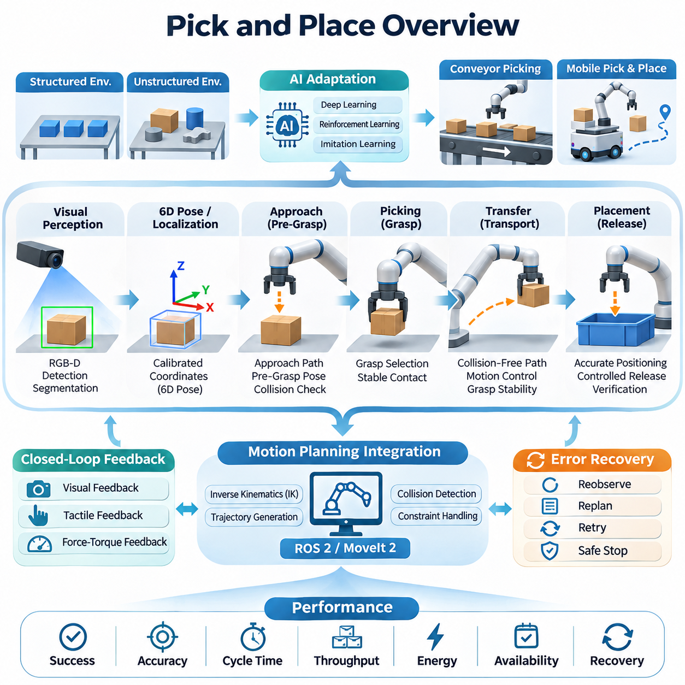
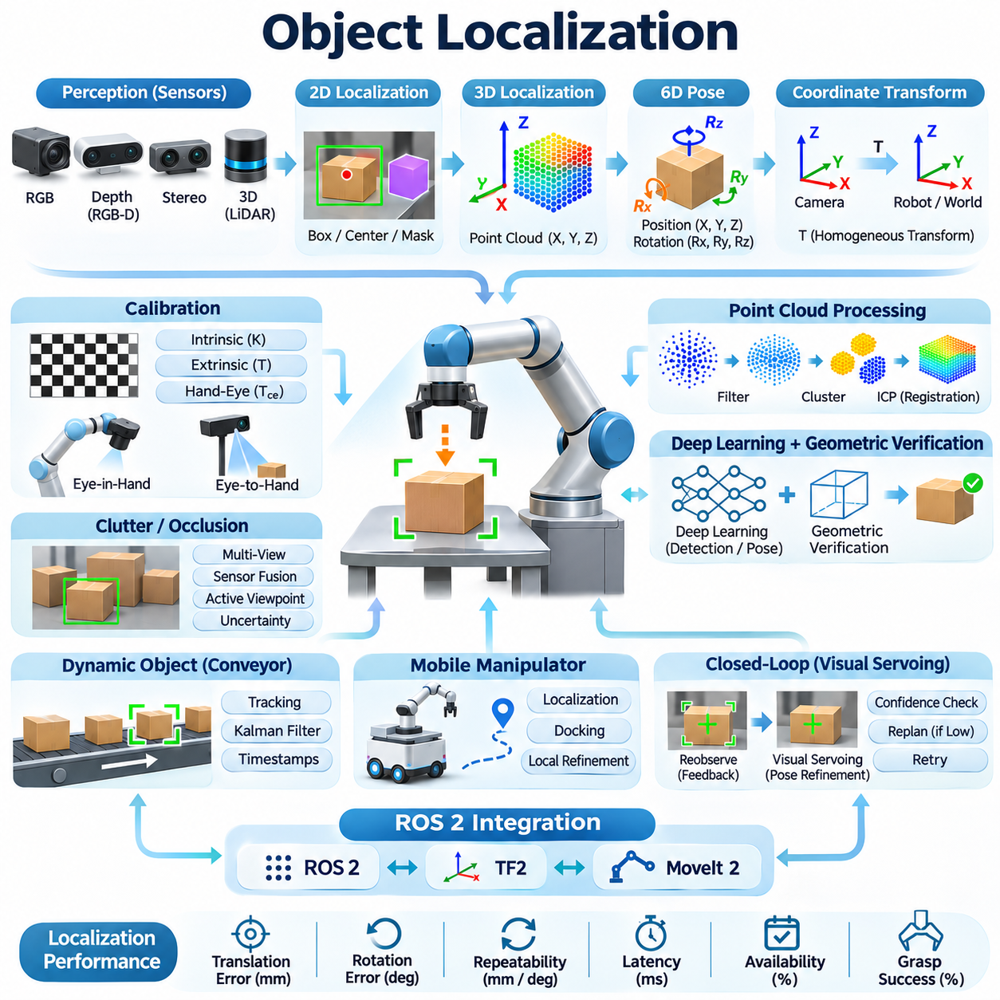
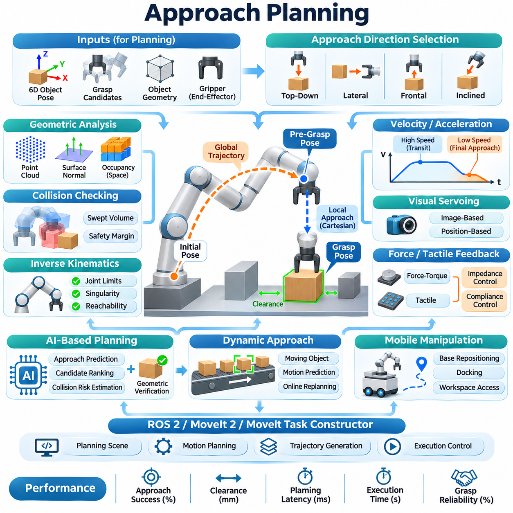
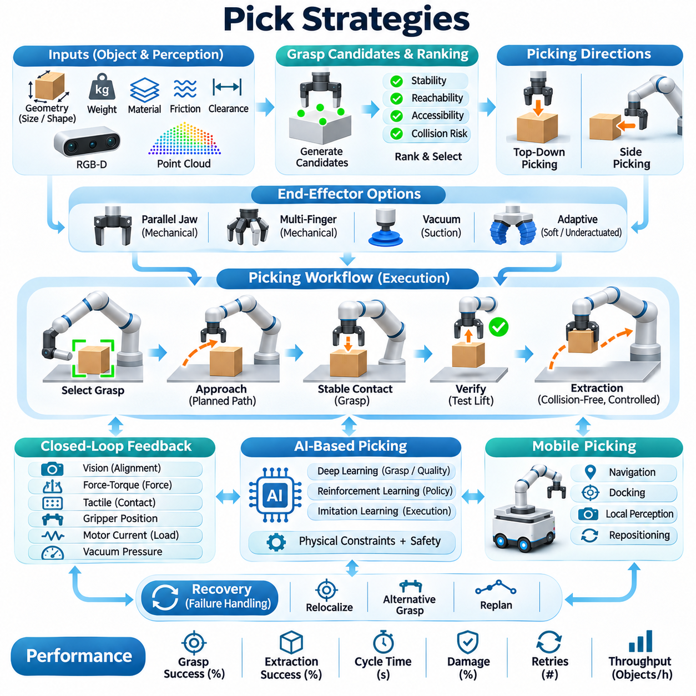
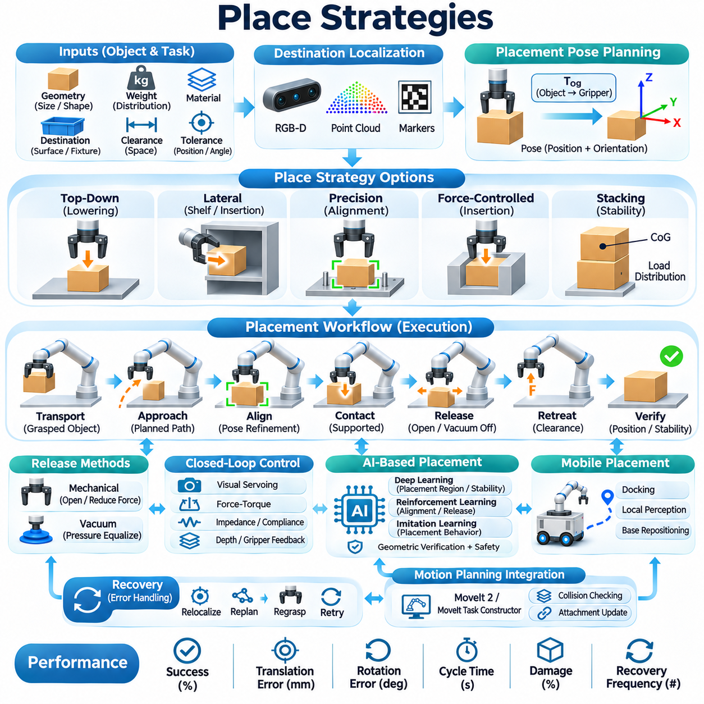
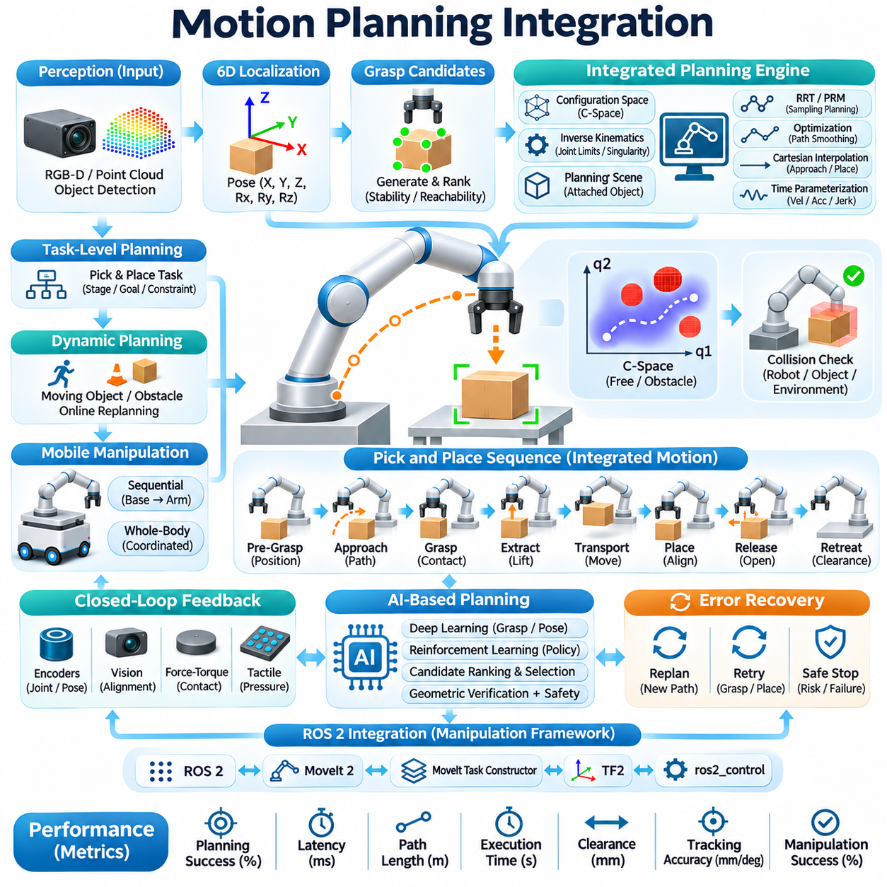
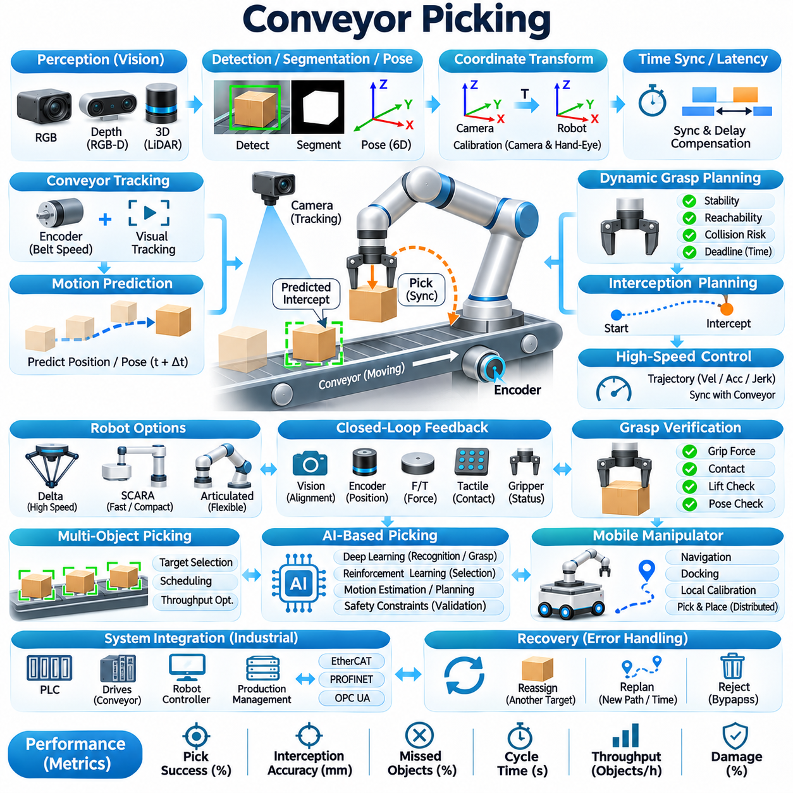
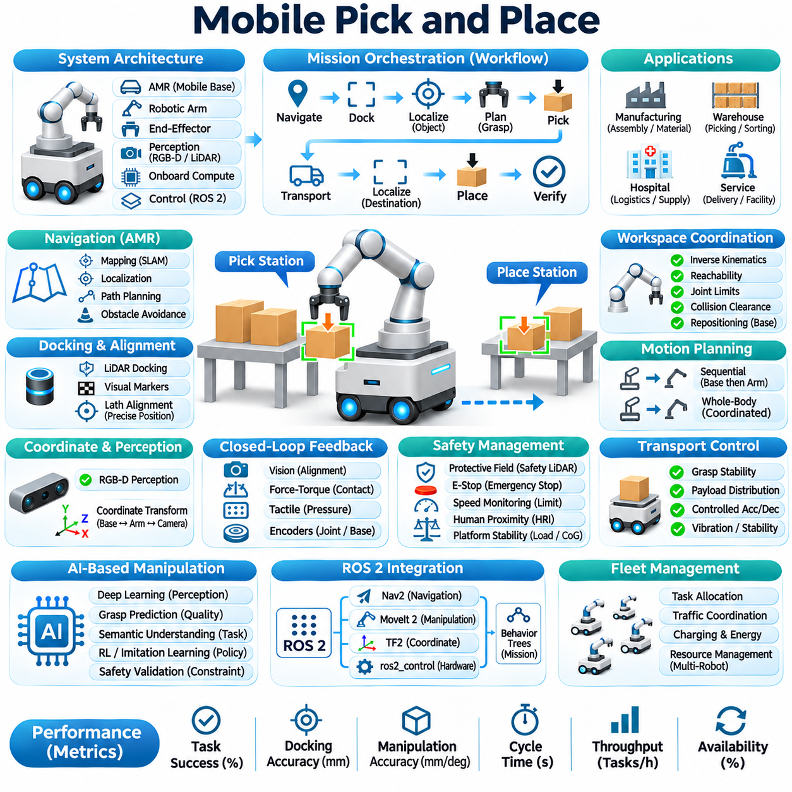
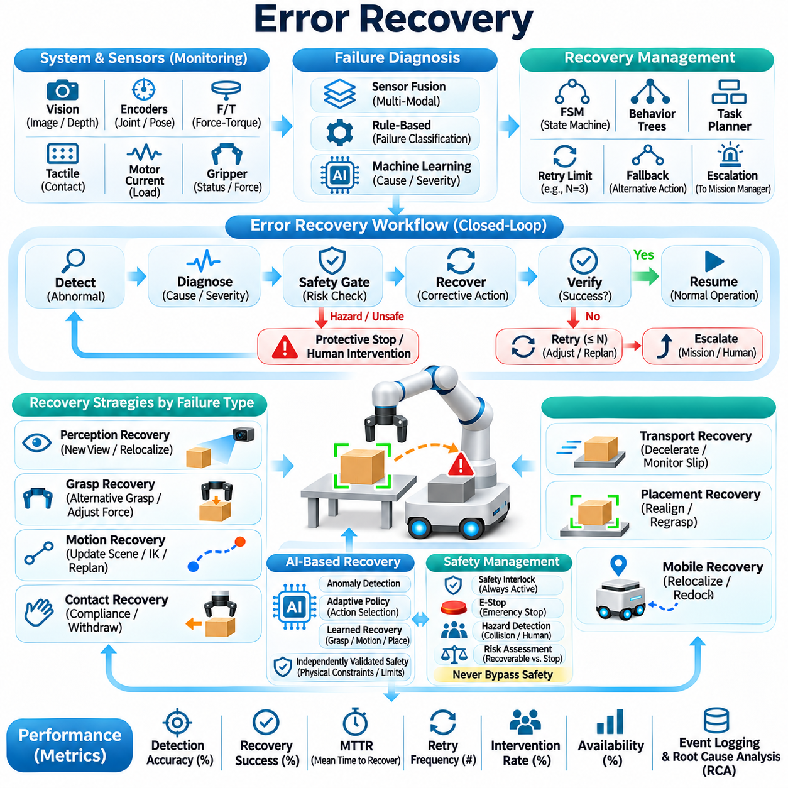

**Volume 03. Vision Manipulation and AI**

# Chapter 07. Pick and Place

## 01 Pick and Place Overview

{width="7.268055555555556in" height="7.268055555555556in"}

Pick and place is a fundamental robotic manipulation operation in which a robot identifies an object, grasps it, transfers it to a designated location, and releases it in a controlled manner. Although the operation appears conceptually simple, successful execution requires the integration of visual perception, object localization, grasp planning, motion planning, and real-time control. It represents a foundational capability of autonomous manipulation systems.

Traditional pick and place systems operate in structured environments where object positions, orientations, and destinations are predetermined. Industrial robots execute repetitive movements using predefined trajectories and programmed coordinates. Modern AI-driven manipulation systems extend this capability to unstructured environments by dynamically identifying objects, estimating their spatial configurations, and adapting movement strategies according to environmental conditions.

A complete pick and place pipeline begins with visual perception. RGB cameras, depth cameras, stereo vision systems, and three-dimensional sensors collect information about objects and their surrounding environments. Object detection and instance segmentation algorithms identify target objects, while pose estimation determines their positions and orientations. This information establishes the spatial foundation required for subsequent manipulation decisions.

Object localization transforms perception results into coordinates that can be interpreted by the robotic manipulation system. Camera coordinates must be accurately converted into robot base coordinates or world coordinates through calibrated transformation relationships. Six-dimensional pose estimation provides both three-dimensional position and rotational orientation, allowing the robot to interact with objects from geometrically appropriate directions.

Approach planning determines how the robotic end effector moves toward the target object before establishing physical contact. The approach trajectory must consider object geometry, surrounding obstacles, gripper dimensions, joint limitations, and available workspace. An appropriate pre-grasp pose provides sufficient clearance and establishes a favorable orientation for grasp execution while reducing the probability of unintended collisions.

The picking phase involves establishing stable physical contact between the end effector and the target object. Mechanical grippers, vacuum grippers, magnetic grippers, and dexterous robotic hands provide different picking capabilities according to object characteristics. Grasp selection must consider material properties, weight distribution, surface geometry, friction, and mechanical stability to prevent object deformation, slippage, or accidental dropping.

After establishing a grasp, the robot lifts and transports the object toward its intended destination. Motion planning generates collision-free trajectories while satisfying kinematic, dynamic, and operational constraints. During transportation, the system must maintain grasp stability by controlling acceleration, deceleration, velocity, and orientation. Excessive inertial forces may compromise grasp quality, particularly when handling heavy or irregularly shaped objects.

The placing phase requires accurate positioning and controlled release of the transported object. Placement strategies depend on destination geometry, positioning tolerances, object orientation, and environmental constraints. Applications such as assembly, packaging, stacking, and precision material handling may require additional visual servoing, force feedback, or compliance control to achieve reliable placement without damaging objects or surrounding equipment.

Motion planning integration connects individual manipulation stages into a continuous and executable operational sequence. Inverse kinematics calculates feasible joint configurations, while trajectory generation determines coordinated joint movements. Collision detection evaluates the robot, attached objects, and surrounding structures. Integrated planning frameworks such as MoveIt 2 support these functions within ROS 2-based robotic manipulation architectures.

Conveyor picking introduces additional complexity because target objects continuously change their positions during operation. The robotic system must estimate object velocity, predict future positions, and synchronize grasp execution with conveyor movement. Perception latency, communication delays, processing time, and robot acceleration directly influence picking accuracy. Effective conveyor synchronization enables continuous material handling and high-throughput industrial automation.

Mobile pick and place extends manipulation capabilities beyond the fixed workspace of conventional industrial robots. An autonomous mobile robot transports a robotic arm between different operational locations, allowing objects to be collected and delivered across distributed environments. Successful execution requires synchronized navigation, mobile base positioning, arm workspace optimization, environmental perception, and manipulation planning within a unified control architecture.

AI-based pick and place systems improve operational flexibility through learned perception and manipulation strategies. Deep learning models can identify previously unseen object configurations, predict grasp candidates, and estimate manipulation success probabilities. Reinforcement learning and imitation learning can further improve action selection and adaptation. However, learned policies must operate within verified physical constraints and reliable safety mechanisms.

Closed-loop feedback is essential for maintaining manipulation reliability under environmental uncertainty. Visual feedback enables target position refinement, tactile sensors detect contact conditions, and force-torque sensors measure interaction forces. These feedback mechanisms allow the robot to adjust its movements during approach, grasping, transportation, and placement rather than relying exclusively on predetermined trajectories.

Error recovery mechanisms enable robotic systems to respond to unsuccessful grasps, object slippage, localization errors, unreachable poses, and unexpected obstacles. Depending on the detected failure, the system may reacquire perception data, generate alternative grasp candidates, modify approach trajectories, or reposition the mobile platform. Persistent or safety-critical failures require controlled interruption and appropriate supervisory intervention.

Performance evaluation considers picking success rate, placement accuracy, cycle time, throughput, recovery rate, energy consumption, and operational availability. These metrics must be evaluated under representative environmental conditions rather than exclusively through controlled laboratory experiments. Ultimately, autonomous pick and place provides a practical foundation for industrial automation, warehouse robotics, mobile manipulation, and increasingly intelligent Physical AI systems.

## 02 Object Localization

{width="7.268055555555556in" height="7.268055555555556in"}

Object localization is the process of determining the spatial position of a target object within the operational environment of a robotic manipulation system. In pick and place applications, recognizing an object is insufficient unless the robot can accurately determine where the object is located and how it is oriented. Object localization establishes the geometric relationship between visual perception and physical manipulation, enabling reliable interaction with target objects.

The localization process begins with environmental data acquisition through RGB cameras, depth cameras, stereo vision systems, or three-dimensional sensors. These sensors capture information about object appearance, distance, geometry, and surrounding structures. The selection of sensing technologies depends on operational distance, environmental lighting, object surface characteristics, required positioning accuracy, and the computational resources available within the robotic platform.

Two-dimensional object localization determines the position of an object within an image coordinate system. Object detection algorithms typically generate bounding boxes, center points, or segmentation masks representing the visible regions of target objects. Although two-dimensional localization is useful for identifying objects and guiding preliminary movements, additional depth information or geometric assumptions are generally required to determine physical positions within three-dimensional space.

Three-dimensional object localization extends image-based detection by estimating spatial coordinates along the X, Y, and Z axes. RGB-D cameras provide synchronized color and depth information, allowing image pixels to be projected into three-dimensional camera coordinates using intrinsic calibration parameters. Stereo vision estimates depth through disparity measurements, while point cloud processing enables direct analysis of object geometry and spatial distribution.

Six-dimensional pose estimation provides a more comprehensive representation by determining both three-dimensional position and three-dimensional rotational orientation. This information is particularly important when objects must be grasped from specific directions or placed according to predefined orientation requirements. Rotation matrices, quaternions, and homogeneous transformation matrices are commonly used to represent object poses and support geometric calculations throughout the manipulation pipeline.

Coordinate transformation connects perception results with robotic motion execution. Objects detected within the camera coordinate system must be transformed into the robot base coordinate system, end-effector coordinate system, or global coordinate system. Homogeneous transformation matrices describe the translation and rotation between these reference frames. Incorrect transformations can introduce systematic positioning errors even when the underlying object detection algorithms perform accurately.

Camera calibration is essential for maintaining localization accuracy. Intrinsic calibration determines parameters such as focal length, principal point, and lens distortion, while extrinsic calibration establishes the spatial relationship between cameras and external reference frames. Hand-eye calibration determines the transformation between a camera and the robotic manipulator, supporting both eye-in-hand and eye-to-hand configurations in industrial and mobile manipulation systems.

Point cloud processing improves object localization by providing detailed three-dimensional geometric information. Background removal, voxel downsampling, outlier filtering, plane segmentation, and clustering can isolate target objects from surrounding structures. Registration algorithms such as Iterative Closest Point can refine estimated poses by aligning observed point clouds with reference geometric models, provided that sufficient geometric information and suitable initial estimates are available.

Deep learning-based localization methods improve adaptability when objects exhibit significant variations in shape, appearance, orientation, or environmental conditions. Neural networks can estimate object centers, keypoints, segmentation masks, depth information, and complete six-dimensional poses. Combining learned predictions with geometric verification can improve localization robustness while reducing dependence on manually designed visual features and application-specific recognition rules.

Object localization becomes more challenging in cluttered environments where neighboring objects partially obscure target surfaces. Occlusion, overlapping boundaries, reflective materials, transparent surfaces, and incomplete depth measurements can reduce estimation reliability. Multi-view perception, sensor fusion, active viewpoint selection, and uncertainty estimation help recover missing spatial information and improve object localization under difficult operating conditions.

Dynamic object localization is required when target objects move during perception and manipulation. Conveyor picking systems must continuously estimate object positions, orientations, and velocities to predict future grasp locations. Tracking algorithms, Kalman filters, synchronized sensor timestamps, and motion prediction compensate for processing delays. Accurate temporal alignment is necessary to prevent the robot from executing movements based on outdated object coordinates.

Mobile manipulators introduce additional localization requirements because the robot base itself can change position and orientation. Base localization errors, docking inaccuracies, structural vibration, and sensor calibration deviations influence the relationship between perceived objects and the robotic arm. Local visual measurements can refine target positions after navigation is completed, reducing dependence on global localization accuracy and supporting precise manipulation within operational workspaces.

Closed-loop localization enables continuous refinement of object positions throughout the approach and grasping stages. Visual servoing uses updated image or spatial measurements to correct deviations between desired and observed relative poses. Confidence thresholds and geometric consistency checks determine whether available estimates are sufficiently reliable for manipulation. When uncertainty exceeds acceptable limits, the system should reacquire sensor data or select an alternative observation position.

Within a ROS 2-based manipulation architecture, localization results are communicated through timestamped pose messages, coordinate transformation services, and perception interfaces. Frameworks such as TF2 maintain spatial relationships between robot components, while MoveIt 2 uses transformed object information to support motion planning and collision avoidance. Consistent reference frames, synchronized timestamps, and validated data interfaces are fundamental requirements for reliable system integration.

Localization performance is evaluated through translational error, rotational error, repeatability, estimation latency, detection availability, and downstream grasp success rates. Evaluation should include variations in lighting, object orientation, occlusion, sensor distance, and mobile base positioning. Ultimately, accurate and robust object localization provides the spatial intelligence required to connect visual perception with reliable physical action in autonomous pick and place systems.

## 03 Approach Planning

{width="7.268055555555556in" height="7.268055555555556in"}

Approach planning is the process of determining how a robotic manipulator moves its end effector toward a target object before executing a grasp. It establishes a connection between object localization, grasp planning, and physical manipulation. An effective approach strategy positions the end effector at an appropriate location and orientation while minimizing collision risks, respecting mechanical constraints, and maintaining favorable conditions for successful grasp execution.

The approach planning process begins with the estimated position and orientation of the target object. Object localization and six-dimensional pose estimation provide spatial information within a defined coordinate system. This information is combined with grasp candidates, object geometry, and end-effector characteristics to determine suitable approach directions. The selected direction must support stable physical contact without interfering with surrounding objects or structures.

A pre-grasp pose represents an intermediate end-effector configuration located at a specified distance from the intended grasp pose. It allows the manipulator to prepare for the final approach while maintaining sufficient clearance from the target object. The distance between the pre-grasp and grasp poses depends on gripper dimensions, object geometry, localization uncertainty, and environmental constraints. Appropriate pre-grasp positioning improves execution reliability.

Approach direction selection significantly influences the feasibility and stability of robotic grasping. Common strategies include top-down, lateral, frontal, and inclined approaches. Top-down approaches are frequently suitable for objects placed on horizontal surfaces, while lateral approaches may be necessary for vertically arranged objects or restricted workspaces. The selected approach direction must satisfy both grasping requirements and environmental accessibility.

Geometric analysis provides the foundation for determining feasible approach trajectories. Three-dimensional object models, point clouds, surface normals, and occupancy representations describe the spatial relationships between the target object and surrounding obstacles. These representations allow the planning system to estimate available clearance, identify accessible contact regions, and reject approach directions that may result in unintended physical interference.

Collision avoidance is a critical requirement throughout the approach planning process. The planner must evaluate potential collisions involving the gripper, robotic arm, target object, neighboring objects, and environmental structures. Collision checking should consider the complete swept volume of the manipulator rather than exclusively examining the final grasp configuration. Additional safety margins can compensate for geometric inaccuracies and perception uncertainty.

Kinematic feasibility determines whether the robotic manipulator can physically achieve the desired pre-grasp and grasp configurations. Inverse kinematics calculates joint configurations corresponding to candidate end-effector poses. Joint position limits, singularities, workspace boundaries, and manipulator redundancy must be considered. A geometrically attractive approach may still be unsuitable if it produces unstable or mechanically infeasible joint configurations.

Approach trajectory generation converts selected spatial configurations into executable robotic movements. The global approach trajectory connects the initial robot configuration to the pre-grasp pose, while the local approach trajectory guides the end effector toward the final grasp pose. Cartesian interpolation is frequently used during the final approach because it provides predictable movement directions and simplifies the management of environmental clearance.

Velocity and acceleration profiles influence both operational efficiency and interaction safety during approach execution. Higher movement speeds may be appropriate when the manipulator travels through obstacle-free regions, whereas reduced speeds are generally required near the target object. Smooth acceleration and deceleration reduce mechanical vibration, minimize positioning errors, and provide additional time for perception updates and corrective control actions.

Visual servoing enables closed-loop approach execution by continuously refining the relative position between the end effector and the target object. Updated camera measurements allow the control system to compensate for localization errors, calibration deviations, and unexpected object movements. Position-based and image-based visual servoing provide complementary approaches for maintaining alignment and improving positioning accuracy during the final approach.

Force and tactile feedback become increasingly important as the end effector approaches physical contact. Force-torque sensors and tactile sensing systems can identify unexpected contact, excessive interaction forces, and deviations from intended movement conditions. Impedance control and compliance control allow the manipulator to respond appropriately to minor positioning errors while reducing the probability of damaging the target object or surrounding equipment.

AI-based approach planning improves adaptability in environments where predefined geometric rules may be insufficient. Deep learning models can predict accessible approach directions, estimate collision risks, and rank candidate trajectories according to expected grasp success. Learning-based strategies can be combined with conventional motion planning and geometric verification to improve flexibility while maintaining explicit physical and operational constraints.

Dynamic approach planning is necessary when the target object or surrounding environment changes during manipulation. Conveyor picking, moving obstacles, and human-robot collaboration require continuous perception updates and trajectory adjustments. Motion prediction and synchronized sensor measurements help estimate future target configurations. Online replanning enables the system to modify its approach when previously selected trajectories become invalid.

Mobile manipulators require coordinated approach planning between the mobile base and robotic arm. Base positioning influences object accessibility, manipulator reachability, sensor visibility, and collision-free workspace availability. When feasible arm configurations cannot be identified, the system may reposition the mobile platform before attempting another approach. Coordinated planning improves manipulation coverage while reducing unnecessary arm movements.

Within ROS 2-based manipulation architectures, MoveIt 2 and the MoveIt Task Constructor can integrate approach planning with grasp generation, inverse kinematics, collision checking, and trajectory execution. Planning scenes represent environmental geometry and robot configurations, while task stages organize movements toward pre-grasp and grasp poses. Performance evaluation considers approach success rate, minimum clearance, planning latency, execution time, and subsequent grasp reliability.

## 04 Pick Strategies

{width="7.268055555555556in" height="7.268055555555556in"}

Pick strategies define the methods and operational decisions used by a robotic manipulator to acquire a target object from its initial position. While grasp planning determines suitable contact configurations, a pick strategy establishes how the grasp is selected, executed, verified, and maintained during object extraction. Effective picking requires the integration of visual perception, grasp intelligence, motion control, and physical interaction management.

The selection of an appropriate pick strategy depends on object geometry, dimensions, weight, material properties, surface characteristics, and environmental conditions. Rigid objects with predictable geometries can often be handled using predefined picking procedures, whereas deformable or irregularly shaped objects require adaptive strategies. The operational environment also determines accessibility, available clearance, and suitable end-effector configurations.

Top-down picking is one of the most common strategies in industrial automation and warehouse robotics. The end effector approaches the target object vertically from above, establishes a grasp, and lifts the object away from its supporting surface. This strategy simplifies trajectory generation and is particularly effective for objects arranged on horizontal surfaces, conveyor belts, and within containers that provide sufficient vertical clearance.

Side picking involves approaching the target object from a horizontal or lateral direction. This strategy is appropriate for objects stored on shelves, vertically arranged components, and applications where overhead access is restricted. Successful side picking requires careful evaluation of lateral clearance, gripper orientation, contact geometry, and gravitational effects to ensure that the object remains stable during extraction and subsequent transportation.

Mechanical gripping strategies rely on physical contact between gripper fingers and object surfaces. Parallel-jaw grippers are widely used because of their mechanical simplicity and predictable closing behavior, while multi-finger robotic hands support more complex grasp configurations. Gripping force must be adjusted according to object weight, friction, and structural strength to prevent excessive deformation, unstable contact, or unintended slippage.

Vacuum picking uses suction forces generated through pressure differences between suction cups and object surfaces. This strategy is particularly effective for cartons, flat components, packaging materials, and objects with relatively smooth, nonporous surfaces. Vacuum pressure monitoring helps verify successful attachment, while suction cup selection and contact position optimization improve handling reliability across different object geometries.

Adaptive picking strategies allow robotic systems to modify their behavior according to variations in object geometry, positioning, and contact conditions. Underactuated grippers, soft robotic grippers, and compliant mechanisms can accommodate irregular shapes without requiring precisely predefined contact configurations. These capabilities are particularly valuable when handling delicate products, mixed inventory, and objects with uncertain physical properties.

Grasp candidate selection is an essential component of intelligent picking. Multiple candidate configurations can be generated from object models, RGB-D images, point clouds, or learned grasp representations. Each candidate is evaluated according to grasp stability, accessibility, collision probability, manipulator reachability, and expected execution success. Candidate ranking enables the system to select a picking configuration that balances these requirements.

Force-controlled picking improves manipulation reliability when physical contact conditions cannot be accurately predicted from visual information alone. Force-torque sensors and tactile sensors provide real-time measurements of contact forces, pressure distributions, and object movement. These measurements enable the controller to adjust gripping force and extraction movements while maintaining contact stability and reducing the risk of object damage.

Closed-loop picking continuously incorporates sensory feedback throughout grasp execution and object extraction. Visual feedback corrects residual alignment errors, while tactile and force feedback detect unstable contact or unexpected resistance. Gripper position measurements, motor current, and vacuum pressure can provide additional evidence of grasp completion. Combining these signals improves picking reliability compared with purely open-loop execution.

Grasp verification determines whether the target object has been successfully acquired before the system proceeds to transportation. Verification methods include monitoring gripper opening distance, measured gripping force, vacuum pressure, and visual observations of the lifted object. A short, controlled test lift can reveal unstable grasps or unintended attachment to neighboring objects, enabling corrective action before larger movements are executed.

Object extraction requires coordinated movement after the initial grasp has been established. The extraction trajectory must consider surrounding obstacles, supporting surfaces, frictional resistance, and possible mechanical interference. Controlled acceleration and appropriate lifting directions help maintain grasp stability. In cluttered environments, extraction may require additional manipulation movements to separate the target object from adjacent components.

AI-based picking strategies use learned models to improve grasp selection and execution across diverse object categories. Deep learning can predict grasp quality, identify suitable contact regions, and estimate successful picking configurations directly from sensory observations. Reinforcement learning and imitation learning can further optimize manipulation behavior through interaction experience, provided that actions remain within validated physical and safety constraints.

Mobile picking introduces additional requirements because the positioning accuracy of the mobile base influences manipulator accessibility and grasp execution. The system must coordinate navigation, local object localization, base positioning, and robotic arm movement. Local perception after arrival can compensate for docking deviations, while mobile base repositioning provides alternative picking configurations when the initial target is outside the feasible arm workspace.

Picking performance is evaluated through grasp success rate, extraction success rate, cycle time, damage rate, retry frequency, and operational throughput. Failed picking attempts should trigger structured recovery procedures such as object relocalization, alternative grasp selection, or approach replanning. Ultimately, robust pick strategies combine geometric reasoning, sensory feedback, adaptive control, and AI-driven decision-making to achieve reliable autonomous object acquisition.

## 05 Place Strategies

{width="7.268055555555556in" height="7.268055555555556in"}

Place strategies define the methods and operational decisions used by a robotic manipulator to position and release a grasped object at a designated destination. While picking focuses on acquiring and securing an object, placing emphasizes positional accuracy, orientation control, release stability, and environmental compatibility. Effective placement requires coordinated integration of perception, motion planning, interaction control, and task verification.

The selection of an appropriate place strategy depends on object geometry, weight distribution, material properties, destination characteristics, and operational requirements. Objects placed on open surfaces generally require simpler movements than objects inserted into fixtures, stacked within containers, or positioned in confined spaces. The robot must consider physical stability, available clearance, placement tolerances, and potential interactions with surrounding structures.

Destination localization establishes the spatial relationship between the robotic manipulator and the intended placement location. RGB cameras, depth sensors, point clouds, and reference markers can identify supporting surfaces, containers, assembly fixtures, and available placement regions. Accurate localization enables the system to determine the target position and orientation while compensating for environmental variations and positioning uncertainties.

Placement pose planning determines the desired position and orientation of an object after it has been released. The relationship between the grasped object and the end effector must be considered when calculating the corresponding robot configuration. Coordinate transformations convert the desired object pose into an achievable end-effector pose. Incorrect grasp transformation estimates may introduce placement errors even when robot motion is accurately controlled.

Top-down placement is commonly used in packaging, material handling, and warehouse automation. The robotic manipulator positions the object above its destination and gradually lowers it until the required placement condition is achieved. This strategy benefits from gravitational support and relatively predictable release behavior. Appropriate vertical clearance and controlled lowering speeds help prevent collisions and excessive contact forces.

Lateral placement involves transferring an object into its destination through horizontal or inclined movements. This strategy is frequently required when loading shelves, positioning components inside machines, or inserting objects into restricted spaces. The planning system must evaluate lateral clearance, insertion depth, object orientation, and surrounding geometry. Controlled withdrawal of the gripper is necessary to avoid disturbing the placed object.

Precision placement is required in applications where objects must satisfy strict positional and rotational tolerances. Industrial assembly, electronic component handling, and precision manufacturing frequently depend on accurate alignment between objects and receiving structures. Visual servoing, high-resolution perception, force-torque feedback, and fine motion control can reduce residual positioning errors during the final placement stage.

Force-controlled placement enables the robot to manage physical interactions between an object and its destination. Force-torque sensors detect contact with supporting surfaces, assembly fixtures, or neighboring components. Impedance control and compliance control allow the manipulator to accommodate minor alignment errors and regulate interaction forces. These capabilities are particularly important when handling fragile objects or performing insertion tasks.

Stacking strategies require additional consideration of object stability, center of gravity, load distribution, and supporting surface conditions. The robotic system must estimate whether the intended arrangement can remain stable after the object is released. Three-dimensional scene analysis helps identify suitable stacking regions and detect geometric interference. Placement sequences should also consider the stability of previously stacked objects.

Release planning determines when and how the robotic end effector disengages from the transported object. Mechanical grippers gradually reduce gripping force or increase finger separation, while vacuum grippers release objects by equalizing pressure. The timing and dynamics of release must be coordinated with object support conditions. Premature release, excessive contact forces, or abrupt disengagement may cause displacement, damage, or instability.

Post-placement verification determines whether the object has been successfully positioned according to task requirements. Visual inspection, depth measurements, gripper feedback, and force measurements can provide evidence of placement completion. The system may evaluate final object position, orientation, stability, and separation from the end effector. Unexpected deviations should trigger corrective actions before subsequent operations are initiated.

AI-based placement strategies improve adaptability in environments where destination configurations and object characteristics are not fully predetermined. Deep learning models can identify available placement regions, estimate spatial compatibility, and predict placement stability. Reinforcement learning and imitation learning can optimize alignment and release behavior, while geometric verification and safety constraints ensure physically feasible execution.

Mobile placement requires coordination between the autonomous mobile robot and the robotic manipulator. Base positioning influences destination accessibility, arm reachability, sensor visibility, and achievable placement accuracy. After arriving at the destination, local perception can compensate for navigation and docking errors. Mobile base repositioning may be necessary when the intended placement pose cannot be achieved within the available arm workspace.

Placement motion planning integrates approach trajectories, object transportation, final alignment, release execution, and end-effector retreat. Frameworks such as MoveIt 2 and MoveIt Task Constructor support collision checking and coordinated execution of these manipulation stages. The planning scene must represent both the transported object and destination geometry, with object attachment states updated after successful release to support subsequent movements.

Placement performance is evaluated through placement success rate, translational error, rotational error, cycle time, object damage rate, and recovery frequency. Failed placement attempts may require destination relocalization, trajectory replanning, object regrasping, or controlled retry procedures. Ultimately, robust place strategies combine spatial reasoning, sensory feedback, adaptive control, and AI-driven decision-making to complete autonomous pick and place operations.

## 06 Motion Planning Integration

{width="7.268055555555556in" height="7.268055555555556in"}

Motion planning integration establishes a coordinated framework that connects visual perception, object localization, grasp planning, and robotic motion execution within a complete pick and place operation. Rather than treating individual manipulation stages as independent processes, an integrated planning architecture ensures that spatial information, mechanical constraints, operational objectives, and sensory feedback are consistently maintained throughout task execution.

The motion planning pipeline begins with the acquisition of environmental information and the identification of target objects. Perception algorithms estimate object positions, orientations, and surrounding geometry, while grasp planning generates feasible end-effector configurations. These results are transferred to the motion planning system, which determines whether the proposed manipulation actions can be executed within the physical constraints of the robot.

Task-level planning decomposes a pick and place operation into sequential manipulation stages, including pre-grasp positioning, final approach, grasp execution, object extraction, transportation, placement, release, and retreat. Each stage defines specific objectives, initial conditions, and execution constraints. Coordinating these stages ensures that the final state of one manipulation action provides a valid initial state for the subsequent action.

Configuration space provides a mathematical representation of possible robotic manipulator configurations. Each configuration describes the positions of individual robot joints, while obstacles and mechanical constraints define regions that cannot be occupied. Motion planning algorithms search for feasible paths through this configuration space, connecting initial and desired robot configurations without violating established operational constraints.

Inverse kinematics integration enables the motion planning system to convert desired end-effector poses into corresponding joint configurations. Multiple inverse kinematic solutions may exist for a single target pose, particularly in manipulators with redundant degrees of freedom. Candidate solutions must be evaluated according to joint limits, singularity avoidance, collision clearance, manipulability, and compatibility with subsequent manipulation stages.

Collision checking evaluates potential interference between the robotic manipulator, target objects, surrounding obstacles, and environmental structures. The planning scene represents these elements through geometric models and spatial occupancy information. After a successful grasp, the transported object must be represented as an attached collision object so that its dimensions and orientation are considered during motion planning and trajectory validation.

Sampling-based motion planning algorithms such as Rapidly-exploring Random Trees and Probabilistic Roadmaps are widely used for robotic manipulation in complex environments. These algorithms explore feasible regions of configuration space to identify collision-free paths. Optimization-based methods can subsequently improve path smoothness, reduce unnecessary movements, and satisfy additional requirements related to clearance, execution efficiency, and mechanical performance.

Cartesian motion planning is particularly important during final approach, object extraction, precision placement, and end-effector retreat. These manipulation stages frequently require predictable movement directions within physical space. Cartesian interpolation generates intermediate end-effector poses along a specified path, while inverse kinematics and collision checking determine whether the corresponding movements remain mechanically feasible and safe.

Trajectory generation converts geometric paths into time-dependent motion commands that can be executed by robotic controllers. Time parameterization assigns velocities and accelerations while respecting joint-level limitations and dynamic capabilities. Smooth trajectories reduce mechanical vibration, excessive inertial forces, and grasp instability. Jerk-limited motion profiles can further improve transportation reliability when handling fragile or heavy objects.

Closed-loop motion execution integrates real-time sensory feedback with planned manipulation trajectories. Joint encoders, visual sensors, force-torque sensors, and tactile sensors provide information about actual robot configurations and environmental interactions. Feedback controllers compensate for tracking errors and minor disturbances, while significant deviations may require trajectory modification, motion replanning, or controlled interruption of task execution.

Dynamic motion planning enables robotic systems to respond to environmental changes occurring after the initial planning process. Moving objects, unexpected obstacles, human activity, and changes in target positions may invalidate previously generated trajectories. Continuous planning scene updates, motion prediction, and online replanning allow the system to adapt its movements without compromising established physical and operational constraints.

Mobile manipulation introduces additional complexity because the mobile base and robotic arm share responsibility for achieving task objectives. Sequential planning positions the mobile base before arm manipulation, whereas whole-body planning considers coordinated base and arm movements. Integrated planning must evaluate navigation feasibility, manipulator reachability, platform stability, collision constraints, and localization uncertainty across the combined system.

Within ROS 2-based robotic architectures, MoveIt 2 provides an integration framework for inverse kinematics, collision detection, motion planning, trajectory processing, and execution management. MoveIt Task Constructor supports the decomposition of complex manipulation tasks into interconnected planning stages. TF2 and ros2_control contribute coordinate transformation management and hardware control interfaces within the overall manipulation pipeline.

AI-based motion planning integration extends conventional planning capabilities through learned representations, trajectory prediction, and adaptive action selection. Neural networks can generate promising motion candidates or estimate planning feasibility, while reinforcement learning can optimize policies for recurring manipulation tasks. Learned outputs should be validated against explicit collision constraints, mechanical limitations, and independent safety mechanisms before execution.

Integrated motion planning performance is evaluated through planning success rate, computational latency, trajectory length, execution time, minimum collision clearance, tracking accuracy, and overall manipulation success rate. Structured error recovery should address invalid trajectories, unreachable poses, unexpected contact, and execution failures. Ultimately, motion planning integration transforms perception and grasp intelligence into coordinated, reliable physical actions within autonomous pick and place systems.

## 07 Conveyor Picking

{width="7.268055555555556in" height="7.268055555555556in"}

Conveyor picking is a robotic manipulation technique used to identify, track, and acquire objects moving along a conveyor system. Unlike conventional picking operations involving stationary objects, conveyor picking requires continuous coordination between perception, motion prediction, grasp planning, and robotic control. The primary objective is to achieve reliable object acquisition without interrupting the material transportation process.

Conveyor picking systems are widely used in manufacturing, warehouse automation, food processing, packaging, sorting, and distribution facilities. Objects transported by conveyors may vary in size, geometry, orientation, material properties, and spacing. The robotic system must accommodate these variations while maintaining operational throughput, grasp reliability, and synchronization with upstream and downstream production equipment.

Visual perception provides the foundation for identifying objects moving along the conveyor. RGB cameras, depth cameras, and three-dimensional vision systems capture information about object appearance, position, orientation, and surrounding geometry. Object detection and instance segmentation algorithms distinguish individual objects, while pose estimation determines their spatial configurations for subsequent grasp planning and execution.

Conveyor tracking establishes the relationship between object movement and conveyor displacement over time. Rotary encoders installed on conveyor drive mechanisms can measure belt velocity and traveled distance, while visual tracking provides independent observations of object movement. Combining encoder measurements with visual feedback improves tracking accuracy and helps compensate for conveyor speed variations, object slippage, and accumulated positioning errors.

Coordinate transformation is essential for maintaining consistent spatial information between cameras, conveyor systems, and robotic manipulators. Camera calibration and hand-eye calibration establish the geometric relationships between these coordinate frames. Time-dependent transformations convert detected object positions into predicted robot-relative positions, enabling the manipulator to approach moving objects within its operational workspace.

Motion prediction estimates the future position and orientation of a target object based on its current state, conveyor velocity, and expected movement characteristics. The robotic system must account for image acquisition latency, perception processing time, planning delays, communication latency, and manipulator response time. Accurate temporal synchronization ensures that the end effector reaches the predicted interception position at the appropriate moment.

Dynamic grasp planning generates suitable grasp configurations for objects whose positions continuously change during transportation. Candidate grasps must be evaluated according to object geometry, grasp stability, manipulator reachability, collision constraints, and available interception time. The selected grasp configuration should remain feasible throughout the approach movement and accommodate variations in object orientation and conveyor velocity.

Interception planning determines where and when the robotic manipulator should establish contact with a moving target. The planning system calculates feasible interception points within the accessible picking region by considering conveyor movement, robot acceleration limits, and trajectory execution time. Synchronizing end-effector velocity with target velocity before contact reduces relative motion and improves grasp stability during object acquisition.

High-speed motion control is particularly important when conveyor systems operate continuously at elevated transportation speeds. Delta robots, SCARA robots, and articulated robotic manipulators provide different combinations of acceleration capability, workspace coverage, and manipulation flexibility. Appropriate trajectory optimization minimizes unnecessary movements while respecting joint velocity, acceleration, jerk, payload, and structural limitations.

Closed-loop conveyor picking continuously incorporates updated sensory information during target tracking and grasp execution. Visual servoing can compensate for unexpected object displacement, while conveyor encoder feedback updates predicted interception positions. Force-torque sensors, tactile sensors, and gripper feedback provide additional information about contact conditions and grasp completion, improving reliability under variable operating conditions.

Multi-object picking requires intelligent target selection when several objects simultaneously enter the accessible conveyor region. The system must prioritize candidates according to interception deadlines, grasp feasibility, object classification, destination requirements, and overall throughput. Scheduling algorithms can optimize picking sequences and reduce missed objects by balancing the available processing time against manipulator movement requirements.

AI-based conveyor picking enhances adaptability through learned object recognition, grasp prediction, motion estimation, and task scheduling. Deep learning models can identify irregularly shaped objects and predict suitable grasp configurations directly from visual observations. Reinforcement learning can optimize target selection and interception policies, provided that learned actions remain subject to validated mechanical and safety constraints.

Industrial conveyor picking requires integration with programmable logic controllers, conveyor drives, robotic controllers, and production management systems. Communication interfaces such as EtherCAT, PROFINET, and OPC UA support different requirements for synchronization, control, and information exchange. Coordinated system operation enables production monitoring, object routing, conveyor speed adjustment, and structured exception handling.

Mobile manipulators can extend conveyor picking capabilities by servicing multiple conveyor stations without requiring permanently installed robotic equipment. The mobile base navigates to a designated station, establishes an appropriate docking position, and performs local calibration or localization before manipulation begins. Accurate base positioning and continuous conveyor tracking are necessary to maintain consistent interception accuracy across different operating locations.

Conveyor picking performance is evaluated through picking success rate, interception accuracy, missed-object rate, cycle time, operational throughput, and object damage rate. Failed attempts may require target reassignment, grasp replanning, or controlled rejection procedures. Ultimately, reliable conveyor picking combines real-time perception, motion prediction, dynamic grasp planning, synchronized control, and intelligent scheduling.

## 08 Mobile Pick and Place

{width="7.268055555555556in" height="7.268055555555556in"}

Mobile pick and place extends conventional robotic manipulation by integrating an autonomous mobile platform with a robotic arm capable of acquiring, transporting, and positioning objects across multiple operational locations. Unlike stationary manipulators operating within fixed workspaces, mobile manipulators dynamically expand their accessible workspace through navigation, enabling flexible material handling and distributed task execution.

The architecture of a mobile pick and place system typically consists of an autonomous mobile robot, a robotic manipulator, an end effector, perception sensors, onboard computing resources, and an integrated control system. The mobile platform provides transportation and global positioning capabilities, while the manipulator performs localized physical interactions. Coordination between these subsystems is essential for reliable autonomous operation.

Task-level planning decomposes mobile pick and place operations into navigation, docking, object localization, grasp planning, picking, transportation, destination localization, placement, and verification. Each operational stage establishes specific execution conditions and completion criteria. A mission orchestration system manages transitions between these stages while monitoring robot status, environmental conditions, and task progress.

Mobile navigation enables the robotic platform to travel between object acquisition locations and placement destinations. Localization, mapping, path planning, and obstacle avoidance provide the foundation for autonomous movement. Navigation objectives must consider not only destination coordinates but also manipulator accessibility, approach direction, available maneuvering space, and environmental conditions at the intended manipulation location.

Base positioning and docking directly influence the accuracy and reliability of subsequent manipulation tasks. Although autonomous mobile robots can achieve repeatable navigation performance, residual positioning errors may exceed the tolerances required for precise object manipulation. Visual markers, LiDAR-based localization, depth perception, and local alignment procedures can improve positioning consistency and establish suitable manipulation conditions.

Local object localization compensates for uncertainties associated with mobile base positioning and environmental variations. After arriving at the designated station, onboard or external perception systems estimate the target object\'s position and orientation relative to the manipulator. Coordinate transformations between the mobile base, robotic arm, cameras, and target object enable accurate estimation of feasible grasp and placement poses.

Workspace coordination determines whether a manipulation task can be completed from the current mobile base configuration. The system evaluates object accessibility, inverse kinematic feasibility, joint limitations, singularities, collision clearance, and end-effector orientation. If no suitable manipulation configuration exists, the mobile platform can adjust its position to establish a more favorable relationship between the robot and the target object.

Sequential motion planning separates mobile navigation from robotic arm manipulation. The mobile base first reaches an appropriate operating position and remains stationary while the robotic arm performs the required picking or placement operation. This architecture simplifies system integration, reduces mechanical coupling, and improves operational predictability, making it suitable for many industrial mobile manipulation applications.

Whole-body motion planning considers the mobile platform and robotic arm as a combined kinematic system. Coordinated base and arm movements can expand effective reachability, improve obstacle avoidance, and support manipulation tasks that cannot be completed from a stationary configuration. However, simultaneous movement requires more sophisticated control, dynamic modeling, localization, collision checking, and stability management.

Object transportation requires careful management of grasp stability, payload distribution, and mobile platform dynamics. Acceleration, deceleration, turning movements, floor irregularities, and mechanical vibration can introduce unexpected forces on the transported object. Appropriate arm configurations, secure grasping mechanisms, controlled driving profiles, and continuous grasp monitoring help maintain stability throughout transportation.

Closed-loop mobile manipulation integrates sensory feedback across navigation, picking, transportation, and placement. Visual sensors provide information about object alignment, while force-torque and tactile sensors monitor physical contact and grasp conditions. Feedback from mobile base localization and joint encoders supports coordinated state estimation, allowing the system to detect deviations and perform corrective actions when necessary.

Safety management must address the combined risks associated with autonomous movement and robotic manipulation. Safety LiDAR, protective fields, emergency stop mechanisms, speed monitoring, and collision detection help reduce operational hazards. The system must also consider manipulator extension, payload dimensions, platform stability, and human proximity when defining permissible movements and transitions between operational states.

ROS 2-based architectures support mobile pick and place integration through modular communication and control frameworks. Nav2 provides autonomous navigation capabilities, while MoveIt 2 supports manipulator motion planning and collision checking. TF2 manages coordinate relationships, and ros2_control provides hardware control interfaces. Behavior trees and mission management software can coordinate these components across complete operational workflows.

AI-based mobile pick and place improves adaptability through learned perception, grasp prediction, semantic understanding, and task-level decision-making. Deep learning models can recognize objects and estimate manipulation opportunities in unfamiliar environments. Reinforcement learning and imitation learning can optimize coordinated actions, while explicit geometric constraints and independent safety mechanisms remain necessary for reliable deployment.

Fleet-level integration enables multiple mobile manipulators to perform distributed pick and place tasks across manufacturing facilities, warehouses, hospitals, and service environments. Fleet management systems coordinate task allocation, traffic management, resource availability, charging schedules, and operational priorities. Performance is evaluated through task success rate, docking accuracy, manipulation accuracy, cycle time, throughput, and operational availability.

## 09 Error Recovery

{width="7.268055555555556in" height="7.268055555555556in"}

Error recovery is an essential component of autonomous pick and place systems that enables robotic manipulators to respond to unexpected conditions, execution failures, and environmental uncertainties. Instead of terminating operations whenever a failure occurs, an intelligent robotic system identifies the underlying problem, evaluates available corrective actions, and attempts to restore a valid operational state within established safety constraints.

Errors may occur during object detection, pose estimation, grasp planning, motion planning, grasp execution, transportation, or final placement. Common failure conditions include inaccurate object localization, unreachable grasp configurations, unexpected collisions, insufficient gripping force, object slippage, and incorrect placement alignment. Effective error recovery requires systematic classification of these failures and their potential causes.

Error detection provides the foundation for identifying abnormal conditions during manipulation. Visual sensors, joint encoders, force-torque sensors, tactile sensors, motor current measurements, and gripper feedback provide complementary information about robot performance. Continuous monitoring allows the system to compare expected and observed states, identify abnormal deviations, and initiate appropriate recovery actions before failures propagate.

Failure diagnosis determines the probable cause, location, and severity of a detected error. For example, an unsuccessful grasp may result from incorrect object pose estimation, inadequate gripping force, mechanical interference, or unexpected object movement. Rule-based reasoning, sensor fusion, and machine learning can support failure classification, enabling the system to select corrective actions that address the underlying problem.

Perception recovery is necessary when object detection or localization produces unreliable results. Occlusion, reflective surfaces, insufficient illumination, sensor noise, and calibration errors may reduce perception accuracy. The robotic system can acquire additional observations, adjust camera viewpoints, modify illumination conditions, or repeat pose estimation before generating an updated manipulation plan.

Grasp recovery addresses failures occurring during object acquisition or extraction. When the initial grasp is unsuccessful, the system may adjust gripper orientation, select an alternative grasp configuration, modify gripping force, or approach the object from another direction. Updated sensory observations and grasp verification help determine whether the recovery attempt has established a stable and reliable grasp.

Motion planning recovery is required when a generated trajectory becomes invalid, encounters an unexpected obstacle, or cannot satisfy mechanical constraints. The planning system can update its environmental representation, calculate alternative inverse kinematic solutions, and generate new collision-free trajectories. Recovery movements must begin from the actual robot configuration rather than relying on previously assumed states.

Contact-based recovery manages unexpected physical interactions between the manipulator, transported objects, and surrounding structures. Force-torque feedback and tactile sensing can identify abnormal resistance, misalignment, or excessive contact forces. Compliance control and controlled withdrawal movements allow the robot to reduce interaction forces and reassess the manipulation configuration before attempting further execution.

Transportation recovery focuses on maintaining object stability after a successful grasp. Unexpected acceleration, mechanical vibration, object slippage, and changes in gripping conditions may compromise transportation reliability. Continuous grasp monitoring enables the system to detect these conditions, initiate controlled deceleration, adjust gripping parameters when appropriate, or transfer the object to a designated recovery location.

Placement recovery addresses positional deviations, orientation errors, unstable support conditions, and unsuccessful object release. Depending on the detected failure, the robot may perform destination relocalization, fine alignment, controlled repositioning, or object regrasping. Post-placement verification ensures that corrective actions have successfully restored the required object configuration before subsequent tasks begin.

Mobile manipulation introduces additional recovery requirements associated with navigation, docking, localization, and coordination between the mobile platform and robotic arm. If a manipulation target is unreachable because of inaccurate base positioning, the system may perform local relocalization or controlled redocking. Recovery planning must consider both navigation feasibility and manipulator accessibility within the combined workspace.

Recovery management architectures commonly use finite state machines, behavior trees, and hierarchical task planners to organize corrective procedures. These frameworks define failure conditions, recovery states, retry limits, fallback actions, and escalation mechanisms. Structured state transitions prevent uncontrolled repetition of unsuccessful operations and ensure that persistent failures are reported to higher-level mission management systems.

AI-based error recovery extends conventional rule-based approaches through learned failure recognition, anomaly detection, and adaptive recovery policies. Deep learning models can identify complex failure patterns from multimodal sensor observations, while reinforcement learning can optimize recovery action selection. Learned recovery behavior must remain subject to explicit physical constraints and independently validated safety mechanisms.

Safety-oriented error recovery distinguishes recoverable operational failures from hazardous conditions requiring protective stops or human intervention. Automatic retries must not bypass safety interlocks, emergency stop functions, or protective monitoring systems. Recovery authorization should depend on failure severity, environmental conditions, equipment status, and verified readiness to resume operation under controlled conditions.

Error recovery performance is evaluated through failure detection accuracy, recovery success rate, mean time to recover, retry frequency, intervention rate, and overall operational availability. Detailed event logging supports root cause analysis and continuous system improvement. Ultimately, robust error recovery combines multimodal perception, intelligent diagnosis, adaptive planning, feedback control, and structured safety management to sustain reliable autonomous pick and place operations.
