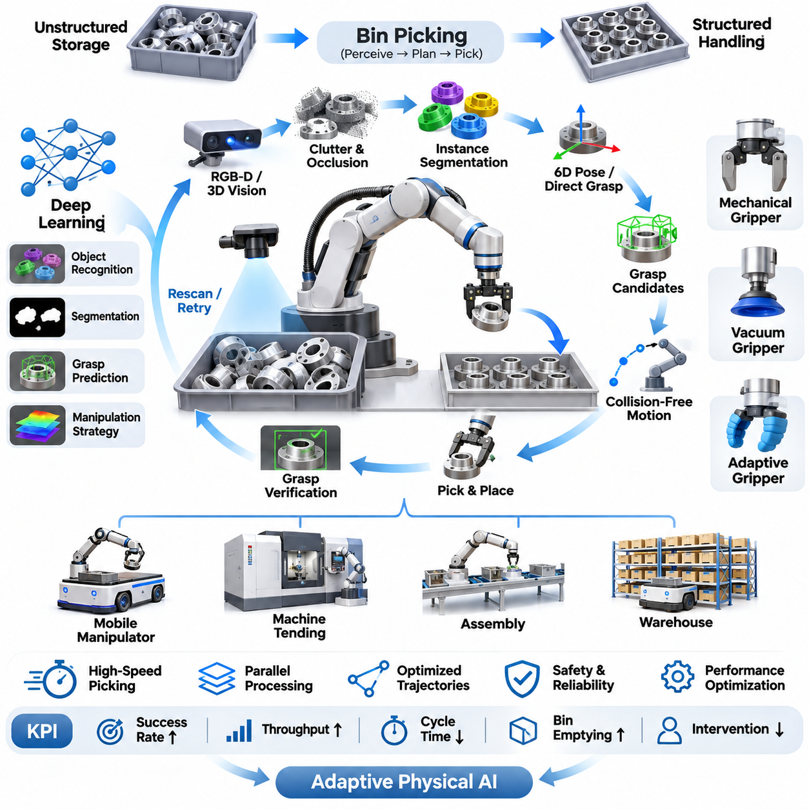
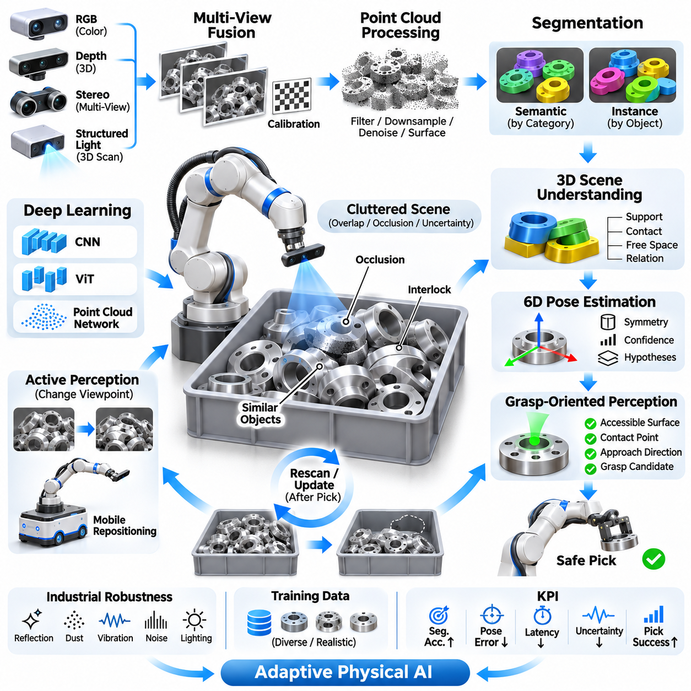
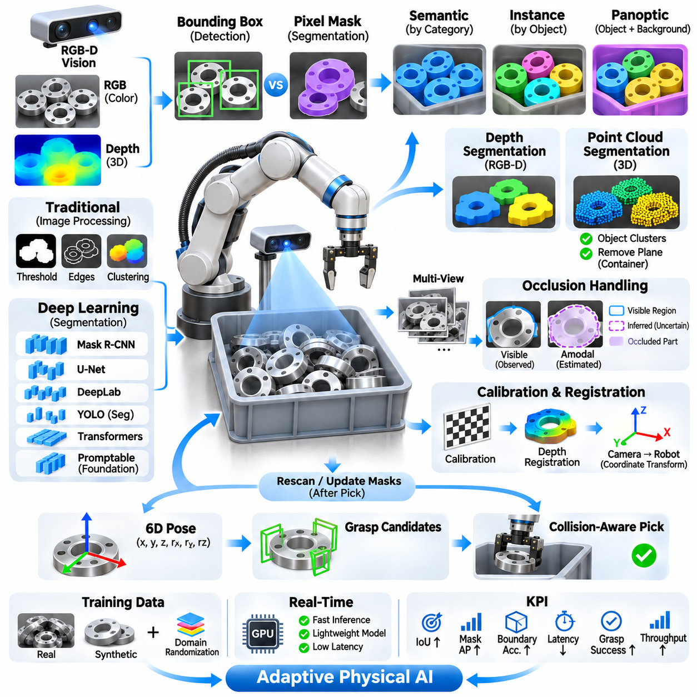
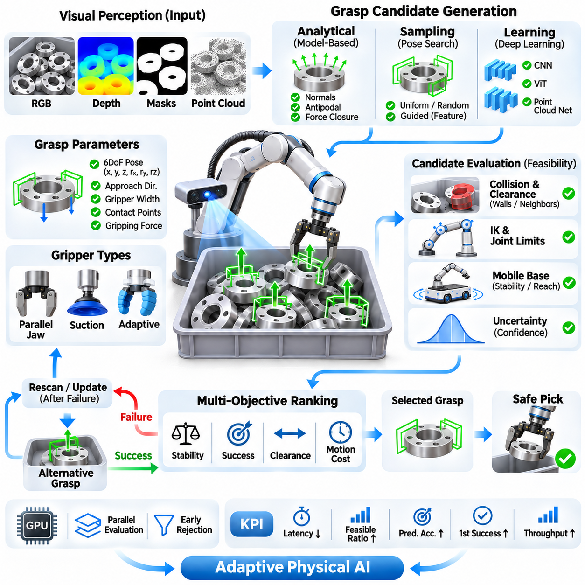
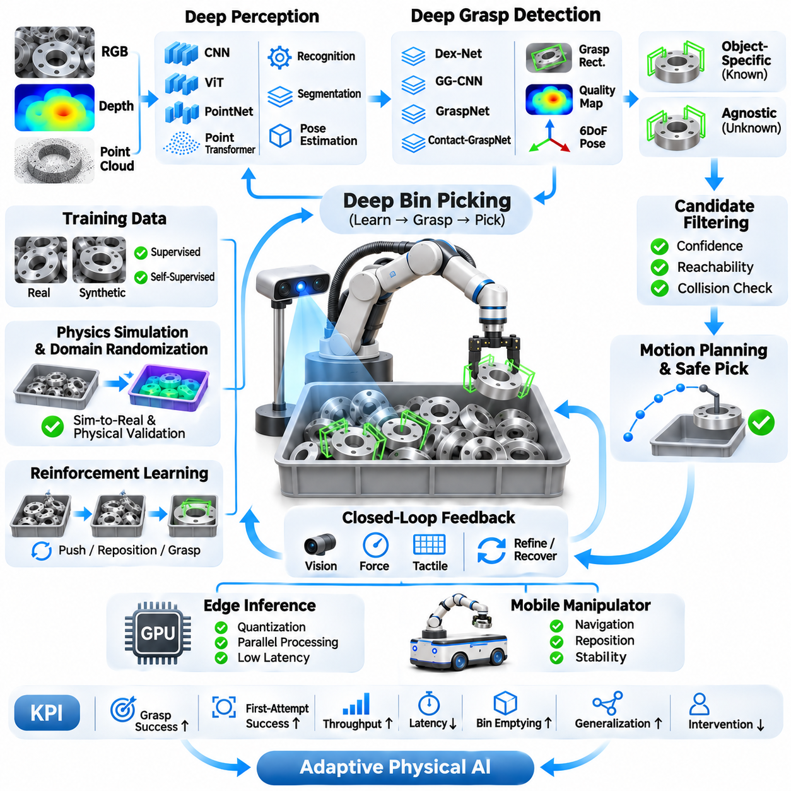
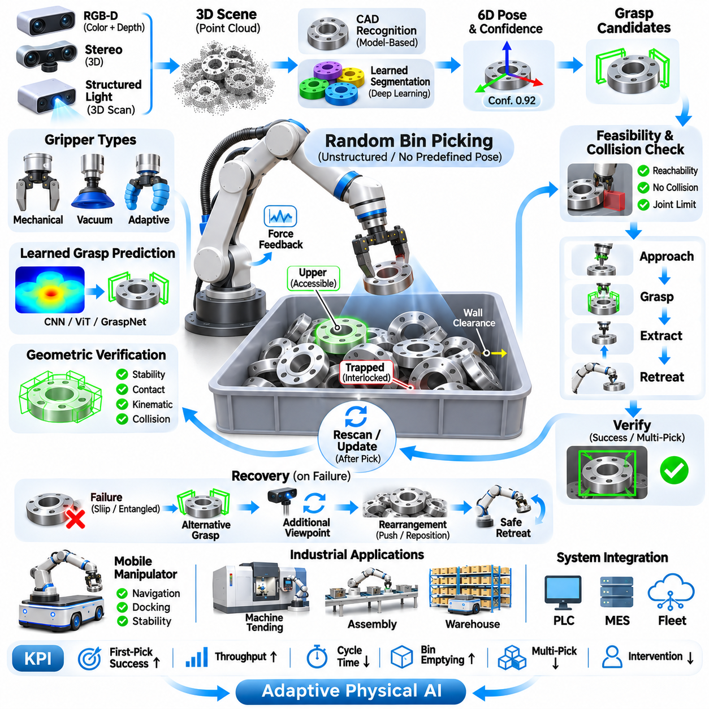
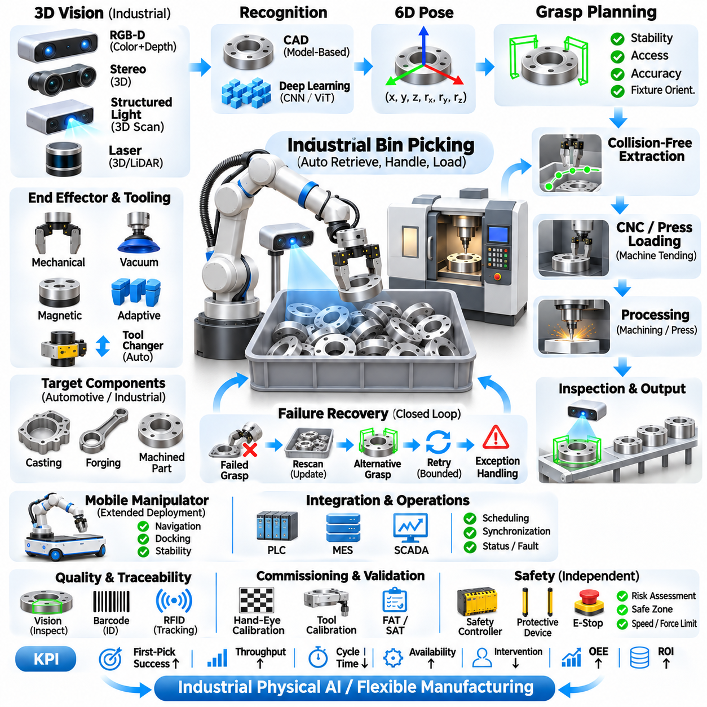
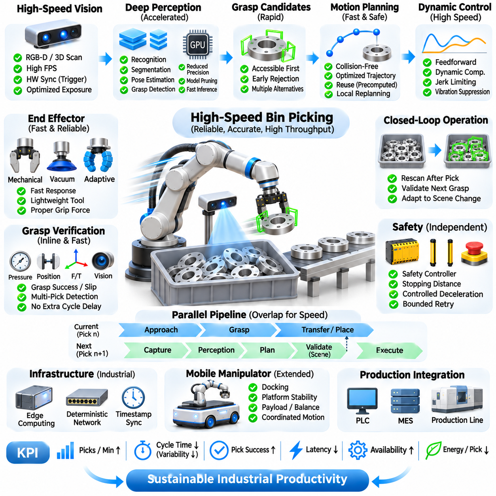
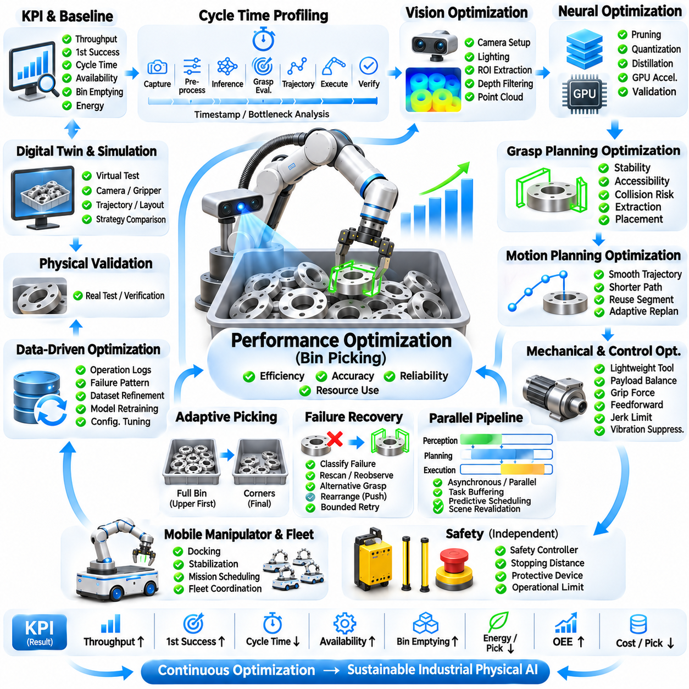

**Volume 03. Vision Manipulation and AI**

# Chapter 08. Bin Picking

## 01 Bin Picking Overview

{width="7.268055555555556in" height="7.268055555555556in"}

Bin picking is a robotic manipulation process in which a robot autonomously identifies, grasps, and retrieves objects stored inside a container, bin, or storage compartment. Unlike conventional pick-and-place operations, bin picking frequently involves objects arranged in random positions and orientations. The robot must understand complex visual environments, identify accessible objects, determine feasible grasp configurations, and execute reliable manipulation actions.

The fundamental objective of bin picking is to transform unstructured material storage into structured and automated material handling. Traditional industrial automation often requires mechanical feeders, customized fixtures, and predefined object arrangements. Bin picking reduces these requirements by allowing robots to retrieve randomly distributed objects directly from containers, thereby improving manufacturing flexibility and reducing dependence on specialized equipment.

A typical bin picking system consists of a robotic manipulator, an end effector, a vision system, a perception processing unit, and a motion planning framework. These components operate collaboratively to identify objects, generate grasping candidates, evaluate manipulation feasibility, and execute physical actions. System reliability depends on the accuracy, communication, and coordination of these interconnected hardware and software components.

Visual perception provides the foundation for intelligent bin picking. RGB cameras, depth cameras, stereo vision systems, and three-dimensional scanners acquire information about the objects and their surrounding environments. Depth information is particularly valuable because objects frequently overlap or partially obstruct one another. Three-dimensional representations enable robots to evaluate object geometry, surface accessibility, and spatial relationships.

Cluttered scene perception represents one of the primary technical challenges in bin picking. Objects may be stacked, interlocked, partially hidden, or positioned against container walls. These conditions complicate object recognition and increase uncertainty in spatial estimation. Robust perception algorithms must distinguish individual objects while accounting for incomplete observations, environmental noise, reflections, and variations in illumination.

Object segmentation separates individual objects from surrounding materials and background regions. Instance segmentation algorithms identify distinct objects even when multiple instances of the same object category are present. Combined with depth measurements, segmentation results provide spatial information that supports object localization, pose estimation, grasp candidate generation, and collision-aware manipulation planning.

Object pose estimation determines the position and orientation of individual objects within the robotic workspace. Six-dimensional pose estimation is particularly important when handling industrial components that require precise alignment or orientation during subsequent operations. However, some applications can operate without explicit pose estimation by directly predicting feasible grasp configurations from visual observations.

Grasp candidate generation determines how the robot can physically interact with accessible objects. Multiple potential grasp configurations are generated using object geometry, surface properties, depth information, and gripper characteristics. Each candidate is evaluated according to grasp stability, accessibility, collision probability, and expected execution success. The robot selects a suitable candidate based on these combined criteria.

Motion planning converts the selected grasp configuration into a feasible robotic trajectory. The planner must consider container boundaries, neighboring objects, robot joint limitations, singularities, and environmental obstacles. Collision avoidance is particularly challenging when objects are located deep inside containers or close to their walls. Reliable motion planning reduces equipment damage and improves operational consistency.

End effector selection significantly influences bin picking performance. Mechanical grippers are suitable for many rigid industrial components, while vacuum grippers are effective for objects with accessible sealing surfaces. Adaptive and soft grippers provide additional flexibility when handling irregular or delicate objects. Gripper design must account for object geometry, material characteristics, weight, and environmental constraints.

Deep learning has substantially expanded the capabilities of modern bin picking systems. Neural networks can learn object recognition, segmentation, grasp detection, and manipulation strategies from large datasets. Unlike purely rule-based approaches, learning-based systems can accommodate greater variability in object appearance and arrangement. Nevertheless, their reliability depends on training data quality and generalization capability.

Random bin picking extends conventional automation by allowing objects to be retrieved without predetermined arrangements. The robot continuously observes the container, evaluates accessible objects, and selects appropriate manipulation actions. Because each successful or unsuccessful grasp can change the surrounding environment, updated visual observations are required to maintain an accurate representation of the scene.

Industrial bin picking is widely applicable to machine tending, automotive component handling, assembly automation, warehouse fulfillment, and manufacturing logistics. These applications require consistent operation under production conditions, where cycle time, equipment availability, maintenance requirements, and handling accuracy directly influence productivity. Integration with existing manufacturing systems is therefore essential.

Mobile manipulators extend bin picking capabilities beyond stationary robotic workstations. An Autonomous Mobile Robot (AMR) equipped with a robotic arm can travel between storage locations, retrieve objects, and deliver materials to designated destinations. This architecture requires coordinated mobile navigation, positioning accuracy, manipulator control, visual perception, and task-level orchestration.

High-speed bin picking focuses on reducing the total time required for perception, grasp selection, motion planning, and physical execution. Parallel processing, accelerated inference, optimized trajectories, and efficient gripper operation contribute to improved throughput. However, increased operating speed must be balanced against grasp reliability, collision avoidance, mechanical limitations, and operational safety.

Error detection and recovery are essential for continuous bin picking operations. Objects may slip, become entangled, move unexpectedly, or remain inaccessible to the selected gripper. The system must verify grasp success and determine appropriate recovery actions when failures occur. Alternative grasp selection, scene rescanning, and controlled object rearrangement can improve operational resilience.

Performance evaluation typically considers grasp success rate, picking throughput, average cycle time, bin emptying rate, and intervention frequency. These metrics provide complementary information about perception accuracy, manipulation effectiveness, and overall system reliability. Comprehensive evaluation should include different object arrangements, container geometries, environmental conditions, and operational constraints.

Ultimately, bin picking represents an integrated application of computer vision, artificial intelligence, robotic manipulation, and autonomous decision-making. Its development illustrates the transition from predefined industrial automation toward adaptive Physical AI systems capable of interacting with unstructured environments. Continuous improvements in perception, grasp planning, and execution will further expand its industrial applications.

## 02 Cluttered Scene Perception

{width="7.268055555555556in" height="7.268055555555556in"}

Cluttered scene perception is the process of interpreting complex environments in which multiple objects are randomly distributed, overlapping, partially occluded, or physically interacting. In robotic bin picking, cluttered conditions frequently occur because industrial components, packages, and other materials are stored without predefined arrangements. Robots must extract reliable spatial and semantic information from these unstructured environments before executing manipulation tasks.

Unlike structured environments, cluttered scenes introduce significant uncertainty into object recognition, localization, and grasp planning. Objects may have similar appearances, irregular orientations, or partially visible surfaces. Their spatial relationships can also change following each manipulation action. Consequently, perception systems must continuously construct and update environmental representations rather than depend exclusively on predefined object coordinates.

Visual sensing provides the primary source of information for cluttered scene perception. RGB cameras capture appearance, color, and texture, while depth cameras provide geometric and spatial measurements. Stereo vision and structured light systems can generate detailed three-dimensional representations. Combining complementary sensing technologies improves perception robustness when individual sensors encounter limitations caused by environmental conditions.

Point cloud processing plays an important role in representing cluttered environments. A point cloud describes visible surfaces using three-dimensional spatial coordinates obtained from depth sensors or scanning devices. Filtering, downsampling, noise removal, and surface estimation improve the quality of these representations. Processed point clouds support object separation, geometric analysis, collision detection, and identification of accessible grasping regions.

Occlusion is one of the most significant challenges in cluttered scene perception. Partial occlusion occurs when neighboring objects obstruct portions of a target object, while complete occlusion prevents direct visual observation. Perception algorithms must account for missing information and estimate the reliability of available observations. In uncertain situations, additional viewpoints or controlled manipulation actions may reveal previously hidden object surfaces.

Object segmentation enables robotic systems to distinguish individual objects within densely populated environments. Semantic segmentation identifies regions belonging to specific object categories, while instance segmentation separates individual objects within the same category. Combining segmentation results with depth information enables more accurate spatial localization and reduces ambiguity when multiple objects have similar visual appearances or overlapping boundaries.

Three-dimensional scene understanding extends perception beyond individual object recognition by analyzing spatial relationships among objects, containers, and environmental obstacles. The system estimates relative positions, surface orientations, supporting structures, and potential contact regions. These relationships provide essential information for determining whether an object can be safely retrieved without disturbing neighboring materials or causing unintended collisions.

Object pose estimation determines the position and orientation of objects within cluttered scenes. Six-dimensional pose estimation combines three translational and three rotational components to describe object configurations. However, incomplete observations and geometric symmetry may produce multiple plausible pose estimates. Robust systems evaluate estimation confidence and consider alternative hypotheses before transferring perception results to manipulation planning modules.

Deep learning has significantly improved perception capabilities in cluttered environments. Convolutional Neural Networks, Vision Transformers, and point cloud neural networks can learn complex spatial and visual relationships from training datasets. These models support object detection, instance segmentation, pose estimation, and grasp prediction. Their practical effectiveness depends on representative training data, sensor quality, and generalization to unfamiliar environments.

Multi-view perception improves environmental understanding by acquiring observations from different camera positions and orientations. Fixed multi-camera configurations provide complementary viewpoints, while robot-mounted cameras enable flexible observation strategies. Combining multiple perspectives can reduce occlusion, improve surface reconstruction, and increase spatial estimation accuracy. Accurate camera calibration and coordinate transformation are essential for reliable information fusion.

Active perception allows robots to deliberately change their observation positions to obtain additional information. Instead of passively processing available sensor measurements, the robot selects viewpoints according to environmental uncertainty and task requirements. A mobile manipulator can reposition its mobile platform or adjust its robotic arm to observe hidden regions. This capability improves decision-making when initial observations are insufficient for reliable manipulation.

Grasp-oriented perception focuses on identifying environmental features that directly influence manipulation feasibility. Rather than requiring complete reconstruction of every object, the system evaluates accessible surfaces, potential contact points, approach directions, and surrounding free space. This task-oriented strategy reduces unnecessary computational processing and enables robots to prioritize objects that can be retrieved efficiently with acceptable levels of risk.

Real-time perception is essential because cluttered environments may change after every robotic interaction. Retrieved objects can alter supporting relationships, while unsuccessful grasps may shift neighboring materials. Closed-loop perception continuously updates the environmental model using recent sensor observations. Efficient inference, hardware acceleration, and synchronized data acquisition help maintain consistency between perception results and actual physical conditions.

Industrial deployment requires cluttered scene perception systems to operate reliably under varying illumination, reflective surfaces, dust, vibration, and sensor noise. Training datasets should represent realistic object arrangements, occlusion levels, material properties, and environmental variations. Performance evaluation should consider segmentation accuracy, pose estimation error, perception latency, uncertainty estimation, and their combined influence on successful robotic manipulation.

Ultimately, cluttered scene perception establishes a critical connection between visual intelligence and autonomous robotic manipulation. By integrating three-dimensional sensing, object segmentation, spatial reasoning, active perception, and continuous environmental updates, robots can operate effectively in unstructured environments. These capabilities form an essential foundation for intelligent bin picking, adaptive mobile manipulation, and advanced Physical AI systems.

## 03 Object Segmentation

{width="7.268055555555556in" height="7.268055555555556in"}

Object segmentation is a computer vision technique that separates individual objects or meaningful regions from complex visual environments. In robotic bin picking, segmentation enables robots to distinguish target objects from neighboring materials, container surfaces, and background regions. Accurate segmentation provides the spatial foundation for object localization, pose estimation, grasp candidate generation, and collision-aware manipulation.

Unlike conventional object detection, which typically describes objects using rectangular bounding boxes, segmentation identifies object regions at the pixel level. Bounding boxes frequently include neighboring objects and irrelevant background information in cluttered environments. Pixel-level segmentation provides more precise object boundaries, allowing robotic systems to identify accessible surfaces and evaluate potential physical interactions more accurately.

Semantic segmentation assigns a predefined category label to each pixel within an image. This approach enables robots to distinguish industrial components, packaging materials, container walls, and background regions. However, semantic segmentation does not inherently distinguish separate objects belonging to the same category. Additional instance-level processing is therefore necessary when identical components are randomly distributed inside a container.

Instance segmentation extends semantic classification by identifying each individual object separately. Every detected object receives an independent segmentation mask, even when multiple objects belong to the same category. This capability is particularly important in bin picking because industrial components frequently overlap or appear in similar orientations. Individual masks allow robots to evaluate each object\'s accessibility and manipulation feasibility.

Panoptic segmentation combines semantic segmentation and instance segmentation into a unified environmental representation. It distinguishes countable objects while simultaneously classifying background surfaces and other environmental regions. Within a bin picking system, this comprehensive representation supports target identification, container boundary recognition, obstacle detection, and spatial reasoning throughout the manipulation planning process.

Traditional segmentation techniques rely on image processing methods such as thresholding, edge detection, region growing, watershed transformation, and geometric clustering. These approaches can perform effectively when object characteristics and environmental conditions are predictable. However, their performance often decreases when objects exhibit complex shapes, overlapping boundaries, inconsistent illumination, or reflective material properties.

Deep learning-based segmentation improves adaptability by learning visual features directly from training datasets. Architectures such as Mask R-CNN, U-Net, DeepLab, and segmentation-enabled YOLO models support different segmentation requirements. Transformer-based architectures further enhance contextual scene understanding, while foundation segmentation models enable flexible mask generation using visual prompts without necessarily identifying object categories.

Depth-based segmentation incorporates three-dimensional geometric information into the object separation process. Depth discontinuities, surface orientations, and spatial distances help distinguish objects that exhibit similar colors or textures. Combining RGB images with depth measurements enables RGB-D segmentation, which improves object boundary estimation and provides geometric information for subsequent robotic manipulation tasks.

Point cloud segmentation directly processes three-dimensional spatial representations acquired from depth cameras or scanning devices. Euclidean clustering, plane segmentation, region growing, and neural network-based methods can identify meaningful object regions. Removing container surfaces and background structures simplifies the scene representation, while individual object clusters provide useful information for geometric grasp planning.

Occlusion handling remains a major challenge because conventional segmentation generally describes only visible object regions. Amodal segmentation attempts to estimate the complete extent of partially hidden objects, but inferred boundaries may contain significant uncertainty. Multi-view observations, geometric priors, and confidence estimation help robotic systems manage incomplete information and avoid treating predicted hidden surfaces as confirmed physical geometry.

Segmentation results must be transformed into the robotic coordinate system before they can support physical manipulation. Camera calibration, depth registration, and coordinate transformation establish relationships between image pixels, three-dimensional object surfaces, and the robot base frame. Accurate transformation is essential because segmentation or calibration errors can produce incorrect grasp positions, unintended contacts, and manipulation failures.

Real-time segmentation is particularly important in dynamic bin picking environments because object arrangements frequently change after manipulation. Lightweight neural networks, GPU acceleration, optimized inference engines, and efficient image preprocessing help reduce computational latency. Closed-loop perception enables the robot to update segmentation masks after each picking attempt and maintain consistency between its internal scene representation and physical reality.

Training dataset quality significantly influences segmentation accuracy and generalization capability. Industrial datasets should represent different object geometries, material characteristics, container configurations, illumination conditions, and occlusion levels. Synthetic data generation, domain randomization, and automated annotation can supplement real-world datasets, while representative physical observations remain essential for validating deployment performance.

Performance evaluation commonly uses Intersection over Union, mean Intersection over Union, mask Average Precision, boundary accuracy, and inference latency. However, segmentation quality must also be assessed through manipulation-oriented metrics, including grasp success rate, picking throughput, and failure frequency. High pixel-level accuracy does not necessarily guarantee successful manipulation when critical grasping surfaces are incorrectly segmented.

Ultimately, object segmentation establishes a fundamental connection between visual perception and physical robotic interaction. By integrating semantic information, instance-level identification, three-dimensional geometry, and continuous environmental updates, robotic systems can distinguish objects within complex environments. These capabilities support intelligent bin picking, autonomous mobile manipulation, and the development of adaptive Physical AI systems.

## 04 Grasp Candidate Generation

{width="7.268055555555556in" height="7.268055555555556in"}

Grasp candidate generation is the process of identifying potential configurations through which a robotic gripper can successfully grasp and retrieve objects from an environment. In robotic bin picking, objects are frequently distributed in random positions, orientations, and overlapping arrangements. The system must generate multiple grasp candidates that account for object geometry, surface accessibility, gripper characteristics, and surrounding environmental constraints.

A grasp candidate typically describes the spatial position and orientation of an end effector, together with parameters such as gripper opening width, approach direction, and contact locations. Depending on the gripper configuration, additional parameters may include suction contact area, finger configuration, and required gripping force. These parameters collectively define how the robotic system intends to establish physical contact with a target object.

Visual perception provides the primary input for grasp candidate generation. RGB images, depth maps, segmentation masks, and three-dimensional point clouds describe the appearance and spatial configuration of objects within a container. Combining these representations enables the system to identify accessible surfaces, estimate local geometry, and determine potential contact regions while considering neighboring objects and container boundaries.

Analytical grasp candidate generation relies on mathematical models, geometric relationships, and physical principles. Surface normals, object edges, curvature, and estimated contact points are analyzed to identify feasible grasp configurations. Grasp stability can be evaluated using friction constraints, antipodal contact conditions, and force closure principles. These methods are particularly useful when reliable geometric information is available.

Sampling-based approaches generate multiple grasp candidates by exploring different positions, orientations, and approach directions within the robotic workspace. Candidates may be sampled uniformly, randomly, or according to geometric features identified through perception. Each generated configuration undergoes feasibility evaluation to eliminate unsuitable grasps. Guided sampling improves computational efficiency by concentrating on promising contact regions.

Learning-based grasp candidate generation uses neural networks to predict suitable grasp configurations directly from visual or geometric observations. Convolutional Neural Networks, Vision Transformers, and point cloud-based architectures can learn relationships between object characteristics and grasp success. These approaches can accommodate unfamiliar objects without requiring complete geometric models, although their reliability depends on training data coverage.

Point cloud-based grasp generation is particularly valuable in cluttered bin picking environments because it incorporates three-dimensional geometry directly into the decision-making process. Local surface patches, normal vectors, and spatial neighborhoods provide information about potential contact configurations. Neural networks can predict six-degree-of-freedom grasp poses while accounting for object shape, gripper geometry, and surrounding free space.

Grasp candidate generation must consider the physical characteristics of the selected end effector. Parallel-jaw grippers require accessible opposing contact surfaces and sufficient clearance for finger insertion. Vacuum grippers require suitable surface geometry and sealing conditions, while adaptive grippers can accommodate more complex shapes. Candidate generation should therefore incorporate gripper-specific geometric and mechanical constraints.

Collision-aware candidate generation evaluates whether a proposed grasp can be approached and executed without unintended contact. The system considers neighboring objects, container walls, the gripper body, and the robotic manipulator. Candidates that appear stable from a contact perspective may still be physically inaccessible. Integrating collision checking and approach clearance evaluation reduces unsuccessful execution attempts and equipment damage.

Kinematic feasibility determines whether the robotic manipulator can physically reach a generated grasp configuration. Inverse kinematics, joint limits, singularity avoidance, and workspace boundaries must be considered during candidate evaluation. For mobile manipulators, base positioning and platform stability introduce additional constraints. Coordinating mobile base placement with grasp accessibility can significantly expand the effective manipulation workspace.

Grasp quality evaluation assigns scores to generated candidates according to their expected execution performance. Relevant criteria include contact stability, predicted grasp success, collision risk, approach clearance, and motion execution cost. A candidate with the highest theoretical grasp stability may not provide the best operational outcome. Multi-objective scoring enables the system to balance physical reliability, accessibility, and picking efficiency.

Uncertainty-aware grasp generation incorporates limitations associated with sensor measurements, segmentation accuracy, and incomplete geometric observations. Reflective surfaces, depth noise, and partial occlusion can create misleading grasp configurations. Confidence estimation and uncertainty-based filtering help eliminate unreliable candidates, while additional observations can improve candidate quality before the robot commits to physical execution.

Real-time candidate generation requires efficient coordination between perception, inference, feasibility evaluation, and motion planning. GPU acceleration, selective sampling, parallel candidate evaluation, and early rejection of invalid configurations reduce computational latency. Maintaining several feasible alternatives also enables rapid recovery when the preferred grasp becomes unavailable or fails during execution.

Closed-loop grasp generation continuously adapts candidate configurations according to changes in the physical environment. Each successful or unsuccessful picking attempt may alter object positions, surface accessibility, and supporting relationships. Updated sensor observations allow the system to invalidate outdated candidates and generate new alternatives. This feedback mechanism improves adaptability and reduces repeated manipulation failures.

Performance evaluation should consider candidate generation latency, feasible candidate ratio, grasp prediction accuracy, first-attempt success rate, and overall picking throughput. Testing must represent realistic variations in object geometry, material properties, container configurations, and clutter density. Ultimately, reliable grasp candidate generation connects visual perception with physical action and establishes a foundation for adaptive robotic bin picking and intelligent Physical AI systems.

## 05 Deep Bin Picking

{width="7.268055555555556in" height="7.268055555555556in"}

Deep bin picking refers to the application of deep learning techniques to robotic systems that autonomously retrieve objects from cluttered and unstructured containers. Unlike conventional bin picking systems that depend heavily on predefined geometric models and manually designed rules, deep bin picking learns visual features, spatial relationships, and grasping strategies from data. This approach improves adaptability to diverse objects and unpredictable environmental conditions.

The fundamental architecture of deep bin picking integrates visual perception, neural network inference, grasp candidate generation, motion planning, and robotic execution. Sensor observations are processed by trained neural networks to identify objects or suitable grasping regions. Predicted grasp configurations are subsequently evaluated against physical and kinematic constraints before the robotic manipulator performs the selected action.

Deep visual perception enables robotic systems to interpret complex environments containing overlapping, partially occluded, and randomly oriented objects. Convolutional Neural Networks and Vision Transformers extract hierarchical visual features from RGB images, depth maps, and combined RGB-D representations. These features support object recognition, instance segmentation, pose estimation, and identification of surfaces suitable for physical manipulation.

Depth-aware neural networks improve grasp prediction by incorporating three-dimensional geometric information into the learning process. Depth maps describe surface distances, while point clouds represent spatial coordinates and local geometric structures. Networks such as PointNet-based architectures and point transformers can process these representations to estimate grasp positions, orientations, and accessibility within densely cluttered containers.

Deep grasp detection predicts potential grasp configurations directly from sensor observations. Depending on the network architecture, predictions may include planar grasp rectangles, pixel-level grasp quality maps, or six-degree-of-freedom grasp poses. Representative approaches include Dex-Net, GG-CNN, GraspNet, and Contact-GraspNet, which illustrate different strategies for learning grasp quality and generating feasible configurations from visual information.

Object-specific deep bin picking combines learned object recognition with pose estimation and predefined grasp models. This approach is particularly suitable for industrial applications involving known components that require precise orientation during subsequent manufacturing operations. Object-agnostic grasping instead predicts feasible contact configurations without requiring explicit object identification, supporting flexible handling of unfamiliar materials.

Training data plays a fundamental role in determining the reliability and generalization capability of deep bin picking systems. Datasets should contain diverse object geometries, material properties, grasp configurations, clutter densities, and sensor conditions. Supervised learning uses annotated grasp examples, while self-supervised learning can exploit physical interaction outcomes to generate additional training signals without extensive manual annotation.

Synthetic data generation provides a scalable method for producing training examples in simulated bin picking environments. Physics simulation enables realistic object dropping, stacking, collision modeling, and grasp execution. Domain randomization introduces variations in lighting, textures, camera configurations, and physical properties. These techniques reduce data acquisition costs and help improve the transfer of learned capabilities from simulation to physical robotic systems.

Simulation-to-real transfer remains an important challenge because simulated environments cannot perfectly reproduce physical interactions and sensor characteristics. Differences in friction, material deformation, depth noise, and contact dynamics may reduce grasp prediction accuracy. Combining synthetic datasets with representative real-world observations, domain adaptation, and physical validation helps narrow the gap between simulated and actual performance.

Reinforcement learning can further extend deep bin picking by enabling robots to learn manipulation policies through environmental interaction. Rather than evaluating isolated grasp configurations exclusively, learned policies may consider sequences of actions involving pushing, repositioning, and grasping objects. Reward functions can encourage successful retrieval, efficient execution, and reduced intervention while penalizing collisions and unsuccessful actions.

Closed-loop deep bin picking integrates continuous perception with adaptive action execution. Neural networks process updated sensor observations as the robot approaches or interacts with an object. Visual feedback, force measurements, and tactile information can support grasp refinement and failure detection. This architecture improves responsiveness when objects shift unexpectedly or initial predictions become inconsistent with actual physical conditions.

Real-time deployment requires balancing neural network complexity, prediction accuracy, and computational latency. GPU acceleration, model quantization, optimized inference engines, and parallel processing can improve execution speed. Edge computing enables perception and grasp inference to operate directly within the robotic platform, reducing communication dependencies and supporting responsive manipulation in industrial mobile robotic systems.

Industrial deep bin picking must integrate learned predictions with deterministic motion planning, collision checking, and independently validated safety mechanisms. Neural network confidence alone cannot guarantee physical feasibility or operational safety. Candidate filtering, uncertainty estimation, reachability analysis, grasp verification, and controlled recovery procedures are necessary to achieve reliable operation under demanding production conditions.

Mobile manipulators extend deep bin picking beyond fixed robotic workstations by combining learned manipulation capabilities with autonomous navigation and task orchestration. The mobile platform can reposition itself to improve camera visibility, grasp accessibility, and workspace coverage. Coordinated perception and manipulation planning must account for localization uncertainty, platform stability, payload distribution, and environmental constraints.

Performance evaluation should consider grasp success rate, first-attempt success rate, picking throughput, inference latency, bin emptying rate, and generalization to unfamiliar objects. Long-duration testing should also measure recovery effectiveness and human intervention frequency. Ultimately, deep bin picking demonstrates how learned perception and adaptive manipulation can transform conventional material handling into intelligent Physical AI systems.

## 06 Random Bin Picking

{width="7.268055555555556in" height="7.268055555555556in"}

Random bin picking is an autonomous robotic manipulation process in which objects are retrieved from containers without requiring predefined positions, orientations, or structured arrangements. Unlike conventional robotic feeding systems, random bin picking enables robots to handle materials distributed unpredictably within confined storage environments. This capability reduces dependence on specialized mechanical feeders, customized fixtures, and manual material preparation.

The primary objective of random bin picking is to achieve reliable material retrieval despite substantial variations in object arrangement and environmental conditions. Objects may overlap, become entangled, rest against container walls, or support neighboring components. The robotic system must continuously analyze these conditions and determine which objects can be safely extracted without causing unintended collisions or excessive disturbances.

A typical random bin picking architecture integrates three-dimensional vision, object segmentation, pose estimation, grasp candidate generation, motion planning, and robotic execution. These functional modules operate within a coordinated perception-action pipeline. Each picking cycle begins with environmental observation and proceeds through grasp selection, trajectory generation, physical retrieval, and verification of the manipulation outcome.

Three-dimensional visual perception is particularly important because conventional two-dimensional images cannot fully describe the spatial complexity of randomly arranged objects. RGB-D cameras, stereo vision systems, and structured light scanners provide depth measurements and geometric representations. These observations enable robots to estimate object positions, surface orientations, container boundaries, and available manipulation space.

Object recognition and segmentation allow the robot to distinguish individual components within densely populated containers. Model-based recognition compares observed geometric features with predefined CAD models, while learning-based segmentation identifies object regions from training data. Depending on application requirements, the system may retrieve specific target objects or select any accessible object that satisfies predefined handling criteria.

Six-dimensional object pose estimation determines the three-dimensional position and orientation of randomly distributed components. Accurate pose estimation is particularly important when retrieved objects must be aligned with machine fixtures or assembly stations. Geometric symmetry, partial occlusion, and incomplete depth measurements can introduce ambiguity, requiring confidence estimation, pose refinement, or additional visual observations.

Grasp candidate generation evaluates accessible surfaces, potential contact locations, approach directions, and gripper configurations. Multiple candidates are produced for individual objects and evaluated according to grasp stability, collision risk, and kinematic feasibility. Prioritizing accessible objects near the upper surface of the material pile can reduce unnecessary manipulation complexity and improve overall picking efficiency.

Grasp selection in random bin picking must consider not only individual object accessibility but also the physical relationships among neighboring components. An apparently accessible object may be trapped beneath another component or mechanically interlocked with surrounding materials. Spatial reasoning, geometric analysis, and force feedback help identify extraction risks and reduce the likelihood of unintended multi-object retrieval.

Container geometry introduces additional constraints during robotic manipulation. Deep containers, narrow openings, vertical walls, and internal partitions can restrict gripper movement and reduce available approach directions. Collision-aware motion planning must evaluate the entire manipulator configuration, including the wrist, gripper, and robot links, throughout the approach, grasping, extraction, and retreat phases.

End effector selection significantly influences the flexibility and reliability of random bin picking. Mechanical grippers provide stable contact for many rigid components, while vacuum grippers are effective when suitable sealing surfaces are available. Adaptive and soft grippers accommodate greater geometric variability. Application-specific finger designs and interchangeable tooling can further improve accessibility and reduce handling failures.

Deep learning enables random bin picking systems to identify graspable objects without relying exclusively on predefined geometric models. Neural networks can predict grasp quality, contact regions, and six-degree-of-freedom grasp configurations from visual observations. Combining learned predictions with geometric verification and motion feasibility analysis improves adaptability while retaining essential physical constraints during robotic execution.

Closed-loop manipulation is necessary because the internal arrangement of a container can change after every picking attempt. Removing an object may cause surrounding components to shift, rotate, or collapse into previously occupied spaces. Updated visual observations allow the robot to reconstruct the current environment, invalidate outdated grasp candidates, and select new actions based on actual physical conditions.

Error recovery strategies improve operational continuity when objects slip, become entangled, or cannot be extracted using the selected grasp. The robot may generate alternative grasp configurations, acquire additional viewpoints, or perform controlled rearrangement actions. Retry limits, force monitoring, and safe retreat procedures prevent repeated failures from developing into equipment damage or unsafe operating conditions.

Mobile manipulators extend random bin picking from fixed industrial workstations to distributed material handling environments. An Autonomous Mobile Robot equipped with a robotic arm can visit multiple storage containers, retrieve required components, and transport them to designated stations. Mobile base positioning, camera calibration, platform stability, and coordinated task execution become additional requirements for reliable operation.

Industrial random bin picking supports machine tending, automotive component feeding, assembly automation, warehouse fulfillment, and manufacturing logistics. Integration with Programmable Logic Controllers, Manufacturing Execution Systems, and fleet management platforms enables coordinated material flow. Successful deployment requires balancing manipulation flexibility with production cycle times, equipment availability, safety requirements, and maintenance costs.

Performance evaluation should consider first-attempt grasp success rate, picking throughput, average cycle time, bin emptying completeness, multi-object retrieval frequency, and human intervention rate. Testing should include variations in container geometry, object quantity, material properties, and clutter density. Ultimately, random bin picking represents a practical application of adaptive robotic manipulation and intelligent Physical AI in unstructured industrial environments.

## 07 Industrial Bin Picking

{width="7.268055555555556in" height="7.268055555555556in"}

Industrial bin picking refers to the deployment of robotic systems for the autonomous retrieval, handling, and transfer of components from containers within manufacturing and logistics environments. Its primary objective is to replace repetitive manual material handling with reliable automated manipulation. Industrial bin picking must satisfy demanding requirements related to productivity, operational stability, positioning accuracy, safety, and production continuity.

A typical industrial bin picking system integrates an industrial robotic manipulator, three-dimensional vision sensors, application-specific end effectors, motion planning software, and industrial control systems. These components operate within a coordinated architecture that connects environmental perception with physical manipulation. Reliable synchronization between perception, decision-making, and execution is essential for continuous production operations.

Industrial machine vision provides the spatial information required to identify and retrieve randomly distributed components. Structured light scanners, RGB-D cameras, stereo vision systems, and laser-based sensors can generate detailed three-dimensional representations of container contents. Sensor selection must consider working distance, measurement accuracy, acquisition speed, surface reflectivity, ambient lighting, and environmental resistance.

Object recognition and six-dimensional pose estimation are particularly important in industrial applications involving standardized components. CAD-based recognition methods compare observed geometric features with reference models to determine component position and orientation. Deep learning-based approaches can complement traditional recognition techniques by improving adaptability to complex backgrounds, partial occlusion, and variations in component appearance.

Grasp planning in industrial bin picking must satisfy both physical manipulation requirements and downstream manufacturing constraints. A component must not only be successfully retrieved but also delivered in an appropriate orientation for subsequent processing. Grasp candidates are therefore evaluated according to mechanical stability, surface accessibility, collision risk, positioning accuracy, and compatibility with destination fixtures or processing equipment.

End effector design significantly influences industrial bin picking performance. Mechanical grippers are commonly used for rigid components, while magnetic and vacuum grippers are suitable for specific materials and surface conditions. Application-specific fingers, adaptive gripping mechanisms, and automatic tool changers can improve handling flexibility. Gripper selection must also consider payload capacity, component protection, and maintenance requirements.

Collision-free motion planning is essential when robotic manipulators operate within deep containers and restricted industrial workspaces. Planning algorithms must consider container walls, neighboring components, production machinery, and the complete geometry of the robotic system. Safe extraction trajectories should account for the geometry of grasped components to prevent unintended contact during retrieval, transportation, and placement.

Machine tending represents a major application of industrial bin picking. Robotic systems retrieve unprocessed components from containers, orient them correctly, and load them into CNC machines, presses, or other manufacturing equipment. After processing, finished components can be transferred to inspection stations or output containers. This automation reduces manual intervention and supports extended periods of continuous production.

Automotive manufacturing frequently requires industrial bin picking for handling metal castings, forged components, machined parts, fasteners, and structural assemblies. These components may exhibit reflective surfaces, irregular geometry, substantial weight, or mechanical interlocking. Successful implementation requires robust three-dimensional perception, specialized gripping mechanisms, and controlled extraction strategies that accommodate component-specific characteristics.

Industrial bin picking systems must coordinate their operations with existing manufacturing infrastructure. Programmable Logic Controllers, Manufacturing Execution Systems, and Supervisory Control and Data Acquisition platforms provide interfaces for production scheduling, equipment synchronization, status monitoring, and fault management. Industrial communication protocols enable reliable data exchange between robotic systems and factory automation equipment.

Quality assurance and component traceability can be integrated into the industrial bin picking workflow. Vision-based inspection may identify damaged components, incorrect variants, or surface abnormalities before downstream processing. Barcode recognition, RFID identification, and digital production records enable tracking of individual components or batches. These functions help connect automated material handling with broader manufacturing quality management systems.

Operational reliability requires effective detection and recovery from manipulation failures. Unsuccessful grasps, dropped components, unexpected object movement, and insufficient sensor confidence must trigger appropriate recovery procedures. Alternative grasp generation, additional visual observations, and controlled retry strategies can reduce production interruptions, while persistent failures should initiate predefined exception handling procedures.

Industrial safety architecture must remain independent of unverified AI predictions. Safety-rated controllers, protective devices, emergency stop circuits, and monitored operating zones provide essential protection for personnel and equipment. Risk assessment must address robot motion, falling components, gripper failures, unexpected system behavior, and maintenance activities. Collaborative operation requires additional application-specific safety validation.

Mobile manipulators extend industrial bin picking beyond fixed robotic workstations by integrating autonomous navigation with robotic manipulation. A mobile platform can service multiple production machines, storage containers, and assembly stations according to operational demand. Reliable docking, coordinate transformation, platform stability, and coordinated mission execution are essential when combining mobile transportation with precise component handling.

Industrial deployment requires systematic commissioning, calibration, and validation under representative production conditions. Hand-eye calibration, robot tool calibration, sensor alignment, and container localization directly influence manipulation accuracy. Factory Acceptance Testing and Site Acceptance Testing should verify picking capability, equipment interfaces, failure recovery, and safety functions before continuous production operation.

Performance evaluation should consider first-attempt grasp success rate, picking throughput, average cycle time, equipment availability, intervention frequency, and Overall Equipment Effectiveness. Economic evaluation should include labor savings, integration costs, maintenance expenses, and return on investment. Ultimately, industrial bin picking establishes a practical foundation for flexible manufacturing, autonomous material handling, and industrial Physical AI.

## 08 High Speed Bin Picking

{width="7.268055555555556in" height="7.268055555555556in"}

High-speed bin picking is an advanced robotic manipulation capability designed to retrieve objects from unstructured containers at high throughput while maintaining accuracy, reliability, and operational safety. Unlike conventional bin picking, which primarily emphasizes successful object retrieval, high-speed bin picking requires simultaneous optimization of visual perception, grasp prediction, motion planning, and physical execution within strict production cycle time constraints.

The overall performance of high-speed bin picking depends on the efficiency of the entire perception-action pipeline rather than the mechanical speed of the robotic manipulator alone. Image acquisition, sensor data processing, object localization, grasp selection, trajectory generation, and physical manipulation contribute to total cycle time. Bottlenecks in any functional module can significantly reduce system throughput and production efficiency.

High-speed visual perception requires rapid acquisition and processing of environmental information. Industrial RGB-D cameras, structured light scanners, and high-frame-rate vision systems provide spatial observations of randomly distributed objects. Hardware synchronization, optimized exposure settings, and efficient data transmission reduce perception latency while maintaining sufficient geometric accuracy for reliable grasp generation.

Deep learning-based perception can accelerate object recognition, instance segmentation, pose estimation, and grasp detection. Optimized neural network architectures enable rapid prediction of accessible grasp configurations from RGB images and three-dimensional geometric representations. GPU acceleration, reduced-precision inference, model pruning, and hardware-specific inference optimization contribute to lower computational latency without unnecessarily sacrificing prediction accuracy.

Parallel processing plays a fundamental role in high-speed bin picking architectures. Instead of executing perception, grasp planning, and motion execution strictly in sequence, the system can perform compatible operations concurrently. For example, the next picking cycle may be partially prepared while the robot transfers a previously retrieved component, provided that updated observations confirm the validity of the predicted grasp configuration.

Rapid grasp candidate generation requires efficient identification and evaluation of promising contact configurations. Rather than exhaustively analyzing every potential grasp, the system can prioritize accessible objects, geometrically favorable surfaces, and configurations with high predicted success rates. Early rejection of unsuitable candidates reduces computational overhead, while maintaining alternative grasps supports rapid recovery from unexpected failures.

High-speed motion planning must generate efficient trajectories while respecting joint limits, velocity constraints, acceleration limits, and collision avoidance requirements. Optimized trajectories minimize unnecessary changes in direction, excessive joint displacement, and redundant movements. Precomputed motion segments, trajectory reuse, and real-time local replanning can further reduce planning latency in repetitive industrial operations.

Dynamic motion control becomes increasingly important as robotic operating speeds increase. Rapid acceleration and deceleration generate inertial forces, mechanical vibration, and additional loading on joints and end effectors. Feedforward control, dynamic compensation, jerk-limited trajectory generation, and vibration suppression help maintain positioning accuracy and grasp stability during high-speed manipulation.

End effector performance directly influences achievable picking speed and operational reliability. Fast-response mechanical grippers, optimized vacuum systems, lightweight tooling, and efficient gripping mechanisms reduce activation and release times. Gripping force must remain sufficient to resist inertial forces during rapid movements, while excessive force should be avoided to prevent component deformation or surface damage.

High-speed grasp verification enables the system to confirm successful object retrieval without introducing unnecessary delays. Vacuum pressure sensors, gripper position measurements, force-torque sensors, and visual feedback can detect unsuccessful grasps, object slippage, and unintended multi-object retrieval. Integrating verification into existing motion sequences reduces additional inspection time and supports continuous operation.

Predictive planning and asynchronous task execution further improve throughput by anticipating subsequent manipulation requirements. The system can prepare destination configurations, evaluate alternative grasp candidates, and calculate preliminary trajectories before the current operation finishes. However, scene changes caused by object extraction must be considered before previously generated predictions are accepted for physical execution.

Industrial communication and computing infrastructure must support high-speed coordination between vision systems, robotic controllers, and production equipment. Low-latency communication, deterministic control networks, edge computing, and synchronized timestamps reduce delays between functional modules. Efficient software architecture should minimize unnecessary data copying, communication overhead, and blocking operations throughout the manipulation pipeline.

High-speed bin picking with mobile manipulators introduces additional constraints associated with platform positioning, structural stiffness, vibration, and dynamic stability. Rapid arm motion can generate reaction forces that affect the mobile base and reduce manipulation accuracy. Coordinating docking, platform stabilization, payload distribution, and arm trajectory execution is essential for achieving reliable high-speed operation across distributed workstations.

Operational safety and failure recovery must remain integral to high-speed bin picking systems. Increased robot velocity can increase collision energy and stopping distance, requiring validated protective measures and appropriate operating limits. Rapid exception detection, controlled deceleration, bounded retry strategies, and independently validated safety functions help prevent equipment damage and prolonged production interruptions.

Performance evaluation should consider successful picks per minute, average cycle time, cycle time variability, grasp success rate, inference latency, equipment availability, and energy consumption per successful pick. Testing should include different object geometries, payloads, container fill levels, and clutter densities. Ultimately, high-speed bin picking requires coordinated optimization of perception, intelligence, mechanics, and control to achieve sustainable industrial productivity.

## 09 Performance Optimization

{width="7.268055555555556in" height="7.268055555555556in"}

Performance optimization in robotic bin picking involves systematically improving the efficiency, accuracy, reliability, and resource utilization of the complete manipulation system. Rather than maximizing individual component performance independently, optimization considers the interactions among visual perception, grasp planning, motion control, and physical execution. The primary objective is to achieve sustainable productivity under realistic operating conditions.

System-level performance optimization begins with identifying measurable Key Performance Indicators that represent operational effectiveness. These indicators include picking throughput, first-attempt grasp success rate, average cycle time, equipment availability, bin emptying completeness, and energy consumption. Establishing baseline measurements enables engineers to identify performance limitations and quantify the benefits of subsequent improvements.

Cycle time analysis provides a systematic method for identifying bottlenecks within the bin picking pipeline. Individual processing stages include image acquisition, sensor preprocessing, neural network inference, grasp candidate evaluation, trajectory generation, robotic execution, and grasp verification. Detailed timestamp measurements and execution profiling reveal which operations contribute most significantly to overall processing delays.

Visual perception optimization focuses on reducing processing latency while maintaining sufficient environmental understanding. Appropriate camera positioning, optimized illumination, region-of-interest extraction, depth filtering, and selective point cloud processing can reduce unnecessary computational workloads. Adaptive sensor configurations allow the system to balance spatial resolution, acquisition frequency, and measurement accuracy according to operational requirements.

Neural network optimization improves the efficiency of learning-based object recognition, segmentation, pose estimation, and grasp prediction. Techniques such as model pruning, quantization, knowledge distillation, and hardware-specific inference acceleration reduce computational requirements. Optimized models must be validated against representative industrial datasets to ensure that reduced inference latency does not introduce unacceptable prediction errors.

Grasp planning optimization prioritizes configurations that provide reliable object retrieval with minimal execution cost. Candidate evaluation should incorporate grasp stability, accessibility, collision probability, extraction difficulty, and compatibility with subsequent placement operations. Multi-objective optimization enables the system to select grasps that balance predicted success rates with motion efficiency and production requirements.

Motion planning optimization reduces unnecessary robotic movements while maintaining collision avoidance and kinematic feasibility. Trajectory smoothing, path shortening, optimized waypoint selection, and appropriate velocity profiles improve execution efficiency. Reusable motion segments can accelerate repetitive operations, while adaptive replanning accommodates changes in object positions, container geometry, and surrounding environmental conditions.

Mechanical and control optimization addresses the physical limitations of robotic manipulators and end effectors. Lightweight tooling, appropriate payload distribution, optimized gripping forces, and vibration suppression improve dynamic response. Advanced control strategies, including feedforward compensation and jerk-limited trajectory generation, help maintain manipulation accuracy while reducing mechanical stress and equipment wear.

Pipeline optimization improves overall throughput by coordinating compatible perception, planning, and execution processes. Asynchronous processing, parallel computation, task buffering, and predictive scheduling reduce idle periods between operations. Updated environmental observations and explicit synchronization mechanisms must ensure that previously generated grasp configurations and trajectories remain valid before physical execution.

Adaptive picking strategies enable the system to respond to changes in container fill levels, object accessibility, and clutter density. Objects near the upper surface may initially provide favorable grasping opportunities, while remaining objects near container corners may require alternative approaches. Dynamic strategy selection improves bin emptying completeness and prevents declining success rates during the final stages of material retrieval.

Failure recovery optimization minimizes the productivity losses associated with unsuccessful grasps, dropped components, and extraction difficulties. Instead of repeatedly executing identical actions, the system should classify failures and select appropriate recovery strategies. Alternative grasp generation, additional sensor observations, controlled object rearrangement, and bounded retry mechanisms improve operational continuity and reduce intervention requirements.

Data-driven optimization uses operational records to identify recurring failure patterns and opportunities for improvement. Stored sensor observations, grasp predictions, execution trajectories, force measurements, and manipulation outcomes provide valuable feedback for performance analysis. These records support dataset refinement, model retraining, configuration adjustments, and systematic investigation of difficult objects or environmental conditions.

Digital twins and physics-based simulation enable performance optimization before modifications are introduced into physical production environments. Virtual experiments can evaluate alternative camera configurations, gripper designs, robot trajectories, container layouts, and picking strategies. Simulation results must subsequently be validated through physical experiments because simulated contact dynamics and sensor behavior may differ from actual conditions.

Mobile manipulator optimization extends performance analysis beyond individual picking operations to include autonomous navigation, docking, platform stabilization, and mission scheduling. Coordinating transportation and manipulation reduces unnecessary travel, waiting periods, and repeated positioning operations. Fleet-level optimization can further improve equipment utilization by distributing picking assignments according to workload, location, and available robotic resources.

Safety-aware optimization ensures that productivity improvements do not compromise personnel protection, equipment integrity, or validated operational limits. Increased acceleration, reduced clearance margins, and aggressive retry strategies may introduce additional risks. Optimization must therefore preserve safety-rated functions, collision avoidance requirements, acceptable stopping distances, and independently validated protective mechanisms.

Continuous performance optimization requires periodic assessment of productivity, reliability, maintenance requirements, energy efficiency, and economic benefits. Overall Equipment Effectiveness and cost per successfully retrieved component provide useful system-level indicators. Ultimately, coordinated improvements across perception, intelligence, mechanics, control, and operations establish a sustainable foundation for industrial bin picking and adaptive Physical AI systems.
