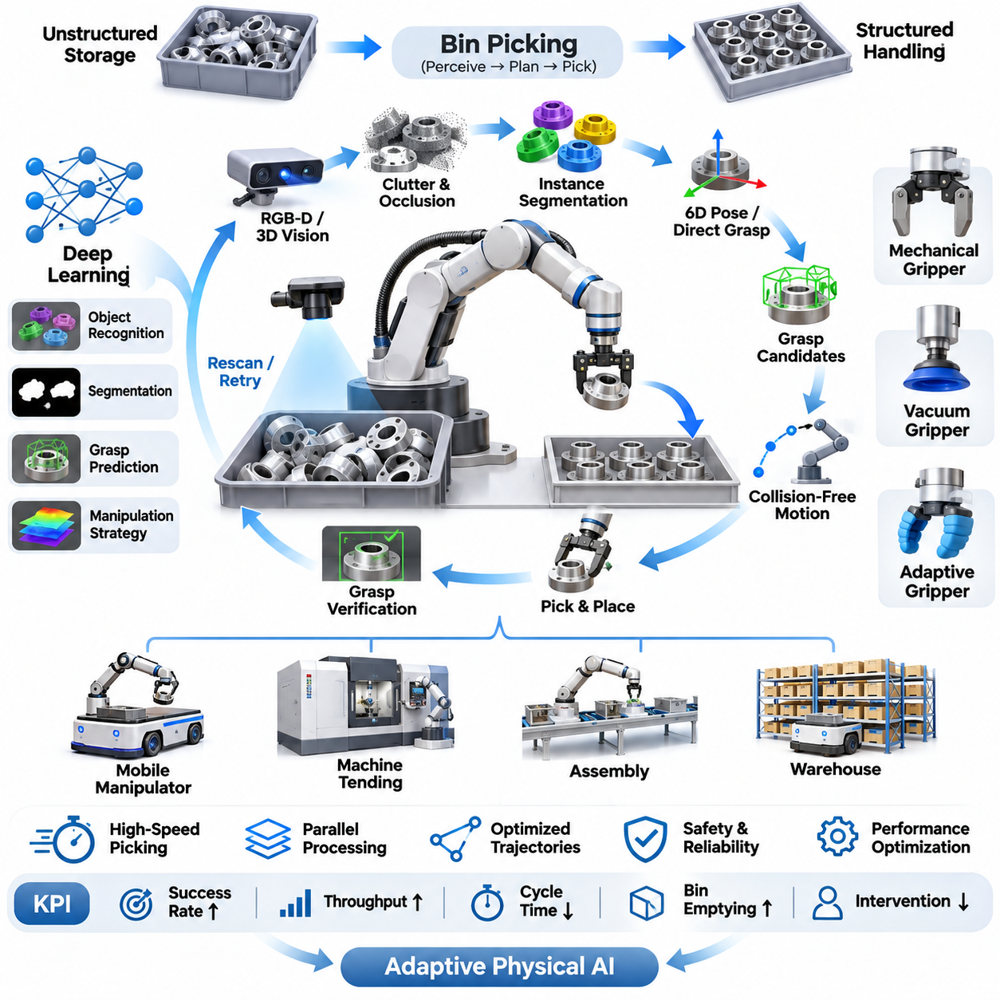
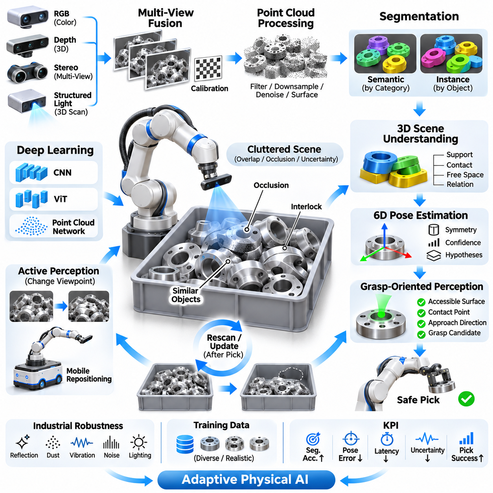
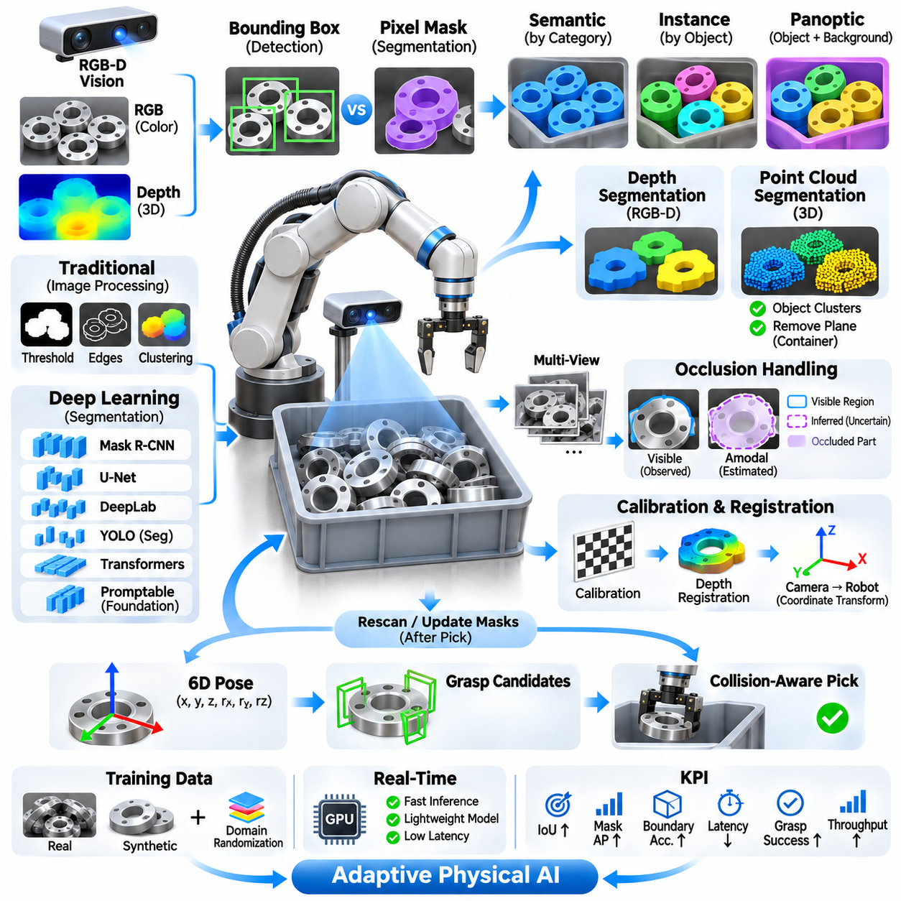
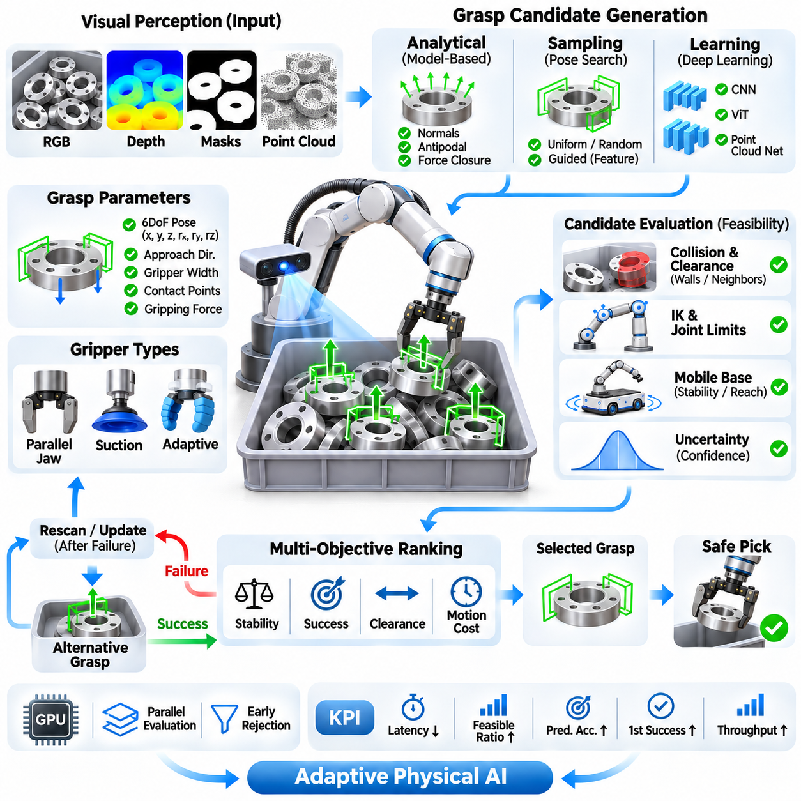
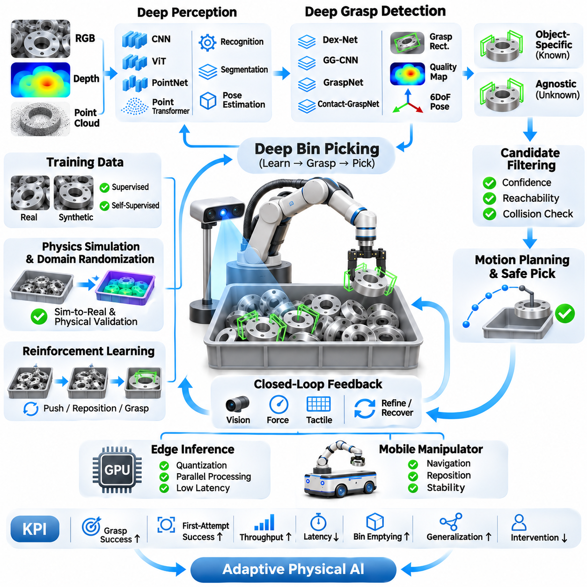
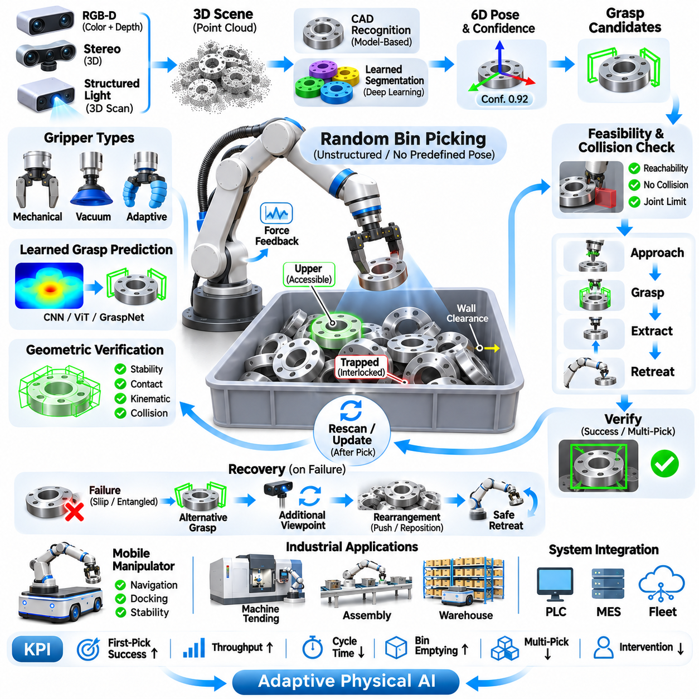
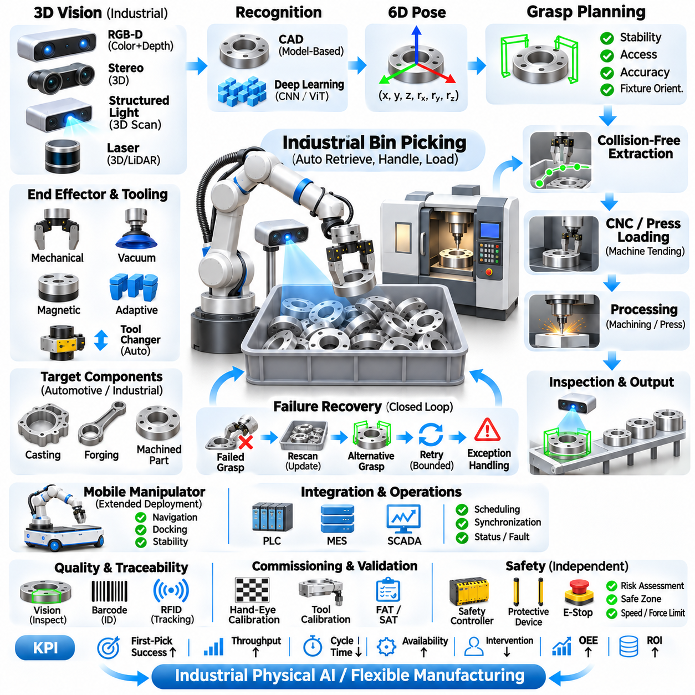
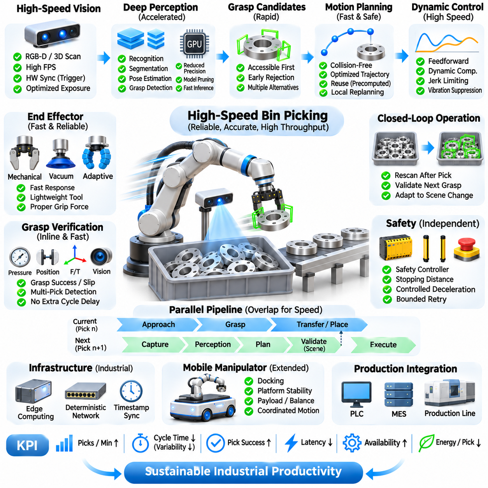
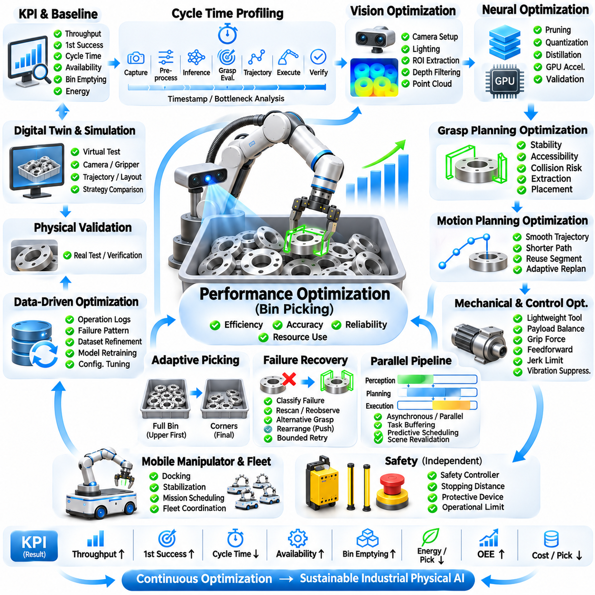

# Chapter 08. Bin Picking

## 01 Bin Picking Overview

{width="7.268055555555556in" height="7.268055555555556in"}

빈 피킹(Bin Picking)은 로봇이 컨테이너(Container), 빈(Bin) 또는 저장 구획(Storage Compartment) 내부에 보관된 물체를 자율적으로 식별하고 파지하여 꺼내는 로봇 조작(Robotic Manipulation) 프로세스이다. 기존의 픽 앤 플레이스(Pick and Place) 작업과 달리 빈 피킹에서는 물체가 무작위 위치와 방향으로 배치된 경우가 많다. 로봇은 복잡한 시각 환경(Visual Environment)을 이해하고, 접근 가능한 물체를 식별하며, 실행 가능한 파지 구성(Grasp Configuration)을 결정하여 신뢰성 있는 조작 동작을 수행해야 한다.

빈 피킹의 근본적인 목적은 비정형 자재 보관(Unstructured Material Storage)을 정형화된 자동 자재 처리(Automated Material Handling) 방식으로 전환하는 것이다. 기존 산업 자동화(Industrial Automation)는 기계식 공급 장치(Mechanical Feeder), 맞춤형 지그(Customized Fixture), 사전에 정의된 물체 배치(Predefined Object Arrangement)를 요구하는 경우가 많다. 빈 피킹은 로봇이 컨테이너에서 무작위로 배치된 물체를 직접 꺼낼 수 있도록 함으로써 이러한 요구사항을 줄이고, 제조 유연성(Manufacturing Flexibility)을 향상시키며, 특수 목적 장비에 대한 의존도를 감소시킨다.

일반적인 빈 피킹 시스템(Bin Picking System)은 로봇 매니퓰레이터(Robotic Manipulator), 말단 장치(End Effector), 비전 시스템(Vision System), 인식 처리 장치(Perception Processing Unit), 모션 계획 프레임워크(Motion Planning Framework)로 구성된다. 이러한 구성 요소들은 협력하여 물체를 식별하고, 파지 후보(Grasp Candidate)를 생성하며, 조작 실행 가능성(Manipulation Feasibility)을 평가하고, 물리적 동작을 수행한다. 시스템 신뢰성(System Reliability)은 상호 연결된 하드웨어와 소프트웨어 구성 요소의 정확도, 통신 및 협조 제어에 의해 결정된다.

시각 인식(Visual Perception)은 지능형 빈 피킹(Intelligent Bin Picking)의 기반을 제공한다. RGB 카메라(RGB Camera), 깊이 카메라(Depth Camera), 스테레오 비전 시스템(Stereo Vision System), 3차원 스캐너(3D Scanner)는 물체와 주변 환경에 대한 정보를 획득한다. 물체가 서로 겹치거나 부분적으로 가려지는 경우가 많기 때문에 깊이 정보(Depth Information)는 특히 중요하다. 3차원 표현(3D Representation)을 활용하면 로봇은 물체의 기하학적 구조(Object Geometry), 표면 접근성(Surface Accessibility), 공간적 관계(Spatial Relationship)를 평가할 수 있다.

혼잡 장면 인식(Cluttered Scene Perception)은 빈 피킹의 주요 기술적 과제 중 하나이다. 물체는 서로 쌓여 있거나 맞물려 있을 수 있으며, 부분적으로 가려지거나 컨테이너 벽면에 인접하여 위치할 수도 있다. 이러한 조건은 물체 인식(Object Recognition)을 복잡하게 만들고 공간 추정(Spatial Estimation)의 불확실성을 증가시킨다. 강건한 인식 알고리즘(Robust Perception Algorithm)은 불완전한 관측 정보, 환경 잡음(Environmental Noise), 반사(Reflection), 조명 변화(Illumination Variation)를 고려하면서 개별 물체를 구분할 수 있어야 한다.

물체 분할(Object Segmentation)은 개별 물체를 주변 자재 및 배경 영역(Background Region)으로부터 분리하는 기술이다. 인스턴스 분할(Instance Segmentation) 알고리즘은 동일한 물체 범주(Object Category)에 속하는 여러 물체가 존재하는 경우에도 각각의 물체를 독립적으로 식별한다. 분할 결과를 깊이 측정(Depth Measurement) 정보와 결합하면 물체 위치 추정(Object Localization), 자세 추정(Pose Estimation), 파지 후보 생성(Grasp Candidate Generation), 충돌 인식 조작 계획(Collision-Aware Manipulation Planning)에 필요한 공간 정보를 확보할 수 있다.

물체 자세 추정(Object Pose Estimation)은 로봇 작업 공간(Robotic Workspace) 내에 존재하는 개별 물체의 위치(Position)와 방향(Orientation)을 결정하는 기술이다. 6차원 자세 추정(6D Pose Estimation)은 후속 작업에서 정밀한 정렬(Precise Alignment) 또는 방향 설정이 요구되는 산업용 부품을 처리할 때 특히 중요하다. 그러나 일부 응용 분야에서는 명시적인 자세 추정(Explicit Pose Estimation)을 수행하지 않고 시각적 관측(Visual Observation) 정보로부터 실행 가능한 파지 구성을 직접 예측하는 방식으로 작동할 수 있다.

파지 후보 생성(Grasp Candidate Generation)은 로봇이 접근 가능한 물체와 물리적으로 상호작용할 수 있는 방법을 결정하는 과정이다. 물체의 기하학적 구조, 표면 특성(Surface Property), 깊이 정보, 그리퍼 특성(Gripper Characteristics)을 기반으로 여러 잠재적 파지 구성이 생성된다. 각각의 후보는 파지 안정성(Grasp Stability), 접근성(Accessibility), 충돌 가능성(Collision Probability), 예상 실행 성공 가능성(Expected Execution Success)에 따라 평가된다. 로봇은 이러한 평가 기준을 종합적으로 고려하여 적절한 파지 후보를 선택한다.

모션 계획(Motion Planning)은 선택된 파지 구성을 실행 가능한 로봇 궤적(Robotic Trajectory)으로 변환하는 과정이다. 모션 계획기(Motion Planner)는 컨테이너 경계(Container Boundary), 인접 물체(Neighboring Object), 로봇 관절 제한(Joint Limit), 특이점(Singularity), 환경 장애물(Environmental Obstacle)을 고려해야 한다. 물체가 컨테이너 내부 깊숙한 곳에 있거나 벽면에 가까이 위치한 경우에는 충돌 회피(Collision Avoidance)가 특히 어렵다. 신뢰성 있는 모션 계획은 장비 손상을 방지하고 작업 일관성(Operational Consistency)을 향상시킨다.

말단 장치 선택(End Effector Selection)은 빈 피킹 성능에 상당한 영향을 미친다. 기계식 그리퍼(Mechanical Gripper)는 다양한 강체 산업용 부품(Rigid Industrial Component)에 적합하며, 진공 그리퍼(Vacuum Gripper)는 흡착 밀봉이 가능한 표면을 가진 물체를 처리하는 데 효과적이다. 적응형 그리퍼(Adaptive Gripper)와 소프트 그리퍼(Soft Gripper)는 불규칙한 형상이나 손상되기 쉬운 물체를 처리할 때 추가적인 유연성을 제공한다. 그리퍼 설계(Gripper Design)는 물체의 기하학적 구조, 재질 특성(Material Characteristics), 무게 및 환경적 제약조건을 고려해야 한다.

딥러닝(Deep Learning)은 현대적인 빈 피킹 시스템의 기능을 크게 확장시켰다. 신경망(Neural Network)은 대규모 데이터셋(Large-Scale Dataset)을 기반으로 물체 인식, 물체 분할, 파지 검출(Grasp Detection), 조작 전략(Manipulation Strategy)을 학습할 수 있다. 순수한 규칙 기반 접근법(Rule-Based Approach)과 달리 학습 기반 시스템(Learning-Based System)은 물체의 외형과 배치에 존재하는 더 큰 변동성(Variability)에 대응할 수 있다. 그러나 이러한 시스템의 신뢰성은 학습 데이터 품질(Training Data Quality)과 일반화 능력(Generalization Capability)에 의해 결정된다.

랜덤 빈 피킹(Random Bin Picking)은 사전에 정의된 배치 없이 물체를 꺼낼 수 있도록 함으로써 기존 자동화의 적용 범위를 확장한다. 로봇은 컨테이너를 지속적으로 관측하고, 접근 가능한 물체를 평가하며, 적절한 조작 동작을 선택한다. 각각의 성공하거나 실패한 파지 동작은 주변 환경을 변화시킬 수 있기 때문에 정확한 장면 표현(Scene Representation)을 유지하기 위해서는 갱신된 시각적 관측(Updated Visual Observation) 정보가 필요하다.

산업용 빈 피킹(Industrial Bin Picking)은 공작기계 로딩 및 언로딩(Machine Tending), 자동차 부품 처리(Automotive Component Handling), 조립 자동화(Assembly Automation), 물류창고 주문 처리(Warehouse Fulfillment), 제조 물류(Manufacturing Logistics) 등 다양한 분야에 적용할 수 있다. 이러한 응용 분야에서는 사이클 타임(Cycle Time), 장비 가용성(Equipment Availability), 유지보수 요구사항(Maintenance Requirements), 처리 정확도(Handling Accuracy)가 생산성(Productivity)에 직접적인 영향을 미치므로 실제 생산 환경에서 일관된 작업 수행이 요구된다. 따라서 기존 제조 시스템(Manufacturing System)과의 통합이 필수적이다.

모바일 매니퓰레이터(Mobile Manipulator)는 빈 피킹 기능을 고정형 로봇 작업장(Stationary Robotic Workstation) 외부로 확장한다. 로봇 팔(Robot Arm)이 장착된 자율 이동 로봇(Autonomous Mobile Robot, AMR)은 여러 자재 보관 위치 사이를 이동하고, 물체를 꺼낸 후 지정된 목적지로 운반할 수 있다. 이러한 아키텍처(Architecture)는 이동체 내비게이션(Mobile Navigation), 위치 결정 정확도(Positioning Accuracy), 매니퓰레이터 제어(Manipulator Control), 시각 인식 및 작업 수준 오케스트레이션(Task-Level Orchestration)의 유기적인 협조를 요구한다.

고속 빈 피킹(High-Speed Bin Picking)은 인식, 파지 선택(Grasp Selection), 모션 계획 및 물리적 실행(Physical Execution)에 필요한 전체 시간을 단축하는 데 중점을 둔다. 병렬 처리(Parallel Processing), 가속 추론(Accelerated Inference), 최적화된 궤적(Optimized Trajectory), 효율적인 그리퍼 작동(Gripper Operation)은 시간당 처리량(Throughput)을 향상시키는 데 기여한다. 그러나 작업 속도의 향상은 파지 신뢰성(Grasp Reliability), 충돌 회피, 기계적 한계(Mechanical Limitation), 작업 안전성(Operational Safety)과 균형을 이루어야 한다.

오류 검출 및 복구(Error Detection and Recovery)는 지속적인 빈 피킹 작업을 수행하기 위한 필수 기능이다. 물체는 미끄러지거나 서로 얽힐 수 있으며, 예상하지 못한 방향으로 이동하거나 선택된 그리퍼로 접근할 수 없는 상태가 될 수도 있다. 시스템은 파지 성공 여부를 검증(Grasp Verification)하고 실패가 발생했을 때 적절한 복구 동작(Recovery Action)을 결정해야 한다. 대체 파지 선택(Alternative Grasp Selection), 장면 재스캔(Scene Rescanning), 제어된 물체 재배치(Controlled Object Rearrangement)는 작업 복원력(Operational Resilience)을 향상시키는 데 기여한다.

성능 평가(Performance Evaluation)는 일반적으로 파지 성공률(Grasp Success Rate), 피킹 처리량(Picking Throughput), 평균 사이클 타임(Average Cycle Time), 빈 비움률(Bin Emptying Rate), 개입 빈도(Intervention Frequency)를 고려한다. 이러한 지표들은 인식 정확도(Perception Accuracy), 조작 효율성(Manipulation Effectiveness), 전체 시스템 신뢰성에 대한 상호 보완적인 정보를 제공한다. 종합적인 성능 평가에는 다양한 물체 배치(Object Arrangement), 컨테이너 형상(Container Geometry), 환경 조건(Environmental Condition), 작업 제약조건(Operational Constraint)이 포함되어야 한다.

궁극적으로 빈 피킹은 컴퓨터 비전(Computer Vision), 인공지능(Artificial Intelligence, AI), 로봇 조작(Robotic Manipulation), 자율적 의사결정(Autonomous Decision-Making)이 결합된 통합 응용 기술이다. 빈 피킹의 발전은 사전에 정의된 산업 자동화에서 비정형 환경(Unstructured Environment)과 상호작용할 수 있는 적응형 물리 인공지능(Adaptive Physical AI) 시스템으로의 전환을 보여준다. 인식, 파지 계획(Grasp Planning), 동작 실행(Motion Execution) 기술의 지속적인 발전은 빈 피킹의 산업적 적용 범위를 더욱 확장할 것이다.

## 02 Cluttered Scene Perception

{width="7.268055555555556in" height="7.268055555555556in"}

혼잡 장면 인식(Cluttered Scene Perception)은 여러 물체가 무작위로 배치되거나 서로 겹쳐 있고, 부분적으로 가려지거나 물리적으로 상호작용하는 복잡한 환경을 해석하는 과정이다. 로봇 빈 피킹(Robotic Bin Picking)에서는 산업용 부품, 포장 물품 및 기타 자재가 사전에 정의된 배치 없이 보관되기 때문에 혼잡한 환경이 빈번하게 발생한다. 로봇은 조작 작업(Manipulation Task)을 수행하기 전에 이러한 비정형 환경(Unstructured Environment)으로부터 신뢰성 있는 공간 정보(Spatial Information)와 의미 정보(Semantic Information)를 추출해야 한다.

정형 환경(Structured Environment)과 달리 혼잡 장면(Cluttered Scene)은 물체 인식(Object Recognition), 위치 추정(Object Localization), 파지 계획(Grasp Planning)에 상당한 불확실성(Uncertainty)을 발생시킨다. 물체는 유사한 외형이나 불규칙한 방향을 가질 수 있으며, 표면의 일부만 관측될 수도 있다. 또한 각각의 조작 동작(Manipulation Action)이 수행된 이후에는 물체 간의 공간적 관계(Spatial Relationship)가 변화할 수 있다. 따라서 인식 시스템(Perception System)은 사전에 정의된 물체 좌표에만 의존하지 않고 환경 표현(Environmental Representation)을 지속적으로 구축하고 갱신해야 한다.

시각 센싱(Visual Sensing)은 혼잡 장면 인식에 필요한 주요 정보 공급원이다. RGB 카메라(RGB Camera)는 외형(Appearance), 색상(Color), 질감(Texture)을 획득하며, 깊이 카메라(Depth Camera)는 기하학적 및 공간적 측정 정보를 제공한다. 스테레오 비전(Stereo Vision)과 구조광 시스템(Structured Light System)은 상세한 3차원 표현(3D Representation)을 생성할 수 있다. 상호 보완적인 센싱 기술(Sensing Technology)을 결합하면 환경 조건으로 인해 개별 센서의 한계가 발생하는 상황에서도 인식 강건성(Perception Robustness)을 향상시킬 수 있다.

포인트 클라우드 처리(Point Cloud Processing)는 혼잡 환경을 표현하는 데 중요한 역할을 수행한다. 포인트 클라우드(Point Cloud)는 깊이 센서(Depth Sensor) 또는 스캐닝 장치(Scanning Device)로부터 획득한 3차원 공간 좌표(3D Spatial Coordinate)를 이용하여 관측 가능한 표면을 표현한다. 필터링(Filtering), 다운샘플링(Downsampling), 잡음 제거(Noise Removal), 표면 추정(Surface Estimation)은 이러한 표현의 품질을 향상시킨다. 처리된 포인트 클라우드는 물체 분리(Object Separation), 기하학적 분석(Geometric Analysis), 충돌 검출(Collision Detection), 접근 가능한 파지 영역(Grasping Region)의 식별을 지원한다.

가려짐(Occlusion)은 혼잡 장면 인식에서 가장 중요한 기술적 과제 중 하나이다. 부분 가려짐(Partial Occlusion)은 인접 물체가 대상 물체의 일부를 가릴 때 발생하며, 완전 가려짐(Complete Occlusion)은 직접적인 시각 관측(Visual Observation)을 불가능하게 만든다. 인식 알고리즘(Perception Algorithm)은 누락된 정보를 고려하고 획득 가능한 관측 정보의 신뢰성을 추정해야 한다. 불확실성이 높은 상황에서는 추가적인 관측 시점(Viewpoint)이나 제어된 조작 동작(Controlled Manipulation Action)을 통해 이전에 가려져 있던 물체 표면을 관측할 수 있다.

물체 분할(Object Segmentation)은 로봇 시스템이 물체가 밀집된 환경에서 개별 물체를 구분할 수 있도록 하는 기술이다. 의미론적 분할(Semantic Segmentation)은 특정 물체 범주(Object Category)에 속하는 영역을 식별하며, 인스턴스 분할(Instance Segmentation)은 동일한 범주에 속하는 개별 물체를 분리한다. 분할 결과를 깊이 정보(Depth Information)와 결합하면 더욱 정확한 공간 위치 추정(Spatial Localization)이 가능하며, 여러 물체가 유사한 시각적 외형이나 중첩된 경계(Overlapping Boundary)를 가질 때 발생하는 모호성(Ambiguity)을 감소시킬 수 있다.

3차원 장면 이해(3D Scene Understanding)는 물체, 컨테이너(Container), 환경 장애물(Environmental Obstacle) 사이의 공간적 관계를 분석함으로써 개별 물체 인식의 범위를 확장한다. 시스템은 상대 위치(Relative Position), 표면 방향(Surface Orientation), 지지 구조(Supporting Structure), 잠재적 접촉 영역(Potential Contact Region)을 추정한다. 이러한 관계는 인접 자재의 배치를 교란하거나 의도하지 않은 충돌(Unintended Collision)을 발생시키지 않으면서 대상 물체를 안전하게 꺼낼 수 있는지를 판단하는 데 필수적인 정보를 제공한다.

물체 자세 추정(Object Pose Estimation)은 혼잡 장면 내부에 존재하는 물체의 위치(Position)와 방향(Orientation)을 결정하는 기술이다. 6차원 자세 추정(6D Pose Estimation)은 세 개의 병진 성분(Translational Component)과 세 개의 회전 성분(Rotational Component)을 결합하여 물체의 공간적 구성(Object Configuration)을 표현한다. 그러나 불완전한 관측 정보와 기하학적 대칭성(Geometric Symmetry)은 여러 개의 타당한 자세 추정 결과를 발생시킬 수 있다. 강건한 시스템(Robust System)은 인식 결과를 조작 계획 모듈(Manipulation Planning Module)에 전달하기 전에 추정 신뢰도(Estimation Confidence)를 평가하고 대안 가설(Alternative Hypothesis)을 고려한다.

딥러닝(Deep Learning)은 혼잡 환경에서의 인식 능력(Perception Capability)을 크게 향상시켰다. 합성곱 신경망(Convolutional Neural Network, CNN), 비전 트랜스포머(Vision Transformer, ViT), 포인트 클라우드 신경망(Point Cloud Neural Network)은 학습 데이터셋(Training Dataset)으로부터 복잡한 공간적 관계와 시각적 관계를 학습할 수 있다. 이러한 모델은 물체 검출(Object Detection), 인스턴스 분할, 자세 추정(Pose Estimation), 파지 예측(Grasp Prediction)을 지원한다. 실제 환경에서의 효과는 대표성 있는 학습 데이터(Representative Training Data), 센서 품질(Sensor Quality), 익숙하지 않은 환경에 대한 일반화 능력(Generalization Capability)에 의해 결정된다.

다중 시점 인식(Multi-View Perception)은 서로 다른 카메라 위치와 방향에서 관측 정보를 획득함으로써 환경 이해(Environmental Understanding)를 향상시킨다. 고정형 다중 카메라 구성(Fixed Multi-Camera Configuration)은 상호 보완적인 관측 시점을 제공하며, 로봇 장착형 카메라(Robot-Mounted Camera)는 유연한 관측 전략(Observation Strategy)을 가능하게 한다. 여러 관측 시점을 결합하면 가려짐을 감소시키고, 표면 재구성(Surface Reconstruction) 품질과 공간 추정 정확도(Spatial Estimation Accuracy)를 향상시킬 수 있다. 신뢰성 있는 정보 융합(Information Fusion)을 위해서는 정확한 카메라 보정(Camera Calibration)과 좌표 변환(Coordinate Transformation)이 필수적이다.

능동 인식(Active Perception)은 로봇이 추가적인 정보를 획득하기 위해 관측 위치를 의도적으로 변경할 수 있도록 하는 기술이다. 로봇은 획득 가능한 센서 측정값을 수동적으로 처리하는 대신 환경 불확실성(Environmental Uncertainty)과 작업 요구사항(Task Requirements)에 따라 관측 시점을 선택한다. 모바일 매니퓰레이터(Mobile Manipulator)는 가려진 영역을 관측하기 위해 이동 플랫폼(Mobile Platform)의 위치를 변경하거나 로봇 팔(Robotic Arm)의 자세를 조정할 수 있다. 이러한 기능은 초기 관측 정보가 신뢰성 있는 조작을 수행하기에 충분하지 않은 상황에서 의사결정(Decision-Making) 능력을 향상시킨다.

파지 지향 인식(Grasp-Oriented Perception)은 조작 실행 가능성(Manipulation Feasibility)에 직접적인 영향을 미치는 환경 특성(Environmental Feature)을 식별하는 데 중점을 둔다. 시스템은 모든 물체를 완전하게 재구성하는 대신 접근 가능한 표면(Accessible Surface), 잠재적 접촉점(Potential Contact Point), 접근 방향(Approach Direction), 주변 자유 공간(Free Space)을 평가한다. 이러한 작업 지향 전략(Task-Oriented Strategy)은 불필요한 연산 처리(Computational Processing)를 감소시키고, 로봇이 허용 가능한 위험 수준에서 효율적으로 꺼낼 수 있는 물체를 우선적으로 선택할 수 있도록 한다.

실시간 인식(Real-Time Perception)은 각각의 로봇 상호작용(Robotic Interaction) 이후 혼잡 환경이 변화할 수 있기 때문에 필수적이다. 물체를 꺼내면 물체 간의 지지 관계(Supporting Relationship)가 변화할 수 있으며, 실패한 파지 동작은 인접 자재의 위치를 변경할 수 있다. 폐루프 인식(Closed-Loop Perception)은 최신 센서 관측 정보(Sensor Observation)를 이용하여 환경 모델(Environmental Model)을 지속적으로 갱신한다. 효율적인 추론(Efficient Inference), 하드웨어 가속(Hardware Acceleration), 동기화된 데이터 획득(Synchronized Data Acquisition)은 인식 결과와 실제 물리적 환경 상태 사이의 일관성(Consistency)을 유지하는 데 기여한다.

산업 현장 배치(Industrial Deployment)를 위해서는 혼잡 장면 인식 시스템이 다양한 조명 조건(Illumination Condition), 반사 표면(Reflective Surface), 먼지(Dust), 진동(Vibration), 센서 잡음(Sensor Noise)이 존재하는 환경에서도 신뢰성 있게 작동해야 한다. 학습 데이터셋은 실제 환경을 반영하는 물체 배치(Object Arrangement), 가려짐 수준(Occlusion Level), 재질 특성(Material Property), 환경 변화(Environmental Variation)를 포함해야 한다. 성능 평가(Performance Evaluation)는 분할 정확도(Segmentation Accuracy), 자세 추정 오차(Pose Estimation Error), 인식 지연 시간(Perception Latency), 불확실성 추정(Uncertainty Estimation) 및 이러한 요소들이 성공적인 로봇 조작에 미치는 종합적인 영향을 고려해야 한다.

궁극적으로 혼잡 장면 인식은 시각 지능(Visual Intelligence)과 자율 로봇 조작(Autonomous Robotic Manipulation)을 연결하는 핵심 기술이다. 3차원 센싱(3D Sensing), 물체 분할, 공간 추론(Spatial Reasoning), 능동 인식, 지속적인 환경 갱신(Continuous Environmental Update)을 통합함으로써 로봇은 비정형 환경에서도 효과적으로 작동할 수 있다. 이러한 기능들은 지능형 빈 피킹(Intelligent Bin Picking), 적응형 모바일 조작(Adaptive Mobile Manipulation), 고도화된 물리 인공지능(Advanced Physical AI) 시스템을 구현하기 위한 필수적인 기술적 기반을 형성한다.

## 03 Object Segmentation

{width="7.268055555555556in" height="7.268055555555556in"}

물체 분할(Object Segmentation)은 복잡한 시각 환경(Visual Environment)에서 개별 물체 또는 의미 있는 영역을 분리하는 컴퓨터 비전(Computer Vision) 기술이다. 로봇 빈 피킹(Robotic Bin Picking)에서 물체 분할은 로봇이 대상 물체(Target Object)를 인접 자재, 컨테이너 표면(Container Surface), 배경 영역(Background Region)으로부터 구분할 수 있도록 한다. 정확한 물체 분할은 물체 위치 추정(Object Localization), 자세 추정(Pose Estimation), 파지 후보 생성(Grasp Candidate Generation), 충돌 인식 조작(Collision-Aware Manipulation)을 위한 공간적 기반을 제공한다.

일반적으로 직사각형 경계 상자(Rectangular Bounding Box)를 이용하여 물체를 표현하는 기존의 물체 검출(Object Detection)과 달리, 물체 분할은 픽셀 수준(Pixel Level)에서 물체 영역(Object Region)을 식별한다. 혼잡 환경(Cluttered Environment)에서 경계 상자는 인접 물체와 불필요한 배경 정보를 포함하는 경우가 많다. 픽셀 수준 분할(Pixel-Level Segmentation)은 더욱 정밀한 물체 경계(Object Boundary)를 제공함으로써 로봇 시스템이 접근 가능한 표면(Accessible Surface)을 식별하고 잠재적인 물리적 상호작용(Physical Interaction)을 더욱 정확하게 평가할 수 있도록 한다.

의미론적 분할(Semantic Segmentation)은 이미지 내부의 각 픽셀에 사전에 정의된 범주 레이블(Category Label)을 할당하는 기술이다. 이러한 접근법은 로봇이 산업용 부품(Industrial Component), 포장 자재(Packaging Material), 컨테이너 벽면(Container Wall), 배경 영역을 구분할 수 있도록 한다. 그러나 의미론적 분할은 동일한 범주에 속하는 개별 물체를 본질적으로 구분하지 못한다. 따라서 동일한 부품들이 컨테이너 내부에 무작위로 배치되어 있는 경우에는 추가적인 인스턴스 수준 처리(Instance-Level Processing)가 필요하다.

인스턴스 분할(Instance Segmentation)은 각각의 개별 물체를 독립적으로 식별함으로써 의미론적 분류(Semantic Classification)의 기능을 확장한다. 여러 물체가 동일한 범주에 속하는 경우에도 검출된 각각의 물체에는 독립적인 분할 마스크(Segmentation Mask)가 할당된다. 산업용 부품들이 서로 겹쳐 있거나 유사한 방향으로 배치되는 경우가 많기 때문에 이러한 기능은 빈 피킹에서 특히 중요하다. 개별 마스크(Individual Mask)를 활용하면 로봇은 각각의 물체에 대한 접근성(Accessibility)과 조작 실행 가능성(Manipulation Feasibility)을 평가할 수 있다.

파놉틱 분할(Panoptic Segmentation)은 의미론적 분할과 인스턴스 분할을 하나의 통합 환경 표현(Unified Environmental Representation)으로 결합하는 기술이다. 개별적으로 셀 수 있는 물체를 구분하는 동시에 배경 표면(Background Surface)과 기타 환경 영역(Environmental Region)을 분류한다. 빈 피킹 시스템(Bin Picking System)에서 이러한 종합적인 환경 표현은 전체 조작 계획 프로세스(Manipulation Planning Process)에 걸쳐 대상 물체 식별(Target Identification), 컨테이너 경계 인식(Container Boundary Recognition), 장애물 검출(Obstacle Detection), 공간 추론(Spatial Reasoning)을 지원한다.

전통적인 분할 기술(Traditional Segmentation Technique)은 임계값 처리(Thresholding), 경계선 검출(Edge Detection), 영역 확장(Region Growing), 워터셰드 변환(Watershed Transformation), 기하학적 군집화(Geometric Clustering)와 같은 영상 처리(Image Processing) 기법에 의존한다. 이러한 접근법은 물체 특성과 환경 조건을 예측할 수 있는 상황에서 효과적으로 작동할 수 있다. 그러나 물체가 복잡한 형상(Complex Shape), 중첩된 경계(Overlapping Boundary), 불균일한 조명(Inconsistent Illumination), 반사성 재질 특성(Reflective Material Property)을 나타내는 경우에는 성능이 저하되는 경우가 많다.

딥러닝 기반 분할(Deep Learning-Based Segmentation)은 학습 데이터셋(Training Dataset)으로부터 시각적 특징(Visual Feature)을 직접 학습함으로써 적응성(Adaptability)을 향상시킨다. Mask R-CNN, U-Net, DeepLab 및 분할 기능이 적용된 YOLO 모델(Segmentation-Enabled YOLO Model)과 같은 아키텍처는 다양한 분할 요구사항(Segmentation Requirements)을 지원한다. 트랜스포머 기반 아키텍처(Transformer-Based Architecture)는 문맥적 장면 이해(Contextual Scene Understanding)를 더욱 향상시키며, 분할 기반 모델(Foundation Segmentation Model)은 물체 범주를 반드시 식별하지 않더라도 시각적 프롬프트(Visual Prompt)를 이용하여 유연하게 마스크를 생성할 수 있도록 한다.

깊이 기반 분할(Depth-Based Segmentation)은 물체 분리(Object Separation) 과정에 3차원 기하학적 정보(3D Geometric Information)를 통합하는 기술이다. 깊이 불연속성(Depth Discontinuity), 표면 방향(Surface Orientation), 공간적 거리(Spatial Distance)는 유사한 색상이나 질감(Texture)을 가진 물체를 구분하는 데 도움을 준다. RGB 이미지와 깊이 측정(Depth Measurement) 정보를 결합하면 RGB-D 분할(RGB-D Segmentation)을 구현할 수 있으며, 이를 통해 물체 경계 추정(Object Boundary Estimation)의 정확도를 향상시키고 후속 로봇 조작 작업(Robotic Manipulation Task)에 필요한 기하학적 정보를 제공할 수 있다.

포인트 클라우드 분할(Point Cloud Segmentation)은 깊이 카메라(Depth Camera) 또는 스캐닝 장치(Scanning Device)로부터 획득한 3차원 공간 표현(3D Spatial Representation)을 직접 처리하는 기술이다. 유클리드 군집화(Euclidean Clustering), 평면 분할(Plane Segmentation), 영역 확장(Region Growing), 신경망 기반 기법(Neural Network-Based Method)은 의미 있는 물체 영역을 식별할 수 있다. 컨테이너 표면과 배경 구조물(Background Structure)을 제거하면 장면 표현(Scene Representation)을 단순화할 수 있으며, 개별 물체 군집(Object Cluster)은 기하학적 파지 계획(Geometric Grasp Planning)에 유용한 정보를 제공한다.

가려짐 처리(Occlusion Handling)는 기존 분할 기술이 일반적으로 관측 가능한 물체 영역(Visible Object Region)만을 표현하기 때문에 여전히 주요 기술적 과제로 남아 있다. 비가시 영역 포함 분할(Amodal Segmentation)은 부분적으로 가려진 물체의 전체 영역을 추정하지만, 추론된 경계(Inferred Boundary)에는 상당한 불확실성(Uncertainty)이 존재할 수 있다. 다중 시점 관측(Multi-View Observation), 기하학적 사전 지식(Geometric Prior), 신뢰도 추정(Confidence Estimation)은 로봇 시스템이 불완전한 정보를 처리하고 예측된 비가시 표면(Predicted Hidden Surface)을 확인된 물리적 기하 구조로 간주하지 않도록 지원한다.

분할 결과(Segmentation Result)는 물리적 조작(Physical Manipulation)에 활용되기 전에 로봇 좌표계(Robotic Coordinate System)로 변환되어야 한다. 카메라 보정(Camera Calibration), 깊이 정합(Depth Registration), 좌표 변환(Coordinate Transformation)은 이미지 픽셀(Image Pixel), 3차원 물체 표면(3D Object Surface), 로봇 기준 좌표계(Robot Base Frame) 사이의 관계를 설정한다. 분할 오차(Segmentation Error) 또는 보정 오차(Calibration Error)는 잘못된 파지 위치(Grasp Position), 의도하지 않은 접촉(Unintended Contact), 조작 실패(Manipulation Failure)를 발생시킬 수 있으므로 정확한 좌표 변환이 필수적이다.

실시간 분할(Real-Time Segmentation)은 조작 동작 이후 물체 배치가 빈번하게 변화하는 동적 빈 피킹 환경(Dynamic Bin Picking Environment)에서 특히 중요하다. 경량 신경망(Lightweight Neural Network), GPU 가속(GPU Acceleration), 최적화된 추론 엔진(Optimized Inference Engine), 효율적인 이미지 전처리(Efficient Image Preprocessing)는 연산 지연 시간(Computational Latency)을 감소시키는 데 기여한다. 폐루프 인식(Closed-Loop Perception)은 로봇이 각각의 피킹 시도 이후 분할 마스크를 갱신하고 내부 장면 표현(Internal Scene Representation)과 실제 물리적 환경 사이의 일관성(Consistency)을 유지할 수 있도록 한다.

학습 데이터셋 품질(Training Dataset Quality)은 분할 정확도(Segmentation Accuracy)와 일반화 능력(Generalization Capability)에 상당한 영향을 미친다. 산업용 데이터셋(Industrial Dataset)은 다양한 물체 형상(Object Geometry), 재질 특성(Material Characteristics), 컨테이너 구성(Container Configuration), 조명 조건(Illumination Condition), 가려짐 수준(Occlusion Level)을 반영해야 한다. 합성 데이터 생성(Synthetic Data Generation), 도메인 무작위화(Domain Randomization), 자동 데이터 주석(Automated Annotation)은 실제 환경 데이터셋(Real-World Dataset)을 보완할 수 있으며, 실제 배치 성능(Deployment Performance)을 검증하기 위해서는 대표성 있는 물리적 환경의 관측 데이터가 여전히 필수적이다.

성능 평가(Performance Evaluation)는 일반적으로 교집합 대 합집합 비율(Intersection over Union, IoU), 평균 교집합 대 합집합 비율(mean Intersection over Union, mIoU), 마스크 평균 정밀도(Mask Average Precision, Mask AP), 경계 정확도(Boundary Accuracy), 추론 지연 시간(Inference Latency)을 활용한다. 그러나 분할 품질(Segmentation Quality)은 파지 성공률(Grasp Success Rate), 피킹 처리량(Picking Throughput), 실패 빈도(Failure Frequency)를 포함하는 조작 지향 성능 지표(Manipulation-Oriented Metric)를 통해서도 평가되어야 한다. 중요한 파지 표면(Grasping Surface)이 잘못 분할된 경우에는 높은 픽셀 수준 정확도(Pixel-Level Accuracy)가 반드시 성공적인 조작을 보장하지는 않는다.

궁극적으로 물체 분할은 시각 인식(Visual Perception)과 물리적 로봇 상호작용(Physical Robotic Interaction)을 연결하는 핵심적인 기술이다. 의미 정보(Semantic Information), 인스턴스 수준 식별(Instance-Level Identification), 3차원 기하학적 구조(3D Geometry), 지속적인 환경 갱신(Continuous Environmental Update)을 통합함으로써 로봇 시스템은 복잡한 환경 내부의 개별 물체를 구분할 수 있다. 이러한 기능은 지능형 빈 피킹(Intelligent Bin Picking), 자율 모바일 조작(Autonomous Mobile Manipulation), 적응형 물리 인공지능(Adaptive Physical AI) 시스템의 개발을 지원한다.

## 04 Grasp Candidate Generation

{width="7.268055555555556in" height="7.268055555555556in"}

파지 후보 생성(Grasp Candidate Generation)은 로봇 그리퍼(Robotic Gripper)가 환경 내에 존재하는 물체를 성공적으로 파지하고 꺼낼 수 있는 잠재적인 구성을 식별하는 과정이다. 로봇 빈 피킹(Robotic Bin Picking)에서는 물체가 무작위 위치와 방향으로 분포하거나 서로 중첩되어 배치되는 경우가 많다. 시스템은 물체의 기하학적 구조(Object Geometry), 표면 접근성(Surface Accessibility), 그리퍼 특성(Gripper Characteristics), 주변 환경 제약조건(Environmental Constraint)을 고려하여 여러 개의 파지 후보(Grasp Candidate)를 생성해야 한다.

일반적으로 파지 후보는 말단 장치(End Effector)의 공간적 위치(Spatial Position)와 방향(Orientation)을 비롯하여 그리퍼 개방 폭(Gripper Opening Width), 접근 방향(Approach Direction), 접촉 위치(Contact Location)와 같은 매개변수(Parameter)를 포함한다. 그리퍼 구성(Gripper Configuration)에 따라 흡착 접촉 면적(Suction Contact Area), 손가락 구성(Finger Configuration), 요구 파지력(Required Gripping Force)과 같은 추가적인 매개변수가 포함될 수 있다. 이러한 매개변수들은 로봇 시스템이 대상 물체(Target Object)와 물리적 접촉(Physical Contact)을 형성하는 방법을 종합적으로 정의한다.

시각 인식(Visual Perception)은 파지 후보 생성을 위한 주요 입력 정보를 제공한다. RGB 이미지(RGB Image), 깊이 맵(Depth Map), 분할 마스크(Segmentation Mask), 3차원 포인트 클라우드(3D Point Cloud)는 컨테이너(Container) 내부에 존재하는 물체의 외형과 공간적 구성(Spatial Configuration)을 표현한다. 이러한 표현을 결합함으로써 시스템은 인접 물체(Neighboring Object)와 컨테이너 경계(Container Boundary)를 고려하면서 접근 가능한 표면(Accessible Surface)을 식별하고, 국부 기하학적 구조(Local Geometry)를 추정하며, 잠재적인 접촉 영역(Potential Contact Region)을 결정할 수 있다.

해석적 파지 후보 생성(Analytical Grasp Candidate Generation)은 수학적 모델(Mathematical Model), 기하학적 관계(Geometric Relationship), 물리적 원리(Physical Principle)에 기반한다. 표면 법선(Surface Normal), 물체 모서리(Object Edge), 곡률(Curvature), 추정된 접촉점(Estimated Contact Point)을 분석하여 실행 가능한 파지 구성(Feasible Grasp Configuration)을 식별한다. 파지 안정성(Grasp Stability)은 마찰 제약조건(Friction Constraint), 대향 접촉 조건(Antipodal Contact Condition), 힘 폐쇄 원리(Force Closure Principle)를 이용하여 평가할 수 있다. 이러한 방법은 신뢰성 있는 기하학적 정보를 확보할 수 있는 경우에 특히 유용하다.

샘플링 기반 접근법(Sampling-Based Approach)은 로봇 작업 공간(Robotic Workspace) 내에서 다양한 위치, 방향 및 접근 방향을 탐색함으로써 여러 개의 파지 후보를 생성한다. 파지 후보는 균일하게 또는 무작위로 샘플링하거나, 인식 과정에서 식별된 기하학적 특징(Geometric Feature)에 따라 샘플링할 수 있다. 생성된 각각의 구성은 부적합한 파지 후보를 제거하기 위한 실행 가능성 평가(Feasibility Evaluation)를 거친다. 유도 샘플링(Guided Sampling)은 성공 가능성이 높은 접촉 영역에 집중함으로써 연산 효율성(Computational Efficiency)을 향상시킨다.

학습 기반 파지 후보 생성(Learning-Based Grasp Candidate Generation)은 신경망(Neural Network)을 활용하여 시각적 또는 기하학적 관측 정보로부터 적절한 파지 구성을 직접 예측한다. 합성곱 신경망(Convolutional Neural Network, CNN), 비전 트랜스포머(Vision Transformer, ViT), 포인트 클라우드 기반 아키텍처(Point Cloud-Based Architecture)는 물체 특성(Object Characteristics)과 파지 성공(Grasp Success) 사이의 관계를 학습할 수 있다. 이러한 접근법은 완전한 기하학적 모델(Geometric Model) 없이도 익숙하지 않은 물체에 대응할 수 있지만, 신뢰성은 학습 데이터의 포괄 범위(Training Data Coverage)에 의해 결정된다.

포인트 클라우드 기반 파지 생성(Point Cloud-Based Grasp Generation)은 3차원 기하학적 구조(3D Geometry)를 의사결정 프로세스(Decision-Making Process)에 직접 통합하기 때문에 혼잡한 빈 피킹 환경(Cluttered Bin Picking Environment)에서 특히 유용하다. 국부 표면 패치(Local Surface Patch), 법선 벡터(Normal Vector), 공간적 인접 영역(Spatial Neighborhood)은 잠재적인 접촉 구성(Contact Configuration)에 대한 정보를 제공한다. 신경망은 물체 형상(Object Shape), 그리퍼 기하학적 구조(Gripper Geometry), 주변 자유 공간(Free Space)을 고려하면서 6자유도 파지 자세(6-DoF Grasp Pose)를 예측할 수 있다.

파지 후보 생성은 선택된 말단 장치의 물리적 특성(Physical Characteristics)을 고려해야 한다. 평행 조 그리퍼(Parallel-Jaw Gripper)는 접근 가능한 대향 접촉 표면(Opposing Contact Surface)과 손가락 삽입(Finger Insertion)을 위한 충분한 여유 공간(Clearance)을 필요로 한다. 진공 그리퍼(Vacuum Gripper)는 적절한 표면 형상(Surface Geometry)과 밀봉 조건(Sealing Condition)을 요구하며, 적응형 그리퍼(Adaptive Gripper)는 더욱 복잡한 형상의 물체에 대응할 수 있다. 따라서 파지 후보 생성에는 그리퍼별 기하학적 및 기계적 제약조건(Gripper-Specific Geometric and Mechanical Constraint)이 반영되어야 한다.

충돌 인식 파지 후보 생성(Collision-Aware Grasp Candidate Generation)은 제안된 파지 구성이 의도하지 않은 접촉(Unintended Contact) 없이 접근 및 실행될 수 있는지를 평가한다. 시스템은 인접 물체, 컨테이너 벽면(Container Wall), 그리퍼 본체(Gripper Body), 로봇 매니퓰레이터(Robotic Manipulator)를 고려한다. 접촉 관점에서 안정적으로 보이는 파지 후보라도 물리적으로 접근할 수 없는 경우가 있다. 충돌 검사(Collision Checking)와 접근 여유 공간 평가(Approach Clearance Evaluation)를 통합하면 실행 실패 및 장비 손상(Equipment Damage)을 줄일 수 있다.

기구학적 실행 가능성(Kinematic Feasibility)은 로봇 매니퓰레이터가 생성된 파지 구성에 물리적으로 도달할 수 있는지를 결정한다. 파지 후보 평가(Candidate Evaluation) 과정에서는 역기구학(Inverse Kinematics, IK), 관절 제한(Joint Limit), 특이점 회피(Singularity Avoidance), 작업 공간 경계(Workspace Boundary)를 고려해야 한다. 모바일 매니퓰레이터(Mobile Manipulator)의 경우 이동체 위치 결정(Base Positioning)과 플랫폼 안정성(Platform Stability)이 추가적인 제약조건으로 작용한다. 이동 플랫폼 배치(Mobile Base Placement)와 파지 접근성(Grasp Accessibility)을 연계하면 유효 조작 작업 공간(Effective Manipulation Workspace)을 크게 확장할 수 있다.

파지 품질 평가(Grasp Quality Evaluation)는 생성된 파지 후보의 예상 실행 성능(Expected Execution Performance)에 따라 점수를 부여하는 과정이다. 관련 평가 기준에는 접촉 안정성(Contact Stability), 예측 파지 성공 가능성(Predicted Grasp Success), 충돌 위험(Collision Risk), 접근 여유 공간(Approach Clearance), 동작 실행 비용(Motion Execution Cost)이 포함된다. 이론적으로 가장 높은 파지 안정성을 갖는 후보가 반드시 최적의 작업 결과(Operational Outcome)를 제공하는 것은 아니다. 다목적 점수화(Multi-Objective Scoring)는 시스템이 물리적 신뢰성(Physical Reliability), 접근성 및 피킹 효율성(Picking Efficiency) 사이의 균형을 유지할 수 있도록 한다.

불확실성 인식 파지 생성(Uncertainty-Aware Grasp Generation)은 센서 측정(Sensor Measurement), 분할 정확도(Segmentation Accuracy), 불완전한 기하학적 관측(Incomplete Geometric Observation)과 관련된 한계점을 고려한다. 반사 표면(Reflective Surface), 깊이 잡음(Depth Noise), 부분 가려짐(Partial Occlusion)은 잘못된 파지 구성을 생성할 수 있다. 신뢰도 추정(Confidence Estimation)과 불확실성 기반 필터링(Uncertainty-Based Filtering)은 신뢰성이 낮은 후보를 제거하는 데 도움을 주며, 추가적인 관측(Additional Observation)은 로봇이 물리적 실행(Physical Execution)을 시작하기 전에 파지 후보의 품질을 향상시킬 수 있다.

실시간 파지 후보 생성(Real-Time Grasp Candidate Generation)은 인식(Perception), 추론(Inference), 실행 가능성 평가(Feasibility Evaluation), 모션 계획(Motion Planning) 사이의 효율적인 협조를 요구한다. GPU 가속(GPU Acceleration), 선택적 샘플링(Selective Sampling), 병렬 후보 평가(Parallel Candidate Evaluation), 유효하지 않은 구성의 조기 제거(Early Rejection of Invalid Configuration)는 연산 지연 시간(Computational Latency)을 감소시킨다. 또한 여러 개의 실행 가능한 대안(Feasible Alternative)을 유지하면 우선적으로 선택된 파지 후보를 사용할 수 없거나 실행 중 실패할 경우 신속한 복구(Rapid Recovery)가 가능하다.

폐루프 파지 생성(Closed-Loop Grasp Generation)은 물리적 환경(Physical Environment)의 변화에 따라 파지 후보 구성을 지속적으로 조정한다. 각각의 성공하거나 실패한 피킹 시도(Picking Attempt)는 물체 위치(Object Position), 표면 접근성, 물체 간 지지 관계(Supporting Relationship)를 변화시킬 수 있다. 갱신된 센서 관측 정보(Updated Sensor Observation)를 활용하면 시스템은 더 이상 유효하지 않은 기존 파지 후보를 무효화하고 새로운 대안을 생성할 수 있다. 이러한 피드백 메커니즘(Feedback Mechanism)은 적응성(Adaptability)을 향상시키고 반복적인 조작 실패(Manipulation Failure)를 감소시킨다.

성능 평가(Performance Evaluation)는 파지 후보 생성 지연 시간(Candidate Generation Latency), 실행 가능한 후보 비율(Feasible Candidate Ratio), 파지 예측 정확도(Grasp Prediction Accuracy), 최초 시도 성공률(First-Attempt Success Rate), 전체 피킹 처리량(Overall Picking Throughput)을 고려해야 한다. 시험(Test)은 물체의 기하학적 구조, 재질 특성(Material Property), 컨테이너 구성(Container Configuration), 혼잡 밀도(Clutter Density)의 현실적인 변화를 반영해야 한다. 궁극적으로 신뢰성 있는 파지 후보 생성은 시각 인식과 물리적 동작(Physical Action)을 연결하며, 적응형 로봇 빈 피킹(Adaptive Robotic Bin Picking)과 지능형 물리 인공지능(Intelligent Physical AI) 시스템을 구현하기 위한 기술적 기반을 형성한다.

## 05 Deep Bin Picking

{width="7.268055555555556in" height="7.268055555555556in"}

딥 빈 피킹(Deep Bin Picking)은 혼잡하고 비정형적인 컨테이너 내부에서 물체를 자율적으로 꺼내는 로봇 시스템에 딥러닝(Deep Learning) 기술을 적용하는 것을 의미한다. 사전에 정의된 기하학적 모델(Geometric Model)과 수동으로 설계된 규칙에 크게 의존하는 기존 빈 피킹(Bin Picking) 시스템과 달리, 딥 빈 피킹은 데이터로부터 시각적 특징(Visual Feature), 공간적 관계(Spatial Relationship), 파지 전략(Grasping Strategy)을 학습한다. 이러한 접근법은 다양한 물체와 예측하기 어려운 환경 조건에 대한 적응성(Adaptability)을 향상시킨다.

딥 빈 피킹의 기본 아키텍처(Fundamental Architecture)는 시각 인식(Visual Perception), 신경망 추론(Neural Network Inference), 파지 후보 생성(Grasp Candidate Generation), 모션 계획(Motion Planning), 로봇 동작 실행(Robotic Execution)을 통합한다. 센서 관측 정보(Sensor Observation)는 학습된 신경망(Trained Neural Network)에 의해 처리되어 물체 또는 적절한 파지 영역(Grasping Region)을 식별한다. 이후 예측된 파지 구성(Predicted Grasp Configuration)은 물리적 및 기구학적 제약조건(Physical and Kinematic Constraint)에 따라 평가되며, 로봇 매니퓰레이터(Robotic Manipulator)는 선택된 동작을 수행한다.

딥러닝 기반 시각 인식(Deep Visual Perception)은 로봇 시스템이 서로 겹쳐 있거나 부분적으로 가려져 있으며 무작위 방향으로 배치된 물체를 포함하는 복잡한 환경을 해석할 수 있도록 한다. 합성곱 신경망(Convolutional Neural Network, CNN)과 비전 트랜스포머(Vision Transformer, ViT)는 RGB 이미지(RGB Image), 깊이 맵(Depth Map), 통합 RGB-D 표현(RGB-D Representation)으로부터 계층적 시각 특징(Hierarchical Visual Feature)을 추출한다. 이러한 특징은 물체 인식(Object Recognition), 인스턴스 분할(Instance Segmentation), 자세 추정(Pose Estimation), 물리적 조작(Physical Manipulation)에 적합한 표면의 식별을 지원한다.

깊이 인식 신경망(Depth-Aware Neural Network)은 학습 프로세스(Learning Process)에 3차원 기하학적 정보(3D Geometric Information)를 통합함으로써 파지 예측(Grasp Prediction)의 성능을 향상시킨다. 깊이 맵은 표면 거리(Surface Distance)를 표현하며, 포인트 클라우드(Point Cloud)는 공간 좌표(Spatial Coordinate)와 국부 기하학적 구조(Local Geometric Structure)를 표현한다. PointNet 기반 아키텍처(PointNet-Based Architecture)와 포인트 트랜스포머(Point Transformer) 등의 신경망은 이러한 표현을 처리하여 물체가 밀집된 컨테이너 내부에서 파지 위치(Grasp Position), 방향(Orientation), 접근성(Accessibility)을 추정할 수 있다.

딥러닝 기반 파지 검출(Deep Grasp Detection)은 센서 관측 정보로부터 잠재적인 파지 구성을 직접 예측하는 기술이다. 신경망 아키텍처(Neural Network Architecture)에 따라 예측 결과에는 평면 파지 사각형(Planar Grasp Rectangle), 픽셀 수준 파지 품질 맵(Pixel-Level Grasp Quality Map), 6자유도 파지 자세(6-DoF Grasp Pose)가 포함될 수 있다. 대표적인 접근법에는 Dex-Net, GG-CNN, GraspNet, Contact-GraspNet이 있으며, 이러한 기술들은 시각 정보로부터 파지 품질(Grasp Quality)을 학습하고 실행 가능한 파지 구성(Feasible Grasp Configuration)을 생성하는 다양한 전략을 보여준다.

물체 특화 딥 빈 피킹(Object-Specific Deep Bin Picking)은 학습 기반 물체 인식(Learned Object Recognition)을 자세 추정 및 사전에 정의된 파지 모델(Predefined Grasp Model)과 결합한다. 이러한 접근법은 후속 제조 공정(Manufacturing Operation)에서 정밀한 방향 설정이 요구되는 알려진 부품을 처리하는 산업 응용 분야에 특히 적합하다. 반면 물체 비종속적 파지(Object-Agnostic Grasping)는 명시적인 물체 식별(Explicit Object Identification) 없이 실행 가능한 접촉 구성(Contact Configuration)을 예측함으로써 익숙하지 않은 자재에 대한 유연한 처리를 지원한다.

학습 데이터(Training Data)는 딥 빈 피킹 시스템의 신뢰성(Reliability)과 일반화 능력(Generalization Capability)을 결정하는 데 근본적인 역할을 수행한다. 데이터셋(Dataset)은 다양한 물체 형상(Object Geometry), 재질 특성(Material Property), 파지 구성, 혼잡 밀도(Clutter Density), 센서 조건(Sensor Condition)을 포함해야 한다. 지도학습(Supervised Learning)은 주석이 부여된 파지 사례(Annotated Grasp Example)를 활용하며, 자기지도학습(Self-Supervised Learning)은 물리적 상호작용 결과(Physical Interaction Outcome)를 활용하여 광범위한 수동 주석 작업 없이 추가적인 학습 신호(Training Signal)를 생성할 수 있다.

합성 데이터 생성(Synthetic Data Generation)은 시뮬레이션된 빈 피킹 환경에서 학습 사례(Training Example)를 생성하기 위한 확장 가능한 방법을 제공한다. 물리 시뮬레이션(Physics Simulation)은 현실적인 물체 낙하(Object Dropping), 적층(Stacking), 충돌 모델링(Collision Modeling), 파지 실행(Grasp Execution)을 가능하게 한다. 도메인 무작위화(Domain Randomization)는 조명(Lighting), 질감(Texture), 카메라 구성(Camera Configuration), 물리적 특성(Physical Property)에 다양한 변화를 적용한다. 이러한 기술들은 데이터 획득 비용(Data Acquisition Cost)을 감소시키고 시뮬레이션에서 학습된 기능을 실제 로봇 시스템으로 전이(Transfer)하는 능력을 향상시키는 데 기여한다.

시뮬레이션-실환경 전이(Simulation-to-Real Transfer, Sim2Real)는 시뮬레이션 환경이 실제 물리적 상호작용과 센서 특성을 완벽하게 재현할 수 없기 때문에 여전히 중요한 기술적 과제로 남아 있다. 마찰(Friction), 재질 변형(Material Deformation), 깊이 잡음(Depth Noise), 접촉 동역학(Contact Dynamics)의 차이는 파지 예측 정확도(Grasp Prediction Accuracy)를 저하시킬 수 있다. 합성 데이터셋(Synthetic Dataset)을 대표성 있는 실제 환경 관측 정보(Real-World Observation), 도메인 적응(Domain Adaptation), 물리적 검증(Physical Validation)과 결합하면 시뮬레이션 성능과 실제 성능 사이의 격차를 줄일 수 있다.

강화학습(Reinforcement Learning, RL)은 로봇이 환경과의 상호작용을 통해 조작 정책(Manipulation Policy)을 학습할 수 있도록 함으로써 딥 빈 피킹의 기능을 더욱 확장할 수 있다. 개별 파지 구성만을 평가하는 대신 학습된 정책(Learned Policy)은 물체 밀기(Pushing), 재배치(Repositioning), 파지(Grasping)를 포함하는 일련의 동작(Action Sequence)을 고려할 수 있다. 보상 함수(Reward Function)는 성공적인 물체 회수(Object Retrieval), 효율적인 동작 실행(Efficient Execution), 개입 감소(Reduced Intervention)를 장려하는 동시에 충돌(Collision)과 실패한 동작(Unsuccessful Action)에 페널티(Penalty)를 부여할 수 있다.

폐루프 딥 빈 피킹(Closed-Loop Deep Bin Picking)은 지속적인 인식(Continuous Perception)과 적응형 동작 실행(Adaptive Action Execution)을 통합한다. 신경망은 로봇이 물체에 접근하거나 상호작용하는 과정에서 갱신된 센서 관측 정보(Updated Sensor Observation)를 처리한다. 시각 피드백(Visual Feedback), 힘 측정(Force Measurement), 촉각 정보(Tactile Information)는 파지 정밀화(Grasp Refinement)와 실패 검출(Failure Detection)을 지원할 수 있다. 이러한 아키텍처는 물체가 예기치 않게 이동하거나 초기 예측 결과가 실제 물리적 환경 상태와 일치하지 않을 때 시스템의 대응성(Responsiveness)을 향상시킨다.

실시간 배치(Real-Time Deployment)는 신경망 복잡도(Neural Network Complexity), 예측 정확도(Prediction Accuracy), 연산 지연 시간(Computational Latency) 사이의 균형을 요구한다. GPU 가속(GPU Acceleration), 모델 양자화(Model Quantization), 최적화된 추론 엔진(Optimized Inference Engine), 병렬 처리(Parallel Processing)는 실행 속도를 향상시킬 수 있다. 엣지 컴퓨팅(Edge Computing)은 인식과 파지 추론(Grasp Inference)이 로봇 플랫폼(Robotic Platform) 내부에서 직접 수행될 수 있도록 함으로써 통신 의존성(Communication Dependency)을 감소시키고 산업용 모바일 로봇 시스템(Industrial Mobile Robotic System)에서 신속한 조작을 지원한다.

산업용 딥 빈 피킹(Industrial Deep Bin Picking)은 학습 기반 예측(Learned Prediction)을 결정론적 모션 계획(Deterministic Motion Planning), 충돌 검사(Collision Checking), 독립적으로 검증된 안전 메커니즘(Independently Validated Safety Mechanism)과 통합해야 한다. 신경망 신뢰도(Neural Network Confidence)만으로는 물리적 실행 가능성(Physical Feasibility)이나 작업 안전성(Operational Safety)을 보장할 수 없다. 까다로운 생산 환경에서 신뢰성 있는 작업을 수행하기 위해서는 파지 후보 필터링(Candidate Filtering), 불확실성 추정(Uncertainty Estimation), 도달 가능성 분석(Reachability Analysis), 파지 검증(Grasp Verification), 제어된 복구 절차(Controlled Recovery Procedure)가 필요하다.

모바일 매니퓰레이터(Mobile Manipulator)는 학습된 조작 능력(Learned Manipulation Capability)을 자율 내비게이션(Autonomous Navigation) 및 작업 오케스트레이션(Task Orchestration)과 결합함으로써 딥 빈 피킹의 적용 범위를 고정형 로봇 작업장(Fixed Robotic Workstation) 외부로 확장한다. 이동 플랫폼(Mobile Platform)은 카메라 가시성(Camera Visibility), 파지 접근성(Grasp Accessibility), 작업 공간 커버리지(Workspace Coverage)를 향상시키기 위해 자체 위치를 변경할 수 있다. 협조 인식 및 조작 계획(Coordinated Perception and Manipulation Planning)은 위치 추정 불확실성(Localization Uncertainty), 플랫폼 안정성(Platform Stability), 페이로드 분포(Payload Distribution), 환경 제약조건(Environmental Constraint)을 고려해야 한다.

성능 평가(Performance Evaluation)는 파지 성공률(Grasp Success Rate), 최초 시도 성공률(First-Attempt Success Rate), 피킹 처리량(Picking Throughput), 추론 지연 시간(Inference Latency), 빈 비움률(Bin Emptying Rate), 익숙하지 않은 물체에 대한 일반화 능력을 고려해야 한다. 장시간 시험(Long-Duration Testing)은 복구 효과성(Recovery Effectiveness)과 작업자 개입 빈도(Human Intervention Frequency)도 측정해야 한다. 궁극적으로 딥 빈 피킹은 학습 기반 인식(Learned Perception)과 적응형 조작(Adaptive Manipulation)이 기존의 자재 처리(Material Handling) 시스템을 지능형 물리 인공지능(Intelligent Physical AI) 시스템으로 어떻게 전환할 수 있는지를 보여준다.

## 06 Random Bin Picking

{width="7.268055555555556in" height="7.268055555555556in"}

랜덤 빈 피킹(Random Bin Picking)은 사전에 정의된 위치(Position), 방향(Orientation), 정형화된 배치(Structured Arrangement) 없이 컨테이너 내부에서 물체를 꺼내는 자율 로봇 조작(Autonomous Robotic Manipulation) 프로세스이다. 기존의 로봇 공급 시스템(Robotic Feeding System)과 달리 랜덤 빈 피킹은 로봇이 제한된 저장 환경(Storage Environment) 내부에 예측할 수 없는 형태로 분포된 자재를 처리할 수 있도록 한다. 이러한 기능은 특수 목적의 기계식 공급 장치(Mechanical Feeder), 맞춤형 지그(Customized Fixture), 수동 자재 준비(Manual Material Preparation)에 대한 의존도를 감소시킨다.

랜덤 빈 피킹의 주요 목적은 물체 배치(Object Arrangement)와 환경 조건(Environmental Condition)에 상당한 변화가 존재하더라도 신뢰성 있는 자재 회수(Material Retrieval)를 달성하는 것이다. 물체는 서로 겹쳐 있거나 얽혀 있을 수 있으며, 컨테이너 벽면(Container Wall)에 기대어 있거나 인접 부품(Neighboring Component)을 지지할 수도 있다. 로봇 시스템은 이러한 조건을 지속적으로 분석하고, 의도하지 않은 충돌(Unintended Collision)이나 과도한 주변 물체의 교란(Excessive Disturbance)을 발생시키지 않으면서 안전하게 꺼낼 수 있는 물체를 결정해야 한다.

일반적인 랜덤 빈 피킹 아키텍처(Random Bin Picking Architecture)는 3차원 비전(3D Vision), 물체 분할(Object Segmentation), 자세 추정(Pose Estimation), 파지 후보 생성(Grasp Candidate Generation), 모션 계획(Motion Planning), 로봇 동작 실행(Robotic Execution)을 통합한다. 이러한 기능 모듈(Functional Module)은 상호 협조적인 인식-동작 파이프라인(Perception-Action Pipeline) 내에서 작동한다. 각각의 피킹 사이클(Picking Cycle)은 환경 관측(Environmental Observation)으로 시작하여 파지 선택(Grasp Selection), 궤적 생성(Trajectory Generation), 물리적 회수(Physical Retrieval), 조작 결과 검증(Manipulation Outcome Verification)으로 진행된다.

3차원 시각 인식(3D Visual Perception)은 기존의 2차원 이미지(2D Image)가 무작위로 배치된 물체의 공간적 복잡성(Spatial Complexity)을 완전하게 표현할 수 없기 때문에 특히 중요하다. RGB-D 카메라(RGB-D Camera), 스테레오 비전 시스템(Stereo Vision System), 구조광 스캐너(Structured Light Scanner)는 깊이 측정(Depth Measurement) 정보와 기하학적 표현(Geometric Representation)을 제공한다. 이러한 관측 정보를 활용하면 로봇은 물체 위치(Object Position), 표면 방향(Surface Orientation), 컨테이너 경계(Container Boundary), 가용 조작 공간(Available Manipulation Space)을 추정할 수 있다.

물체 인식(Object Recognition)과 물체 분할(Object Segmentation)은 로봇이 물체가 밀집된 컨테이너 내부에서 개별 부품을 구분할 수 있도록 한다. 모델 기반 인식(Model-Based Recognition)은 관측된 기하학적 특징(Geometric Feature)을 사전에 정의된 CAD 모델(CAD Model)과 비교하며, 학습 기반 분할(Learning-Based Segmentation)은 학습 데이터(Training Data)로부터 물체 영역(Object Region)을 식별한다. 응용 분야의 요구사항(Application Requirements)에 따라 시스템은 특정 대상 물체(Target Object)를 꺼내거나 사전에 정의된 처리 기준(Handling Criteria)을 충족하는 접근 가능한 물체를 선택할 수 있다.

6차원 물체 자세 추정(6D Object Pose Estimation)은 무작위로 배치된 부품의 3차원 위치(3D Position)와 방향을 결정하는 기술이다. 정확한 자세 추정은 회수된 물체를 공작기계 지그(Machine Fixture) 또는 조립 스테이션(Assembly Station)에 정렬해야 하는 경우 특히 중요하다. 기하학적 대칭성(Geometric Symmetry), 부분 가려짐(Partial Occlusion), 불완전한 깊이 측정(Incomplete Depth Measurement)은 모호성(Ambiguity)을 발생시킬 수 있으므로 신뢰도 추정(Confidence Estimation), 자세 정밀화(Pose Refinement), 추가적인 시각 관측(Additional Visual Observation)이 요구된다.

파지 후보 생성(Grasp Candidate Generation)은 접근 가능한 표면(Accessible Surface), 잠재적 접촉 위치(Potential Contact Location), 접근 방향(Approach Direction), 그리퍼 구성(Gripper Configuration)을 평가하는 과정이다. 개별 물체에 대해 여러 개의 파지 후보(Grasp Candidate)가 생성되며, 파지 안정성(Grasp Stability), 충돌 위험(Collision Risk), 기구학적 실행 가능성(Kinematic Feasibility)에 따라 평가된다. 적층된 자재(Material Pile)의 상단 표면에 위치한 접근 가능한 물체를 우선적으로 선택하면 불필요한 조작 복잡성(Manipulation Complexity)을 감소시키고 전체 피킹 효율성(Picking Efficiency)을 향상시킬 수 있다.

랜덤 빈 피킹에서 파지 선택(Grasp Selection)은 개별 물체의 접근성(Accessibility)뿐만 아니라 인접 부품 사이의 물리적 관계(Physical Relationship)도 고려해야 한다. 접근할 수 있는 것으로 보이는 물체라도 다른 부품의 아래에 갇혀 있거나 주변 자재와 기계적으로 맞물려 있는 상태(Mechanical Interlocking)일 수 있다. 공간 추론(Spatial Reasoning), 기하학적 분석(Geometric Analysis), 힘 피드백(Force Feedback)은 물체 인출 위험(Extraction Risk)을 식별하고 의도하지 않은 다중 물체 회수(Multi-Object Retrieval)의 발생 가능성을 감소시키는 데 기여한다.

컨테이너 형상(Container Geometry)은 로봇 조작 과정에서 추가적인 제약조건(Constraint)을 발생시킨다. 깊은 컨테이너(Deep Container), 좁은 개구부(Narrow Opening), 수직 벽면(Vertical Wall), 내부 칸막이(Internal Partition)는 그리퍼 움직임(Gripper Movement)을 제한하고 가용 접근 방향(Available Approach Direction)을 감소시킬 수 있다. 충돌 인식 모션 계획(Collision-Aware Motion Planning)은 접근(Approach), 파지(Grasping), 인출(Extraction), 후퇴(Retreat) 단계 전체에 걸쳐 손목(Wrist), 그리퍼(Gripper), 로봇 링크(Robot Link)를 포함하는 매니퓰레이터의 전체 구성(Manipulator Configuration)을 평가해야 한다.

말단 장치 선택(End Effector Selection)은 랜덤 빈 피킹의 유연성(Flexibility)과 신뢰성(Reliability)에 상당한 영향을 미친다. 기계식 그리퍼(Mechanical Gripper)는 다양한 강체 부품(Rigid Component)에 대해 안정적인 접촉을 제공하며, 진공 그리퍼(Vacuum Gripper)는 적절한 흡착 밀봉 표면(Sealing Surface)을 확보할 수 있는 경우 효과적이다. 적응형 그리퍼(Adaptive Gripper)와 소프트 그리퍼(Soft Gripper)는 더욱 다양한 기하학적 형상 변화(Geometric Variability)에 대응할 수 있다. 응용 분야별 그리퍼 손가락 설계(Application-Specific Finger Design)와 교체형 툴링(Interchangeable Tooling)은 접근성을 더욱 향상시키고 자재 처리 실패(Handling Failure)를 감소시킬 수 있다.

딥러닝(Deep Learning)은 랜덤 빈 피킹 시스템이 사전에 정의된 기하학적 모델(Geometric Model)에만 의존하지 않고 파지 가능한 물체(Graspable Object)를 식별할 수 있도록 한다. 신경망(Neural Network)은 시각적 관측 정보(Visual Observation)로부터 파지 품질(Grasp Quality), 접촉 영역(Contact Region), 6자유도 파지 구성(6-DoF Grasp Configuration)을 예측할 수 있다. 학습 기반 예측(Learned Prediction)을 기하학적 검증(Geometric Verification) 및 모션 실행 가능성 분석(Motion Feasibility Analysis)과 결합하면 로봇 동작 실행 과정에서 필수적인 물리적 제약조건(Physical Constraint)을 유지하면서 적응성(Adaptability)을 향상시킬 수 있다.

폐루프 조작(Closed-Loop Manipulation)은 각각의 피킹 시도(Picking Attempt) 이후 컨테이너 내부의 물체 배치가 변화할 수 있기 때문에 필수적이다. 하나의 물체를 제거하면 주변 부품이 이동하거나 회전할 수 있으며, 이전에 물체가 점유하고 있던 공간으로 무너져 내릴 수도 있다. 갱신된 시각 관측 정보(Updated Visual Observation)를 활용하면 로봇은 현재 환경을 재구성(Reconstruction)하고, 더 이상 유효하지 않은 기존 파지 후보를 무효화하며, 실제 물리적 환경 상태(Physical Condition)를 기반으로 새로운 동작을 선택할 수 있다.

오류 복구 전략(Error Recovery Strategy)은 물체가 미끄러지거나 서로 얽혀 있거나 선택된 파지 방식으로 인출할 수 없을 때 작업 연속성(Operational Continuity)을 향상시킨다. 로봇은 대체 파지 구성(Alternative Grasp Configuration)을 생성하거나 추가적인 관측 시점(Additional Viewpoint)을 확보하거나 제어된 재배치 동작(Controlled Rearrangement Action)을 수행할 수 있다. 재시도 횟수 제한(Retry Limit), 힘 모니터링(Force Monitoring), 안전 후퇴 절차(Safe Retreat Procedure)는 반복적인 실패가 장비 손상(Equipment Damage)이나 위험한 작업 상태(Unsafe Operating Condition)로 이어지는 것을 방지한다.

모바일 매니퓰레이터(Mobile Manipulator)는 랜덤 빈 피킹의 적용 범위를 고정형 산업용 작업장(Fixed Industrial Workstation)에서 분산형 자재 처리 환경(Distributed Material Handling Environment)으로 확장한다. 로봇 팔(Robotic Arm)이 장착된 자율 이동 로봇(Autonomous Mobile Robot, AMR)은 여러 자재 보관 컨테이너를 방문하고 필요한 부품을 회수하여 지정된 스테이션(Designated Station)으로 운반할 수 있다. 이동 플랫폼 위치 결정(Mobile Base Positioning), 카메라 보정(Camera Calibration), 플랫폼 안정성(Platform Stability), 협조 작업 실행(Coordinated Task Execution)은 신뢰성 있는 작업 수행을 위한 추가적인 요구사항이 된다.

산업용 랜덤 빈 피킹(Industrial Random Bin Picking)은 공작기계 로딩 및 언로딩(Machine Tending), 자동차 부품 공급(Automotive Component Feeding), 조립 자동화(Assembly Automation), 물류창고 주문 처리(Warehouse Fulfillment), 제조 물류(Manufacturing Logistics)를 지원한다. 프로그래머블 로직 컨트롤러(Programmable Logic Controller, PLC), 제조 실행 시스템(Manufacturing Execution System, MES), 플릿 관리 플랫폼(Fleet Management Platform)과의 통합은 협조적인 자재 흐름(Coordinated Material Flow)을 가능하게 한다. 성공적인 산업 현장 배치(Industrial Deployment)를 위해서는 조작 유연성(Manipulation Flexibility), 생산 사이클 타임(Production Cycle Time), 장비 가용성(Equipment Availability), 안전 요구사항(Safety Requirements), 유지보수 비용(Maintenance Cost) 사이의 균형을 유지해야 한다.

성능 평가(Performance Evaluation)는 최초 시도 파지 성공률(First-Attempt Grasp Success Rate), 피킹 처리량(Picking Throughput), 평균 사이클 타임(Average Cycle Time), 빈 비움 완전성(Bin Emptying Completeness), 다중 물체 회수 빈도(Multi-Object Retrieval Frequency), 작업자 개입률(Human Intervention Rate)을 고려해야 한다. 시험(Testing)에는 컨테이너 형상, 물체 수량(Object Quantity), 재질 특성(Material Property), 혼잡 밀도(Clutter Density)의 다양한 변화가 포함되어야 한다. 궁극적으로 랜덤 빈 피킹은 비정형 산업 환경(Unstructured Industrial Environment)에서 적응형 로봇 조작(Adaptive Robotic Manipulation)과 지능형 물리 인공지능(Intelligent Physical AI)을 구현하는 실질적인 응용 기술이다.

## 07 Industrial Bin Picking

{width="7.268055555555556in" height="7.268055555555556in"}

산업용 빈 피킹(Industrial Bin Picking)은 제조 및 물류 환경(Manufacturing and Logistics Environment)에서 컨테이너 내부의 부품을 자율적으로 회수하고, 취급하며, 이송하기 위한 로봇 시스템의 산업 현장 적용을 의미한다. 주요 목적은 반복적인 수동 자재 처리(Manual Material Handling)를 신뢰성 있는 자동화 조작(Automated Manipulation)으로 대체하는 것이다. 산업용 빈 피킹은 생산성(Productivity), 운영 안정성(Operational Stability), 위치 결정 정확도(Positioning Accuracy), 안전성(Safety), 생산 연속성(Production Continuity)과 관련된 까다로운 요구사항을 충족해야 한다.

일반적인 산업용 빈 피킹 시스템은 산업용 로봇 매니퓰레이터(Industrial Robotic Manipulator), 3차원 비전 센서(3D Vision Sensor), 응용 분야별 말단 장치(Application-Specific End Effector), 모션 계획 소프트웨어(Motion Planning Software), 산업용 제어 시스템(Industrial Control System)을 통합한다. 이러한 구성 요소들은 환경 인식(Environmental Perception)과 물리적 조작(Physical Manipulation)을 연결하는 협조적인 아키텍처(Coordinated Architecture) 내에서 작동한다. 인식(Perception), 의사결정(Decision-Making), 동작 실행(Execution) 사이의 신뢰성 있는 동기화(Synchronization)는 연속적인 생산 운영(Continuous Production Operation)을 위해 필수적이다.

산업용 머신 비전(Industrial Machine Vision)은 무작위로 분포된 부품을 식별하고 회수하는 데 필요한 공간 정보(Spatial Information)를 제공한다. 구조광 스캐너(Structured Light Scanner), RGB-D 카메라(RGB-D Camera), 스테레오 비전 시스템(Stereo Vision System), 레이저 기반 센서(Laser-Based Sensor)는 컨테이너 내부 물체에 대한 상세한 3차원 표현(3D Representation)을 생성할 수 있다. 센서 선택(Sensor Selection) 과정에서는 작업 거리(Working Distance), 측정 정확도(Measurement Accuracy), 데이터 획득 속도(Acquisition Speed), 표면 반사율(Surface Reflectivity), 주변 조명(Ambient Lighting), 환경 내구성(Environmental Resistance)을 고려해야 한다.

물체 인식(Object Recognition)과 6차원 자세 추정(6D Pose Estimation)은 표준화된 부품(Standardized Component)을 처리하는 산업 응용 분야에서 특히 중요하다. CAD 기반 인식 방법(CAD-Based Recognition Method)은 관측된 기하학적 특징(Geometric Feature)을 기준 모델(Reference Model)과 비교하여 부품의 위치(Position)와 방향(Orientation)을 결정한다. 딥러닝 기반 접근법(Deep Learning-Based Approach)은 복잡한 배경(Complex Background), 부분 가려짐(Partial Occlusion), 부품 외형 변화(Component Appearance Variation)에 대한 적응성(Adaptability)을 향상시킴으로써 기존 인식 기술(Traditional Recognition Technique)을 보완할 수 있다.

산업용 빈 피킹에서 파지 계획(Grasp Planning)은 물리적 조작 요구사항(Physical Manipulation Requirements)과 후속 제조 공정 제약조건(Downstream Manufacturing Constraint)을 모두 충족해야 한다. 부품은 성공적으로 회수되어야 할 뿐만 아니라 후속 공정(Subsequent Processing)에 적합한 방향으로 전달되어야 한다. 따라서 파지 후보(Grasp Candidate)는 기계적 안정성(Mechanical Stability), 표면 접근성(Surface Accessibility), 충돌 위험(Collision Risk), 위치 결정 정확도, 목적지 지그(Destination Fixture) 또는 가공 장비(Processing Equipment)와의 호환성(Compatibility)에 따라 평가된다.

말단 장치 설계(End Effector Design)는 산업용 빈 피킹 성능에 상당한 영향을 미친다. 기계식 그리퍼(Mechanical Gripper)는 일반적으로 강체 부품(Rigid Component)을 처리하는 데 사용되며, 자기식 그리퍼(Magnetic Gripper)와 진공 그리퍼(Vacuum Gripper)는 특정 재질 및 표면 조건(Surface Condition)에 적합하다. 응용 분야별 그리퍼 손가락(Application-Specific Finger), 적응형 파지 메커니즘(Adaptive Gripping Mechanism), 자동 공구 교환 장치(Automatic Tool Changer)는 자재 처리 유연성(Handling Flexibility)을 향상시킬 수 있다. 그리퍼 선택(Gripper Selection) 과정에서는 페이로드 용량(Payload Capacity), 부품 보호(Component Protection), 유지보수 요구사항(Maintenance Requirements)도 고려해야 한다.

충돌 없는 모션 계획(Collision-Free Motion Planning)은 로봇 매니퓰레이터가 깊은 컨테이너(Deep Container)와 제한된 산업 작업 공간(Restricted Industrial Workspace) 내부에서 작동할 때 필수적이다. 계획 알고리즘(Planning Algorithm)은 컨테이너 벽면(Container Wall), 인접 부품(Neighboring Component), 생산 설비(Production Machinery), 로봇 시스템의 전체 기하학적 구조(Complete Geometry)를 고려해야 한다. 안전한 인출 궤적(Safe Extraction Trajectory)은 회수(Retrieval), 이송(Transportation), 배치(Placement) 과정에서 의도하지 않은 접촉(Unintended Contact)을 방지하기 위해 파지된 부품의 기하학적 구조도 고려해야 한다.

공작기계 로딩 및 언로딩(Machine Tending)은 산업용 빈 피킹의 주요 응용 분야를 대표한다. 로봇 시스템은 컨테이너 내부에서 미가공 부품(Unprocessed Component)을 회수하고, 올바른 방향으로 정렬한 후 CNC 공작기계(CNC Machine), 프레스(Press) 또는 기타 제조 장비(Manufacturing Equipment)에 투입한다. 가공이 완료되면 완성된 부품(Finished Component)을 검사 스테이션(Inspection Station) 또는 배출 컨테이너(Output Container)로 이송할 수 있다. 이러한 자동화(Automation)는 작업자의 수동 개입(Manual Intervention)을 감소시키고 장시간의 연속 생산(Continuous Production)을 지원한다.

자동차 제조(Automotive Manufacturing) 분야에서는 금속 주조품(Metal Casting), 단조 부품(Forged Component), 기계 가공 부품(Machined Part), 체결 부품(Fastener), 구조 조립품(Structural Assembly)을 처리하기 위해 산업용 빈 피킹이 빈번하게 요구된다. 이러한 부품은 반사 표면(Reflective Surface), 불규칙한 기하학적 구조(Irregular Geometry), 상당한 중량(Substantial Weight), 기계적 맞물림(Mechanical Interlocking) 등의 특성을 나타낼 수 있다. 성공적인 구현을 위해서는 강건한 3차원 인식(Robust 3D Perception), 특수 파지 메커니즘(Specialized Gripping Mechanism), 부품별 특성(Component-Specific Characteristics)에 대응하는 제어된 인출 전략(Controlled Extraction Strategy)이 필요하다.

산업용 빈 피킹 시스템은 기존 제조 인프라(Manufacturing Infrastructure)와 연계하여 작업을 수행해야 한다. 프로그래머블 로직 컨트롤러(Programmable Logic Controller, PLC), 제조 실행 시스템(Manufacturing Execution System, MES), 감시 제어 및 데이터 획득 시스템(Supervisory Control and Data Acquisition, SCADA)은 생산 일정 관리(Production Scheduling), 장비 동기화(Equipment Synchronization), 상태 모니터링(Status Monitoring), 장애 관리(Fault Management)를 위한 인터페이스(Interface)를 제공한다. 산업용 통신 프로토콜(Industrial Communication Protocol)은 로봇 시스템과 공장 자동화 장비(Factory Automation Equipment) 사이의 신뢰성 있는 데이터 교환(Data Exchange)을 가능하게 한다.

품질 보증(Quality Assurance)과 부품 추적성(Component Traceability)은 산업용 빈 피킹 작업 흐름(Workflow)에 통합될 수 있다. 비전 기반 검사(Vision-Based Inspection)는 후속 공정 이전에 손상된 부품(Damaged Component), 잘못된 부품 유형(Incorrect Variant), 표면 이상(Surface Abnormality)을 식별할 수 있다. 바코드 인식(Barcode Recognition), RFID 식별(RFID Identification), 디지털 생산 기록(Digital Production Record)은 개별 부품 또는 생산 배치(Batch)의 추적을 가능하게 한다. 이러한 기능들은 자동화된 자재 처리(Automated Material Handling)를 보다 광범위한 제조 품질 관리 시스템(Manufacturing Quality Management System)과 연결하는 데 기여한다.

운영 신뢰성(Operational Reliability)을 확보하기 위해서는 조작 실패(Manipulation Failure)에 대한 효과적인 검출(Detection)과 복구(Recovery)가 필요하다. 파지 실패(Unsuccessful Grasp), 부품 낙하(Dropped Component), 예기치 않은 물체 이동(Unexpected Object Movement), 불충분한 센서 신뢰도(Insufficient Sensor Confidence)는 적절한 복구 절차(Recovery Procedure)를 개시하도록 해야 한다. 대체 파지 생성(Alternative Grasp Generation), 추가적인 시각 관측(Additional Visual Observation), 제어된 재시도 전략(Controlled Retry Strategy)은 생산 중단(Production Interruption)을 감소시킬 수 있으며, 지속적인 실패(Persistent Failure)가 발생하면 사전에 정의된 예외 처리 절차(Exception Handling Procedure)를 실행해야 한다.

산업용 안전 아키텍처(Industrial Safety Architecture)는 검증되지 않은 인공지능 예측(Unverified AI Prediction)으로부터 독립적으로 유지되어야 한다. 안전 등급 제어기(Safety-Rated Controller), 보호 장치(Protective Device), 비상 정지 회로(Emergency Stop Circuit), 감시되는 작업 구역(Monitored Operating Zone)은 작업자와 장비에 대한 필수적인 보호 기능을 제공한다. 위험성 평가(Risk Assessment)는 로봇 동작(Robot Motion), 부품 낙하(Falling Component), 그리퍼 고장(Gripper Failure), 예기치 않은 시스템 동작(Unexpected System Behavior), 유지보수 활동(Maintenance Activity)을 고려해야 한다. 협동 작업(Collaborative Operation)은 응용 분야별 추가적인 안전 검증(Safety Validation)을 요구한다.

모바일 매니퓰레이터(Mobile Manipulator)는 자율 내비게이션(Autonomous Navigation)과 로봇 조작(Robotic Manipulation)을 통합함으로써 산업용 빈 피킹의 적용 범위를 고정형 로봇 작업장(Fixed Robotic Workstation) 외부로 확장한다. 이동 플랫폼(Mobile Platform)은 작업 수요(Operational Demand)에 따라 여러 생산 설비(Production Machine), 자재 보관 컨테이너(Storage Container), 조립 스테이션(Assembly Station)에 서비스를 제공할 수 있다. 이동 운송(Mobile Transportation)과 정밀 부품 처리(Precise Component Handling)를 결합하기 위해서는 신뢰성 있는 도킹(Docking), 좌표 변환(Coordinate Transformation), 플랫폼 안정성(Platform Stability), 협조 임무 실행(Coordinated Mission Execution)이 필수적이다.

산업 현장 배치(Industrial Deployment)는 실제 생산 환경을 대표하는 조건에서 체계적인 시운전(Commissioning), 보정(Calibration), 검증(Validation)을 요구한다. 핸드-아이 보정(Hand-Eye Calibration), 로봇 공구 보정(Robot Tool Calibration), 센서 정렬(Sensor Alignment), 컨테이너 위치 추정(Container Localization)은 조작 정확도(Manipulation Accuracy)에 직접적인 영향을 미친다. 공장 인수 시험(Factory Acceptance Testing, FAT)과 현장 인수 시험(Site Acceptance Testing, SAT)은 연속적인 생산 운영을 시작하기 전에 피킹 능력(Picking Capability), 장비 인터페이스(Equipment Interface), 장애 복구(Failure Recovery), 안전 기능(Safety Function)을 검증해야 한다.

성능 평가(Performance Evaluation)는 최초 시도 파지 성공률(First-Attempt Grasp Success Rate), 피킹 처리량(Picking Throughput), 평균 사이클 타임(Average Cycle Time), 장비 가용성(Equipment Availability), 작업자 개입 빈도(Intervention Frequency), 설비 종합 효율(Overall Equipment Effectiveness, OEE)을 고려해야 한다. 경제성 평가(Economic Evaluation)는 인건비 절감(Labor Savings), 시스템 통합 비용(Integration Cost), 유지보수 비용(Maintenance Expense), 투자 수익률(Return on Investment, ROI)을 포함해야 한다. 궁극적으로 산업용 빈 피킹은 유연 제조(Flexible Manufacturing), 자율 자재 처리(Autonomous Material Handling), 산업용 물리 인공지능(Industrial Physical AI)을 구현하기 위한 실질적인 기술적 기반을 형성한다.

## 08 High Speed Bin Picking

{width="7.268055555555556in" height="7.268055555555556in"}

고속 빈 피킹(High-Speed Bin Picking)은 정확도(Accuracy), 신뢰성(Reliability), 작업 안전성(Operational Safety)을 유지하면서 비정형 컨테이너(Unstructured Container) 내부의 물체를 높은 처리량(High Throughput)으로 회수하도록 설계된 고급 로봇 조작 기술(Advanced Robotic Manipulation Capability)이다. 성공적인 물체 회수(Object Retrieval)를 주로 강조하는 기존 빈 피킹(Conventional Bin Picking)과 달리, 고속 빈 피킹은 엄격한 생산 사이클 타임 제약조건(Production Cycle Time Constraint) 내에서 시각 인식(Visual Perception), 파지 예측(Grasp Prediction), 모션 계획(Motion Planning), 물리적 동작 실행(Physical Execution)의 동시 최적화(Simultaneous Optimization)를 요구한다.

고속 빈 피킹의 전체 성능(Overall Performance)은 로봇 매니퓰레이터(Robotic Manipulator)의 기계적 속도(Mechanical Speed)뿐만 아니라 전체 인식-동작 파이프라인(Perception-Action Pipeline)의 효율성(Efficiency)에 의해 결정된다. 이미지 획득(Image Acquisition), 센서 데이터 처리(Sensor Data Processing), 물체 위치 추정(Object Localization), 파지 선택(Grasp Selection), 궤적 생성(Trajectory Generation), 물리적 조작(Physical Manipulation)은 모두 전체 사이클 타임(Total Cycle Time)에 영향을 미친다. 특정 기능 모듈(Functional Module)에서 발생하는 병목 현상(Bottleneck)은 시스템 처리량(System Throughput)과 생산 효율성(Production Efficiency)을 크게 저하시킬 수 있다.

고속 시각 인식(High-Speed Visual Perception)은 환경 정보(Environmental Information)의 신속한 획득 및 처리를 요구한다. 산업용 RGB-D 카메라(Industrial RGB-D Camera), 구조광 스캐너(Structured Light Scanner), 고프레임률 비전 시스템(High-Frame-Rate Vision System)은 무작위로 분포된 물체에 대한 공간적 관측 정보(Spatial Observation)를 제공한다. 하드웨어 동기화(Hardware Synchronization), 최적화된 노출 설정(Optimized Exposure Setting), 효율적인 데이터 전송(Efficient Data Transmission)은 신뢰성 있는 파지 생성(Grasp Generation)에 필요한 충분한 기하학적 정확도(Geometric Accuracy)를 유지하면서 인식 지연 시간(Perception Latency)을 감소시킨다.

딥러닝 기반 인식(Deep Learning-Based Perception)은 물체 인식(Object Recognition), 인스턴스 분할(Instance Segmentation), 자세 추정(Pose Estimation), 파지 검출(Grasp Detection)을 가속할 수 있다. 최적화된 신경망 아키텍처(Optimized Neural Network Architecture)는 RGB 이미지(RGB Image)와 3차원 기하학적 표현(3D Geometric Representation)으로부터 접근 가능한 파지 구성(Accessible Grasp Configuration)을 신속하게 예측할 수 있도록 한다. GPU 가속(GPU Acceleration), 저정밀도 추론(Reduced-Precision Inference), 모델 가지치기(Model Pruning), 하드웨어 특화 추론 최적화(Hardware-Specific Inference Optimization)는 예측 정확도(Prediction Accuracy)를 불필요하게 희생하지 않으면서 연산 지연 시간(Computational Latency)을 감소시키는 데 기여한다.

병렬 처리(Parallel Processing)는 고속 빈 피킹 아키텍처(High-Speed Bin Picking Architecture)에서 근본적인 역할을 수행한다. 인식, 파지 계획(Grasp Planning), 동작 실행(Motion Execution)을 엄격하게 순차적으로 수행하는 대신 시스템은 동시에 수행 가능한 작업을 병행 처리할 수 있다. 예를 들어, 갱신된 관측 정보(Updated Observation)가 예측된 파지 구성(Predicted Grasp Configuration)의 유효성(Validity)을 확인한다는 조건하에, 로봇이 이전에 회수한 부품을 이송하는 동안 다음 피킹 사이클(Picking Cycle)을 부분적으로 준비할 수 있다.

신속한 파지 후보 생성(Rapid Grasp Candidate Generation)은 성공 가능성이 높은 접촉 구성(Contact Configuration)의 효율적인 식별 및 평가를 요구한다. 시스템은 모든 잠재적인 파지를 전수 분석(Exhaustive Analysis)하는 대신 접근 가능한 물체(Accessible Object), 기하학적으로 유리한 표면(Geometrically Favorable Surface), 높은 예측 성공률(Predicted Success Rate)을 갖는 구성을 우선적으로 선택할 수 있다. 부적합한 후보의 조기 제거(Early Rejection)는 연산 오버헤드(Computational Overhead)를 감소시키며, 대체 파지 후보(Alternative Grasp Candidate)를 유지함으로써 예기치 않은 실패에 대한 신속한 복구(Rapid Recovery)를 지원한다.

고속 모션 계획(High-Speed Motion Planning)은 관절 제한(Joint Limit), 속도 제약조건(Velocity Constraint), 가속도 제한(Acceleration Limit), 충돌 회피 요구사항(Collision Avoidance Requirement)을 준수하면서 효율적인 궤적(Efficient Trajectory)을 생성해야 한다. 최적화된 궤적(Optimized Trajectory)은 불필요한 방향 변화(Direction Change), 과도한 관절 변위(Joint Displacement), 중복 동작(Redundant Movement)을 최소화한다. 사전 계산된 동작 구간(Precomputed Motion Segment), 궤적 재사용(Trajectory Reuse), 실시간 국부 재계획(Real-Time Local Replanning)은 반복적인 산업 작업에서 계획 지연 시간(Planning Latency)을 더욱 감소시킬 수 있다.

동적 모션 제어(Dynamic Motion Control)는 로봇의 작동 속도(Operating Speed)가 증가함에 따라 더욱 중요해진다. 급격한 가속 및 감속(Rapid Acceleration and Deceleration)은 관성력(Inertial Force), 기계적 진동(Mechanical Vibration), 관절 및 말단 장치에 대한 추가 하중(Additional Loading)을 발생시킨다. 피드포워드 제어(Feedforward Control), 동역학 보상(Dynamic Compensation), 저크 제한 궤적 생성(Jerk-Limited Trajectory Generation), 진동 억제(Vibration Suppression)는 고속 조작(High-Speed Manipulation) 과정에서 위치 결정 정확도(Positioning Accuracy)와 파지 안정성(Grasp Stability)을 유지하는 데 기여한다.

말단 장치 성능(End Effector Performance)은 달성 가능한 피킹 속도(Picking Speed)와 운영 신뢰성(Operational Reliability)에 직접적인 영향을 미친다. 고속 응답 기계식 그리퍼(Fast-Response Mechanical Gripper), 최적화된 진공 시스템(Optimized Vacuum System), 경량 툴링(Lightweight Tooling), 효율적인 파지 메커니즘(Efficient Gripping Mechanism)은 작동 및 해제 시간(Activation and Release Time)을 감소시킨다. 파지력(Gripping Force)은 급격한 움직임에서 발생하는 관성력에 저항할 수 있도록 충분히 유지되어야 하며, 부품 변형(Component Deformation)이나 표면 손상(Surface Damage)을 방지하기 위해 과도한 힘은 피해야 한다.

고속 파지 검증(High-Speed Grasp Verification)은 시스템이 불필요한 지연을 발생시키지 않으면서 성공적인 물체 회수를 확인할 수 있도록 한다. 진공 압력 센서(Vacuum Pressure Sensor), 그리퍼 위치 측정(Gripper Position Measurement), 힘-토크 센서(Force-Torque Sensor), 시각 피드백(Visual Feedback)은 파지 실패(Unsuccessful Grasp), 물체 미끄러짐(Object Slippage), 의도하지 않은 다중 물체 회수(Unintended Multi-Object Retrieval)를 검출할 수 있다. 기존 동작 시퀀스(Motion Sequence)에 검증 절차(Verification Procedure)를 통합하면 추가적인 검사 시간(Inspection Time)을 감소시키고 연속 작업(Continuous Operation)을 지원할 수 있다.

예측 계획(Predictive Planning)과 비동기 작업 실행(Asynchronous Task Execution)은 후속 조작 요구사항(Subsequent Manipulation Requirement)을 사전에 예측함으로써 처리량을 더욱 향상시킨다. 시스템은 현재 작업이 완료되기 전에 목적지 구성(Destination Configuration)을 준비하고, 대체 파지 후보를 평가하며, 예비 궤적(Preliminary Trajectory)을 계산할 수 있다. 그러나 이전에 생성된 예측 결과를 실제 물리적 동작 실행에 적용하기 전에 물체 인출(Object Extraction)로 인해 발생하는 장면 변화(Scene Change)를 반드시 고려해야 한다.

산업용 통신 및 컴퓨팅 인프라(Industrial Communication and Computing Infrastructure)는 비전 시스템(Vision System), 로봇 제어기(Robotic Controller), 생산 장비(Production Equipment) 사이의 고속 협조(High-Speed Coordination)를 지원해야 한다. 저지연 통신(Low-Latency Communication), 결정론적 제어 네트워크(Deterministic Control Network), 엣지 컴퓨팅(Edge Computing), 동기화된 타임스탬프(Synchronized Timestamp)는 기능 모듈 간의 지연을 감소시킨다. 효율적인 소프트웨어 아키텍처(Efficient Software Architecture)는 전체 조작 파이프라인(Manipulation Pipeline)에서 불필요한 데이터 복사(Data Copying), 통신 오버헤드(Communication Overhead), 블로킹 연산(Blocking Operation)을 최소화해야 한다.

모바일 매니퓰레이터(Mobile Manipulator)를 활용한 고속 빈 피킹은 플랫폼 위치 결정(Platform Positioning), 구조 강성(Structural Stiffness), 진동(Vibration), 동적 안정성(Dynamic Stability)과 관련된 추가적인 제약조건을 발생시킨다. 로봇 팔의 급격한 움직임(Rapid Arm Motion)은 이동 플랫폼(Mobile Base)에 영향을 미치는 반력(Reaction Force)을 발생시키고 조작 정확도(Manipulation Accuracy)를 저하시킬 수 있다. 분산형 작업장(Distributed Workstation)에서 신뢰성 있는 고속 작업을 수행하기 위해서는 도킹(Docking), 플랫폼 안정화(Platform Stabilization), 페이로드 분포(Payload Distribution), 로봇 팔 궤적 실행(Arm Trajectory Execution)의 협조가 필수적이다.

작업 안전성(Operational Safety)과 장애 복구(Failure Recovery)는 고속 빈 피킹 시스템의 필수적인 구성 요소로 유지되어야 한다. 로봇 속도(Robot Velocity)의 증가는 충돌 에너지(Collision Energy)와 정지 거리(Stopping Distance)를 증가시킬 수 있으므로 검증된 보호 조치(Validated Protective Measure)와 적절한 작동 제한(Operating Limit)이 요구된다. 신속한 예외 검출(Rapid Exception Detection), 제어된 감속(Controlled Deceleration), 제한된 재시도 전략(Bounded Retry Strategy), 독립적으로 검증된 안전 기능(Independently Validated Safety Function)은 장비 손상(Equipment Damage)과 장시간의 생산 중단(Prolonged Production Interruption)을 방지하는 데 기여한다.

성능 평가(Performance Evaluation)는 분당 성공 피킹 횟수(Successful Picks per Minute), 평균 사이클 타임(Average Cycle Time), 사이클 타임 변동성(Cycle Time Variability), 파지 성공률(Grasp Success Rate), 추론 지연 시간(Inference Latency), 장비 가용성(Equipment Availability), 성공적인 피킹당 에너지 소비량(Energy Consumption per Successful Pick)을 고려해야 한다. 시험(Testing)은 다양한 물체 형상(Object Geometry), 페이로드(Payload), 컨테이너 적재 수준(Container Fill Level), 혼잡 밀도(Clutter Density)를 포함해야 한다. 궁극적으로 고속 빈 피킹은 지속 가능한 산업 생산성(Sustainable Industrial Productivity)을 달성하기 위해 인식(Perception), 지능(Intelligence), 기계 시스템(Mechanics), 제어(Control)의 협조 최적화(Coordinated Optimization)를 요구한다.

## 09 Performance Optimization

{width="7.268055555555556in" height="7.268055555555556in"}

로봇 빈 피킹(Robotic Bin Picking)의 성능 최적화(Performance Optimization)는 전체 조작 시스템(Manipulation System)의 효율성(Efficiency), 정확도(Accuracy), 신뢰성(Reliability), 자원 활용도(Resource Utilization)를 체계적으로 향상시키는 것을 의미한다. 개별 구성 요소의 성능을 독립적으로 극대화하는 대신, 최적화는 시각 인식(Visual Perception), 파지 계획(Grasp Planning), 모션 제어(Motion Control), 물리적 동작 실행(Physical Execution) 사이의 상호작용(Interaction)을 고려한다. 주요 목적은 실제 운영 조건(Realistic Operating Condition)에서 지속 가능한 생산성(Sustainable Productivity)을 달성하는 것이다.

시스템 수준의 성능 최적화(System-Level Performance Optimization)는 운영 효율성(Operational Effectiveness)을 나타내는 측정 가능한 핵심 성과 지표(Key Performance Indicator, KPI)를 식별하는 것에서 시작된다. 이러한 지표에는 피킹 처리량(Picking Throughput), 최초 시도 파지 성공률(First-Attempt Grasp Success Rate), 평균 사이클 타임(Average Cycle Time), 장비 가용성(Equipment Availability), 빈 비움 완전성(Bin Emptying Completeness), 에너지 소비량(Energy Consumption)이 포함된다. 기준 성능 측정(Baseline Measurement)을 수립하면 엔지니어는 성능 한계(Performance Limitation)를 식별하고 후속 개선의 효과를 정량화(Quantification)할 수 있다.

사이클 타임 분석(Cycle Time Analysis)은 빈 피킹 파이프라인(Bin Picking Pipeline) 내부의 병목 현상(Bottleneck)을 식별하기 위한 체계적인 방법을 제공한다. 개별 처리 단계(Processing Stage)에는 이미지 획득(Image Acquisition), 센서 데이터 전처리(Sensor Preprocessing), 신경망 추론(Neural Network Inference), 파지 후보 평가(Grasp Candidate Evaluation), 궤적 생성(Trajectory Generation), 로봇 동작 실행(Robotic Execution), 파지 검증(Grasp Verification)이 포함된다. 상세한 타임스탬프 측정(Timestamp Measurement)과 실행 프로파일링(Execution Profiling)은 전체 처리 지연(Processing Delay)에 가장 큰 영향을 미치는 작업을 파악할 수 있도록 한다.

시각 인식 최적화(Visual Perception Optimization)는 충분한 환경 이해(Environmental Understanding)를 유지하면서 처리 지연 시간(Processing Latency)을 감소시키는 데 중점을 둔다. 적절한 카메라 배치(Camera Positioning), 최적화된 조명(Optimized Illumination), 관심 영역 추출(Region-of-Interest Extraction, ROI Extraction), 깊이 필터링(Depth Filtering), 선택적 포인트 클라우드 처리(Selective Point Cloud Processing)는 불필요한 연산 작업량(Computational Workload)을 감소시킬 수 있다. 적응형 센서 구성(Adaptive Sensor Configuration)은 시스템이 운영 요구사항(Operational Requirement)에 따라 공간 해상도(Spatial Resolution), 데이터 획득 주파수(Acquisition Frequency), 측정 정확도(Measurement Accuracy) 사이의 균형을 유지할 수 있도록 한다.

신경망 최적화(Neural Network Optimization)는 학습 기반 물체 인식(Learning-Based Object Recognition), 분할(Segmentation), 자세 추정(Pose Estimation), 파지 예측(Grasp Prediction)의 효율성을 향상시킨다. 모델 가지치기(Model Pruning), 양자화(Quantization), 지식 증류(Knowledge Distillation), 하드웨어 특화 추론 가속(Hardware-Specific Inference Acceleration)과 같은 기술은 연산 요구사항(Computational Requirement)을 감소시킨다. 최적화된 모델(Optimized Model)은 감소된 추론 지연 시간(Inference Latency)이 허용할 수 없는 예측 오류(Prediction Error)를 발생시키지 않도록 실제 산업 환경을 대표하는 산업용 데이터셋(Industrial Dataset)을 기반으로 검증되어야 한다.

파지 계획 최적화(Grasp Planning Optimization)는 최소한의 실행 비용(Execution Cost)으로 신뢰성 있는 물체 회수(Object Retrieval)를 제공하는 파지 구성을 우선적으로 선택한다. 후보 평가(Candidate Evaluation)는 파지 안정성(Grasp Stability), 접근성(Accessibility), 충돌 확률(Collision Probability), 인출 난이도(Extraction Difficulty), 후속 배치 작업(Subsequent Placement Operation)과의 호환성(Compatibility)을 포함해야 한다. 다목적 최적화(Multi-Objective Optimization)는 시스템이 예측 성공률(Predicted Success Rate), 동작 효율성(Motion Efficiency), 생산 요구사항(Production Requirement) 사이의 균형을 유지하는 파지를 선택할 수 있도록 한다.

모션 계획 최적화(Motion Planning Optimization)는 충돌 회피(Collision Avoidance)와 기구학적 실행 가능성(Kinematic Feasibility)을 유지하면서 불필요한 로봇 동작(Robotic Movement)을 감소시킨다. 궤적 평활화(Trajectory Smoothing), 경로 단축(Path Shortening), 최적화된 경유점 선택(Optimized Waypoint Selection), 적절한 속도 프로파일(Velocity Profile)은 동작 실행 효율성(Execution Efficiency)을 향상시킨다. 재사용 가능한 동작 구간(Reusable Motion Segment)은 반복 작업(Repetitive Operation)을 가속할 수 있으며, 적응형 재계획(Adaptive Replanning)은 물체 위치(Object Position), 컨테이너 형상(Container Geometry), 주변 환경 조건(Environmental Condition)의 변화에 대응한다.

기계 및 제어 최적화(Mechanical and Control Optimization)는 로봇 매니퓰레이터(Robotic Manipulator)와 말단 장치(End Effector)의 물리적 한계(Physical Limitation)를 다룬다. 경량 툴링(Lightweight Tooling), 적절한 페이로드 분포(Payload Distribution), 최적화된 파지력(Optimized Gripping Force), 진동 억제(Vibration Suppression)는 동적 응답성(Dynamic Response)을 향상시킨다. 피드포워드 보상(Feedforward Compensation)과 저크 제한 궤적 생성(Jerk-Limited Trajectory Generation)을 포함하는 고급 제어 전략(Advanced Control Strategy)은 기계적 응력(Mechanical Stress)과 장비 마모(Equipment Wear)를 감소시키면서 조작 정확도(Manipulation Accuracy)를 유지하는 데 기여한다.

파이프라인 최적화(Pipeline Optimization)는 병행 수행이 가능한 인식(Perception), 계획(Planning), 동작 실행(Execution) 프로세스를 협조시킴으로써 전체 처리량(Overall Throughput)을 향상시킨다. 비동기 처리(Asynchronous Processing), 병렬 연산(Parallel Computation), 작업 버퍼링(Task Buffering), 예측 스케줄링(Predictive Scheduling)은 작업 사이의 유휴 시간(Idle Time)을 감소시킨다. 갱신된 환경 관측 정보(Updated Environmental Observation)와 명시적 동기화 메커니즘(Explicit Synchronization Mechanism)은 물리적 동작 실행 이전에 생성된 파지 구성(Grasp Configuration)과 궤적(Trajectory)이 여전히 유효하도록 보장해야 한다.

적응형 피킹 전략(Adaptive Picking Strategy)은 시스템이 컨테이너 적재 수준(Container Fill Level), 물체 접근성(Object Accessibility), 혼잡 밀도(Clutter Density)의 변화에 대응할 수 있도록 한다. 초기에는 적재물의 상단 표면(Upper Surface)에 위치한 물체가 유리한 파지 기회(Favorable Grasping Opportunity)를 제공할 수 있지만, 컨테이너 모서리(Container Corner) 주변에 남아 있는 물체는 대체 접근 방법(Alternative Approach)을 요구할 수 있다. 동적 전략 선택(Dynamic Strategy Selection)은 빈 비움 완전성을 향상시키고 자재 회수(Material Retrieval)의 마지막 단계에서 발생하는 성공률 저하를 방지한다.

장애 복구 최적화(Failure Recovery Optimization)는 파지 실패(Unsuccessful Grasp), 부품 낙하(Dropped Component), 인출 어려움(Extraction Difficulty)과 관련된 생산성 손실(Productivity Loss)을 최소화한다. 시스템은 동일한 동작을 반복적으로 수행하는 대신 실패 유형을 분류(Failure Classification)하고 적절한 복구 전략(Recovery Strategy)을 선택해야 한다. 대체 파지 생성(Alternative Grasp Generation), 추가적인 센서 관측(Additional Sensor Observation), 제어된 물체 재배치(Controlled Object Rearrangement), 제한된 재시도 메커니즘(Bounded Retry Mechanism)은 운영 연속성(Operational Continuity)을 향상시키고 작업자 개입 요구사항(Intervention Requirement)을 감소시킨다.

데이터 기반 최적화(Data-Driven Optimization)는 운영 기록(Operational Record)을 활용하여 반복적으로 발생하는 실패 패턴(Recurring Failure Pattern)과 개선 기회(Improvement Opportunity)를 식별한다. 저장된 센서 관측 정보(Sensor Observation), 파지 예측 결과(Grasp Prediction), 실행 궤적(Execution Trajectory), 힘 측정값(Force Measurement), 조작 결과(Manipulation Outcome)는 성능 분석(Performance Analysis)을 위한 가치 있는 피드백(Feedback)을 제공한다. 이러한 기록은 데이터셋 정제(Dataset Refinement), 모델 재학습(Model Retraining), 구성 설정 조정(Configuration Adjustment), 처리가 어려운 물체 또는 환경 조건에 대한 체계적인 분석(Systematic Investigation)을 지원한다.

디지털 트윈(Digital Twin)과 물리 기반 시뮬레이션(Physics-Based Simulation)은 실제 생산 환경(Physical Production Environment)에 변경 사항을 적용하기 전에 성능 최적화를 수행할 수 있도록 한다. 가상 실험(Virtual Experiment)은 다양한 카메라 구성(Camera Configuration), 그리퍼 설계(Gripper Design), 로봇 궤적(Robot Trajectory), 컨테이너 배치(Container Layout), 피킹 전략(Picking Strategy)을 평가할 수 있다. 시뮬레이션 환경의 접촉 동역학(Contact Dynamics)과 센서 동작 특성(Sensor Behavior)은 실제 조건과 다를 수 있으므로 시뮬레이션 결과(Simulation Result)는 이후 물리적 실험(Physical Experiment)을 통해 검증되어야 한다.

모바일 매니퓰레이터 최적화(Mobile Manipulator Optimization)는 성능 분석의 범위를 개별 피킹 작업에서 자율 내비게이션(Autonomous Navigation), 도킹(Docking), 플랫폼 안정화(Platform Stabilization), 임무 스케줄링(Mission Scheduling)까지 확장한다. 운송(Transportation)과 조작(Manipulation)을 협조시키면 불필요한 이동(Unnecessary Travel), 대기 시간(Waiting Period), 반복적인 위치 결정 작업(Repeated Positioning Operation)을 감소시킬 수 있다. 플릿 수준 최적화(Fleet-Level Optimization)는 작업 부하(Workload), 위치(Location), 가용 로봇 자원(Available Robotic Resource)에 따라 피킹 작업을 분배함으로써 장비 활용도(Equipment Utilization)를 더욱 향상시킬 수 있다.

안전 인식형 최적화(Safety-Aware Optimization)는 생산성 향상이 작업자 보호(Personnel Protection), 장비 무결성(Equipment Integrity), 검증된 운영 한계(Validated Operational Limit)를 저해하지 않도록 보장한다. 가속도 증가(Increased Acceleration), 안전 이격 여유 감소(Reduced Clearance Margin), 공격적인 재시도 전략(Aggressive Retry Strategy)은 추가적인 위험(Additional Risk)을 초래할 수 있다. 따라서 최적화 과정에서는 안전 등급 기능(Safety-Rated Function), 충돌 회피 요구사항(Collision Avoidance Requirement), 허용 가능한 정지 거리(Acceptable Stopping Distance), 독립적으로 검증된 보호 메커니즘(Independently Validated Protective Mechanism)을 유지해야 한다.

지속적인 성능 최적화(Continuous Performance Optimization)는 생산성(Productivity), 신뢰성(Reliability), 유지보수 요구사항(Maintenance Requirement), 에너지 효율성(Energy Efficiency), 경제적 효과(Economic Benefit)에 대한 주기적인 평가(Periodic Assessment)를 요구한다. 설비 종합 효율(Overall Equipment Effectiveness, OEE)과 성공적으로 회수된 부품당 비용(Cost per Successfully Retrieved Component)은 유용한 시스템 수준의 성과 지표(System-Level Performance Indicator)를 제공한다. 궁극적으로 인식(Perception), 지능(Intelligence), 기계 시스템(Mechanics), 제어(Control), 운영(Operations) 전반에 걸친 협조적 개선(Coordinated Improvement)은 산업용 빈 피킹(Industrial Bin Picking)과 적응형 물리 인공지능 시스템(Adaptive Physical AI System)을 구현하기 위한 지속 가능한 기반(Sustainable Foundation)을 확립한다.
