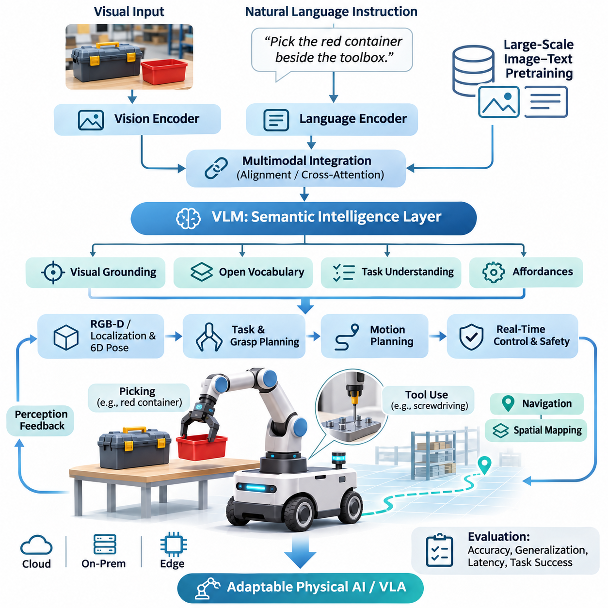
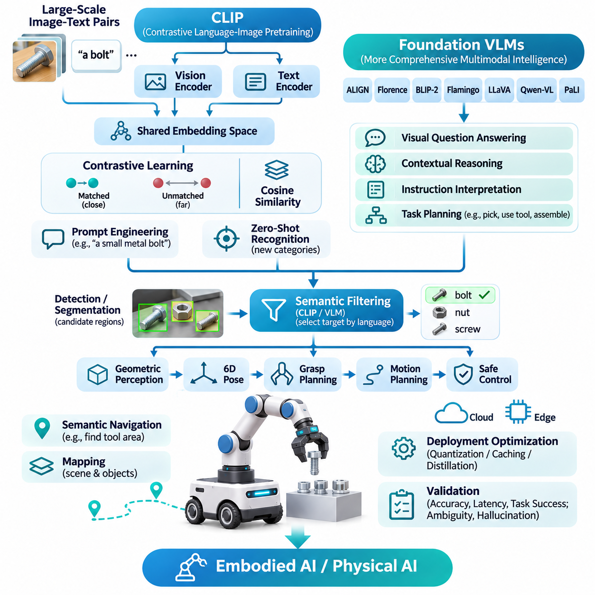
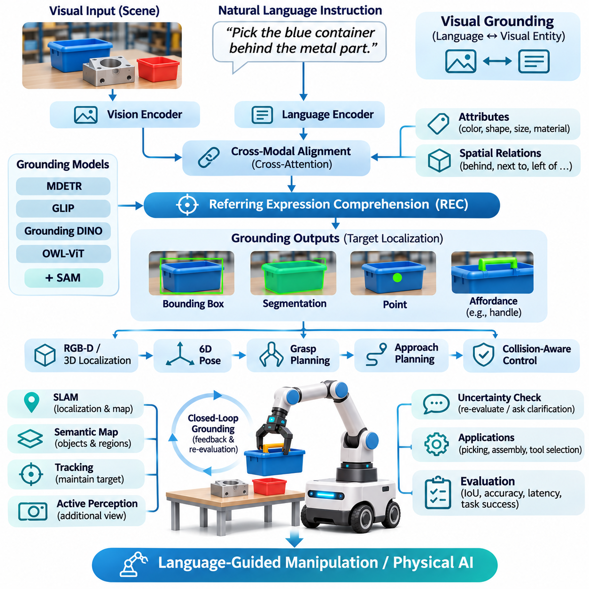
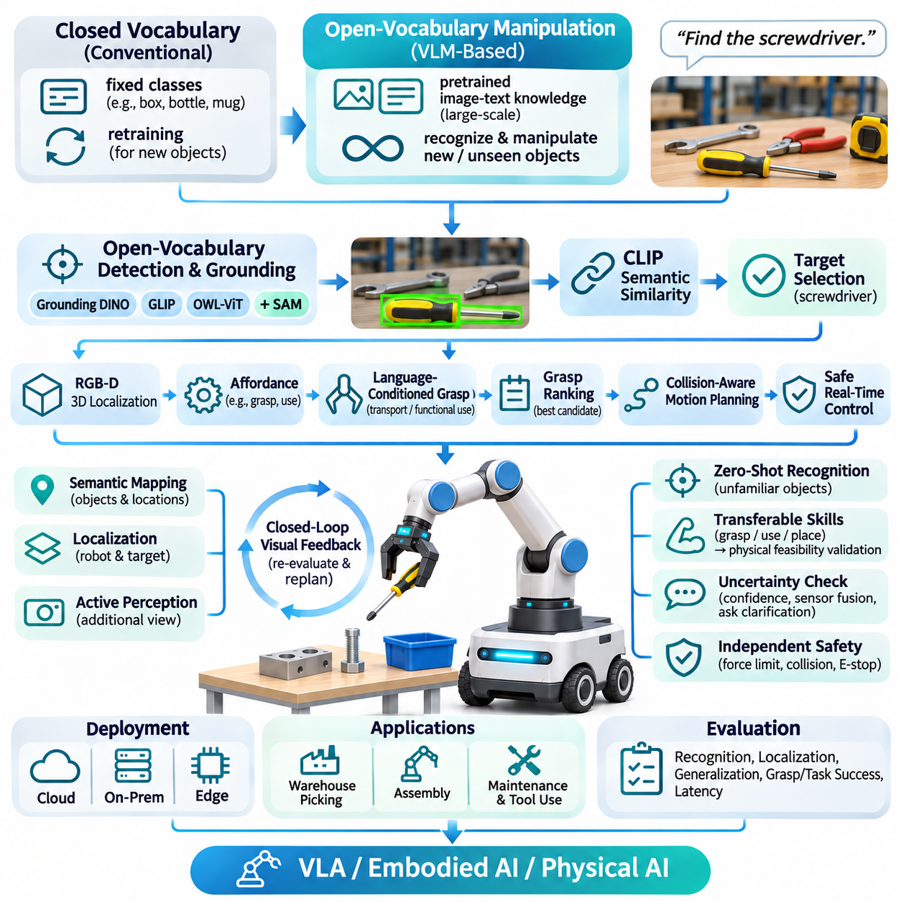
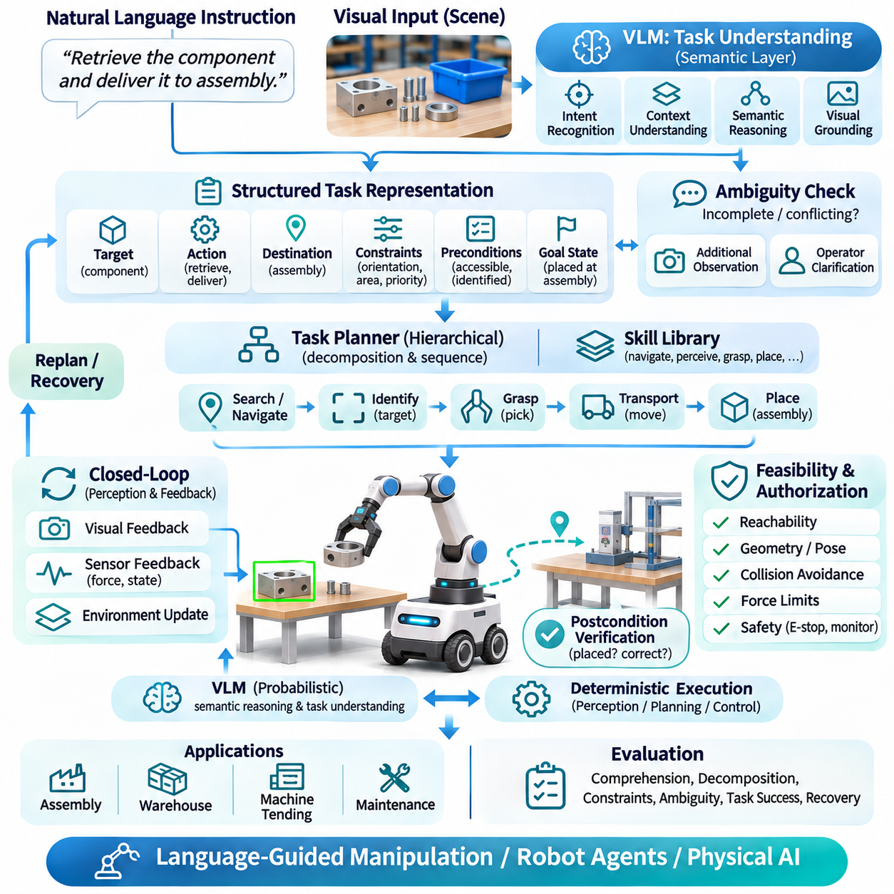
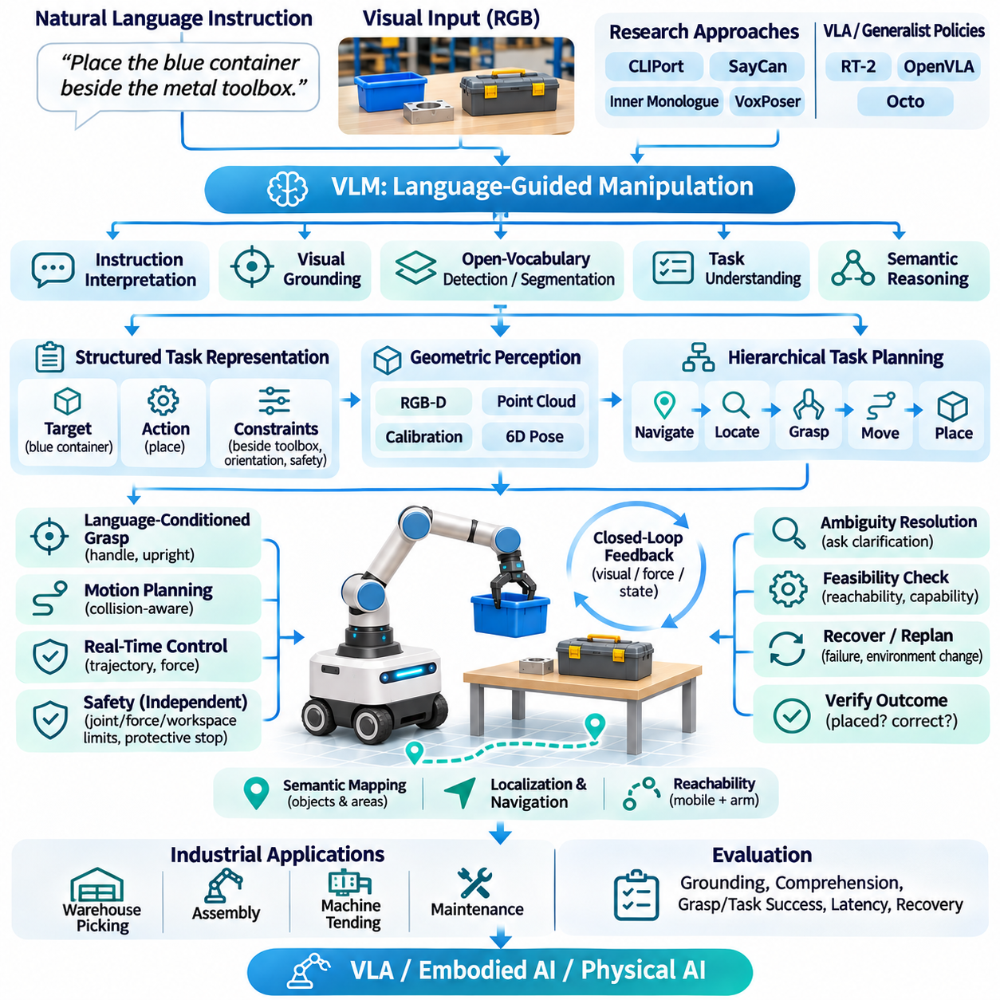
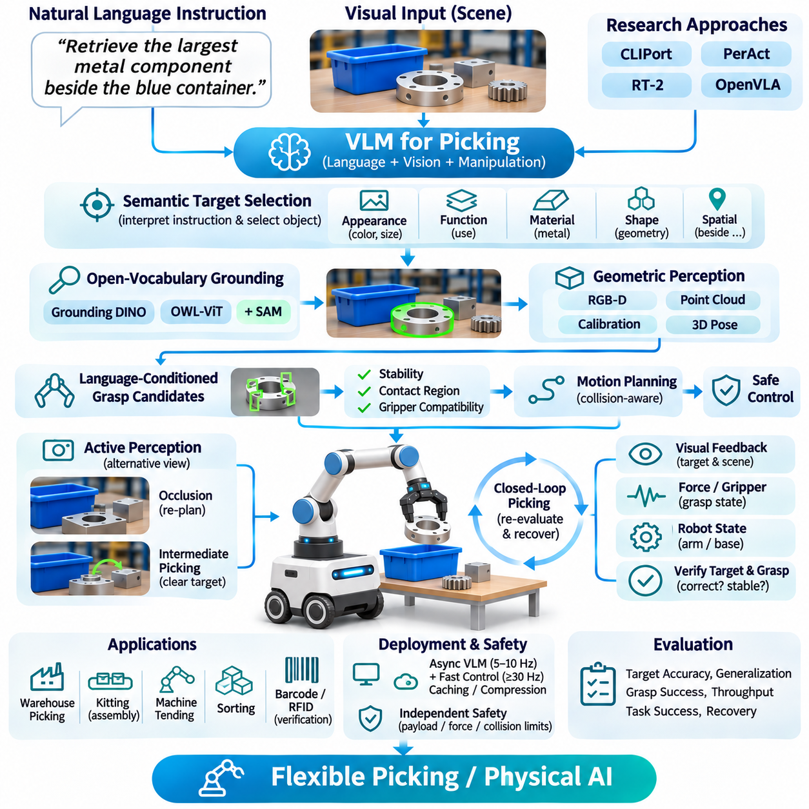
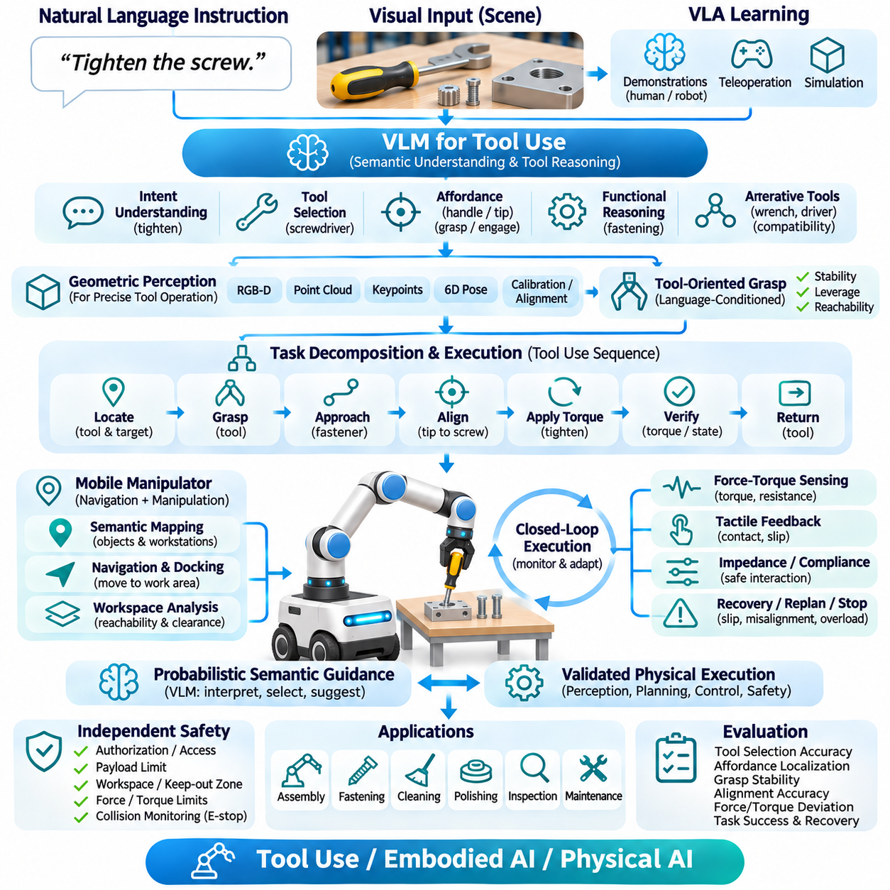
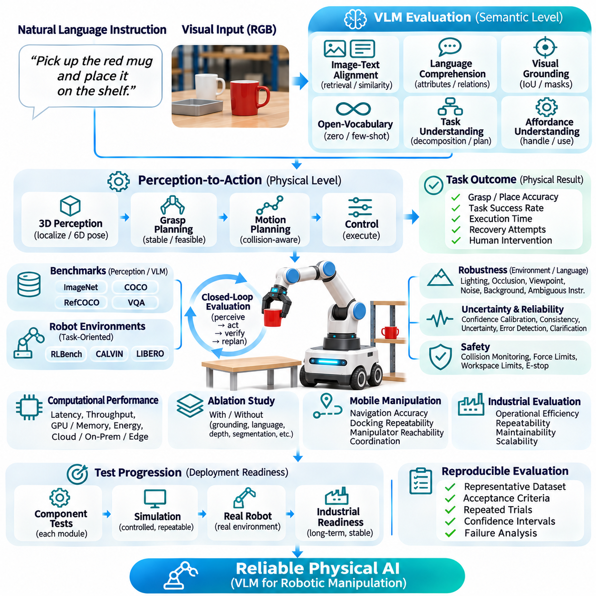

**Volume 03. Vision Manipulation and AI**


# Chapter 09. VLM for Manipulation

##  

## 01 VLM Overview

{width="7.268055555555556in" height="7.268055555555556in"}

Vision-Language Models (VLMs) represent a major advancement in robotic intelligence by integrating visual perception with natural language understanding. Unlike conventional computer vision systems that primarily identify predefined objects, VLMs enable robots to interpret visual environments in relation to linguistic instructions, semantic concepts, and contextual information. This capability establishes a foundation for intelligent and flexible robotic manipulation.

The fundamental objective of a VLM is to establish meaningful relationships between visual and linguistic information. Images captured by cameras are transformed into visual representations, while natural language instructions are converted into textual representations. These representations are aligned or integrated within a multimodal architecture, enabling the model to associate physical objects, environmental conditions, and spatial relationships with human intentions.

A typical VLM architecture consists of a vision encoder, a language encoder or language model, and a multimodal integration mechanism. The vision encoder extracts visual features from images, while the language component processes textual information. Depending on the architecture, contrastive learning, projection layers, or cross-attention mechanisms connect these modalities, allowing the system to perform semantic matching, visual reasoning, and contextual interpretation.

Large-scale pretraining is an important characteristic of modern VLMs. By learning from extensive collections of image-text pairs, these models acquire knowledge about object categories, visual attributes, functional relationships, and environmental contexts. This pretrained knowledge supports generalization beyond narrowly defined training datasets, reducing the dependence on application-specific annotations when developing robotic perception and manipulation systems.

In robotic manipulation, VLMs provide a semantic intelligence layer above conventional perception and motion control systems. Traditional object detection determines where an object is located, while pose estimation identifies its position and orientation. A VLM extends these capabilities by interpreting what the object represents, why it is relevant to a particular task, and how it may be associated with the requested manipulation objective.

Visual grounding is a fundamental mechanism connecting language instructions with physical entities. When an operator instructs a robot to pick up the red container beside a toolbox, the system must associate linguistic expressions with corresponding regions in the visual scene. Grounding enables the identification of relevant objects based on appearance, location, attributes, and contextual relationships, providing meaningful inputs for subsequent manipulation processes.

Open-vocabulary perception further expands the operational flexibility of robotic systems. Conventional detection models are generally restricted to object categories defined during training. VLM-based approaches can recognize or retrieve objects using previously unseen textual descriptions, although recognition reliability depends on model capabilities and environmental conditions. This flexibility is particularly valuable in high-mix manufacturing and unstructured environments.

Task understanding enables robots to interpret manipulation objectives beyond simple object recognition. A natural language instruction may describe a desired outcome, specify operational constraints, or establish relationships between multiple objects. A VLM can contribute to interpreting these requirements and extracting task-relevant information, which a dedicated task planner can subsequently transform into executable robotic actions and logical operation sequences.

Language-guided manipulation integrates semantic understanding with physical execution. An instruction is interpreted to identify target objects, desired actions, and environmental constraints. The resulting semantic information is transferred to object localization, six-dimensional pose estimation, grasp planning, and motion planning modules. This architecture connects human communication with precise robotic execution while preserving specialized control functions.

In picking applications, VLMs enable robots to select objects according to natural language descriptions rather than relying exclusively on predefined product identifiers. A warehouse robot may receive instructions describing an object\'s appearance, packaging, or intended destination. The VLM identifies potential targets, while geometric perception and grasp planning determine whether the selected object can be safely and reliably retrieved from its current location.

Tool use represents another important application of vision-language intelligence. A robot must distinguish between objects based on their functional properties and determine which tool is appropriate for a requested task. VLMs can provide semantic information about tools, components, and potential affordances. However, physical feasibility, tool orientation, contact conditions, and required forces must be validated through specialized perception and control mechanisms.

For mobile manipulators, VLMs support semantic understanding across both navigation and manipulation environments. As the autonomous mobile robot changes its position, the manipulator encounters different viewpoints, obstacles, and object arrangements. Integrating VLM outputs with spatial mapping, localization, and environmental perception allows the robotic system to maintain task relevance while adapting its observations and manipulation strategies.

A practical VLM-based manipulation architecture must distinguish semantic reasoning from physical control. Although a VLM can identify an appropriate object or suggest a manipulation strategy, it does not inherently guarantee accurate metric localization, collision-free trajectories, or stable grasping. Dedicated geometric algorithms, kinematic models, motion planners, and real-time controllers remain essential for translating semantic predictions into physically executable actions.

Deployment requires careful consideration of computational resources, inference latency, and operational reliability. Large VLMs may operate on cloud servers or on-premises computing infrastructure, while optimized models can support edge deployment. Hybrid architectures allow computationally intensive semantic reasoning to execute remotely while maintaining time-critical perception, safety monitoring, and motion control functions within the robot\'s onboard computing environment.

Performance evaluation must address both semantic intelligence and physical task execution. Relevant metrics include object recognition accuracy, visual grounding accuracy, instruction comprehension, generalization capability, inference latency, and manipulation success rate. Testing should also consider ambiguous instructions, unfamiliar objects, occlusion, changing illumination, and unexpected environmental conditions to identify limitations before industrial deployment.

Ultimately, VLMs establish an important connection between human intentions, environmental perception, and robotic manipulation. Their integration with conventional vision systems, geometric reasoning, task planning, and motion control provides a foundation for more adaptable robotic intelligence. This progression supports the development of multimodal foundation models, Vision-Language-Action (VLA) models, Embodied AI, and general-purpose Physical AI systems.

비전-언어 모델(Vision-Language Model, VLM)은 시각 인식(Visual Perception)과 자연어 이해(Natural Language Understanding)를 통합함으로써 로봇 지능(Robotic Intelligence)의 중요한 발전을 대표한다. 사전에 정의된 객체를 주로 식별하는 기존 컴퓨터 비전(Computer Vision) 시스템과 달리, VLM은 로봇이 언어적 명령(Linguistic Instruction), 의미적 개념(Semantic Concept), 문맥 정보(Contextual Information)와 연계하여 시각적 환경을 해석할 수 있도록 한다. 이러한 능력은 지능적이고 유연한 로봇 조작(Robotic Manipulation)의 기반을 형성한다.

VLM의 근본적인 목적은 시각 정보(Visual Information)와 언어 정보(Linguistic Information) 사이에 의미 있는 관계를 구축하는 것이다. 카메라를 통해 획득한 이미지는 시각적 표현(Visual Representation)으로 변환되며, 자연어 명령은 텍스트 표현(Textual Representation)으로 변환된다. 이러한 표현은 멀티모달 아키텍처(Multimodal Architecture) 내부에서 정렬(Alignment)되거나 통합(Integration)되며, 이를 통해 모델은 물리적 객체, 환경 조건 및 공간적 관계(Spatial Relationship)를 인간의 의도(Human Intention)와 연관시킬 수 있다.

일반적인 VLM 아키텍처(Architecture)는 비전 인코더(Vision Encoder), 언어 인코더(Language Encoder) 또는 언어 모델(Language Model), 그리고 멀티모달 통합 메커니즘(Multimodal Integration Mechanism)으로 구성된다. 비전 인코더는 이미지에서 시각적 특징(Visual Feature)을 추출하며, 언어 구성 요소는 텍스트 정보를 처리한다. 아키텍처에 따라 대조 학습(Contrastive Learning), 투영 계층(Projection Layer), 교차 어텐션(Cross-Attention) 메커니즘이 이러한 모달리티(Modality)를 연결하여 의미적 매칭(Semantic Matching), 시각적 추론(Visual Reasoning), 문맥적 해석(Contextual Interpretation)을 수행할 수 있도록 한다.

대규모 사전 학습(Large-Scale Pretraining)은 현대 VLM의 중요한 특징이다. 방대한 이미지-텍스트 쌍(Image-Text Pair)을 학습함으로써 이러한 모델은 객체 범주(Object Category), 시각적 속성(Visual Attribute), 기능적 관계(Functional Relationship), 환경적 문맥(Environmental Context)에 관한 지식을 획득한다. 이러한 사전 학습 지식(Pretrained Knowledge)은 제한적으로 정의된 학습 데이터셋(Training Dataset)을 넘어서는 일반화(Generalization)를 지원하며, 로봇 인식 및 조작 시스템을 개발할 때 응용 분야별 어노테이션(Application-Specific Annotation)에 대한 의존성을 감소시킨다.

로봇 조작(Robotic Manipulation)에서 VLM은 기존 인식 및 모션 제어(Motion Control) 시스템의 상위에 위치하는 의미적 지능 계층(Semantic Intelligence Layer)을 제공한다. 기존 객체 검출(Object Detection)은 객체가 어디에 위치하는지를 결정하며, 자세 추정(Pose Estimation)은 객체의 위치(Position)와 방향(Orientation)을 식별한다. VLM은 객체가 무엇을 의미하는지, 특정 작업과 어떤 관련성이 있는지, 그리고 요청된 조작 목표(Manipulation Objective)와 어떻게 연계될 수 있는지를 해석함으로써 이러한 능력을 확장한다.

시각적 그라운딩(Visual Grounding)은 언어적 명령과 물리적 개체(Physical Entity)를 연결하는 핵심 메커니즘이다. 작업자가 로봇에게 공구함 옆에 있는 빨간색 용기를 집으라고 지시하면, 시스템은 언어적 표현(Linguistic Expression)을 시각적 장면(Visual Scene) 내의 해당 영역과 연관시켜야 한다. 그라운딩(Grounding)은 외형(Appearance), 위치(Location), 속성(Attribute), 문맥적 관계(Contextual Relationship)를 기반으로 관련 객체를 식별할 수 있도록 하며, 후속 조작 프로세스에 의미 있는 입력 정보를 제공한다.

개방형 어휘 인식(Open-Vocabulary Perception)은 로봇 시스템의 운용 유연성(Operational Flexibility)을 더욱 확장한다. 기존 객체 검출 모델은 일반적으로 학습 과정에서 정의된 객체 범주로 제한된다. VLM 기반 접근 방식은 이전에 접하지 않은 텍스트 설명(Textual Description)을 활용하여 객체를 인식하거나 검색할 수 있지만, 인식 신뢰성(Recognition Reliability)은 모델의 성능과 환경 조건에 따라 달라진다. 이러한 유연성은 다품종 제조(High-Mix Manufacturing) 및 비정형 환경(Unstructured Environment)에서 특히 높은 가치를 제공한다.

작업 이해(Task Understanding)는 로봇이 단순한 객체 인식을 넘어 조작 목표를 해석할 수 있도록 한다. 자연어 명령은 원하는 결과(Desired Outcome)를 설명하거나, 운용 제약조건(Operational Constraint)을 지정하거나, 여러 객체 사이의 관계를 설정할 수 있다. VLM은 이러한 요구사항을 해석하고 작업 관련 정보(Task-Relevant Information)를 추출하는 데 기여하며, 전용 작업 계획기(Task Planner)는 이러한 정보를 실행 가능한 로봇 행동(Executable Robotic Action)과 논리적 작업 순서(Logical Operation Sequence)로 변환할 수 있다.

언어 유도 조작(Language-Guided Manipulation)은 의미적 이해(Semantic Understanding)와 물리적 실행(Physical Execution)을 통합한다. 명령을 해석하여 대상 객체(Target Object), 요구 행동(Desired Action), 환경적 제약조건(Environmental Constraint)을 식별한다. 이렇게 생성된 의미 정보(Semantic Information)는 객체 위치 추정(Object Localization), 6차원 자세 추정(6D Pose Estimation), 파지 계획(Grasp Planning), 모션 계획(Motion Planning) 모듈로 전달된다. 이러한 아키텍처는 전문화된 제어 기능을 유지하면서 인간의 의사소통과 정밀한 로봇 실행을 연결한다.

피킹 응용 분야(Picking Application)에서 VLM은 사전에 정의된 제품 식별자(Product Identifier)에만 의존하지 않고 자연어 설명에 따라 객체를 선택할 수 있도록 한다. 물류창고 로봇(Warehouse Robot)은 객체의 외형, 포장 형태(Packaging), 목적지(Destination)를 설명하는 명령을 전달받을 수 있다. VLM은 잠재적인 대상 객체를 식별하며, 기하학적 인식(Geometric Perception)과 파지 계획은 선택된 객체를 현재 위치에서 안전하고 신뢰성 있게 회수할 수 있는지를 판단한다.

도구 사용(Tool Use)은 비전-언어 지능(Vision-Language Intelligence)의 또 다른 중요한 응용 분야이다. 로봇은 객체의 기능적 특성(Functional Property)을 기반으로 객체를 구분하고, 요청된 작업에 적합한 도구를 판단해야 한다. VLM은 도구, 부품(Component), 잠재적 행동 유도성(Affordance)에 관한 의미 정보를 제공할 수 있다. 그러나 물리적 실행 가능성(Physical Feasibility), 도구의 방향(Tool Orientation), 접촉 조건(Contact Condition), 요구 힘(Required Force)은 전문화된 인식 및 제어 메커니즘을 통해 검증되어야 한다.

모바일 매니퓰레이터(Mobile Manipulator)에서 VLM은 주행(Navigation) 및 조작(Manipulation) 환경 전반에 걸쳐 의미적 이해를 지원한다. 자율 이동 로봇(Autonomous Mobile Robot, AMR)의 위치가 변경됨에 따라 매니퓰레이터는 다양한 관측 시점(Viewpoint), 장애물(Obstacle), 객체 배치(Object Arrangement)를 마주하게 된다. VLM의 출력 정보를 공간 매핑(Spatial Mapping), 위치 추정(Localization), 환경 인식(Environmental Perception)과 통합함으로써 로봇 시스템은 작업 관련성(Task Relevance)을 유지하면서 관측 및 조작 전략을 적응적으로 변경할 수 있다.

실용적인 VLM 기반 조작 아키텍처는 의미적 추론(Semantic Reasoning)과 물리적 제어(Physical Control)를 구분해야 한다. VLM은 적절한 객체를 식별하거나 조작 전략(Manipulation Strategy)을 제안할 수 있지만, 정확한 계측 기반 위치 추정(Metric Localization), 충돌 없는 궤적(Collision-Free Trajectory), 안정적인 파지(Stable Grasping)를 자체적으로 보장하지는 않는다. 의미적 예측(Semantic Prediction)을 물리적으로 실행 가능한 행동으로 변환하기 위해서는 전용 기하학적 알고리즘(Geometric Algorithm), 기구학 모델(Kinematic Model), 모션 계획기(Motion Planner), 실시간 제어기(Real-Time Controller)가 여전히 필수적이다.

시스템 배포(Deployment) 과정에서는 연산 자원(Computational Resource), 추론 지연시간(Inference Latency), 운용 신뢰성(Operational Reliability)을 신중하게 고려해야 한다. 대규모 VLM은 클라우드 서버(Cloud Server) 또는 온프레미스 컴퓨팅 인프라(On-Premises Computing Infrastructure)에서 운용될 수 있으며, 최적화된 모델은 엣지 배포(Edge Deployment)를 지원할 수 있다. 하이브리드 아키텍처(Hybrid Architecture)는 연산 집약적인 의미적 추론을 원격으로 수행하면서 시간 민감형 인식(Time-Critical Perception), 안전 모니터링(Safety Monitoring), 모션 제어 기능을 로봇의 온보드 컴퓨팅 환경(Onboard Computing Environment)에서 유지할 수 있도록 한다.

성능 평가(Performance Evaluation)는 의미적 지능(Semantic Intelligence)과 물리적 작업 실행(Physical Task Execution)을 모두 고려해야 한다. 주요 평가 지표(Evaluation Metric)에는 객체 인식 정확도(Object Recognition Accuracy), 시각적 그라운딩 정확도(Visual Grounding Accuracy), 명령 이해도(Instruction Comprehension), 일반화 능력(Generalization Capability), 추론 지연시간, 조작 성공률(Manipulation Success Rate)이 포함된다. 또한 산업 현장 배포(Industrial Deployment) 이전에 시스템의 한계를 식별하기 위해 모호한 명령(Ambiguous Instruction), 익숙하지 않은 객체(Unfamiliar Object), 가림 현상(Occlusion), 조명 변화(Illumination Variation), 예기치 않은 환경 조건도 시험 과정에서 고려해야 한다.

궁극적으로 VLM은 인간의 의도, 환경 인식, 로봇 조작 사이에 중요한 연결고리를 형성한다. 기존 비전 시스템(Conventional Vision System), 기하학적 추론(Geometric Reasoning), 작업 계획(Task Planning), 모션 제어와의 통합은 더욱 적응적인 로봇 지능(Adaptive Robotic Intelligence)을 구현하기 위한 기반을 제공한다. 이러한 발전은 멀티모달 파운데이션 모델(Multimodal Foundation Model), 비전-언어-행동 모델(Vision-Language-Action Model, VLA), 체화 인공지능(Embodied AI), 범용 피지컬 AI 시스템(General-Purpose Physical AI System)의 개발을 뒷받침한다.

##  

## 02 CLIP and Foundation VLMs

{width="7.268055555555556in" height="7.268055555555556in"}

Contrastive Language-Image Pretraining (CLIP) represents a foundational approach to connecting visual perception with natural language understanding. Developed by OpenAI, CLIP introduced a scalable method for learning relationships between images and textual descriptions through large-scale multimodal training. Its ability to associate visual content with linguistic concepts provides an important technological foundation for intelligent robotic manipulation.

Traditional computer vision models are generally trained using predefined object categories and manually annotated datasets. Their recognition capabilities are therefore limited by the classes represented during training. CLIP addresses this limitation by learning from image-text pairs, allowing visual concepts to be associated with natural language descriptions rather than relying exclusively on fixed classification categories.

The CLIP architecture consists of two independent neural network components: a vision encoder and a text encoder. The vision encoder transforms input images into high-dimensional feature vectors, while the text encoder converts linguistic descriptions into corresponding numerical representations. Both encoders project their outputs into a shared embedding space, where semantic relationships between visual and textual information can be evaluated.

Contrastive learning constitutes the fundamental training mechanism of CLIP. During training, corresponding image-text pairs are encouraged to produce similar representations, while unrelated pairs are encouraged to produce dissimilar representations. This optimization process enables the model to establish meaningful associations between visual appearances, linguistic expressions, object attributes, and broader semantic concepts.

The shared embedding space enables semantic similarity to be calculated between visual observations and natural language descriptions. Cosine similarity is commonly employed to measure the relationship between normalized feature vectors. In robotic applications, this mechanism allows candidate objects or image regions to be compared against textual instructions, supporting language-based object identification and semantic target selection.

Zero-shot recognition is one of the most significant capabilities introduced by CLIP. Instead of retraining a classification network whenever new object categories are introduced, the system can construct textual descriptions of candidate categories and compare their embeddings with visual observations. This approach enables recognition of categories that were not explicitly represented in task-specific supervised training datasets.

Prompt engineering plays an important role in determining the effectiveness of CLIP-based recognition. Different linguistic descriptions of the same object may generate different semantic representations and recognition results. Providing contextual information about object appearance, intended function, material properties, or environmental relationships may improve the model\'s ability to distinguish between visually similar manipulation targets.

In robotic manipulation, CLIP can function as a semantic filtering mechanism within a larger perception pipeline. Conventional object detection or segmentation algorithms generate candidate regions from camera observations, while CLIP evaluates their semantic relevance to natural language instructions. The selected candidates are subsequently processed by geometric perception, object pose estimation, and grasp planning modules.

For example, a mobile manipulator operating in a manufacturing environment may receive an instruction to retrieve a small metallic component used for fastening. A CLIP-based perception system can compare visual candidates against descriptions of bolts, nuts, screws, and other components. This semantic comparison assists target selection without requiring every possible component to belong to a dedicated classification model.

Foundation Vision-Language Models extend the principles established by CLIP toward more comprehensive multimodal intelligence. While CLIP primarily focuses on semantic alignment and similarity measurement, advanced foundation VLMs incorporate mechanisms for visual question answering, contextual reasoning, image interpretation, and natural language generation. These capabilities support more sophisticated interactions between humans and robotic systems.

Representative foundation VLM architectures include ALIGN, Florence, BLIP, BLIP-2, Flamingo, LLaVA, and multimodal models within the Qwen-VL and PaLI families. Although their training strategies and architectural designs differ, these models share the objective of integrating visual and linguistic knowledge. Some emphasize representation learning, while others support generative reasoning and instruction-driven multimodal interactions.

Generative foundation VLMs provide capabilities that extend beyond image-text similarity. By connecting visual encoders with large language models, these architectures can generate descriptions, answer questions about observed environments, and interpret complex instructions. In robotic manipulation, they may assist in understanding object relationships, identifying operational requirements, and proposing sequences of task-level actions.

The integration of foundation VLMs with robotic manipulation requires a clear separation between semantic intelligence and physical execution. A model may correctly identify the desired object or recommend an appropriate manipulation strategy without determining its precise three-dimensional position or physical properties. Dedicated perception, kinematics, motion planning, and control systems must therefore validate and execute the proposed actions.

For mobile manipulators, foundation VLMs provide opportunities to connect semantic navigation with object manipulation. Visual observations acquired from different locations can be associated with natural language descriptions of workstations, storage areas, tools, and target objects. When integrated with spatial mapping and localization, these capabilities support flexible task execution across changing industrial and logistics environments.

Computational efficiency remains an important consideration when deploying CLIP and foundation VLMs on robotic platforms. Lightweight encoders may support onboard semantic recognition, while larger generative models may require dedicated GPU resources or remote computing infrastructure. Model quantization, feature caching, knowledge distillation, and hybrid edge-cloud architectures can help balance inference performance and computational requirements.

Despite their capabilities, CLIP and foundation VLMs exhibit limitations involving spatial precision, domain-specific recognition, visual ambiguity, and semantic hallucination in generative models. Reliable industrial deployment requires application-specific validation using unfamiliar objects, complex backgrounds, varying illumination, and ambiguous instructions. Evaluation should address semantic accuracy, inference latency, target selection reliability, and physical task success.

Ultimately, CLIP and foundation VLMs establish a technological bridge between conventional computer vision and general-purpose robotic intelligence. Their ability to connect visual observations with natural language concepts supports open-vocabulary manipulation, semantic task understanding, and flexible human-robot interaction. Integration with action-oriented models further contributes to Embodied AI and the evolution of Physical AI systems.

대조적 언어-이미지 사전 학습(Contrastive Language-Image Pretraining, CLIP)은 시각 인식(Visual Perception)과 자연어 이해(Natural Language Understanding)를 연결하는 기반 접근 방식이다. OpenAI에서 개발한 CLIP은 대규모 멀티모달 학습(Large-Scale Multimodal Training)을 통해 이미지와 텍스트 설명(Textual Description) 사이의 관계를 학습하는 확장 가능한 방법을 도입하였다. 시각적 콘텐츠(Visual Content)와 언어적 개념(Linguistic Concept)을 연관시키는 능력은 지능형 로봇 조작(Intelligent Robotic Manipulation)을 위한 중요한 기술적 기반을 제공한다.

기존 컴퓨터 비전(Computer Vision) 모델은 일반적으로 사전에 정의된 객체 범주(Object Category)와 수동으로 어노테이션된 데이터셋(Manually Annotated Dataset)을 사용하여 학습된다. 따라서 이러한 모델의 인식 능력(Recognition Capability)은 학습 과정에 포함된 클래스(Class)에 의해 제한된다. CLIP은 이미지-텍스트 쌍(Image-Text Pair)을 학습함으로써 이러한 한계를 해결하며, 고정된 분류 범주(Classification Category)에만 의존하지 않고 시각적 개념(Visual Concept)을 자연어 설명(Natural Language Description)과 연관시킬 수 있도록 한다.

CLIP 아키텍처(Architecture)는 비전 인코더(Vision Encoder)와 텍스트 인코더(Text Encoder)라는 두 개의 독립적인 신경망 구성 요소(Neural Network Component)로 구성된다. 비전 인코더는 입력 이미지(Input Image)를 고차원 특징 벡터(High-Dimensional Feature Vector)로 변환하며, 텍스트 인코더는 언어적 설명(Linguistic Description)을 이에 대응하는 수치적 표현(Numerical Representation)으로 변환한다. 두 인코더는 출력값을 공유 임베딩 공간(Shared Embedding Space)에 투영하며, 이 공간에서 시각 정보와 텍스트 정보 사이의 의미적 관계(Semantic Relationship)를 평가할 수 있다.

대조 학습(Contrastive Learning)은 CLIP의 근본적인 학습 메커니즘(Training Mechanism)을 구성한다. 학습 과정에서 서로 대응하는 이미지-텍스트 쌍은 유사한 표현(Similar Representation)을 생성하도록 유도되며, 관련성이 없는 쌍은 서로 다른 표현(Dissimilar Representation)을 생성하도록 유도된다. 이러한 최적화 프로세스(Optimization Process)를 통해 모델은 시각적 외형(Visual Appearance), 언어적 표현(Linguistic Expression), 객체 속성(Object Attribute), 보다 광범위한 의미적 개념(Semantic Concept) 사이에 의미 있는 연관성을 구축할 수 있다.

공유 임베딩 공간(Shared Embedding Space)은 시각적 관측 정보(Visual Observation)와 자연어 설명 사이의 의미적 유사도(Semantic Similarity)를 계산할 수 있도록 한다. 정규화된 특징 벡터(Normalized Feature Vector) 사이의 관계를 측정하기 위해 일반적으로 코사인 유사도(Cosine Similarity)가 사용된다. 로봇 응용 분야(Robotic Application)에서 이러한 메커니즘은 후보 객체(Candidate Object) 또는 이미지 영역(Image Region)을 텍스트 명령(Textual Instruction)과 비교할 수 있도록 하며, 언어 기반 객체 식별(Language-Based Object Identification)과 의미적 대상 선택(Semantic Target Selection)을 지원한다.

제로샷 인식(Zero-Shot Recognition)은 CLIP이 도입한 가장 중요한 능력 중 하나이다. 새로운 객체 범주가 추가될 때마다 분류 신경망(Classification Network)을 재학습(Retraining)하는 대신, 시스템은 후보 범주(Candidate Category)에 대한 텍스트 설명을 생성하고 해당 임베딩(Embedding)을 시각적 관측 정보와 비교할 수 있다. 이러한 접근 방식은 작업별 지도 학습 데이터셋(Task-Specific Supervised Training Dataset)에 명시적으로 포함되지 않았던 객체 범주도 인식할 수 있도록 한다.

프롬프트 엔지니어링(Prompt Engineering)은 CLIP 기반 인식(CLIP-Based Recognition)의 효과를 결정하는 데 중요한 역할을 수행한다. 동일한 객체에 대한 서로 다른 언어적 설명은 상이한 의미적 표현(Semantic Representation)과 인식 결과(Recognition Result)를 생성할 수 있다. 객체의 외형(Object Appearance), 의도된 기능(Intended Function), 재질 특성(Material Property), 환경적 관계(Environmental Relationship)에 관한 문맥 정보(Contextual Information)를 제공하면 시각적으로 유사한 조작 대상(Manipulation Target)을 구분하는 모델의 능력을 향상시킬 수 있다.

로봇 조작(Robotic Manipulation)에서 CLIP은 보다 광범위한 인식 파이프라인(Perception Pipeline) 내부의 의미적 필터링 메커니즘(Semantic Filtering Mechanism)으로 기능할 수 있다. 기존 객체 검출(Object Detection) 또는 객체 분할(Object Segmentation) 알고리즘은 카메라 관측 정보(Camera Observation)로부터 후보 영역(Candidate Region)을 생성하며, CLIP은 이러한 영역과 자연어 명령 사이의 의미적 관련성(Semantic Relevance)을 평가한다. 이후 선택된 후보 객체는 기하학적 인식(Geometric Perception), 객체 자세 추정(Object Pose Estimation), 파지 계획(Grasp Planning) 모듈을 통해 처리된다.

예를 들어, 제조 환경(Manufacturing Environment)에서 운용되는 모바일 매니퓰레이터(Mobile Manipulator)는 체결 작업(Fastening)에 사용되는 소형 금속 부품을 가져오라는 명령을 전달받을 수 있다. CLIP 기반 인식 시스템(CLIP-Based Perception System)은 시각적으로 검출된 후보 객체를 볼트(Bolt), 너트(Nut), 나사(Screw) 및 기타 부품에 관한 설명과 비교할 수 있다. 이러한 의미적 비교(Semantic Comparison)는 가능한 모든 부품을 전용 분류 모델(Dedicated Classification Model)에 포함하지 않고도 대상 객체의 선택을 지원한다.

파운데이션 비전-언어 모델(Foundation Vision-Language Model)은 CLIP이 확립한 원리를 보다 포괄적인 멀티모달 지능(Multimodal Intelligence)으로 확장한다. CLIP이 주로 의미적 정렬(Semantic Alignment)과 유사도 측정(Similarity Measurement)에 집중하는 반면, 고도화된 파운데이션 VLM은 시각적 질의응답(Visual Question Answering), 문맥적 추론(Contextual Reasoning), 이미지 해석(Image Interpretation), 자연어 생성(Natural Language Generation)을 위한 메커니즘을 포함한다. 이러한 능력은 인간과 로봇 시스템 사이의 더욱 정교한 상호작용(Interaction)을 지원한다.

대표적인 파운데이션 VLM 아키텍처에는 ALIGN, Florence, BLIP, BLIP-2, Flamingo, LLaVA와 Qwen-VL 및 PaLI 계열의 멀티모달 모델(Multimodal Model)이 포함된다. 이러한 모델의 학습 전략(Training Strategy)과 아키텍처 설계(Architectural Design)는 서로 다르지만, 시각적 지식(Visual Knowledge)과 언어적 지식(Linguistic Knowledge)을 통합한다는 공통된 목표를 가진다. 일부 모델은 표현 학습(Representation Learning)을 강조하는 반면, 다른 모델은 생성형 추론(Generative Reasoning)과 명령 기반 멀티모달 상호작용(Instruction-Driven Multimodal Interaction)을 지원한다.

생성형 파운데이션 VLM(Generative Foundation VLM)은 이미지-텍스트 유사도(Image-Text Similarity)를 넘어서는 능력을 제공한다. 비전 인코더(Vision Encoder)와 대규모 언어 모델(Large Language Model, LLM)을 연결함으로써 이러한 아키텍처는 설명을 생성하고, 관측된 환경에 관한 질문에 답변하며, 복잡한 명령(Complex Instruction)을 해석할 수 있다. 로봇 조작 분야에서는 객체 간 관계(Object Relationship)의 이해, 운용 요구사항(Operational Requirement)의 식별, 작업 수준 행동(Task-Level Action)의 실행 순서 제안 등을 지원할 수 있다.

파운데이션 VLM과 로봇 조작의 통합(Integration)은 의미적 지능(Semantic Intelligence)과 물리적 실행(Physical Execution)을 명확하게 구분해야 한다. 모델은 원하는 객체를 정확하게 식별하거나 적절한 조작 전략(Manipulation Strategy)을 추천할 수 있지만, 해당 객체의 정밀한 3차원 위치(Three-Dimensional Position) 또는 물리적 특성(Physical Property)을 반드시 결정할 수 있는 것은 아니다. 따라서 전용 인식 시스템(Perception System), 기구학(Kinematics), 모션 계획(Motion Planning), 제어 시스템(Control System)을 통해 제안된 행동을 검증하고 실행해야 한다.

모바일 매니퓰레이터(Mobile Manipulator)에서 파운데이션 VLM은 의미 기반 주행(Semantic Navigation)과 객체 조작(Object Manipulation)을 연결할 수 있는 기회를 제공한다. 서로 다른 위치에서 획득한 시각적 관측 정보는 작업 스테이션(Workstation), 저장 구역(Storage Area), 도구(Tool), 대상 객체(Target Object)에 관한 자연어 설명과 연관될 수 있다. 이러한 능력을 공간 매핑(Spatial Mapping) 및 위치 추정(Localization)과 통합하면 지속적으로 변화하는 산업 환경(Industrial Environment)과 물류 환경(Logistics Environment)에서 유연한 작업 실행(Flexible Task Execution)을 지원할 수 있다.

연산 효율성(Computational Efficiency)은 로봇 플랫폼(Robotic Platform)에 CLIP과 파운데이션 VLM을 배포할 때 중요한 고려사항이다. 경량 인코더(Lightweight Encoder)는 온보드 의미 인식(Onboard Semantic Recognition)을 지원할 수 있는 반면, 대규모 생성형 모델(Generative Model)은 전용 GPU 자원(Dedicated GPU Resource) 또는 원격 컴퓨팅 인프라(Remote Computing Infrastructure)를 요구할 수 있다. 모델 양자화(Model Quantization), 특징 캐싱(Feature Caching), 지식 증류(Knowledge Distillation), 하이브리드 엣지-클라우드 아키텍처(Hybrid Edge-Cloud Architecture)는 추론 성능(Inference Performance)과 연산 요구사항(Computational Requirement) 사이의 균형을 유지하는 데 기여할 수 있다.

이러한 능력에도 불구하고 CLIP과 파운데이션 VLM은 공간적 정밀도(Spatial Precision), 도메인 특화 인식(Domain-Specific Recognition), 시각적 모호성(Visual Ambiguity), 생성형 모델의 의미적 환각(Semantic Hallucination)과 관련된 한계를 가진다. 신뢰성 있는 산업 현장 배포(Industrial Deployment)를 위해서는 익숙하지 않은 객체(Unfamiliar Object), 복잡한 배경(Complex Background), 다양한 조명 조건(Varying Illumination), 모호한 명령(Ambiguous Instruction)을 활용한 응용 분야별 검증(Application-Specific Validation)이 필요하다. 성능 평가는 의미적 정확도(Semantic Accuracy), 추론 지연시간(Inference Latency), 대상 선택 신뢰성(Target Selection Reliability), 물리적 작업 성공률(Physical Task Success Rate)을 고려해야 한다.

궁극적으로 CLIP과 파운데이션 VLM은 기존 컴퓨터 비전(Conventional Computer Vision)과 범용 로봇 지능(General-Purpose Robotic Intelligence) 사이의 기술적 연결고리를 형성한다. 시각적 관측 정보와 자연어 개념(Natural Language Concept)을 연결하는 능력은 개방형 어휘 조작(Open-Vocabulary Manipulation), 의미적 작업 이해(Semantic Task Understanding), 유연한 인간-로봇 상호작용(Flexible Human-Robot Interaction)을 지원한다. 행동 지향형 모델(Action-Oriented Model)과의 통합은 체화 인공지능(Embodied AI)과 피지컬 AI 시스템(Physical AI System)의 발전에 더욱 기여한다.

##  

## 03 Visual Grounding

{width="7.268055555555556in" height="7.268055555555556in"}

Visual grounding is a fundamental capability of Vision-Language Models (VLMs) that establishes relationships between natural language expressions and specific visual entities within an observed environment. In robotic manipulation, visual grounding enables a robot to identify the physical objects, regions, and spatial relationships referenced by human instructions, thereby connecting semantic understanding with practical manipulation objectives.

Conventional object detection primarily identifies and localizes objects belonging to predefined categories. Visual grounding extends this capability by associating linguistic descriptions with corresponding visual regions. Instead of simply detecting a container, a grounding system can identify the blue container located behind a metallic component, incorporating object attributes, spatial relationships, and contextual information into the identification process.

The fundamental architecture of a visual grounding system integrates visual feature extraction, linguistic feature extraction, and cross-modal alignment. A vision encoder processes images to generate spatial feature representations, while a language encoder interprets textual instructions. Multimodal integration mechanisms establish correspondences between linguistic concepts and visual features, enabling the localization of referenced entities within the scene.

Cross-attention mechanisms play an important role in modern visual grounding architectures. Visual and linguistic representations interact through attention layers that evaluate relationships between image regions and textual tokens. This interaction enables the model to emphasize task-relevant visual information while suppressing unrelated environmental features, improving its ability to interpret complex descriptions within cluttered operational environments.

Referring Expression Comprehension (REC) is a representative visual grounding task that identifies an object or region described by a natural language expression. Unlike general image classification, REC requires the system to distinguish between multiple potentially similar objects. Expressions involving color, shape, size, material, relative position, and functional characteristics provide semantic constraints that guide the identification process.

Visual grounding can generate different forms of spatial output depending on the application and model architecture. Bounding boxes provide approximate object localization, while segmentation masks identify more detailed object boundaries. Point-based grounding identifies specific locations associated with linguistic instructions. These representations provide complementary information for robotic perception, target selection, and subsequent geometric processing.

Representative visual grounding models include MDETR, GLIP, Grounding DINO, and OWL-ViT. These architectures integrate visual and linguistic information through different combinations of multimodal transformers, contrastive learning, and language-conditioned detection. Grounding models can also be combined with segmentation foundation models such as the Segment Anything Model (SAM) to obtain more precise object-level segmentation.

In robotic manipulation, visual grounding connects natural language instructions with geometric perception. After identifying the relevant object or region, the system can integrate RGB-D observations, depth measurements, and camera calibration parameters to estimate three-dimensional coordinates. The resulting spatial information supports object pose estimation, grasp candidate generation, approach planning, and collision-aware motion execution.

Spatial relationship reasoning is particularly important when multiple objects share similar visual characteristics. Instructions involving expressions such as left of, behind, inside, above, or next to require the system to evaluate relationships between environmental entities. Since spatial interpretations may depend on the observer\'s viewpoint, robotic systems must establish appropriate coordinate frames and reference conventions before executing manipulation tasks.

Affordance grounding extends conventional object-level grounding toward identifying functional regions associated with particular actions. Instead of locating an entire object, the system may identify a handle suitable for grasping, a button suitable for pressing, or a surface suitable for placement. These semantic predictions provide useful manipulation objectives, although physical feasibility must still be verified through geometric and mechanical analysis.

For mobile manipulators, visual grounding must accommodate changes in camera viewpoint, robot position, object visibility, and environmental configuration. Integrating grounding results with simultaneous localization and mapping, semantic maps, and object tracking enables the system to maintain associations between linguistic references and physical entities. Active perception can acquire additional observations when target identification remains uncertain.

Closed-loop visual grounding combines semantic target identification with continuous environmental feedback. During manipulation, the robot can acquire updated images, reevaluate the referenced object, and correct its approach when environmental conditions change. This iterative process reduces dependence on initial observations and supports adaptive manipulation in dynamic environments where objects may move or become partially occluded.

Industrial applications of visual grounding include warehouse picking, component retrieval, assembly assistance, tool selection, and material handling. An operator may describe a required component using its appearance, functional purpose, or storage location rather than a predefined identifier. This capability improves operational flexibility in high-mix manufacturing environments where object categories and production configurations frequently change.

Reliable visual grounding requires careful management of semantic ambiguity, prediction uncertainty, and environmental variability. Similar-looking objects, incomplete instructions, reflective surfaces, poor illumination, and occlusion may produce incorrect grounding results. Confidence thresholds, geometric consistency checks, additional observations, and operator clarification can reduce the probability of selecting inappropriate manipulation targets.

Performance evaluation should consider both semantic localization accuracy and downstream manipulation reliability. Relevant metrics include Intersection over Union (IoU), grounding accuracy, segmentation accuracy, target selection success rate, inference latency, and physical manipulation success rate. Evaluation datasets should incorporate unfamiliar objects, complex relational expressions, cluttered environments, and multiple observation viewpoints to assess practical generalization.

Ultimately, visual grounding establishes a critical connection between linguistic intelligence, spatial perception, and physical interaction. Its integration with open-vocabulary detection, three-dimensional perception, task planning, grasp planning, and motion control enables robots to translate human instructions into meaningful physical objectives. This capability provides an essential foundation for language-guided manipulation, Embodied AI, and advanced Physical AI systems.

시각적 그라운딩(Visual Grounding)은 자연어 표현(Natural Language Expression)과 관측된 환경(Observed Environment) 내의 특정 시각적 개체(Visual Entity) 사이에 관계를 구축하는 비전-언어 모델(Vision-Language Model, VLM)의 핵심 능력이다. 로봇 조작(Robotic Manipulation)에서 시각적 그라운딩은 로봇이 인간의 명령(Human Instruction)에서 참조하는 물리적 객체(Physical Object), 영역(Region), 공간적 관계(Spatial Relationship)를 식별할 수 있도록 하며, 이를 통해 의미적 이해(Semantic Understanding)와 실질적인 조작 목표(Manipulation Objective)를 연결한다.

기존 객체 검출(Conventional Object Detection)은 주로 사전에 정의된 범주(Predefined Category)에 속하는 객체를 식별하고 위치를 추정한다. 시각적 그라운딩은 언어적 설명(Linguistic Description)을 대응하는 시각적 영역(Visual Region)과 연관시킴으로써 이러한 능력을 확장한다. 단순히 용기를 검출하는 대신, 그라운딩 시스템(Grounding System)은 금속 부품 뒤에 위치한 파란색 용기를 식별할 수 있으며, 객체 속성(Object Attribute), 공간적 관계(Spatial Relationship), 문맥 정보(Contextual Information)를 식별 프로세스(Identification Process)에 통합한다.

시각적 그라운딩 시스템의 기본 아키텍처(Architecture)는 시각적 특징 추출(Visual Feature Extraction), 언어적 특징 추출(Linguistic Feature Extraction), 교차 모달 정렬(Cross-Modal Alignment)을 통합한다. 비전 인코더(Vision Encoder)는 이미지를 처리하여 공간적 특징 표현(Spatial Feature Representation)을 생성하며, 언어 인코더(Language Encoder)는 텍스트 명령(Textual Instruction)을 해석한다. 멀티모달 통합 메커니즘(Multimodal Integration Mechanism)은 언어적 개념(Linguistic Concept)과 시각적 특징(Visual Feature) 사이에 대응 관계(Correspondence)를 구축하여 장면 내에서 참조된 개체의 위치를 추정할 수 있도록 한다.

교차 어텐션 메커니즘(Cross-Attention Mechanism)은 현대적인 시각적 그라운딩 아키텍처에서 중요한 역할을 수행한다. 시각적 표현(Visual Representation)과 언어적 표현(Linguistic Representation)은 이미지 영역(Image Region)과 텍스트 토큰(Textual Token) 사이의 관계를 평가하는 어텐션 계층(Attention Layer)을 통해 상호작용한다. 이러한 상호작용은 모델이 작업 관련 시각 정보(Task-Relevant Visual Information)를 강조하면서 관련성이 없는 환경적 특징(Environmental Feature)을 억제할 수 있도록 하며, 복잡하고 혼잡한 운용 환경(Cluttered Operational Environment)에서 복합적인 설명을 해석하는 능력을 향상시킨다.

참조 표현 이해(Referring Expression Comprehension, REC)는 자연어 표현으로 설명된 객체 또는 영역을 식별하는 대표적인 시각적 그라운딩 작업이다. 일반적인 이미지 분류(Image Classification)와 달리 REC는 시스템이 잠재적으로 유사한 여러 객체를 구분할 수 있어야 한다. 색상(Color), 형상(Shape), 크기(Size), 재질(Material), 상대적 위치(Relative Position), 기능적 특성(Functional Characteristic)을 포함하는 표현은 객체 식별 프로세스를 유도하는 의미적 제약조건(Semantic Constraint)을 제공한다.

시각적 그라운딩은 응용 분야(Application)와 모델 아키텍처(Model Architecture)에 따라 다양한 형태의 공간적 출력(Spatial Output)을 생성할 수 있다. 경계 상자(Bounding Box)는 대략적인 객체 위치(Object Localization)를 제공하는 반면, 분할 마스크(Segmentation Mask)는 보다 상세한 객체 경계(Object Boundary)를 식별한다. 점 기반 그라운딩(Point-Based Grounding)은 언어적 명령과 연관된 특정 위치를 식별한다. 이러한 표현은 로봇 인식(Robotic Perception), 대상 선택(Target Selection), 후속 기하학적 처리(Geometric Processing)를 위한 상호 보완적인 정보를 제공한다.

대표적인 시각적 그라운딩 모델(Visual Grounding Model)에는 MDETR, GLIP, Grounding DINO, OWL-ViT가 포함된다. 이러한 아키텍처는 멀티모달 트랜스포머(Multimodal Transformer), 대조 학습(Contrastive Learning), 언어 조건부 검출(Language-Conditioned Detection)의 다양한 조합을 통해 시각 정보(Visual Information)와 언어 정보(Linguistic Information)를 통합한다. 또한 그라운딩 모델은 보다 정밀한 객체 수준 분할(Object-Level Segmentation)을 획득하기 위해 세그먼트 애니씽 모델(Segment Anything Model, SAM)과 같은 분할 파운데이션 모델(Segmentation Foundation Model)과 결합될 수 있다.

로봇 조작에서 시각적 그라운딩은 자연어 명령(Natural Language Instruction)과 기하학적 인식(Geometric Perception)을 연결한다. 관련 객체 또는 영역을 식별한 후 시스템은 RGB-D 관측 정보(RGB-D Observation), 깊이 측정값(Depth Measurement), 카메라 보정 파라미터(Camera Calibration Parameter)를 통합하여 3차원 좌표(Three-Dimensional Coordinate)를 추정할 수 있다. 이렇게 생성된 공간 정보(Spatial Information)는 객체 자세 추정(Object Pose Estimation), 파지 후보 생성(Grasp Candidate Generation), 접근 계획(Approach Planning), 충돌 인지형 모션 실행(Collision-Aware Motion Execution)을 지원한다.

공간적 관계 추론(Spatial Relationship Reasoning)은 여러 객체가 유사한 시각적 특성(Visual Characteristic)을 공유하는 경우 특히 중요하다. 왼쪽(Left of), 뒤쪽(Behind), 내부(Inside), 위쪽(Above), 옆쪽(Next to)과 같은 표현을 포함하는 명령은 시스템이 환경 내 개체들 사이의 관계를 평가할 수 있어야 한다. 공간적 해석(Spatial Interpretation)은 관측자의 시점(Observer\'s Viewpoint)에 따라 달라질 수 있으므로, 로봇 시스템은 조작 작업을 실행하기 전에 적절한 좌표계(Coordinate Frame)와 참조 규약(Reference Convention)을 설정해야 한다.

행동 유도성 그라운딩(Affordance Grounding)은 기존의 객체 수준 그라운딩(Object-Level Grounding)을 특정 행동과 연관된 기능적 영역(Functional Region)의 식별로 확장한다. 시스템은 전체 객체의 위치를 식별하는 대신 파지(Grasping)에 적합한 손잡이(Handle), 누르기(Pressing)에 적합한 버튼(Button), 배치(Placement)에 적합한 표면(Surface)을 식별할 수 있다. 이러한 의미적 예측(Semantic Prediction)은 유용한 조작 목표를 제공하지만, 물리적 실행 가능성(Physical Feasibility)은 여전히 기하학적 분석(Geometric Analysis)과 기계적 분석(Mechanical Analysis)을 통해 검증되어야 한다.

모바일 매니퓰레이터(Mobile Manipulator)에서 시각적 그라운딩은 카메라 관측 시점(Camera Viewpoint), 로봇 위치(Robot Position), 객체 가시성(Object Visibility), 환경 구성(Environmental Configuration)의 변화를 수용할 수 있어야 한다. 그라운딩 결과를 동시적 위치 추정 및 지도 작성(Simultaneous Localization and Mapping, SLAM), 의미 지도(Semantic Map), 객체 추적(Object Tracking)과 통합함으로써 시스템은 언어적 참조(Linguistic Reference)와 물리적 개체(Physical Entity) 사이의 연관성을 유지할 수 있다. 대상 식별(Target Identification)이 불확실한 경우 능동적 인식(Active Perception)을 통해 추가적인 관측 정보를 획득할 수 있다.

폐루프 시각적 그라운딩(Closed-Loop Visual Grounding)은 의미적 대상 식별(Semantic Target Identification)과 지속적인 환경 피드백(Continuous Environmental Feedback)을 결합한다. 조작 과정에서 로봇은 갱신된 이미지(Updated Image)를 획득하고, 참조된 객체를 재평가하며, 환경 조건이 변화할 때 접근 경로를 수정할 수 있다. 이러한 반복적 프로세스(Iterative Process)는 초기 관측 정보(Initial Observation)에 대한 의존성을 감소시키며, 객체가 이동하거나 부분적으로 가려질 수 있는 동적 환경(Dynamic Environment)에서 적응형 조작(Adaptive Manipulation)을 지원한다.

시각적 그라운딩의 산업 응용 분야(Industrial Application)에는 물류창고 피킹(Warehouse Picking), 부품 회수(Component Retrieval), 조립 지원(Assembly Assistance), 도구 선택(Tool Selection), 자재 취급(Material Handling)이 포함된다. 작업자는 사전에 정의된 식별자(Predefined Identifier)를 사용하는 대신 필요한 부품의 외형(Appearance), 기능적 목적(Functional Purpose), 저장 위치(Storage Location)를 활용하여 설명할 수 있다. 이러한 능력은 객체 범주와 생산 구성(Production Configuration)이 빈번하게 변경되는 다품종 제조 환경(High-Mix Manufacturing Environment)에서 운용 유연성(Operational Flexibility)을 향상시킨다.

신뢰성 있는 시각적 그라운딩을 구현하기 위해서는 의미적 모호성(Semantic Ambiguity), 예측 불확실성(Prediction Uncertainty), 환경적 변동성(Environmental Variability)을 신중하게 관리해야 한다. 외형이 유사한 객체(Similar-Looking Object), 불완전한 명령(Incomplete Instruction), 반사 표면(Reflective Surface), 불충분한 조명(Poor Illumination), 가림 현상(Occlusion)은 잘못된 그라운딩 결과를 생성할 수 있다. 신뢰도 임계값(Confidence Threshold), 기하학적 일관성 검사(Geometric Consistency Check), 추가 관측(Additional Observation), 작업자를 통한 명령 명확화(Operator Clarification)는 부적절한 조작 대상을 선택할 가능성을 감소시킬 수 있다.

성능 평가(Performance Evaluation)는 의미적 위치 추정 정확도(Semantic Localization Accuracy)와 후속 조작 신뢰성(Downstream Manipulation Reliability)을 모두 고려해야 한다. 주요 평가 지표(Evaluation Metric)에는 교집합 대 합집합 비율(Intersection over Union, IoU), 그라운딩 정확도(Grounding Accuracy), 분할 정확도(Segmentation Accuracy), 대상 선택 성공률(Target Selection Success Rate), 추론 지연시간(Inference Latency), 물리적 조작 성공률(Physical Manipulation Success Rate)이 포함된다. 평가 데이터셋(Evaluation Dataset)은 실질적인 일반화 능력(Generalization Capability)을 평가하기 위해 익숙하지 않은 객체(Unfamiliar Object), 복잡한 관계 표현(Complex Relational Expression), 혼잡한 환경(Cluttered Environment), 다양한 관측 시점(Multiple Observation Viewpoint)을 포함해야 한다.

궁극적으로 시각적 그라운딩은 언어적 지능(Linguistic Intelligence), 공간 인식(Spatial Perception), 물리적 상호작용(Physical Interaction) 사이에 핵심적인 연결고리를 형성한다. 개방형 어휘 검출(Open-Vocabulary Detection), 3차원 인식(Three-Dimensional Perception), 작업 계획(Task Planning), 파지 계획(Grasp Planning), 모션 제어(Motion Control)와의 통합은 로봇이 인간의 명령을 의미 있는 물리적 목표(Physical Objective)로 변환할 수 있도록 한다. 이러한 능력은 언어 유도 조작(Language-Guided Manipulation), 체화 인공지능(Embodied AI), 고도화된 피지컬 AI 시스템(Advanced Physical AI System)을 구현하기 위한 필수적인 기반을 제공한다.

##  

## 04 Open Vocabulary Manipulation

{width="7.268055555555556in" height="7.268055555555556in"}

Open-vocabulary manipulation represents an advanced robotic capability in which objects and manipulation objectives can be identified through natural language descriptions rather than predefined object categories. By integrating Vision-Language Models (VLMs) with robotic perception, task planning, and motion control, this approach enables robots to interact with unfamiliar objects and adapt to changing operational environments without extensive application-specific retraining.

Conventional robotic manipulation systems typically depend on closed-vocabulary perception models trained to recognize a fixed set of object categories. Introducing new objects frequently requires additional data collection, annotation, model retraining, and system validation. Open-vocabulary manipulation addresses this limitation by leveraging large-scale pretrained visual and linguistic representations that support more flexible object recognition and semantic interpretation.

The fundamental principle of open-vocabulary manipulation is to associate natural language concepts with visual observations and physically executable actions. When a robot receives an instruction, the language component interprets the requested object and manipulation objective. The perception component searches the environment for corresponding visual entities, while specialized planning and control modules determine how the requested interaction can be physically accomplished.

Open-vocabulary object detection provides an essential perception capability for this architecture. Models such as Grounding DINO, GLIP, and OWL-ViT enable object localization based on textual queries rather than exclusively predefined classification labels. These models can be combined with segmentation architectures such as the Segment Anything Model (SAM) to generate detailed object masks that support subsequent geometric analysis and manipulation planning.

Semantic feature representations enable robots to distinguish objects based on appearance, material, shape, function, and contextual relationships. Contrastive Language-Image Pretraining (CLIP) provides a shared embedding space in which visual observations and textual descriptions can be compared. This capability allows robots to evaluate multiple candidate objects and select those that exhibit the strongest semantic correspondence with the requested manipulation task.

Zero-shot manipulation refers to performing manipulation tasks involving objects or task conditions not explicitly encountered during task-specific training. Open-vocabulary perception contributes to this capability by recognizing unfamiliar object categories through natural language descriptions. However, successful physical execution also requires transferable manipulation skills, reliable geometric perception, appropriate grasp configurations, and validated control strategies.

A practical open-vocabulary manipulation pipeline begins with natural language interpretation and semantic target identification. The detected object is subsequently segmented, localized in three-dimensional space, and evaluated using geometric perception. Grasp candidates are generated and ranked according to physical feasibility, collision constraints, and task requirements, allowing semantic understanding to be translated into executable robotic trajectories.

Affordance understanding extends open-vocabulary manipulation beyond object recognition by identifying potential functional interactions. A robot may interpret an unfamiliar container as an object that can be grasped, opened, filled, or transported. Vision-language representations can provide semantic guidance concerning such actions, while geometric analysis, contact modeling, force estimation, and physical constraints determine whether the proposed interaction is feasible.

Language-conditioned grasp planning allows grasp configurations to be selected according to task-specific requirements rather than geometric stability alone. For example, grasping a screwdriver for transportation differs from grasping it for functional use. Natural language instructions can provide constraints regarding preferred contact regions, object orientation, and intended actions, enabling the grasp planner to consider both semantic relevance and mechanical feasibility.

For mobile manipulators, open-vocabulary manipulation extends across navigation, environmental exploration, object retrieval, and physical interaction. A robot may receive an instruction to locate a particular tool somewhere within a manufacturing facility. Semantic mapping, localization, visual grounding, and active perception enable the robot to search relevant locations before establishing an appropriate manipulation configuration.

Closed-loop perception and action are essential for maintaining reliable performance in dynamic environments. After selecting a target object, the robot continuously acquires updated observations and evaluates whether the object remains consistent with the original instruction. When object movement, occlusion, or environmental changes occur, the system can update its semantic and geometric representations before replanning the manipulation trajectory.

Industrial applications include flexible manufacturing, high-mix assembly, warehouse picking, component retrieval, maintenance assistance, and tool handling. Open-vocabulary manipulation reduces dependence on rigid object taxonomies and dedicated recognition models for every product variation. Nevertheless, industrial applications involving visually similar components or strict traceability requirements must incorporate additional identification and verification mechanisms.

Deployment requires balancing semantic reasoning capabilities with computational efficiency and operational reliability. Large foundation VLMs may execute on cloud or on-premises computing infrastructure, while optimized perception models operate on embedded robotic processors. Time-critical motion control, collision monitoring, and protective safety functions should remain independent of uncertain or delayed language-model predictions.

Open-vocabulary manipulation introduces challenges involving semantic ambiguity, unfamiliar physical properties, incorrect object identification, and limited generalization. A model may recognize an object\'s intended function without accurately estimating its weight, friction, rigidity, or mechanical constraints. Confidence calibration, multimodal sensor fusion, geometric verification, and operator clarification are therefore important mechanisms for managing uncertainty.

Performance evaluation should measure open-vocabulary recognition accuracy, target localization precision, unseen-object generalization, grasp success rate, task completion rate, and inference latency. Evaluation scenarios should incorporate unfamiliar categories, diverse object geometries, ambiguous instructions, cluttered environments, and changing operational conditions to determine whether semantic generalization produces reliable physical performance.

Ultimately, open-vocabulary manipulation establishes a foundation for flexible robotic systems capable of interpreting diverse human instructions and interacting with previously unfamiliar physical objects. Its integration with foundation models, Vision-Language-Action (VLA) models, learning-based manipulation policies, and Embodied AI supports the transition from narrowly specialized industrial automation toward more adaptable and general-purpose Physical AI systems.

개방형 어휘 조작(Open-Vocabulary Manipulation)은 사전에 정의된 객체 범주(Predefined Object Category)가 아닌 자연어 설명(Natural Language Description)을 통해 객체와 조작 목표(Manipulation Objective)를 식별할 수 있는 고도화된 로봇 능력(Robotic Capability)을 의미한다. 비전-언어 모델(Vision-Language Model, VLM)을 로봇 인식(Robotic Perception), 작업 계획(Task Planning), 모션 제어(Motion Control)와 통합함으로써 이러한 접근 방식은 로봇이 광범위한 응용 분야별 재학습(Application-Specific Retraining) 없이도 익숙하지 않은 객체(Unfamiliar Object)와 상호작용하고 변화하는 운용 환경(Operational Environment)에 적응할 수 있도록 한다.

기존 로봇 조작 시스템(Conventional Robotic Manipulation System)은 일반적으로 고정된 객체 범주를 인식하도록 학습된 폐쇄형 어휘 인식 모델(Closed-Vocabulary Perception Model)에 의존한다. 새로운 객체를 도입하려면 추가적인 데이터 수집(Data Collection), 어노테이션(Annotation), 모델 재학습(Model Retraining), 시스템 검증(System Validation)이 필요한 경우가 많다. 개방형 어휘 조작은 더욱 유연한 객체 인식(Object Recognition)과 의미적 해석(Semantic Interpretation)을 지원하는 대규모 사전 학습 기반 시각적 표현(Visual Representation)과 언어적 표현(Linguistic Representation)을 활용함으로써 이러한 한계를 해결한다.

개방형 어휘 조작의 기본 원리(Fundamental Principle)는 자연어 개념(Natural Language Concept)을 시각적 관측 정보(Visual Observation) 및 물리적으로 실행 가능한 행동(Physically Executable Action)과 연관시키는 것이다. 로봇이 명령을 전달받으면 언어 구성 요소(Language Component)는 요청된 객체와 조작 목표를 해석한다. 인식 구성 요소(Perception Component)는 환경에서 이에 대응하는 시각적 개체(Visual Entity)를 탐색하며, 전문화된 계획 및 제어 모듈(Planning and Control Module)은 요청된 상호작용을 물리적으로 어떻게 수행할 수 있는지를 결정한다.

개방형 어휘 객체 검출(Open-Vocabulary Object Detection)은 이러한 아키텍처(Architecture)의 필수적인 인식 능력(Perception Capability)을 제공한다. Grounding DINO, GLIP, OWL-ViT와 같은 모델은 사전에 정의된 분류 레이블(Classification Label)에만 의존하지 않고 텍스트 질의(Textual Query)를 기반으로 객체 위치 추정(Object Localization)을 수행할 수 있다. 이러한 모델은 세그먼트 애니씽 모델(Segment Anything Model, SAM)과 같은 분할 아키텍처(Segmentation Architecture)와 결합하여 후속 기하학적 분석(Geometric Analysis) 및 조작 계획(Manipulation Planning)을 지원하는 상세한 객체 마스크(Object Mask)를 생성할 수 있다.

의미적 특징 표현(Semantic Feature Representation)은 로봇이 외형(Appearance), 재질(Material), 형상(Shape), 기능(Function), 문맥적 관계(Contextual Relationship)를 기반으로 객체를 구분할 수 있도록 한다. 대조적 언어-이미지 사전 학습(Contrastive Language-Image Pretraining, CLIP)은 시각적 관측 정보와 텍스트 설명(Textual Description)을 비교할 수 있는 공유 임베딩 공간(Shared Embedding Space)을 제공한다. 이러한 능력을 통해 로봇은 여러 후보 객체(Candidate Object)를 평가하고 요청된 조작 작업과 가장 높은 의미적 대응 관계(Semantic Correspondence)를 나타내는 객체를 선택할 수 있다.

제로샷 조작(Zero-Shot Manipulation)은 작업별 학습(Task-Specific Training) 과정에서 명시적으로 경험하지 않은 객체 또는 작업 조건(Task Condition)을 대상으로 조작 작업을 수행하는 것을 의미한다. 개방형 어휘 인식(Open-Vocabulary Perception)은 자연어 설명을 통해 익숙하지 않은 객체 범주를 인식함으로써 이러한 능력에 기여한다. 그러나 성공적인 물리적 실행(Physical Execution)을 위해서는 전이 가능한 조작 기술(Transferable Manipulation Skill), 신뢰성 있는 기하학적 인식(Geometric Perception), 적절한 파지 구성(Grasp Configuration), 검증된 제어 전략(Validated Control Strategy)도 필요하다.

실용적인 개방형 어휘 조작 파이프라인(Open-Vocabulary Manipulation Pipeline)은 자연어 해석(Natural Language Interpretation)과 의미적 대상 식별(Semantic Target Identification)에서 시작된다. 검출된 객체는 이후 분할(Segmentation)되고, 3차원 공간(Three-Dimensional Space)에서 위치가 추정되며, 기하학적 인식을 통해 평가된다. 파지 후보(Grasp Candidate)는 물리적 실행 가능성(Physical Feasibility), 충돌 제약조건(Collision Constraint), 작업 요구사항(Task Requirement)에 따라 생성되고 순위가 결정되며, 이를 통해 의미적 이해(Semantic Understanding)를 실행 가능한 로봇 궤적(Executable Robotic Trajectory)으로 변환할 수 있다.

행동 유도성 이해(Affordance Understanding)는 잠재적인 기능적 상호작용(Functional Interaction)을 식별함으로써 개방형 어휘 조작을 객체 인식 이상의 영역으로 확장한다. 로봇은 익숙하지 않은 용기를 파지(Grasping), 개방(Opening), 채우기(Filling), 운반(Transportation)이 가능한 객체로 해석할 수 있다. 비전-언어 표현(Vision-Language Representation)은 이러한 행동에 관한 의미적 지침(Semantic Guidance)을 제공할 수 있으며, 기하학적 분석, 접촉 모델링(Contact Modeling), 힘 추정(Force Estimation), 물리적 제약조건(Physical Constraint)은 제안된 상호작용의 실행 가능성을 결정한다.

언어 조건부 파지 계획(Language-Conditioned Grasp Planning)은 단순히 기하학적 안정성(Geometric Stability)에만 의존하지 않고 작업별 요구사항(Task-Specific Requirement)에 따라 파지 구성을 선택할 수 있도록 한다. 예를 들어, 운반을 목적으로 드라이버(Screwdriver)를 파지하는 방식은 실제 기능적 사용(Functional Use)을 목적으로 파지하는 방식과 다르다. 자연어 명령은 선호 접촉 영역(Preferred Contact Region), 객체 방향(Object Orientation), 의도된 행동(Intended Action)에 관한 제약조건을 제공함으로써 파지 계획기(Grasp Planner)가 의미적 관련성(Semantic Relevance)과 기계적 실행 가능성(Mechanical Feasibility)을 모두 고려할 수 있도록 한다.

모바일 매니퓰레이터(Mobile Manipulator)에서 개방형 어휘 조작은 주행(Navigation), 환경 탐색(Environmental Exploration), 객체 회수(Object Retrieval), 물리적 상호작용(Physical Interaction) 전반으로 확장된다. 로봇은 제조 시설(Manufacturing Facility) 내의 특정 위치에 있는 도구를 찾으라는 명령을 전달받을 수 있다. 의미 기반 매핑(Semantic Mapping), 위치 추정(Localization), 시각적 그라운딩(Visual Grounding), 능동적 인식(Active Perception)은 로봇이 적절한 조작 구성(Manipulation Configuration)을 설정하기 전에 관련 위치를 탐색할 수 있도록 한다.

폐루프 인식 및 행동(Closed-Loop Perception and Action)은 동적 환경(Dynamic Environment)에서 신뢰성 있는 성능을 유지하기 위해 필수적이다. 대상 객체(Target Object)를 선택한 후 로봇은 지속적으로 갱신된 관측 정보(Updated Observation)를 획득하고, 해당 객체가 초기 명령(Original Instruction)과 계속 일치하는지를 평가한다. 객체 이동(Object Movement), 가림 현상(Occlusion), 환경 변화(Environmental Change)가 발생하면 시스템은 조작 궤적(Manipulation Trajectory)을 재계획(Replanning)하기 전에 의미적 표현과 기하학적 표현(Geometric Representation)을 갱신할 수 있다.

산업 응용 분야(Industrial Application)에는 유연 생산(Flexible Manufacturing), 다품종 조립(High-Mix Assembly), 물류창고 피킹(Warehouse Picking), 부품 회수(Component Retrieval), 유지보수 지원(Maintenance Assistance), 도구 취급(Tool Handling)이 포함된다. 개방형 어휘 조작은 경직된 객체 분류 체계(Object Taxonomy)와 모든 제품 변형(Product Variation)에 대응하는 전용 인식 모델(Dedicated Recognition Model)에 대한 의존성을 감소시킨다. 그러나 시각적으로 유사한 부품(Visually Similar Component)이나 엄격한 추적성 요구사항(Traceability Requirement)이 적용되는 산업 응용 분야에서는 추가적인 식별 및 검증 메커니즘(Identification and Verification Mechanism)을 통합해야 한다.

시스템 배포(Deployment)를 위해서는 의미적 추론 능력(Semantic Reasoning Capability), 연산 효율성(Computational Efficiency), 운용 신뢰성(Operational Reliability) 사이의 균형을 유지해야 한다. 대규모 파운데이션 VLM(Foundation VLM)은 클라우드(Cloud) 또는 온프레미스 컴퓨팅 인프라(On-Premises Computing Infrastructure)에서 실행될 수 있으며, 최적화된 인식 모델(Optimized Perception Model)은 임베디드 로봇 프로세서(Embedded Robotic Processor)에서 작동할 수 있다. 시간 민감형 모션 제어(Time-Critical Motion Control), 충돌 모니터링(Collision Monitoring), 보호 안전 기능(Protective Safety Function)은 불확실하거나 지연되는 언어 모델의 예측(Language Model Prediction)으로부터 독립적으로 유지되어야 한다.

개방형 어휘 조작은 의미적 모호성(Semantic Ambiguity), 익숙하지 않은 물리적 특성(Physical Property), 잘못된 객체 식별(Incorrect Object Identification), 제한적인 일반화(Limited Generalization)와 관련된 문제를 수반한다. 모델은 객체의 의도된 기능(Intended Function)을 인식할 수 있지만, 해당 객체의 중량(Weight), 마찰(Friction), 강성(Rigidity), 기계적 제약조건(Mechanical Constraint)을 정확하게 추정하지 못할 수 있다. 따라서 신뢰도 보정(Confidence Calibration), 멀티모달 센서 융합(Multimodal Sensor Fusion), 기하학적 검증(Geometric Verification), 작업자를 통한 명령 명확화(Operator Clarification)는 불확실성 관리(Uncertainty Management)를 위한 중요한 메커니즘이다.

성능 평가(Performance Evaluation)는 개방형 어휘 인식 정확도(Open-Vocabulary Recognition Accuracy), 대상 위치 추정 정밀도(Target Localization Precision), 미학습 객체 일반화(Unseen-Object Generalization), 파지 성공률(Grasp Success Rate), 작업 완료율(Task Completion Rate), 추론 지연시간(Inference Latency)을 측정해야 한다. 평가 시나리오(Evaluation Scenario)는 의미적 일반화(Semantic Generalization)가 신뢰성 있는 물리적 성능(Physical Performance)으로 이어지는지를 판단하기 위해 익숙하지 않은 객체 범주, 다양한 객체 형상(Object Geometry), 모호한 명령(Ambiguous Instruction), 혼잡한 환경(Cluttered Environment), 변화하는 운용 조건(Operational Condition)을 포함해야 한다.

궁극적으로 개방형 어휘 조작은 다양한 인간의 명령(Human Instruction)을 해석하고 이전에 접하지 않은 물리적 객체와 상호작용할 수 있는 유연한 로봇 시스템(Flexible Robotic System)의 기반을 형성한다. 파운데이션 모델(Foundation Model), 비전-언어-행동 모델(Vision-Language-Action Model, VLA), 학습 기반 조작 정책(Learning-Based Manipulation Policy), 체화 인공지능(Embodied AI)과의 통합은 제한적으로 전문화된 산업 자동화(Industrial Automation)에서 더욱 적응적이고 범용적인 피지컬 AI 시스템(General-Purpose Physical AI System)으로의 전환을 지원한다.

##  

## 05 Task Understanding

{width="7.268055555555556in" height="7.268055555555556in"}

Task understanding is a fundamental capability of Vision-Language Models (VLMs) that enables robotic systems to interpret human intentions, environmental conditions, and operational objectives. In robotic manipulation, task understanding extends beyond identifying individual objects by determining what actions are required, which objects are involved, and what physical outcomes must be achieved to satisfy a given instruction.

Conventional robotic systems generally execute predefined task sequences developed through explicit programming. Although these systems provide reliable performance in structured environments, they exhibit limited flexibility when operational requirements change. VLM-based task understanding introduces a semantic interpretation layer that allows robots to process natural language instructions in conjunction with visual observations.

The fundamental objective of task understanding is to transform human instructions into structured task representations. These representations may include target objects, requested actions, destination locations, operational constraints, preconditions, and desired final states. By extracting such information, a robotic system can establish meaningful connections between linguistic descriptions and physically executable manipulation tasks.

Multimodal information processing plays an important role in task understanding. Language processing identifies the semantic content of an instruction, while visual perception provides information about the physical environment. By integrating these modalities, a VLM can associate abstract task objectives with observable objects, spatial relationships, environmental conditions, and potential opportunities for physical interaction.

Intent recognition enables robotic systems to identify the underlying purpose of human instructions. For example, an instruction to prepare a workstation may imply organizing components, retrieving tools, and removing unnecessary objects. Understanding such intentions requires contextual reasoning beyond literal language interpretation, together with application-specific knowledge that defines acceptable operational outcomes and constraints.

Contextual understanding allows robots to interpret instructions according to the current environmental and operational state. The same command may require different actions depending on object availability, workstation configuration, equipment status, or previous task execution. Integrating visual observations with contextual information enables robotic systems to adapt their interpretation rather than relying on fixed action sequences.

Task decomposition transforms complex operational objectives into smaller and more manageable subtasks. A request to retrieve a component and deliver it to an assembly station may involve environmental exploration, object identification, navigation, grasping, transportation, and placement. VLMs can contribute to identifying these subtasks, while dedicated task planners establish their execution order and operational dependencies.

Semantic reasoning supports the interpretation of relationships between objects, actions, and functional requirements. A robot instructed to retrieve an appropriate fastening tool must distinguish between available tools according to their intended functions and compatibility with the target component. Such reasoning provides valuable task-level guidance, although functional compatibility and physical feasibility require further verification.

Task constraints define the conditions under which robotic actions must be performed. Natural language instructions may specify preferred grasping regions, object orientations, restricted areas, handling requirements, or task priorities. These semantic constraints must be converted into measurable operational parameters and integrated with motion planning, collision avoidance, force control, and independent safety mechanisms.

Task understanding also involves interpreting preconditions and postconditions associated with physical actions. Before grasping an object, the robot must verify its accessibility, identity, and suitable grasp configuration. After completing the action, the system must determine whether the object has been successfully secured or placed. Such state-based reasoning establishes a systematic connection between task objectives and observable execution results.

For mobile manipulators, task understanding must integrate navigation and manipulation requirements within a unified operational framework. A single instruction may involve locating a workstation, navigating through a facility, identifying a target object, and performing a physical operation. The semantic task representation must therefore accommodate spatial information, mobile platform capabilities, manipulator reachability, and environmental constraints.

Ambiguity management is essential when human instructions contain incomplete, inconsistent, or context-dependent information. Multiple objects may satisfy the same description, or the requested destination may not be clearly specified. Robotic systems should identify unresolved task parameters and obtain additional visual observations or operator clarification instead of executing actions based on unsupported assumptions.

Closed-loop task understanding enables robotic systems to continuously evaluate whether ongoing actions remain consistent with the original task objective. Updated visual observations, sensor measurements, and execution feedback provide information about environmental changes and action outcomes. When unexpected conditions occur, the system can revise its task representation and initiate appropriate replanning or recovery procedures.

Industrial applications of VLM-based task understanding include flexible assembly, warehouse order fulfillment, machine tending, component retrieval, maintenance assistance, and workstation preparation. Natural language interfaces can reduce the effort required to configure new operational tasks. However, production environments require validated skill libraries, standardized task interfaces, traceability, and deterministic execution boundaries.

Reliable deployment requires a clear separation between probabilistic semantic interpretation and deterministic execution requirements. VLM-generated task representations should be evaluated against available robot capabilities, authorized operations, physical constraints, and safety requirements before execution. This architectural separation prevents unsupported semantic predictions from directly generating potentially unsafe physical actions.

Performance evaluation should address instruction comprehension accuracy, task decomposition quality, constraint interpretation, ambiguity resolution, task completion rate, and recovery effectiveness. Evaluation scenarios should incorporate unfamiliar objects, complex instructions, changing environmental conditions, and unexpected execution failures to determine whether semantic understanding produces reliable physical outcomes.

Ultimately, task understanding establishes a central connection between human intentions, multimodal perception, robotic reasoning, and physical execution. Its integration with visual grounding, open-vocabulary manipulation, hierarchical task planning, robot skill libraries, and closed-loop control provides an important foundation for language-guided manipulation, autonomous robot agents, Embodied AI, and adaptable Physical AI systems.

작업 이해(Task Understanding)는 로봇 시스템(Robotic System)이 인간의 의도(Human Intention), 환경 조건(Environmental Condition), 운용 목표(Operational Objective)를 해석할 수 있도록 하는 비전-언어 모델(Vision-Language Model, VLM)의 핵심 능력이다. 로봇 조작(Robotic Manipulation)에서 작업 이해는 개별 객체를 식별하는 수준을 넘어 어떤 행동(Action)이 필요한지, 어떤 객체가 관련되어 있는지, 주어진 명령(Instruction)을 충족하기 위해 어떠한 물리적 결과(Physical Outcome)를 달성해야 하는지를 결정하는 영역으로 확장된다.

기존 로봇 시스템(Conventional Robotic System)은 일반적으로 명시적 프로그래밍(Explicit Programming)을 통해 개발된 사전 정의 작업 순서(Predefined Task Sequence)를 실행한다. 이러한 시스템은 정형화된 환경(Structured Environment)에서 신뢰성 있는 성능을 제공하지만, 운용 요구사항(Operational Requirement)이 변경될 때 제한적인 유연성(Flexibility)을 나타낸다. VLM 기반 작업 이해(VLM-Based Task Understanding)는 로봇이 시각적 관측 정보(Visual Observation)와 연계하여 자연어 명령(Natural Language Instruction)을 처리할 수 있도록 의미적 해석 계층(Semantic Interpretation Layer)을 도입한다.

작업 이해의 근본적인 목적은 인간의 명령(Human Instruction)을 구조화된 작업 표현(Structured Task Representation)으로 변환하는 것이다. 이러한 표현에는 대상 객체(Target Object), 요청된 행동(Requested Action), 목적지 위치(Destination Location), 운용 제약조건(Operational Constraint), 사전 조건(Precondition), 목표 최종 상태(Desired Final State)가 포함될 수 있다. 이러한 정보를 추출함으로써 로봇 시스템은 언어적 설명(Linguistic Description)과 물리적으로 실행 가능한 조작 작업(Physically Executable Manipulation Task) 사이에 의미 있는 연결 관계를 구축할 수 있다.

멀티모달 정보 처리(Multimodal Information Processing)는 작업 이해에서 중요한 역할을 수행한다. 언어 처리(Language Processing)는 명령의 의미적 내용(Semantic Content)을 식별하는 반면, 시각 인식(Visual Perception)은 물리적 환경(Physical Environment)에 관한 정보를 제공한다. 이러한 모달리티(Modality)를 통합함으로써 VLM은 추상적인 작업 목표(Abstract Task Objective)를 관측 가능한 객체(Observable Object), 공간적 관계(Spatial Relationship), 환경 조건, 잠재적인 물리적 상호작용 기회(Physical Interaction Opportunity)와 연관시킬 수 있다.

의도 인식(Intent Recognition)은 로봇 시스템이 인간의 명령에 내재된 근본적인 목적(Underlying Purpose)을 식별할 수 있도록 한다. 예를 들어, 작업 스테이션(Workstation)을 준비하라는 명령은 부품 정리(Component Organization), 도구 회수(Tool Retrieval), 불필요한 객체 제거(Object Removal)를 암묵적으로 포함할 수 있다. 이러한 의도를 이해하기 위해서는 문자 그대로의 언어 해석(Literal Language Interpretation)을 넘어서는 문맥적 추론(Contextual Reasoning)과 허용 가능한 운용 결과(Operational Outcome) 및 제약조건을 정의하는 응용 분야별 지식(Application-Specific Knowledge)이 필요하다.

문맥적 이해(Contextual Understanding)는 로봇이 현재의 환경 상태(Environmental State)와 운용 상태(Operational State)에 따라 명령을 해석할 수 있도록 한다. 동일한 명령이라도 객체 가용성(Object Availability), 작업 스테이션 구성(Workstation Configuration), 장비 상태(Equipment Status), 이전 작업 실행(Previous Task Execution)에 따라 서로 다른 행동이 요구될 수 있다. 시각적 관측 정보와 문맥 정보(Contextual Information)를 통합함으로써 로봇 시스템은 고정된 행동 순서(Fixed Action Sequence)에 의존하지 않고 상황에 따라 명령의 해석을 적응적으로 변경할 수 있다.

작업 분해(Task Decomposition)는 복잡한 운용 목표(Complex Operational Objective)를 보다 작고 관리하기 쉬운 하위 작업(Subtask)으로 변환한다. 특정 부품을 회수하여 조립 스테이션(Assembly Station)으로 전달하라는 요청에는 환경 탐색(Environmental Exploration), 객체 식별(Object Identification), 주행(Navigation), 파지(Grasping), 운반(Transportation), 배치(Placement)가 포함될 수 있다. VLM은 이러한 하위 작업을 식별하는 데 기여하며, 전용 작업 계획기(Dedicated Task Planner)는 각각의 실행 순서(Execution Order)와 운용 의존 관계(Operational Dependency)를 설정한다.

의미적 추론(Semantic Reasoning)은 객체, 행동, 기능적 요구사항(Functional Requirement) 사이의 관계를 해석하는 데 기여한다. 적절한 체결 도구(Fastening Tool)를 회수하라는 명령을 받은 로봇은 사용 가능한 도구(Available Tool)의 의도된 기능(Intended Function)과 대상 부품(Target Component)과의 호환성(Compatibility)을 기반으로 도구를 구분해야 한다. 이러한 추론은 유용한 작업 수준 지침(Task-Level Guidance)을 제공하지만, 기능적 호환성(Functional Compatibility)과 물리적 실행 가능성(Physical Feasibility)은 추가적인 검증(Verification)이 필요하다.

작업 제약조건(Task Constraint)은 로봇 행동(Robotic Action)이 수행되어야 하는 조건을 정의한다. 자연어 명령은 선호 파지 영역(Preferred Grasping Region), 객체 방향(Object Orientation), 제한 구역(Restricted Area), 취급 요구사항(Handling Requirement), 작업 우선순위(Task Priority)를 지정할 수 있다. 이러한 의미적 제약조건(Semantic Constraint)은 측정 가능한 운용 파라미터(Measurable Operational Parameter)로 변환되어야 하며, 모션 계획(Motion Planning), 충돌 회피(Collision Avoidance), 힘 제어(Force Control), 독립적인 안전 메커니즘(Independent Safety Mechanism)과 통합되어야 한다.

작업 이해에는 물리적 행동(Physical Action)과 관련된 사전 조건(Precondition)과 사후 조건(Postcondition)의 해석도 포함된다. 객체를 파지하기 전에 로봇은 접근 가능성(Accessibility), 객체의 정체성(Object Identity), 적절한 파지 구성(Grasp Configuration)을 검증해야 한다. 행동을 완료한 후 시스템은 객체가 성공적으로 파지되어 유지되고 있는지 또는 배치되었는지를 판단해야 한다. 이러한 상태 기반 추론(State-Based Reasoning)은 작업 목표(Task Objective)와 관측 가능한 실행 결과(Observable Execution Result) 사이에 체계적인 연결 관계를 구축한다.

모바일 매니퓰레이터(Mobile Manipulator)에서 작업 이해는 주행 요구사항(Navigation Requirement)과 조작 요구사항(Manipulation Requirement)을 통합된 운용 프레임워크(Unified Operational Framework) 내에서 결합해야 한다. 하나의 명령에는 작업 스테이션 탐색(Workstation Localization), 시설 내부 주행(Facility Navigation), 대상 객체 식별(Target Object Identification), 물리적 작업(Physical Operation) 수행이 포함될 수 있다. 따라서 의미적 작업 표현(Semantic Task Representation)은 공간 정보(Spatial Information), 모바일 플랫폼 능력(Mobile Platform Capability), 매니퓰레이터 도달 가능성(Manipulator Reachability), 환경적 제약조건(Environmental Constraint)을 수용할 수 있어야 한다.

모호성 관리(Ambiguity Management)는 인간의 명령에 불완전하거나 일관성이 없거나 문맥에 의존하는 정보(Context-Dependent Information)가 포함되어 있을 때 필수적이다. 여러 객체가 동일한 설명을 충족할 수 있으며, 요청된 목적지(Requested Destination)가 명확하게 지정되지 않을 수도 있다. 로봇 시스템은 근거 없는 가정(Unsupported Assumption)을 기반으로 행동을 실행하는 대신, 해결되지 않은 작업 파라미터(Unresolved Task Parameter)를 식별하고 추가적인 시각적 관측(Additional Visual Observation)이나 작업자를 통한 명령 명확화(Operator Clarification)를 수행해야 한다.

폐루프 작업 이해(Closed-Loop Task Understanding)는 로봇 시스템이 진행 중인 행동(Ongoing Action)이 초기 작업 목표(Original Task Objective)와 계속 일치하는지를 지속적으로 평가할 수 있도록 한다. 갱신된 시각적 관측 정보(Updated Visual Observation), 센서 측정값(Sensor Measurement), 실행 피드백(Execution Feedback)은 환경 변화(Environmental Change)와 행동 결과(Action Outcome)에 관한 정보를 제공한다. 예기치 않은 조건(Unexpected Condition)이 발생하면 시스템은 작업 표현(Task Representation)을 수정하고 적절한 재계획(Replanning) 또는 복구 절차(Recovery Procedure)를 시작할 수 있다.

VLM 기반 작업 이해의 산업 응용 분야(Industrial Application)에는 유연 조립(Flexible Assembly), 물류창고 주문 이행(Warehouse Order Fulfillment), 기계 관리(Machine Tending), 부품 회수(Component Retrieval), 유지보수 지원(Maintenance Assistance), 작업 스테이션 준비(Workstation Preparation)가 포함된다. 자연어 인터페이스(Natural Language Interface)는 새로운 운용 작업(Operational Task)을 구성하는 데 필요한 노력을 감소시킬 수 있다. 그러나 생산 환경(Production Environment)에서는 검증된 기술 라이브러리(Validated Skill Library), 표준화된 작업 인터페이스(Standardized Task Interface), 추적성(Traceability), 결정론적 실행 경계(Deterministic Execution Boundary)가 요구된다.

신뢰성 있는 시스템 배포(Reliable Deployment)를 위해서는 확률적 의미 해석(Probabilistic Semantic Interpretation)과 결정론적 실행 요구사항(Deterministic Execution Requirement)을 명확하게 분리해야 한다. VLM에서 생성된 작업 표현(VLM-Generated Task Representation)은 실행 이전에 사용 가능한 로봇 능력(Available Robot Capability), 허가된 작업(Authorized Operation), 물리적 제약조건(Physical Constraint), 안전 요구사항(Safety Requirement)을 기준으로 평가되어야 한다. 이러한 아키텍처 분리(Architectural Separation)는 근거가 부족한 의미적 예측(Semantic Prediction)이 잠재적으로 위험한 물리적 행동(Unsafe Physical Action)을 직접 생성하는 것을 방지한다.

성능 평가(Performance Evaluation)는 명령 이해 정확도(Instruction Comprehension Accuracy), 작업 분해 품질(Task Decomposition Quality), 제약조건 해석(Constraint Interpretation), 모호성 해결(Ambiguity Resolution), 작업 완료율(Task Completion Rate), 복구 효과성(Recovery Effectiveness)을 고려해야 한다. 평가 시나리오(Evaluation Scenario)는 의미적 이해(Semantic Understanding)가 신뢰성 있는 물리적 결과(Reliable Physical Outcome)로 이어지는지를 판단하기 위해 익숙하지 않은 객체(Unfamiliar Object), 복잡한 명령(Complex Instruction), 변화하는 환경 조건(Changing Environmental Condition), 예기치 않은 실행 실패(Unexpected Execution Failure)를 포함해야 한다.

궁극적으로 작업 이해는 인간의 의도(Human Intention), 멀티모달 인식(Multimodal Perception), 로봇 추론(Robotic Reasoning), 물리적 실행(Physical Execution) 사이에 핵심적인 연결고리를 형성한다. 시각적 그라운딩(Visual Grounding), 개방형 어휘 조작(Open-Vocabulary Manipulation), 계층적 작업 계획(Hierarchical Task Planning), 로봇 기술 라이브러리(Robot Skill Library), 폐루프 제어(Closed-Loop Control)와의 통합은 언어 유도 조작(Language-Guided Manipulation), 자율 로봇 에이전트(Autonomous Robot Agent), 체화 인공지능(Embodied AI), 적응형 피지컬 AI 시스템(Adaptable Physical AI System)을 구현하기 위한 중요한 기반을 제공한다.

##  

## 06 Language Guided Manipulation

{width="7.268055555555556in" height="7.268055555555556in"}

Language-guided manipulation is an advanced robotic approach that enables physical interactions with objects according to natural language instructions. By integrating Vision-Language Models (VLMs), semantic perception, task planning, and robotic control, this approach allows robots to translate human intentions into meaningful physical actions. It provides a foundation for flexible automation and intuitive human-robot interaction.

Traditional robotic manipulation generally relies on predefined programs, fixed action sequences, and application-specific interfaces. Modifying operational tasks frequently requires additional programming and system configuration. Language-guided manipulation introduces a more flexible interaction mechanism in which operators can communicate desired objectives, object descriptions, and handling requirements through natural language.

The fundamental architecture of language-guided manipulation integrates instruction interpretation, visual grounding, geometric perception, task planning, and physical execution. Natural language instructions are processed to identify target objects, requested actions, and operational constraints. These semantic representations are subsequently transformed into structured manipulation objectives that specialized robotic modules can execute.

Visual grounding establishes the connection between linguistic instructions and physical entities within the observed environment. For example, an instruction to place the blue container beside the metallic toolbox requires the robot to identify both referenced objects and interpret their intended spatial relationship. Vision-language representations provide semantic guidance for target selection and environmental understanding.

Language-conditioned perception allows robotic systems to dynamically modify their visual processing objectives according to human instructions. Instead of continuously detecting only predefined object categories, the perception system can prioritize objects, attributes, and regions relevant to the requested operation. Open-vocabulary detection and segmentation models provide important capabilities for implementing this approach.

Geometric perception transforms semantically identified targets into spatial representations suitable for physical manipulation. RGB-D cameras, point clouds, camera calibration, and coordinate transformations provide the information required to estimate object positions, orientations, and accessible surfaces. These geometric representations bridge the gap between linguistic descriptions and precise manipulation requirements.

Hierarchical task planning decomposes complex language instructions into executable sequences of robotic skills. An instruction to retrieve a component from a shelf and deliver it to an assembly station may include navigation, object localization, grasping, transportation, and placement. Each subtask is associated with execution parameters, operational dependencies, and measurable completion conditions.

Language-conditioned grasp planning incorporates semantic requirements into the selection of physically feasible grasp configurations. Instructions may specify that an object should be held by its handle, maintained in an upright orientation, or grasped without covering a functional surface. Such requirements influence grasp candidate generation, contact region selection, approach direction, and collision-aware trajectory planning.

Several research architectures demonstrate different approaches to language-guided manipulation. CLIPort combines semantic representations with spatial manipulation learning, while SayCan evaluates language-generated actions against available robotic skills and their feasibility. Inner Monologue incorporates environmental feedback into language-based planning, and VoxPoser uses language-generated spatial objectives to support motion generation.

Vision-Language-Action (VLA) models extend language-guided manipulation by learning more direct relationships between visual observations, linguistic instructions, and robotic actions. Models such as RT-2, OpenVLA, and Octo illustrate different approaches to generalist robot policies, although their architectures and training methods differ. These systems aim to improve skill transfer and generalization across diverse manipulation tasks.

For mobile manipulators, language-guided manipulation must coordinate autonomous navigation with robotic arm operations. Natural language commands may describe tasks distributed across multiple workstations or storage locations. Integrating semantic mapping, spatial reasoning, mobile platform localization, and manipulator reachability allows robots to interpret and execute transportation and manipulation objectives within a unified framework.

Closed-loop language-guided manipulation incorporates continuous feedback from visual observations, force sensors, robot states, and action outcomes. The system evaluates whether each executed action satisfies the original instruction and expected physical conditions. When unexpected object movement, grasp failure, or environmental changes occur, the robot can update its interpretation and initiate appropriate recovery procedures.

Ambiguity resolution and uncertainty management are essential because natural language instructions may contain incomplete or context-dependent information. Multiple objects may satisfy the same description, or a requested action may exceed the robot\'s physical capabilities. Additional observations, confidence assessment, feasibility checks, and operator clarification help prevent incorrect interpretations from becoming physical execution errors.

Industrial applications of language-guided manipulation include warehouse picking, flexible assembly, machine tending, component retrieval, material handling, and maintenance assistance. Natural language interfaces can simplify task configuration in high-mix production environments. Nevertheless, industrial deployment requires validated skill libraries, standardized interfaces, traceability, and application-specific acceptance criteria.

Reliable deployment requires separating probabilistic language interpretation from deterministic motion control and independent safety functions. VLM-generated instructions and learned action policies must operate within validated physical and operational boundaries. Collision avoidance, joint limits, force limits, workspace restrictions, and protective stopping mechanisms remain essential regardless of the intelligence of the underlying model.

Performance evaluation should measure instruction comprehension accuracy, visual grounding reliability, task planning quality, grasp success rate, task completion rate, inference latency, and recovery effectiveness. Testing should incorporate unfamiliar objects, alternative linguistic expressions, complex spatial relationships, environmental disturbances, and multi-stage manipulation objectives to assess practical generalization.

Ultimately, language-guided manipulation establishes a unified connection between human communication, semantic intelligence, spatial perception, and physical execution. Its integration with foundation VLMs, transferable robotic skills, Vision-Language-Action models, and closed-loop control supports the transition from explicitly programmed automation toward adaptable robotic intelligence, Embodied AI, and general-purpose Physical AI systems.

언어 유도 조작(Language-Guided Manipulation)은 자연어 명령(Natural Language Instruction)에 따라 객체와 물리적으로 상호작용할 수 있도록 하는 고도화된 로봇 접근 방식이다. 비전-언어 모델(Vision-Language Model, VLM), 의미적 인식(Semantic Perception), 작업 계획(Task Planning), 로봇 제어(Robotic Control)를 통합함으로써 이러한 접근 방식은 로봇이 인간의 의도(Human Intention)를 의미 있는 물리적 행동(Physical Action)으로 변환할 수 있도록 한다. 이는 유연 자동화(Flexible Automation)와 직관적인 인간-로봇 상호작용(Intuitive Human-Robot Interaction)을 위한 기반을 제공한다.

기존 로봇 조작(Traditional Robotic Manipulation)은 일반적으로 사전 정의된 프로그램(Predefined Program), 고정된 행동 순서(Fixed Action Sequence), 응용 분야별 인터페이스(Application-Specific Interface)에 의존한다. 운용 작업(Operational Task)을 변경하려면 추가적인 프로그래밍(Programming)과 시스템 구성(System Configuration)이 필요한 경우가 많다. 언어 유도 조작은 작업자가 자연어를 통해 원하는 목표(Desired Objective), 객체 설명(Object Description), 취급 요구사항(Handling Requirement)을 전달할 수 있도록 보다 유연한 상호작용 메커니즘(Interaction Mechanism)을 도입한다.

언어 유도 조작의 기본 아키텍처(Fundamental Architecture)는 명령 해석(Instruction Interpretation), 시각적 그라운딩(Visual Grounding), 기하학적 인식(Geometric Perception), 작업 계획(Task Planning), 물리적 실행(Physical Execution)을 통합한다. 자연어 명령은 대상 객체(Target Object), 요청된 행동(Requested Action), 운용 제약조건(Operational Constraint)을 식별하기 위해 처리된다. 이러한 의미적 표현(Semantic Representation)은 이후 전문화된 로봇 모듈(Specialized Robotic Module)이 실행할 수 있는 구조화된 조작 목표(Structured Manipulation Objective)로 변환된다.

시각적 그라운딩(Visual Grounding)은 언어적 명령(Linguistic Instruction)과 관측된 환경(Observed Environment) 내의 물리적 개체(Physical Entity) 사이에 연결 관계를 구축한다. 예를 들어, 파란색 용기(Blue Container)를 금속 공구함(Metallic Toolbox) 옆에 배치하라는 명령은 로봇이 참조된 두 객체(Referenced Object)를 모두 식별하고 의도된 공간적 관계(Spatial Relationship)를 해석하도록 요구한다. 비전-언어 표현(Vision-Language Representation)은 대상 선택(Target Selection)과 환경 이해(Environmental Understanding)를 위한 의미적 지침(Semantic Guidance)을 제공한다.

언어 조건부 인식(Language-Conditioned Perception)은 로봇 시스템이 인간의 명령에 따라 시각 처리 목표(Visual Processing Objective)를 동적으로 변경할 수 있도록 한다. 사전에 정의된 객체 범주(Predefined Object Category)만을 지속적으로 검출하는 대신, 인식 시스템(Perception System)은 요청된 작업과 관련된 객체(Object), 속성(Attribute), 관심 영역(Region)을 우선적으로 처리할 수 있다. 개방형 어휘 검출(Open-Vocabulary Detection)과 분할 모델(Segmentation Model)은 이러한 접근 방식을 구현하기 위한 중요한 능력을 제공한다.

기하학적 인식(Geometric Perception)은 의미적으로 식별된 대상(Semantically Identified Target)을 물리적 조작에 적합한 공간적 표현(Spatial Representation)으로 변환한다. RGB-D 카메라(RGB-D Camera), 포인트 클라우드(Point Cloud), 카메라 보정(Camera Calibration), 좌표 변환(Coordinate Transformation)은 객체 위치(Object Position), 방향(Orientation), 접근 가능한 표면(Accessible Surface)을 추정하는 데 필요한 정보를 제공한다. 이러한 기하학적 표현(Geometric Representation)은 언어적 설명(Linguistic Description)과 정밀한 조작 요구사항(Precise Manipulation Requirement) 사이의 간극을 연결한다.

계층적 작업 계획(Hierarchical Task Planning)은 복잡한 언어 명령(Complex Language Instruction)을 실행 가능한 로봇 기술 순서(Executable Robotic Skill Sequence)로 분해한다. 선반(Shelf)에서 부품을 회수하여 조립 스테이션(Assembly Station)으로 전달하라는 명령에는 주행(Navigation), 객체 위치 추정(Object Localization), 파지(Grasping), 운반(Transportation), 배치(Placement)가 포함될 수 있다. 각각의 하위 작업(Subtask)은 실행 파라미터(Execution Parameter), 운용 의존 관계(Operational Dependency), 측정 가능한 완료 조건(Measurable Completion Condition)과 연계된다.

언어 조건부 파지 계획(Language-Conditioned Grasp Planning)은 물리적으로 실행 가능한 파지 구성(Physically Feasible Grasp Configuration)을 선택하는 과정에 의미적 요구사항(Semantic Requirement)을 반영한다. 명령에는 객체의 손잡이(Handle)를 잡거나, 수직 방향(Upright Orientation)을 유지하거나, 기능적 표면(Functional Surface)을 가리지 않도록 파지해야 한다는 요구사항이 포함될 수 있다. 이러한 요구사항은 파지 후보 생성(Grasp Candidate Generation), 접촉 영역 선택(Contact Region Selection), 접근 방향(Approach Direction), 충돌 인식 기반 궤적 계획(Collision-Aware Trajectory Planning)에 영향을 미친다.

여러 연구 아키텍처(Research Architecture)는 언어 유도 조작을 구현하기 위한 다양한 접근 방식을 보여준다. CLIPort는 의미적 표현(Semantic Representation)과 공간적 조작 학습(Spatial Manipulation Learning)을 결합하는 반면, SayCan은 언어 기반으로 생성된 행동(Language-Generated Action)을 사용 가능한 로봇 기술(Available Robotic Skill) 및 실행 가능성(Feasibility)을 기준으로 평가한다. Inner Monologue는 환경 피드백(Environmental Feedback)을 언어 기반 계획(Language-Based Planning)에 통합하며, VoxPoser는 모션 생성(Motion Generation)을 지원하기 위해 언어 기반으로 생성된 공간적 목표(Language-Generated Spatial Objective)를 활용한다.

비전-언어-행동 모델(Vision-Language-Action Model, VLA)은 시각적 관측 정보(Visual Observation), 언어적 명령(Linguistic Instruction), 로봇 행동(Robotic Action) 사이의 보다 직접적인 관계를 학습함으로써 언어 유도 조작을 확장한다. RT-2, OpenVLA, Octo와 같은 모델은 각각의 아키텍처와 학습 방법(Training Method)이 서로 다르지만, 범용 로봇 정책(Generalist Robot Policy)을 구현하기 위한 다양한 접근 방식을 보여준다. 이러한 시스템은 다양한 조작 작업(Manipulation Task)에서 기술 전이(Skill Transfer)와 일반화(Generalization) 능력을 향상시키는 것을 목표로 한다.

모바일 매니퓰레이터(Mobile Manipulator)에서 언어 유도 조작은 자율 주행(Autonomous Navigation)과 로봇 팔 작업(Robotic Arm Operation)을 연계해야 한다. 자연어 명령은 여러 작업 스테이션(Workstation) 또는 저장 위치(Storage Location)에 분산된 작업을 설명할 수 있다. 의미 기반 매핑(Semantic Mapping), 공간적 추론(Spatial Reasoning), 모바일 플랫폼 위치 추정(Mobile Platform Localization), 매니퓰레이터 도달 가능성(Manipulator Reachability)을 통합함으로써 로봇은 통합된 프레임워크(Unified Framework) 내에서 운반 및 조작 목표(Transportation and Manipulation Objective)를 해석하고 실행할 수 있다.

폐루프 언어 유도 조작(Closed-Loop Language-Guided Manipulation)은 시각적 관측 정보, 힘 센서(Force Sensor), 로봇 상태(Robot State), 행동 결과(Action Outcome)로부터 지속적인 피드백(Continuous Feedback)을 통합한다. 시스템은 실행된 각각의 행동이 초기 명령(Original Instruction)과 예상된 물리적 조건(Expected Physical Condition)을 충족하는지를 평가한다. 예기치 않은 객체 이동(Unexpected Object Movement), 파지 실패(Grasp Failure), 환경 변화(Environmental Change)가 발생하면 로봇은 명령에 대한 해석을 갱신하고 적절한 복구 절차(Recovery Procedure)를 시작할 수 있다.

모호성 해결(Ambiguity Resolution)과 불확실성 관리(Uncertainty Management)는 자연어 명령에 불완전하거나 문맥 의존적인 정보(Context-Dependent Information)가 포함될 수 있기 때문에 필수적이다. 여러 객체가 동일한 설명을 충족하거나 요청된 행동이 로봇의 물리적 능력(Physical Capability)을 초과할 수 있다. 추가적인 관측(Additional Observation), 신뢰도 평가(Confidence Assessment), 실행 가능성 검증(Feasibility Check), 작업자를 통한 명령 명확화(Operator Clarification)는 잘못된 해석(Incorrect Interpretation)이 물리적 실행 오류(Physical Execution Error)로 이어지는 것을 방지하는 데 기여한다.

언어 유도 조작의 산업 응용 분야(Industrial Application)에는 물류창고 피킹(Warehouse Picking), 유연 조립(Flexible Assembly), 기계 관리(Machine Tending), 부품 회수(Component Retrieval), 자재 취급(Material Handling), 유지보수 지원(Maintenance Assistance)이 포함된다. 자연어 인터페이스(Natural Language Interface)는 다품종 생산 환경(High-Mix Production Environment)에서 작업 구성(Task Configuration)을 간소화할 수 있다. 그러나 산업 환경 배포(Industrial Deployment)를 위해서는 검증된 기술 라이브러리(Validated Skill Library), 표준화된 인터페이스(Standardized Interface), 추적성(Traceability), 응용 분야별 인수 기준(Application-Specific Acceptance Criteria)이 필요하다.

신뢰성 있는 시스템 배포(Reliable Deployment)를 위해서는 확률적 언어 해석(Probabilistic Language Interpretation)을 결정론적 모션 제어(Deterministic Motion Control) 및 독립적인 안전 기능(Independent Safety Function)으로부터 분리해야 한다. VLM에서 생성된 명령(VLM-Generated Instruction)과 학습된 행동 정책(Learned Action Policy)은 검증된 물리적 및 운용 경계(Validated Physical and Operational Boundary) 내에서 작동해야 한다. 충돌 회피(Collision Avoidance), 관절 한계(Joint Limit), 힘 제한(Force Limit), 작업 공간 제한(Workspace Restriction), 보호 정지 메커니즘(Protective Stopping Mechanism)은 기반 모델의 지능 수준과 관계없이 필수적으로 유지되어야 한다.

성능 평가(Performance Evaluation)는 명령 이해 정확도(Instruction Comprehension Accuracy), 시각적 그라운딩 신뢰성(Visual Grounding Reliability), 작업 계획 품질(Task Planning Quality), 파지 성공률(Grasp Success Rate), 작업 완료율(Task Completion Rate), 추론 지연시간(Inference Latency), 복구 효과성(Recovery Effectiveness)을 측정해야 한다. 실제 환경에서의 일반화 능력(Practical Generalization)을 평가하기 위해서는 익숙하지 않은 객체(Unfamiliar Object), 다양한 언어적 표현(Alternative Linguistic Expression), 복잡한 공간적 관계(Complex Spatial Relationship), 환경적 외란(Environmental Disturbance), 다단계 조작 목표(Multi-Stage Manipulation Objective)를 포함한 시험이 수행되어야 한다.

궁극적으로 언어 유도 조작은 인간의 의사소통(Human Communication), 의미적 지능(Semantic Intelligence), 공간적 인식(Spatial Perception), 물리적 실행(Physical Execution) 사이에 통합된 연결 관계(Unified Connection)를 구축한다. 파운데이션 비전-언어 모델(Foundation Vision-Language Model), 전이 가능한 로봇 기술(Transferable Robotic Skill), 비전-언어-행동 모델(Vision-Language-Action Model), 폐루프 제어(Closed-Loop Control)와의 통합은 명시적으로 프로그래밍된 자동화(Explicitly Programmed Automation)에서 적응형 로봇 지능(Adaptable Robotic Intelligence), 체화 인공지능(Embodied AI), 범용 피지컬 AI 시스템(General-Purpose Physical AI System)으로의 전환을 지원한다.

##  

## 07 VLM for Picking

{width="7.268055555555556in" height="7.268055555555556in"}

Vision-Language Models (VLMs) for robotic picking enable robots to identify, select, and retrieve physical objects according to natural language instructions and visual observations. By integrating semantic understanding with geometric perception, grasp planning, and motion control, VLM-based picking extends conventional robotic capabilities toward flexible object retrieval in diverse and dynamically changing environments.

Traditional robotic picking systems generally depend on predefined object categories, dedicated recognition models, and application-specific grasp configurations. Although these approaches provide reliable performance in structured environments, introducing unfamiliar products frequently requires additional engineering. VLM-based picking reduces this dependency by utilizing pretrained visual and linguistic representations.

The fundamental architecture of VLM-based picking integrates natural language interpretation, visual grounding, object segmentation, three-dimensional localization, grasp generation, and physical execution. The VLM determines which object should be retrieved, while specialized perception and manipulation modules establish how the selected object can be grasped and transported safely within the robot\'s operational constraints.

Language-conditioned object selection enables robots to identify picking targets using descriptions of appearance, functionality, material, shape, or spatial relationships. For example, an operator may instruct a robot to retrieve the largest metallic component beside a blue container. The VLM interprets these semantic attributes and evaluates visible candidate objects according to their correspondence with the instruction.

Open-vocabulary detection provides an important capability for identifying unfamiliar picking targets without restricting perception to predefined categories. Models such as Grounding DINO and OWL-ViT can localize objects through textual queries, while segmentation models such as SAM can refine object boundaries. These complementary capabilities support flexible target identification in high-mix picking environments.

Semantic target identification must be followed by geometric perception to establish physically meaningful picking parameters. RGB-D cameras, point clouds, and calibrated coordinate transformations enable the system to estimate object positions, orientations, dimensions, and accessible surfaces. These spatial representations provide the foundation for generating grasp candidates that correspond to the selected semantic target.

Language-conditioned grasp selection incorporates task-specific requirements into physical picking strategies. An instruction may require a robot to retrieve a fragile container without compressing its sides or to grasp a component without touching its functional surface. Semantic guidance identifies preferred interaction regions, while grasp planning evaluates contact geometry, stability, gripper compatibility, and collision constraints.

VLM-based bin picking introduces semantic reasoning into environments containing randomly arranged, overlapping, and partially occluded objects. Instead of selecting only the most accessible object, the robot can prioritize a particular component according to production requirements. When the requested target is obstructed, the system may plan intermediate picking actions or acquire additional observations to improve accessibility.

Active perception improves picking reliability when initial visual observations provide insufficient information. A mobile manipulator or wrist-mounted camera can acquire alternative viewpoints to reduce occlusion, distinguish visually similar objects, and improve spatial localization. The VLM can contribute to identifying information gaps, while viewpoint planning determines feasible sensing positions within the available workspace.

Research architectures demonstrate several approaches to integrating language and robotic picking. CLIPort combines semantic representations with spatial action learning for language-conditioned pick-and-place tasks. PerAct uses language-conditioned voxel representations for three-dimensional manipulation, while generalist robot policies such as RT-2 and OpenVLA learn relationships between visual observations, instructions, and actions.

For mobile manipulators, VLM-based picking extends beyond stationary workspaces by integrating semantic navigation, environmental exploration, and object retrieval. A robot may search multiple shelves or workstations to locate a requested component. Semantic maps support target discovery, while localization, docking, reachability analysis, and collision-aware motion planning establish suitable picking configurations.

Closed-loop picking combines continuous visual feedback with gripper measurements, force sensing, and robot state information. After grasp execution, the system verifies whether the intended object has been successfully secured and whether its condition remains acceptable. Incorrect object selection, unstable grasps, or unexpected movement may trigger renewed perception, alternative grasp generation, or controlled recovery.

Industrial applications include warehouse order fulfillment, high-mix manufacturing, machine tending, component kitting, spare-part retrieval, and automated sorting. VLM-based picking can simplify the introduction of new products and support natural language task configuration. However, visually similar components and strict traceability requirements necessitate additional verification through barcodes, RFID, or manufacturing databases.

Computational optimization is particularly important in high-throughput picking environments. Large VLMs may perform semantic interpretation at relatively low frequencies, while lightweight detection, pose estimation, grasp generation, and motion control modules execute at higher frequencies. Feature caching, model compression, and asynchronous processing can reduce inference overhead without unnecessarily repeating semantic analysis.

Reliable deployment requires managing semantic ambiguity, incorrect grounding, limited physical knowledge, and uncertain model predictions. VLM confidence alone cannot guarantee correct object identification or mechanical grasp feasibility. Independent verification, validated skill libraries, payload restrictions, force limits, collision monitoring, and protective safety mechanisms must constrain physical picking operations.

Performance evaluation should measure target selection accuracy, grounding precision, unseen-object generalization, grasp success rate, picking throughput, task completion rate, and recovery effectiveness. Testing should incorporate cluttered bins, unfamiliar products, variable lighting, ambiguous instructions, and environmental disturbances. These measurements help distinguish semantic perception failures from physical execution failures.

Ultimately, VLM-based picking establishes a connection between natural language communication, semantic intelligence, geometric perception, and reliable physical manipulation. Its integration with foundation models, Vision-Language-Action models, autonomous mobile platforms, and closed-loop robotic control supports the transition toward flexible warehouse automation, intelligent manufacturing, and general-purpose Physical AI systems.

로봇 피킹(Robotic Picking)을 위한 비전-언어 모델(Vision-Language Model, VLM)은 로봇이 자연어 명령(Natural Language Instruction)과 시각적 관측 정보(Visual Observation)에 따라 물리적 객체(Physical Object)를 식별(Identification), 선택(Selection), 회수(Retrieval)할 수 있도록 한다. 의미적 이해(Semantic Understanding)를 기하학적 인식(Geometric Perception), 파지 계획(Grasp Planning), 모션 제어(Motion Control)와 통합함으로써 VLM 기반 피킹(VLM-Based Picking)은 기존 로봇의 능력을 다양하고 동적으로 변화하는 환경에서 유연한 객체 회수(Flexible Object Retrieval)가 가능한 수준으로 확장한다.

기존 로봇 피킹 시스템(Traditional Robotic Picking System)은 일반적으로 사전 정의된 객체 범주(Predefined Object Category), 전용 인식 모델(Dedicated Recognition Model), 응용 분야별 파지 구성(Application-Specific Grasp Configuration)에 의존한다. 이러한 접근 방식은 정형화된 환경(Structured Environment)에서 신뢰성 있는 성능을 제공하지만, 익숙하지 않은 제품(Unfamiliar Product)을 도입하려면 추가적인 엔지니어링(Engineering)이 필요한 경우가 많다. VLM 기반 피킹은 사전 학습된 시각적 표현(Pretrained Visual Representation)과 언어적 표현(Linguistic Representation)을 활용하여 이러한 의존성을 감소시킨다.

VLM 기반 피킹의 기본 아키텍처(Fundamental Architecture)는 자연어 해석(Natural Language Interpretation), 시각적 그라운딩(Visual Grounding), 객체 분할(Object Segmentation), 3차원 위치 추정(Three-Dimensional Localization), 파지 생성(Grasp Generation), 물리적 실행(Physical Execution)을 통합한다. VLM은 어떤 객체를 회수해야 하는지를 결정하며, 전문화된 인식 및 조작 모듈(Specialized Perception and Manipulation Module)은 선택된 객체를 로봇의 운용 제약조건(Operational Constraint) 내에서 어떻게 안전하게 파지하고 운반할 수 있는지를 결정한다.

언어 조건부 객체 선택(Language-Conditioned Object Selection)은 로봇이 외형(Appearance), 기능(Functionality), 재질(Material), 형상(Shape), 공간적 관계(Spatial Relationship)에 관한 설명을 이용하여 피킹 대상(Picking Target)을 식별할 수 있도록 한다. 예를 들어, 작업자는 로봇에게 파란색 용기(Blue Container) 옆에 있는 가장 큰 금속 부품(Metallic Component)을 회수하도록 명령할 수 있다. VLM은 이러한 의미적 속성(Semantic Attribute)을 해석하고, 명령과의 대응 관계(Correspondence)를 기반으로 시각적으로 관측 가능한 후보 객체(Visible Candidate Object)를 평가한다.

개방형 어휘 객체 검출(Open-Vocabulary Detection)은 인식 범위를 사전에 정의된 객체 범주로 제한하지 않고 익숙하지 않은 피킹 대상을 식별하기 위한 중요한 능력을 제공한다. Grounding DINO와 OWL-ViT 같은 모델은 텍스트 질의(Textual Query)를 통해 객체의 위치를 추정할 수 있으며, 세그먼트 애니씽 모델(Segment Anything Model, SAM)과 같은 분할 모델(Segmentation Model)은 객체 경계(Object Boundary)를 정교화할 수 있다. 이러한 상호 보완적 능력(Complementary Capability)은 다품종 피킹 환경(High-Mix Picking Environment)에서 유연한 대상 식별(Flexible Target Identification)을 지원한다.

의미적 대상 식별(Semantic Target Identification) 이후에는 물리적으로 의미 있는 피킹 파라미터(Picking Parameter)를 설정하기 위한 기하학적 인식(Geometric Perception)이 수행되어야 한다. RGB-D 카메라(RGB-D Camera), 포인트 클라우드(Point Cloud), 보정된 좌표 변환(Calibrated Coordinate Transformation)은 시스템이 객체 위치(Object Position), 방향(Orientation), 치수(Dimension), 접근 가능한 표면(Accessible Surface)을 추정할 수 있도록 한다. 이러한 공간적 표현(Spatial Representation)은 선택된 의미적 대상(Semantic Target)에 대응하는 파지 후보(Grasp Candidate)를 생성하기 위한 기반을 제공한다.

언어 조건부 파지 선택(Language-Conditioned Grasp Selection)은 물리적 피킹 전략(Physical Picking Strategy)에 작업별 요구사항(Task-Specific Requirement)을 반영한다. 명령에는 손상되기 쉬운 용기(Fragile Container)의 측면을 압축하지 않고 회수하거나, 부품의 기능적 표면(Functional Surface)에 접촉하지 않고 파지해야 한다는 요구사항이 포함될 수 있다. 의미적 지침(Semantic Guidance)은 선호 상호작용 영역(Preferred Interaction Region)을 식별하며, 파지 계획은 접촉 기하학(Contact Geometry), 안정성(Stability), 그리퍼 호환성(Gripper Compatibility), 충돌 제약조건(Collision Constraint)을 평가한다.

VLM 기반 빈 피킹(VLM-Based Bin Picking)은 무작위로 배치되고(Randomly Arranged), 서로 겹쳐 있으며(Overlapping), 부분적으로 가려진(Partially Occluded) 객체가 존재하는 환경에 의미적 추론(Semantic Reasoning)을 도입한다. 로봇은 단순히 가장 접근하기 쉬운 객체를 선택하는 대신 생산 요구사항(Production Requirement)에 따라 특정 부품의 우선순위를 결정할 수 있다. 요청된 대상의 접근이 방해받는 경우 시스템은 접근 가능성(Accessibility)을 향상시키기 위해 중간 피킹 행동(Intermediate Picking Action)을 계획하거나 추가적인 관측 정보(Additional Observation)를 획득할 수 있다.

능동적 인식(Active Perception)은 초기 시각적 관측 정보(Initial Visual Observation)가 충분한 정보를 제공하지 못할 때 피킹 신뢰성(Picking Reliability)을 향상시킨다. 모바일 매니퓰레이터(Mobile Manipulator) 또는 손목 장착형 카메라(Wrist-Mounted Camera)는 가림 현상(Occlusion)을 감소시키고, 시각적으로 유사한 객체(Visually Similar Object)를 구분하며, 공간적 위치 추정(Spatial Localization)을 개선하기 위해 대체 관측 시점(Alternative Viewpoint)에서 정보를 획득할 수 있다. VLM은 부족한 정보(Information Gap)를 식별하는 데 기여하며, 관측 시점 계획(Viewpoint Planning)은 사용 가능한 작업 공간(Available Workspace) 내에서 실행 가능한 센싱 위치(Feasible Sensing Position)를 결정한다.

여러 연구 아키텍처(Research Architecture)는 언어와 로봇 피킹을 통합하기 위한 다양한 접근 방식을 보여준다. CLIPort는 언어 조건부 피킹 및 배치 작업(Language-Conditioned Pick-and-Place Task)을 위해 의미적 표현(Semantic Representation)과 공간적 행동 학습(Spatial Action Learning)을 결합한다. PerAct는 3차원 조작(Three-Dimensional Manipulation)을 위해 언어 조건부 복셀 표현(Language-Conditioned Voxel Representation)을 사용하며, RT-2와 OpenVLA 같은 범용 로봇 정책(Generalist Robot Policy)은 시각적 관측 정보, 명령(Instruction), 행동(Action) 사이의 관계를 학습한다.

모바일 매니퓰레이터에서 VLM 기반 피킹은 의미 기반 주행(Semantic Navigation), 환경 탐색(Environmental Exploration), 객체 회수(Object Retrieval)를 통합함으로써 고정형 작업 공간(Stationary Workspace)을 넘어 확장된다. 로봇은 요청된 부품을 찾기 위해 여러 선반(Shelf)이나 작업 스테이션(Workstation)을 탐색할 수 있다. 의미 기반 지도(Semantic Map)는 대상 탐색(Target Discovery)을 지원하며, 위치 추정(Localization), 도킹(Docking), 도달 가능성 분석(Reachability Analysis), 충돌 인식 기반 모션 계획(Collision-Aware Motion Planning)은 적절한 피킹 구성(Suitable Picking Configuration)을 설정한다.

폐루프 피킹(Closed-Loop Picking)은 지속적인 시각적 피드백(Continuous Visual Feedback)을 그리퍼 측정값(Gripper Measurement), 힘 센싱(Force Sensing), 로봇 상태 정보(Robot State Information)와 결합한다. 파지 실행(Grasp Execution) 이후 시스템은 의도된 객체(Intended Object)가 성공적으로 파지되어 유지되고 있는지와 객체의 상태가 허용 가능한 범위 내에 있는지를 검증한다. 잘못된 객체 선택(Incorrect Object Selection), 불안정한 파지(Unstable Grasp), 예기치 않은 이동(Unexpected Movement)은 인식 재수행(Renewed Perception), 대체 파지 생성(Alternative Grasp Generation), 제어된 복구(Controlled Recovery)를 유발할 수 있다.

산업 응용 분야(Industrial Application)에는 물류창고 주문 이행(Warehouse Order Fulfillment), 다품종 제조(High-Mix Manufacturing), 기계 관리(Machine Tending), 부품 키팅(Component Kitting), 예비 부품 회수(Spare-Part Retrieval), 자동 분류(Automated Sorting)가 포함된다. VLM 기반 피킹은 새로운 제품의 도입을 간소화하고 자연어 기반 작업 구성(Natural Language Task Configuration)을 지원할 수 있다. 그러나 시각적으로 유사한 부품이나 엄격한 추적성 요구사항(Traceability Requirement)이 적용되는 경우에는 바코드(Barcode), 무선 주파수 식별(Radio-Frequency Identification, RFID), 제조 데이터베이스(Manufacturing Database)를 통한 추가적인 검증(Additional Verification)이 필요하다.

연산 최적화(Computational Optimization)는 특히 고처리량 피킹 환경(High-Throughput Picking Environment)에서 중요하다. 대규모 VLM(Large VLM)은 상대적으로 낮은 실행 주기(Low Execution Frequency)에서 의미적 해석(Semantic Interpretation)을 수행할 수 있으며, 경량 객체 검출(Lightweight Detection), 자세 추정(Pose Estimation), 파지 생성(Grasp Generation), 모션 제어 모듈(Motion Control Module)은 보다 높은 실행 주기(High Execution Frequency)에서 작동할 수 있다. 특징 캐싱(Feature Caching), 모델 압축(Model Compression), 비동기 처리(Asynchronous Processing)는 의미적 분석(Semantic Analysis)을 불필요하게 반복하지 않으면서 추론 오버헤드(Inference Overhead)를 감소시킬 수 있다.

신뢰성 있는 시스템 배포(Reliable Deployment)를 위해서는 의미적 모호성(Semantic Ambiguity), 잘못된 그라운딩(Incorrect Grounding), 제한적인 물리적 지식(Limited Physical Knowledge), 불확실한 모델 예측(Uncertain Model Prediction)을 관리해야 한다. VLM의 신뢰도(VLM Confidence)만으로는 정확한 객체 식별(Correct Object Identification)이나 기계적 파지 실행 가능성(Mechanical Grasp Feasibility)을 보장할 수 없다. 독립적인 검증(Independent Verification), 검증된 기술 라이브러리(Validated Skill Library), 가반하중 제한(Payload Restriction), 힘 제한(Force Limit), 충돌 모니터링(Collision Monitoring), 보호 안전 메커니즘(Protective Safety Mechanism)은 물리적 피킹 작업(Physical Picking Operation)을 제한하고 보호해야 한다.

성능 평가(Performance Evaluation)는 대상 선택 정확도(Target Selection Accuracy), 그라운딩 정밀도(Grounding Precision), 미학습 객체 일반화(Unseen-Object Generalization), 파지 성공률(Grasp Success Rate), 피킹 처리량(Picking Throughput), 작업 완료율(Task Completion Rate), 복구 효과성(Recovery Effectiveness)을 측정해야 한다. 시험에는 혼잡한 빈(Cluttered Bin), 익숙하지 않은 제품(Unfamiliar Product), 가변적인 조명(Variable Lighting), 모호한 명령(Ambiguous Instruction), 환경적 외란(Environmental Disturbance)이 포함되어야 한다. 이러한 측정 지표는 의미적 인식 실패(Semantic Perception Failure)와 물리적 실행 실패(Physical Execution Failure)를 구분하는 데 기여한다.

궁극적으로 VLM 기반 피킹은 자연어 의사소통(Natural Language Communication), 의미적 지능(Semantic Intelligence), 기하학적 인식(Geometric Perception), 신뢰성 있는 물리적 조작(Reliable Physical Manipulation) 사이에 연결 관계를 구축한다. 파운데이션 모델(Foundation Model), 비전-언어-행동 모델(Vision-Language-Action Model, VLA), 자율 이동 플랫폼(Autonomous Mobile Platform), 폐루프 로봇 제어(Closed-Loop Robotic Control)와의 통합은 유연한 물류창고 자동화(Flexible Warehouse Automation), 지능형 제조(Intelligent Manufacturing), 범용 피지컬 AI 시스템(General-Purpose Physical AI System)으로의 전환을 지원한다.

##  

## 08 VLM for Tool Use

{width="7.268055555555556in" height="7.268055555555556in"}

Vision-Language Models (VLMs) for robotic tool use enable robots to identify tools, understand their functional purposes, and perform physical operations according to natural language instructions. Unlike conventional object manipulation, tool use requires understanding the relationships between a tool, a target object, and an intended physical outcome. This capability represents an important step toward general-purpose robotic intelligence.

Conventional industrial robots typically use predefined tools with explicitly programmed operating sequences and calibrated mechanical interfaces. Although these systems provide reliable performance in structured environments, adapting them to unfamiliar tools requires additional engineering. VLM-based tool use introduces semantic flexibility by associating visual observations with functional knowledge derived from large-scale multimodal pretraining.

The fundamental architecture of VLM-based tool use integrates instruction interpretation, tool identification, affordance understanding, geometric perception, task planning, and physical execution. The VLM provides semantic guidance regarding which tool should be selected and how it is intended to interact with the target object, while specialized manipulation and control modules determine whether the proposed operation is physically feasible.

Language-conditioned tool selection enables robots to identify appropriate tools according to their intended functions rather than relying exclusively on predefined object categories. For example, a robot instructed to tighten a mechanical fastener must distinguish among screwdrivers, wrenches, and other available tools. Visual recognition and semantic reasoning support this selection, while dimensional and mechanical compatibility require additional verification.

Affordance understanding plays a central role in robotic tool use by identifying functional interaction regions and potential actions associated with physical objects. A screwdriver contains a handle suitable for grasping and a tip designed for engagement with a fastener. VLMs can contribute to identifying these semantic relationships, while geometric perception determines the precise locations, orientations, and dimensions of the functional regions.

Geometric perception establishes the spatial information required for accurate tool manipulation. RGB-D cameras, point clouds, keypoint detection, and six-degree-of-freedom pose estimation enable robots to determine the positions and orientations of tools and target objects. Calibrated coordinate transformations connect these observations to the robot\'s reference frames, supporting precise alignment between the active tool surface and the intended interaction region.

Tool-oriented grasp planning differs from conventional grasp planning because a mechanically stable grasp does not necessarily support effective tool operation. The selected grasp must preserve functional accessibility, appropriate tool orientation, and sufficient mechanical leverage. Language-conditioned grasp planning combines semantic preferences with contact modeling, force closure, gripper compatibility, and manipulator reachability.

Task decomposition enables robots to transform complex tool-use instructions into sequential physical operations. A fastening task may involve locating the appropriate tool, grasping its handle, approaching the fastener, aligning the tool, applying torque, verifying completion, and returning the tool. Each operation requires specific preconditions, execution parameters, and measurable completion criteria that support reliable task coordination.

Contact-rich tool interaction requires sensing and control capabilities beyond those used in simple pick-and-place operations. Force-torque sensors, tactile feedback, impedance control, and compliance control enable robots to regulate physical interactions during fastening, insertion, scraping, polishing, and cleaning. VLM-generated semantic objectives must therefore be translated into bounded physical control parameters through validated execution modules.

Functional reasoning allows robots to associate unfamiliar tools with previously learned interaction concepts and potentially identify suitable alternatives. A robot may recognize that different brush designs can perform similar cleaning operations. However, semantic similarity does not establish mechanical equivalence, and alternative tools must be evaluated against material properties, geometric compatibility, operating limits, and task-specific safety requirements.

Vision-Language-Action (VLA) models extend robotic tool use by learning relationships between visual observations, language instructions, and physical action sequences. Training data may include human demonstrations, teleoperated robot trajectories, and simulated tool interactions. These approaches support skill transfer across related tasks, although successful generalization depends on training coverage, embodiment compatibility, and reliable contact-aware control.

For mobile manipulators, VLM-based tool use integrates autonomous navigation, tool retrieval, workstation identification, and physical task execution. A robot may retrieve a maintenance tool from a storage area before traveling to equipment requiring inspection or servicing. Semantic mapping, docking, manipulator reachability, and workspace analysis establish the spatial and operational conditions required for effective tool manipulation.

Closed-loop tool use continuously evaluates the relationship between intended actions and observed physical outcomes. Visual observations, force measurements, torque feedback, and robot state information provide evidence regarding tool alignment, engagement, and task progress. When slipping, excessive resistance, incorrect alignment, or unexpected movement occurs, the system must initiate controlled recovery, realignment, replanning, or safe termination.

Industrial applications include mechanical assembly, fastening, surface cleaning, polishing, inspection, maintenance assistance, and automated tool handling. VLM-based tool use can improve operational flexibility in high-mix manufacturing environments where different products require different tools and procedures. Nevertheless, industrial deployment requires validated tool libraries, calibrated interfaces, process-specific constraints, and operational traceability.

Reliable deployment requires separating probabilistic semantic reasoning from safety-critical physical execution. VLM confidence cannot independently guarantee correct tool selection, appropriate contact forces, or mechanical compatibility. Tool authorization, workspace restrictions, payload limitations, force and torque thresholds, collision monitoring, and independent protective mechanisms must constrain all physical tool-use operations.

Performance evaluation should measure tool selection accuracy, affordance localization precision, grasp stability, alignment accuracy, contact force deviation, task completion rate, and recovery effectiveness. Evaluation scenarios should incorporate unfamiliar tools, alternative tool designs, variable target geometries, ambiguous instructions, and environmental disturbances to distinguish semantic generalization from physical execution reliability.

Ultimately, VLM-based tool use establishes a connection between semantic intelligence, functional reasoning, geometric perception, and purposeful physical interaction. Its integration with foundation models, dexterous manipulation, transferable robotic skills, and closed-loop force control supports the evolution of mobile manipulators from specialized object-handling machines toward adaptable and general-purpose Physical AI systems.

로봇 도구 사용(Robotic Tool Use)을 위한 비전-언어 모델(Vision-Language Model, VLM)은 로봇이 자연어 명령(Natural Language Instruction)에 따라 도구(Tool)를 식별하고, 기능적 목적(Functional Purpose)을 이해하며, 물리적 작업(Physical Operation)을 수행할 수 있도록 한다. 기존의 일반적인 객체 조작(Conventional Object Manipulation)과 달리, 도구 사용은 도구(Tool), 대상 객체(Target Object), 의도된 물리적 결과(Intended Physical Outcome) 사이의 관계를 이해해야 한다. 이러한 능력은 범용 로봇 지능(General-Purpose Robotic Intelligence)을 향한 중요한 발전을 의미한다.

기존 산업용 로봇(Conventional Industrial Robot)은 일반적으로 명시적으로 프로그래밍된 작업 순서(Operating Sequence)와 보정된 기계적 인터페이스(Calibrated Mechanical Interface)를 갖춘 사전 정의 도구(Predefined Tool)를 사용한다. 이러한 시스템은 정형화된 환경(Structured Environment)에서 신뢰성 있는 성능을 제공하지만, 익숙하지 않은 도구(Unfamiliar Tool)에 적응하려면 추가적인 엔지니어링(Engineering)이 필요하다. VLM 기반 도구 사용(VLM-Based Tool Use)은 대규모 멀티모달 사전 학습(Large-Scale Multimodal Pretraining)을 통해 획득한 기능적 지식(Functional Knowledge)과 시각적 관측 정보(Visual Observation)를 연관시킴으로써 의미적 유연성(Semantic Flexibility)을 제공한다.

VLM 기반 도구 사용의 기본 아키텍처(Fundamental Architecture)는 명령 해석(Instruction Interpretation), 도구 식별(Tool Identification), 행동 유도성 이해(Affordance Understanding), 기하학적 인식(Geometric Perception), 작업 계획(Task Planning), 물리적 실행(Physical Execution)을 통합한다. VLM은 어떤 도구를 선택해야 하는지와 해당 도구가 대상 객체와 어떻게 상호작용하도록 설계되었는지에 관한 의미적 지침(Semantic Guidance)을 제공하며, 전문화된 조작 및 제어 모듈(Specialized Manipulation and Control Module)은 제안된 작업의 물리적 실행 가능성(Physical Feasibility)을 결정한다.

언어 조건부 도구 선택(Language-Conditioned Tool Selection)은 사전에 정의된 객체 범주(Predefined Object Category)에만 의존하지 않고 의도된 기능(Intended Function)을 기반으로 로봇이 적절한 도구를 식별할 수 있도록 한다. 예를 들어, 기계적 체결부(Mechanical Fastener)를 조이라는 명령을 받은 로봇은 드라이버(Screwdriver), 렌치(Wrench), 기타 사용 가능한 도구(Available Tool)를 구분해야 한다. 시각적 인식(Visual Recognition)과 의미적 추론(Semantic Reasoning)은 이러한 선택을 지원하며, 치수 및 기계적 호환성(Dimensional and Mechanical Compatibility)은 추가적인 검증이 필요하다.

행동 유도성 이해(Affordance Understanding)는 물리적 객체와 연관된 기능적 상호작용 영역(Functional Interaction Region)과 잠재적 행동(Potential Action)을 식별함으로써 로봇 도구 사용에서 중심적인 역할을 수행한다. 드라이버에는 파지에 적합한 손잡이(Handle)와 체결부와 맞물리도록 설계된 팁(Tip)이 존재한다. VLM은 이러한 의미적 관계(Semantic Relationship)를 식별하는 데 기여하며, 기하학적 인식(Geometric Perception)은 기능적 영역의 정확한 위치, 방향, 치수를 결정한다.

기하학적 인식(Geometric Perception)은 정밀한 도구 조작(Precise Tool Manipulation)에 필요한 공간 정보를 구축한다. RGB-D 카메라(RGB-D Camera), 포인트 클라우드(Point Cloud), 키포인트 검출(Keypoint Detection), 6자유도 자세 추정(Six-Degree-of-Freedom Pose Estimation)을 통해 로봇은 도구와 대상 객체의 위치 및 방향을 결정할 수 있다. 보정된 좌표 변환(Calibrated Coordinate Transformation)은 이러한 관측 정보를 로봇의 기준 좌표계(Reference Frame)와 연결하여 활성 도구 표면(Active Tool Surface)과 의도된 상호작용 영역(Intended Interaction Region) 사이의 정밀한 정렬을 지원한다.

도구 중심 파지 계획(Tool-Oriented Grasp Planning)은 기계적으로 안정적인 파지가 반드시 효과적인 도구 작동(Tool Operation)을 보장하지는 않는다는 점에서 기존 파지 계획(Conventional Grasp Planning)과 차이가 있다. 선택된 파지는 기능적 접근성(Functional Accessibility), 적절한 도구 방향(Tool Orientation), 충분한 기계적 지렛대 효과(Mechanical Leverage)를 유지해야 한다. 언어 조건부 파지 계획(Language-Conditioned Grasp Planning)은 의미적 선호 조건(Semantic Preference)을 접촉 모델링(Contact Modeling), 포스 클로저(Force Closure), 그리퍼 호환성(Gripper Compatibility), 매니퓰레이터 도달 가능성(Manipulator Reachability)과 결합한다.

작업 분해(Task Decomposition)는 로봇이 복잡한 도구 사용 명령(Complex Tool-Use Instruction)을 순차적인 물리적 작업(Sequential Physical Operation)으로 변환할 수 있도록 한다. 체결 작업(Fastening Task)은 적절한 도구 탐색, 손잡이 파지, 체결부 접근, 도구 정렬, 토크 적용, 완료 여부 검증, 도구 반환을 포함할 수 있다. 각각의 작업에는 신뢰성 있는 작업 조정(Reliable Task Coordination)을 지원하는 구체적인 사전 조건(Precondition), 실행 파라미터(Execution Parameter), 측정 가능한 완료 기준(Measurable Completion Criteria)이 필요하다.

접촉이 중요한 도구 상호작용(Contact-Rich Tool Interaction)은 단순한 픽앤플레이스(Pick-and-Place) 작업에 사용되는 것 이상의 센싱 및 제어 능력을 요구한다. 힘-토크 센서(Force-Torque Sensor), 촉각 피드백(Tactile Feedback), 임피던스 제어(Impedance Control), 컴플라이언스 제어(Compliance Control)는 체결(Fastening), 삽입(Insertion), 긁기(Scraping), 연마(Polishing), 청소(Cleaning) 과정에서 로봇이 물리적 상호작용을 조절할 수 있도록 한다. 따라서 VLM이 생성한 의미적 목표(Semantic Objective)는 검증된 실행 모듈(Validated Execution Module)을 통해 제한된 물리적 제어 파라미터(Bounded Physical Control Parameter)로 변환되어야 한다.

기능적 추론(Functional Reasoning)은 로봇이 익숙하지 않은 도구를 이전에 학습한 상호작용 개념(Interaction Concept)과 연관시키고 잠재적으로 적합한 대체 도구(Alternative Tool)를 식별할 수 있도록 한다. 예를 들어, 로봇은 서로 다른 형태의 브러시(Brush)가 유사한 청소 작업을 수행할 수 있다는 사실을 인식할 수 있다. 그러나 의미적 유사성(Semantic Similarity)이 기계적 동등성(Mechanical Equivalence)을 의미하지는 않으며, 대체 도구는 재질 특성(Material Property), 기하학적 호환성(Geometric Compatibility), 작동 한계(Operating Limit), 작업별 안전 요구사항(Task-Specific Safety Requirement)을 기준으로 평가되어야 한다.

비전-언어-행동 모델(Vision-Language-Action Model, VLA)은 시각적 관측 정보(Visual Observation), 언어 명령(Language Instruction), 물리적 행동 순서(Physical Action Sequence) 사이의 관계를 학습함으로써 로봇의 도구 사용 능력을 확장한다. 학습 데이터(Training Data)에는 인간의 시연(Human Demonstration), 원격 조작 로봇 궤적(Teleoperated Robot Trajectory), 시뮬레이션된 도구 상호작용(Simulated Tool Interaction)이 포함될 수 있다. 이러한 접근 방식은 관련 작업 간 기술 전이(Skill Transfer)를 지원하지만, 성공적인 일반화(Generalization)는 학습 범위(Training Coverage), 로봇 구현체 호환성(Embodiment Compatibility), 신뢰성 있는 접촉 인지 제어(Contact-Aware Control)에 따라 달라진다.

모바일 매니퓰레이터(Mobile Manipulator)에서 VLM 기반 도구 사용은 자율 주행(Autonomous Navigation), 도구 회수(Tool Retrieval), 작업 스테이션 식별(Workstation Identification), 물리적 작업 실행(Physical Task Execution)을 통합한다. 로봇은 점검 또는 정비가 필요한 장비로 이동하기 전에 저장 구역(Storage Area)에서 유지보수 도구(Maintenance Tool)를 회수할 수 있다. 의미 지도(Semantic Mapping), 도킹(Docking), 매니퓰레이터 도달 가능성(Manipulator Reachability), 작업 공간 분석(Workspace Analysis)은 효과적인 도구 조작에 필요한 공간적 및 운용적 조건을 설정한다.

폐루프 도구 사용(Closed-Loop Tool Use)은 의도된 행동(Intended Action)과 관측된 물리적 결과(Observed Physical Outcome) 사이의 관계를 지속적으로 평가한다. 시각적 관측 정보(Visual Observation), 힘 측정값(Force Measurement), 토크 피드백(Torque Feedback), 로봇 상태 정보(Robot State Information)는 도구 정렬(Tool Alignment), 체결 상태(Engagement), 작업 진행 상황(Task Progress)에 관한 정보를 제공한다. 미끄러짐(Slipping), 과도한 저항(Excessive Resistance), 잘못된 정렬(Incorrect Alignment), 예기치 않은 움직임(Unexpected Movement)이 발생하면 시스템은 제어된 복구(Controlled Recovery), 재정렬(Realignment), 재계획(Replanning), 안전한 작업 종료(Safe Termination)를 수행해야 한다.

산업 응용 분야(Industrial Application)에는 기계 조립(Mechanical Assembly), 체결(Fastening), 표면 청소(Surface Cleaning), 연마(Polishing), 검사(Inspection), 유지보수 지원(Maintenance Assistance), 자동화된 도구 취급(Automated Tool Handling)이 포함된다. VLM 기반 도구 사용은 다양한 제품과 서로 다른 도구 및 작업 절차가 요구되는 다품종 제조 환경(High-Mix Manufacturing Environment)에서 운용 유연성(Operational Flexibility)을 향상시킬 수 있다. 그러나 산업 현장 배포(Industrial Deployment)를 위해서는 검증된 도구 라이브러리(Validated Tool Library), 보정된 인터페이스(Calibrated Interface), 공정별 제약조건(Process-Specific Constraint), 운용 추적성(Operational Traceability)이 필요하다.

신뢰성 있는 시스템 배포(Reliable Deployment)를 위해서는 확률적 의미 추론(Probabilistic Semantic Reasoning)과 안전이 중요한 물리적 실행(Safety-Critical Physical Execution)을 분리해야 한다. VLM의 신뢰도(VLM Confidence)만으로는 올바른 도구 선택(Correct Tool Selection), 적절한 접촉력(Appropriate Contact Force), 기계적 호환성(Mechanical Compatibility)을 독립적으로 보장할 수 없다. 도구 사용 승인(Tool Authorization), 작업 공간 제한(Workspace Restriction), 가반하중 제한(Payload Limitation), 힘 및 토크 임계값(Force and Torque Threshold), 충돌 모니터링(Collision Monitoring), 독립적인 보호 메커니즘(Independent Protective Mechanism)은 모든 물리적 도구 사용 작업(Physical Tool-Use Operation)을 제한하고 안전하게 관리해야 한다.

성능 평가(Performance Evaluation)는 도구 선택 정확도(Tool Selection Accuracy), 행동 유도성 위치 추정 정밀도(Affordance Localization Precision), 파지 안정성(Grasp Stability), 정렬 정확도(Alignment Accuracy), 접촉력 편차(Contact Force Deviation), 작업 완료율(Task Completion Rate), 복구 효과성(Recovery Effectiveness)을 측정해야 한다. 평가 시나리오(Evaluation Scenario)에는 익숙하지 않은 도구(Unfamiliar Tool), 대체 도구 설계(Alternative Tool Design), 다양한 대상 형상(Variable Target Geometry), 모호한 명령(Ambiguous Instruction), 환경적 외란(Environmental Disturbance)이 포함되어야 한다. 이를 통해 의미적 일반화(Semantic Generalization)와 물리적 실행 신뢰성(Physical Execution Reliability)을 구분하여 평가할 수 있다.

궁극적으로 VLM 기반 도구 사용은 의미적 지능(Semantic Intelligence), 기능적 추론(Functional Reasoning), 기하학적 인식(Geometric Perception), 목적 지향적 물리적 상호작용(Purposeful Physical Interaction) 사이의 연결고리를 형성한다. 파운데이션 모델(Foundation Model), 정교한 조작(Dexterous Manipulation), 전이 가능한 로봇 기술(Transferable Robotic Skill), 폐루프 힘 제어(Closed-Loop Force Control)와의 통합은 모바일 매니퓰레이터를 전문화된 객체 취급 기계(Specialized Object-Handling Machine)에서 적응형 범용 피지컬 AI 시스템(Adaptable General-Purpose Physical AI System)으로 발전시키는 기반을 제공한다.

##  

## 09 VLM Evaluation

{width="7.268055555555556in" height="7.268055555555556in"}

Evaluation of Vision-Language Models (VLMs) for robotic manipulation requires assessing how effectively models connect visual perception, natural language understanding, semantic reasoning, and physical actions. Unlike conventional computer vision evaluation, VLM evaluation must consider not only whether a model correctly recognizes objects but also whether it understands instructions, identifies relevant interaction regions, and supports successful manipulation. The ultimate objective is to determine whether a VLM provides reliable intelligence for real-world robotic operations.

A comprehensive evaluation framework should examine several interconnected capabilities, including visual recognition, language comprehension, visual grounding, task understanding, spatial reasoning, action planning, and manipulation performance. Each capability represents a different stage in the perception-to-action pipeline. Evaluating these stages independently helps identify specific weaknesses, while integrated testing reveals whether errors propagate across the complete robotic system.

Visual-language alignment measures how accurately a model associates textual descriptions with corresponding visual content. Image-text retrieval accuracy, contrastive similarity, and classification performance can indicate whether the model has learned meaningful relationships between visual and linguistic representations. However, high alignment scores do not necessarily demonstrate accurate spatial understanding or physical interaction capabilities. Additional task-oriented evaluation is therefore required.

Visual grounding evaluation measures whether a VLM can locate the correct object or region based on a natural language expression. Metrics such as Intersection over Union (IoU), bounding box accuracy, localization precision, and segmentation quality provide quantitative measures of spatial correspondence. Evaluation scenarios should include multiple similar objects, partial occlusion, cluttered environments, and ambiguous descriptions to determine whether the model can reliably identify the intended target.

Language understanding evaluation examines whether a model correctly interprets instructions involving object attributes, spatial relationships, functional properties, and sequential operations. Test scenarios should include simple commands as well as complex instructions containing multiple conditions. The evaluation should distinguish between recognizing individual words and understanding the complete operational meaning of an instruction, particularly when task requirements involve implicit relationships.

Open-vocabulary generalization is an important evaluation dimension because VLM-based manipulation systems are expected to operate beyond predefined object categories. Models should be tested using unfamiliar objects, previously unseen product variations, different materials, and uncommon object configurations. Zero-shot and few-shot evaluation can reveal whether pretrained semantic knowledge transfers effectively to new manipulation scenarios without requiring extensive task-specific retraining.

Task understanding and reasoning evaluation determine whether a VLM can transform high-level instructions into physically meaningful manipulation objectives. A model may correctly identify an object but misunderstand the intended operation, required sequence, or completion condition. Evaluation should therefore examine task decomposition, action selection, prerequisite identification, and consistency between the interpreted instruction and the proposed manipulation strategy.

Affordance understanding evaluation focuses on whether the model can identify functional regions and appropriate interactions associated with objects. For example, a robot should distinguish between a container\'s handle, opening, and supporting surface when executing different operations. Relevant measurements include affordance localization accuracy, functional region classification, interaction feasibility, and consistency between predicted affordances and actual physical properties.

Manipulation-oriented evaluation must extend beyond semantic predictions to measure physical execution outcomes. Important metrics include grasp success rate, object localization error, pose estimation accuracy, placement accuracy, task completion rate, and interaction stability. These measurements reveal whether the semantic decisions produced by the VLM can be translated into reliable robotic behavior through perception, planning, and control modules.

End-to-end evaluation examines the complete robotic pipeline, beginning with natural language instructions and visual observations and ending with verified physical task completion. Representative scenarios include object retrieval, bin picking, tool selection, assembly assistance, and mobile manipulation. Task success rate, execution time, number of recovery attempts, and human intervention frequency provide practical indicators of system-level effectiveness.

Robustness evaluation examines how model performance changes under environmental and operational variations. Lighting changes, camera viewpoint differences, sensor noise, object displacement, background complexity, and partial occlusion can significantly affect visual understanding. Language variations, incomplete instructions, synonyms, and ambiguous expressions should also be included. Robustness testing helps determine whether a model maintains consistent behavior outside controlled laboratory conditions.

Reliability and uncertainty evaluation are particularly important for physical robotic systems. VLMs can generate confident but incorrect interpretations, incorrect object locations, or unsuitable action recommendations. Confidence calibration, prediction consistency, uncertainty estimation, and error detection should therefore be examined. A reliable system should recognize situations in which available evidence is insufficient and request additional observations or human clarification rather than proceeding with an unsupported action.

Benchmarking provides a standardized approach for comparing different VLM architectures and deployment configurations. General-purpose benchmarks such as ImageNet, COCO, RefCOCO, and VQA can assess supporting visual and language capabilities, while robotic environments such as RLBench, CALVIN, and LIBERO provide task-oriented evaluation opportunities. No single benchmark captures every aspect of physical manipulation, so multiple complementary datasets and real-robot experiments are necessary.

Simulation-based evaluation enables repeatable experiments across diverse object configurations, environmental conditions, and manipulation tasks. Simulators provide controlled environments for measuring task success, collision frequency, trajectory quality, and execution efficiency. However, simulation results may not accurately represent real-world friction, contact dynamics, sensor characteristics, and mechanical uncertainty. Sim-to-real validation is therefore essential before drawing conclusions about industrial readiness.

Real-world evaluation should measure performance under representative operational conditions, including changing workspaces, unfamiliar objects, different robot configurations, and continuous task execution. Mobile manipulators introduce additional factors such as navigation accuracy, docking repeatability, manipulator reachability, and coordination between the mobile platform and robot arm. These factors should be evaluated together with VLM reasoning to determine the actual effectiveness of the integrated system.

Computational performance is another important consideration for practical deployment. Evaluation should measure inference latency, throughput, memory consumption, GPU utilization, energy consumption, and communication overhead. Large VLMs may provide strong semantic reasoning but require substantial computational resources. Comparing cloud-based inference, on-premises deployment, and edge execution helps determine the appropriate architecture for different robotic applications.

Ablation studies help identify the contribution of individual components within a VLM-based manipulation architecture. Researchers can compare systems with and without visual grounding, language conditioning, depth information, object segmentation, or specialized manipulation modules. These experiments reveal which components contribute most significantly to performance improvements and whether additional model complexity produces measurable operational benefits.

Safety evaluation must examine whether VLM-generated decisions remain within predefined physical and operational constraints. Test cases should include incorrect tool selection, unsafe grasp proposals, unreachable targets, excessive contact forces, unexpected obstacles, and ambiguous commands. Independent safety controllers, collision monitoring, force limits, and emergency stopping mechanisms must remain effective regardless of the model\'s confidence or reasoning output.

For industrial applications, evaluation should also consider operational efficiency, repeatability, maintainability, and scalability. A model that performs well in isolated demonstrations may still be unsuitable for production if it requires frequent human intervention or exhibits inconsistent behavior across repeated operations. Long-duration testing, failure analysis, and statistical evaluation provide stronger evidence of deployment readiness than isolated successful demonstrations.

A practical evaluation process should establish representative datasets, define measurable acceptance criteria, conduct component-level benchmarking, perform integrated simulation experiments, and validate results on physical robots. Performance should be reported using consistent test conditions, repeated trials, confidence intervals, and clearly defined failure categories. This approach improves reproducibility and supports objective comparisons between different models and system architectures.

Ultimately, VLM evaluation must establish whether semantic intelligence can be converted into reliable physical performance. Recognition accuracy and language understanding are necessary but insufficient indicators of robotic capability. Comprehensive assessment must connect perception, reasoning, grounding, planning, control, and safety with measurable task outcomes. Such an evaluation framework provides the foundation for selecting, improving, and deploying VLM-based manipulation systems in industrial environments and general-purpose Physical AI applications.

로봇 조작(Robotic Manipulation)을 위한 비전-언어 모델(Vision-Language Model, VLM)의 평가는 모델이 시각적 인식(Visual Perception), 자연어 이해(Natural Language Understanding), 의미적 추론(Semantic Reasoning), 물리적 행동(Physical Action)을 얼마나 효과적으로 연결하는지를 평가해야 한다. 기존 컴퓨터 비전 평가(Conventional Computer Vision Evaluation)와 달리 VLM 평가는 모델이 객체를 정확하게 인식하는지뿐만 아니라 명령을 이해하고, 관련된 상호작용 영역(Interaction Region)을 식별하며, 성공적인 조작을 지원하는지도 고려해야 한다. 궁극적인 목적은 실제 로봇 운용(Real-World Robotic Operation)을 위해 VLM이 신뢰성 있는 지능을 제공하는지를 판단하는 것이다.

종합적인 평가 프레임워크(Comprehensive Evaluation Framework)는 시각적 인식(Visual Recognition), 언어 이해(Language Comprehension), 시각적 그라운딩(Visual Grounding), 작업 이해(Task Understanding), 공간적 추론(Spatial Reasoning), 행동 계획(Action Planning), 조작 성능(Manipulation Performance) 등 서로 연관된 여러 능력을 검토해야 한다. 각각의 능력은 인식에서 행동으로 이어지는 파이프라인(Perception-to-Action Pipeline)의 서로 다른 단계를 나타낸다. 이러한 단계를 독립적으로 평가하면 구체적인 약점을 식별할 수 있으며, 통합 시험(Integrated Testing)은 전체 로봇 시스템에서 오류가 어떻게 전파되는지를 파악할 수 있도록 한다.

시각-언어 정렬(Visual-Language Alignment)은 모델이 텍스트 설명(Textual Description)을 이에 대응하는 시각적 콘텐츠(Visual Content)와 얼마나 정확하게 연결하는지를 측정한다. 이미지-텍스트 검색 정확도(Image-Text Retrieval Accuracy), 대조적 유사도(Contrastive Similarity), 분류 성능(Classification Performance)은 모델이 시각적 표현(Visual Representation)과 언어적 표현(Linguistic Representation) 사이의 의미 있는 관계를 학습했는지를 보여주는 지표가 될 수 있다. 그러나 높은 정렬 점수(Alignment Score)가 반드시 정확한 공간적 이해(Spatial Understanding)나 물리적 상호작용 능력(Physical Interaction Capability)을 의미하지는 않는다. 따라서 추가적인 작업 중심 평가(Task-Oriented Evaluation)가 필요하다.

시각적 그라운딩 평가(Visual Grounding Evaluation)는 자연어 표현(Natural Language Expression)을 기반으로 VLM이 올바른 객체 또는 영역을 얼마나 정확하게 찾는지를 측정한다. 교집합 대 합집합 비율(Intersection over Union, IoU), 경계 상자 정확도(Bounding Box Accuracy), 위치 추정 정밀도(Localization Precision), 분할 품질(Segmentation Quality)과 같은 지표는 공간적 대응 관계(Spatial Correspondence)를 정량적으로 측정한다. 모델이 의도된 대상을 신뢰성 있게 식별할 수 있는지 판단하기 위해 유사한 여러 객체, 부분적인 가림(Partial Occlusion), 혼잡한 환경(Cluttered Environment), 모호한 설명(Ambiguous Description)을 포함한 평가 시나리오를 구성해야 한다.

언어 이해 평가(Language Understanding Evaluation)는 모델이 객체 속성(Object Attribute), 공간적 관계(Spatial Relationship), 기능적 특성(Functional Property), 순차적 작업(Sequential Operation)을 포함하는 명령을 올바르게 해석하는지를 검토한다. 시험 시나리오에는 단순한 명령뿐만 아니라 여러 조건이 포함된 복잡한 명령도 포함해야 한다. 특히 작업 요구사항(Task Requirement)에 암묵적인 관계가 포함된 경우, 개별 단어를 인식하는 능력과 명령 전체의 운용상 의미(Operational Meaning)를 이해하는 능력을 구분하여 평가해야 한다.

개방형 어휘 일반화(Open-Vocabulary Generalization)는 VLM 기반 조작 시스템이 사전에 정의된 객체 범주를 넘어 작동해야 한다는 점에서 중요한 평가 항목이다. 모델은 익숙하지 않은 객체(Unfamiliar Object), 이전에 보지 못한 제품 변형(Unseen Product Variation), 다양한 재질(Different Material), 일반적이지 않은 객체 구성(Uncommon Object Configuration)을 사용하여 시험해야 한다. 제로샷(Zero-Shot) 및 퓨샷(Few-Shot) 평가는 사전 학습된 의미적 지식(Pretrained Semantic Knowledge)이 광범위한 작업별 재학습(Task-Specific Retraining) 없이 새로운 조작 시나리오로 효과적으로 전이되는지를 보여준다.

작업 이해 및 추론 평가(Task Understanding and Reasoning Evaluation)는 VLM이 상위 수준의 명령(High-Level Instruction)을 물리적으로 의미 있는 조작 목표(Manipulation Objective)로 변환할 수 있는지를 판단한다. 모델은 객체를 정확하게 식별하면서도 의도된 작업, 필요한 실행 순서, 완료 조건(Completion Condition)을 잘못 이해할 수 있다. 따라서 평가에서는 작업 분해(Task Decomposition), 행동 선택(Action Selection), 사전 조건 식별(Prerequisite Identification), 해석된 명령과 제안된 조작 전략 사이의 일관성을 검토해야 한다.

행동 유도성 이해 평가(Affordance Understanding Evaluation)는 모델이 객체와 연관된 기능적 영역(Functional Region)과 적절한 상호작용 방법(Appropriate Interaction)을 식별할 수 있는지에 초점을 맞춘다. 예를 들어, 로봇은 서로 다른 작업을 수행할 때 용기의 손잡이(Handle), 개구부(Opening), 지지 표면(Supporting Surface)을 구분할 수 있어야 한다. 관련 평가 지표에는 행동 유도성 위치 추정 정확도(Affordance Localization Accuracy), 기능 영역 분류(Functional Region Classification), 상호작용 실행 가능성(Interaction Feasibility), 예측된 행동 유도성과 실제 물리적 특성 사이의 일관성이 포함된다.

조작 중심 평가(Manipulation-Oriented Evaluation)는 의미적 예측(Semantic Prediction)을 넘어 실제 물리적 실행 결과(Physical Execution Outcome)를 측정해야 한다. 주요 평가 지표에는 파지 성공률(Grasp Success Rate), 객체 위치 추정 오차(Object Localization Error), 자세 추정 정확도(Pose Estimation Accuracy), 배치 정확도(Placement Accuracy), 작업 완료율(Task Completion Rate), 상호작용 안정성(Interaction Stability)이 포함된다. 이러한 측정은 VLM이 내린 의미적 판단이 인식, 계획, 제어 모듈을 통해 신뢰성 있는 로봇 행동으로 변환될 수 있는지를 보여준다.

종단 간 평가(End-to-End Evaluation)는 자연어 명령(Natural Language Instruction)과 시각적 관측 정보(Visual Observation)에서 시작하여 검증된 물리적 작업 완료(Verified Physical Task Completion)에 이르는 전체 로봇 파이프라인을 평가한다. 대표적인 시나리오에는 객체 회수(Object Retrieval), 빈 피킹(Bin Picking), 도구 선택(Tool Selection), 조립 지원(Assembly Assistance), 모바일 조작(Mobile Manipulation)이 포함된다. 작업 성공률(Task Success Rate), 실행 시간(Execution Time), 복구 시도 횟수(Number of Recovery Attempts), 인간 개입 빈도(Human Intervention Frequency)는 시스템 전체의 실질적인 효과를 나타내는 지표이다.

강건성 평가(Robustness Evaluation)는 환경적 및 운용적 변화에 따라 모델 성능이 어떻게 달라지는지를 검토한다. 조명 변화(Lighting Change), 카메라 관측 시점(Camera Viewpoint) 차이, 센서 노이즈(Sensor Noise), 객체 이동(Object Displacement), 배경 복잡도(Background Complexity), 부분적인 가림(Partial Occlusion)은 시각적 이해에 상당한 영향을 미칠 수 있다. 언어적 표현의 변화(Language Variation), 불완전한 명령(Incomplete Instruction), 동의어(Synonym), 모호한 표현(Ambiguous Expression)도 평가에 포함해야 한다. 강건성 시험은 통제된 실험실 환경을 벗어나서도 모델이 일관된 행동을 유지하는지를 판단하는 데 도움이 된다.

신뢰성 및 불확실성 평가(Reliability and Uncertainty Evaluation)는 물리적 로봇 시스템에서 특히 중요하다. VLM은 높은 신뢰도를 나타내면서도 잘못된 해석, 부정확한 객체 위치, 부적절한 행동 제안을 생성할 수 있다. 따라서 신뢰도 보정(Confidence Calibration), 예측 일관성(Prediction Consistency), 불확실성 추정(Uncertainty Estimation), 오류 감지(Error Detection)를 검토해야 한다. 신뢰성 있는 시스템은 사용 가능한 근거가 충분하지 않은 상황을 인식하고, 근거가 부족한 행동을 실행하는 대신 추가적인 관측이나 인간의 명확한 지시를 요청해야 한다.

벤치마킹(Benchmarking)은 서로 다른 VLM 아키텍처와 배포 구성을 표준화된 방식으로 비교할 수 있도록 한다. ImageNet, COCO, RefCOCO, VQA와 같은 범용 벤치마크(General-Purpose Benchmark)는 기본적인 시각 및 언어 능력을 평가할 수 있으며, RLBench, CALVIN, LIBERO와 같은 로봇 환경(Robotic Environment)은 작업 중심 평가(Task-Oriented Evaluation)를 제공한다. 그러나 단일 벤치마크로는 물리적 조작의 모든 측면을 평가할 수 없으므로 여러 상호 보완적인 데이터셋과 실제 로봇 실험이 필요하다.

시뮬레이션 기반 평가(Simulation-Based Evaluation)는 다양한 객체 구성, 환경 조건, 조작 작업을 대상으로 반복 가능한 실험을 수행할 수 있도록 한다. 시뮬레이터는 작업 성공률(Task Success), 충돌 빈도(Collision Frequency), 궤적 품질(Trajectory Quality), 실행 효율성(Execution Efficiency)을 측정할 수 있는 통제된 환경을 제공한다. 그러나 시뮬레이션 결과는 실제 세계의 마찰(Friction), 접촉 동역학(Contact Dynamics), 센서 특성(Sensor Characteristic), 기계적 불확실성(Mechanical Uncertainty)을 정확하게 반영하지 못할 수 있다. 따라서 산업 현장 적용 가능성(Industrial Readiness)을 판단하기 전에 시뮬레이션-실제 환경 전이 검증(Sim-to-Real Validation)이 반드시 필요하다.

실제 환경 평가(Real-World Evaluation)는 변화하는 작업 공간, 익숙하지 않은 객체, 서로 다른 로봇 구성, 지속적인 작업 실행 등 대표적인 운용 조건에서 성능을 측정해야 한다. 모바일 매니퓰레이터(Mobile Manipulator)는 주행 정확도(Navigation Accuracy), 도킹 반복 정밀도(Docking Repeatability), 매니퓰레이터 도달 가능성(Manipulator Reachability), 모바일 플랫폼과 로봇 팔 사이의 협조 제어(Coordination)와 같은 추가적인 요소를 가진다. 통합 시스템의 실제 효과를 판단하기 위해 이러한 요소를 VLM 추론과 함께 평가해야 한다.

연산 성능(Computational Performance)은 실제 시스템 배포에서 고려해야 할 또 다른 중요한 요소이다. 평가에서는 추론 지연시간(Inference Latency), 처리량(Throughput), 메모리 사용량(Memory Consumption), GPU 활용률(GPU Utilization), 에너지 소비(Energy Consumption), 통신 오버헤드(Communication Overhead)를 측정해야 한다. 대규모 VLM은 우수한 의미적 추론 능력을 제공할 수 있지만 상당한 연산 자원을 요구할 수 있다. 클라우드 기반 추론(Cloud-Based Inference), 온프레미스 배포(On-Premises Deployment), 엣지 실행(Edge Execution)을 비교하면 다양한 로봇 응용 분야에 적합한 아키텍처를 결정하는 데 도움이 된다.

절제 연구(Ablation Study)는 VLM 기반 조작 아키텍처에서 개별 구성 요소의 기여도를 식별하는 데 도움이 된다. 연구자는 시각적 그라운딩, 언어 조건화(Language Conditioning), 깊이 정보(Depth Information), 객체 분할, 전문화된 조작 모듈의 유무에 따라 시스템을 비교할 수 있다. 이러한 실험은 어떤 구성 요소가 성능 향상에 가장 크게 기여하는지, 추가적인 모델 복잡성이 측정 가능한 운용상 이점을 제공하는지를 밝혀준다.

안전성 평가(Safety Evaluation)는 VLM이 생성한 의사결정이 사전에 정의된 물리적 및 운용적 제약조건 내에서 유지되는지를 검토해야 한다. 시험 사례에는 잘못된 도구 선택, 안전하지 않은 파지 제안, 도달할 수 없는 대상, 과도한 접촉력(Excessive Contact Force), 예기치 않은 장애물(Unexpected Obstacle), 모호한 명령이 포함되어야 한다. 독립적인 안전 제어기(Independent Safety Controller), 충돌 모니터링, 힘 제한(Force Limit), 비상 정지 메커니즘(Emergency Stopping Mechanism)은 모델의 신뢰도나 추론 결과와 관계없이 정상적으로 작동해야 한다.

산업 응용 분야(Industrial Application)에서는 운용 효율성(Operational Efficiency), 반복 정밀도(Repeatability), 유지보수성(Maintainability), 확장성(Scalability)도 고려해야 한다. 개별 시연에서 우수한 성능을 보이는 모델이라도 빈번한 인간 개입이 필요하거나 반복 작업에서 일관되지 않은 행동을 나타낸다면 실제 생산 환경에 적합하지 않을 수 있다. 장시간 시험(Long-Duration Testing), 실패 분석(Failure Analysis), 통계적 평가(Statistical Evaluation)는 개별적으로 성공한 시연보다 시스템 배포 준비 상태(Deployment Readiness)를 더욱 신뢰성 있게 입증한다.

실용적인 평가 프로세스(Practical Evaluation Process)는 대표성 있는 데이터셋(Representative Dataset)을 구축하고, 측정 가능한 승인 기준(Measurable Acceptance Criteria)을 정의하며, 구성 요소 수준의 벤치마킹(Component-Level Benchmarking)을 수행하고, 통합 시뮬레이션 실험(Integrated Simulation Experiment)을 진행한 후 실제 로봇에서 결과를 검증해야 한다. 성능은 일관된 시험 조건(Consistent Test Condition), 반복 시험(Repeated Trial), 신뢰구간(Confidence Interval), 명확하게 정의된 실패 유형(Failure Category)을 사용하여 보고해야 한다. 이러한 접근 방식은 재현성(Reproducibility)을 향상시키고 서로 다른 모델 및 시스템 아키텍처를 객관적으로 비교할 수 있도록 한다.

궁극적으로 VLM 평가는 의미적 지능(Semantic Intelligence)이 신뢰성 있는 물리적 성능(Reliable Physical Performance)으로 전환될 수 있는지를 입증해야 한다. 인식 정확도(Recognition Accuracy)와 언어 이해(Language Understanding)는 필수적인 요소이지만 로봇의 능력을 판단하기에는 충분하지 않다. 종합적인 평가는 인식(Perception), 추론(Reasoning), 그라운딩(Grounding), 계획(Planning), 제어(Control), 안전성(Safety)을 측정 가능한 작업 결과(Task Outcome)와 연결해야 한다. 이러한 평가 프레임워크는 산업 환경과 범용 피지컬 AI 응용 분야(General-Purpose Physical AI Application)에서 VLM 기반 조작 시스템을 선정하고, 개선하며, 배포하기 위한 기반을 제공한다.
