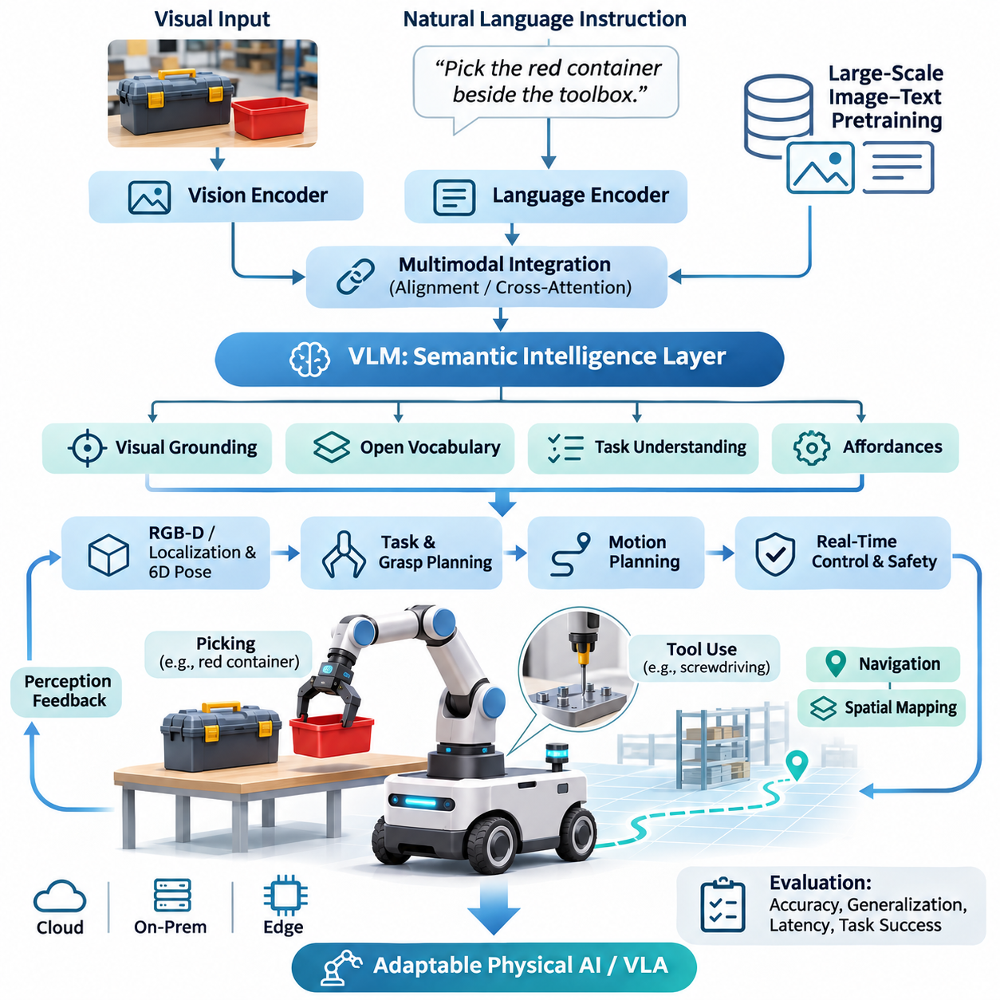
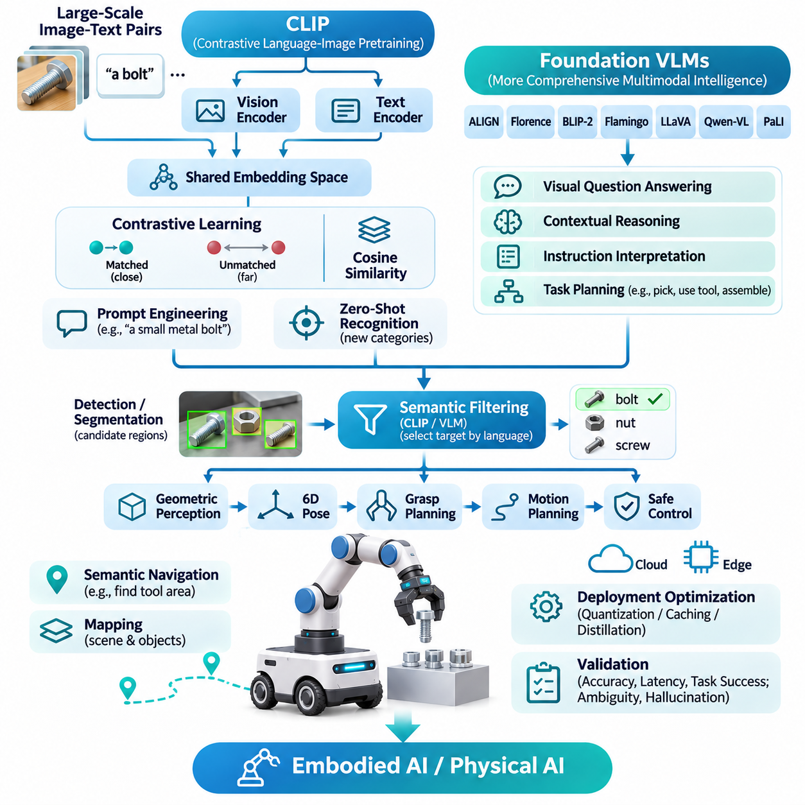
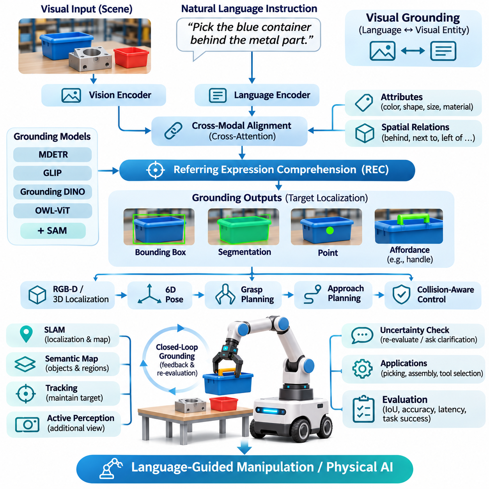
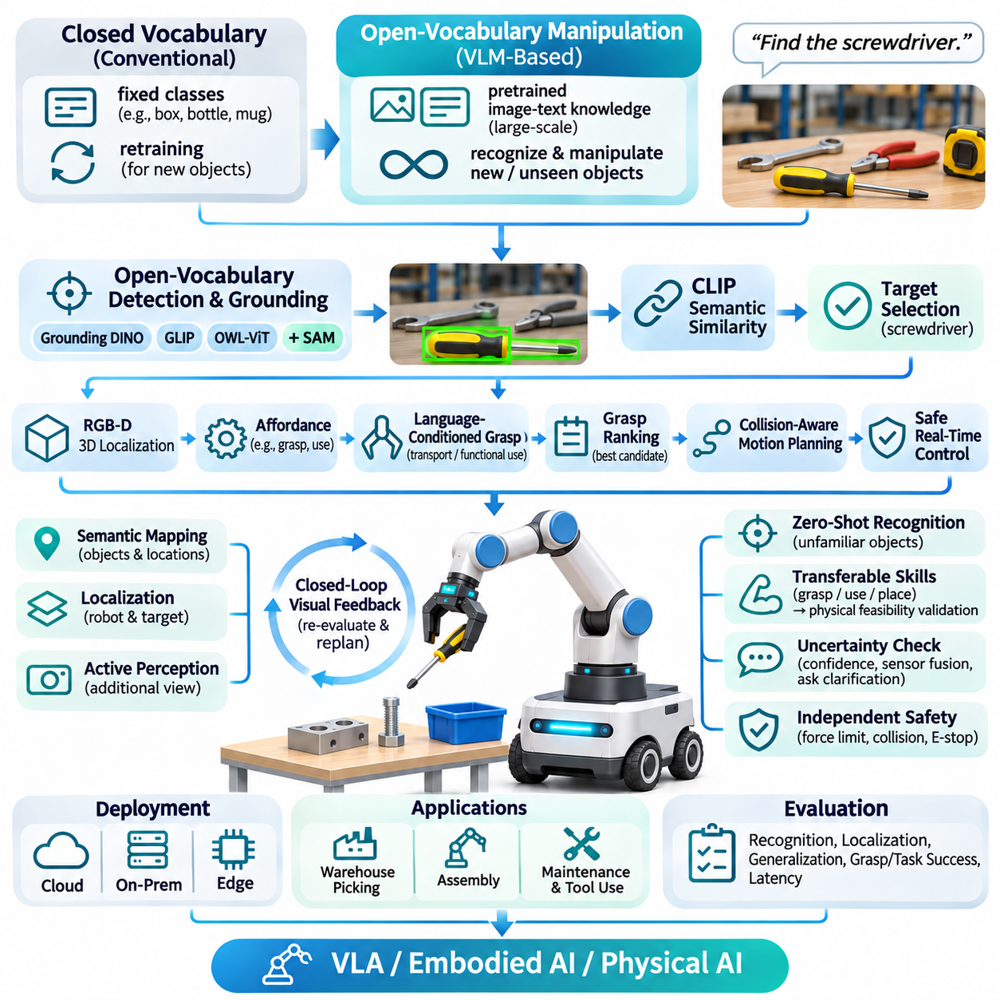
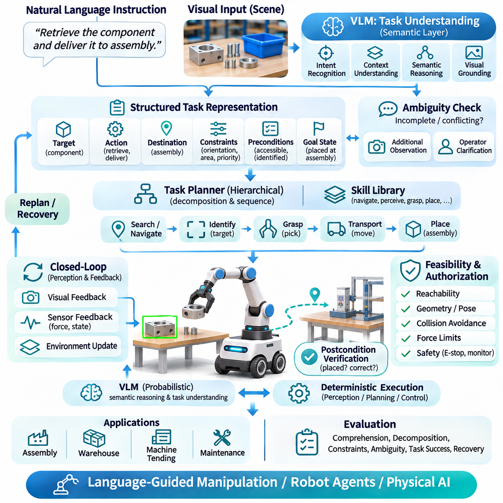
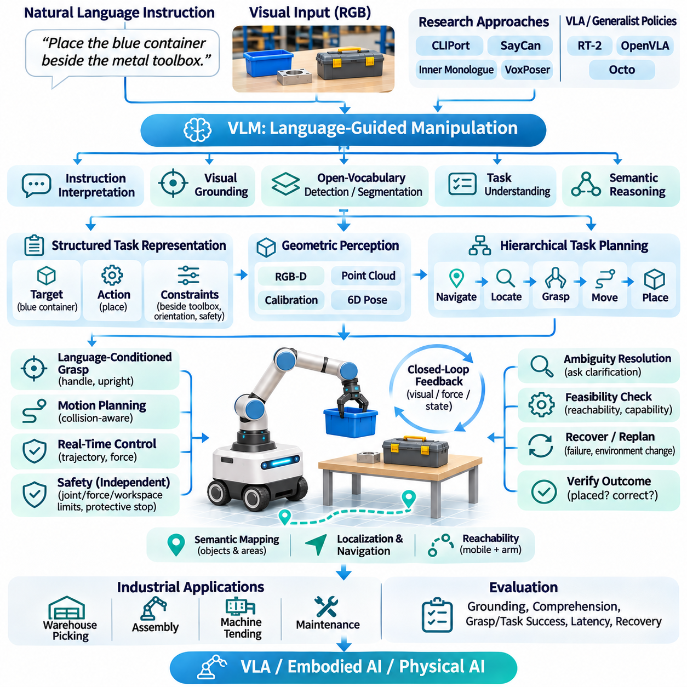
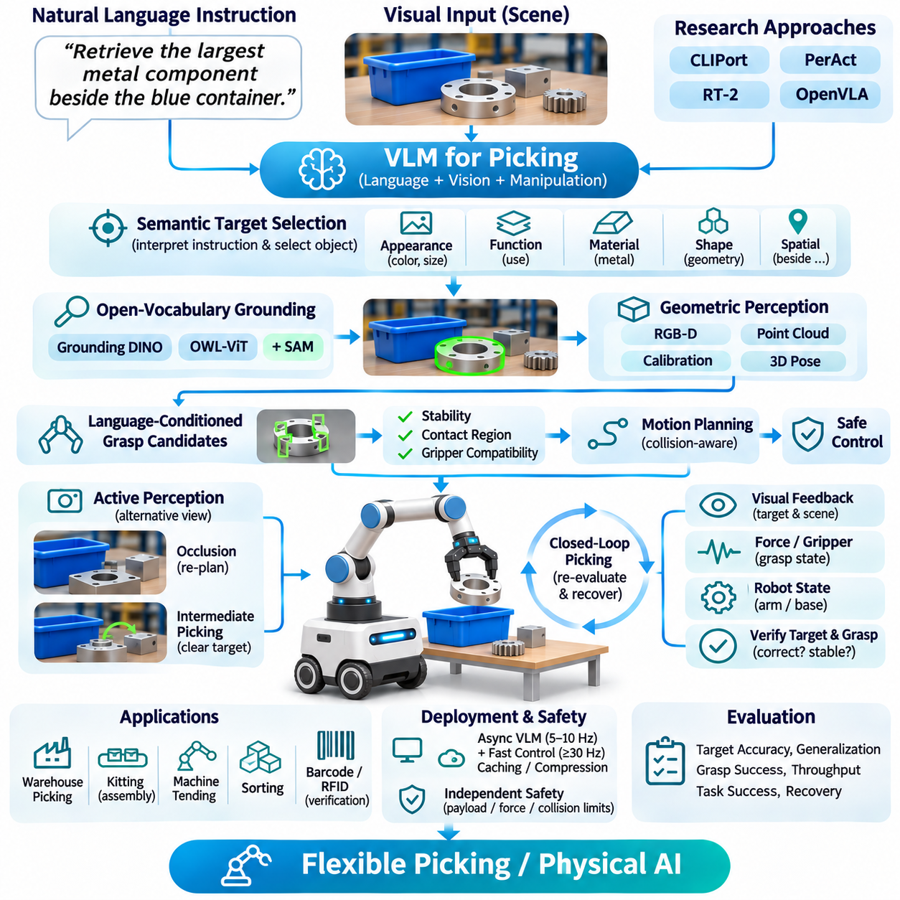
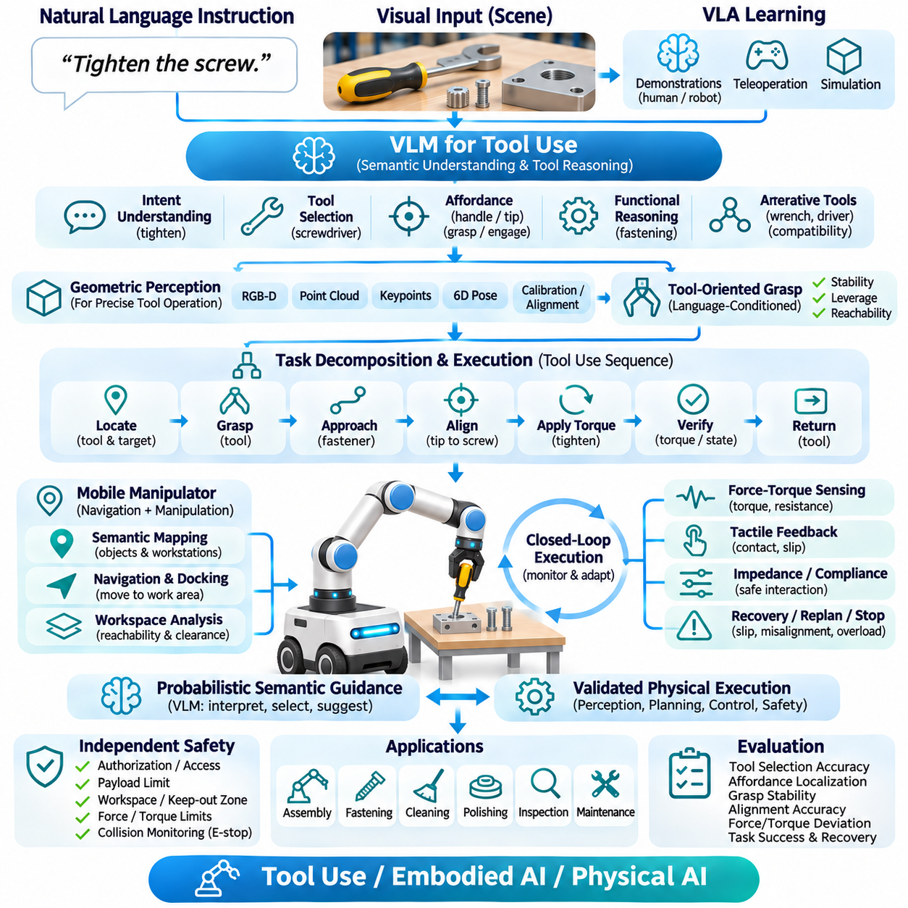
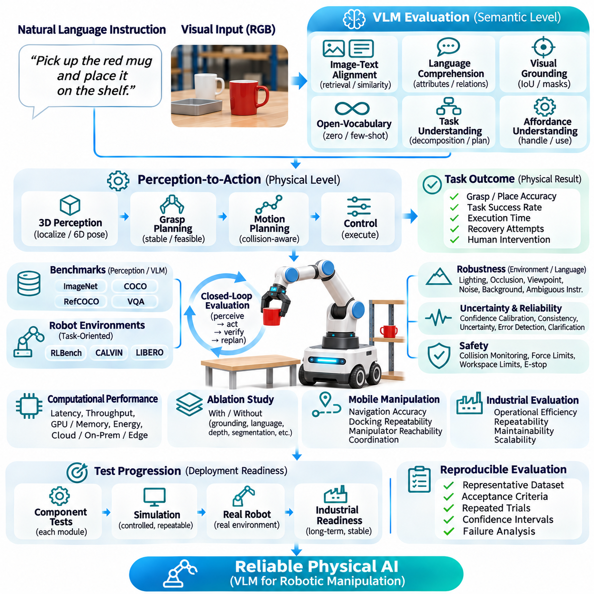

**Volume 03. Vision Manipulation and AI**

# Chapter 09. VLM for Manipulation

## 01 VLM Overview

{width="7.268055555555556in" height="7.268055555555556in"}

Vision-Language Models (VLMs) represent a major advancement in robotic intelligence by integrating visual perception with natural language understanding. Unlike conventional computer vision systems that primarily identify predefined objects, VLMs enable robots to interpret visual environments in relation to linguistic instructions, semantic concepts, and contextual information. This capability establishes a foundation for intelligent and flexible robotic manipulation.

The fundamental objective of a VLM is to establish meaningful relationships between visual and linguistic information. Images captured by cameras are transformed into visual representations, while natural language instructions are converted into textual representations. These representations are aligned or integrated within a multimodal architecture, enabling the model to associate physical objects, environmental conditions, and spatial relationships with human intentions.

A typical VLM architecture consists of a vision encoder, a language encoder or language model, and a multimodal integration mechanism. The vision encoder extracts visual features from images, while the language component processes textual information. Depending on the architecture, contrastive learning, projection layers, or cross-attention mechanisms connect these modalities, allowing the system to perform semantic matching, visual reasoning, and contextual interpretation.

Large-scale pretraining is an important characteristic of modern VLMs. By learning from extensive collections of image-text pairs, these models acquire knowledge about object categories, visual attributes, functional relationships, and environmental contexts. This pretrained knowledge supports generalization beyond narrowly defined training datasets, reducing the dependence on application-specific annotations when developing robotic perception and manipulation systems.

In robotic manipulation, VLMs provide a semantic intelligence layer above conventional perception and motion control systems. Traditional object detection determines where an object is located, while pose estimation identifies its position and orientation. A VLM extends these capabilities by interpreting what the object represents, why it is relevant to a particular task, and how it may be associated with the requested manipulation objective.

Visual grounding is a fundamental mechanism connecting language instructions with physical entities. When an operator instructs a robot to pick up the red container beside a toolbox, the system must associate linguistic expressions with corresponding regions in the visual scene. Grounding enables the identification of relevant objects based on appearance, location, attributes, and contextual relationships, providing meaningful inputs for subsequent manipulation processes.

Open-vocabulary perception further expands the operational flexibility of robotic systems. Conventional detection models are generally restricted to object categories defined during training. VLM-based approaches can recognize or retrieve objects using previously unseen textual descriptions, although recognition reliability depends on model capabilities and environmental conditions. This flexibility is particularly valuable in high-mix manufacturing and unstructured environments.

Task understanding enables robots to interpret manipulation objectives beyond simple object recognition. A natural language instruction may describe a desired outcome, specify operational constraints, or establish relationships between multiple objects. A VLM can contribute to interpreting these requirements and extracting task-relevant information, which a dedicated task planner can subsequently transform into executable robotic actions and logical operation sequences.

Language-guided manipulation integrates semantic understanding with physical execution. An instruction is interpreted to identify target objects, desired actions, and environmental constraints. The resulting semantic information is transferred to object localization, six-dimensional pose estimation, grasp planning, and motion planning modules. This architecture connects human communication with precise robotic execution while preserving specialized control functions.

In picking applications, VLMs enable robots to select objects according to natural language descriptions rather than relying exclusively on predefined product identifiers. A warehouse robot may receive instructions describing an object\'s appearance, packaging, or intended destination. The VLM identifies potential targets, while geometric perception and grasp planning determine whether the selected object can be safely and reliably retrieved from its current location.

Tool use represents another important application of vision-language intelligence. A robot must distinguish between objects based on their functional properties and determine which tool is appropriate for a requested task. VLMs can provide semantic information about tools, components, and potential affordances. However, physical feasibility, tool orientation, contact conditions, and required forces must be validated through specialized perception and control mechanisms.

For mobile manipulators, VLMs support semantic understanding across both navigation and manipulation environments. As the autonomous mobile robot changes its position, the manipulator encounters different viewpoints, obstacles, and object arrangements. Integrating VLM outputs with spatial mapping, localization, and environmental perception allows the robotic system to maintain task relevance while adapting its observations and manipulation strategies.

A practical VLM-based manipulation architecture must distinguish semantic reasoning from physical control. Although a VLM can identify an appropriate object or suggest a manipulation strategy, it does not inherently guarantee accurate metric localization, collision-free trajectories, or stable grasping. Dedicated geometric algorithms, kinematic models, motion planners, and real-time controllers remain essential for translating semantic predictions into physically executable actions.

Deployment requires careful consideration of computational resources, inference latency, and operational reliability. Large VLMs may operate on cloud servers or on-premises computing infrastructure, while optimized models can support edge deployment. Hybrid architectures allow computationally intensive semantic reasoning to execute remotely while maintaining time-critical perception, safety monitoring, and motion control functions within the robot\'s onboard computing environment.

Performance evaluation must address both semantic intelligence and physical task execution. Relevant metrics include object recognition accuracy, visual grounding accuracy, instruction comprehension, generalization capability, inference latency, and manipulation success rate. Testing should also consider ambiguous instructions, unfamiliar objects, occlusion, changing illumination, and unexpected environmental conditions to identify limitations before industrial deployment.

Ultimately, VLMs establish an important connection between human intentions, environmental perception, and robotic manipulation. Their integration with conventional vision systems, geometric reasoning, task planning, and motion control provides a foundation for more adaptable robotic intelligence. This progression supports the development of multimodal foundation models, Vision-Language-Action (VLA) models, Embodied AI, and general-purpose Physical AI systems.

## 02 CLIP and Foundation VLMs

{width="7.268055555555556in" height="7.268055555555556in"}

Contrastive Language-Image Pretraining (CLIP) represents a foundational approach to connecting visual perception with natural language understanding. Developed by OpenAI, CLIP introduced a scalable method for learning relationships between images and textual descriptions through large-scale multimodal training. Its ability to associate visual content with linguistic concepts provides an important technological foundation for intelligent robotic manipulation.

Traditional computer vision models are generally trained using predefined object categories and manually annotated datasets. Their recognition capabilities are therefore limited by the classes represented during training. CLIP addresses this limitation by learning from image-text pairs, allowing visual concepts to be associated with natural language descriptions rather than relying exclusively on fixed classification categories.

The CLIP architecture consists of two independent neural network components: a vision encoder and a text encoder. The vision encoder transforms input images into high-dimensional feature vectors, while the text encoder converts linguistic descriptions into corresponding numerical representations. Both encoders project their outputs into a shared embedding space, where semantic relationships between visual and textual information can be evaluated.

Contrastive learning constitutes the fundamental training mechanism of CLIP. During training, corresponding image-text pairs are encouraged to produce similar representations, while unrelated pairs are encouraged to produce dissimilar representations. This optimization process enables the model to establish meaningful associations between visual appearances, linguistic expressions, object attributes, and broader semantic concepts.

The shared embedding space enables semantic similarity to be calculated between visual observations and natural language descriptions. Cosine similarity is commonly employed to measure the relationship between normalized feature vectors. In robotic applications, this mechanism allows candidate objects or image regions to be compared against textual instructions, supporting language-based object identification and semantic target selection.

Zero-shot recognition is one of the most significant capabilities introduced by CLIP. Instead of retraining a classification network whenever new object categories are introduced, the system can construct textual descriptions of candidate categories and compare their embeddings with visual observations. This approach enables recognition of categories that were not explicitly represented in task-specific supervised training datasets.

Prompt engineering plays an important role in determining the effectiveness of CLIP-based recognition. Different linguistic descriptions of the same object may generate different semantic representations and recognition results. Providing contextual information about object appearance, intended function, material properties, or environmental relationships may improve the model\'s ability to distinguish between visually similar manipulation targets.

In robotic manipulation, CLIP can function as a semantic filtering mechanism within a larger perception pipeline. Conventional object detection or segmentation algorithms generate candidate regions from camera observations, while CLIP evaluates their semantic relevance to natural language instructions. The selected candidates are subsequently processed by geometric perception, object pose estimation, and grasp planning modules.

For example, a mobile manipulator operating in a manufacturing environment may receive an instruction to retrieve a small metallic component used for fastening. A CLIP-based perception system can compare visual candidates against descriptions of bolts, nuts, screws, and other components. This semantic comparison assists target selection without requiring every possible component to belong to a dedicated classification model.

Foundation Vision-Language Models extend the principles established by CLIP toward more comprehensive multimodal intelligence. While CLIP primarily focuses on semantic alignment and similarity measurement, advanced foundation VLMs incorporate mechanisms for visual question answering, contextual reasoning, image interpretation, and natural language generation. These capabilities support more sophisticated interactions between humans and robotic systems.

Representative foundation VLM architectures include ALIGN, Florence, BLIP, BLIP-2, Flamingo, LLaVA, and multimodal models within the Qwen-VL and PaLI families. Although their training strategies and architectural designs differ, these models share the objective of integrating visual and linguistic knowledge. Some emphasize representation learning, while others support generative reasoning and instruction-driven multimodal interactions.

Generative foundation VLMs provide capabilities that extend beyond image-text similarity. By connecting visual encoders with large language models, these architectures can generate descriptions, answer questions about observed environments, and interpret complex instructions. In robotic manipulation, they may assist in understanding object relationships, identifying operational requirements, and proposing sequences of task-level actions.

The integration of foundation VLMs with robotic manipulation requires a clear separation between semantic intelligence and physical execution. A model may correctly identify the desired object or recommend an appropriate manipulation strategy without determining its precise three-dimensional position or physical properties. Dedicated perception, kinematics, motion planning, and control systems must therefore validate and execute the proposed actions.

For mobile manipulators, foundation VLMs provide opportunities to connect semantic navigation with object manipulation. Visual observations acquired from different locations can be associated with natural language descriptions of workstations, storage areas, tools, and target objects. When integrated with spatial mapping and localization, these capabilities support flexible task execution across changing industrial and logistics environments.

Computational efficiency remains an important consideration when deploying CLIP and foundation VLMs on robotic platforms. Lightweight encoders may support onboard semantic recognition, while larger generative models may require dedicated GPU resources or remote computing infrastructure. Model quantization, feature caching, knowledge distillation, and hybrid edge-cloud architectures can help balance inference performance and computational requirements.

Despite their capabilities, CLIP and foundation VLMs exhibit limitations involving spatial precision, domain-specific recognition, visual ambiguity, and semantic hallucination in generative models. Reliable industrial deployment requires application-specific validation using unfamiliar objects, complex backgrounds, varying illumination, and ambiguous instructions. Evaluation should address semantic accuracy, inference latency, target selection reliability, and physical task success.

Ultimately, CLIP and foundation VLMs establish a technological bridge between conventional computer vision and general-purpose robotic intelligence. Their ability to connect visual observations with natural language concepts supports open-vocabulary manipulation, semantic task understanding, and flexible human-robot interaction. Integration with action-oriented models further contributes to Embodied AI and the evolution of Physical AI systems.

## 03 Visual Grounding

{width="7.268055555555556in" height="7.268055555555556in"}

Visual grounding is a fundamental capability of Vision-Language Models (VLMs) that establishes relationships between natural language expressions and specific visual entities within an observed environment. In robotic manipulation, visual grounding enables a robot to identify the physical objects, regions, and spatial relationships referenced by human instructions, thereby connecting semantic understanding with practical manipulation objectives.

Conventional object detection primarily identifies and localizes objects belonging to predefined categories. Visual grounding extends this capability by associating linguistic descriptions with corresponding visual regions. Instead of simply detecting a container, a grounding system can identify the blue container located behind a metallic component, incorporating object attributes, spatial relationships, and contextual information into the identification process.

The fundamental architecture of a visual grounding system integrates visual feature extraction, linguistic feature extraction, and cross-modal alignment. A vision encoder processes images to generate spatial feature representations, while a language encoder interprets textual instructions. Multimodal integration mechanisms establish correspondences between linguistic concepts and visual features, enabling the localization of referenced entities within the scene.

Cross-attention mechanisms play an important role in modern visual grounding architectures. Visual and linguistic representations interact through attention layers that evaluate relationships between image regions and textual tokens. This interaction enables the model to emphasize task-relevant visual information while suppressing unrelated environmental features, improving its ability to interpret complex descriptions within cluttered operational environments.

Referring Expression Comprehension (REC) is a representative visual grounding task that identifies an object or region described by a natural language expression. Unlike general image classification, REC requires the system to distinguish between multiple potentially similar objects. Expressions involving color, shape, size, material, relative position, and functional characteristics provide semantic constraints that guide the identification process.

Visual grounding can generate different forms of spatial output depending on the application and model architecture. Bounding boxes provide approximate object localization, while segmentation masks identify more detailed object boundaries. Point-based grounding identifies specific locations associated with linguistic instructions. These representations provide complementary information for robotic perception, target selection, and subsequent geometric processing.

Representative visual grounding models include MDETR, GLIP, Grounding DINO, and OWL-ViT. These architectures integrate visual and linguistic information through different combinations of multimodal transformers, contrastive learning, and language-conditioned detection. Grounding models can also be combined with segmentation foundation models such as the Segment Anything Model (SAM) to obtain more precise object-level segmentation.

In robotic manipulation, visual grounding connects natural language instructions with geometric perception. After identifying the relevant object or region, the system can integrate RGB-D observations, depth measurements, and camera calibration parameters to estimate three-dimensional coordinates. The resulting spatial information supports object pose estimation, grasp candidate generation, approach planning, and collision-aware motion execution.

Spatial relationship reasoning is particularly important when multiple objects share similar visual characteristics. Instructions involving expressions such as left of, behind, inside, above, or next to require the system to evaluate relationships between environmental entities. Since spatial interpretations may depend on the observer\'s viewpoint, robotic systems must establish appropriate coordinate frames and reference conventions before executing manipulation tasks.

Affordance grounding extends conventional object-level grounding toward identifying functional regions associated with particular actions. Instead of locating an entire object, the system may identify a handle suitable for grasping, a button suitable for pressing, or a surface suitable for placement. These semantic predictions provide useful manipulation objectives, although physical feasibility must still be verified through geometric and mechanical analysis.

For mobile manipulators, visual grounding must accommodate changes in camera viewpoint, robot position, object visibility, and environmental configuration. Integrating grounding results with simultaneous localization and mapping, semantic maps, and object tracking enables the system to maintain associations between linguistic references and physical entities. Active perception can acquire additional observations when target identification remains uncertain.

Closed-loop visual grounding combines semantic target identification with continuous environmental feedback. During manipulation, the robot can acquire updated images, reevaluate the referenced object, and correct its approach when environmental conditions change. This iterative process reduces dependence on initial observations and supports adaptive manipulation in dynamic environments where objects may move or become partially occluded.

Industrial applications of visual grounding include warehouse picking, component retrieval, assembly assistance, tool selection, and material handling. An operator may describe a required component using its appearance, functional purpose, or storage location rather than a predefined identifier. This capability improves operational flexibility in high-mix manufacturing environments where object categories and production configurations frequently change.

Reliable visual grounding requires careful management of semantic ambiguity, prediction uncertainty, and environmental variability. Similar-looking objects, incomplete instructions, reflective surfaces, poor illumination, and occlusion may produce incorrect grounding results. Confidence thresholds, geometric consistency checks, additional observations, and operator clarification can reduce the probability of selecting inappropriate manipulation targets.

Performance evaluation should consider both semantic localization accuracy and downstream manipulation reliability. Relevant metrics include Intersection over Union (IoU), grounding accuracy, segmentation accuracy, target selection success rate, inference latency, and physical manipulation success rate. Evaluation datasets should incorporate unfamiliar objects, complex relational expressions, cluttered environments, and multiple observation viewpoints to assess practical generalization.

Ultimately, visual grounding establishes a critical connection between linguistic intelligence, spatial perception, and physical interaction. Its integration with open-vocabulary detection, three-dimensional perception, task planning, grasp planning, and motion control enables robots to translate human instructions into meaningful physical objectives. This capability provides an essential foundation for language-guided manipulation, Embodied AI, and advanced Physical AI systems.

## 04 Open Vocabulary Manipulation

{width="7.268055555555556in" height="7.268055555555556in"}

Open-vocabulary manipulation represents an advanced robotic capability in which objects and manipulation objectives can be identified through natural language descriptions rather than predefined object categories. By integrating Vision-Language Models (VLMs) with robotic perception, task planning, and motion control, this approach enables robots to interact with unfamiliar objects and adapt to changing operational environments without extensive application-specific retraining.

Conventional robotic manipulation systems typically depend on closed-vocabulary perception models trained to recognize a fixed set of object categories. Introducing new objects frequently requires additional data collection, annotation, model retraining, and system validation. Open-vocabulary manipulation addresses this limitation by leveraging large-scale pretrained visual and linguistic representations that support more flexible object recognition and semantic interpretation.

The fundamental principle of open-vocabulary manipulation is to associate natural language concepts with visual observations and physically executable actions. When a robot receives an instruction, the language component interprets the requested object and manipulation objective. The perception component searches the environment for corresponding visual entities, while specialized planning and control modules determine how the requested interaction can be physically accomplished.

Open-vocabulary object detection provides an essential perception capability for this architecture. Models such as Grounding DINO, GLIP, and OWL-ViT enable object localization based on textual queries rather than exclusively predefined classification labels. These models can be combined with segmentation architectures such as the Segment Anything Model (SAM) to generate detailed object masks that support subsequent geometric analysis and manipulation planning.

Semantic feature representations enable robots to distinguish objects based on appearance, material, shape, function, and contextual relationships. Contrastive Language-Image Pretraining (CLIP) provides a shared embedding space in which visual observations and textual descriptions can be compared. This capability allows robots to evaluate multiple candidate objects and select those that exhibit the strongest semantic correspondence with the requested manipulation task.

Zero-shot manipulation refers to performing manipulation tasks involving objects or task conditions not explicitly encountered during task-specific training. Open-vocabulary perception contributes to this capability by recognizing unfamiliar object categories through natural language descriptions. However, successful physical execution also requires transferable manipulation skills, reliable geometric perception, appropriate grasp configurations, and validated control strategies.

A practical open-vocabulary manipulation pipeline begins with natural language interpretation and semantic target identification. The detected object is subsequently segmented, localized in three-dimensional space, and evaluated using geometric perception. Grasp candidates are generated and ranked according to physical feasibility, collision constraints, and task requirements, allowing semantic understanding to be translated into executable robotic trajectories.

Affordance understanding extends open-vocabulary manipulation beyond object recognition by identifying potential functional interactions. A robot may interpret an unfamiliar container as an object that can be grasped, opened, filled, or transported. Vision-language representations can provide semantic guidance concerning such actions, while geometric analysis, contact modeling, force estimation, and physical constraints determine whether the proposed interaction is feasible.

Language-conditioned grasp planning allows grasp configurations to be selected according to task-specific requirements rather than geometric stability alone. For example, grasping a screwdriver for transportation differs from grasping it for functional use. Natural language instructions can provide constraints regarding preferred contact regions, object orientation, and intended actions, enabling the grasp planner to consider both semantic relevance and mechanical feasibility.

For mobile manipulators, open-vocabulary manipulation extends across navigation, environmental exploration, object retrieval, and physical interaction. A robot may receive an instruction to locate a particular tool somewhere within a manufacturing facility. Semantic mapping, localization, visual grounding, and active perception enable the robot to search relevant locations before establishing an appropriate manipulation configuration.

Closed-loop perception and action are essential for maintaining reliable performance in dynamic environments. After selecting a target object, the robot continuously acquires updated observations and evaluates whether the object remains consistent with the original instruction. When object movement, occlusion, or environmental changes occur, the system can update its semantic and geometric representations before replanning the manipulation trajectory.

Industrial applications include flexible manufacturing, high-mix assembly, warehouse picking, component retrieval, maintenance assistance, and tool handling. Open-vocabulary manipulation reduces dependence on rigid object taxonomies and dedicated recognition models for every product variation. Nevertheless, industrial applications involving visually similar components or strict traceability requirements must incorporate additional identification and verification mechanisms.

Deployment requires balancing semantic reasoning capabilities with computational efficiency and operational reliability. Large foundation VLMs may execute on cloud or on-premises computing infrastructure, while optimized perception models operate on embedded robotic processors. Time-critical motion control, collision monitoring, and protective safety functions should remain independent of uncertain or delayed language-model predictions.

Open-vocabulary manipulation introduces challenges involving semantic ambiguity, unfamiliar physical properties, incorrect object identification, and limited generalization. A model may recognize an object\'s intended function without accurately estimating its weight, friction, rigidity, or mechanical constraints. Confidence calibration, multimodal sensor fusion, geometric verification, and operator clarification are therefore important mechanisms for managing uncertainty.

Performance evaluation should measure open-vocabulary recognition accuracy, target localization precision, unseen-object generalization, grasp success rate, task completion rate, and inference latency. Evaluation scenarios should incorporate unfamiliar categories, diverse object geometries, ambiguous instructions, cluttered environments, and changing operational conditions to determine whether semantic generalization produces reliable physical performance.

Ultimately, open-vocabulary manipulation establishes a foundation for flexible robotic systems capable of interpreting diverse human instructions and interacting with previously unfamiliar physical objects. Its integration with foundation models, Vision-Language-Action (VLA) models, learning-based manipulation policies, and Embodied AI supports the transition from narrowly specialized industrial automation toward more adaptable and general-purpose Physical AI systems.

## 05 Task Understanding

{width="7.268055555555556in" height="7.268055555555556in"}

Task understanding is a fundamental capability of Vision-Language Models (VLMs) that enables robotic systems to interpret human intentions, environmental conditions, and operational objectives. In robotic manipulation, task understanding extends beyond identifying individual objects by determining what actions are required, which objects are involved, and what physical outcomes must be achieved to satisfy a given instruction.

Conventional robotic systems generally execute predefined task sequences developed through explicit programming. Although these systems provide reliable performance in structured environments, they exhibit limited flexibility when operational requirements change. VLM-based task understanding introduces a semantic interpretation layer that allows robots to process natural language instructions in conjunction with visual observations.

The fundamental objective of task understanding is to transform human instructions into structured task representations. These representations may include target objects, requested actions, destination locations, operational constraints, preconditions, and desired final states. By extracting such information, a robotic system can establish meaningful connections between linguistic descriptions and physically executable manipulation tasks.

Multimodal information processing plays an important role in task understanding. Language processing identifies the semantic content of an instruction, while visual perception provides information about the physical environment. By integrating these modalities, a VLM can associate abstract task objectives with observable objects, spatial relationships, environmental conditions, and potential opportunities for physical interaction.

Intent recognition enables robotic systems to identify the underlying purpose of human instructions. For example, an instruction to prepare a workstation may imply organizing components, retrieving tools, and removing unnecessary objects. Understanding such intentions requires contextual reasoning beyond literal language interpretation, together with application-specific knowledge that defines acceptable operational outcomes and constraints.

Contextual understanding allows robots to interpret instructions according to the current environmental and operational state. The same command may require different actions depending on object availability, workstation configuration, equipment status, or previous task execution. Integrating visual observations with contextual information enables robotic systems to adapt their interpretation rather than relying on fixed action sequences.

Task decomposition transforms complex operational objectives into smaller and more manageable subtasks. A request to retrieve a component and deliver it to an assembly station may involve environmental exploration, object identification, navigation, grasping, transportation, and placement. VLMs can contribute to identifying these subtasks, while dedicated task planners establish their execution order and operational dependencies.

Semantic reasoning supports the interpretation of relationships between objects, actions, and functional requirements. A robot instructed to retrieve an appropriate fastening tool must distinguish between available tools according to their intended functions and compatibility with the target component. Such reasoning provides valuable task-level guidance, although functional compatibility and physical feasibility require further verification.

Task constraints define the conditions under which robotic actions must be performed. Natural language instructions may specify preferred grasping regions, object orientations, restricted areas, handling requirements, or task priorities. These semantic constraints must be converted into measurable operational parameters and integrated with motion planning, collision avoidance, force control, and independent safety mechanisms.

Task understanding also involves interpreting preconditions and postconditions associated with physical actions. Before grasping an object, the robot must verify its accessibility, identity, and suitable grasp configuration. After completing the action, the system must determine whether the object has been successfully secured or placed. Such state-based reasoning establishes a systematic connection between task objectives and observable execution results.

For mobile manipulators, task understanding must integrate navigation and manipulation requirements within a unified operational framework. A single instruction may involve locating a workstation, navigating through a facility, identifying a target object, and performing a physical operation. The semantic task representation must therefore accommodate spatial information, mobile platform capabilities, manipulator reachability, and environmental constraints.

Ambiguity management is essential when human instructions contain incomplete, inconsistent, or context-dependent information. Multiple objects may satisfy the same description, or the requested destination may not be clearly specified. Robotic systems should identify unresolved task parameters and obtain additional visual observations or operator clarification instead of executing actions based on unsupported assumptions.

Closed-loop task understanding enables robotic systems to continuously evaluate whether ongoing actions remain consistent with the original task objective. Updated visual observations, sensor measurements, and execution feedback provide information about environmental changes and action outcomes. When unexpected conditions occur, the system can revise its task representation and initiate appropriate replanning or recovery procedures.

Industrial applications of VLM-based task understanding include flexible assembly, warehouse order fulfillment, machine tending, component retrieval, maintenance assistance, and workstation preparation. Natural language interfaces can reduce the effort required to configure new operational tasks. However, production environments require validated skill libraries, standardized task interfaces, traceability, and deterministic execution boundaries.

Reliable deployment requires a clear separation between probabilistic semantic interpretation and deterministic execution requirements. VLM-generated task representations should be evaluated against available robot capabilities, authorized operations, physical constraints, and safety requirements before execution. This architectural separation prevents unsupported semantic predictions from directly generating potentially unsafe physical actions.

Performance evaluation should address instruction comprehension accuracy, task decomposition quality, constraint interpretation, ambiguity resolution, task completion rate, and recovery effectiveness. Evaluation scenarios should incorporate unfamiliar objects, complex instructions, changing environmental conditions, and unexpected execution failures to determine whether semantic understanding produces reliable physical outcomes.

Ultimately, task understanding establishes a central connection between human intentions, multimodal perception, robotic reasoning, and physical execution. Its integration with visual grounding, open-vocabulary manipulation, hierarchical task planning, robot skill libraries, and closed-loop control provides an important foundation for language-guided manipulation, autonomous robot agents, Embodied AI, and adaptable Physical AI systems.

## 06 Language Guided Manipulation

{width="7.268055555555556in" height="7.268055555555556in"}

Language-guided manipulation is an advanced robotic approach that enables physical interactions with objects according to natural language instructions. By integrating Vision-Language Models (VLMs), semantic perception, task planning, and robotic control, this approach allows robots to translate human intentions into meaningful physical actions. It provides a foundation for flexible automation and intuitive human-robot interaction.

Traditional robotic manipulation generally relies on predefined programs, fixed action sequences, and application-specific interfaces. Modifying operational tasks frequently requires additional programming and system configuration. Language-guided manipulation introduces a more flexible interaction mechanism in which operators can communicate desired objectives, object descriptions, and handling requirements through natural language.

The fundamental architecture of language-guided manipulation integrates instruction interpretation, visual grounding, geometric perception, task planning, and physical execution. Natural language instructions are processed to identify target objects, requested actions, and operational constraints. These semantic representations are subsequently transformed into structured manipulation objectives that specialized robotic modules can execute.

Visual grounding establishes the connection between linguistic instructions and physical entities within the observed environment. For example, an instruction to place the blue container beside the metallic toolbox requires the robot to identify both referenced objects and interpret their intended spatial relationship. Vision-language representations provide semantic guidance for target selection and environmental understanding.

Language-conditioned perception allows robotic systems to dynamically modify their visual processing objectives according to human instructions. Instead of continuously detecting only predefined object categories, the perception system can prioritize objects, attributes, and regions relevant to the requested operation. Open-vocabulary detection and segmentation models provide important capabilities for implementing this approach.

Geometric perception transforms semantically identified targets into spatial representations suitable for physical manipulation. RGB-D cameras, point clouds, camera calibration, and coordinate transformations provide the information required to estimate object positions, orientations, and accessible surfaces. These geometric representations bridge the gap between linguistic descriptions and precise manipulation requirements.

Hierarchical task planning decomposes complex language instructions into executable sequences of robotic skills. An instruction to retrieve a component from a shelf and deliver it to an assembly station may include navigation, object localization, grasping, transportation, and placement. Each subtask is associated with execution parameters, operational dependencies, and measurable completion conditions.

Language-conditioned grasp planning incorporates semantic requirements into the selection of physically feasible grasp configurations. Instructions may specify that an object should be held by its handle, maintained in an upright orientation, or grasped without covering a functional surface. Such requirements influence grasp candidate generation, contact region selection, approach direction, and collision-aware trajectory planning.

Several research architectures demonstrate different approaches to language-guided manipulation. CLIPort combines semantic representations with spatial manipulation learning, while SayCan evaluates language-generated actions against available robotic skills and their feasibility. Inner Monologue incorporates environmental feedback into language-based planning, and VoxPoser uses language-generated spatial objectives to support motion generation.

Vision-Language-Action (VLA) models extend language-guided manipulation by learning more direct relationships between visual observations, linguistic instructions, and robotic actions. Models such as RT-2, OpenVLA, and Octo illustrate different approaches to generalist robot policies, although their architectures and training methods differ. These systems aim to improve skill transfer and generalization across diverse manipulation tasks.

For mobile manipulators, language-guided manipulation must coordinate autonomous navigation with robotic arm operations. Natural language commands may describe tasks distributed across multiple workstations or storage locations. Integrating semantic mapping, spatial reasoning, mobile platform localization, and manipulator reachability allows robots to interpret and execute transportation and manipulation objectives within a unified framework.

Closed-loop language-guided manipulation incorporates continuous feedback from visual observations, force sensors, robot states, and action outcomes. The system evaluates whether each executed action satisfies the original instruction and expected physical conditions. When unexpected object movement, grasp failure, or environmental changes occur, the robot can update its interpretation and initiate appropriate recovery procedures.

Ambiguity resolution and uncertainty management are essential because natural language instructions may contain incomplete or context-dependent information. Multiple objects may satisfy the same description, or a requested action may exceed the robot\'s physical capabilities. Additional observations, confidence assessment, feasibility checks, and operator clarification help prevent incorrect interpretations from becoming physical execution errors.

Industrial applications of language-guided manipulation include warehouse picking, flexible assembly, machine tending, component retrieval, material handling, and maintenance assistance. Natural language interfaces can simplify task configuration in high-mix production environments. Nevertheless, industrial deployment requires validated skill libraries, standardized interfaces, traceability, and application-specific acceptance criteria.

Reliable deployment requires separating probabilistic language interpretation from deterministic motion control and independent safety functions. VLM-generated instructions and learned action policies must operate within validated physical and operational boundaries. Collision avoidance, joint limits, force limits, workspace restrictions, and protective stopping mechanisms remain essential regardless of the intelligence of the underlying model.

Performance evaluation should measure instruction comprehension accuracy, visual grounding reliability, task planning quality, grasp success rate, task completion rate, inference latency, and recovery effectiveness. Testing should incorporate unfamiliar objects, alternative linguistic expressions, complex spatial relationships, environmental disturbances, and multi-stage manipulation objectives to assess practical generalization.

Ultimately, language-guided manipulation establishes a unified connection between human communication, semantic intelligence, spatial perception, and physical execution. Its integration with foundation VLMs, transferable robotic skills, Vision-Language-Action models, and closed-loop control supports the transition from explicitly programmed automation toward adaptable robotic intelligence, Embodied AI, and general-purpose Physical AI systems.

## 07 VLM for Picking

{width="7.268055555555556in" height="7.268055555555556in"}

Vision-Language Models (VLMs) for robotic picking enable robots to identify, select, and retrieve physical objects according to natural language instructions and visual observations. By integrating semantic understanding with geometric perception, grasp planning, and motion control, VLM-based picking extends conventional robotic capabilities toward flexible object retrieval in diverse and dynamically changing environments.

Traditional robotic picking systems generally depend on predefined object categories, dedicated recognition models, and application-specific grasp configurations. Although these approaches provide reliable performance in structured environments, introducing unfamiliar products frequently requires additional engineering. VLM-based picking reduces this dependency by utilizing pretrained visual and linguistic representations.

The fundamental architecture of VLM-based picking integrates natural language interpretation, visual grounding, object segmentation, three-dimensional localization, grasp generation, and physical execution. The VLM determines which object should be retrieved, while specialized perception and manipulation modules establish how the selected object can be grasped and transported safely within the robot\'s operational constraints.

Language-conditioned object selection enables robots to identify picking targets using descriptions of appearance, functionality, material, shape, or spatial relationships. For example, an operator may instruct a robot to retrieve the largest metallic component beside a blue container. The VLM interprets these semantic attributes and evaluates visible candidate objects according to their correspondence with the instruction.

Open-vocabulary detection provides an important capability for identifying unfamiliar picking targets without restricting perception to predefined categories. Models such as Grounding DINO and OWL-ViT can localize objects through textual queries, while segmentation models such as SAM can refine object boundaries. These complementary capabilities support flexible target identification in high-mix picking environments.

Semantic target identification must be followed by geometric perception to establish physically meaningful picking parameters. RGB-D cameras, point clouds, and calibrated coordinate transformations enable the system to estimate object positions, orientations, dimensions, and accessible surfaces. These spatial representations provide the foundation for generating grasp candidates that correspond to the selected semantic target.

Language-conditioned grasp selection incorporates task-specific requirements into physical picking strategies. An instruction may require a robot to retrieve a fragile container without compressing its sides or to grasp a component without touching its functional surface. Semantic guidance identifies preferred interaction regions, while grasp planning evaluates contact geometry, stability, gripper compatibility, and collision constraints.

VLM-based bin picking introduces semantic reasoning into environments containing randomly arranged, overlapping, and partially occluded objects. Instead of selecting only the most accessible object, the robot can prioritize a particular component according to production requirements. When the requested target is obstructed, the system may plan intermediate picking actions or acquire additional observations to improve accessibility.

Active perception improves picking reliability when initial visual observations provide insufficient information. A mobile manipulator or wrist-mounted camera can acquire alternative viewpoints to reduce occlusion, distinguish visually similar objects, and improve spatial localization. The VLM can contribute to identifying information gaps, while viewpoint planning determines feasible sensing positions within the available workspace.

Research architectures demonstrate several approaches to integrating language and robotic picking. CLIPort combines semantic representations with spatial action learning for language-conditioned pick-and-place tasks. PerAct uses language-conditioned voxel representations for three-dimensional manipulation, while generalist robot policies such as RT-2 and OpenVLA learn relationships between visual observations, instructions, and actions.

For mobile manipulators, VLM-based picking extends beyond stationary workspaces by integrating semantic navigation, environmental exploration, and object retrieval. A robot may search multiple shelves or workstations to locate a requested component. Semantic maps support target discovery, while localization, docking, reachability analysis, and collision-aware motion planning establish suitable picking configurations.

Closed-loop picking combines continuous visual feedback with gripper measurements, force sensing, and robot state information. After grasp execution, the system verifies whether the intended object has been successfully secured and whether its condition remains acceptable. Incorrect object selection, unstable grasps, or unexpected movement may trigger renewed perception, alternative grasp generation, or controlled recovery.

Industrial applications include warehouse order fulfillment, high-mix manufacturing, machine tending, component kitting, spare-part retrieval, and automated sorting. VLM-based picking can simplify the introduction of new products and support natural language task configuration. However, visually similar components and strict traceability requirements necessitate additional verification through barcodes, RFID, or manufacturing databases.

Computational optimization is particularly important in high-throughput picking environments. Large VLMs may perform semantic interpretation at relatively low frequencies, while lightweight detection, pose estimation, grasp generation, and motion control modules execute at higher frequencies. Feature caching, model compression, and asynchronous processing can reduce inference overhead without unnecessarily repeating semantic analysis.

Reliable deployment requires managing semantic ambiguity, incorrect grounding, limited physical knowledge, and uncertain model predictions. VLM confidence alone cannot guarantee correct object identification or mechanical grasp feasibility. Independent verification, validated skill libraries, payload restrictions, force limits, collision monitoring, and protective safety mechanisms must constrain physical picking operations.

Performance evaluation should measure target selection accuracy, grounding precision, unseen-object generalization, grasp success rate, picking throughput, task completion rate, and recovery effectiveness. Testing should incorporate cluttered bins, unfamiliar products, variable lighting, ambiguous instructions, and environmental disturbances. These measurements help distinguish semantic perception failures from physical execution failures.

Ultimately, VLM-based picking establishes a connection between natural language communication, semantic intelligence, geometric perception, and reliable physical manipulation. Its integration with foundation models, Vision-Language-Action models, autonomous mobile platforms, and closed-loop robotic control supports the transition toward flexible warehouse automation, intelligent manufacturing, and general-purpose Physical AI systems.

## 08 VLM for Tool Use

{width="7.268055555555556in" height="7.268055555555556in"}

Vision-Language Models (VLMs) for robotic tool use enable robots to identify tools, understand their functional purposes, and perform physical operations according to natural language instructions. Unlike conventional object manipulation, tool use requires understanding the relationships between a tool, a target object, and an intended physical outcome. This capability represents an important step toward general-purpose robotic intelligence.

Conventional industrial robots typically use predefined tools with explicitly programmed operating sequences and calibrated mechanical interfaces. Although these systems provide reliable performance in structured environments, adapting them to unfamiliar tools requires additional engineering. VLM-based tool use introduces semantic flexibility by associating visual observations with functional knowledge derived from large-scale multimodal pretraining.

The fundamental architecture of VLM-based tool use integrates instruction interpretation, tool identification, affordance understanding, geometric perception, task planning, and physical execution. The VLM provides semantic guidance regarding which tool should be selected and how it is intended to interact with the target object, while specialized manipulation and control modules determine whether the proposed operation is physically feasible.

Language-conditioned tool selection enables robots to identify appropriate tools according to their intended functions rather than relying exclusively on predefined object categories. For example, a robot instructed to tighten a mechanical fastener must distinguish among screwdrivers, wrenches, and other available tools. Visual recognition and semantic reasoning support this selection, while dimensional and mechanical compatibility require additional verification.

Affordance understanding plays a central role in robotic tool use by identifying functional interaction regions and potential actions associated with physical objects. A screwdriver contains a handle suitable for grasping and a tip designed for engagement with a fastener. VLMs can contribute to identifying these semantic relationships, while geometric perception determines the precise locations, orientations, and dimensions of the functional regions.

Geometric perception establishes the spatial information required for accurate tool manipulation. RGB-D cameras, point clouds, keypoint detection, and six-degree-of-freedom pose estimation enable robots to determine the positions and orientations of tools and target objects. Calibrated coordinate transformations connect these observations to the robot\'s reference frames, supporting precise alignment between the active tool surface and the intended interaction region.

Tool-oriented grasp planning differs from conventional grasp planning because a mechanically stable grasp does not necessarily support effective tool operation. The selected grasp must preserve functional accessibility, appropriate tool orientation, and sufficient mechanical leverage. Language-conditioned grasp planning combines semantic preferences with contact modeling, force closure, gripper compatibility, and manipulator reachability.

Task decomposition enables robots to transform complex tool-use instructions into sequential physical operations. A fastening task may involve locating the appropriate tool, grasping its handle, approaching the fastener, aligning the tool, applying torque, verifying completion, and returning the tool. Each operation requires specific preconditions, execution parameters, and measurable completion criteria that support reliable task coordination.

Contact-rich tool interaction requires sensing and control capabilities beyond those used in simple pick-and-place operations. Force-torque sensors, tactile feedback, impedance control, and compliance control enable robots to regulate physical interactions during fastening, insertion, scraping, polishing, and cleaning. VLM-generated semantic objectives must therefore be translated into bounded physical control parameters through validated execution modules.

Functional reasoning allows robots to associate unfamiliar tools with previously learned interaction concepts and potentially identify suitable alternatives. A robot may recognize that different brush designs can perform similar cleaning operations. However, semantic similarity does not establish mechanical equivalence, and alternative tools must be evaluated against material properties, geometric compatibility, operating limits, and task-specific safety requirements.

Vision-Language-Action (VLA) models extend robotic tool use by learning relationships between visual observations, language instructions, and physical action sequences. Training data may include human demonstrations, teleoperated robot trajectories, and simulated tool interactions. These approaches support skill transfer across related tasks, although successful generalization depends on training coverage, embodiment compatibility, and reliable contact-aware control.

For mobile manipulators, VLM-based tool use integrates autonomous navigation, tool retrieval, workstation identification, and physical task execution. A robot may retrieve a maintenance tool from a storage area before traveling to equipment requiring inspection or servicing. Semantic mapping, docking, manipulator reachability, and workspace analysis establish the spatial and operational conditions required for effective tool manipulation.

Closed-loop tool use continuously evaluates the relationship between intended actions and observed physical outcomes. Visual observations, force measurements, torque feedback, and robot state information provide evidence regarding tool alignment, engagement, and task progress. When slipping, excessive resistance, incorrect alignment, or unexpected movement occurs, the system must initiate controlled recovery, realignment, replanning, or safe termination.

Industrial applications include mechanical assembly, fastening, surface cleaning, polishing, inspection, maintenance assistance, and automated tool handling. VLM-based tool use can improve operational flexibility in high-mix manufacturing environments where different products require different tools and procedures. Nevertheless, industrial deployment requires validated tool libraries, calibrated interfaces, process-specific constraints, and operational traceability.

Reliable deployment requires separating probabilistic semantic reasoning from safety-critical physical execution. VLM confidence cannot independently guarantee correct tool selection, appropriate contact forces, or mechanical compatibility. Tool authorization, workspace restrictions, payload limitations, force and torque thresholds, collision monitoring, and independent protective mechanisms must constrain all physical tool-use operations.

Performance evaluation should measure tool selection accuracy, affordance localization precision, grasp stability, alignment accuracy, contact force deviation, task completion rate, and recovery effectiveness. Evaluation scenarios should incorporate unfamiliar tools, alternative tool designs, variable target geometries, ambiguous instructions, and environmental disturbances to distinguish semantic generalization from physical execution reliability.

Ultimately, VLM-based tool use establishes a connection between semantic intelligence, functional reasoning, geometric perception, and purposeful physical interaction. Its integration with foundation models, dexterous manipulation, transferable robotic skills, and closed-loop force control supports the evolution of mobile manipulators from specialized object-handling machines toward adaptable and general-purpose Physical AI systems.

## 09 VLM Evaluation

{width="7.268055555555556in" height="7.268055555555556in"}

Evaluation of Vision-Language Models (VLMs) for robotic manipulation requires assessing how effectively models connect visual perception, natural language understanding, semantic reasoning, and physical actions. Unlike conventional computer vision evaluation, VLM evaluation must consider not only whether a model correctly recognizes objects but also whether it understands instructions, identifies relevant interaction regions, and supports successful manipulation. The ultimate objective is to determine whether a VLM provides reliable intelligence for real-world robotic operations.

A comprehensive evaluation framework should examine several interconnected capabilities, including visual recognition, language comprehension, visual grounding, task understanding, spatial reasoning, action planning, and manipulation performance. Each capability represents a different stage in the perception-to-action pipeline. Evaluating these stages independently helps identify specific weaknesses, while integrated testing reveals whether errors propagate across the complete robotic system.

Visual-language alignment measures how accurately a model associates textual descriptions with corresponding visual content. Image-text retrieval accuracy, contrastive similarity, and classification performance can indicate whether the model has learned meaningful relationships between visual and linguistic representations. However, high alignment scores do not necessarily demonstrate accurate spatial understanding or physical interaction capabilities. Additional task-oriented evaluation is therefore required.

Visual grounding evaluation measures whether a VLM can locate the correct object or region based on a natural language expression. Metrics such as Intersection over Union (IoU), bounding box accuracy, localization precision, and segmentation quality provide quantitative measures of spatial correspondence. Evaluation scenarios should include multiple similar objects, partial occlusion, cluttered environments, and ambiguous descriptions to determine whether the model can reliably identify the intended target.

Language understanding evaluation examines whether a model correctly interprets instructions involving object attributes, spatial relationships, functional properties, and sequential operations. Test scenarios should include simple commands as well as complex instructions containing multiple conditions. The evaluation should distinguish between recognizing individual words and understanding the complete operational meaning of an instruction, particularly when task requirements involve implicit relationships.

Open-vocabulary generalization is an important evaluation dimension because VLM-based manipulation systems are expected to operate beyond predefined object categories. Models should be tested using unfamiliar objects, previously unseen product variations, different materials, and uncommon object configurations. Zero-shot and few-shot evaluation can reveal whether pretrained semantic knowledge transfers effectively to new manipulation scenarios without requiring extensive task-specific retraining.

Task understanding and reasoning evaluation determine whether a VLM can transform high-level instructions into physically meaningful manipulation objectives. A model may correctly identify an object but misunderstand the intended operation, required sequence, or completion condition. Evaluation should therefore examine task decomposition, action selection, prerequisite identification, and consistency between the interpreted instruction and the proposed manipulation strategy.

Affordance understanding evaluation focuses on whether the model can identify functional regions and appropriate interactions associated with objects. For example, a robot should distinguish between a container\'s handle, opening, and supporting surface when executing different operations. Relevant measurements include affordance localization accuracy, functional region classification, interaction feasibility, and consistency between predicted affordances and actual physical properties.

Manipulation-oriented evaluation must extend beyond semantic predictions to measure physical execution outcomes. Important metrics include grasp success rate, object localization error, pose estimation accuracy, placement accuracy, task completion rate, and interaction stability. These measurements reveal whether the semantic decisions produced by the VLM can be translated into reliable robotic behavior through perception, planning, and control modules.

End-to-end evaluation examines the complete robotic pipeline, beginning with natural language instructions and visual observations and ending with verified physical task completion. Representative scenarios include object retrieval, bin picking, tool selection, assembly assistance, and mobile manipulation. Task success rate, execution time, number of recovery attempts, and human intervention frequency provide practical indicators of system-level effectiveness.

Robustness evaluation examines how model performance changes under environmental and operational variations. Lighting changes, camera viewpoint differences, sensor noise, object displacement, background complexity, and partial occlusion can significantly affect visual understanding. Language variations, incomplete instructions, synonyms, and ambiguous expressions should also be included. Robustness testing helps determine whether a model maintains consistent behavior outside controlled laboratory conditions.

Reliability and uncertainty evaluation are particularly important for physical robotic systems. VLMs can generate confident but incorrect interpretations, incorrect object locations, or unsuitable action recommendations. Confidence calibration, prediction consistency, uncertainty estimation, and error detection should therefore be examined. A reliable system should recognize situations in which available evidence is insufficient and request additional observations or human clarification rather than proceeding with an unsupported action.

Benchmarking provides a standardized approach for comparing different VLM architectures and deployment configurations. General-purpose benchmarks such as ImageNet, COCO, RefCOCO, and VQA can assess supporting visual and language capabilities, while robotic environments such as RLBench, CALVIN, and LIBERO provide task-oriented evaluation opportunities. No single benchmark captures every aspect of physical manipulation, so multiple complementary datasets and real-robot experiments are necessary.

Simulation-based evaluation enables repeatable experiments across diverse object configurations, environmental conditions, and manipulation tasks. Simulators provide controlled environments for measuring task success, collision frequency, trajectory quality, and execution efficiency. However, simulation results may not accurately represent real-world friction, contact dynamics, sensor characteristics, and mechanical uncertainty. Sim-to-real validation is therefore essential before drawing conclusions about industrial readiness.

Real-world evaluation should measure performance under representative operational conditions, including changing workspaces, unfamiliar objects, different robot configurations, and continuous task execution. Mobile manipulators introduce additional factors such as navigation accuracy, docking repeatability, manipulator reachability, and coordination between the mobile platform and robot arm. These factors should be evaluated together with VLM reasoning to determine the actual effectiveness of the integrated system.

Computational performance is another important consideration for practical deployment. Evaluation should measure inference latency, throughput, memory consumption, GPU utilization, energy consumption, and communication overhead. Large VLMs may provide strong semantic reasoning but require substantial computational resources. Comparing cloud-based inference, on-premises deployment, and edge execution helps determine the appropriate architecture for different robotic applications.

Ablation studies help identify the contribution of individual components within a VLM-based manipulation architecture. Researchers can compare systems with and without visual grounding, language conditioning, depth information, object segmentation, or specialized manipulation modules. These experiments reveal which components contribute most significantly to performance improvements and whether additional model complexity produces measurable operational benefits.

Safety evaluation must examine whether VLM-generated decisions remain within predefined physical and operational constraints. Test cases should include incorrect tool selection, unsafe grasp proposals, unreachable targets, excessive contact forces, unexpected obstacles, and ambiguous commands. Independent safety controllers, collision monitoring, force limits, and emergency stopping mechanisms must remain effective regardless of the model\'s confidence or reasoning output.

For industrial applications, evaluation should also consider operational efficiency, repeatability, maintainability, and scalability. A model that performs well in isolated demonstrations may still be unsuitable for production if it requires frequent human intervention or exhibits inconsistent behavior across repeated operations. Long-duration testing, failure analysis, and statistical evaluation provide stronger evidence of deployment readiness than isolated successful demonstrations.

A practical evaluation process should establish representative datasets, define measurable acceptance criteria, conduct component-level benchmarking, perform integrated simulation experiments, and validate results on physical robots. Performance should be reported using consistent test conditions, repeated trials, confidence intervals, and clearly defined failure categories. This approach improves reproducibility and supports objective comparisons between different models and system architectures.

Ultimately, VLM evaluation must establish whether semantic intelligence can be converted into reliable physical performance. Recognition accuracy and language understanding are necessary but insufficient indicators of robotic capability. Comprehensive assessment must connect perception, reasoning, grounding, planning, control, and safety with measurable task outcomes. Such an evaluation framework provides the foundation for selecting, improving, and deploying VLM-based manipulation systems in industrial environments and general-purpose Physical AI applications.
