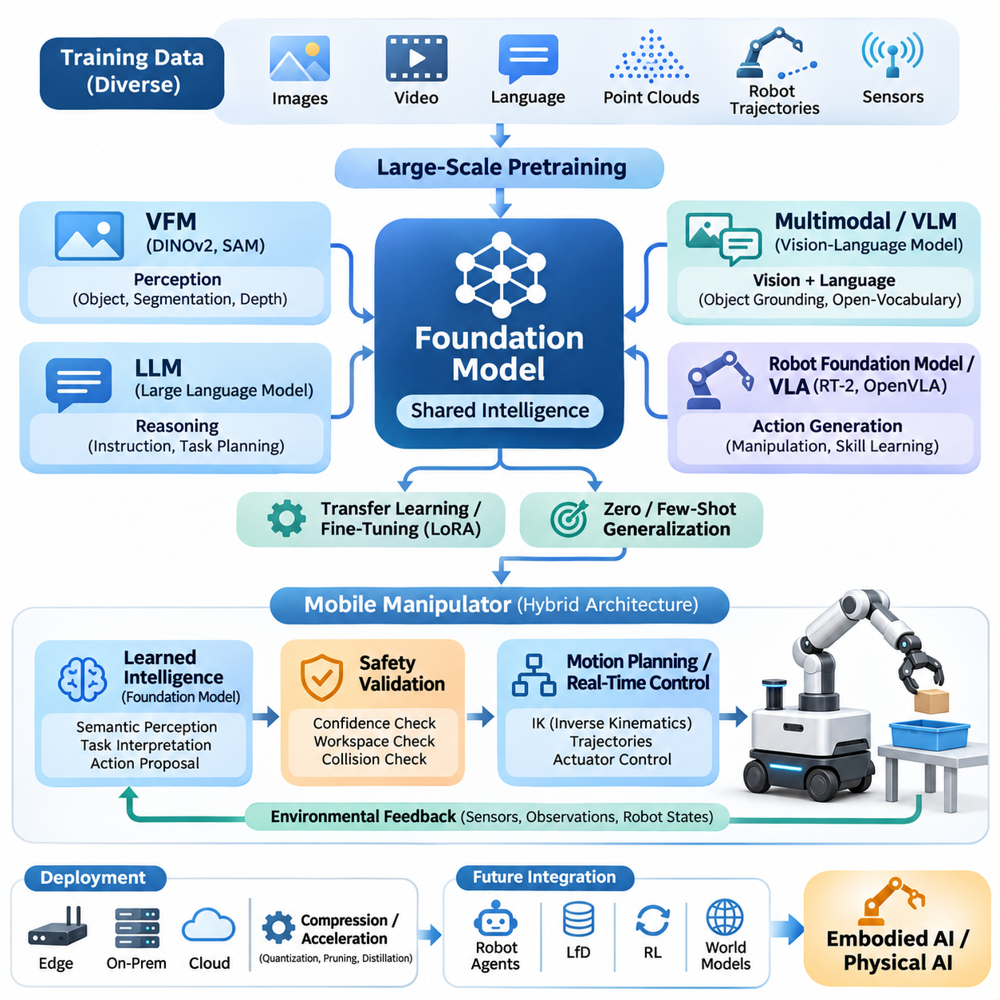
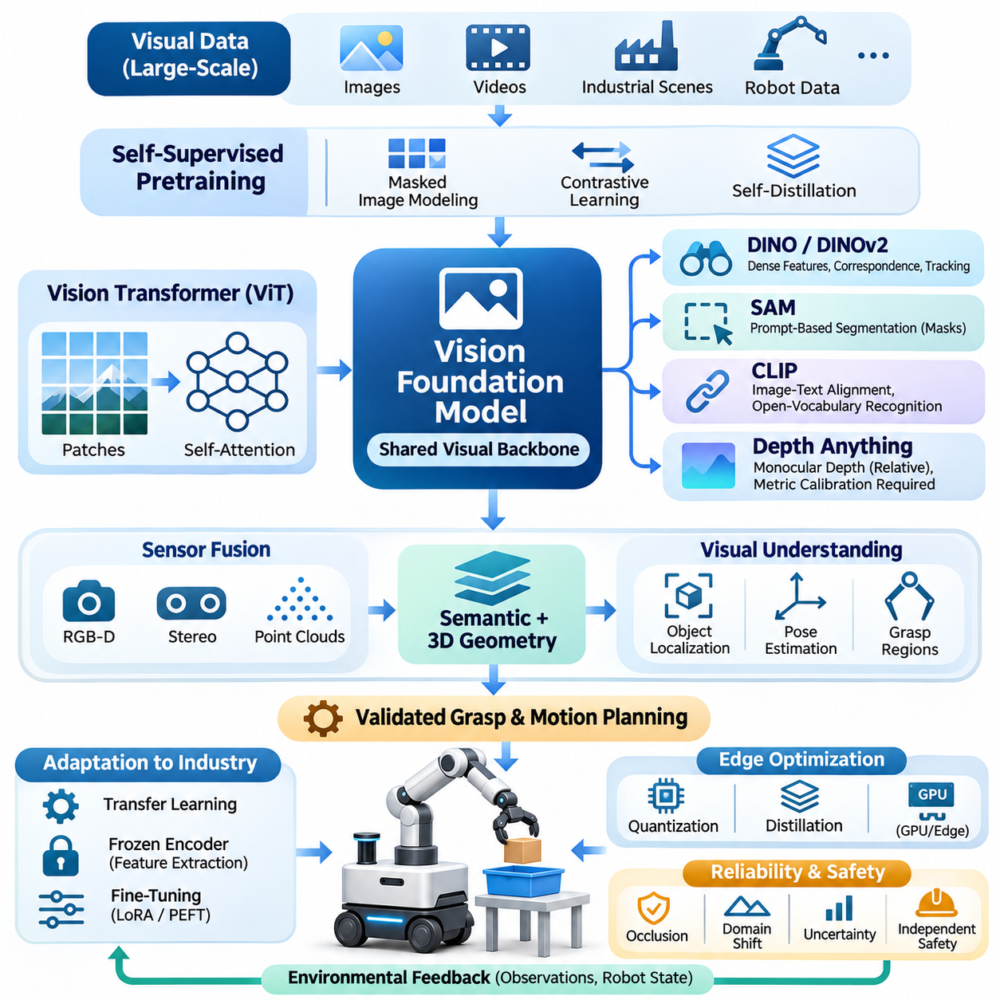
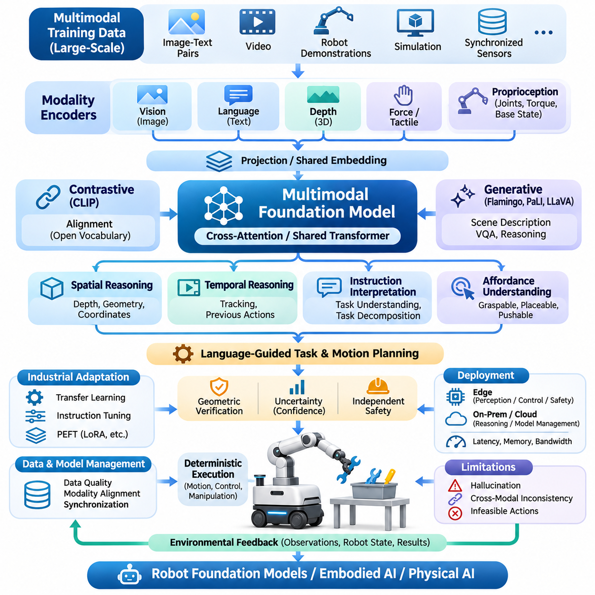
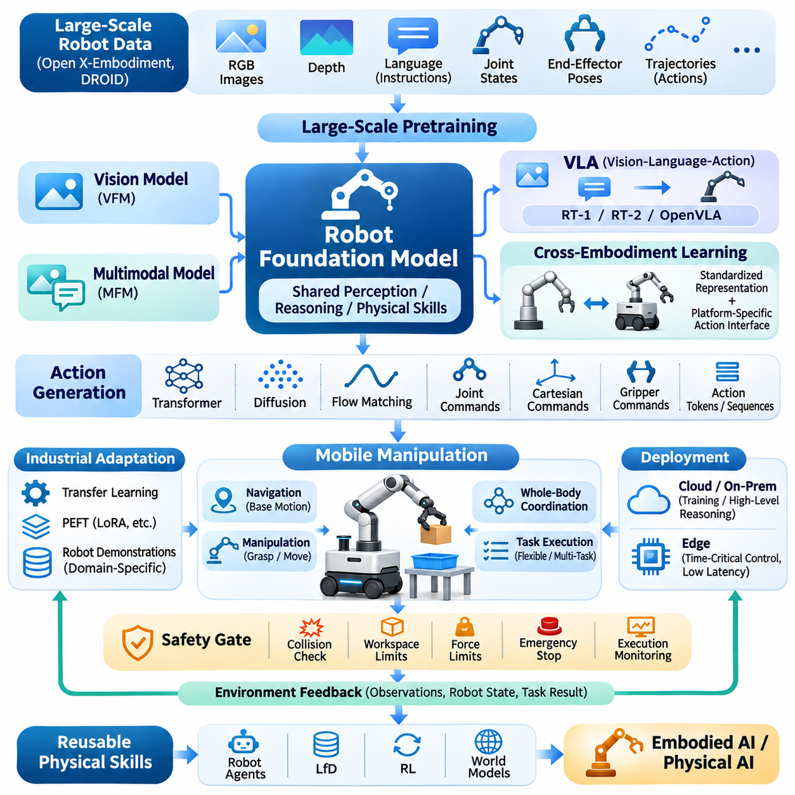
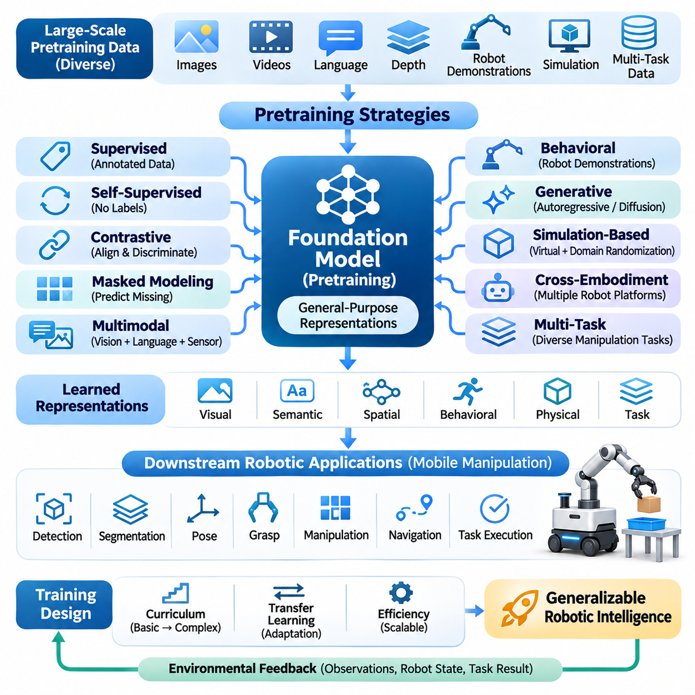
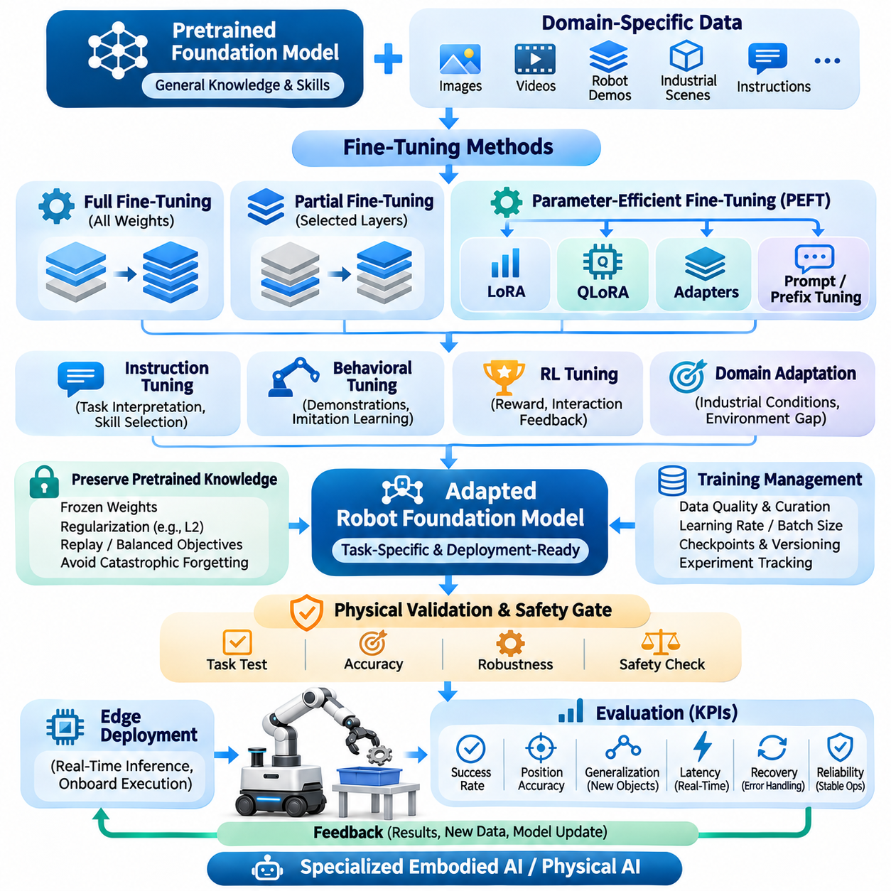
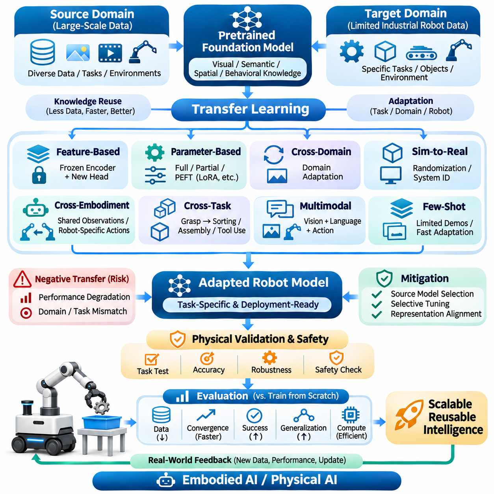
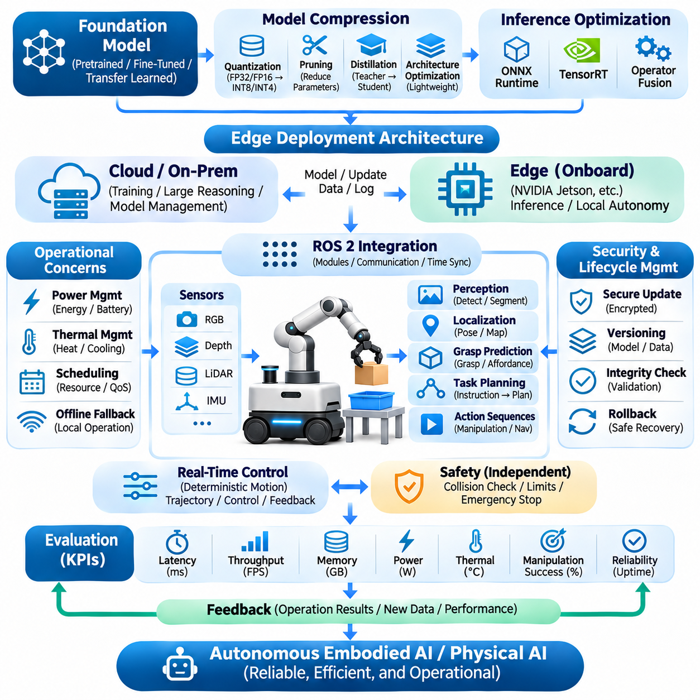
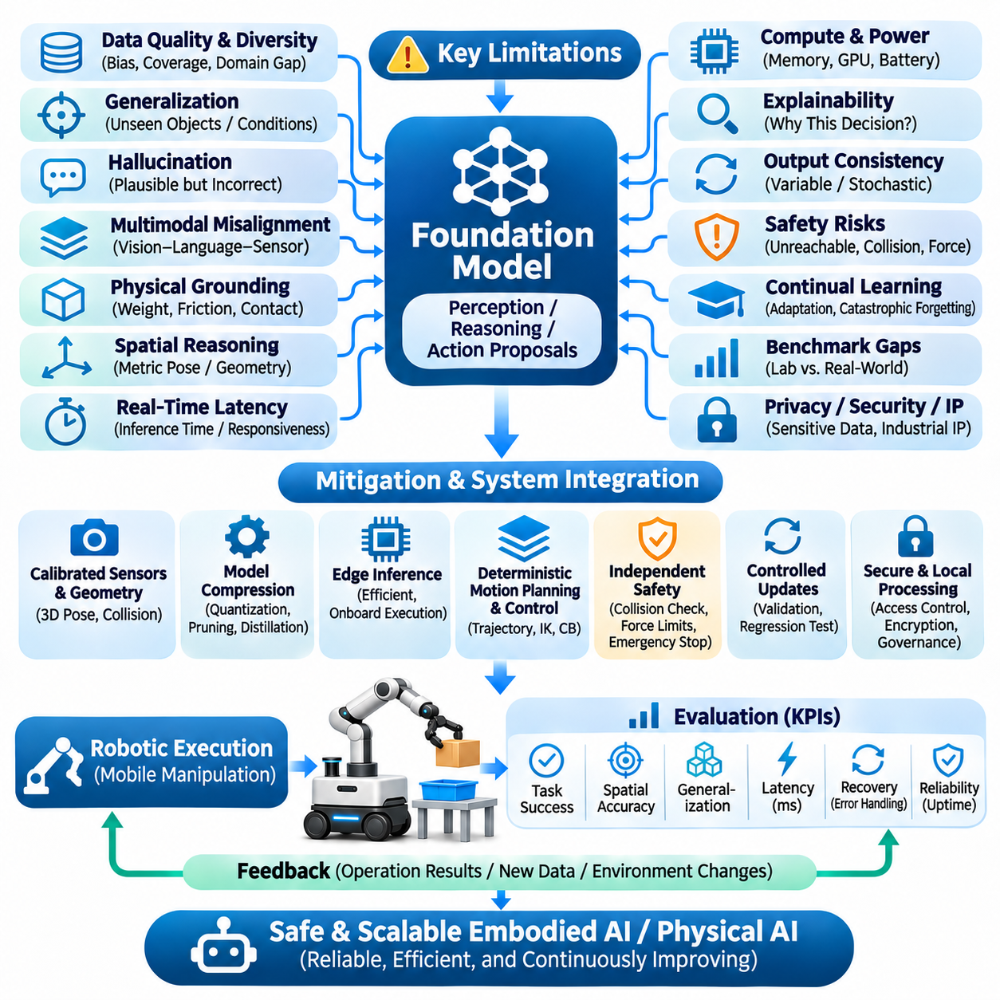

**Volume 03. Vision Manipulation and AI**

# Chapter 10. Foundation Models

## 01 Foundation Model Overview

{width="7.268055555555556in" height="7.268055555555556in"}

A foundation model is a large-scale artificial intelligence model pretrained on diverse datasets and designed to support a wide range of downstream tasks. Unlike conventional machine learning models developed for specific applications, foundation models acquire reusable representations of knowledge, perception, and behavior. These capabilities enable robotic systems to adapt to unfamiliar objects, environments, and operational requirements with relatively limited additional training.

In mobile manipulation, foundation models represent a transition from task-specific intelligence toward general-purpose robotic intelligence. Traditional robotic systems depend on independently developed algorithms for object detection, pose estimation, grasp planning, and task execution. Foundation models provide a shared intelligence layer that can connect these functions through common representations, reducing dependency on individually engineered perception and decision-making modules.

The fundamental principle of foundation models is large-scale pretraining. During pretraining, models learn statistical patterns, semantic relationships, spatial structures, and contextual dependencies from extensive datasets. Depending on the model architecture, training data may include images, videos, natural language, point clouds, robot trajectories, and sensor observations. The resulting representations can subsequently be adapted to specialized robotic applications.

Vision Foundation Models (VFMs) focus on extracting general-purpose visual representations from large image and video datasets. These models support object recognition, segmentation, feature extraction, depth estimation, and scene understanding. Models such as DINOv2 and Segment Anything demonstrate how pretrained visual intelligence can provide reusable perception capabilities without requiring extensive task-specific annotations for every industrial application.

Large Language Models (LLMs) contribute semantic understanding, contextual reasoning, knowledge representation, and high-level task decomposition. In robotic applications, language models can interpret human instructions, generate operational sequences, select available functions, and evaluate task requirements. However, language-based reasoning must be connected to physical observations and executable robot capabilities to produce meaningful manipulation behavior.

Multimodal Foundation Models extend these capabilities by integrating multiple information modalities within a unified learning architecture. Images, language, depth information, robot states, and other sensory observations can be represented jointly or through interconnected encoders. This integration allows robotic systems to associate semantic instructions with physical objects, environmental conditions, spatial relationships, and potential interaction opportunities.

Vision-Language Models (VLMs) are particularly important for mobile manipulation because they connect visual perception with natural language understanding. Rather than restricting recognition to predefined object categories, these models can support open-vocabulary perception and language-guided object selection. A mobile manipulator may identify a requested tool, interpret its functional purpose, and locate it within a previously unfamiliar operational environment.

Robot Foundation Models extend general-purpose learning into the physical action domain. These models learn relationships among sensory observations, task objectives, robot configurations, and manipulation actions. Training datasets may contain teleoperation demonstrations, autonomous robot trajectories, simulated interactions, and multi-robot experiences. The objective is to acquire transferable robotic skills that can support diverse manipulation tasks.

Vision-Language-Action (VLA) models represent an architectural approach that connects perception, semantic reasoning, and physical action generation. These models receive visual observations and language instructions and generate predicted robot actions or action sequences. Examples such as RT-2 and OpenVLA illustrate the potential of integrating semantic knowledge acquired through large-scale pretraining with robot-specific manipulation experience.

Generalization is one of the primary advantages of foundation models. A pretrained model may recognize objects, interpret instructions, or support tasks that were not explicitly represented in its downstream training dataset. Zero-shot and few-shot learning can reduce the effort required to introduce new operational capabilities. Nevertheless, generalization remains dependent on training diversity, environmental conditions, and the physical characteristics of the robot.

Transfer learning and fine-tuning provide practical mechanisms for adapting foundation models to industrial environments. Instead of training large neural networks from the beginning, developers initialize models using pretrained parameters and subsequently optimize them using domain-specific datasets. Parameter-efficient fine-tuning methods, including Low-Rank Adaptation (LoRA), can reduce computational requirements while preserving much of the original model capability.

Within a mobile manipulator architecture, foundation models generally operate above deterministic motion planning and real-time control layers. They can provide semantic perception, task interpretation, action proposals, and adaptive decision-making, while conventional robotic software performs inverse kinematics, trajectory generation, collision checking, and actuator control. This hybrid architecture combines learned intelligence with predictable physical execution.

Foundation model deployment introduces significant computational challenges. Large neural networks require substantial memory capacity, processing performance, and energy resources. Mobile manipulators must balance inference latency, model accuracy, battery consumption, and onboard computing limitations. Quantization, knowledge distillation, model compression, and hardware acceleration can improve deployment efficiency across edge, on-premises, and cloud computing environments.

Safety and reliability remain essential considerations when foundation models interact with physical environments. Model-generated predictions may contain semantic errors, incorrect spatial interpretations, or physically infeasible action proposals. Independent safety mechanisms, confidence assessment, workspace restrictions, collision avoidance, and execution monitoring must therefore validate model outputs before and during physical manipulation.

The future of foundation models in mobile manipulation involves integrating reusable perception, multimodal reasoning, transferable robotic skills, and continuous environmental interaction. Combined with robot agents, learning from demonstration, reinforcement learning, and world models, foundation models provide an important technological basis for Embodied AI and Physical AI systems capable of performing increasingly diverse tasks across industrial and service environments.

## 02 Vision Foundation Models

{width="7.268055555555556in" height="7.268055555555556in"}

Vision Foundation Models (VFMs) are large-scale artificial intelligence models pretrained on extensive visual datasets to acquire general-purpose visual representations. Unlike conventional computer vision models designed for individual recognition tasks, these models provide reusable visual intelligence across diverse applications, including object detection, image segmentation, depth estimation, feature extraction, and robotic scene understanding.

The fundamental objective of Vision Foundation Models is to learn transferable representations of visual information. During large-scale pretraining, these models acquire knowledge about object appearance, geometric structures, textures, spatial relationships, and environmental variations. The learned representations can subsequently be adapted to specialized robotic perception tasks without requiring the entire model to be trained from the beginning.

Traditional computer vision systems typically require separate datasets, model architectures, and training procedures for each perception task. Vision Foundation Models introduce a shared visual representation that can support multiple downstream applications. In mobile manipulation, this approach reduces redundant model development and provides a common perception backbone for object recognition, localization, segmentation, and interaction planning.

Vision Transformers (ViTs) constitute an important architectural foundation for modern Vision Foundation Models. Unlike conventional convolutional neural networks, Vision Transformers divide images into patches and process their relationships through self-attention mechanisms. This architecture enables models to capture both local visual characteristics and global contextual relationships, supporting perception in complex and partially obstructed environments.

Self-supervised learning plays a fundamental role in the development of Vision Foundation Models. Instead of relying exclusively on manually annotated datasets, self-supervised methods generate learning objectives from the visual data itself. Techniques such as masked image modeling, contrastive learning, and self-distillation enable models to acquire meaningful visual representations from large collections of unlabeled images and videos.

DINO and DINOv2 represent important examples of self-supervised visual representation learning. These models generate rich visual features that capture semantic information, object boundaries, and structural relationships. In mobile manipulation, their feature representations can support object correspondence, visual tracking, similarity-based recognition, and perception of previously unseen objects under changing environmental conditions.

The Segment Anything Model (SAM) demonstrates the potential of foundation models for general-purpose image segmentation. Through prompt-based segmentation, the model generates object masks using input points, bounding boxes, or other supported prompts. Robotic systems can utilize these segmentation capabilities to isolate target objects, distinguish overlapping components, and construct object-specific perception regions for subsequent manipulation tasks.

CLIP introduces a complementary approach by learning aligned visual and textual representations from large-scale image-text datasets. Although CLIP is a multimodal foundation model rather than a purely visual model, its pretrained visual encoder provides valuable semantic features for robotic perception. These capabilities support open-vocabulary recognition, language-guided object retrieval, and identification of unfamiliar object categories.

Monocular depth foundation models extend visual perception into the geometric domain by estimating scene depth from individual RGB images. Models such as Depth Anything provide reusable depth estimation capabilities across diverse environments. However, relative depth predictions must not be interpreted directly as metric distances without appropriate calibration, metric depth estimation, or integration with reliable three-dimensional sensing technologies.

For mobile manipulators, three-dimensional visual understanding is essential because successful manipulation requires accurate knowledge of object geometry, position, orientation, and surrounding obstacles. Vision Foundation Models can be integrated with RGB-D cameras, stereo vision systems, and point cloud processing algorithms. This combination connects semantic visual representations with geometric measurements required for reliable physical interactions.

Feature correspondence represents another important application of Vision Foundation Models. Dense visual features extracted from different observations can establish relationships between corresponding objects or surface regions. These capabilities contribute to multi-view perception, object tracking, pose estimation, and visual localization, particularly when a mobile manipulator observes the same object from different positions or viewing angles.

Vision Foundation Models also contribute to grasp detection and manipulation planning by providing object-specific visual representations. Segmentation masks, semantic features, and estimated geometric structures can help identify potential grasping regions and distinguish functional object components. Nevertheless, grasp stability, contact mechanics, approach feasibility, and collision risks must be evaluated using dedicated geometric or learned manipulation algorithms.

Industrial adaptation of Vision Foundation Models generally involves transfer learning, feature extraction, or parameter-efficient fine-tuning. Pretrained visual encoders can remain frozen while specialized prediction heads are trained using application-specific datasets. Alternatively, selected model parameters can be optimized to accommodate reflective materials, repetitive components, unusual lighting conditions, and other characteristics of industrial operating environments.

Deployment on mobile manipulators requires careful optimization of computational resources, inference latency, memory consumption, and energy efficiency. Large visual encoders may introduce processing delays that exceed real-time operational requirements. Model quantization, knowledge distillation, selective feature processing, and GPU acceleration can improve inference performance while maintaining sufficient perception accuracy for robotic applications.

Despite their advantages, Vision Foundation Models remain susceptible to domain shifts, visual ambiguities, occlusion, and inaccurate geometric interpretation. Their predictions do not inherently guarantee physical feasibility or operational safety. Reliable deployment requires application-specific validation, uncertainty assessment, sensor fusion, and independent safety mechanisms. Within a hybrid robotic architecture, these models provide a reusable visual intelligence backbone rather than a complete replacement for geometric perception and deterministic robotic control.

## 03 Multimodal Foundation Models

{width="7.268055555555556in" height="7.268055555555556in"}

Multimodal Foundation Models (MFMs) are large-scale artificial intelligence models designed to learn and integrate information from multiple data modalities within a unified computational framework. Unlike unimodal models that process only images, language, or other individual data types, multimodal foundation models establish relationships among heterogeneous information sources, enabling more comprehensive environmental understanding and intelligent decision-making.

In mobile manipulation, multimodal foundation models provide an intelligence layer that connects visual perception, semantic understanding, spatial reasoning, and physical interaction. A mobile manipulator must simultaneously interpret environmental observations, understand human instructions, evaluate its physical configuration, and determine appropriate actions. Multimodal learning provides a common framework for connecting these diverse operational requirements.

The fundamental principle of multimodal foundation models is cross-modal representation learning. Different information modalities are processed using specialized encoders that transform raw inputs into numerical feature representations. These representations can subsequently be projected into a shared embedding space, allowing the model to establish semantic and contextual relationships among images, language, sensor measurements, and robotic observations.

Multimodal architectures commonly employ modality-specific encoders, projection layers, attention mechanisms, and shared transformer networks. Visual encoders extract image features, language encoders process textual information, and additional sensory encoders represent depth, force, tactile signals, or robot states. Cross-attention mechanisms enable information from different modalities to interact, supporting context-dependent interpretation and integrated reasoning.

Contrastive learning represents an important training approach for multimodal foundation models. Models such as CLIP learn relationships between images and corresponding textual descriptions by increasing the similarity of matching representations while reducing the similarity of unrelated representations. This approach enables semantic alignment across modalities and supports open-vocabulary recognition without requiring predefined object categories.

Generative multimodal learning extends representation alignment into information generation and contextual reasoning. Models such as Flamingo, PaLI, and LLaVA demonstrate approaches for combining visual observations with language generation capabilities. In robotic applications, these architectures can support scene description, visual question answering, task interpretation, and reasoning about relationships among objects within the operational environment.

Spatial reasoning is particularly important when multimodal foundation models are applied to mobile manipulation. Understanding an object category is insufficient unless the robotic system can also determine its physical location, orientation, accessibility, and relationship to surrounding objects. Consequently, multimodal representations must be integrated with calibrated depth sensors, geometric perception algorithms, and coordinate transformation mechanisms.

Temporal multimodal learning enables robotic systems to interpret environmental changes across sequential observations. Instead of processing individual images independently, temporal architectures can incorporate video sequences, historical sensor measurements, and previous robot actions. These capabilities support object tracking, motion understanding, interaction prediction, and the interpretation of dynamic activities within industrial and service environments.

Multimodal foundation models can also incorporate proprioceptive information, including joint positions, joint velocities, actuator torques, and mobile platform states. Combining internal robot observations with external visual and linguistic information improves awareness of the relationship between the robot and its environment. This integration is especially important for contact-rich manipulation, coordinated mobile manipulation, and adaptive physical interaction.

Language-guided manipulation represents a practical application of multimodal foundation models. A human operator may instruct a mobile manipulator to retrieve a specific component, transport an object to a designated workstation, or organize tools according to their functional characteristics. The model interprets the instruction, associates linguistic concepts with visual observations, and provides contextual information for downstream task and motion planning.

Multimodal foundation models also support affordance understanding by connecting object appearance, semantic knowledge, and potential interaction opportunities. A robotic system may infer that a handle is suitable for grasping, a container can receive objects, or a button can be pressed. However, these semantic predictions must be validated against actual geometry, material properties, contact mechanics, and the physical capabilities of the manipulator.

Large-scale multimodal pretraining requires diverse datasets containing relationships among visual, linguistic, spatial, and behavioral information. Image-text pairs, video descriptions, robot demonstrations, simulated interactions, and synchronized sensor recordings can contribute complementary learning signals. Dataset quality, modality alignment, temporal synchronization, and environmental diversity directly influence the resulting model capabilities.

Adapting multimodal foundation models to industrial robotic applications frequently involves transfer learning, instruction tuning, and parameter-efficient fine-tuning. Developers can incorporate domain-specific terminology, equipment configurations, operational procedures, and manipulation demonstrations into the adaptation process. This approach preserves reusable pretrained knowledge while improving performance within specialized manufacturing and logistics environments.

Deployment introduces challenges related to computational complexity, communication bandwidth, memory consumption, and inference latency. Multimodal processing requires coordination among multiple encoders and potentially large reasoning networks. Distributed computing architectures can allocate computationally intensive reasoning to on-premises or cloud resources while maintaining latency-sensitive perception, execution, and safety functions on the mobile robot.

Despite their advantages, multimodal foundation models may produce hallucinations, inconsistent cross-modal interpretations, and physically infeasible recommendations. Reliable mobile manipulation therefore requires uncertainty assessment, geometric verification, independent safety mechanisms, and deterministic execution monitoring. Within a hybrid robotic architecture, multimodal foundation models provide integrated perception and semantic reasoning while supporting the development of robot foundation models, Embodied AI, and Physical AI.

## 04 Robot Foundation Models

{width="7.268055555555556in" height="7.268055555555556in"}

Robot Foundation Models (RFMs) are large-scale artificial intelligence models designed to acquire reusable robotic knowledge and transferable physical skills through extensive pretraining. Unlike conventional robotic learning models developed for individual tasks, robot foundation models aim to support diverse manipulation behaviors, operational environments, object categories, and robotic platforms within a common learning framework.

The emergence of robot foundation models represents a transition from task-specific robotic automation toward general-purpose robotic intelligence. Traditional robotic systems require separately engineered algorithms or independently trained policies for individual operations. Robot foundation models seek to reduce this dependency by learning shared representations of perception, task objectives, physical interactions, and action generation.

The fundamental principle of robot foundation models is learning relationships among environmental observations, robot states, task instructions, and physical actions. Training datasets may contain RGB images, depth measurements, natural language instructions, joint configurations, end-effector poses, and manipulation trajectories. These heterogeneous data sources enable models to learn connections between environmental understanding and executable behavior.

Robot Foundation Models extend the capabilities of vision and multimodal foundation models into the physical action domain. While vision models primarily extract visual representations and multimodal models integrate heterogeneous information, robot foundation models additionally learn how physical actions influence environmental states. This capability connects semantic understanding with interaction-oriented decision-making and robotic skill execution.

Vision-Language-Action (VLA) models represent an important architectural category within robot foundation models. These models integrate visual observations, natural language instructions, and robotic action representations within a unified learning architecture. By connecting semantic knowledge with physical behavior, VLA models enable robotic systems to interpret human instructions and generate corresponding manipulation actions or action sequences.

Google\'s Robotics Transformer models, including RT-1 and RT-2, demonstrate approaches to large-scale robotic learning. RT-1 learns manipulation policies from extensive real-world robotic demonstrations, while RT-2 integrates vision-language pretraining with robot action generation. These approaches illustrate how knowledge acquired from large-scale visual and linguistic datasets can contribute to transferable robotic manipulation capabilities.

OpenVLA represents an open-source approach to developing Vision-Language-Action models for robotic manipulation. By utilizing pretrained vision-language representations and diverse robot demonstration datasets, OpenVLA provides a foundation for adapting language-conditioned manipulation policies to different robotic systems. Such architectures can reduce development effort while supporting research into generalizable robotic intelligence.

Cross-embodiment learning is a particularly important objective of robot foundation models. Different robotic systems possess distinct kinematic structures, degrees of freedom, actuator characteristics, gripper configurations, and sensor arrangements. Cross-embodiment learning seeks to identify shared manipulation principles while accommodating platform-specific differences through standardized representations and embodiment-aware action interfaces.

Large-scale robotic datasets provide the essential training infrastructure for robot foundation models. Initiatives such as Open X-Embodiment and DROID collect diverse manipulation demonstrations across robotic platforms, objects, environments, and tasks. These datasets expose learning algorithms to variations in physical interactions, enabling the development of more transferable policies and reducing dependence on isolated robot-specific training environments.

Action representation significantly influences the architecture and performance of robot foundation models. Robotic actions may be represented through joint positions, Cartesian displacements, end-effector poses, gripper commands, discrete action tokens, or continuous action sequences. Transformer-based policies, diffusion-based architectures, and flow-matching methods provide alternative mechanisms for generating coordinated and context-dependent robotic behaviors.

Within mobile manipulation, robot foundation models must address both navigation and manipulation requirements. The robotic system must determine appropriate base positions, evaluate object accessibility, coordinate manipulator movements, and adapt to environmental changes. Integrating mobility-related observations with manipulation policies supports whole-body coordination, extended workspace utilization, and flexible task execution across distributed workstations.

Adapting robot foundation models to industrial environments generally requires domain-specific fine-tuning and physical validation. Manufacturing and logistics applications frequently involve specialized components, strict tolerances, repetitive workflows, and equipment-specific constraints. Transfer learning, parameter-efficient fine-tuning, and additional robot demonstrations can improve task performance while preserving reusable pretrained capabilities.

Deploying robot foundation models requires balancing computational performance, inference latency, memory consumption, and operational reliability. Large pretrained models may execute high-level reasoning or action sequence generation, while onboard controllers manage time-critical execution. Distributed architectures can allocate training and computationally intensive processing to external infrastructure while maintaining essential control functions locally.

Safety remains a fundamental requirement because robot foundation models generate predictions rather than guaranteed physically feasible actions. Incorrect object interpretations, unstable grasp proposals, unexpected contact, or unreachable target poses may result in operational failures. Independent collision checking, workspace restrictions, force limitations, emergency stopping mechanisms, and deterministic execution monitoring must therefore remain integral components of the robotic architecture.

Robot foundation models provide an important technological foundation for increasingly adaptable mobile manipulators and general-purpose robotic systems. Their integration with robot agents, learning from demonstration, reinforcement learning, and world models supports the development of reusable physical skills and context-aware decision-making. Within Embodied AI and Physical AI architectures, these models connect learned intelligence with continuous perception, action, and environmental interaction.

## 05 Pretraining Strategies

{width="7.268055555555556in" height="7.268055555555556in"}

Pretraining strategies are fundamental to the development of foundation models because they determine how reusable knowledge, general-purpose representations, and transferable capabilities are acquired before adaptation to specific applications. In mobile manipulation, effective pretraining enables robotic systems to learn visual perception, semantic relationships, spatial reasoning, and physical interaction patterns from diverse and extensive datasets.

The primary objective of pretraining is to establish a common intelligence foundation that can support multiple downstream robotic tasks. Instead of developing separate models for object recognition, grasp detection, pose estimation, and manipulation control, developers can utilize pretrained representations that capture shared characteristics across these applications. This approach reduces redundant training and improves development efficiency.

Supervised pretraining utilizes annotated datasets containing explicit relationships between input observations and desired outputs. In robotic perception, these annotations may include object categories, segmentation masks, bounding boxes, object poses, and grasp configurations. Although supervised learning provides clearly defined training objectives, its scalability is constrained by annotation costs, dataset diversity, and the availability of specialized robotic expertise.

Self-supervised pretraining enables foundation models to acquire meaningful representations without requiring extensive manual annotations. Learning objectives are generated directly from the structure and relationships within the available data. Techniques such as masked image modeling, self-distillation, and temporal prediction allow models to extract semantic, spatial, and structural knowledge from large collections of images, videos, and robot observations.

Contrastive pretraining focuses on learning relationships between corresponding and noncorresponding data samples. Representations associated with similar objects, matching observations, or related semantic descriptions are encouraged to become closer within an embedding space. This strategy supports visual correspondence, cross-modal alignment, open-vocabulary recognition, and transferable perception capabilities in robotic environments.

Masked modeling represents another important pretraining strategy in which selected portions of input data are intentionally hidden during training. The model learns to reconstruct missing information or predict representations of the masked regions using surrounding context. Applied to images, videos, and robotic observations, masked modeling encourages the acquisition of contextual relationships, geometric structures, and temporal dependencies.

Multimodal pretraining integrates heterogeneous information sources, including images, natural language, depth measurements, robot states, and sensory observations. Through cross-modal alignment and joint representation learning, models acquire relationships between semantic concepts and physical environments. These capabilities establish a foundation for language-guided manipulation, object grounding, and context-aware robotic task execution.

Behavioral pretraining utilizes large collections of robot demonstrations to learn relationships among observations, task instructions, and physical actions. Teleoperated demonstrations, autonomous execution records, and simulated trajectories provide examples of successful and unsuccessful interactions. Suitable learning objectives enable models to acquire manipulation skills such as reaching, grasping, lifting, placing, and tool handling.

Generative pretraining enables foundation models to learn the underlying distributions of visual observations, robot actions, and environmental transitions. Autoregressive architectures, diffusion models, and flow-matching methods can generate predictions or sequences conditioned on task objectives and sensory information. These approaches provide important foundations for action generation, trajectory prediction, and adaptive manipulation policies.

Simulation-based pretraining provides a scalable mechanism for generating robotic interaction data without relying exclusively on physical hardware. Virtual environments enable repeated experimentation across diverse object configurations, environmental conditions, and manipulation scenarios. Domain randomization and physically realistic simulation can improve robustness, although subsequent real-world validation remains essential.

Cross-embodiment pretraining incorporates demonstrations collected from robotic platforms with different mechanical structures, sensor configurations, and control interfaces. By utilizing standardized observations, normalized action representations, and embodiment-specific information, models can learn shared manipulation principles. This strategy aims to improve skill transfer across industrial robots, mobile manipulators, and general-purpose robotic platforms.

Multi-task pretraining exposes foundation models to diverse operational objectives within a common learning framework. Rather than optimizing policies exclusively for individual manipulation tasks, models learn reusable relationships across object retrieval, sorting, placement, assembly, and other activities. Balanced task sampling and appropriate training objectives are necessary to prevent dominant tasks from degrading performance on less represented tasks.

Curriculum learning organizes pretraining data and learning objectives according to progressively increasing complexity. Robotic models may initially acquire basic visual representations and elementary manipulation skills before learning sequential activities, dynamic interactions, and complex operational procedures. A carefully designed curriculum can improve training stability, computational efficiency, and the acquisition of hierarchical robotic capabilities.

Dataset design and quality management are critical determinants of pretraining effectiveness. Large datasets alone do not guarantee reliable generalization if they contain inconsistent annotations, redundant demonstrations, inaccurate sensor measurements, or insufficient behavioral diversity. Data filtering, calibration, temporal synchronization, trajectory normalization, and balanced sampling contribute to more dependable pretrained representations.

Large-scale pretraining requires substantial computational infrastructure, including GPU clusters, high-bandwidth storage systems, and distributed training frameworks. Distributed data parallelism, mixed-precision training, gradient accumulation, and efficient data-loading pipelines can improve resource utilization. Developers must balance model size, dataset coverage, training duration, computational expenditure, and downstream performance.

The effectiveness of pretraining must ultimately be evaluated through downstream robotic tasks rather than training loss alone. Generalization to unfamiliar objects, transferability across robotic platforms, manipulation success rates, and adaptation efficiency provide practical evaluation criteria. Combined with fine-tuning, transfer learning, and physical validation, effective pretraining establishes a reusable intelligence foundation for mobile manipulation, Embodied AI, and Physical AI.

## 06 Fine Tuning Methods

{width="7.268055555555556in" height="7.268055555555556in"}

Fine-tuning is the process of adapting a pretrained foundation model to specific downstream tasks, operational environments, or robotic platforms through additional training. Unlike large-scale pretraining, which focuses on acquiring general-purpose knowledge and reusable representations, fine-tuning emphasizes the specialization of existing capabilities. In mobile manipulation, this enables efficient adaptation to particular objects, equipment, and physical interaction requirements.

The primary objective of fine-tuning is to improve application-specific performance while preserving valuable knowledge acquired during pretraining. A robot foundation model may possess general manipulation capabilities but lack sufficient accuracy for specialized industrial operations. Fine-tuning enables the model to acquire domain-specific perception, task interpretation, grasping behavior, and action generation capabilities using comparatively smaller datasets.

Full fine-tuning involves updating all trainable parameters of a pretrained model using application-specific training data. This approach provides extensive flexibility when adapting models to environments that differ significantly from their original training distributions. However, full fine-tuning requires substantial computational resources, memory capacity, and training data, while introducing a risk of degrading previously acquired capabilities.

Partial fine-tuning reduces computational requirements by updating selected model layers while keeping the remaining parameters frozen. For example, a pretrained vision encoder may retain its general visual representations while specialized prediction heads or selected transformer layers are optimized. This approach is particularly useful when adapting foundation models to industrial object recognition, pose estimation, and manipulation planning.

Parameter-Efficient Fine-Tuning (PEFT) encompasses techniques designed to adapt large pretrained models by modifying only a relatively small number of parameters. Rather than updating the entire network, these methods introduce additional trainable components or selectively optimize existing parameters. PEFT reduces GPU memory requirements, training costs, and model storage overhead, making foundation model adaptation more accessible.

Low-Rank Adaptation (LoRA) is a widely used parameter-efficient fine-tuning method that represents weight updates through trainable low-rank matrices. The original pretrained weights remain frozen while the additional matrices learn application-specific modifications. In mobile manipulation, LoRA can facilitate the adaptation of vision-language models and robot foundation models to specialized tasks without maintaining multiple complete model copies.

Quantized Low-Rank Adaptation (QLoRA) combines low-rank adaptation with a quantized representation of pretrained model parameters. By reducing the memory required to store frozen model weights, QLoRA enables fine-tuning of relatively large models using limited GPU resources. Nevertheless, quantization compatibility, numerical precision, computational overhead, and downstream robotic performance must be evaluated before practical deployment.

Adapter-based fine-tuning introduces compact trainable neural network modules into existing pretrained architectures. These modules learn domain-specific transformations while preserving the original model parameters. Multiple adapters can be developed for different robotic applications, allowing a shared foundation model to support warehouse picking, industrial assembly, equipment inspection, and service-oriented manipulation with separate adaptation parameters.

Prompt tuning and prefix tuning provide alternative adaptation methods that optimize continuous prompt embeddings or trainable prefix representations rather than modifying the entire neural network. These approaches are particularly relevant to language and multimodal foundation models. In robotic applications, they can improve task interpretation, domain-specific instruction understanding, and contextual reasoning when supported by the underlying architecture.

Instruction fine-tuning adapts foundation models to interpret and respond to structured or natural language instructions. Training datasets may include operational commands, task descriptions, environmental observations, and expected responses or robotic actions. For mobile manipulators, instruction fine-tuning improves the connection between human intentions and executable behaviors while supporting more consistent task decomposition and skill selection.

Behavioral fine-tuning focuses on adapting robotic policies using application-specific demonstrations and interaction trajectories. Teleoperation, human-guided manipulation, and recorded autonomous executions provide examples of desired physical behaviors. Through imitation learning or related policy optimization methods, robot foundation models can acquire specialized grasping strategies, placement precision, tool handling, and coordinated mobile manipulation skills.

Reinforcement learning-based fine-tuning enables robotic policies to improve through interaction feedback and task-specific reward functions. A pretrained policy can provide an initial behavioral foundation, reducing the need to explore entirely from random actions. Reward design, constrained exploration, simulation-based experimentation, and independent safety mechanisms are particularly important when adapting policies for physical robotic systems.

Domain adaptation addresses differences between pretraining environments and target operational conditions. Industrial settings may introduce reflective materials, unfamiliar equipment, changing illumination, repetitive components, and strict positioning tolerances. Fine-tuning with representative domain-specific observations can reduce performance degradation caused by distribution shifts, although robustness must be verified under realistic operating conditions.

Catastrophic forgetting is an important challenge that occurs when fine-tuning degrades capabilities acquired during earlier training. Excessive specialization, aggressive learning rates, and insufficient training diversity can contribute to this problem. Frozen parameters, regularization, replay datasets, and balanced training objectives can help preserve general-purpose knowledge while improving application-specific robotic performance.

The fine-tuning workflow requires careful management of dataset quality, hyperparameters, computational resources, and model checkpoints. Learning rate, batch size, training duration, and parameter selection influence adaptation stability and final performance. Experiment tracking, dataset versioning, checkpoint management, and reproducible evaluation procedures provide an engineering foundation for reliable robotic model development.

Fine-tuned foundation models must ultimately be evaluated through practical robotic performance rather than training loss alone. Manipulation success rates, positioning accuracy, generalization, inference latency, recovery capability, and operational reliability provide meaningful evaluation criteria. Combined with transfer learning, edge deployment, and independent safety validation, fine-tuning enables general-purpose foundation models to support specialized Embodied AI and Physical AI applications.

## 07 Transfer Learning

{width="7.268055555555556in" height="7.268055555555556in"}

Transfer learning is a machine learning strategy in which knowledge acquired from one task, dataset, or operational domain is reused to improve learning in another. Within foundation model architectures, transfer learning enables robotic systems to exploit previously learned representations and capabilities rather than developing intelligence entirely from scratch. This approach is particularly valuable for mobile manipulation applications with limited training data.

The fundamental principle of transfer learning is that different tasks and environments frequently share underlying semantic, spatial, structural, and behavioral characteristics. A model trained to recognize diverse objects may already possess useful representations for industrial component identification or grasp detection. Transferring these representations can reduce training requirements, accelerate convergence, and improve downstream performance.

Transfer learning generally involves a source domain and a target domain. The source domain provides the original training data, learned representations, and pretrained model parameters, while the target domain represents the intended application environment. Successful knowledge transfer depends on the relationships between these domains, including similarities in object characteristics, sensory observations, task objectives, and physical interaction patterns.

Feature-based transfer learning utilizes pretrained neural networks as feature extractors for downstream applications. The original model parameters may remain frozen while newly introduced prediction layers are trained using target-specific datasets. In mobile manipulation, pretrained visual encoders can support object detection, segmentation, pose estimation, and grasp prediction without requiring extensive retraining of the entire perception architecture.

Parameter-based transfer learning initializes a target model using parameters acquired during previous training. These parameters provide a meaningful starting point for subsequent optimization rather than relying on random initialization. Through full fine-tuning, partial fine-tuning, or parameter-efficient adaptation, robotic systems can acquire specialized capabilities while benefiting from previously established visual, semantic, and behavioral knowledge.

Cross-domain transfer learning addresses differences between the environments used for initial model training and those encountered during practical deployment. Variations in illumination, background appearance, object materials, sensor configurations, and environmental geometry can significantly affect model performance. Domain adaptation techniques seek to reduce these discrepancies and improve the reliability of transferred robotic capabilities.

Simulation-to-real transfer learning, commonly referred to as Sim-to-Real transfer, enables robotic systems to reuse knowledge acquired within simulated environments. Simulation provides scalable opportunities for generating diverse manipulation experiences without excessive physical experimentation. Domain randomization, system identification, and real-world fine-tuning can help reduce discrepancies between simulated dynamics and actual robotic behavior.

Cross-embodiment transfer learning focuses on transferring knowledge between robotic platforms with different mechanical structures and physical capabilities. Differences in kinematics, degrees of freedom, actuator characteristics, gripper designs, and sensor configurations complicate direct policy reuse. Standardized observation spaces, embodiment-aware representations, and platform-specific action transformations can facilitate transferable robotic skills.

Cross-task transfer learning enables knowledge acquired from one robotic task to support the execution of another related task. Skills learned through object grasping, for example, may provide useful foundations for sorting, assembly, and tool handling. Shared representations and reusable behavioral primitives allow robotic systems to adapt to new operational objectives without independently learning every component of the required behavior.

Multimodal transfer learning extends knowledge reuse across visual, linguistic, spatial, and behavioral information domains. Pretrained vision-language models can provide semantic representations that support language-guided manipulation, object grounding, and task interpretation. These representations can be integrated with robot-specific action policies to connect general semantic knowledge with executable physical behavior.

Few-shot transfer learning focuses on adapting pretrained models using a limited number of target-specific training examples or robotic demonstrations. This capability is particularly valuable in industrial environments characterized by high product variability and limited data availability. Effective pretrained representations can reduce adaptation costs, although successful transfer depends on task complexity and the relevance of prior knowledge.

Negative transfer occurs when knowledge acquired from a source domain interferes with learning or reduces performance in the target domain. Significant differences in physical dynamics, observation distributions, or task requirements may cause pretrained representations to become unsuitable. Source model selection, selective parameter adaptation, representation alignment, and comparative evaluation can help identify and mitigate negative transfer.

The effectiveness of transfer learning must be evaluated through comparisons with models trained from scratch and alternative adaptation strategies. Training data requirements, convergence speed, manipulation success rates, generalization capabilities, and computational costs provide meaningful evaluation criteria. Physical validation is essential because successful knowledge transfer does not necessarily guarantee safe or mechanically feasible robotic behavior.

Transfer learning establishes an important connection between large-scale foundation model pretraining and specialized robotic deployment. Its integration with fine-tuning, learning from demonstration, reinforcement learning, and edge computing supports efficient adaptation throughout the robotic development lifecycle. Within Embodied AI and Physical AI, transfer learning contributes to scalable, reusable, and adaptable physical intelligence.

## 08 Edge Deployment

{width="7.268055555555556in" height="7.268055555555556in"}

Edge deployment refers to the execution of artificial intelligence models directly on robotic platforms or nearby computing devices rather than relying exclusively on centralized cloud infrastructure. In mobile manipulation, edge deployment enables foundation models to process sensory observations, interpret task instructions, and generate robotic actions with reduced communication latency and greater operational autonomy.

The primary objective of edge deployment is to balance artificial intelligence capabilities with the computational limitations of physical robotic systems. Large-scale foundation models frequently require substantial processing power, memory capacity, and energy consumption. Edge computing architectures must therefore accommodate these requirements while maintaining responsiveness, operational reliability, and sufficient resources for other robotic functions.

Inference latency is a critical consideration when deploying foundation models on mobile manipulators. Visual perception, object localization, grasp prediction, and action generation must be performed within appropriate operational time constraints. Excessive inference latency can reduce manipulation efficiency and responsiveness to environmental changes, particularly when robots operate in dynamic or human-shared environments.

Model compression provides an important mechanism for reducing the computational requirements of foundation models before edge deployment. Techniques such as quantization, pruning, knowledge distillation, and architectural optimization can decrease model size and processing overhead. These approaches aim to preserve essential perception, reasoning, and manipulation capabilities while improving compatibility with resource-constrained robotic hardware.

Quantization reduces the numerical precision used to represent model weights and, in some implementations, intermediate activations. Foundation models originally trained using FP32 or FP16 precision may be converted to lower-precision formats such as INT8 or INT4. Although quantization can reduce memory consumption and accelerate compatible inference operations, its effects on perception accuracy and robotic action generation must be carefully evaluated.

Knowledge distillation transfers learned capabilities from a larger teacher model to a smaller student model. The student model is trained to reproduce selected predictions, intermediate representations, or behavioral outputs generated by the teacher. In mobile manipulation, knowledge distillation can support compact perception models and manipulation policies that retain essential capabilities while requiring fewer onboard computational resources.

Hardware accelerators play an important role in enabling efficient foundation model inference at the edge. Graphics Processing Units (GPUs), Neural Processing Units (NPUs), and specialized artificial intelligence accelerators provide hardware support for computationally intensive neural network operations. Embedded computing platforms such as NVIDIA Jetson enable the integration of accelerated perception and learned robotic policies within mobile systems.

Inference optimization frameworks improve the execution efficiency of pretrained models by applying hardware-specific computational optimizations. Technologies such as ONNX Runtime and NVIDIA TensorRT support model execution, operator fusion, memory optimization, and reduced-precision inference where compatible. These frameworks can improve processing throughput and reduce inference latency without requiring extensive model retraining.

Distributed computing architectures enable foundation model workloads to be allocated across edge devices, on-premises servers, and cloud infrastructure. Computationally intensive training, large-scale reasoning, and model management may be performed externally, while time-sensitive perception and action execution remain onboard. This hierarchical approach balances computational scalability with local responsiveness and operational independence.

Foundation model deployment within mobile manipulators requires integration with existing robotic software architectures. Frameworks such as ROS 2 provide communication interfaces connecting perception models, task planners, manipulation controllers, and mobile navigation systems. Appropriate message structures, coordinate transformations, timestamp synchronization, and execution monitoring support reliable interaction between learned and conventional components.

Real-time robotic control must remain distinguishable from foundation model inference because large neural networks generally cannot guarantee deterministic execution timing. Foundation models may provide semantic reasoning, task objectives, grasp proposals, or action sequences, while dedicated controllers execute time-critical motion and feedback control. This separation helps maintain control stability and predictable physical behavior.

Power consumption and thermal management are particularly important for battery-powered mobile manipulators. Continuous foundation model inference can increase electrical demand, generate heat, and reduce available operating time. Dynamic power management, workload scheduling, efficient cooling systems, and selective inference activation can help maintain computational performance within acceptable energy and thermal constraints.

Edge deployment also improves operational independence by reducing reliance on continuous network connectivity. Mobile manipulators operating in factories, warehouses, or remote facilities may encounter communication interruptions and restricted network bandwidth. Locally deployed models allow essential perception and robotic behaviors to continue during connectivity disruptions, provided that appropriate fallback strategies are available.

Security and model lifecycle management are essential for maintaining reliable edge intelligence. Deployed models require controlled version management, secure software updates, integrity verification, performance monitoring, and rollback mechanisms. Operational data and model parameters must also be protected against unauthorized access, particularly when robotic systems process confidential industrial information or execute safety-sensitive tasks.

The effectiveness of edge deployment must be evaluated using integrated hardware and software performance metrics. Inference latency, throughput, memory utilization, power consumption, thermal stability, manipulation success rates, and operational reliability provide practical evaluation criteria. Testing under representative workloads and environmental conditions is necessary to identify bottlenecks that may not appear during isolated model benchmarking.

Edge deployment connects the knowledge acquired through foundation model pretraining, fine-tuning, and transfer learning with executable intelligence in physical robotic systems. Its integration with onboard perception, robotic control, distributed computing, and independent safety mechanisms enables increasingly autonomous mobile manipulators. Within Embodied AI and Physical AI, edge deployment provides a practical foundation for responsive and adaptable physical intelligence.

## 09 Foundation Model Limitations

{width="7.268055555555556in" height="7.268055555555556in"}

Foundation models provide powerful capabilities for perception, reasoning, and robotic action generation, but their general-purpose nature introduces important limitations. These models are trained on large and diverse datasets, yet their performance is not universally reliable across all tasks and environments. In mobile manipulation, understanding these limitations is essential because incorrect predictions can directly affect physical operations, equipment, products, and human safety.

One fundamental limitation is the dependency on training data quality and diversity. Foundation models learn statistical patterns from their training datasets, meaning their capabilities are strongly influenced by the objects, environments, tasks, and behaviors represented in the data. When deployed in unfamiliar industrial environments, models may encounter visual conditions or physical interactions that differ significantly from their training experience, resulting in degraded performance.

Generalization limitations become particularly important when robotic systems encounter previously unseen objects, unusual configurations, or unexpected environmental conditions. Although zero-shot and few-shot learning provide adaptation capabilities, they do not guarantee reliable performance in every situation. Differences in object geometry, material properties, lighting, sensor characteristics, and physical constraints can reduce the accuracy of pretrained representations and downstream predictions.

Hallucination is another significant limitation, particularly in large language models and multimodal foundation models. These models may generate plausible-sounding descriptions, incorrect object interpretations, or unsupported operational recommendations. In mobile manipulation, such errors can cause a robot to select an inappropriate object, misunderstand a task instruction, or propose an action that does not correspond to the actual physical environment.

Multimodal alignment introduces additional challenges because different information sources may contain inconsistent or incomplete observations. A vision-language model may correctly identify an object category while incorrectly interpreting its spatial location or physical orientation. Differences in camera perspectives, sensor synchronization, coordinate systems, and environmental observations can create inconsistencies between semantic understanding and geometric reality.

Physical grounding remains a major challenge for foundation models. Understanding an object\'s visual appearance or semantic meaning does not necessarily provide knowledge of its weight, friction, rigidity, mechanical constraints, or contact behavior. A robot may recognize a container and identify an appropriate grasping region without understanding whether the proposed grasp can physically support the object during lifting or transportation.

Spatial reasoning limitations can significantly affect manipulation accuracy. Foundation models may describe relative object positions or identify spatial relationships without producing sufficiently precise metric coordinates. Reliable robotic manipulation requires accurate three-dimensional localization, coordinate transformations, orientation estimation, and collision-aware motion planning. These functions therefore require integration with calibrated sensors and dedicated geometric algorithms.

Real-time performance is another important limitation. Large foundation models frequently require substantial computational resources and may introduce significant inference latency. Mobile manipulators must process visual observations, evaluate task conditions, and execute physical actions within operational time constraints. Excessive processing delays can reduce productivity and prevent timely responses to moving objects, unexpected obstacles, or changing environmental conditions.

Computational requirements also restrict deployment flexibility. Large models may require substantial GPU memory, processing capacity, storage, and electrical power. Battery-powered mobile robots cannot always accommodate continuous execution of computationally intensive models. Model quantization, pruning, knowledge distillation, and distributed inference can reduce these requirements, but optimization may introduce accuracy degradation or additional system complexity.

Interpretability and explainability remain challenging because foundation models contain large numbers of parameters and learn complex internal representations. Understanding why a model selected a particular object, generated a specific action, or rejected an alternative can be difficult. In industrial applications, limited interpretability complicates debugging, performance analysis, certification, and the identification of failure causes.

Reliability and consistency are also important concerns. Foundation models may produce different outputs for similar inputs because of contextual variations, stochastic generation, or sensitivity to prompt formulations. Such variability can be acceptable in exploratory applications but problematic in repetitive industrial operations. Reliable robotic systems require predictable behavior, controlled decision-making, confidence assessment, and deterministic execution mechanisms.

Safety limitations become particularly significant when foundation models are connected directly to physical actuators. Generated action sequences may contain unreachable positions, unstable grasp configurations, excessive forces, or collision risks. Foundation models should therefore not replace independent safety controllers, motion validation, emergency stopping systems, or hardware-level protection mechanisms. Physical execution must remain subject to verified operational constraints.

Continuous adaptation presents another challenge. Industrial environments change as products, equipment, production processes, and operational requirements evolve. Foundation models do not automatically acquire reliable new knowledge simply because they encounter additional observations. Continual learning requires carefully managed datasets, controlled model updates, performance regression testing, and mechanisms for preventing catastrophic forgetting of previously acquired capabilities.

Evaluation and benchmarking are difficult because foundation models support diverse tasks and operating conditions. Performance on standardized datasets does not necessarily represent actual robotic performance in industrial environments. Evaluation should consider task success rates, generalization to unfamiliar objects, spatial accuracy, inference latency, recovery behavior, and operational reliability. Physical testing is necessary to establish whether learned capabilities translate into dependable real-world performance.

Data privacy, security, and intellectual property introduce additional deployment concerns. Industrial datasets may contain confidential product designs, manufacturing processes, facility layouts, and operational information. Using external cloud services or transferring robotic observations across networks can create information security risks. Appropriate access controls, encryption, local processing, model governance, and data management policies are necessary to protect sensitive information.

Despite these limitations, foundation models remain valuable components of advanced robotic architectures. Their capabilities are most effective when combined with conventional perception algorithms, geometric reasoning, deterministic motion planning, specialized controllers, and independent safety mechanisms. In mobile manipulation, foundation models should provide general-purpose perception and reasoning capabilities while verified robotic subsystems retain responsibility for precise physical execution.

Understanding foundation model limitations is essential for developing reliable Embodied AI and Physical AI systems. Rather than treating foundation models as complete autonomous solutions, engineers should regard them as reusable intelligence components within a carefully designed robotic architecture. Combining learned intelligence with physical validation, operational constraints, continuous monitoring, and controlled adaptation provides a practical path toward safe and scalable general-purpose robotic systems.
