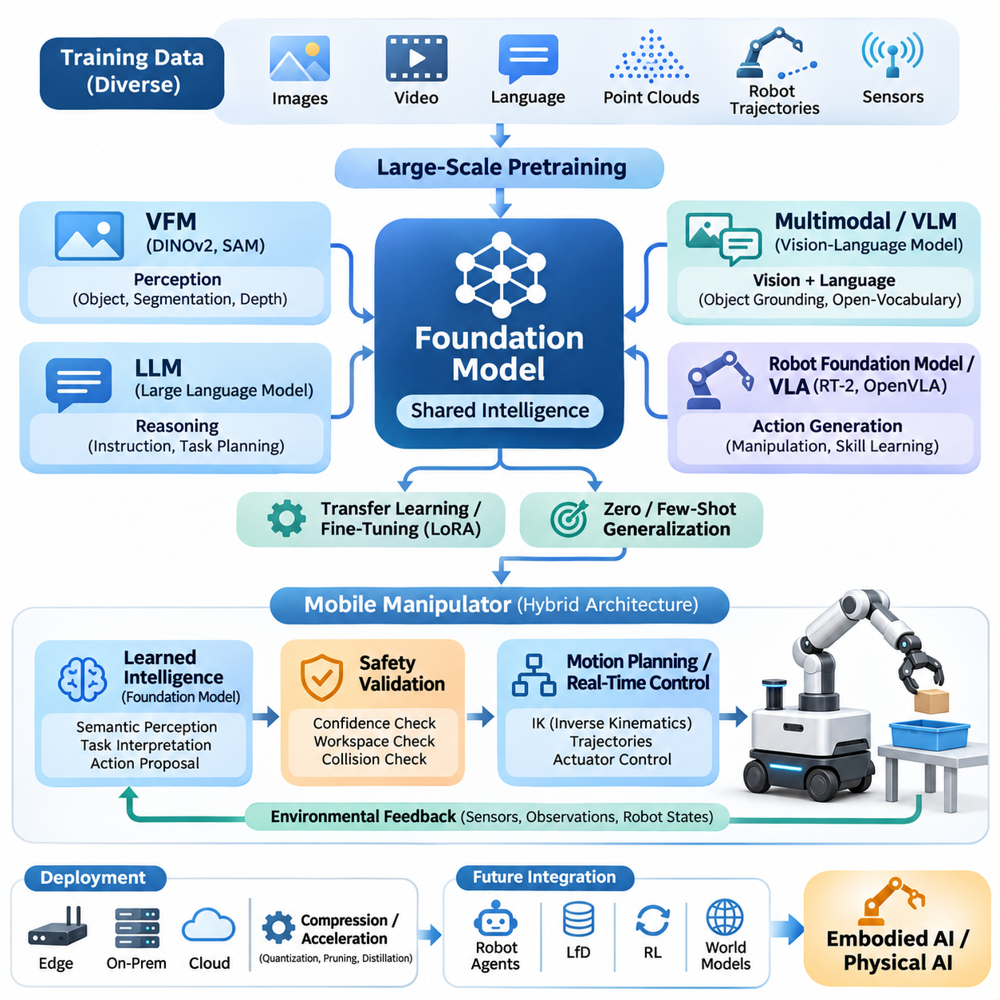
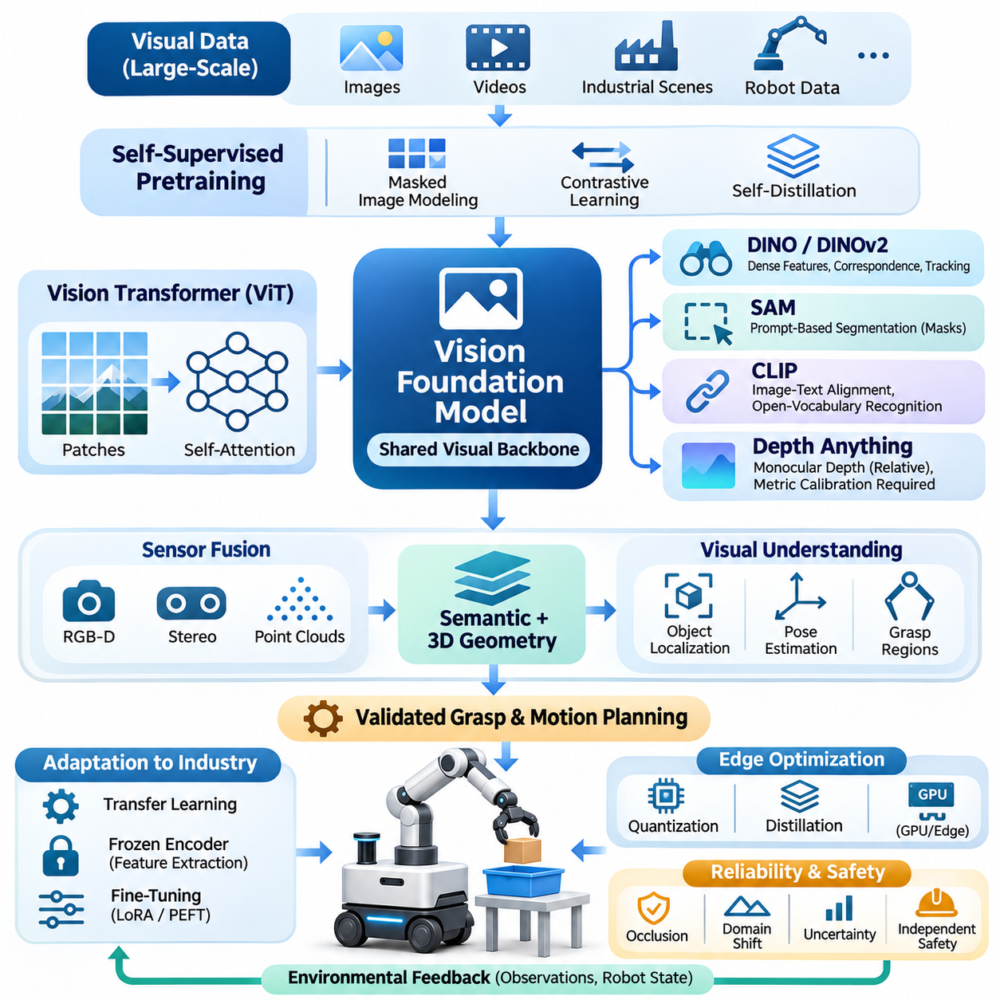
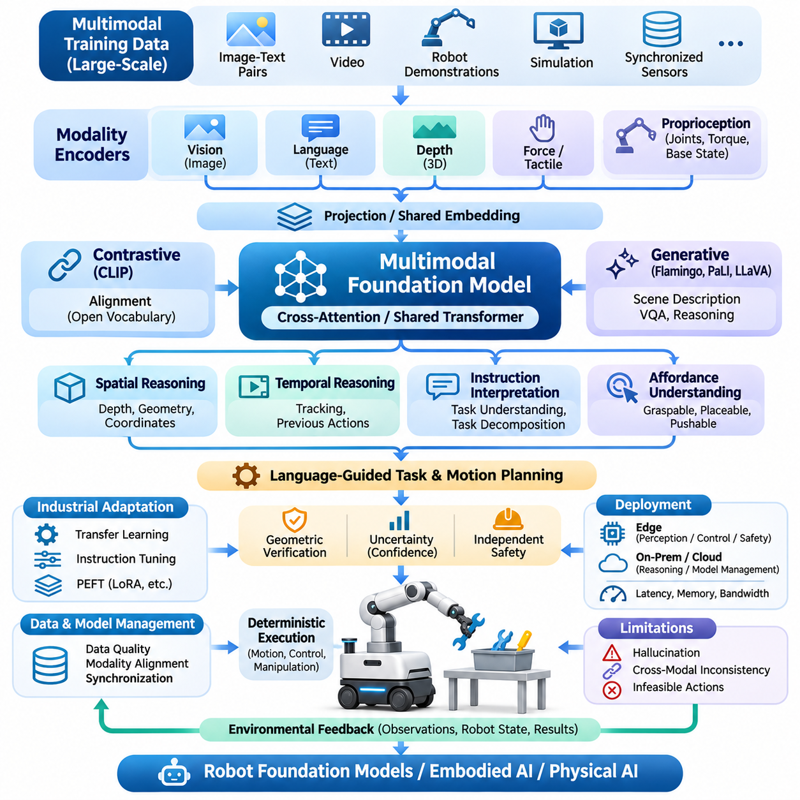
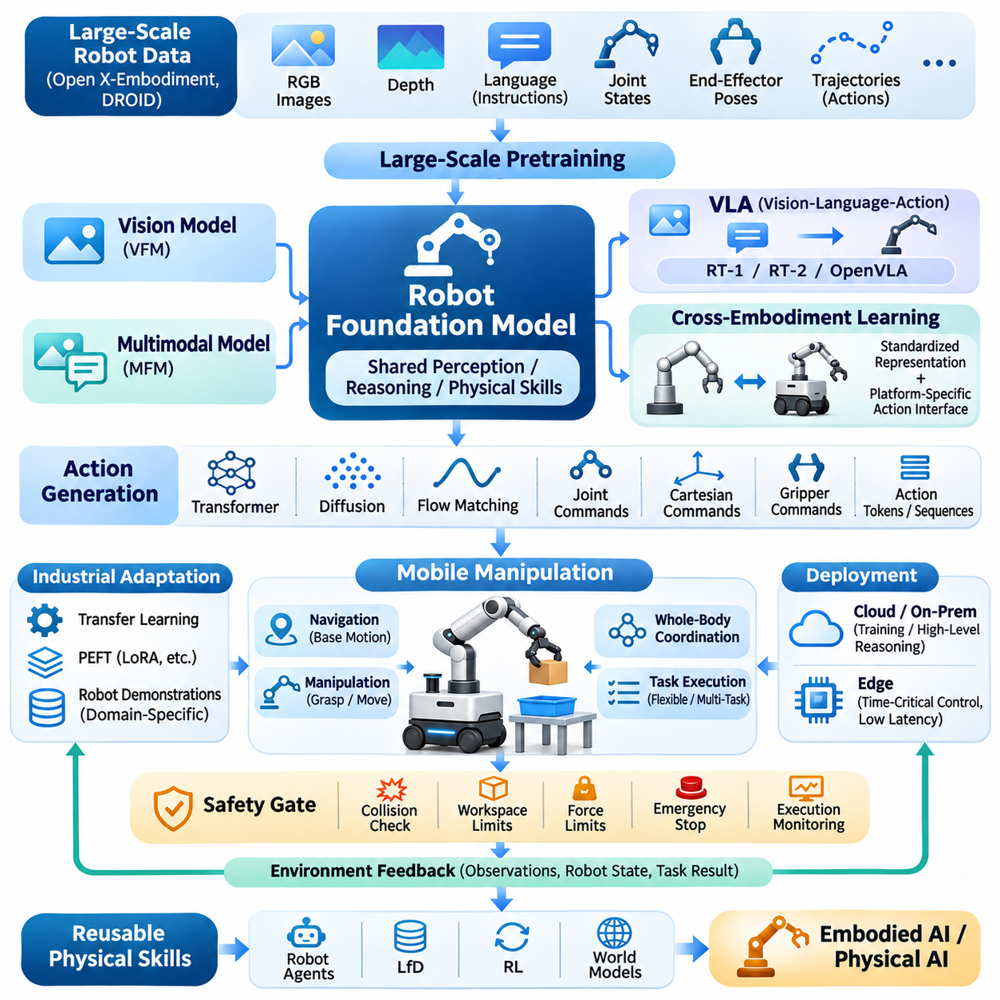
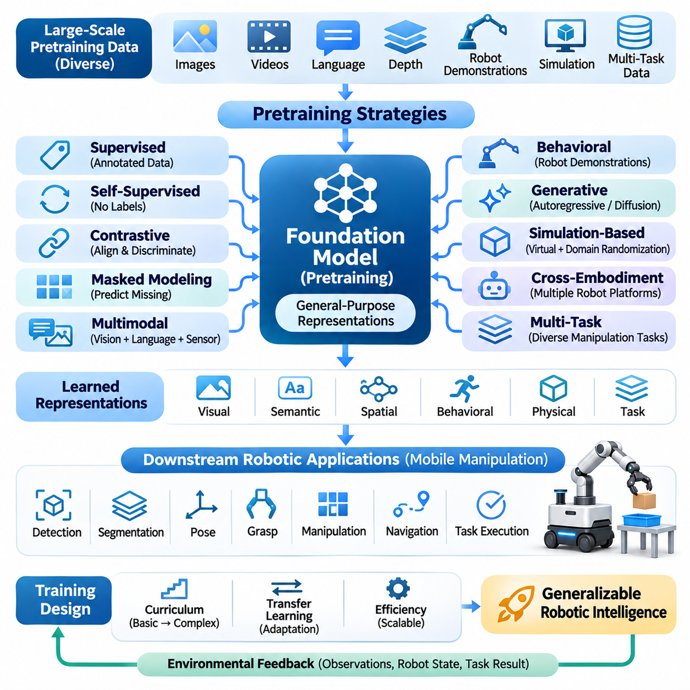
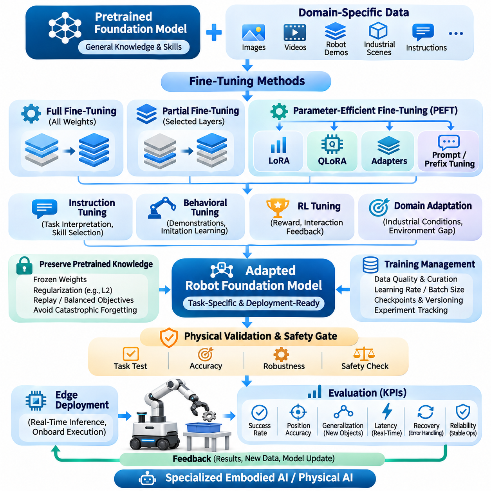
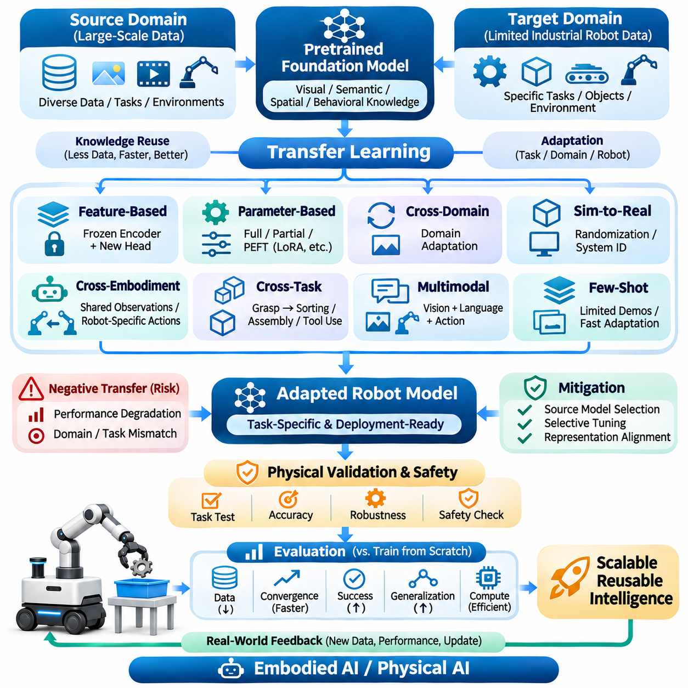
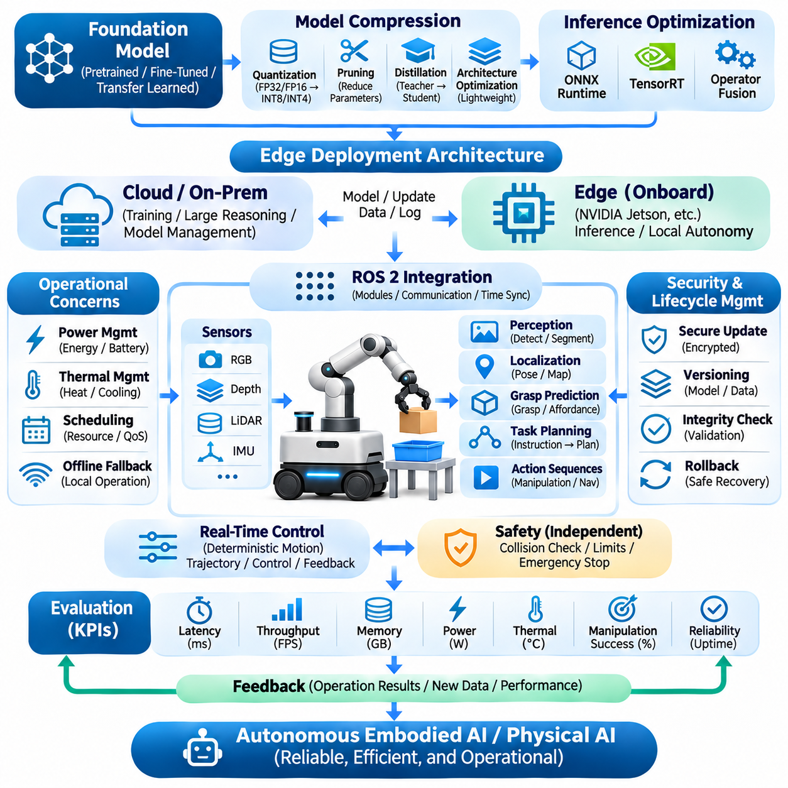
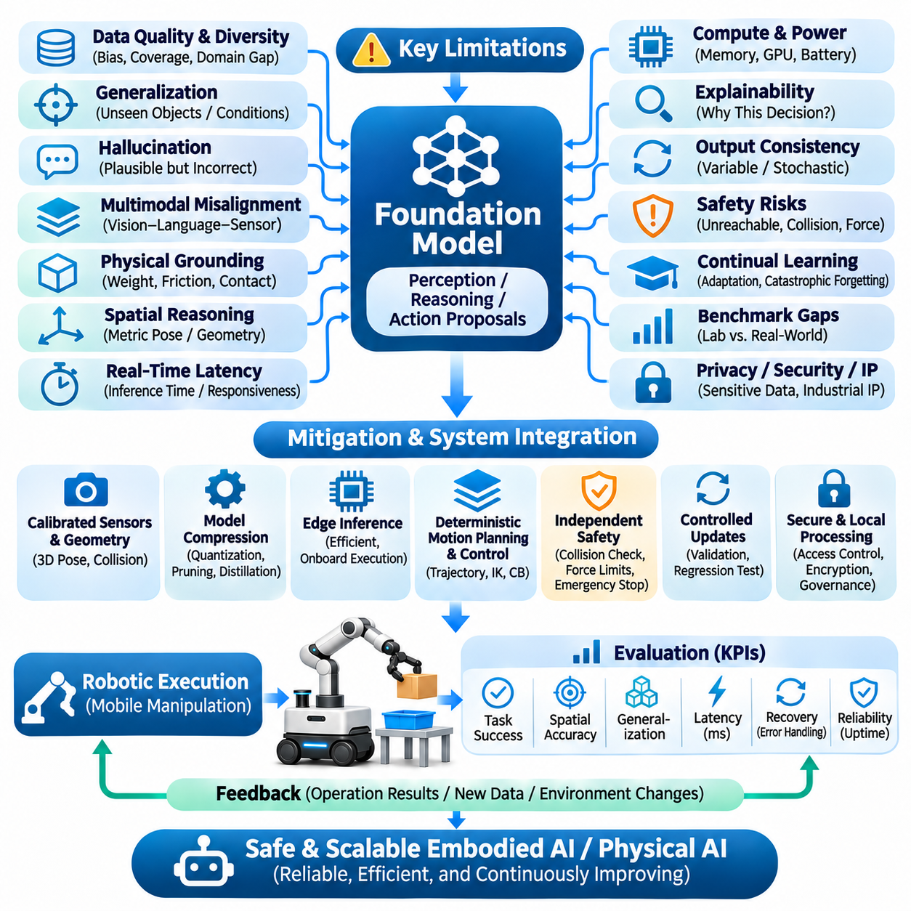

# Chapter 10. Foundation Models

## 01 Foundation Model Overview

{width="7.268055555555556in" height="7.268055555555556in"}

기반 모델(Foundation Model)은 다양한 데이터셋(Dataset)을 기반으로 사전 학습(Pretraining)되며, 광범위한 후속 작업(Downstream Task)을 지원하도록 설계된 대규모 인공지능 모델(Artificial Intelligence Model)이다. 특정 응용 분야를 위해 개발된 기존 기계 학습 모델(Machine Learning Model)과 달리, 기반 모델은 지식(Knowledge), 인식(Perception), 행동(Behavior)에 대한 재사용 가능한 표현(Reusable Representation)을 학습한다. 이러한 능력을 통해 로봇 시스템은 상대적으로 제한된 추가 학습만으로도 새로운 객체, 환경 및 운영 요구사항에 적응할 수 있다.

이동형 매니퓰레이션(Mobile Manipulation)에서 기반 모델은 작업 특화 지능(Task-Specific Intelligence)에서 범용 로봇 지능(General-Purpose Robotic Intelligence)으로의 전환을 의미한다. 기존 로봇 시스템은 객체 감지(Object Detection), 자세 추정(Pose Estimation), 파지 계획(Grasp Planning), 작업 실행(Task Execution)을 위해 독립적으로 개발된 알고리즘에 의존한다. 기반 모델은 공통 표현(Common Representation)을 통해 이러한 기능을 연결할 수 있는 공유 지능 계층(Shared Intelligence Layer)을 제공하며, 개별적으로 설계된 인식 및 의사결정 모듈에 대한 의존도를 감소시킨다.

기반 모델의 기본 원리는 대규모 사전 학습(Large-Scale Pretraining)이다. 사전 학습 과정에서 모델은 방대한 데이터셋으로부터 통계적 패턴(Statistical Pattern), 의미적 관계(Semantic Relationship), 공간적 구조(Spatial Structure), 문맥적 의존성(Contextual Dependency)을 학습한다. 모델 아키텍처(Model Architecture)에 따라 학습 데이터에는 이미지, 영상, 자연어(Natural Language), 점군(Point Cloud), 로봇 궤적(Robot Trajectory), 센서 관측 데이터(Sensor Observation) 등이 포함될 수 있다. 이렇게 획득한 표현은 이후 특화된 로봇 응용 분야에 적응시킬 수 있다.

비전 기반 모델(Vision Foundation Model, VFM)은 대규모 이미지 및 영상 데이터셋으로부터 범용 시각 표현(General-Purpose Visual Representation)을 추출하는 데 중점을 둔다. 이러한 모델은 객체 인식(Object Recognition), 분할(Segmentation), 특징 추출(Feature Extraction), 깊이 추정(Depth Estimation), 장면 이해(Scene Understanding)를 지원한다. DINOv2 및 Segment Anything과 같은 모델은 사전 학습된 시각 지능(Visual Intelligence)이 모든 산업 응용 분야에 대해 방대한 작업별 어노테이션(Task-Specific Annotation)을 요구하지 않고도 재사용 가능한 인식 능력을 제공할 수 있음을 보여준다.

대규모 언어 모델(Large Language Model, LLM)은 의미적 이해(Semantic Understanding), 문맥적 추론(Contextual Reasoning), 지식 표현(Knowledge Representation), 상위 수준의 작업 분해(High-Level Task Decomposition)에 기여한다. 로봇 응용 분야에서 언어 모델은 인간의 명령을 해석하고, 작업 순서(Operational Sequence)를 생성하며, 사용 가능한 기능을 선택하고, 작업 요구사항을 평가할 수 있다. 그러나 실질적인 매니퓰레이션 행동을 생성하려면 언어 기반 추론(Language-Based Reasoning)이 물리적 관측(Physical Observation) 및 실행 가능한 로봇 기능과 연결되어야 한다.

멀티모달 기반 모델(Multimodal Foundation Model)은 통합 학습 아키텍처(Unified Learning Architecture) 내에서 여러 정보 양식(Modality)을 결합하여 이러한 능력을 확장한다. 이미지, 언어, 깊이 정보(Depth Information), 로봇 상태(Robot State), 기타 센서 관측 정보는 공동으로 표현되거나 상호 연결된 인코더(Encoder)를 통해 표현될 수 있다. 이러한 통합을 통해 로봇 시스템은 의미적 명령(Semantic Instruction)을 물리적 객체, 환경 조건(Environmental Condition), 공간적 관계(Spatial Relationship), 잠재적인 상호작용 가능성(Interaction Opportunity)과 연결할 수 있다.

비전 언어 모델(Vision-Language Model, VLM)은 시각적 인식(Visual Perception)과 자연어 이해(Natural Language Understanding)를 연결하기 때문에 이동형 매니퓰레이션에서 특히 중요하다. 이러한 모델은 객체 인식을 사전에 정의된 객체 범주(Object Category)로 제한하는 대신, 개방형 어휘 인식(Open-Vocabulary Perception)과 언어 유도 객체 선택(Language-Guided Object Selection)을 지원할 수 있다. 이동형 매니퓰레이터(Mobile Manipulator)는 요청된 공구를 식별하고, 해당 공구의 기능적 목적을 이해하며, 이전에 경험하지 못한 작업 환경에서 공구의 위치를 파악할 수 있다.

로봇 기반 모델(Robot Foundation Model)은 범용 학습(General-Purpose Learning)의 범위를 물리적 행동 영역(Physical Action Domain)으로 확장한다. 이러한 모델은 센서 관측(Sensory Observation), 작업 목표(Task Objective), 로봇 구성(Robot Configuration), 매니퓰레이션 행동(Manipulation Action) 사이의 관계를 학습한다. 학습 데이터셋에는 원격 조작 시연(Teleoperation Demonstration), 자율 로봇 궤적(Autonomous Robot Trajectory), 시뮬레이션 상호작용(Simulated Interaction), 다중 로봇 경험(Multi-Robot Experience)이 포함될 수 있다. 주요 목적은 다양한 매니퓰레이션 작업을 지원할 수 있는 전이 가능한 로봇 기술(Transferable Robotic Skill)을 획득하는 것이다.

비전 언어 행동 모델(Vision-Language-Action Model, VLA)은 인식(Perception), 의미적 추론(Semantic Reasoning), 물리적 행동 생성(Physical Action Generation)을 연결하는 아키텍처 접근 방식이다. 이러한 모델은 시각적 관측 정보(Visual Observation)와 언어 명령(Language Instruction)을 입력받아 예측된 로봇 행동(Robot Action) 또는 행동 시퀀스(Action Sequence)를 생성한다. RT-2 및 OpenVLA와 같은 사례는 대규모 사전 학습을 통해 획득한 의미적 지식(Semantic Knowledge)을 로봇 특화 매니퓰레이션 경험과 통합할 수 있는 가능성을 보여준다.

일반화(Generalization)는 기반 모델의 주요 장점 중 하나이다. 사전 학습된 모델(Pretrained Model)은 후속 학습 데이터셋에 명시적으로 포함되지 않았던 객체를 인식하거나, 명령을 해석하거나, 새로운 작업을 지원할 수 있다. 제로샷 학습(Zero-Shot Learning)과 퓨샷 학습(Few-Shot Learning)은 새로운 작업 능력을 도입하는 데 필요한 노력을 감소시킬 수 있다. 그러나 일반화 성능은 여전히 학습 데이터의 다양성(Training Diversity), 환경 조건, 로봇의 물리적 특성(Physical Characteristic)에 의존한다.

전이 학습(Transfer Learning)과 미세 조정(Fine-Tuning)은 기반 모델을 산업 환경에 적응시키기 위한 실질적인 방법을 제공한다. 개발자는 대규모 신경망(Large-Scale Neural Network)을 처음부터 학습시키는 대신, 사전 학습된 매개변수(Pretrained Parameter)를 사용하여 모델을 초기화하고 특정 도메인의 데이터셋(Domain-Specific Dataset)을 활용하여 모델을 최적화한다. 저랭크 적응(Low-Rank Adaptation, LoRA)을 포함한 매개변수 효율적 미세 조정(Parameter-Efficient Fine-Tuning) 기법은 기존 모델의 능력을 상당 부분 유지하면서 컴퓨팅 요구사항(Computational Requirement)을 감소시킬 수 있다.

이동형 매니퓰레이터 아키텍처에서 기반 모델은 일반적으로 결정론적 모션 계획(Deterministic Motion Planning) 및 실시간 제어 계층(Real-Time Control Layer)의 상위에서 동작한다. 기반 모델은 의미적 인식(Semantic Perception), 작업 해석(Task Interpretation), 행동 제안(Action Proposal), 적응형 의사결정(Adaptive Decision-Making)을 제공하며, 기존 로봇 소프트웨어는 역기구학(Inverse Kinematics), 궤적 생성(Trajectory Generation), 충돌 검사(Collision Checking), 액추에이터 제어(Actuator Control)를 수행한다. 이러한 하이브리드 아키텍처(Hybrid Architecture)는 학습된 지능(Learned Intelligence)과 예측 가능한 물리적 실행(Physical Execution)을 결합한다.

기반 모델 배포(Foundation Model Deployment)는 상당한 컴퓨팅 기술적 과제를 수반한다. 대규모 신경망은 높은 메모리 용량(Memory Capacity), 연산 성능(Processing Performance), 에너지 자원(Energy Resource)을 요구한다. 이동형 매니퓰레이터는 추론 지연시간(Inference Latency), 모델 정확도(Model Accuracy), 배터리 소비량(Battery Consumption), 온보드 컴퓨팅(Onboard Computing)의 제약 사이에서 균형을 유지해야 한다. 양자화(Quantization), 지식 증류(Knowledge Distillation), 모델 압축(Model Compression), 하드웨어 가속(Hardware Acceleration)은 엣지(Edge), 온프레미스(On-Premises), 클라우드(Cloud) 컴퓨팅 환경 전반에서 배포 효율성(Deployment Efficiency)을 향상시킬 수 있다.

기반 모델이 물리적 환경과 상호작용할 때 안전성(Safety)과 신뢰성(Reliability)은 필수적인 고려사항이다. 모델이 생성한 예측에는 의미적 오류(Semantic Error), 잘못된 공간적 해석(Spatial Interpretation), 물리적으로 실행 불가능한 행동 제안(Physically Infeasible Action Proposal)이 포함될 수 있다. 따라서 독립적인 안전 메커니즘(Independent Safety Mechanism), 신뢰도 평가(Confidence Assessment), 작업 공간 제한(Workspace Restriction), 충돌 회피(Collision Avoidance), 실행 모니터링(Execution Monitoring)을 통해 물리적 매니퓰레이션 이전과 실행 중에 모델의 출력을 검증해야 한다.

이동형 매니퓰레이션에서 기반 모델의 미래는 재사용 가능한 인식(Reusable Perception), 멀티모달 추론(Multimodal Reasoning), 전이 가능한 로봇 기술(Transferable Robotic Skill), 지속적인 환경 상호작용(Continuous Environmental Interaction)을 통합하는 방향으로 발전할 것이다. 로봇 에이전트(Robot Agent), 시연 기반 학습(Learning from Demonstration, LfD), 강화 학습(Reinforcement Learning, RL), 세계 모델(World Model)과 결합된 기반 모델은 산업 및 서비스 환경 전반에서 점차 다양해지는 작업을 수행할 수 있는 체화 인공지능(Embodied AI)과 물리 인공지능(Physical AI) 시스템의 중요한 기술적 기반을 제공한다.

## 02 Vision Foundation Models

{width="7.268055555555556in" height="7.268055555555556in"}

비전 기반 모델(Vision Foundation Model, VFM)은 범용 시각 표현(General-Purpose Visual Representation)을 획득하기 위해 방대한 시각 데이터셋(Visual Dataset)을 기반으로 사전 학습(Pretraining)된 대규모 인공지능 모델(Artificial Intelligence Model)이다. 개별 인식 작업을 위해 설계된 기존 컴퓨터 비전 모델(Computer Vision Model)과 달리, 이러한 모델은 객체 감지(Object Detection), 이미지 분할(Image Segmentation), 깊이 추정(Depth Estimation), 특징 추출(Feature Extraction), 로봇 장면 이해(Robotic Scene Understanding)를 포함한 다양한 응용 분야에서 재사용 가능한 시각 지능(Reusable Visual Intelligence)을 제공한다.

비전 기반 모델의 근본적인 목표는 시각 정보(Visual Information)에 대한 전이 가능한 표현(Transferable Representation)을 학습하는 것이다. 대규모 사전 학습(Large-Scale Pretraining) 과정에서 이러한 모델은 객체 외관(Object Appearance), 기하학적 구조(Geometric Structure), 질감(Texture), 공간적 관계(Spatial Relationship), 환경적 변화(Environmental Variation)에 관한 지식을 획득한다. 학습된 표현(Learned Representation)은 전체 모델을 처음부터 다시 학습할 필요 없이 특화된 로봇 인식 작업(Robotic Perception Task)에 적응시킬 수 있다.

기존 컴퓨터 비전 시스템(Computer Vision System)은 일반적으로 각각의 인식 작업에 대해 독립적인 데이터셋(Dataset), 모델 아키텍처(Model Architecture), 학습 절차(Training Procedure)를 요구한다. 비전 기반 모델은 여러 후속 응용 분야(Downstream Application)를 지원할 수 있는 공유 시각 표현(Shared Visual Representation)을 도입한다. 이동형 매니퓰레이션(Mobile Manipulation)에서 이러한 접근 방식은 중복적인 모델 개발을 감소시키고, 객체 인식(Object Recognition), 위치 추정(Localization), 분할(Segmentation), 상호작용 계획(Interaction Planning)을 위한 공통 인식 백본(Common Perception Backbone)을 제공한다.

비전 트랜스포머(Vision Transformer, ViT)는 현대적인 비전 기반 모델의 중요한 아키텍처 기반(Architectural Foundation)을 구성한다. 기존 합성곱 신경망(Convolutional Neural Network, CNN)과 달리, 비전 트랜스포머는 이미지를 여러 패치(Patch)로 분할하고 자기 주의 메커니즘(Self-Attention Mechanism)을 통해 패치 사이의 관계를 처리한다. 이러한 아키텍처는 모델이 국소적 시각 특성(Local Visual Characteristic)과 전역적 문맥 관계(Global Contextual Relationship)를 모두 파악할 수 있도록 하며, 복잡하고 부분적으로 가려진 환경에서의 인식을 지원한다.

자기지도 학습(Self-Supervised Learning)은 비전 기반 모델의 개발에서 핵심적인 역할을 수행한다. 자기지도 학습은 수작업으로 어노테이션된 데이터셋(Manually Annotated Dataset)에 전적으로 의존하는 대신, 시각 데이터 자체로부터 학습 목표(Learning Objective)를 생성한다. 마스킹 이미지 모델링(Masked Image Modeling), 대조 학습(Contrastive Learning), 자기 증류(Self-Distillation)와 같은 기법은 모델이 대규모 비라벨링 이미지(Unlabeled Image) 및 영상 데이터로부터 의미 있는 시각 표현을 획득할 수 있도록 한다.

DINO와 DINOv2는 자기지도 시각 표현 학습(Self-Supervised Visual Representation Learning)의 대표적인 사례이다. 이러한 모델은 의미적 정보(Semantic Information), 객체 경계(Object Boundary), 구조적 관계(Structural Relationship)를 포함하는 풍부한 시각 특징(Visual Feature)을 생성한다. 이동형 매니퓰레이션에서 이러한 특징 표현(Feature Representation)은 객체 대응 관계(Object Correspondence), 시각 추적(Visual Tracking), 유사도 기반 인식(Similarity-Based Recognition), 변화하는 환경 조건에서 이전에 관측하지 못한 객체에 대한 인식을 지원할 수 있다.

범용 분할 모델(Segment Anything Model, SAM)은 범용 이미지 분할(General-Purpose Image Segmentation)을 위한 기반 모델의 가능성을 보여준다. 프롬프트 기반 분할(Prompt-Based Segmentation)을 통해 모델은 입력 지점(Input Point), 경계 상자(Bounding Box), 기타 지원되는 프롬프트(Prompt)를 활용하여 객체 마스크(Object Mask)를 생성한다. 로봇 시스템은 이러한 분할 능력을 활용하여 목표 객체(Target Object)를 분리하고, 중첩된 구성 요소를 구별하며, 후속 매니퓰레이션 작업을 위한 객체 특화 인식 영역(Object-Specific Perception Region)을 구성할 수 있다.

CLIP은 대규모 이미지-텍스트 데이터셋(Image-Text Dataset)으로부터 정렬된 시각 및 텍스트 표현(Aligned Visual and Textual Representation)을 학습함으로써 상호 보완적인 접근 방식을 도입한다. CLIP은 순수한 시각 모델보다는 멀티모달 기반 모델(Multimodal Foundation Model)에 해당하지만, 사전 학습된 시각 인코더(Pretrained Visual Encoder)는 로봇 인식에 유용한 의미적 특징(Semantic Feature)을 제공한다. 이러한 능력은 개방형 어휘 인식(Open-Vocabulary Recognition), 언어 유도 객체 검색(Language-Guided Object Retrieval), 새로운 객체 범주(Object Category)의 식별을 지원한다.

단안 깊이 기반 모델(Monocular Depth Foundation Model)은 개별 RGB 이미지로부터 장면의 깊이를 추정함으로써 시각적 인식을 기하학적 영역(Geometric Domain)으로 확장한다. Depth Anything과 같은 모델은 다양한 환경에서 재사용 가능한 깊이 추정 능력(Depth Estimation Capability)을 제공한다. 그러나 상대 깊이 예측(Relative Depth Prediction)은 적절한 보정(Calibration), 절대 척도 기반 깊이 추정(Metric Depth Estimation), 신뢰할 수 있는 3차원 센싱 기술(Three-Dimensional Sensing Technology)과의 통합 없이 실제 거리(Metric Distance)로 직접 해석해서는 안 된다.

이동형 매니퓰레이터(Mobile Manipulator)에서 성공적인 매니퓰레이션을 수행하려면 객체의 기하학적 형상(Object Geometry), 위치(Position), 방향(Orientation), 주변 장애물(Surrounding Obstacle)에 관한 정확한 정보가 필요하므로 3차원 시각 이해(Three-Dimensional Visual Understanding)가 필수적이다. 비전 기반 모델은 RGB-D 카메라(RGB-D Camera), 스테레오 비전 시스템(Stereo Vision System), 점군 처리 알고리즘(Point Cloud Processing Algorithm)과 통합될 수 있다. 이러한 결합은 의미적 시각 표현(Semantic Visual Representation)과 신뢰성 있는 물리적 상호작용에 필요한 기하학적 측정값(Geometric Measurement)을 연결한다.

특징 대응 관계(Feature Correspondence)는 비전 기반 모델의 또 다른 중요한 응용 분야이다. 서로 다른 관측 정보로부터 추출된 밀집 시각 특징(Dense Visual Feature)은 대응되는 객체 또는 표면 영역(Surface Region) 사이의 관계를 설정할 수 있다. 이러한 능력은 다중 시점 인식(Multi-View Perception), 객체 추적(Object Tracking), 자세 추정(Pose Estimation), 시각 기반 위치 추정(Visual Localization)에 기여하며, 특히 이동형 매니퓰레이터가 서로 다른 위치 또는 관측 각도(Viewing Angle)에서 동일한 객체를 관측하는 경우에 유용하다.

비전 기반 모델은 객체 특화 시각 표현(Object-Specific Visual Representation)을 제공함으로써 파지 감지(Grasp Detection)와 매니퓰레이션 계획(Manipulation Planning)에도 기여한다. 분할 마스크(Segmentation Mask), 의미적 특징(Semantic Feature), 추정된 기하학적 구조(Estimated Geometric Structure)는 잠재적인 파지 영역(Grasping Region)을 식별하고 객체의 기능적 구성 요소(Functional Component)를 구별하는 데 활용될 수 있다. 그러나 파지 안정성(Grasp Stability), 접촉 역학(Contact Mechanics), 접근 가능성(Approach Feasibility), 충돌 위험(Collision Risk)은 전용 기하학적 알고리즘 또는 학습 기반 매니퓰레이션 알고리즘(Learned Manipulation Algorithm)을 사용하여 평가해야 한다.

비전 기반 모델의 산업 환경 적응(Industrial Adaptation)은 일반적으로 전이 학습(Transfer Learning), 특징 추출(Feature Extraction), 매개변수 효율적 미세 조정(Parameter-Efficient Fine-Tuning)을 포함한다. 사전 학습된 시각 인코더(Pretrained Visual Encoder)의 매개변수를 동결(Freezing)한 상태에서 응용 분야별 데이터셋(Application-Specific Dataset)을 활용하여 특화된 예측 헤드(Prediction Head)를 학습시킬 수 있다. 또는 선택된 모델 매개변수를 최적화하여 반사성 소재(Reflective Material), 반복적인 구성 요소(Repetitive Component), 비정상적인 조명 조건(Unusual Lighting Condition), 기타 산업 운영 환경의 특성에 적응시킬 수 있다.

이동형 매니퓰레이터에 비전 기반 모델을 배포(Deployment)하려면 컴퓨팅 자원(Computational Resource), 추론 지연시간(Inference Latency), 메모리 소비량(Memory Consumption), 에너지 효율성(Energy Efficiency)에 대한 신중한 최적화가 필요하다. 대규모 시각 인코더(Large-Scale Visual Encoder)는 실시간 운영 요구사항(Real-Time Operational Requirement)을 초과하는 처리 지연(Processing Delay)을 발생시킬 수 있다. 모델 양자화(Model Quantization), 지식 증류(Knowledge Distillation), 선택적 특징 처리(Selective Feature Processing), GPU 가속(GPU Acceleration)은 로봇 응용 분야에 필요한 충분한 인식 정확도를 유지하면서 추론 성능(Inference Performance)을 향상시킬 수 있다.

비전 기반 모델은 다양한 장점에도 불구하고 도메인 변화(Domain Shift), 시각적 모호성(Visual Ambiguity), 가림 현상(Occlusion), 부정확한 기하학적 해석(Geometric Interpretation)에 여전히 취약하다. 이러한 모델의 예측 결과는 본질적으로 물리적 실행 가능성(Physical Feasibility)이나 운영 안전성(Operational Safety)을 보장하지 않는다. 신뢰성 있는 배포를 위해서는 응용 분야별 검증(Application-Specific Validation), 불확실성 평가(Uncertainty Assessment), 센서 융합(Sensor Fusion), 독립적인 안전 메커니즘(Independent Safety Mechanism)이 필요하다. 하이브리드 로봇 아키텍처(Hybrid Robotic Architecture)에서 이러한 모델은 기하학적 인식(Geometric Perception)과 결정론적 로봇 제어(Deterministic Robotic Control)를 완전히 대체하는 것이 아니라, 재사용 가능한 시각 지능 백본(Reusable Visual Intelligence Backbone)을 제공한다.

## 03 Multimodal Foundation Models

{width="7.268055555555556in" height="7.268055555555556in"}

멀티모달 기반 모델(Multimodal Foundation Model, MFM)은 통합 컴퓨팅 프레임워크(Unified Computational Framework) 내에서 여러 데이터 양식(Data Modality)의 정보를 학습하고 통합하도록 설계된 대규모 인공지능 모델(Artificial Intelligence Model)이다. 이미지, 언어 또는 기타 개별 데이터 유형만을 처리하는 단일모달 모델(Unimodal Model)과 달리, 멀티모달 기반 모델은 이기종 정보 소스(Heterogeneous Information Source) 사이의 관계를 형성하여 보다 포괄적인 환경 이해(Environmental Understanding)와 지능적 의사결정(Intelligent Decision-Making)을 가능하게 한다.

이동형 매니퓰레이션(Mobile Manipulation)에서 멀티모달 기반 모델은 시각적 인식(Visual Perception), 의미적 이해(Semantic Understanding), 공간적 추론(Spatial Reasoning), 물리적 상호작용(Physical Interaction)을 연결하는 지능 계층(Intelligence Layer)을 제공한다. 이동형 매니퓰레이터(Mobile Manipulator)는 환경 관측 정보를 해석하고, 인간의 명령을 이해하며, 자신의 물리적 구성(Physical Configuration)을 평가하고, 적절한 행동을 동시에 결정해야 한다. 멀티모달 학습(Multimodal Learning)은 이러한 다양한 운영 요구사항을 연결하기 위한 공통 프레임워크(Common Framework)를 제공한다.

멀티모달 기반 모델의 기본 원리는 교차모달 표현 학습(Cross-Modal Representation Learning)이다. 서로 다른 정보 양식(Information Modality)은 원시 입력 데이터(Raw Input Data)를 수치적 특징 표현(Numerical Feature Representation)으로 변환하는 특화된 인코더(Specialized Encoder)를 통해 처리된다. 이러한 표현은 이후 공유 임베딩 공간(Shared Embedding Space)에 투영될 수 있으며, 이를 통해 모델은 이미지, 언어, 센서 측정값(Sensor Measurement), 로봇 관측 정보(Robotic Observation) 사이의 의미적 관계(Semantic Relationship)와 문맥적 관계(Contextual Relationship)를 형성할 수 있다.

멀티모달 아키텍처(Multimodal Architecture)는 일반적으로 양식별 인코더(Modality-Specific Encoder), 투영 계층(Projection Layer), 주의 메커니즘(Attention Mechanism), 공유 트랜스포머 네트워크(Shared Transformer Network)를 활용한다. 시각 인코더(Visual Encoder)는 이미지 특징을 추출하고, 언어 인코더(Language Encoder)는 텍스트 정보를 처리하며, 추가적인 센서 인코더(Sensory Encoder)는 깊이, 힘, 촉각 신호(Tactile Signal) 또는 로봇 상태(Robot State)를 표현한다. 교차 주의 메커니즘(Cross-Attention Mechanism)은 서로 다른 정보 양식 사이의 상호작용을 가능하게 하여 문맥 의존적 해석(Context-Dependent Interpretation)과 통합 추론(Integrated Reasoning)을 지원한다.

대조 학습(Contrastive Learning)은 멀티모달 기반 모델의 중요한 학습 접근 방식이다. CLIP과 같은 모델은 서로 대응되는 표현 사이의 유사도(Similarity)를 증가시키고 관련 없는 표현 사이의 유사도를 감소시킴으로써 이미지와 해당 텍스트 설명(Textual Description) 사이의 관계를 학습한다. 이러한 접근 방식은 서로 다른 정보 양식 사이의 의미적 정렬(Semantic Alignment)을 가능하게 하며, 사전에 정의된 객체 범주(Object Category)를 요구하지 않고도 개방형 어휘 인식(Open-Vocabulary Recognition)을 지원한다.

생성형 멀티모달 학습(Generative Multimodal Learning)은 표현 정렬(Representation Alignment)의 범위를 정보 생성(Information Generation)과 문맥적 추론(Contextual Reasoning)으로 확장한다. Flamingo, PaLI, LLaVA와 같은 모델은 시각적 관측 정보(Visual Observation)와 언어 생성 능력(Language Generation Capability)을 결합하는 접근 방식을 보여준다. 로봇 응용 분야에서 이러한 아키텍처는 장면 설명(Scene Description), 시각적 질의응답(Visual Question Answering), 작업 해석(Task Interpretation), 운영 환경 내 객체 사이의 관계에 대한 추론을 지원할 수 있다.

멀티모달 기반 모델을 이동형 매니퓰레이션에 적용할 때 공간적 추론(Spatial Reasoning)은 특히 중요하다. 로봇 시스템이 객체의 물리적 위치(Physical Location), 방향(Orientation), 접근성(Accessibility), 주변 객체와의 관계를 파악할 수 없다면 단순히 객체 범주를 이해하는 것만으로는 충분하지 않다. 따라서 멀티모달 표현(Multimodal Representation)은 보정된 깊이 센서(Calibrated Depth Sensor), 기하학적 인식 알고리즘(Geometric Perception Algorithm), 좌표 변환 메커니즘(Coordinate Transformation Mechanism)과 통합되어야 한다.

시간적 멀티모달 학습(Temporal Multimodal Learning)은 로봇 시스템이 연속적인 관측 정보(Sequential Observation)를 통해 환경의 변화를 해석할 수 있도록 한다. 개별 이미지를 독립적으로 처리하는 대신, 시간적 아키텍처(Temporal Architecture)는 영상 시퀀스(Video Sequence), 과거 센서 측정값(Historical Sensor Measurement), 이전 로봇 행동(Previous Robot Action)을 통합할 수 있다. 이러한 능력은 객체 추적(Object Tracking), 움직임 이해(Motion Understanding), 상호작용 예측(Interaction Prediction), 산업 및 서비스 환경에서 발생하는 동적 활동(Dynamic Activity)의 해석을 지원한다.

멀티모달 기반 모델은 관절 위치(Joint Position), 관절 속도(Joint Velocity), 액추에이터 토크(Actuator Torque), 이동 플랫폼 상태(Mobile Platform State)를 포함하는 고유수용성 정보(Proprioceptive Information)도 통합할 수 있다. 로봇 내부 관측 정보(Internal Robot Observation)를 외부 시각 및 언어 정보(External Visual and Linguistic Information)와 결합하면 로봇과 환경 사이의 관계에 대한 인식 능력이 향상된다. 이러한 통합은 특히 접촉 중심 매니퓰레이션(Contact-Rich Manipulation), 협조형 이동 매니퓰레이션(Coordinated Mobile Manipulation), 적응형 물리적 상호작용(Adaptive Physical Interaction)에서 중요하다.

언어 유도 매니퓰레이션(Language-Guided Manipulation)은 멀티모달 기반 모델의 실질적인 응용 분야이다. 인간 작업자(Human Operator)는 이동형 매니퓰레이터에게 특정 부품을 가져오거나, 객체를 지정된 작업장(Designated Workstation)으로 운반하거나, 기능적 특성(Functional Characteristic)에 따라 공구를 정리하도록 명령할 수 있다. 모델은 이러한 명령을 해석하고, 언어적 개념(Linguistic Concept)을 시각적 관측 정보와 연결하며, 후속 작업 계획(Task Planning) 및 모션 계획(Motion Planning)에 필요한 문맥적 정보(Contextual Information)를 제공한다.

멀티모달 기반 모델은 객체 외관(Object Appearance), 의미적 지식(Semantic Knowledge), 잠재적인 상호작용 가능성(Interaction Opportunity)을 연결함으로써 행동유도성 이해(Affordance Understanding)도 지원한다. 로봇 시스템은 손잡이가 파지(Grasping)에 적합하고, 용기에 객체를 담을 수 있으며, 버튼을 누를 수 있다는 사실을 추론할 수 있다. 그러나 이러한 의미적 예측(Semantic Prediction)은 실제 기하학적 형상(Actual Geometry), 재료 특성(Material Property), 접촉 역학(Contact Mechanics), 매니퓰레이터의 물리적 능력(Physical Capability)을 기반으로 검증되어야 한다.

대규모 멀티모달 사전 학습(Large-Scale Multimodal Pretraining)은 시각적 정보, 언어적 정보, 공간적 정보, 행동 정보 사이의 관계를 포함하는 다양한 데이터셋(Dataset)을 요구한다. 이미지-텍스트 쌍(Image-Text Pair), 영상 설명(Video Description), 로봇 시연(Robot Demonstration), 시뮬레이션 상호작용(Simulated Interaction), 동기화된 센서 기록(Synchronized Sensor Recording)은 상호 보완적인 학습 신호(Complementary Learning Signal)를 제공할 수 있다. 데이터셋 품질(Dataset Quality), 정보 양식 정렬(Modality Alignment), 시간 동기화(Temporal Synchronization), 환경적 다양성(Environmental Diversity)은 결과적으로 획득되는 모델 능력(Model Capability)에 직접적인 영향을 미친다.

멀티모달 기반 모델을 산업용 로봇 응용 분야에 적응시키는 과정은 일반적으로 전이 학습(Transfer Learning), 명령어 튜닝(Instruction Tuning), 매개변수 효율적 미세 조정(Parameter-Efficient Fine-Tuning)을 포함한다. 개발자는 특정 도메인의 전문 용어(Domain-Specific Terminology), 장비 구성(Equipment Configuration), 운영 절차(Operational Procedure), 매니퓰레이션 시연(Manipulation Demonstration)을 모델 적응 과정(Adaptation Process)에 통합할 수 있다. 이러한 접근 방식은 재사용 가능한 사전 학습 지식(Reusable Pretrained Knowledge)을 유지하면서 특화된 제조 및 물류 환경에서의 성능을 향상시킨다.

모델 배포(Model Deployment)는 컴퓨팅 복잡도(Computational Complexity), 통신 대역폭(Communication Bandwidth), 메모리 소비량(Memory Consumption), 추론 지연시간(Inference Latency)과 관련된 기술적 과제를 수반한다. 멀티모달 처리(Multimodal Processing)는 여러 인코더와 잠재적으로 대규모인 추론 네트워크(Reasoning Network) 사이의 협조를 요구한다. 분산 컴퓨팅 아키텍처(Distributed Computing Architecture)는 연산 집약적 추론(Computationally Intensive Reasoning)을 온프레미스(On-Premises) 또는 클라우드(Cloud) 자원에 할당하면서, 지연시간에 민감한 인식(Latency-Sensitive Perception), 실행(Execution), 안전 기능(Safety Function)은 이동형 로봇에서 유지할 수 있도록 한다.

멀티모달 기반 모델은 다양한 장점에도 불구하고 환각 현상(Hallucination), 일관성이 부족한 교차모달 해석(Inconsistent Cross-Modal Interpretation), 물리적으로 실행 불가능한 권고(Physically Infeasible Recommendation)를 생성할 수 있다. 따라서 신뢰성 있는 이동형 매니퓰레이션을 위해서는 불확실성 평가(Uncertainty Assessment), 기하학적 검증(Geometric Verification), 독립적인 안전 메커니즘(Independent Safety Mechanism), 결정론적 실행 모니터링(Deterministic Execution Monitoring)이 필요하다. 하이브리드 로봇 아키텍처(Hybrid Robotic Architecture)에서 멀티모달 기반 모델은 통합 인식(Integrated Perception)과 의미적 추론(Semantic Reasoning)을 제공하는 동시에 로봇 기반 모델(Robot Foundation Model), 체화 인공지능(Embodied AI), 물리 인공지능(Physical AI)의 발전을 지원한다.

## 04 Robot Foundation Models

{width="7.268055555555556in" height="7.268055555555556in"}

로봇 기반 모델(Robot Foundation Model, RFM)은 대규모 사전 학습(Pretraining)을 통해 재사용 가능한 로봇 지식(Reusable Robotic Knowledge)과 전이 가능한 물리적 기술(Transferable Physical Skill)을 획득하도록 설계된 대규모 인공지능 모델(Artificial Intelligence Model)이다. 개별 작업을 위해 개발된 기존 로봇 학습 모델(Robotic Learning Model)과 달리, 로봇 기반 모델은 공통 학습 프레임워크(Common Learning Framework) 내에서 다양한 매니퓰레이션 행동(Manipulation Behavior), 운영 환경(Operational Environment), 객체 범주(Object Category), 로봇 플랫폼(Robotic Platform)을 지원하는 것을 목표로 한다.

로봇 기반 모델의 등장은 작업 특화 로봇 자동화(Task-Specific Robotic Automation)에서 범용 로봇 지능(General-Purpose Robotic Intelligence)으로의 전환을 의미한다. 기존 로봇 시스템은 개별 작업을 위해 독립적으로 설계된 알고리즘(Algorithm) 또는 개별적으로 학습된 정책(Policy)을 필요로 한다. 로봇 기반 모델은 인식(Perception), 작업 목표(Task Objective), 물리적 상호작용(Physical Interaction), 행동 생성(Action Generation)에 대한 공유 표현(Shared Representation)을 학습함으로써 이러한 의존성을 감소시키고자 한다.

로봇 기반 모델의 기본 원리는 환경 관측 정보(Environmental Observation), 로봇 상태(Robot State), 작업 명령(Task Instruction), 물리적 행동(Physical Action) 사이의 관계를 학습하는 것이다. 학습 데이터셋(Training Dataset)에는 RGB 이미지, 깊이 측정값(Depth Measurement), 자연어 명령(Natural Language Instruction), 관절 구성(Joint Configuration), 말단장치 자세(End-Effector Pose), 매니퓰레이션 궤적(Manipulation Trajectory)이 포함될 수 있다. 이러한 이기종 데이터 소스(Heterogeneous Data Source)는 모델이 환경 이해(Environmental Understanding)와 실행 가능한 행동(Executable Behavior) 사이의 연결 관계를 학습할 수 있도록 한다.

로봇 기반 모델은 비전 기반 모델(Vision Foundation Model)과 멀티모달 기반 모델(Multimodal Foundation Model)의 능력을 물리적 행동 영역(Physical Action Domain)으로 확장한다. 비전 모델(Vision Model)은 주로 시각 표현(Visual Representation)을 추출하고 멀티모달 모델(Multimodal Model)은 이기종 정보를 통합하는 반면, 로봇 기반 모델은 물리적 행동이 환경 상태(Environmental State)에 어떠한 영향을 미치는지 추가적으로 학습한다. 이러한 능력은 의미적 이해(Semantic Understanding)를 상호작용 중심 의사결정(Interaction-Oriented Decision-Making) 및 로봇 기술 실행(Robotic Skill Execution)과 연결한다.

비전 언어 행동 모델(Vision-Language-Action Model, VLA)은 로봇 기반 모델 내에서 중요한 아키텍처 범주(Architectural Category)를 구성한다. 이러한 모델은 통합 학습 아키텍처(Unified Learning Architecture) 내에서 시각적 관측 정보(Visual Observation), 자연어 명령(Natural Language Instruction), 로봇 행동 표현(Robotic Action Representation)을 통합한다. 의미적 지식(Semantic Knowledge)과 물리적 행동(Physical Behavior)을 연결함으로써 VLA 모델은 로봇 시스템이 인간의 명령을 해석하고 이에 대응하는 매니퓰레이션 행동 또는 행동 시퀀스(Action Sequence)를 생성할 수 있도록 한다.

RT-1과 RT-2를 포함한 구글(Google)의 로보틱스 트랜스포머(Robotics Transformer) 모델은 대규모 로봇 학습(Large-Scale Robotic Learning)에 대한 접근 방식을 보여준다. RT-1은 방대한 실제 환경 로봇 시연(Real-World Robotic Demonstration)으로부터 매니퓰레이션 정책(Manipulation Policy)을 학습하는 반면, RT-2는 비전 언어 사전 학습(Vision-Language Pretraining)과 로봇 행동 생성(Robot Action Generation)을 통합한다. 이러한 접근 방식은 대규모 시각 및 언어 데이터셋으로부터 획득한 지식이 전이 가능한 로봇 매니퓰레이션 능력(Transferable Robotic Manipulation Capability)에 어떻게 기여할 수 있는지를 보여준다.

OpenVLA는 로봇 매니퓰레이션을 위한 비전 언어 행동 모델 개발에 대한 오픈소스 접근 방식(Open-Source Approach)을 대표한다. OpenVLA는 사전 학습된 비전 언어 표현(Pretrained Vision-Language Representation)과 다양한 로봇 시연 데이터셋(Robot Demonstration Dataset)을 활용하여 언어 조건부 매니퓰레이션 정책(Language-Conditioned Manipulation Policy)을 서로 다른 로봇 시스템에 적응시키기 위한 기반을 제공한다. 이러한 아키텍처는 개발 노력을 감소시키는 동시에 일반화 가능한 로봇 지능(Generalizable Robotic Intelligence)에 관한 연구를 지원할 수 있다.

이기종 로봇 신체 간 학습(Cross-Embodiment Learning)은 로봇 기반 모델의 특히 중요한 목표이다. 서로 다른 로봇 시스템은 각기 다른 기구학적 구조(Kinematic Structure), 자유도(Degree of Freedom, DoF), 액추에이터 특성(Actuator Characteristic), 그리퍼 구성(Gripper Configuration), 센서 배치(Sensor Arrangement)를 가진다. 이기종 로봇 신체 간 학습은 표준화된 표현(Standardized Representation)과 로봇 신체 인식형 행동 인터페이스(Embodiment-Aware Action Interface)를 통해 플랫폼별 차이를 수용하면서 공통 매니퓰레이션 원리(Shared Manipulation Principle)를 식별하고자 한다.

대규모 로봇 데이터셋(Large-Scale Robotic Dataset)은 로봇 기반 모델을 위한 필수적인 학습 인프라(Training Infrastructure)를 제공한다. Open X-Embodiment와 DROID 같은 프로젝트는 다양한 로봇 플랫폼, 객체, 환경, 작업에 걸쳐 매니퓰레이션 시연(Manipulation Demonstration) 데이터를 수집한다. 이러한 데이터셋은 학습 알고리즘(Learning Algorithm)이 다양한 물리적 상호작용을 경험할 수 있도록 하며, 보다 높은 전이성을 가진 정책(Transferable Policy)의 개발을 가능하게 하고 개별 로봇에 특화된 학습 환경(Robot-Specific Training Environment)에 대한 의존성을 감소시킨다.

행동 표현(Action Representation)은 로봇 기반 모델의 아키텍처와 성능에 상당한 영향을 미친다. 로봇 행동은 관절 위치(Joint Position), 직교 좌표계 변위(Cartesian Displacement), 말단장치 자세(End-Effector Pose), 그리퍼 명령(Gripper Command), 이산 행동 토큰(Discrete Action Token), 연속 행동 시퀀스(Continuous Action Sequence)를 통해 표현될 수 있다. 트랜스포머 기반 정책(Transformer-Based Policy), 확산 기반 아키텍처(Diffusion-Based Architecture), 흐름 정합 기법(Flow-Matching Method)은 협조적이고 문맥 의존적인 로봇 행동(Coordinated and Context-Dependent Robotic Behavior)을 생성하기 위한 다양한 메커니즘을 제공한다.

이동형 매니퓰레이션(Mobile Manipulation)에서 로봇 기반 모델은 자율주행(Navigation)과 매니퓰레이션(Manipulation) 요구사항을 모두 처리해야 한다. 로봇 시스템은 적절한 이동 베이스 위치(Mobile Base Position)를 결정하고, 객체 접근성(Object Accessibility)을 평가하며, 매니퓰레이터의 움직임을 조율하고, 환경 변화에 적응해야 한다. 이동 관련 관측 정보(Mobility-Related Observation)와 매니퓰레이션 정책을 통합하면 전신 협조 제어(Whole-Body Coordination), 확장된 작업 공간 활용(Extended Workspace Utilization), 분산된 작업장(Distributed Workstation) 전반에서의 유연한 작업 실행(Flexible Task Execution)을 지원할 수 있다.

로봇 기반 모델을 산업 환경에 적응시키려면 일반적으로 도메인 특화 미세 조정(Domain-Specific Fine-Tuning)과 물리적 검증(Physical Validation)이 필요하다. 제조 및 물류 응용 분야(Manufacturing and Logistics Application)는 특수 부품(Specialized Component), 엄격한 공차(Strict Tolerance), 반복적인 작업 흐름(Repetitive Workflow), 장비 특화 제약조건(Equipment-Specific Constraint)을 포함하는 경우가 많다. 전이 학습(Transfer Learning), 매개변수 효율적 미세 조정(Parameter-Efficient Fine-Tuning), 추가적인 로봇 시연(Robot Demonstration)은 재사용 가능한 사전 학습 능력(Reusable Pretrained Capability)을 유지하면서 작업 성능(Task Performance)을 향상시킬 수 있다.

로봇 기반 모델을 배포(Deployment)하려면 컴퓨팅 성능(Computational Performance), 추론 지연시간(Inference Latency), 메모리 소비량(Memory Consumption), 운영 신뢰성(Operational Reliability) 사이에서 균형을 유지해야 한다. 대규모 사전 학습 모델(Large-Scale Pretrained Model)은 상위 수준의 추론(High-Level Reasoning) 또는 행동 시퀀스 생성(Action Sequence Generation)을 수행할 수 있으며, 온보드 제어기(Onboard Controller)는 시간 제약이 중요한 실행(Time-Critical Execution)을 관리한다. 분산 아키텍처(Distributed Architecture)는 학습과 연산 집약적 처리(Computationally Intensive Processing)를 외부 인프라(External Infrastructure)에 할당하면서 필수 제어 기능(Essential Control Function)을 로봇 내부에서 유지할 수 있도록 한다.

로봇 기반 모델은 물리적 실행 가능성이 보장된 행동이 아니라 예측 결과(Prediction)를 생성하기 때문에 안전성(Safety)은 여전히 근본적인 요구사항이다. 잘못된 객체 해석(Incorrect Object Interpretation), 불안정한 파지 제안(Unstable Grasp Proposal), 예상하지 못한 접촉(Unexpected Contact), 도달 불가능한 목표 자세(Unreachable Target Pose)는 운영 실패(Operational Failure)를 초래할 수 있다. 따라서 독립적인 충돌 검사(Independent Collision Checking), 작업 공간 제한(Workspace Restriction), 힘 제한(Force Limitation), 비상 정지 메커니즘(Emergency Stopping Mechanism), 결정론적 실행 모니터링(Deterministic Execution Monitoring)은 로봇 아키텍처의 필수 구성 요소로 유지되어야 한다.

로봇 기반 모델은 점차 높은 적응성을 갖추는 이동형 매니퓰레이터(Mobile Manipulator)와 범용 로봇 시스템(General-Purpose Robotic System)을 위한 중요한 기술적 기반(Technological Foundation)을 제공한다. 로봇 에이전트(Robot Agent), 시연 기반 학습(Learning from Demonstration, LfD), 강화 학습(Reinforcement Learning, RL), 세계 모델(World Model)과의 통합은 재사용 가능한 물리적 기술(Reusable Physical Skill)과 문맥 인식형 의사결정(Context-Aware Decision-Making)의 발전을 지원한다. 체화 인공지능(Embodied AI)과 물리 인공지능(Physical AI) 아키텍처 내에서 이러한 모델은 학습된 지능(Learned Intelligence)을 지속적인 인식(Continuous Perception), 행동(Action), 환경 상호작용(Environmental Interaction)과 연결한다.

## 05 Pretraining Strategies

{width="7.268055555555556in" height="7.268055555555556in"}

사전 학습 전략(Pretraining Strategy)은 특정 응용 분야에 적응하기 전에 재사용 가능한 지식(Reusable Knowledge), 범용 표현(General-Purpose Representation), 전이 가능한 능력(Transferable Capability)을 어떻게 획득할 것인지를 결정하기 때문에 기반 모델(Foundation Model) 개발의 핵심 요소이다. 이동형 매니퓰레이션(Mobile Manipulation)에서 효과적인 사전 학습은 로봇 시스템이 다양하고 방대한 데이터셋(Dataset)으로부터 시각적 인식(Visual Perception), 의미적 관계(Semantic Relationship), 공간적 추론(Spatial Reasoning), 물리적 상호작용 패턴(Physical Interaction Pattern)을 학습할 수 있도록 한다.

사전 학습(Pretraining)의 주요 목적은 다양한 후속 로봇 작업(Downstream Robotic Task)을 지원할 수 있는 공통 지능 기반(Common Intelligence Foundation)을 구축하는 것이다. 개발자는 객체 인식(Object Recognition), 파지 감지(Grasp Detection), 자세 추정(Pose Estimation), 매니퓰레이션 제어(Manipulation Control)를 위한 독립적인 모델을 개발하는 대신, 이러한 응용 분야 전반의 공통 특성을 포함하는 사전 학습 표현(Pretrained Representation)을 활용할 수 있다. 이러한 접근 방식은 중복 학습(Redundant Training)을 감소시키고 개발 효율성(Development Efficiency)을 향상시킨다.

지도 사전 학습(Supervised Pretraining)은 입력 관측 정보(Input Observation)와 목표 출력(Desired Output) 사이의 명시적인 관계를 포함하는 어노테이션 데이터셋(Annotated Dataset)을 활용한다. 로봇 인식(Robotic Perception)에서 이러한 어노테이션(Annotation)에는 객체 범주(Object Category), 분할 마스크(Segmentation Mask), 경계 상자(Bounding Box), 객체 자세(Object Pose), 파지 구성(Grasp Configuration)이 포함될 수 있다. 지도 학습(Supervised Learning)은 명확하게 정의된 학습 목표(Training Objective)를 제공하지만, 확장성(Scalability)은 어노테이션 비용(Annotation Cost), 데이터셋 다양성(Dataset Diversity), 전문적인 로봇 기술 지식의 확보 가능성에 의해 제한된다.

자기지도 사전 학습(Self-Supervised Pretraining)은 방대한 수작업 어노테이션(Manual Annotation)을 요구하지 않고도 기반 모델이 의미 있는 표현(Meaningful Representation)을 획득할 수 있도록 한다. 학습 목표는 사용 가능한 데이터 내부의 구조와 관계로부터 직접 생성된다. 마스킹 이미지 모델링(Masked Image Modeling), 자기 증류(Self-Distillation), 시간적 예측(Temporal Prediction)과 같은 기법은 모델이 대규모 이미지, 영상 및 로봇 관측 정보(Robot Observation)로부터 의미적 지식(Semantic Knowledge), 공간적 지식(Spatial Knowledge), 구조적 지식(Structural Knowledge)을 추출할 수 있도록 한다.

대조 사전 학습(Contrastive Pretraining)은 서로 대응되는 데이터 샘플(Corresponding Data Sample)과 대응되지 않는 데이터 샘플(Noncorresponding Data Sample) 사이의 관계를 학습하는 데 중점을 둔다. 유사한 객체, 일치하는 관측 정보(Matching Observation), 관련된 의미적 설명(Semantic Description)에 대응하는 표현들이 임베딩 공간(Embedding Space) 내에서 서로 가까워지도록 학습한다. 이러한 전략은 로봇 환경에서 시각적 대응 관계(Visual Correspondence), 교차모달 정렬(Cross-Modal Alignment), 개방형 어휘 인식(Open-Vocabulary Recognition), 전이 가능한 인식 능력(Transferable Perception Capability)을 지원한다.

마스킹 모델링(Masked Modeling)은 학습 과정에서 입력 데이터(Input Data)의 일부를 의도적으로 가리는 또 다른 중요한 사전 학습 전략이다. 모델은 주변 문맥(Surrounding Context)을 활용하여 누락된 정보를 복원하거나 마스킹된 영역(Masked Region)의 표현을 예측하도록 학습한다. 이미지, 영상, 로봇 관측 정보에 적용되는 마스킹 모델링은 문맥적 관계(Contextual Relationship), 기하학적 구조(Geometric Structure), 시간적 의존성(Temporal Dependency)의 획득을 촉진한다.

멀티모달 사전 학습(Multimodal Pretraining)은 이미지, 자연어(Natural Language), 깊이 측정값(Depth Measurement), 로봇 상태(Robot State), 센서 관측 정보(Sensory Observation)를 포함하는 이기종 정보 소스(Heterogeneous Information Source)를 통합한다. 교차모달 정렬(Cross-Modal Alignment)과 공동 표현 학습(Joint Representation Learning)을 통해 모델은 의미적 개념(Semantic Concept)과 물리적 환경(Physical Environment) 사이의 관계를 획득한다. 이러한 능력은 언어 유도 매니퓰레이션(Language-Guided Manipulation), 객체 정합(Object Grounding), 문맥 인식형 로봇 작업 실행(Context-Aware Robotic Task Execution)을 위한 기반을 구축한다.

행동 사전 학습(Behavioral Pretraining)은 대규모 로봇 시연(Robot Demonstration) 데이터를 활용하여 관측 정보(Observation), 작업 명령(Task Instruction), 물리적 행동(Physical Action) 사이의 관계를 학습한다. 원격 조작 시연(Teleoperated Demonstration), 자율 실행 기록(Autonomous Execution Record), 시뮬레이션 궤적(Simulated Trajectory)은 성공적인 상호작용과 실패한 상호작용에 대한 사례를 제공한다. 적절한 학습 목표를 통해 모델은 도달( Reaching), 파지(Grasping), 들어 올리기(Lifting), 배치(Placing), 공구 취급(Tool Handling)과 같은 매니퓰레이션 기술(Manipulation Skill)을 획득할 수 있다.

생성형 사전 학습(Generative Pretraining)은 기반 모델이 시각적 관측 정보(Visual Observation), 로봇 행동(Robot Action), 환경 상태 전이(Environmental Transition)의 기저 분포(Underlying Distribution)를 학습할 수 있도록 한다. 자기회귀 아키텍처(Autoregressive Architecture), 확산 모델(Diffusion Model), 흐름 정합 기법(Flow-Matching Method)은 작업 목표(Task Objective)와 센서 정보(Sensory Information)를 조건으로 예측 결과 또는 시퀀스(Sequence)를 생성할 수 있다. 이러한 접근 방식은 행동 생성(Action Generation), 궤적 예측(Trajectory Prediction), 적응형 매니퓰레이션 정책(Adaptive Manipulation Policy)을 위한 중요한 기반을 제공한다.

시뮬레이션 기반 사전 학습(Simulation-Based Pretraining)은 실제 물리적 하드웨어(Physical Hardware)에 전적으로 의존하지 않고 로봇 상호작용 데이터(Robotic Interaction Data)를 생성할 수 있는 확장 가능한 메커니즘(Scalable Mechanism)을 제공한다. 가상 환경(Virtual Environment)은 다양한 객체 구성(Object Configuration), 환경 조건(Environmental Condition), 매니퓰레이션 시나리오(Manipulation Scenario)에 걸쳐 반복적인 실험을 가능하게 한다. 도메인 무작위화(Domain Randomization)와 물리적으로 사실적인 시뮬레이션(Physically Realistic Simulation)은 강건성(Robustness)을 향상시킬 수 있지만, 이후 실제 환경 검증(Real-World Validation)은 여전히 필수적이다.

이기종 로봇 신체 간 사전 학습(Cross-Embodiment Pretraining)은 서로 다른 기계적 구조(Mechanical Structure), 센서 구성(Sensor Configuration), 제어 인터페이스(Control Interface)를 가진 로봇 플랫폼으로부터 수집된 시연 데이터를 통합한다. 표준화된 관측 정보(Standardized Observation), 정규화된 행동 표현(Normalized Action Representation), 로봇 신체 특화 정보(Embodiment-Specific Information)를 활용함으로써 모델은 공통 매니퓰레이션 원리(Shared Manipulation Principle)를 학습할 수 있다. 이러한 전략은 산업용 로봇(Industrial Robot), 이동형 매니퓰레이터(Mobile Manipulator), 범용 로봇 플랫폼(General-Purpose Robotic Platform) 사이의 기술 전이(Skill Transfer)를 향상시키는 것을 목표로 한다.

다중 작업 사전 학습(Multi-Task Pretraining)은 공통 학습 프레임워크(Common Learning Framework) 내에서 기반 모델이 다양한 운영 목표(Operational Objective)를 경험하도록 한다. 개별 매니퓰레이션 작업에 대해서만 정책(Policy)을 최적화하는 대신, 모델은 객체 수거(Object Retrieval), 분류(Sorting), 배치(Placement), 조립(Assembly), 기타 활동 전반에서 재사용 가능한 관계(Reusable Relationship)를 학습한다. 지배적인 작업(Dominant Task)이 상대적으로 적게 포함된 작업(Less Represented Task)의 성능을 저하시키는 것을 방지하려면 균형 잡힌 작업 샘플링(Balanced Task Sampling)과 적절한 학습 목표(Training Objective)가 필요하다.

커리큘럼 학습(Curriculum Learning)은 점진적으로 증가하는 복잡도(Progressively Increasing Complexity)에 따라 사전 학습 데이터와 학습 목표를 구성한다. 로봇 모델은 초기 단계에서 기본 시각 표현(Basic Visual Representation)과 기초 매니퓰레이션 기술(Elementary Manipulation Skill)을 획득한 후, 순차적 활동(Sequential Activity), 동적 상호작용(Dynamic Interaction), 복잡한 운영 절차(Complex Operational Procedure)를 학습할 수 있다. 신중하게 설계된 학습 커리큘럼(Learning Curriculum)은 학습 안정성(Training Stability), 컴퓨팅 효율성(Computational Efficiency), 계층적 로봇 능력(Hierarchical Robotic Capability)의 획득을 향상시킬 수 있다.

데이터셋 설계(Dataset Design)와 품질 관리(Quality Management)는 사전 학습 효과(Pretraining Effectiveness)를 결정하는 핵심 요소이다. 대규모 데이터셋이라도 일관성이 부족한 어노테이션(Inconsistent Annotation), 중복된 시연(Redundant Demonstration), 부정확한 센서 측정값(Inaccurate Sensor Measurement), 불충분한 행동 다양성(Behavioral Diversity)을 포함한다면 신뢰성 있는 일반화(Generalization)를 보장하지 못한다. 데이터 필터링(Data Filtering), 보정(Calibration), 시간 동기화(Temporal Synchronization), 궤적 정규화(Trajectory Normalization), 균형 잡힌 샘플링(Balanced Sampling)은 더욱 신뢰성 있는 사전 학습 표현의 획득에 기여한다.

대규모 사전 학습(Large-Scale Pretraining)은 GPU 클러스터(GPU Cluster), 고대역폭 스토리지 시스템(High-Bandwidth Storage System), 분산 학습 프레임워크(Distributed Training Framework)를 포함하는 상당한 컴퓨팅 인프라(Computational Infrastructure)를 요구한다. 분산 데이터 병렬 처리(Distributed Data Parallelism, DDP), 혼합 정밀도 학습(Mixed-Precision Training), 그래디언트 누적(Gradient Accumulation), 효율적인 데이터 로딩 파이프라인(Data-Loading Pipeline)은 자원 활용률(Resource Utilization)을 향상시킬 수 있다. 개발자는 모델 크기(Model Size), 데이터셋 포괄 범위(Dataset Coverage), 학습 시간(Training Duration), 컴퓨팅 비용(Computational Expenditure), 후속 작업 성능(Downstream Performance) 사이에서 균형을 유지해야 한다.

사전 학습의 효과는 궁극적으로 학습 손실(Training Loss)만이 아니라 후속 로봇 작업(Downstream Robotic Task)을 통해 평가되어야 한다. 새로운 객체에 대한 일반화(Generalization), 로봇 플랫폼 간 전이 가능성(Transferability), 매니퓰레이션 성공률(Manipulation Success Rate), 적응 효율성(Adaptation Efficiency)은 실질적인 평가 기준(Evaluation Criteria)을 제공한다. 효과적인 사전 학습은 미세 조정(Fine-Tuning), 전이 학습(Transfer Learning), 물리적 검증(Physical Validation)과 결합되어 이동형 매니퓰레이션(Mobile Manipulation), 체화 인공지능(Embodied AI), 물리 인공지능(Physical AI)을 위한 재사용 가능한 지능 기반(Reusable Intelligence Foundation)을 구축한다.

## 06 Fine Tuning Methods

{width="7.268055555555556in" height="7.268055555555556in"}

미세 조정(Fine-Tuning)은 추가 학습(Additional Training)을 통해 사전 학습된 기반 모델(Pretrained Foundation Model)을 특정 후속 작업(Downstream Task), 운영 환경(Operational Environment), 로봇 플랫폼(Robotic Platform)에 적응시키는 과정이다. 범용 지식(General-Purpose Knowledge)과 재사용 가능한 표현(Reusable Representation)의 획득에 중점을 두는 대규모 사전 학습(Large-Scale Pretraining)과 달리, 미세 조정은 기존 능력의 특화(Specialization)에 중점을 둔다. 이동형 매니퓰레이션(Mobile Manipulation)에서 이러한 접근 방식은 특정 객체, 장비 및 물리적 상호작용 요구사항에 효율적으로 적응할 수 있도록 한다.

미세 조정의 주요 목적은 사전 학습 과정에서 획득한 유용한 지식을 유지하면서 응용 분야별 성능(Application-Specific Performance)을 향상시키는 것이다. 로봇 기반 모델(Robot Foundation Model)은 범용 매니퓰레이션 능력(General Manipulation Capability)을 보유하고 있더라도 특화된 산업 작업(Specialized Industrial Operation)에 필요한 정확도가 부족할 수 있다. 미세 조정은 상대적으로 작은 데이터셋(Dataset)을 활용하여 모델이 도메인 특화 인식(Domain-Specific Perception), 작업 해석(Task Interpretation), 파지 행동(Grasping Behavior), 행동 생성(Action Generation) 능력을 획득할 수 있도록 한다.

전체 미세 조정(Full Fine-Tuning)은 응용 분야별 학습 데이터(Application-Specific Training Data)를 활용하여 사전 학습된 모델의 모든 학습 가능 매개변수(Trainable Parameter)를 갱신하는 방식이다. 이러한 접근 방식은 기존 학습 데이터 분포(Training Distribution)와 상당히 다른 환경에 모델을 적응시킬 때 높은 유연성(Flexibility)을 제공한다. 그러나 전체 미세 조정은 상당한 컴퓨팅 자원(Computational Resource), 메모리 용량(Memory Capacity), 학습 데이터(Training Data)를 요구하며, 이전에 획득한 능력을 저하시킬 위험도 수반한다.

부분 미세 조정(Partial Fine-Tuning)은 나머지 매개변수를 동결(Freezing)한 상태에서 선택된 모델 계층(Model Layer)만을 갱신함으로써 컴퓨팅 요구사항(Computational Requirement)을 감소시킨다. 예를 들어, 사전 학습된 비전 인코더(Pretrained Vision Encoder)는 범용 시각 표현(General Visual Representation)을 유지하면서 특화된 예측 헤드(Prediction Head) 또는 선택된 트랜스포머 계층(Transformer Layer)만을 최적화할 수 있다. 이러한 접근 방식은 기반 모델을 산업용 객체 인식(Industrial Object Recognition), 자세 추정(Pose Estimation), 매니퓰레이션 계획(Manipulation Planning)에 적응시킬 때 특히 유용하다.

매개변수 효율적 미세 조정(Parameter-Efficient Fine-Tuning, PEFT)은 상대적으로 적은 수의 매개변수만을 수정하여 대규모 사전 학습 모델(Large-Scale Pretrained Model)을 적응시키도록 설계된 기법들을 포함한다. 전체 신경망(Neural Network)을 갱신하는 대신, 이러한 기법은 추가적인 학습 가능 구성 요소(Trainable Component)를 도입하거나 기존 매개변수를 선택적으로 최적화한다. PEFT는 GPU 메모리 요구사항(GPU Memory Requirement), 학습 비용(Training Cost), 모델 저장 오버헤드(Model Storage Overhead)를 감소시켜 기반 모델 적응(Foundation Model Adaptation)에 대한 접근성을 향상시킨다.

저랭크 적응(Low-Rank Adaptation, LoRA)은 가중치 갱신(Weight Update)을 학습 가능한 저랭크 행렬(Trainable Low-Rank Matrix)을 통해 표현하는 널리 사용되는 매개변수 효율적 미세 조정 기법이다. 기존 사전 학습 가중치(Pretrained Weight)는 동결된 상태로 유지되며, 추가된 행렬은 응용 분야별 수정 사항(Application-Specific Modification)을 학습한다. 이동형 매니퓰레이션에서 LoRA는 여러 개의 완전한 모델 복사본(Model Copy)을 유지할 필요 없이 비전 언어 모델(Vision-Language Model, VLM)과 로봇 기반 모델을 특화된 작업에 적응시키는 데 활용될 수 있다.

양자화 저랭크 적응(Quantized Low-Rank Adaptation, QLoRA)은 저랭크 적응(Low-Rank Adaptation)과 사전 학습된 모델 매개변수의 양자화 표현(Quantized Representation)을 결합한다. QLoRA는 동결된 모델 가중치(Frozen Model Weight)를 저장하는 데 필요한 메모리를 감소시킴으로써 제한된 GPU 자원(GPU Resource)을 활용하여 상대적으로 대규모인 모델을 미세 조정할 수 있도록 한다. 그러나 실제 배포(Deployment) 이전에 양자화 호환성(Quantization Compatibility), 수치 정밀도(Numerical Precision), 컴퓨팅 오버헤드(Computational Overhead), 후속 로봇 작업 성능(Downstream Robotic Performance)을 평가해야 한다.

어댑터 기반 미세 조정(Adapter-Based Fine-Tuning)은 기존 사전 학습 아키텍처(Pretrained Architecture)에 소규모의 학습 가능한 신경망 모듈(Trainable Neural Network Module)을 추가하는 방식이다. 이러한 모듈은 기존 모델 매개변수(Model Parameter)를 유지하면서 도메인 특화 변환(Domain-Specific Transformation)을 학습한다. 서로 다른 로봇 응용 분야를 위해 여러 어댑터(Adapter)를 개발할 수 있으며, 이를 통해 공유 기반 모델(Shared Foundation Model)은 독립적인 적응 매개변수(Adaptation Parameter)를 활용하여 물류창고 피킹(Warehouse Picking), 산업용 조립(Industrial Assembly), 장비 검사(Equipment Inspection), 서비스 지향 매니퓰레이션(Service-Oriented Manipulation)을 지원할 수 있다.

프롬프트 튜닝(Prompt Tuning)과 프리픽스 튜닝(Prefix Tuning)은 전체 신경망을 수정하는 대신 연속적인 프롬프트 임베딩(Continuous Prompt Embedding) 또는 학습 가능한 프리픽스 표현(Trainable Prefix Representation)을 최적화하는 대안적인 적응 기법(Adaptation Method)을 제공한다. 이러한 접근 방식은 특히 언어 기반 모델(Language Foundation Model)과 멀티모달 기반 모델(Multimodal Foundation Model)에 적합하다. 로봇 응용 분야에서는 기반 아키텍처(Underlying Architecture)가 이를 지원하는 경우 작업 해석(Task Interpretation), 도메인 특화 명령 이해(Domain-Specific Instruction Understanding), 문맥적 추론(Contextual Reasoning)을 향상시킬 수 있다.

명령어 미세 조정(Instruction Fine-Tuning)은 기반 모델이 구조화된 명령(Structured Instruction) 또는 자연어 명령(Natural Language Instruction)을 해석하고 이에 대응할 수 있도록 적응시키는 방식이다. 학습 데이터셋에는 운영 명령(Operational Command), 작업 설명(Task Description), 환경 관측 정보(Environmental Observation), 기대 응답(Expected Response) 또는 로봇 행동(Robot Action)이 포함될 수 있다. 이동형 매니퓰레이터(Mobile Manipulator)에서 명령어 미세 조정은 인간의 의도(Human Intention)와 실행 가능한 행동(Executable Behavior) 사이의 연결성을 향상시키면서 보다 일관된 작업 분해(Task Decomposition)와 기술 선택(Skill Selection)을 지원한다.

행동 미세 조정(Behavioral Fine-Tuning)은 응용 분야별 시연(Application-Specific Demonstration)과 상호작용 궤적(Interaction Trajectory)을 활용하여 로봇 정책(Robotic Policy)을 적응시키는 데 중점을 둔다. 원격 조작(Teleoperation), 인간 유도 매니퓰레이션(Human-Guided Manipulation), 기록된 자율 실행(Recorded Autonomous Execution)은 목표 물리적 행동(Desired Physical Behavior)에 대한 사례를 제공한다. 모방 학습(Imitation Learning) 또는 관련 정책 최적화 기법(Policy Optimization Method)을 통해 로봇 기반 모델은 특화된 파지 전략(Specialized Grasping Strategy), 배치 정밀도(Placement Precision), 공구 취급(Tool Handling), 협조형 이동 매니퓰레이션 기술(Coordinated Mobile Manipulation Skill)을 획득할 수 있다.

강화 학습 기반 미세 조정(Reinforcement Learning-Based Fine-Tuning)은 상호작용 피드백(Interaction Feedback)과 작업 특화 보상 함수(Task-Specific Reward Function)를 통해 로봇 정책을 향상시킬 수 있도록 한다. 사전 학습된 정책(Pretrained Policy)은 초기 행동 기반(Initial Behavioral Foundation)을 제공하여 완전히 무작위적인 행동(Random Action)으로부터 탐색(Exploration)을 시작해야 하는 필요성을 감소시킨다. 물리적 로봇 시스템(Physical Robotic System)에 정책을 적응시킬 때에는 보상 설계(Reward Design), 제약 기반 탐색(Constrained Exploration), 시뮬레이션 기반 실험(Simulation-Based Experimentation), 독립적인 안전 메커니즘(Independent Safety Mechanism)이 특히 중요하다.

도메인 적응(Domain Adaptation)은 사전 학습 환경(Pretraining Environment)과 목표 운영 조건(Target Operational Condition) 사이의 차이를 해결하는 데 중점을 둔다. 산업 환경(Industrial Environment)에는 반사성 소재(Reflective Material), 새로운 장비(Unfamiliar Equipment), 변화하는 조명(Changing Illumination), 반복적인 구성 요소(Repetitive Component), 엄격한 위치 결정 공차(Strict Positioning Tolerance)가 존재할 수 있다. 대표성 있는 도메인 특화 관측 정보(Domain-Specific Observation)를 활용한 미세 조정은 데이터 분포 변화(Distribution Shift)로 인해 발생하는 성능 저하(Performance Degradation)를 감소시킬 수 있지만, 실제적인 운영 조건에서 강건성(Robustness)을 검증해야 한다.

파국적 망각(Catastrophic Forgetting)은 미세 조정 과정에서 이전 학습을 통해 획득한 능력이 저하될 때 발생하는 중요한 기술적 과제이다. 과도한 특화(Excessive Specialization), 지나치게 높은 학습률(Aggressive Learning Rate), 불충분한 학습 다양성(Training Diversity)은 이러한 문제를 유발할 수 있다. 매개변수 동결(Parameter Freezing), 정규화(Regularization), 재학습용 데이터셋(Replay Dataset), 균형 잡힌 학습 목표(Balanced Training Objective)는 응용 분야별 로봇 성능을 향상시키면서 범용 지식(General-Purpose Knowledge)을 유지하는 데 기여할 수 있다.

미세 조정 작업 흐름(Fine-Tuning Workflow)은 데이터셋 품질(Dataset Quality), 하이퍼파라미터(Hyperparameter), 컴퓨팅 자원(Computational Resource), 모델 체크포인트(Model Checkpoint)에 대한 신중한 관리를 요구한다. 학습률(Learning Rate), 배치 크기(Batch Size), 학습 시간(Training Duration), 매개변수 선택(Parameter Selection)은 적응 안정성(Adaptation Stability)과 최종 성능(Final Performance)에 영향을 미친다. 실험 추적(Experiment Tracking), 데이터셋 버전 관리(Dataset Versioning), 체크포인트 관리(Checkpoint Management), 재현 가능한 평가 절차(Reproducible Evaluation Procedure)는 신뢰성 있는 로봇 모델 개발(Robotic Model Development)을 위한 공학적 기반(Engineering Foundation)을 제공한다.

미세 조정된 기반 모델(Fine-Tuned Foundation Model)은 궁극적으로 학습 손실(Training Loss)만이 아니라 실질적인 로봇 성능(Practical Robotic Performance)을 통해 평가되어야 한다. 매니퓰레이션 성공률(Manipulation Success Rate), 위치 결정 정확도(Positioning Accuracy), 일반화(Generalization), 추론 지연시간(Inference Latency), 오류 복구 능력(Recovery Capability), 운영 신뢰성(Operational Reliability)은 의미 있는 평가 기준(Evaluation Criteria)을 제공한다. 전이 학습(Transfer Learning), 엣지 배포(Edge Deployment), 독립적인 안전 검증(Independent Safety Validation)과 결합된 미세 조정은 범용 기반 모델(General-Purpose Foundation Model)이 특화된 체화 인공지능(Embodied AI)과 물리 인공지능(Physical AI) 응용 분야를 지원할 수 있도록 한다.

## 07 Transfer Learning

{width="7.268055555555556in" height="7.268055555555556in"}

전이 학습(Transfer Learning)은 하나의 작업(Task), 데이터셋(Dataset) 또는 운영 도메인(Operational Domain)에서 획득한 지식을 재사용하여 다른 영역의 학습 성능을 향상시키는 기계 학습 전략(Machine Learning Strategy)이다. 기반 모델 아키텍처(Foundation Model Architecture) 내에서 전이 학습은 로봇 시스템이 지능을 처음부터 개발하는 대신 이전에 학습된 표현(Learned Representation)과 능력(Capability)을 활용할 수 있도록 한다. 이러한 접근 방식은 학습 데이터(Training Data)가 제한적인 이동형 매니퓰레이션(Mobile Manipulation) 응용 분야에서 특히 가치가 높다.

전이 학습의 기본 원리는 서로 다른 작업과 환경이 기저의 의미적 특성(Semantic Characteristic), 공간적 특성(Spatial Characteristic), 구조적 특성(Structural Characteristic), 행동적 특성(Behavioral Characteristic)을 공유하는 경우가 많다는 것이다. 다양한 객체를 인식하도록 학습된 모델은 산업용 부품 식별(Industrial Component Identification) 또는 파지 감지(Grasp Detection)에 유용한 표현을 이미 보유하고 있을 수 있다. 이러한 표현을 전이함으로써 학습 요구사항(Training Requirement)을 감소시키고, 학습 수렴(Convergence)을 가속화하며, 후속 작업 성능(Downstream Performance)을 향상시킬 수 있다.

전이 학습은 일반적으로 소스 도메인(Source Domain)과 목표 도메인(Target Domain)을 포함한다. 소스 도메인은 기존 학습 데이터(Original Training Data), 학습된 표현(Learned Representation), 사전 학습된 모델 매개변수(Pretrained Model Parameter)를 제공하는 반면, 목표 도메인은 적용하고자 하는 응용 환경(Application Environment)을 나타낸다. 성공적인 지식 전이(Knowledge Transfer)는 객체 특성(Object Characteristic), 센서 관측 정보(Sensory Observation), 작업 목표(Task Objective), 물리적 상호작용 패턴(Physical Interaction Pattern)의 유사성을 포함하여 이러한 도메인 사이의 관계에 의존한다.

특징 기반 전이 학습(Feature-Based Transfer Learning)은 사전 학습된 신경망(Pretrained Neural Network)을 후속 응용 분야(Downstream Application)를 위한 특징 추출기(Feature Extractor)로 활용한다. 기존 모델 매개변수(Model Parameter)는 동결(Frozen)된 상태로 유지하면서 새롭게 도입된 예측 계층(Prediction Layer)을 목표 특화 데이터셋(Target-Specific Dataset)으로 학습할 수 있다. 이동형 매니퓰레이션에서 사전 학습된 비전 인코더(Pretrained Visual Encoder)는 전체 인식 아키텍처(Perception Architecture)에 대한 광범위한 재학습(Retraining) 없이 객체 감지(Object Detection), 분할(Segmentation), 자세 추정(Pose Estimation), 파지 예측(Grasp Prediction)을 지원할 수 있다.

매개변수 기반 전이 학습(Parameter-Based Transfer Learning)은 이전 학습 과정에서 획득한 매개변수를 활용하여 목표 모델(Target Model)을 초기화(Initialization)한다. 이러한 매개변수는 무작위 초기화(Random Initialization)에 의존하는 대신 후속 최적화(Subsequent Optimization)를 위한 의미 있는 시작점을 제공한다. 전체 미세 조정(Full Fine-Tuning), 부분 미세 조정(Partial Fine-Tuning), 매개변수 효율적 적응(Parameter-Efficient Adaptation)을 통해 로봇 시스템은 이전에 구축된 시각적 지식(Visual Knowledge), 의미적 지식(Semantic Knowledge), 행동적 지식(Behavioral Knowledge)을 활용하면서 특화된 능력을 획득할 수 있다.

교차 도메인 전이 학습(Cross-Domain Transfer Learning)은 초기 모델 학습에 사용된 환경과 실제 배포(Practical Deployment) 과정에서 접하게 되는 환경 사이의 차이를 해결하는 데 중점을 둔다. 조명(Illumination), 배경 외관(Background Appearance), 객체 소재(Object Material), 센서 구성(Sensor Configuration), 환경 기하 구조(Environmental Geometry)의 변화는 모델 성능(Model Performance)에 상당한 영향을 미칠 수 있다. 도메인 적응 기법(Domain Adaptation Technique)은 이러한 차이를 감소시키고 전이된 로봇 능력(Transferred Robotic Capability)의 신뢰성(Reliability)을 향상시키는 것을 목표로 한다.

시뮬레이션에서 실제 환경으로의 전이 학습(Simulation-to-Real Transfer Learning)은 일반적으로 심투리얼 전이(Sim-to-Real Transfer)라고 하며, 로봇 시스템이 시뮬레이션 환경(Simulated Environment)에서 획득한 지식을 재사용할 수 있도록 한다. 시뮬레이션(Simulation)은 과도한 물리적 실험(Physical Experimentation) 없이 다양한 매니퓰레이션 경험(Manipulation Experience)을 생성할 수 있는 확장 가능한 기회를 제공한다. 도메인 무작위화(Domain Randomization), 시스템 식별(System Identification), 실제 환경 미세 조정(Real-World Fine-Tuning)은 시뮬레이션 동역학(Simulated Dynamics)과 실제 로봇 행동(Actual Robotic Behavior) 사이의 차이를 감소시키는 데 기여할 수 있다.

이기종 로봇 신체 간 전이 학습(Cross-Embodiment Transfer Learning)은 서로 다른 기계적 구조(Mechanical Structure)와 물리적 능력(Physical Capability)을 가진 로봇 플랫폼(Robotic Platform) 사이에서 지식을 전이하는 데 중점을 둔다. 기구학(Kinematics), 자유도(Degree of Freedom, DoF), 액추에이터 특성(Actuator Characteristic), 그리퍼 설계(Gripper Design), 센서 구성(Sensor Configuration)의 차이는 정책의 직접적인 재사용(Direct Policy Reuse)을 어렵게 만든다. 표준화된 관측 공간(Standardized Observation Space), 로봇 신체 인식형 표현(Embodiment-Aware Representation), 플랫폼 특화 행동 변환(Platform-Specific Action Transformation)은 전이 가능한 로봇 기술(Transferable Robotic Skill)의 구현을 촉진할 수 있다.

교차 작업 전이 학습(Cross-Task Transfer Learning)은 하나의 로봇 작업에서 획득한 지식이 다른 관련 작업의 실행을 지원할 수 있도록 한다. 예를 들어, 객체 파지(Object Grasping)를 통해 학습된 기술은 분류(Sorting), 조립(Assembly), 공구 취급(Tool Handling)을 위한 유용한 기반을 제공할 수 있다. 공유 표현(Shared Representation)과 재사용 가능한 기본 행동 요소(Reusable Behavioral Primitive)는 로봇 시스템이 필요한 행동의 모든 구성 요소를 독립적으로 학습하지 않고도 새로운 운영 목표(Operational Objective)에 적응할 수 있도록 한다.

멀티모달 전이 학습(Multimodal Transfer Learning)은 시각적 정보(Visual Information), 언어적 정보(Linguistic Information), 공간적 정보(Spatial Information), 행동적 정보(Behavioral Information) 영역 전반으로 지식 재사용(Knowledge Reuse)을 확장한다. 사전 학습된 비전 언어 모델(Pretrained Vision-Language Model, VLM)은 언어 유도 매니퓰레이션(Language-Guided Manipulation), 객체 정합(Object Grounding), 작업 해석(Task Interpretation)을 지원하는 의미적 표현(Semantic Representation)을 제공할 수 있다. 이러한 표현은 로봇 특화 행동 정책(Robot-Specific Action Policy)과 통합되어 범용 의미적 지식(General Semantic Knowledge)을 실행 가능한 물리적 행동(Executable Physical Behavior)과 연결할 수 있다.

소수 샘플 전이 학습(Few-Shot Transfer Learning)은 제한된 수의 목표 특화 학습 사례(Target-Specific Training Example) 또는 로봇 시연(Robot Demonstration)을 활용하여 사전 학습 모델(Pretrained Model)을 적응시키는 데 중점을 둔다. 이러한 능력은 제품 다양성(Product Variability)이 높고 데이터 가용성(Data Availability)이 제한적인 산업 환경(Industrial Environment)에서 특히 가치가 높다. 효과적인 사전 학습 표현(Pretrained Representation)은 적응 비용(Adaptation Cost)을 감소시킬 수 있지만, 성공적인 전이는 작업 복잡도(Task Complexity)와 사전 지식(Prior Knowledge)의 관련성에 의존한다.

부정적 전이(Negative Transfer)는 소스 도메인에서 획득한 지식이 목표 도메인의 학습을 방해하거나 성능을 저하시키는 경우에 발생한다. 물리적 동역학(Physical Dynamics), 관측 정보 분포(Observation Distribution), 작업 요구사항(Task Requirement)의 상당한 차이는 사전 학습된 표현을 부적합하게 만들 수 있다. 소스 모델 선택(Source Model Selection), 선택적 매개변수 적응(Selective Parameter Adaptation), 표현 정렬(Representation Alignment), 비교 평가(Comparative Evaluation)는 부정적 전이를 식별하고 완화하는 데 기여할 수 있다.

전이 학습의 효과(Transfer Learning Effectiveness)는 처음부터 학습된 모델(Model Trained from Scratch) 및 대안적인 적응 전략(Alternative Adaptation Strategy)과의 비교를 통해 평가되어야 한다. 학습 데이터 요구사항(Training Data Requirement), 수렴 속도(Convergence Speed), 매니퓰레이션 성공률(Manipulation Success Rate), 일반화 능력(Generalization Capability), 컴퓨팅 비용(Computational Cost)은 의미 있는 평가 기준(Evaluation Criteria)을 제공한다. 성공적인 지식 전이가 반드시 안전하거나 기계적으로 실행 가능한 로봇 행동(Mechanically Feasible Robotic Behavior)을 보장하는 것은 아니므로 물리적 검증(Physical Validation)이 필수적이다.

전이 학습은 대규모 기반 모델 사전 학습(Large-Scale Foundation Model Pretraining)과 특화된 로봇 배포(Specialized Robotic Deployment) 사이의 중요한 연결 관계를 구축한다. 미세 조정(Fine-Tuning), 시연 기반 학습(Learning from Demonstration, LfD), 강화 학습(Reinforcement Learning, RL), 엣지 컴퓨팅(Edge Computing)과의 통합은 로봇 개발 수명주기(Robotic Development Lifecycle) 전반에서 효율적인 적응(Efficient Adaptation)을 지원한다. 체화 인공지능(Embodied AI)과 물리 인공지능(Physical AI)에서 전이 학습은 확장 가능하고(Scalable), 재사용 가능하며(Reusable), 적응 가능한(Adaptable) 물리적 지능(Physical Intelligence)의 발전에 기여한다.

## 08 Edge Deployment

{width="7.268055555555556in" height="7.268055555555556in"}

엣지 배포(Edge Deployment)는 중앙 집중식 클라우드 인프라(Centralized Cloud Infrastructure)에만 의존하지 않고 로봇 플랫폼(Robotic Platform) 또는 인근 컴퓨팅 장치(Nearby Computing Device)에서 직접 인공지능 모델(Artificial Intelligence Model)을 실행하는 것을 의미한다. 이동형 매니퓰레이션(Mobile Manipulation)에서 엣지 배포는 기반 모델(Foundation Model)이 센서 관측 정보(Sensory Observation)를 처리하고, 작업 명령(Task Instruction)을 해석하며, 통신 지연시간(Communication Latency)을 줄이면서 로봇 행동(Robotic Action)을 생성할 수 있도록 하여 운영 자율성(Operational Autonomy)을 향상시킨다.

엣지 배포의 주요 목적은 인공지능 능력(Artificial Intelligence Capability)과 실제 로봇 시스템(Physical Robotic System)의 컴퓨팅 제약(Computational Limitation) 사이에서 균형을 유지하는 것이다. 대규모 기반 모델(Large-Scale Foundation Model)은 상당한 연산 성능(Processing Power), 메모리 용량(Memory Capacity), 에너지 소비량(Energy Consumption)을 요구하는 경우가 많다. 따라서 엣지 컴퓨팅 아키텍처(Edge Computing Architecture)는 응답성(Responsiveness), 운영 신뢰성(Operational Reliability), 다른 로봇 기능을 위한 충분한 자원을 유지하면서 이러한 요구사항을 수용해야 한다.

추론 지연시간(Inference Latency)은 이동형 매니퓰레이터(Mobile Manipulator)에 기반 모델을 배포할 때 고려해야 할 핵심 요소이다. 시각적 인식(Visual Perception), 객체 위치 추정(Object Localization), 파지 예측(Grasp Prediction), 행동 생성(Action Generation)은 적절한 운영 시간 제약(Operational Time Constraint) 내에서 수행되어야 한다. 과도한 추론 지연시간은 매니퓰레이션 효율성(Manipulation Efficiency)을 감소시키고 환경 변화에 대한 대응성을 저하시킬 수 있으며, 특히 로봇이 동적인 환경이나 인간과 공간을 공유하는 환경에서 작동할 때 더욱 중요하다.

모델 압축(Model Compression)은 엣지 배포 이전에 기반 모델의 컴퓨팅 요구사항(Computational Requirement)을 감소시키는 중요한 방법을 제공한다. 양자화(Quantization), 가지치기(Pruning), 지식 증류(Knowledge Distillation), 아키텍처 최적화(Architectural Optimization)와 같은 기법은 모델 크기(Model Size)와 처리 오버헤드(Processing Overhead)를 감소시킬 수 있다. 이러한 접근 방식은 자원이 제한된 로봇 하드웨어(Resource-Constrained Robotic Hardware)와의 호환성을 향상시키면서 핵심적인 인식, 추론, 매니퓰레이션 능력을 유지하는 것을 목표로 한다.

양자화(Quantization)는 모델 가중치(Model Weight)와 일부 구현에서는 중간 활성값(Intermediate Activation)을 표현하는 데 사용되는 수치 정밀도(Numerical Precision)를 감소시킨다. 원래 FP32 또는 FP16 정밀도로 학습된 기반 모델은 INT8 또는 INT4와 같은 저정밀도 형식(Lower-Precision Format)으로 변환할 수 있다. 양자화는 메모리 소비량(Memory Consumption)을 줄이고 호환되는 추론 연산(Inference Operation)을 가속화할 수 있지만, 인식 정확도(Perception Accuracy)와 로봇 행동 생성(Robotic Action Generation)에 미치는 영향을 신중하게 평가해야 한다.

지식 증류(Knowledge Distillation)는 대규모 교사 모델(Teacher Model)에서 학습된 능력을 소규모 학생 모델(Student Model)로 전이한다. 학생 모델은 교사 모델이 생성한 특정 예측 결과(Prediction), 중간 표현(Intermediate Representation), 행동 출력(Behavioral Output)을 재현하도록 학습된다. 이동형 매니퓰레이션에서 지식 증류는 필수적인 능력을 유지하면서 온보드 컴퓨팅 자원(Onboard Computational Resource)을 적게 요구하는 소형 인식 모델(Compact Perception Model)과 매니퓰레이션 정책(Manipulation Policy)의 개발을 지원할 수 있다.

하드웨어 가속기(Hardware Accelerator)는 엣지에서 효율적인 기반 모델 추론(Foundation Model Inference)을 구현하는 데 중요한 역할을 한다. 그래픽 처리 장치(Graphics Processing Unit, GPU), 신경망 처리 장치(Neural Processing Unit, NPU), 특화된 인공지능 가속기(Specialized Artificial Intelligence Accelerator)는 연산 집약적인 신경망 연산(Neural Network Operation)을 위한 하드웨어 지원을 제공한다. NVIDIA Jetson과 같은 임베디드 컴퓨팅 플랫폼(Embedded Computing Platform)은 이동형 시스템 내에서 가속화된 인식 기능과 학습된 로봇 정책(Learned Robotic Policy)을 통합할 수 있도록 한다.

추론 최적화 프레임워크(Inference Optimization Framework)는 하드웨어 특화 연산 최적화(Hardware-Specific Computational Optimization)를 적용하여 사전 학습된 모델의 실행 효율성(Execution Efficiency)을 향상시킨다. ONNX Runtime과 NVIDIA TensorRT와 같은 기술은 호환되는 환경에서 모델 실행(Model Execution), 연산자 융합(Operator Fusion), 메모리 최적화(Memory Optimization), 저정밀도 추론(Reduced-Precision Inference)을 지원한다. 이러한 프레임워크는 광범위한 모델 재학습(Model Retraining) 없이도 처리량(Processing Throughput)을 향상시키고 추론 지연시간을 감소시킬 수 있다.

분산 컴퓨팅 아키텍처(Distributed Computing Architecture)는 기반 모델의 작업 부하(Workload)를 엣지 장치(Edge Device), 온프레미스 서버(On-Premises Server), 클라우드 인프라(Cloud Infrastructure)에 분산할 수 있도록 한다. 연산 집약적인 학습(Computationally Intensive Training), 대규모 추론(Large-Scale Reasoning), 모델 관리는 외부에서 수행할 수 있으며, 시간에 민감한 인식(Time-Sensitive Perception)과 행동 실행(Action Execution)은 로봇 내부에서 유지할 수 있다. 이러한 계층적 접근 방식(Hierarchical Approach)은 컴퓨팅 확장성(Computational Scalability)과 로컬 응답성(Local Responsiveness), 운영 독립성(Operational Independence) 사이의 균형을 제공한다.

이동형 매니퓰레이터 내에서 기반 모델을 배포하려면 기존 로봇 소프트웨어 아키텍처(Robotic Software Architecture)와의 통합이 필요하다. ROS 2와 같은 프레임워크는 인식 모델(Perception Model), 작업 계획기(Task Planner), 매니퓰레이션 제어기(Manipulation Controller), 이동 자율주행 시스템(Mobile Navigation System)을 연결하는 통신 인터페이스(Communication Interface)를 제공한다. 적절한 메시지 구조(Message Structure), 좌표 변환(Coordinate Transformation), 타임스탬프 동기화(Timestamp Synchronization), 실행 모니터링(Execution Monitoring)은 학습 기반 구성 요소(Learned Component)와 기존 구성 요소(Conventional Component) 사이의 신뢰성 있는 상호작용을 지원한다.

실시간 로봇 제어(Real-Time Robotic Control)는 대규모 신경망이 일반적으로 결정론적인 실행 시간(Deterministic Execution Timing)을 보장할 수 없다는 점에서 기반 모델 추론과 구분되어야 한다. 기반 모델은 의미적 추론(Semantic Reasoning), 작업 목표(Task Objective), 파지 제안(Grasp Proposal), 행동 시퀀스(Action Sequence)를 제공할 수 있으며, 전용 제어기(Dedicated Controller)는 시간 제약이 중요한 모션 제어(Time-Critical Motion Control)와 피드백 제어(Feedback Control)를 실행한다. 이러한 역할 분리는 제어 안정성(Control Stability)과 예측 가능한 물리적 행동(Predictable Physical Behavior)을 유지하는 데 기여한다.

전력 소비량(Power Consumption)과 열 관리(Thermal Management)는 배터리로 구동되는 이동형 매니퓰레이터(Battery-Powered Mobile Manipulator)에서 특히 중요하다. 지속적인 기반 모델 추론(Continuous Foundation Model Inference)은 전력 수요(Electrical Demand)를 증가시키고 열을 발생시키며 사용 가능한 운용 시간(Operating Time)을 감소시킬 수 있다. 동적 전력 관리(Dynamic Power Management), 작업 부하 스케줄링(Workload Scheduling), 효율적인 냉각 시스템(Efficient Cooling System), 선택적 추론 활성화(Selective Inference Activation)는 허용 가능한 에너지 및 열 제약(Energy and Thermal Constraint) 내에서 컴퓨팅 성능(Computational Performance)을 유지하는 데 기여할 수 있다.

엣지 배포는 지속적인 네트워크 연결(Continuous Network Connectivity)에 대한 의존성을 감소시켜 운영 독립성(Operational Independence)을 향상시킨다. 공장, 물류창고 또는 원격 시설에서 작동하는 이동형 매니퓰레이터는 통신 중단(Communication Interruption)이나 제한된 네트워크 대역폭(Network Bandwidth)에 직면할 수 있다. 로컬에 배포된 모델(Local Deployed Model)은 적절한 대체 대응 전략(Fallback Strategy)이 마련되어 있다면 연결이 중단되는 상황에서도 필수적인 인식 기능과 로봇 행동을 지속할 수 있도록 한다.

보안(Security)과 모델 수명주기 관리(Model Lifecycle Management)는 신뢰성 있는 엣지 지능(Edge Intelligence)을 유지하는 데 필수적이다. 배포된 모델은 통제된 버전 관리(Version Management), 보안 소프트웨어 업데이트(Secure Software Update), 무결성 검증(Integrity Verification), 성능 모니터링(Performance Monitoring), 롤백 메커니즘(Rollback Mechanism)을 필요로 한다. 또한 로봇 시스템이 기밀 산업 정보(Confidential Industrial Information)를 처리하거나 안전에 민감한 작업(Safety-Sensitive Task)을 수행하는 경우 운영 데이터(Operational Data)와 모델 매개변수(Model Parameter)를 무단 접근으로부터 보호해야 한다.

엣지 배포의 효과는 하드웨어와 소프트웨어가 통합된 성능 지표(Integrated Hardware and Software Performance Metric)를 활용하여 평가해야 한다. 추론 지연시간(Inference Latency), 처리량(Throughput), 메모리 사용률(Memory Utilization), 전력 소비량(Power Consumption), 열적 안정성(Thermal Stability), 매니퓰레이션 성공률(Manipulation Success Rate), 운영 신뢰성(Operational Reliability)은 실질적인 평가 기준(Practical Evaluation Criteria)을 제공한다. 개별 모델 벤치마킹(Isolated Model Benchmarking)에서는 나타나지 않을 수 있는 병목 현상(Bottleneck)을 식별하려면 대표성 있는 작업 부하(Representative Workload)와 환경 조건(Environmental Condition)에서 테스트를 수행해야 한다.

엣지 배포는 기반 모델 사전 학습(Foundation Model Pretraining), 미세 조정(Fine-Tuning), 전이 학습(Transfer Learning)을 통해 획득한 지식을 실제 로봇 시스템에서 실행 가능한 지능(Executable Intelligence)으로 연결한다. 온보드 인식(Onboard Perception), 로봇 제어(Robotic Control), 분산 컴퓨팅(Distributed Computing), 독립적인 안전 메커니즘(Independent Safety Mechanism)과의 통합은 점점 더 높은 자율성을 갖춘 이동형 매니퓰레이터의 발전을 가능하게 한다. 체화 인공지능(Embodied AI)과 물리 인공지능(Physical AI)에서 엣지 배포는 반응성이 높고 적응 가능한 물리적 지능(Responsive and Adaptable Physical Intelligence)을 구현하기 위한 실질적인 기반을 제공한다.

## 09 Foundation Model Limitations

{width="7.268055555555556in" height="7.268055555555556in"}

기반 모델(Foundation Model)은 인식(Perception), 추론(Reasoning), 로봇 행동 생성(Robotic Action Generation)을 위한 강력한 능력을 제공하지만, 범용적인 특성으로 인해 중요한 한계(Limitation)를 가지고 있다. 이러한 모델은 대규모의 다양한 데이터셋을 기반으로 학습되지만, 모든 작업과 환경에서 보편적으로 신뢰할 수 있는 성능을 제공하지는 않는다. 이동형 매니퓰레이션(Mobile Manipulation)에서는 잘못된 예측이 실제 물리적 작업, 장비, 제품 및 인간의 안전에 직접적인 영향을 미칠 수 있으므로 이러한 한계를 이해하는 것이 필수적이다.

근본적인 한계 중 하나는 학습 데이터의 품질과 다양성에 대한 의존성이다. 기반 모델은 학습 데이터셋으로부터 통계적 패턴(Statistical Pattern)을 학습하므로, 모델의 능력은 학습 데이터에 포함된 객체, 환경, 작업 및 행동에 크게 영향을 받는다. 익숙하지 않은 산업 환경에 배포될 경우 모델은 학습 과정에서 경험한 것과 상당히 다른 시각적 조건이나 물리적 상호작용에 직면할 수 있으며, 이로 인해 성능이 저하될 수 있다.

일반화(Generalization)의 한계는 로봇 시스템이 이전에 관측하지 못한 객체, 특이한 구성 또는 예상하지 못한 환경 조건에 직면할 때 특히 중요해진다. 제로샷 학습(Zero-Shot Learning)과 퓨샷 학습(Few-Shot Learning)은 적응 능력을 제공하지만 모든 상황에서 신뢰할 수 있는 성능을 보장하지는 않는다. 객체의 기하학적 형상(Geometry), 재료 특성(Material Property), 조명, 센서 특성(Sensor Characteristic), 물리적 제약조건(Physical Constraint)의 차이는 사전 학습된 표현(Pretrained Representation)과 후속 예측(Downstream Prediction)의 정확도를 저하시킬 수 있다.

환각(Hallucination)은 특히 대규모 언어 모델(Large Language Model)과 멀티모달 기반 모델(Multimodal Foundation Model)에서 나타나는 또 다른 중요한 한계이다. 이러한 모델은 그럴듯하게 들리는 설명, 잘못된 객체 해석 또는 근거가 부족한 운영 권고사항(Operational Recommendation)을 생성할 수 있다. 이동형 매니퓰레이션에서 이러한 오류는 로봇이 부적절한 객체를 선택하거나, 작업 명령을 잘못 이해하거나, 실제 물리적 환경과 일치하지 않는 행동을 제안하도록 만들 수 있다.

멀티모달 정렬(Multimodal Alignment)은 서로 다른 정보 소스가 일관되지 않거나 불완전한 관측 정보를 포함할 수 있기 때문에 추가적인 과제를 발생시킨다. 비전 언어 모델(Vision-Language Model)은 객체 범주를 정확하게 식별하면서도 객체의 공간적 위치나 물리적 방향을 잘못 해석할 수 있다. 카메라 시점(Camera Perspective), 센서 동기화(Sensor Synchronization), 좌표계(Coordinate System), 환경 관측 정보의 차이는 의미적 이해(Semantic Understanding)와 기하학적 현실(Geometric Reality) 사이에 불일치를 발생시킬 수 있다.

물리적 접지(Physical Grounding)는 기반 모델이 해결해야 할 중요한 과제이다. 객체의 시각적 외관이나 의미를 이해하는 것이 반드시 객체의 무게, 마찰력, 강성, 기계적 제약조건 또는 접촉 거동(Contact Behavior)에 대한 지식을 제공하는 것은 아니다. 로봇은 용기를 인식하고 적절한 파지 영역(Grasping Region)을 식별할 수 있지만, 들어 올리거나 운반하는 동안 제안된 파지가 실제로 객체를 지탱할 수 있는지는 이해하지 못할 수 있다.

공간적 추론(Spatial Reasoning)의 한계는 매니퓰레이션 정확도에 상당한 영향을 미칠 수 있다. 기반 모델은 객체의 상대적 위치(Relative Position)를 설명하거나 공간적 관계(Spatial Relationship)를 식별할 수 있지만, 충분히 정밀한 미터 단위 좌표(Metric Coordinate)를 생성하지 못할 수 있다. 신뢰성 있는 로봇 매니퓰레이션을 위해서는 정확한 3차원 위치 추정(Three-Dimensional Localization), 좌표 변환(Coordinate Transformation), 방향 추정(Orientation Estimation), 충돌 인식 모션 계획(Collision-Aware Motion Planning)이 필요하다. 따라서 이러한 기능은 보정된 센서(Calibrated Sensor) 및 전용 기하학적 알고리즘(Dedicated Geometric Algorithm)과 통합되어야 한다.

실시간 성능(Real-Time Performance) 역시 중요한 한계이다. 대규모 기반 모델은 상당한 컴퓨팅 자원을 요구하는 경우가 많으며, 추론 지연시간(Inference Latency)을 증가시킬 수 있다. 이동형 매니퓰레이터는 운영 시간 제약(Operational Time Constraint) 내에서 시각적 관측 정보를 처리하고, 작업 조건을 평가하며, 물리적 행동을 실행해야 한다. 과도한 처리 지연은 생산성을 감소시키고 움직이는 객체, 예상하지 못한 장애물 또는 변화하는 환경 조건에 적시에 대응하지 못하게 할 수 있다.

컴퓨팅 요구사항(Computational Requirement)은 배포 유연성(Deployment Flexibility)도 제한한다. 대규모 모델은 상당한 GPU 메모리, 연산 능력, 저장 공간 및 전력을 요구할 수 있다. 배터리로 구동되는 이동형 로봇은 연산 집약적인 모델을 지속적으로 실행하기 위한 자원을 항상 확보할 수 있는 것은 아니다. 모델 양자화(Model Quantization), 가지치기(Pruning), 지식 증류(Knowledge Distillation), 분산 추론(Distributed Inference)은 이러한 요구사항을 감소시킬 수 있지만, 최적화 과정에서 정확도 저하 또는 추가적인 시스템 복잡성이 발생할 수 있다.

해석 가능성(Interpretability)과 설명 가능성(Explainability)은 기반 모델이 방대한 매개변수를 포함하고 복잡한 내부 표현(Internal Representation)을 학습하기 때문에 여전히 해결하기 어려운 과제이다. 모델이 특정 객체를 선택하거나, 특정 행동을 생성하거나, 대안을 거부한 이유를 이해하는 것은 어려울 수 있다. 산업 응용 분야에서 제한적인 해석 가능성은 디버깅(Debugging), 성능 분석(Performance Analysis), 인증(Certification), 실패 원인 식별(Failure Cause Identification)을 복잡하게 만든다.

신뢰성(Reliability)과 일관성(Consistency) 역시 중요한 고려사항이다. 기반 모델은 문맥의 변화, 확률적 생성(Stochastic Generation), 프롬프트 구성(Prompt Formulation)에 대한 민감성으로 인해 유사한 입력에 대해서도 서로 다른 출력을 생성할 수 있다. 이러한 가변성은 탐색적 응용 분야에서는 허용될 수 있지만 반복적인 산업 작업에서는 문제가 될 수 있다. 신뢰성 있는 로봇 시스템을 위해서는 예측 가능한 행동(Predictable Behavior), 통제된 의사결정(Controlled Decision-Making), 신뢰도 평가(Confidence Assessment), 결정론적 실행 메커니즘(Deterministic Execution Mechanism)이 필요하다.

기반 모델이 물리적 액추에이터(Physical Actuator)와 직접 연결될 때 안전성 한계(Safety Limitation)는 특히 중요해진다. 생성된 행동 시퀀스(Action Sequence)에는 도달할 수 없는 위치, 불안정한 파지 구성(Grasp Configuration), 과도한 힘 또는 충돌 위험이 포함될 수 있다. 따라서 기반 모델은 독립적인 안전 제어기(Independent Safety Controller), 모션 검증(Motion Validation), 비상 정지 시스템(Emergency Stopping System), 하드웨어 수준의 보호 메커니즘(Hardware-Level Protection Mechanism)을 대체해서는 안 된다. 물리적 실행(Physical Execution)은 반드시 검증된 운영 제약조건(Verified Operational Constraint)의 통제를 받아야 한다.

지속적인 적응(Continuous Adaptation)도 또 다른 과제이다. 제품, 장비, 생산 공정 및 운영 요구사항이 변화함에 따라 산업 환경은 지속적으로 변한다. 기반 모델은 추가적인 관측 정보를 접한다는 이유만으로 새로운 지식을 자동으로 신뢰성 있게 획득하지는 않는다. 지속 학습(Continual Learning)을 위해서는 신중하게 관리되는 데이터셋, 통제된 모델 업데이트(Model Update), 성능 회귀 테스트(Performance Regression Testing), 기존에 획득한 능력의 파국적 망각(Catastrophic Forgetting)을 방지하는 메커니즘이 필요하다.

기반 모델이 다양한 작업과 운영 조건을 지원하기 때문에 평가와 벤치마킹(Evaluation and Benchmarking)도 어렵다. 표준화된 데이터셋(Standardized Dataset)에서의 성능이 실제 산업 환경에서의 로봇 성능을 반드시 대변하지는 않는다. 평가는 작업 성공률(Task Success Rate), 새로운 객체에 대한 일반화, 공간적 정확도(Spatial Accuracy), 추론 지연시간, 복구 행동(Recovery Behavior), 운영 신뢰성을 고려해야 한다. 학습된 능력이 실제 환경에서 신뢰할 수 있는 성능으로 이어지는지를 확인하려면 물리적 테스트(Physical Testing)가 필요하다.

데이터 프라이버시(Data Privacy), 보안(Security), 지식재산권(Intellectual Property)도 추가적인 배포 관련 문제를 발생시킨다. 산업 데이터셋에는 기밀 제품 설계(Confidential Product Design), 제조 공정(Manufacturing Process), 시설 배치(Facility Layout), 운영 정보(Operational Information)가 포함될 수 있다. 외부 클라우드 서비스(External Cloud Service)를 사용하거나 로봇 관측 정보를 네트워크를 통해 전송하면 정보 보안 위험(Information Security Risk)이 발생할 수 있다. 민감한 정보를 보호하기 위해 적절한 접근 제어(Access Control), 암호화(Encryption), 로컬 처리(Local Processing), 모델 거버넌스(Model Governance), 데이터 관리 정책(Data Management Policy)이 필요하다.

이러한 한계에도 불구하고 기반 모델은 고도화된 로봇 아키텍처(Advanced Robotic Architecture)의 중요한 구성 요소로 남아 있다. 기반 모델의 능력은 기존 인식 알고리즘(Conventional Perception Algorithm), 기하학적 추론(Geometric Reasoning), 결정론적 모션 계획(Deterministic Motion Planning), 특화된 제어기(Specialized Controller), 독립적인 안전 메커니즘(Independent Safety Mechanism)과 결합될 때 가장 효과적으로 발휘된다. 이동형 매니퓰레이션에서 기반 모델은 범용 인식 및 추론 능력을 제공하고, 검증된 로봇 하위 시스템(Verified Robotic Subsystem)은 정밀한 물리적 실행을 담당해야 한다.

기반 모델의 한계를 이해하는 것은 신뢰성 있는 체화 인공지능(Embodied AI)과 물리 인공지능(Physical AI) 시스템을 개발하는 데 필수적이다. 엔지니어는 기반 모델을 완전한 자율 솔루션(Autonomous Solution)으로 간주하기보다 신중하게 설계된 로봇 아키텍처 내에서 재사용 가능한 지능 구성 요소(Reusable Intelligence Component)로 이해해야 한다. 학습된 지능(Learned Intelligence)을 물리적 검증(Physical Validation), 운영 제약조건(Operational Constraint), 지속적인 모니터링(Continuous Monitoring), 통제된 적응(Controlled Adaptation)과 결합하는 것은 안전하고 확장 가능한 범용 로봇 시스템(General-Purpose Robotic System)을 구현하기 위한 실질적인 방향을 제공한다.
