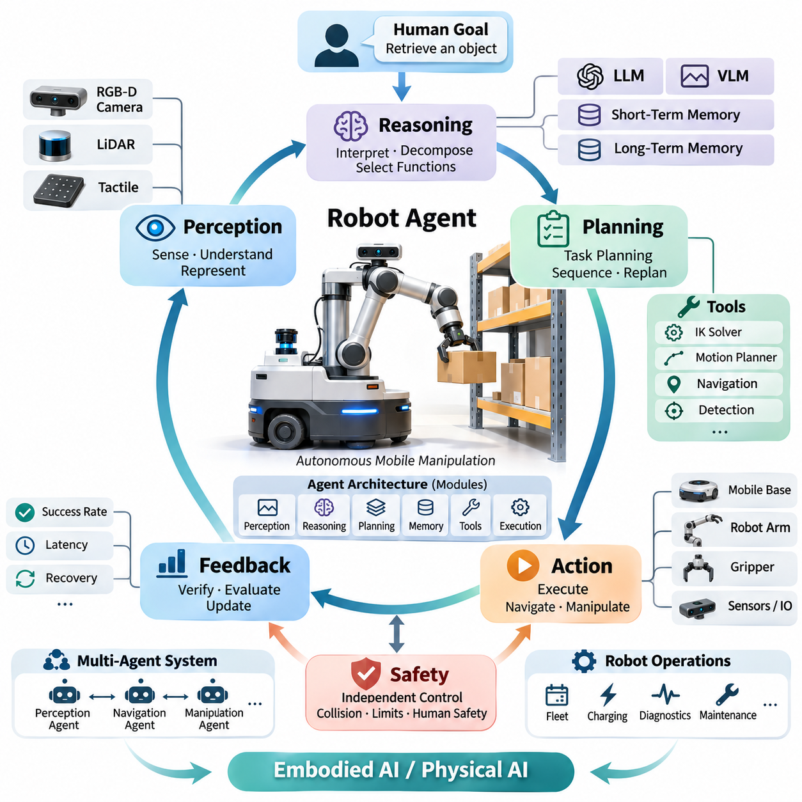
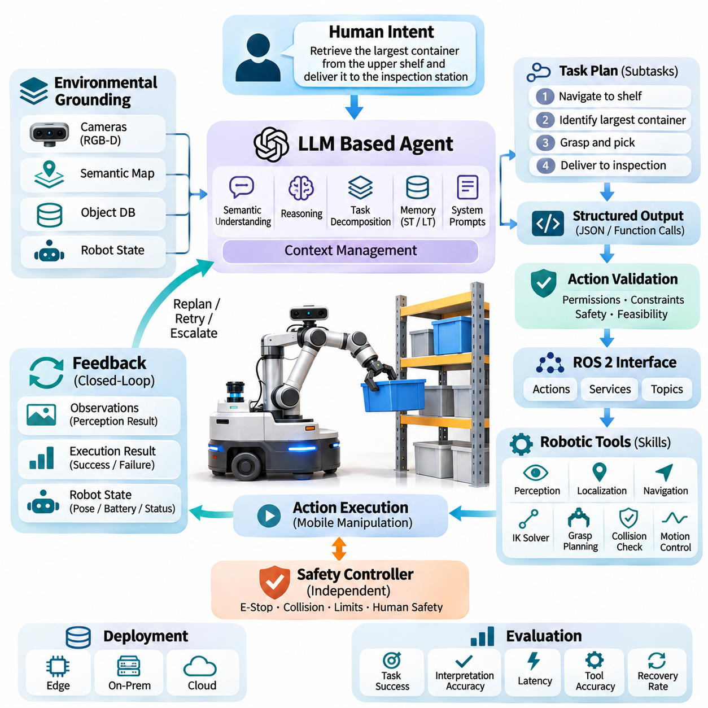
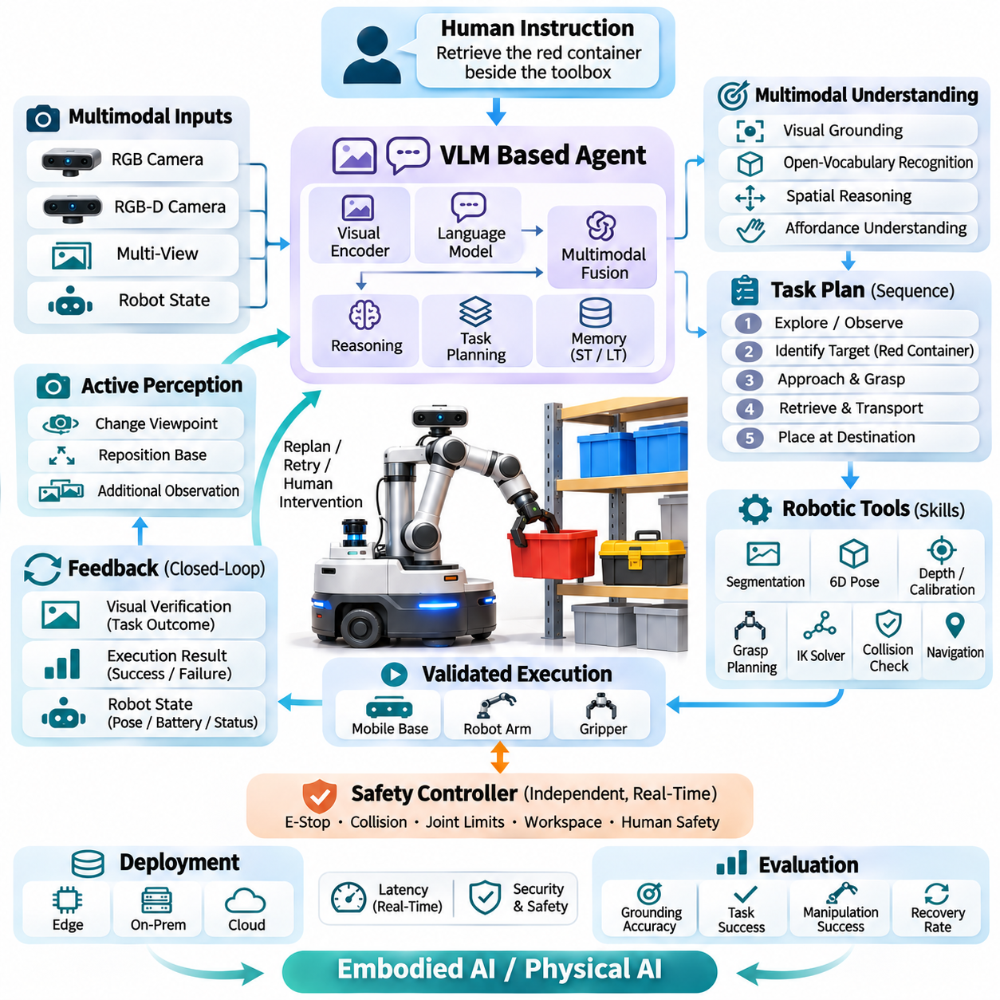
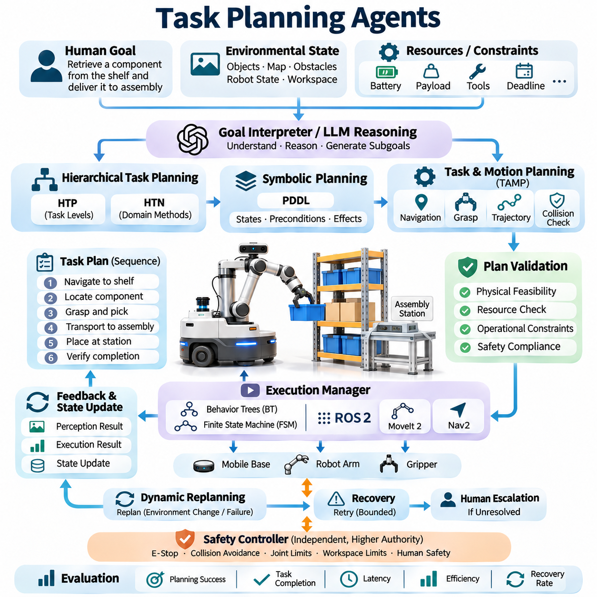
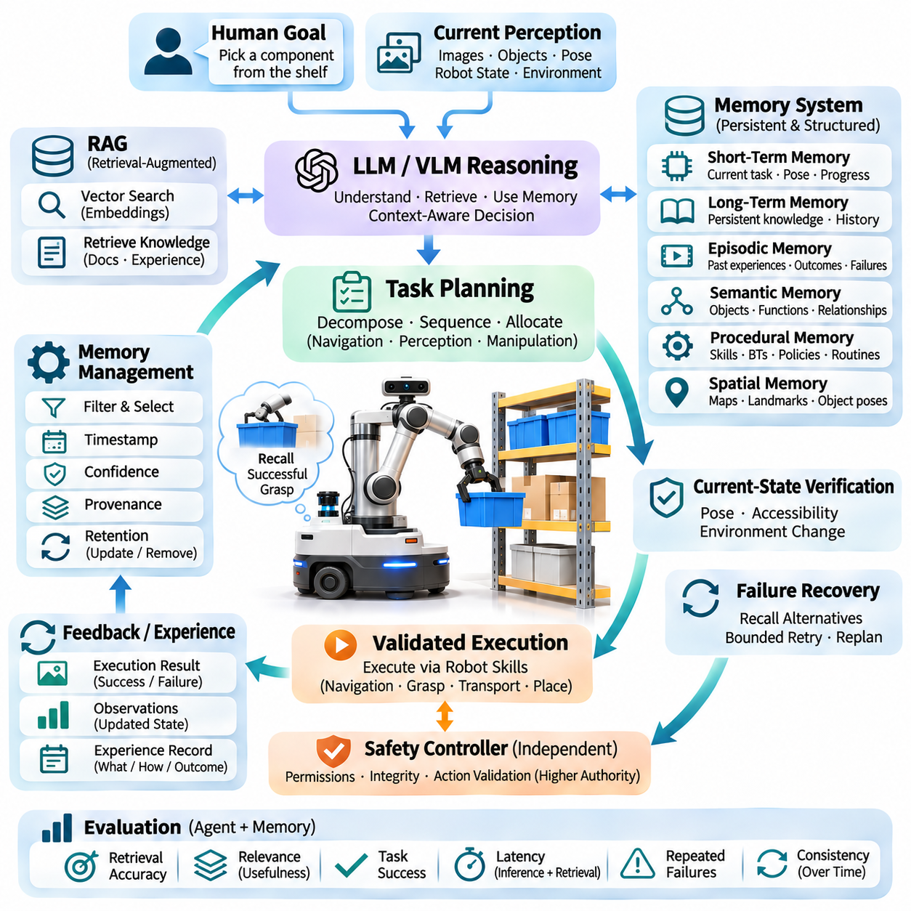
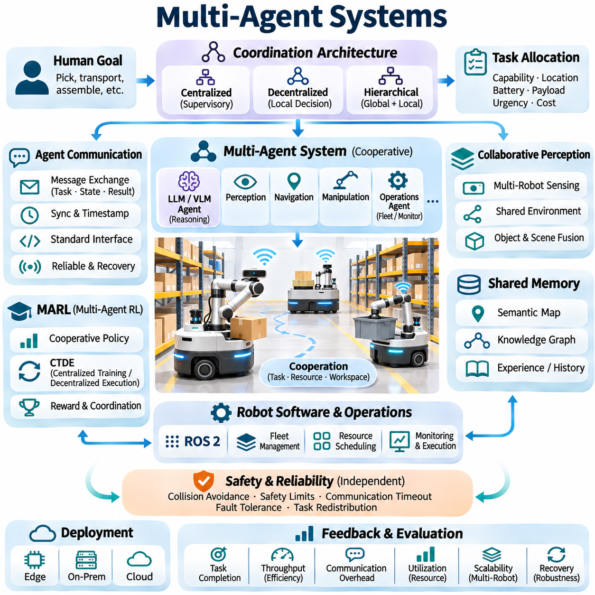
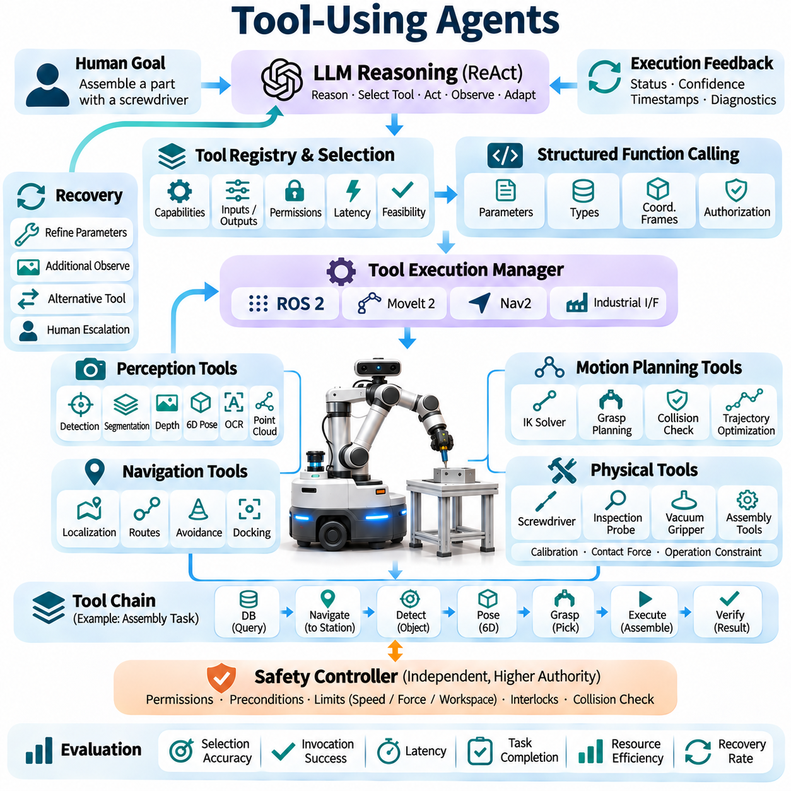
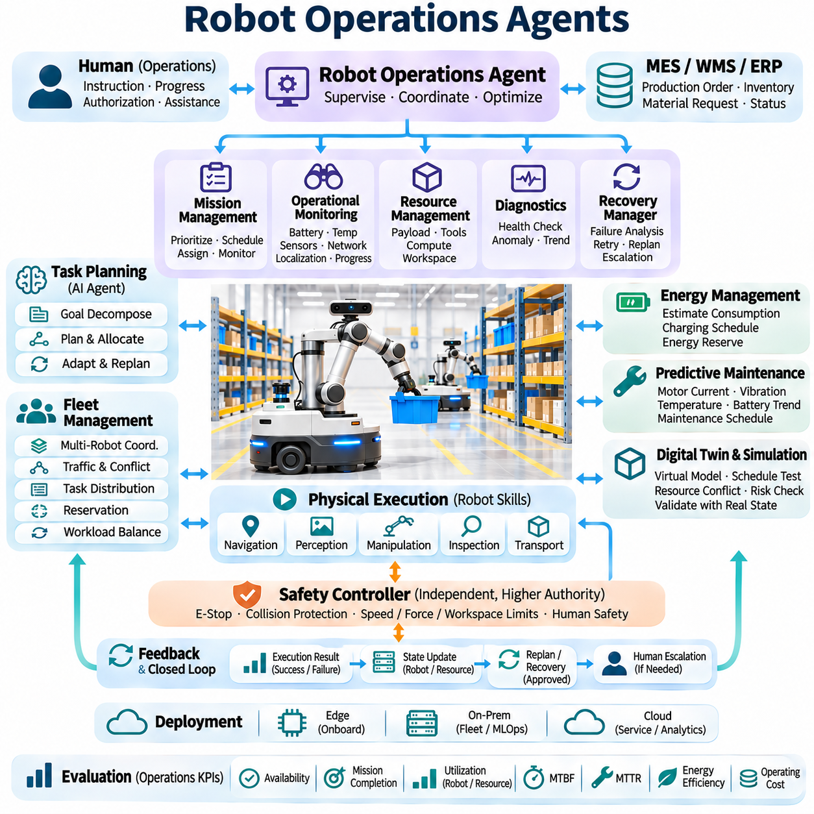
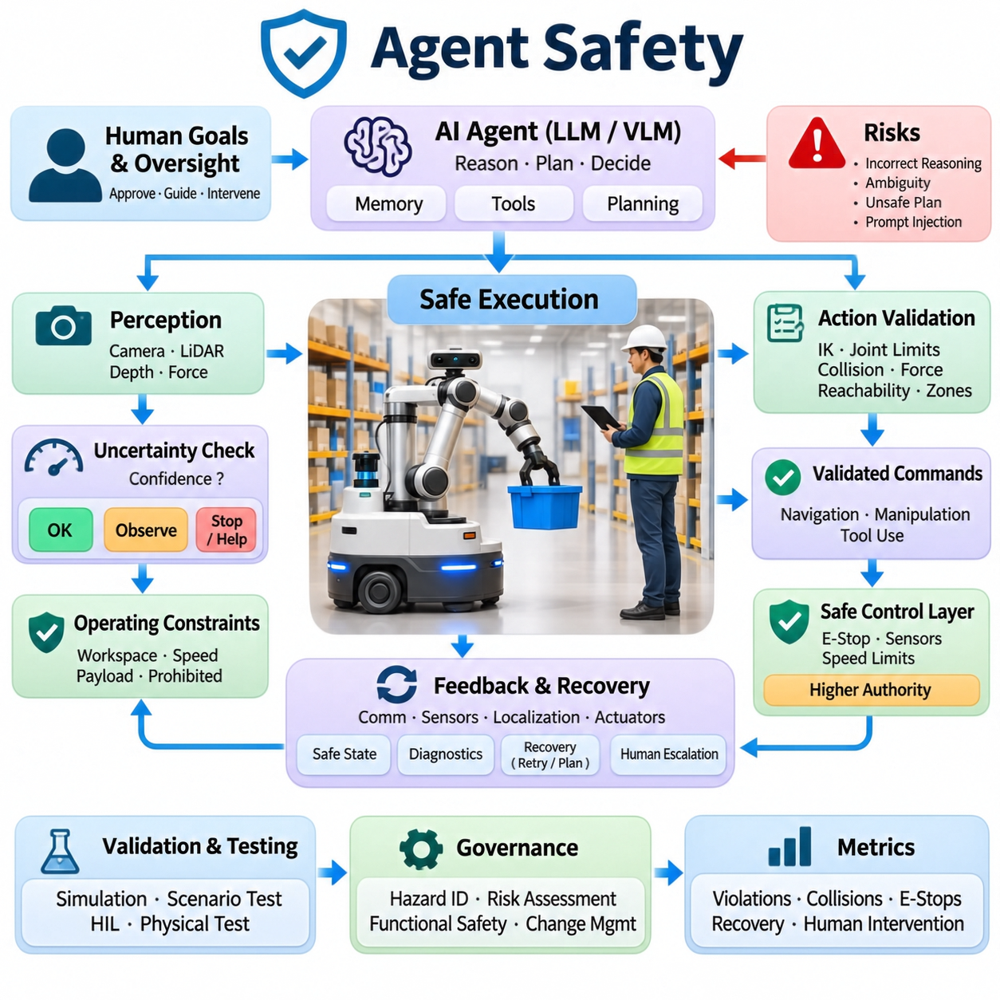
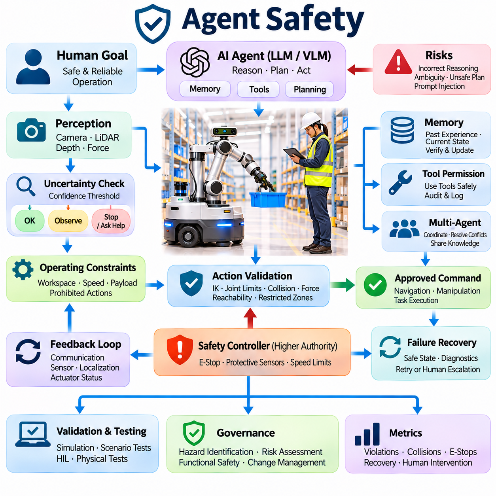

**Volume 03. Vision Manipulation and AI**


# Chapter 11. Robot Agents

##  

## 01 Robot Agent Overview

{width="7.268055555555556in" height="7.268055555555556in"}

A robot agent is an intelligent computational entity capable of perceiving its environment, interpreting objectives, making decisions, executing actions, and evaluating operational outcomes. Unlike conventional robotic systems that primarily execute predefined instructions, robot agents can adapt their behavior according to environmental conditions, task requirements, and available resources. They provide a foundation for autonomous mobile manipulation.

The fundamental purpose of a robot agent is to transform high-level human intentions into executable physical actions. When an operator requests an object to be retrieved from a storage location, the agent interprets the instruction, identifies the target, determines its location, plans navigation and manipulation sequences, and verifies task completion. This process connects cognitive intelligence with physical execution.

A robot agent operates through a continuous perception, reasoning, planning, action, and feedback cycle. Sensory information is collected from cameras, LiDAR, tactile sensors, and robot state interfaces. The agent processes these observations to establish an internal representation of the environment, evaluates possible actions, and selects an appropriate strategy based on its objectives and operational constraints.

The architecture of a robot agent typically includes perception modules, reasoning engines, planning mechanisms, memory systems, action interfaces, and execution monitoring components. These elements cooperate to support autonomous decision-making. A modular architecture allows individual components to be independently developed, evaluated, replaced, and optimized without requiring complete reconstruction of the robotic system.

Large Language Models (LLMs) introduce advanced semantic reasoning capabilities into robot agents. An LLM-based agent can interpret natural language commands, decompose complex objectives into subtasks, generate execution sequences, and select appropriate robotic functions. However, language-generated decisions must be grounded in actual environmental conditions and validated against the physical capabilities of the robot.

Vision-Language Models (VLMs) extend robot agent intelligence by connecting visual observations with semantic understanding. A VLM-based agent can identify objects described through natural language, interpret spatial relationships, recognize functional properties, and understand contextual information. These capabilities are particularly valuable in unstructured environments where predefined object categories are insufficient.

Task planning represents a fundamental capability of robot agents. Complex missions are decomposed into manageable subtasks involving navigation, object detection, pose estimation, grasp planning, manipulation, and verification. The agent determines execution dependencies, evaluates resource availability, and reorganizes task sequences when unexpected environmental changes or execution failures occur.

Memory-augmented robot agents maintain information beyond immediate sensory observations. Short-term memory stores current task states and recent environmental changes, while long-term memory can preserve object locations, operational experiences, successful manipulation strategies, and historical failure patterns. Memory mechanisms improve contextual reasoning and support more consistent behavior across extended missions.

Tool-using robot agents extend their capabilities through structured interfaces to external software and physical resources. Available tools may include object detection models, motion planners, inverse kinematics solvers, navigation systems, databases, and robotic control services. The agent selects suitable tools according to task requirements and uses their returned results to guide subsequent decisions and actions.

In mobile manipulation systems, robot agents coordinate the autonomous mobile robot, robotic arm, end effector, perception sensors, and onboard computing resources. Navigation and manipulation must be treated as interconnected activities rather than independent operations. Base positioning influences arm reachability, grasp feasibility, sensor visibility, collision avoidance, and the overall efficiency of physical task execution.

Multi-agent systems distribute responsibilities among multiple intelligent agents. Individual agents may specialize in perception, navigation, manipulation, task scheduling, fleet coordination, or operational monitoring. Through structured communication and shared environmental information, these agents can cooperate to accomplish complex missions while reducing the computational and organizational burden placed on individual components.

Robot operations agents support continuous system operation beyond direct physical manipulation. Their responsibilities may include mission scheduling, battery monitoring, autonomous charging, resource allocation, equipment diagnostics, failure recovery, and maintenance coordination. These capabilities allow mobile manipulators to participate in larger industrial workflows while reducing unnecessary human intervention and operational interruptions.

Safety is an essential architectural requirement for robot agents because their decisions produce physical consequences. AI-generated plans must be evaluated against collision constraints, joint limitations, workspace boundaries, payload restrictions, and human safety requirements. Independent safety mechanisms and deterministic control layers must retain authority over agent-generated commands to prevent unsafe physical execution.

The performance of robot agents should be evaluated using both cognitive and physical operational metrics. Relevant indicators include task completion rate, planning accuracy, reasoning latency, manipulation success rate, recovery effectiveness, execution time, and human intervention frequency. Reliable evaluation requires testing under diverse environmental conditions, including uncertainty, sensor degradation, and unexpected obstacles.

Robot agents represent an important transition from instruction-driven automation toward goal-oriented physical intelligence. By integrating foundation models, visual perception, semantic reasoning, memory, planning, and physical control, they enable mobile manipulators to perform increasingly complex tasks. Their evolution toward dependable autonomous operation remains closely associated with advances in Embodied AI and Physical AI.

로봇 에이전트(Robot Agent)는 환경을 인식하고, 목표를 해석하며, 의사결정을 수행하고, 행동을 실행하며, 운영 결과를 평가할 수 있는 지능형 컴퓨팅 개체(Intelligent Computational Entity)이다. 사전에 정의된 명령을 주로 실행하는 기존 로봇 시스템(Conventional Robotic System)과 달리, 로봇 에이전트는 환경 조건(Environmental Conditions), 작업 요구사항(Task Requirements), 가용 자원(Available Resources)에 따라 자신의 행동을 적응적으로 변경할 수 있다. 이러한 특성은 자율 이동 조작(Autonomous Mobile Manipulation)의 기반을 제공한다.

로봇 에이전트의 근본적인 목적은 인간의 고수준 의도(High-Level Human Intentions)를 실행 가능한 물리적 행동(Physical Actions)으로 변환하는 것이다. 작업자가 보관 장소에서 특정 물체를 가져오도록 요청하면, 에이전트는 명령을 해석하고, 대상 물체를 식별하며, 위치를 파악하고, 자율주행(Navigation)과 조작(Manipulation) 순서를 계획하며, 작업 완료 여부를 검증한다. 이러한 과정은 인지 지능(Cognitive Intelligence)과 물리적 실행(Physical Execution)을 연결한다.

로봇 에이전트는 인식(Perception), 추론(Reasoning), 계획(Planning), 행동(Action), 피드백(Feedback)으로 구성된 지속적인 순환 구조(Cycle)를 통해 작동한다. 카메라(Camera), 라이다(LiDAR), 촉각 센서(Tactile Sensor), 로봇 상태 인터페이스(Robot State Interface)로부터 감각 정보를 수집한다. 에이전트는 이러한 관측 정보를 처리하여 환경의 내부 표현(Internal Representation)을 구성하고, 가능한 행동을 평가하며, 목표와 운영 제약조건(Operational Constraints)에 따라 적절한 전략을 선택한다.

로봇 에이전트의 아키텍처(Architecture)는 일반적으로 인식 모듈(Perception Module), 추론 엔진(Reasoning Engine), 계획 메커니즘(Planning Mechanism), 메모리 시스템(Memory System), 행동 인터페이스(Action Interface), 실행 모니터링 구성요소(Execution Monitoring Component)로 구성된다. 이러한 구성요소들은 자율 의사결정(Autonomous Decision-Making)을 지원하기 위해 상호 협력한다. 모듈형 아키텍처(Modular Architecture)는 전체 로봇 시스템을 재구축하지 않고도 개별 구성요소를 독립적으로 개발, 평가, 교체 및 최적화할 수 있도록 한다.

대규모 언어 모델(Large Language Model, LLM)은 로봇 에이전트에 고도화된 의미론적 추론(Semantic Reasoning) 능력을 제공한다. 대규모 언어 모델 기반 에이전트(LLM-Based Agent)는 자연어 명령(Natural Language Command)을 해석하고, 복잡한 목표를 하위 작업(Subtask)으로 분해하며, 실행 순서(Execution Sequence)를 생성하고, 적절한 로봇 기능(Robotic Function)을 선택할 수 있다. 그러나 언어를 기반으로 생성된 의사결정은 실제 환경 조건에 근거해야 하며, 로봇의 물리적 능력(Physical Capability)에 부합하는지 검증되어야 한다.

비전 언어 모델(Vision-Language Model, VLM)은 시각적 관측(Visual Observation)과 의미론적 이해(Semantic Understanding)를 연결함으로써 로봇 에이전트의 지능을 확장한다. 비전 언어 모델 기반 에이전트(VLM-Based Agent)는 자연어로 설명된 물체를 식별하고, 공간적 관계(Spatial Relationship)를 해석하며, 기능적 속성(Functional Property)을 인식하고, 문맥 정보(Contextual Information)를 이해할 수 있다. 이러한 능력은 사전에 정의된 객체 범주(Object Category)만으로 대응하기 어려운 비정형 환경(Unstructured Environment)에서 특히 중요하다.

작업 계획(Task Planning)은 로봇 에이전트의 핵심 능력을 구성한다. 복잡한 임무(Complex Mission)는 자율주행(Navigation), 객체 검출(Object Detection), 자세 추정(Pose Estimation), 파지 계획(Grasp Planning), 조작(Manipulation), 검증(Verification)을 포함하는 관리 가능한 하위 작업으로 분해된다. 에이전트는 실행 의존성(Execution Dependency)을 결정하고, 자원 가용성(Resource Availability)을 평가하며, 예상하지 못한 환경 변화나 실행 실패(Execution Failure)가 발생하면 작업 순서를 재구성한다.

메모리 증강 로봇 에이전트(Memory-Augmented Robot Agent)는 즉각적인 감각 관측을 넘어서는 정보를 유지한다. 단기 메모리(Short-Term Memory)는 현재 작업 상태와 최근 환경 변화를 저장하며, 장기 메모리(Long-Term Memory)는 물체의 위치, 운영 경험(Operational Experience), 성공적인 조작 전략(Manipulation Strategy), 과거의 실패 패턴(Failure Pattern)을 보존할 수 있다. 이러한 메모리 메커니즘(Memory Mechanism)은 문맥 기반 추론(Contextual Reasoning)을 향상시키고 장시간 임무에서 더욱 일관된 행동을 지원한다.

도구 활용 로봇 에이전트(Tool-Using Robot Agent)는 외부 소프트웨어와 물리적 자원에 대한 구조화된 인터페이스(Structured Interface)를 통해 자신의 능력을 확장한다. 활용 가능한 도구에는 객체 검출 모델(Object Detection Model), 동작 계획기(Motion Planner), 역기구학 해석기(Inverse Kinematics Solver), 자율주행 시스템(Navigation System), 데이터베이스(Database), 로봇 제어 서비스(Robotic Control Service) 등이 포함된다. 에이전트는 작업 요구사항에 따라 적절한 도구를 선택하고, 반환된 결과를 활용하여 후속 의사결정과 행동을 수행한다.

이동 조작 시스템(Mobile Manipulation System)에서 로봇 에이전트는 자율이동로봇(Autonomous Mobile Robot, AMR), 로봇 팔(Robotic Arm), 말단장치(End Effector), 인식 센서(Perception Sensor), 온보드 컴퓨팅 자원(Onboard Computing Resource)을 통합적으로 조정한다. 자율주행과 조작은 독립적인 작업이 아니라 상호 연결된 활동으로 취급되어야 한다. 이동 플랫폼의 위치 결정(Base Positioning)은 로봇 팔의 도달 가능성(Reachability), 파지 실현 가능성(Grasp Feasibility), 센서 가시성(Sensor Visibility), 충돌 회피(Collision Avoidance), 전반적인 물리적 작업 실행 효율에 영향을 미친다.

다중 에이전트 시스템(Multi-Agent System)은 여러 지능형 에이전트(Intelligent Agent)에 역할과 책임을 분산한다. 개별 에이전트는 인식(Perception), 자율주행(Navigation), 조작(Manipulation), 작업 스케줄링(Task Scheduling), 로봇 군집 조정(Fleet Coordination), 운영 모니터링(Operational Monitoring) 등의 기능에 특화될 수 있다. 구조화된 통신(Structured Communication)과 공유 환경 정보(Shared Environmental Information)를 통해 이러한 에이전트들은 복잡한 임무를 협력적으로 수행하면서 개별 구성요소에 집중되는 컴퓨팅 및 조직적 부담을 줄일 수 있다.

로봇 운영 에이전트(Robot Operations Agent)는 직접적인 물리적 조작을 넘어 지속적인 시스템 운영(Continuous System Operation)을 지원한다. 주요 역할에는 임무 스케줄링(Mission Scheduling), 배터리 모니터링(Battery Monitoring), 자율 충전(Autonomous Charging), 자원 할당(Resource Allocation), 장비 진단(Equipment Diagnostics), 장애 복구(Failure Recovery), 유지보수 조정(Maintenance Coordination) 등이 포함된다. 이러한 능력은 이동형 매니퓰레이터(Mobile Manipulator)가 더 광범위한 산업 작업 흐름(Industrial Workflow)에 참여하도록 하면서 불필요한 인간 개입(Human Intervention)과 운영 중단(Operational Interruption)을 줄일 수 있도록 한다.

안전(Safety)은 로봇 에이전트의 의사결정이 물리적 결과를 초래한다는 점에서 필수적인 아키텍처 요구사항(Architectural Requirement)이다. 인공지능(AI)이 생성한 계획은 충돌 제약조건(Collision Constraints), 관절 한계(Joint Limits), 작업공간 경계(Workspace Boundaries), 가반하중 제한(Payload Restrictions), 인간 안전 요구사항(Human Safety Requirements)에 따라 평가되어야 한다. 독립적인 안전 메커니즘(Independent Safety Mechanism)과 결정론적 제어 계층(Deterministic Control Layer)은 위험한 물리적 실행을 방지하기 위해 에이전트가 생성한 명령에 대한 제어 권한을 유지해야 한다.

로봇 에이전트의 성능은 인지적 및 물리적 운영 지표(Cognitive and Physical Operational Metrics)를 모두 활용하여 평가해야 한다. 주요 평가 지표에는 작업 완료율(Task Completion Rate), 계획 정확도(Planning Accuracy), 추론 지연시간(Reasoning Latency), 조작 성공률(Manipulation Success Rate), 복구 효과성(Recovery Effectiveness), 실행 시간(Execution Time), 인간 개입 빈도(Human Intervention Frequency) 등이 포함된다. 신뢰성 있는 평가(Reliable Evaluation)를 위해서는 불확실성(Uncertainty), 센서 성능 저하(Sensor Degradation), 예상하지 못한 장애물(Unexpected Obstacles)을 포함하는 다양한 환경 조건에서 시험을 수행해야 한다.

로봇 에이전트는 명령 중심 자동화(Instruction-Driven Automation)에서 목표 지향적 물리 지능(Goal-Oriented Physical Intelligence)으로 전환하는 중요한 기술적 변화를 나타낸다. 기반 모델(Foundation Model), 시각 인식(Visual Perception), 의미론적 추론(Semantic Reasoning), 메모리(Memory), 계획(Planning), 물리적 제어(Physical Control)를 통합함으로써 이동형 매니퓰레이터가 점차 복잡해지는 작업을 수행할 수 있도록 한다. 신뢰성 있는 자율 운영(Dependable Autonomous Operation)을 향한 로봇 에이전트의 발전은 체화형 인공지능(Embodied AI)과 물리적 인공지능(Physical AI)의 기술적 발전과 밀접하게 연관되어 있다.

##  

## 02 LLM Based Agents

{width="7.268055555555556in" height="7.268055555555556in"}

Large Language Model (LLM) based agents represent an advanced approach to robotic intelligence in which language models provide semantic understanding, contextual reasoning, task decomposition, and high-level decision-making capabilities. Unlike conventional robotic software that depends primarily on predefined rules and deterministic execution sequences, LLM-based agents can interpret diverse instructions and generate adaptive strategies for physical task execution.

The primary function of an LLM-based robot agent is to translate human intentions into structured robotic operations. Natural language instructions such as retrieving a component, transporting a container, or organizing objects can be interpreted without requiring operators to specify individual movements. The agent determines the intended objective, identifies relevant constraints, and generates a sequence of actions that can be executed by available robotic subsystems.

The architecture of an LLM-based agent typically consists of a language model, context management mechanism, reasoning engine, task planner, memory interface, tool execution framework, and feedback monitoring system. The language model serves as a high-level cognitive component, while specialized robotic modules remain responsible for perception, localization, navigation, motion planning, manipulation, and real-time physical control.

Natural language understanding enables robot agents to interpret instructions containing semantic relationships, conditional requirements, operational priorities, and contextual references. For example, an instruction to retrieve the largest container from an upper shelf and deliver it to an inspection station requires object identification, spatial interpretation, comparative reasoning, destination recognition, and physical task coordination.

Task decomposition allows LLM-based agents to transform complex objectives into smaller and more manageable subtasks. A mobile manipulation mission may involve navigating to a workstation, locating the target object, estimating its pose, generating grasp candidates, executing a manipulation trajectory, and transporting the object to another location. Each subtask is associated with specific execution requirements and completion conditions.

Reasoning capabilities allow LLM-based agents to evaluate alternative execution strategies when environmental conditions change. If a target object is obstructed, the agent may request additional visual observations, select an alternative approach position, or reorganize the manipulation sequence. Such decisions must be supported by reliable environmental information rather than depending exclusively on knowledge encoded within the language model.

Prompt engineering plays an important role in defining the behavior of LLM-based robot agents. System prompts can specify operational objectives, permitted actions, available tools, safety requirements, task constraints, and expected response formats. Structured prompts reduce ambiguity and encourage consistent decision-making by establishing explicit relationships between human instructions, environmental observations, and executable robotic operations.

Tool calling enables an LLM-based agent to interact with specialized robotic software through structured interfaces. Instead of directly calculating robot trajectories or joint commands, the agent can invoke object detection services, navigation planners, inverse kinematics solvers, grasp planning modules, and collision checking functions. Tool responses provide verified computational results that support subsequent reasoning and execution decisions.

Structured output generation provides a systematic mechanism for connecting language models with robotic execution frameworks. An agent may generate action descriptions using JSON schemas, predefined function signatures, symbolic representations, or task-specific command formats. These representations enable software components to validate required parameters, reject unsupported operations, and translate approved decisions into executable robotic requests.

LLM-based agents can be integrated with Robot Operating System 2 (ROS 2) through middleware interfaces that connect high-level reasoning with distributed robotic components. ROS 2 actions, services, and topics provide communication mechanisms for requesting navigation, manipulation, perception, and diagnostic operations. The agent receives execution feedback and updates its decisions according to reported robot states and task outcomes.

Environmental grounding is essential because language models do not inherently possess accurate knowledge of the current physical environment. Information from perception systems, semantic maps, object databases, and robot state interfaces must be incorporated into the reasoning context. Grounding reduces the likelihood of generating actions involving nonexistent objects, inaccessible locations, or physically impossible manipulation strategies.

Closed-loop execution allows an LLM-based agent to continuously evaluate the progress of a robotic mission. After each significant action, the agent receives updated observations and execution results to determine whether the expected state has been achieved. When discrepancies are detected, the agent may revise its plan, request additional information, retry an operation within permitted limits, or escalate the problem to a human operator.

Computational efficiency remains an important consideration when deploying LLM-based agents on mobile manipulators. Large models may require cloud or on-premises computing resources, while smaller language models can support selected reasoning tasks on edge devices. Hybrid architectures can distribute computational responsibilities according to inference latency, communication reliability, memory capacity, data confidentiality, and operational requirements.

Safety and reliability represent fundamental challenges because LLMs may generate inaccurate information, inconsistent plans, or unsupported commands. Independent safety controllers, deterministic validation mechanisms, permission management, and execution boundaries must prevent unsafe actions. Performance evaluation should include instruction interpretation accuracy, task completion rates, planning latency, tool selection accuracy, and failure recovery effectiveness.

LLM-based robot agents provide a cognitive interface between human objectives and physical robotic capabilities. Their practical value emerges from combining semantic reasoning with reliable perception, structured planning, validated tool execution, and deterministic control. Within mobile manipulation and Physical AI architectures, language models should enhance autonomous decision-making without replacing specialized control systems or independent safety mechanisms.

대규모 언어 모델(Large Language Model, LLM) 기반 에이전트는 언어 모델을 활용하여 의미론적 이해(Semantic Understanding), 문맥 기반 추론(Contextual Reasoning), 작업 분해(Task Decomposition), 고수준 의사결정(High-Level Decision-Making) 능력을 제공하는 고도화된 로봇 지능(Robotic Intelligence) 접근 방식이다. 사전에 정의된 규칙과 결정론적 실행 순서(Deterministic Execution Sequence)에 주로 의존하는 기존 로봇 소프트웨어와 달리, 대규모 언어 모델 기반 에이전트는 다양한 명령을 해석하고 물리적 작업 실행(Physical Task Execution)을 위한 적응형 전략(Adaptive Strategy)을 생성할 수 있다.

대규모 언어 모델 기반 로봇 에이전트(LLM-Based Robot Agent)의 주요 기능은 인간의 의도(Human Intention)를 구조화된 로봇 작업(Structured Robotic Operation)으로 변환하는 것이다. 부품을 가져오거나, 용기를 운반하거나, 물체를 정리하는 것과 같은 자연어 명령(Natural Language Instruction)은 작업자가 개별 동작을 지정하지 않아도 해석될 수 있다. 에이전트는 의도된 목표를 파악하고, 관련 제약조건(Constraints)을 식별하며, 가용 로봇 하위 시스템(Robotic Subsystem)에서 실행할 수 있는 행동 순서(Action Sequence)를 생성한다.

대규모 언어 모델 기반 에이전트의 아키텍처(Architecture)는 일반적으로 언어 모델(Language Model), 문맥 관리 메커니즘(Context Management Mechanism), 추론 엔진(Reasoning Engine), 작업 계획기(Task Planner), 메모리 인터페이스(Memory Interface), 도구 실행 프레임워크(Tool Execution Framework), 피드백 모니터링 시스템(Feedback Monitoring System)으로 구성된다. 언어 모델은 고수준 인지 구성요소(High-Level Cognitive Component)로 작동하며, 전문화된 로봇 모듈은 인식(Perception), 위치 추정(Localization), 자율주행(Navigation), 동작 계획(Motion Planning), 조작(Manipulation), 실시간 물리적 제어(Real-Time Physical Control)를 담당한다.

자연어 이해(Natural Language Understanding, NLU)는 로봇 에이전트가 의미론적 관계(Semantic Relationship), 조건부 요구사항(Conditional Requirements), 운영 우선순위(Operational Priority), 문맥적 참조(Contextual Reference)를 포함하는 명령을 해석할 수 있도록 한다. 예를 들어, 상단 선반에서 가장 큰 용기를 가져와 검사 작업장으로 운반하라는 명령은 객체 식별(Object Identification), 공간적 해석(Spatial Interpretation), 비교 추론(Comparative Reasoning), 목적지 인식(Destination Recognition), 물리적 작업 조정(Physical Task Coordination)을 요구한다.

작업 분해(Task Decomposition)는 대규모 언어 모델 기반 에이전트가 복잡한 목표를 더 작고 관리하기 쉬운 하위 작업(Subtask)으로 변환할 수 있도록 한다. 이동 조작 임무(Mobile Manipulation Mission)는 작업장으로의 자율주행, 대상 객체의 위치 파악, 객체 자세 추정(Object Pose Estimation), 파지 후보(Grasp Candidate) 생성, 조작 궤적(Manipulation Trajectory) 실행, 다른 위치로의 물체 운반 등을 포함할 수 있다. 각각의 하위 작업은 구체적인 실행 요구사항(Execution Requirements) 및 완료 조건(Completion Conditions)과 연계된다.

추론 능력(Reasoning Capability)은 환경 조건이 변화할 때 대규모 언어 모델 기반 에이전트가 대안적인 실행 전략(Alternative Execution Strategy)을 평가할 수 있도록 한다. 대상 물체가 장애물에 의해 가려지거나 접근이 제한되면, 에이전트는 추가적인 시각적 관측(Visual Observation)을 요청하거나, 대안적인 접근 위치(Alternative Approach Position)를 선택하거나, 조작 순서(Manipulation Sequence)를 재구성할 수 있다. 이러한 의사결정은 언어 모델 내부에 인코딩된 지식에만 의존하지 않고 신뢰할 수 있는 환경 정보(Environmental Information)에 의해 뒷받침되어야 한다.

프롬프트 엔지니어링(Prompt Engineering)은 대규모 언어 모델 기반 로봇 에이전트의 행동을 정의하는 데 중요한 역할을 수행한다. 시스템 프롬프트(System Prompt)는 운영 목표(Operational Objective), 허용된 행동(Permitted Action), 가용 도구(Available Tool), 안전 요구사항(Safety Requirements), 작업 제약조건(Task Constraints), 예상 응답 형식(Expected Response Format)을 지정할 수 있다. 구조화된 프롬프트(Structured Prompt)는 인간의 명령, 환경 관측 정보, 실행 가능한 로봇 작업 사이의 명확한 관계를 설정함으로써 모호성(Ambiguity)을 감소시키고 일관된 의사결정을 유도한다.

도구 호출(Tool Calling)은 대규모 언어 모델 기반 에이전트가 구조화된 인터페이스(Structured Interface)를 통해 전문화된 로봇 소프트웨어와 상호작용할 수 있도록 한다. 에이전트는 로봇 궤적(Robot Trajectory)이나 관절 명령(Joint Command)을 직접 계산하는 대신 객체 검출 서비스(Object Detection Service), 자율주행 계획기(Navigation Planner), 역기구학 해석기(Inverse Kinematics Solver), 파지 계획 모듈(Grasp Planning Module), 충돌 검사 기능(Collision Checking Function)을 호출할 수 있다. 도구 응답(Tool Response)은 후속 추론과 실행 의사결정을 지원하는 검증된 계산 결과(Verified Computational Result)를 제공한다.

구조화된 출력 생성(Structured Output Generation)은 언어 모델을 로봇 실행 프레임워크(Robotic Execution Framework)와 연결하기 위한 체계적인 메커니즘을 제공한다. 에이전트는 JSON 스키마(JSON Schema), 사전 정의된 함수 시그니처(Predefined Function Signature), 기호적 표현(Symbolic Representation), 작업별 명령 형식(Task-Specific Command Format)을 활용하여 행동에 대한 설명을 생성할 수 있다. 이러한 표현 방식은 소프트웨어 구성요소가 필수 매개변수(Required Parameter)를 검증하고, 지원되지 않는 작업을 거부하며, 승인된 의사결정을 실행 가능한 로봇 요청(Executable Robotic Request)으로 변환할 수 있도록 한다.

대규모 언어 모델 기반 에이전트는 고수준 추론(High-Level Reasoning)과 분산형 로봇 구성요소(Distributed Robotic Component)를 연결하는 미들웨어 인터페이스(Middleware Interface)를 통해 로봇 운영체제 2(Robot Operating System 2, ROS 2)와 통합될 수 있다. ROS 2의 액션(Action), 서비스(Service), 토픽(Topic)은 자율주행, 조작, 인식, 진단 작업을 요청하기 위한 통신 메커니즘(Communication Mechanism)을 제공한다. 에이전트는 실행 피드백(Execution Feedback)을 수신하고, 보고된 로봇 상태(Robot State)와 작업 결과(Task Outcome)에 따라 자신의 의사결정을 갱신한다.

환경 근거화(Environmental Grounding)는 언어 모델이 현재의 물리적 환경(Physical Environment)에 관한 정확한 지식을 본질적으로 보유하고 있지 않기 때문에 필수적이다. 인식 시스템(Perception System), 의미론적 지도(Semantic Map), 객체 데이터베이스(Object Database), 로봇 상태 인터페이스(Robot State Interface)로부터 수집된 정보는 추론 문맥(Reasoning Context)에 통합되어야 한다. 환경 근거화는 존재하지 않는 물체, 접근할 수 없는 위치, 물리적으로 불가능한 조작 전략과 관련된 행동이 생성될 가능성을 감소시킨다.

폐루프 실행(Closed-Loop Execution)은 대규모 언어 모델 기반 에이전트가 로봇 임무의 진행 상황을 지속적으로 평가할 수 있도록 한다. 각각의 주요 행동 이후 에이전트는 갱신된 관측 정보(Updated Observation)와 실행 결과(Execution Result)를 수신하여 예상 상태(Expected State)에 도달했는지를 판단한다. 불일치(Discrepancy)가 감지되면 에이전트는 계획을 수정하거나, 추가 정보를 요청하거나, 허용된 범위 내에서 작업을 재시도하거나, 해당 문제를 인간 작업자(Human Operator)에게 전달하여 대응을 요청할 수 있다.

컴퓨팅 효율성(Computational Efficiency)은 이동형 매니퓰레이터(Mobile Manipulator)에 대규모 언어 모델 기반 에이전트를 배포할 때 고려해야 하는 중요한 요소이다. 대규모 모델은 클라우드(Cloud) 또는 온프레미스(On-Premises) 컴퓨팅 자원을 필요로 할 수 있으며, 소규모 언어 모델은 엣지 장치(Edge Device)에서 특정 추론 작업을 지원할 수 있다. 하이브리드 아키텍처(Hybrid Architecture)는 추론 지연시간(Inference Latency), 통신 신뢰성(Communication Reliability), 메모리 용량(Memory Capacity), 데이터 기밀성(Data Confidentiality), 운영 요구사항(Operational Requirements)에 따라 컴퓨팅 역할을 분산할 수 있다.

안전성(Safety)과 신뢰성(Reliability)은 대규모 언어 모델이 부정확한 정보, 일관되지 않은 계획, 지원되지 않는 명령을 생성할 수 있다는 점에서 근본적인 기술적 과제이다. 독립형 안전 제어기(Independent Safety Controller), 결정론적 검증 메커니즘(Deterministic Validation Mechanism), 권한 관리(Permission Management), 실행 경계(Execution Boundary)는 위험한 행동을 방지해야 한다. 성능 평가(Performance Evaluation)에는 명령 해석 정확도(Instruction Interpretation Accuracy), 작업 완료율(Task Completion Rate), 계획 지연시간(Planning Latency), 도구 선택 정확도(Tool Selection Accuracy), 장애 복구 효과성(Failure Recovery Effectiveness)이 포함되어야 한다.

대규모 언어 모델 기반 로봇 에이전트는 인간의 목표(Human Objective)와 로봇의 물리적 능력(Physical Robotic Capability) 사이를 연결하는 인지 인터페이스(Cognitive Interface)를 제공한다. 이러한 에이전트의 실질적인 가치는 의미론적 추론(Semantic Reasoning), 신뢰성 있는 인식(Reliable Perception), 구조화된 계획(Structured Planning), 검증된 도구 실행(Validated Tool Execution), 결정론적 제어(Deterministic Control)를 결합함으로써 구현된다. 이동 조작(Mobile Manipulation) 및 물리적 인공지능(Physical AI) 아키텍처에서 언어 모델은 전문화된 제어 시스템(Specialized Control System)이나 독립적인 안전 메커니즘(Independent Safety Mechanism)을 대체하지 않으면서 자율 의사결정(Autonomous Decision-Making) 능력을 향상시켜야 한다.

##  

## 03 VLM Based Agents

{width="7.268055555555556in" height="7.268055555555556in"}

Vision-Language Model (VLM) based agents represent an intelligent robotic architecture that integrates visual perception, natural language understanding, semantic reasoning, and physical task execution. Unlike language-only agents that primarily process textual information, VLM-based agents can interpret visual observations and establish meaningful relationships between human instructions, physical objects, and environmental conditions.

The primary objective of a VLM-based robot agent is to establish a direct connection between visual information and goal-oriented robotic behavior. When an operator requests the retrieval of a specific object, the agent analyzes visual observations, interprets the linguistic description, identifies relevant objects, and determines appropriate actions. This capability reduces dependence on predefined object categories and fixed operational scenarios.

The architecture of a VLM-based agent typically incorporates a visual encoder, language processing model, multimodal fusion mechanism, reasoning engine, task planner, memory system, and robotic execution interface. Visual and linguistic representations are integrated to support contextual decision-making. Specialized robotic subsystems subsequently translate high-level decisions into physically feasible navigation and manipulation operations.

Multimodal perception enables VLM-based agents to interpret images, natural language descriptions, and additional environmental information within a unified reasoning framework. Visual inputs may originate from RGB cameras, RGB-D sensors, or multiple camera perspectives. Geometric information and robot state measurements can be incorporated through complementary perception modules to improve spatial understanding and operational reliability.

Visual grounding represents a fundamental capability of VLM-based robot agents. It establishes correspondence between linguistic expressions and specific regions, objects, or relationships within visual observations. For example, an instruction to retrieve the red container beside the toolbox requires the agent to associate descriptive language with visible object properties and spatial relationships before initiating physical manipulation.

Open-vocabulary recognition allows VLM-based agents to identify objects beyond conventional fixed-category detection frameworks. Through knowledge acquired during multimodal pretraining, these agents may recognize unfamiliar components, tools, packages, and household objects using natural language descriptions. However, recognition confidence and geometric accuracy must be independently evaluated before consequential physical actions are authorized.

Spatial reasoning enables VLM-based agents to understand relative object positions, environmental arrangements, and task-relevant relationships. Concepts such as above, below, inside, behind, and adjacent to can be interpreted in connection with visual observations. Accurate physical manipulation nevertheless requires coordinate transformations, depth estimation, camera calibration, and dedicated three-dimensional perception mechanisms.

Affordance understanding allows VLM-based agents to reason about potential interactions between robots and physical objects. A model may associate handles with pulling, buttons with pressing, containers with holding, and tools with particular functions. These semantic predictions provide useful guidance for action selection, while dedicated grasp planning and motion planning algorithms determine whether the proposed interactions are physically feasible.

Task planning integrates multimodal understanding with sequential robotic execution. A VLM-based agent may decompose a warehouse retrieval mission into visual exploration, target identification, approach planning, grasp selection, object retrieval, transportation, and placement. Each subtask must incorporate execution constraints and measurable completion conditions to maintain consistency between semantic objectives and physical outcomes.

Active perception enables VLM-based agents to request additional observations when existing visual information is insufficient. The robot may reposition its mobile base, adjust a wrist-mounted camera, or observe an object from another perspective. These actions can reduce uncertainty caused by occlusion, unfavorable viewing angles, environmental clutter, and incomplete observations before manipulation decisions are finalized.

Tool integration extends VLM-based agents beyond multimodal reasoning by connecting them with specialized robotic functions. Object detection, instance segmentation, six-dimensional pose estimation, grasp generation, inverse kinematics, collision checking, and navigation services can be invoked through structured interfaces. Their computational outputs provide physical and geometric information that complements the semantic understanding of the model.

In mobile manipulation systems, VLM-based agents coordinate visual reasoning with mobile platform navigation and robotic arm operations. The agent evaluates whether the target is visible, accessible, and suitable for manipulation from the current robot position. When necessary, it may request mobile base repositioning to improve sensor visibility, arm reachability, grasp feasibility, and overall task execution efficiency.

Closed-loop execution enables VLM-based agents to compare expected outcomes with updated visual observations. After grasping or placing an object, the agent evaluates whether the intended environmental change has occurred. When discrepancies are detected, additional perception, bounded retries, alternative manipulation strategies, or human intervention may be requested through predefined recovery mechanisms and operational policies.

Deployment of VLM-based agents requires careful consideration of computational resources, inference latency, communication reliability, and data security. Large multimodal models may operate on cloud or on-premises infrastructure, while compact models support selected edge-based perception and reasoning functions. Independent real-time control and safety systems must remain operational regardless of multimodal inference availability.

Safety validation and performance evaluation are essential because visual-language models may misidentify objects, misunderstand spatial relationships, or generate physically unsuitable actions. Evaluation should include visual grounding accuracy, instruction interpretation, task completion rates, manipulation success, inference latency, and recovery effectiveness. Independent safety mechanisms must retain authority over physical execution.

VLM-based robot agents provide an important connection between multimodal intelligence and autonomous physical interaction. By integrating semantic perception, visual grounding, spatial reasoning, task planning, and validated robotic execution, they expand mobile manipulation capabilities in dynamic environments. Their development contributes to the broader evolution of Embodied AI and Physical AI toward adaptable, reliable robotic autonomy.

비전 언어 모델(Vision-Language Model, VLM) 기반 에이전트는 시각 인식(Visual Perception), 자연어 이해(Natural Language Understanding), 의미론적 추론(Semantic Reasoning), 물리적 작업 실행(Physical Task Execution)을 통합하는 지능형 로봇 아키텍처(Intelligent Robotic Architecture)이다. 주로 텍스트 정보를 처리하는 언어 전용 에이전트(Language-Only Agent)와 달리, 비전 언어 모델 기반 에이전트는 시각적 관측 정보를 해석하고 인간의 명령, 물리적 객체, 환경 조건 사이의 의미 있는 관계를 설정할 수 있다.

비전 언어 모델 기반 로봇 에이전트(VLM-Based Robot Agent)의 주요 목적은 시각 정보(Visual Information)와 목표 지향적 로봇 행동(Goal-Oriented Robotic Behavior) 사이에 직접적인 연결을 형성하는 것이다. 작업자가 특정 물체를 가져오도록 요청하면 에이전트는 시각적 관측 정보(Visual Observation)를 분석하고, 언어적 설명(Linguistic Description)을 해석하며, 관련 객체를 식별하고, 적절한 행동을 결정한다. 이러한 능력은 사전에 정의된 객체 범주(Predefined Object Category)와 고정된 운영 시나리오(Fixed Operational Scenario)에 대한 의존성을 감소시킨다.

비전 언어 모델 기반 에이전트의 아키텍처(Architecture)는 일반적으로 시각 인코더(Visual Encoder), 언어 처리 모델(Language Processing Model), 다중 모달 융합 메커니즘(Multimodal Fusion Mechanism), 추론 엔진(Reasoning Engine), 작업 계획기(Task Planner), 메모리 시스템(Memory System), 로봇 실행 인터페이스(Robotic Execution Interface)를 포함한다. 시각적 표현(Visual Representation)과 언어적 표현(Linguistic Representation)은 문맥 기반 의사결정(Contextual Decision-Making)을 지원하도록 통합된다. 이후 전문화된 로봇 하위 시스템은 고수준 의사결정을 물리적으로 실현 가능한 자율주행 및 조작 작업으로 변환한다.

다중 모달 인식(Multimodal Perception)은 비전 언어 모델 기반 에이전트가 이미지, 자연어 설명(Natural Language Description), 추가적인 환경 정보를 통합된 추론 프레임워크(Unified Reasoning Framework) 내에서 해석할 수 있도록 한다. 시각적 입력(Visual Input)은 RGB 카메라(RGB Camera), RGB-D 센서(RGB-D Sensor), 다양한 카메라 관측 시점(Multiple Camera Perspectives)에서 획득될 수 있다. 공간적 이해(Spatial Understanding)와 운영 신뢰성(Operational Reliability)을 향상시키기 위해 보완적인 인식 모듈을 통해 기하학적 정보와 로봇 상태 측정값을 통합할 수 있다.

시각적 근거화(Visual Grounding)는 비전 언어 모델 기반 로봇 에이전트의 핵심 능력을 구성한다. 시각적 근거화는 언어적 표현(Linguistic Expression)과 시각적 관측 정보에 포함된 특정 영역(Region), 객체(Object), 관계(Relationship) 사이의 대응 관계(Correspondence)를 설정한다. 예를 들어, 공구 상자 옆에 있는 빨간색 용기를 가져오라는 명령은 물리적 조작을 시작하기 전에 에이전트가 설명적 언어(Descriptive Language)를 시각적으로 관측 가능한 객체 속성(Object Property) 및 공간적 관계(Spatial Relationship)와 연결할 것을 요구한다.

개방형 어휘 인식(Open-Vocabulary Recognition)은 비전 언어 모델 기반 에이전트가 기존의 고정 범주 검출 프레임워크(Fixed-Category Detection Framework)를 넘어 다양한 객체를 식별할 수 있도록 한다. 다중 모달 사전학습(Multimodal Pretraining) 과정에서 획득한 지식을 활용하여 이러한 에이전트는 자연어 설명을 기반으로 익숙하지 않은 부품, 공구, 포장 물품, 가정용 물체 등을 인식할 수 있다. 그러나 물리적으로 중요한 결과를 초래하는 행동을 승인하기 전에 인식 신뢰도(Recognition Confidence)와 기하학적 정확도(Geometric Accuracy)를 독립적으로 평가해야 한다.

공간적 추론(Spatial Reasoning)은 비전 언어 모델 기반 에이전트가 객체의 상대적 위치(Relative Object Position), 환경 배치(Environmental Arrangement), 작업 관련 관계(Task-Relevant Relationship)를 이해할 수 있도록 한다. 위(Above), 아래(Below), 내부(Inside), 뒤(Behind), 인접(Adjacent) 등의 개념은 시각적 관측 정보와 연계하여 해석될 수 있다. 그러나 정확한 물리적 조작을 위해서는 좌표 변환(Coordinate Transformation), 깊이 추정(Depth Estimation), 카메라 보정(Camera Calibration), 전문화된 3차원 인식 메커니즘(Three-Dimensional Perception Mechanism)이 필요하다.

행동 유도성 이해(Affordance Understanding)는 비전 언어 모델 기반 에이전트가 로봇과 물리적 객체 사이에서 가능한 상호작용(Potential Interaction)을 추론할 수 있도록 한다. 모델은 손잡이를 당기기(Pulling), 버튼을 누르기(Pressing), 용기를 물체 보관(Holding), 공구를 특정 기능(Particular Function)과 연관시킬 수 있다. 이러한 의미론적 예측(Semantic Prediction)은 행동 선택(Action Selection)을 위한 유용한 지침을 제공하며, 전문화된 파지 계획(Grasp Planning) 및 동작 계획(Motion Planning) 알고리즘은 제안된 상호작용이 물리적으로 실현 가능한지를 판단한다.

작업 계획(Task Planning)은 다중 모달 이해(Multimodal Understanding)와 순차적 로봇 실행(Sequential Robotic Execution)을 통합한다. 비전 언어 모델 기반 에이전트는 물류창고의 물품 회수 임무(Warehouse Retrieval Mission)를 시각적 탐색(Visual Exploration), 대상 식별(Target Identification), 접근 계획(Approach Planning), 파지 선택(Grasp Selection), 물체 회수(Object Retrieval), 운반(Transportation), 배치(Placement) 등의 하위 작업으로 분해할 수 있다. 각각의 하위 작업은 의미론적 목표(Semantic Objective)와 물리적 결과(Physical Outcome) 사이의 일관성을 유지하기 위해 실행 제약조건(Execution Constraints)과 측정 가능한 완료 조건(Measurable Completion Conditions)을 포함해야 한다.

능동적 인식(Active Perception)은 기존의 시각 정보가 충분하지 않을 때 비전 언어 모델 기반 에이전트가 추가적인 관측 정보를 요청할 수 있도록 한다. 로봇은 이동 플랫폼(Mobile Base)의 위치를 변경하거나, 손목 장착형 카메라(Wrist-Mounted Camera)를 조정하거나, 다른 관측 시점에서 물체를 관측할 수 있다. 이러한 행동은 조작에 관한 의사결정이 최종적으로 확정되기 전에 가려짐(Occlusion), 불리한 관측 각도(Unfavorable Viewing Angle), 복잡한 환경 내 물체 배치(Environmental Clutter), 불완전한 관측(Incomplete Observation)으로 인해 발생하는 불확실성(Uncertainty)을 감소시킬 수 있다.

도구 통합(Tool Integration)은 비전 언어 모델 기반 에이전트를 전문화된 로봇 기능(Specialized Robotic Function)과 연결함으로써 다중 모달 추론(Multimodal Reasoning) 이상의 능력을 제공한다. 객체 검출(Object Detection), 인스턴스 분할(Instance Segmentation), 6차원 자세 추정(Six-Dimensional Pose Estimation), 파지 생성(Grasp Generation), 역기구학(Inverse Kinematics), 충돌 검사(Collision Checking), 자율주행 서비스(Navigation Service)는 구조화된 인터페이스(Structured Interface)를 통해 호출될 수 있다. 이러한 도구의 계산 결과는 모델의 의미론적 이해를 보완하는 물리적 및 기하학적 정보(Physical and Geometric Information)를 제공한다.

이동 조작 시스템(Mobile Manipulation System)에서 비전 언어 모델 기반 에이전트는 시각적 추론(Visual Reasoning)과 이동 플랫폼의 자율주행(Mobile Platform Navigation), 로봇 팔 작업(Robotic Arm Operation)을 통합적으로 조정한다. 에이전트는 현재 로봇의 위치에서 대상 객체의 가시성(Visibility), 접근 가능성(Accessibility), 조작 적합성(Manipulation Suitability)을 평가한다. 필요한 경우 센서 가시성(Sensor Visibility), 로봇 팔의 도달 가능성(Arm Reachability), 파지 실현 가능성(Grasp Feasibility), 전체적인 작업 실행 효율성(Task Execution Efficiency)을 향상시키기 위해 이동 플랫폼의 재배치(Mobile Base Repositioning)를 요청할 수 있다.

폐루프 실행(Closed-Loop Execution)은 비전 언어 모델 기반 에이전트가 예상 결과(Expected Outcome)와 갱신된 시각적 관측 정보(Updated Visual Observation)를 비교할 수 있도록 한다. 물체를 파지하거나 배치한 이후 에이전트는 의도한 환경 변화(Intended Environmental Change)가 발생했는지를 평가한다. 불일치(Discrepancy)가 감지되면 사전에 정의된 복구 메커니즘(Predefined Recovery Mechanism)과 운영 정책(Operational Policy)을 통해 추가 인식(Additional Perception), 제한된 재시도(Bounded Retry), 대안적 조작 전략(Alternative Manipulation Strategy), 인간 개입(Human Intervention)을 요청할 수 있다.

비전 언어 모델 기반 에이전트의 배포(Deployment)는 컴퓨팅 자원(Computational Resources), 추론 지연시간(Inference Latency), 통신 신뢰성(Communication Reliability), 데이터 보안(Data Security)에 대한 신중한 고려를 요구한다. 대규모 다중 모달 모델(Large Multimodal Model)은 클라우드(Cloud) 또는 온프레미스 인프라(On-Premises Infrastructure)에서 작동할 수 있으며, 경량화 모델(Compact Model)은 특정 엣지 기반 인식 및 추론 기능(Edge-Based Perception and Reasoning Function)을 지원한다. 독립적인 실시간 제어 시스템(Real-Time Control System)과 안전 시스템(Safety System)은 다중 모달 추론의 가용 여부와 관계없이 지속적으로 작동해야 한다.

안전 검증(Safety Validation)과 성능 평가(Performance Evaluation)는 비전 언어 모델이 객체를 잘못 식별하거나, 공간적 관계를 잘못 이해하거나, 물리적으로 부적합한 행동을 생성할 수 있다는 점에서 필수적이다. 평가에는 시각적 근거화 정확도(Visual Grounding Accuracy), 명령 해석(Instruction Interpretation), 작업 완료율(Task Completion Rate), 조작 성공률(Manipulation Success Rate), 추론 지연시간(Inference Latency), 복구 효과성(Recovery Effectiveness)이 포함되어야 한다. 독립적인 안전 메커니즘(Independent Safety Mechanism)은 물리적 실행(Physical Execution)에 대한 제어 권한을 유지해야 한다.

비전 언어 모델 기반 로봇 에이전트는 다중 모달 지능(Multimodal Intelligence)과 자율적 물리 상호작용(Autonomous Physical Interaction) 사이의 중요한 연결을 제공한다. 의미론적 인식(Semantic Perception), 시각적 근거화(Visual Grounding), 공간적 추론(Spatial Reasoning), 작업 계획(Task Planning), 검증된 로봇 실행(Validated Robotic Execution)을 통합함으로써 동적 환경(Dynamic Environment)에서 이동 조작의 능력을 확장한다. 이러한 기술의 발전은 체화형 인공지능(Embodied AI)과 물리적 인공지능(Physical AI)이 적응성과 신뢰성을 갖춘 로봇 자율성(Robotic Autonomy)으로 발전하는 데 기여한다.

##  

## 04 Task Planning Agents

{width="7.268055555555556in" height="7.268055555555556in"}

Task planning agents represent a specialized form of robotic intelligence responsible for transforming high-level objectives into structured sequences of executable robotic actions. Unlike conventional automation systems that primarily follow predefined workflows, task planning agents evaluate environmental conditions, available resources, operational constraints, and execution dependencies to generate adaptive strategies for accomplishing complex missions.

The fundamental purpose of a task planning agent is to establish a connection between human intentions and physically executable operations. An instruction to retrieve a component from a storage shelf and deliver it to an assembly station requires multiple coordinated activities. The agent determines the necessary navigation, perception, grasping, transportation, and placement operations while maintaining consistency with the original objective.

The architecture of a task planning agent typically includes a goal interpreter, environmental state representation, task decomposition mechanism, planning engine, execution manager, and feedback interface. These components cooperate to determine what actions should be performed, in which sequence they should occur, and under what conditions execution can proceed. Modular architectures support integration with specialized robotic subsystems.

Hierarchical Task Planning (HTP) enables complex missions to be decomposed into multiple levels of abstraction. High-level objectives are divided into intermediate tasks, which are subsequently translated into executable robotic skills. For mobile manipulators, a material handling mission may be decomposed into workstation navigation, target localization, object manipulation, transportation, and destination verification.

Symbolic planning provides a formal mechanism for representing goals, environmental states, actions, preconditions, and effects. Planning Domain Definition Language (PDDL) is commonly used to describe these relationships within classical planning frameworks. A symbolic planner searches for an action sequence that transforms the initial environmental state into a desired goal state according to predefined domain rules and constraints.

Hierarchical Task Network (HTN) planning extends task decomposition by incorporating domain-specific knowledge about how complex activities should be performed. Compound tasks are recursively decomposed into simpler tasks using predefined methods until executable actions are obtained. This approach is useful in industrial robotic environments where established operating procedures and process dependencies must be consistently maintained.

Large Language Models (LLMs) introduce semantic reasoning and flexible task generation into robotic planning agents. An LLM can interpret natural language objectives, propose intermediate goals, and generate candidate action sequences using contextual information. However, generated plans must be validated through symbolic reasoning, geometric analysis, resource availability checks, and physical feasibility assessment before execution.

Task and Motion Planning (TAMP) integrates high-level symbolic task planning with continuous geometric motion planning. A logically valid task sequence does not necessarily guarantee physical executability. TAMP evaluates whether navigation paths, grasp configurations, robot arm trajectories, and manipulation operations satisfy kinematic constraints, collision avoidance requirements, and environmental limitations.

Preconditions and postconditions establish explicit requirements for determining whether individual robotic actions can be executed and whether they have been successfully completed. Before grasping an object, the target must be identified, localized, reachable, and suitable for manipulation. After execution, sensory feedback should confirm that the object has been securely grasped and that the expected environmental state has been achieved.

Dynamic replanning enables task planning agents to revise execution strategies when unexpected conditions arise. An obstacle may block a navigation route, an object may become inaccessible, or a manipulation attempt may fail. The agent updates its environmental state representation, evaluates alternative actions, and regenerates the affected portion of the task plan without unnecessarily restarting the entire mission.

Behavior Trees (BTs) and Finite State Machines (FSMs) provide practical mechanisms for organizing and executing planned robotic behaviors. Behavior trees support hierarchical execution, conditional branching, fallback strategies, and reactive task management. Finite state machines represent operational states and transitions, enabling predictable execution. Both approaches can complement higher-level AI-based planning agents.

In mobile manipulation systems, task planning agents must coordinate navigation and manipulation within a unified planning framework. Mobile base positioning directly affects robotic arm reachability, sensor visibility, grasp feasibility, and collision avoidance. Effective planning therefore considers the combined configuration of the mobile platform, manipulator, end effector, target object, and surrounding physical environment.

Resource-aware planning incorporates operational factors such as battery capacity, computational availability, payload limits, tool availability, task deadlines, and shared workspace accessibility. A task planning agent may prioritize urgent missions, schedule autonomous charging, or select alternative execution resources. These capabilities become particularly important when mobile manipulators operate continuously within industrial workflows.

Integration with Robot Operating System 2 (ROS 2), MoveIt 2, and Navigation 2 (Nav2) enables task planning agents to connect high-level decisions with specialized robotic execution frameworks. Structured actions, services, and status interfaces provide mechanisms for requesting navigation, motion planning, grasp execution, and environmental verification. Execution feedback supports continuous monitoring and adaptive planning.

Safety-aware task planning requires every proposed action to comply with operational boundaries, human safety requirements, collision constraints, and equipment limitations. AI-generated plans must not bypass independent safety controllers or deterministic validation mechanisms. When uncertainty exceeds acceptable limits, the agent should request additional observations, initiate an approved recovery procedure, or escalate the decision to a human operator.

The effectiveness of task planning agents should be evaluated through planning success rate, task completion rate, computational latency, execution efficiency, replanning frequency, and failure recovery performance. Task planning agents provide a critical connection between cognitive intelligence and physical execution, enabling mobile manipulators to perform increasingly complex missions within Embodied AI and Physical AI architectures.

작업 계획 에이전트(Task Planning Agent)는 고수준 목표(High-Level Objective)를 실행 가능한 로봇 행동(Robotic Action)의 구조화된 순서(Structured Sequence)로 변환하는 역할을 담당하는 전문화된 로봇 지능(Robotic Intelligence)의 형태이다. 사전에 정의된 작업 흐름(Predefined Workflow)을 주로 따르는 기존 자동화 시스템(Conventional Automation System)과 달리, 작업 계획 에이전트는 환경 조건(Environmental Conditions), 가용 자원(Available Resources), 운영 제약조건(Operational Constraints), 실행 의존성(Execution Dependency)을 평가하여 복잡한 임무를 수행하기 위한 적응형 전략(Adaptive Strategy)을 생성한다.

작업 계획 에이전트의 근본적인 목적은 인간의 의도(Human Intention)와 물리적으로 실행 가능한 작업(Physically Executable Operation) 사이의 연결을 형성하는 것이다. 보관 선반에서 부품을 가져와 조립 작업장으로 운반하라는 명령은 여러 활동의 통합적인 조정을 요구한다. 에이전트는 최초 목표와의 일관성을 유지하면서 필요한 자율주행(Navigation), 인식(Perception), 파지(Grasping), 운반(Transportation), 배치(Placement) 작업을 결정한다.

작업 계획 에이전트의 아키텍처(Architecture)는 일반적으로 목표 해석기(Goal Interpreter), 환경 상태 표현(Environmental State Representation), 작업 분해 메커니즘(Task Decomposition Mechanism), 계획 엔진(Planning Engine), 실행 관리자(Execution Manager), 피드백 인터페이스(Feedback Interface)로 구성된다. 이러한 구성요소들은 어떤 행동을 수행해야 하는지, 어떤 순서로 실행해야 하는지, 어떤 조건에서 실행을 진행할 수 있는지를 결정하기 위해 상호 협력한다. 모듈형 아키텍처(Modular Architecture)는 전문화된 로봇 하위 시스템(Robotic Subsystem)과의 통합을 지원한다.

계층적 작업 계획(Hierarchical Task Planning, HTP)은 복잡한 임무를 여러 추상화 수준(Level of Abstraction)으로 분해할 수 있도록 한다. 고수준 목표는 중간 작업(Intermediate Task)으로 분해되며, 이후 실행 가능한 로봇 기술(Robotic Skill)로 변환된다. 이동형 매니퓰레이터(Mobile Manipulator)의 경우 자재 취급 임무(Material Handling Mission)는 작업장으로의 자율주행, 대상 위치 파악(Target Localization), 물체 조작(Object Manipulation), 운반(Transportation), 목적지 검증(Destination Verification)으로 분해될 수 있다.

기호적 계획(Symbolic Planning)은 목표(Goal), 환경 상태(Environmental State), 행동(Action), 사전조건(Precondition), 효과(Effect)를 표현하기 위한 형식적 메커니즘(Formal Mechanism)을 제공한다. 계획 영역 정의 언어(Planning Domain Definition Language, PDDL)는 고전적 계획 프레임워크(Classical Planning Framework) 내에서 이러한 관계를 기술하기 위해 일반적으로 사용된다. 기호적 계획기(Symbolic Planner)는 사전에 정의된 영역 규칙(Domain Rule)과 제약조건에 따라 초기 환경 상태(Initial Environmental State)를 원하는 목표 상태(Desired Goal State)로 변환하는 행동 순서를 탐색한다.

계층적 작업 네트워크(Hierarchical Task Network, HTN) 계획은 복잡한 활동이 어떻게 수행되어야 하는지에 관한 영역 특화 지식(Domain-Specific Knowledge)을 통합하여 작업 분해 능력을 확장한다. 복합 작업(Compound Task)은 실행 가능한 행동이 도출될 때까지 사전에 정의된 방법을 활용하여 더 단순한 작업으로 재귀적으로 분해(Recursive Decomposition)된다. 이러한 접근 방식은 확립된 운영 절차(Operating Procedure)와 공정 의존성(Process Dependency)이 일관되게 유지되어야 하는 산업용 로봇 환경(Industrial Robotic Environment)에서 유용하다.

대규모 언어 모델(Large Language Model, LLM)은 로봇 계획 에이전트에 의미론적 추론(Semantic Reasoning)과 유연한 작업 생성(Flexible Task Generation) 능력을 제공한다. 대규모 언어 모델은 자연어 목표(Natural Language Objective)를 해석하고, 중간 목표(Intermediate Goal)를 제안하며, 문맥 정보(Contextual Information)를 활용하여 후보 행동 순서(Candidate Action Sequence)를 생성할 수 있다. 그러나 생성된 계획은 실행 전에 기호적 추론(Symbolic Reasoning), 기하학적 분석(Geometric Analysis), 자원 가용성 검사(Resource Availability Check), 물리적 실현 가능성 평가(Physical Feasibility Assessment)를 통해 검증되어야 한다.

작업 및 동작 계획(Task and Motion Planning, TAMP)은 고수준 기호적 작업 계획(High-Level Symbolic Task Planning)과 연속적인 기하학적 동작 계획(Continuous Geometric Motion Planning)을 통합한다. 논리적으로 유효한 작업 순서(Logically Valid Task Sequence)가 반드시 물리적 실행 가능성(Physical Executability)을 보장하는 것은 아니다. 작업 및 동작 계획은 자율주행 경로(Navigation Path), 파지 구성(Grasp Configuration), 로봇 팔 궤적(Robot Arm Trajectory), 조작 작업(Manipulation Operation)이 기구학적 제약조건(Kinematic Constraints), 충돌 회피 요구사항(Collision Avoidance Requirements), 환경적 제한조건(Environmental Limitations)을 충족하는지 평가한다.

사전조건(Precondition)과 사후조건(Postcondition)은 개별 로봇 행동을 실행할 수 있는지, 그리고 성공적으로 완료되었는지를 판단하기 위한 명시적인 요구사항(Explicit Requirements)을 설정한다. 물체를 파지하기 전에 대상 객체는 식별되고, 위치가 파악되며, 도달 가능하고, 조작에 적합해야 한다. 실행 이후에는 감각 피드백(Sensory Feedback)을 통해 물체가 안정적으로 파지되었으며 예상 환경 상태(Expected Environmental State)에 도달했는지를 확인해야 한다.

동적 재계획(Dynamic Replanning)은 예상하지 못한 상황이 발생할 때 작업 계획 에이전트가 실행 전략(Execution Strategy)을 수정할 수 있도록 한다. 장애물이 자율주행 경로를 차단하거나, 물체에 접근할 수 없게 되거나, 조작 시도(Manipulation Attempt)가 실패할 수 있다. 에이전트는 환경 상태 표현(Environmental State Representation)을 갱신하고, 대안적 행동(Alternative Action)을 평가하며, 전체 임무를 불필요하게 재시작하지 않고 영향을 받은 작업 계획의 일부를 재생성한다.

행동 트리(Behavior Tree, BT)와 유한 상태 기계(Finite State Machine, FSM)는 계획된 로봇 행동(Robotic Behavior)을 구성하고 실행하기 위한 실용적인 메커니즘을 제공한다. 행동 트리는 계층적 실행(Hierarchical Execution), 조건부 분기(Conditional Branching), 대체 전략(Fallback Strategy), 반응형 작업 관리(Reactive Task Management)를 지원한다. 유한 상태 기계는 운영 상태(Operational State)와 상태 전이(State Transition)를 표현하여 예측 가능한 실행(Predictable Execution)을 지원한다. 두 접근 방식은 모두 고수준 인공지능 기반 계획 에이전트(AI-Based Planning Agent)를 보완할 수 있다.

이동 조작 시스템(Mobile Manipulation System)에서 작업 계획 에이전트는 통합 계획 프레임워크(Unified Planning Framework) 내에서 자율주행과 조작을 통합적으로 조정해야 한다. 이동 플랫폼의 위치 결정(Mobile Base Positioning)은 로봇 팔의 도달 가능성(Arm Reachability), 센서 가시성(Sensor Visibility), 파지 실현 가능성(Grasp Feasibility), 충돌 회피(Collision Avoidance)에 직접적인 영향을 미친다. 따라서 효과적인 계획은 이동 플랫폼(Mobile Platform), 매니퓰레이터(Manipulator), 말단장치(End Effector), 대상 객체(Target Object), 주변 물리적 환경(Surrounding Physical Environment)의 통합 구성을 고려한다.

자원 인식형 계획(Resource-Aware Planning)은 배터리 용량(Battery Capacity), 컴퓨팅 자원 가용성(Computational Availability), 가반하중 한계(Payload Limits), 도구 가용성(Tool Availability), 작업 완료 기한(Task Deadline), 공유 작업공간 접근성(Shared Workspace Accessibility)과 같은 운영 요소(Operational Factor)를 통합한다. 작업 계획 에이전트는 긴급 임무의 우선순위를 높이거나, 자율 충전(Autonomous Charging)을 스케줄링하거나, 대안적인 실행 자원(Alternative Execution Resource)을 선택할 수 있다. 이러한 능력은 이동형 매니퓰레이터가 산업 작업 흐름(Industrial Workflow) 내에서 지속적으로 운영될 때 특히 중요하다.

로봇 운영체제 2(Robot Operating System 2, ROS 2), MoveIt 2, 내비게이션 2(Navigation 2, Nav2)와의 통합은 작업 계획 에이전트가 고수준 의사결정(High-Level Decision-Making)을 전문화된 로봇 실행 프레임워크(Robotic Execution Framework)와 연결할 수 있도록 한다. 구조화된 액션(Structured Action), 서비스(Service), 상태 인터페이스(Status Interface)는 자율주행, 동작 계획(Motion Planning), 파지 실행(Grasp Execution), 환경 검증(Environmental Verification)을 요청하기 위한 메커니즘을 제공한다. 실행 피드백(Execution Feedback)은 지속적인 모니터링(Continuous Monitoring)과 적응형 계획(Adaptive Planning)을 지원한다.

안전 인식형 작업 계획(Safety-Aware Task Planning)은 제안된 모든 행동이 운영 경계(Operational Boundary), 인간 안전 요구사항(Human Safety Requirements), 충돌 제약조건(Collision Constraints), 장비 제한조건(Equipment Limitations)을 준수할 것을 요구한다. 인공지능이 생성한 계획(AI-Generated Plan)은 독립형 안전 제어기(Independent Safety Controller)나 결정론적 검증 메커니즘(Deterministic Validation Mechanism)을 우회해서는 안 된다. 불확실성(Uncertainty)이 허용 한계(Acceptable Limit)를 초과하면 에이전트는 추가적인 관측 정보를 요청하거나, 승인된 복구 절차(Approved Recovery Procedure)를 시작하거나, 해당 의사결정을 인간 작업자(Human Operator)에게 전달하여 판단을 요청해야 한다.

작업 계획 에이전트의 효과성(Effectiveness)은 계획 성공률(Planning Success Rate), 작업 완료율(Task Completion Rate), 계산 지연시간(Computational Latency), 실행 효율성(Execution Efficiency), 재계획 빈도(Replanning Frequency), 장애 복구 성능(Failure Recovery Performance)을 통해 평가해야 한다. 작업 계획 에이전트는 인지 지능(Cognitive Intelligence)과 물리적 실행(Physical Execution) 사이의 핵심적인 연결을 제공하며, 이동형 매니퓰레이터가 체화형 인공지능(Embodied AI)과 물리적 인공지능(Physical AI) 아키텍처 내에서 점차 복잡해지는 임무를 수행할 수 있도록 한다.

##  

## 05 Memory Augmented Agents

{width="7.268055555555556in" height="7.268055555555556in"}

Memory-augmented agents represent an intelligent robotic architecture that incorporates persistent information storage and retrieval mechanisms into perception, reasoning, planning, and physical task execution. Unlike agents that rely exclusively on immediate sensory observations or temporary inference contexts, memory-augmented agents can utilize historical experiences and accumulated environmental knowledge to support more consistent and adaptive autonomous behavior.

The primary objective of memory augmentation is to provide continuity between previous experiences, current environmental observations, and future operational decisions. A mobile manipulator may remember object locations, successful grasp configurations, navigation routes, workstation layouts, and historical execution failures. This accumulated information reduces repetitive computation and supports more informed decisions during subsequent robotic missions.

The architecture of a memory-augmented robot agent typically includes a perception system, reasoning engine, memory storage mechanism, retrieval interface, task planner, and robotic execution framework. Memory operates as an external or internal information resource that complements the knowledge encoded within artificial intelligence models. Relevant information is retrieved according to task objectives, environmental conditions, and operational context.

Short-term memory maintains information associated with an ongoing robotic mission. This information may include current task objectives, recently detected objects, estimated object poses, navigation progress, completed subtasks, and temporary execution constraints. Short-term memory enables the agent to maintain contextual continuity across multiple reasoning and execution cycles without repeatedly reconstructing the entire operational state.

Long-term memory preserves information across multiple missions and extended operational periods. A robot agent may retain historical manipulation outcomes, frequently accessed storage locations, equipment characteristics, environmental structures, and effective recovery strategies. Persistent memory allows the system to accumulate operational knowledge while reducing dependence on repeated exploration and redundant perception processes.

Episodic memory stores information about specific events and previous robotic experiences. Each recorded episode may contain the initial environmental state, task objective, selected action sequence, sensory observations, execution results, and encountered failures. By retrieving comparable historical experiences, an agent can identify potentially effective strategies and avoid repeating previously unsuccessful actions under similar conditions.

Semantic memory represents generalized knowledge concerning objects, environments, operational procedures, and relationships between physical entities. Unlike episodic memory, which preserves individual experiences, semantic memory organizes information into reusable concepts and factual representations. A mobile manipulator may use semantic knowledge to associate particular tools with functions, storage locations with object categories, and workstations with operational requirements.

Procedural memory preserves knowledge about how specific robotic activities should be performed. It may contain validated manipulation skills, navigation procedures, grasping strategies, equipment operating sequences, and approved failure recovery routines. Procedural memory can be implemented through reusable skill libraries, behavior trees, symbolic action templates, or learned policies that remain accessible to higher-level reasoning agents.

Spatial memory enables robot agents to retain information concerning environmental geometry, object distributions, navigation landmarks, and spatial relationships. Semantic maps, occupancy grids, three-dimensional representations, and object pose databases can provide persistent environmental knowledge. Because physical environments may change over time, stored spatial information must be periodically verified against current sensory observations.

Retrieval-Augmented Generation (RAG) provides a mechanism for connecting large language models and vision-language models with external memory resources. Relevant information is retrieved from operational documents, historical records, semantic databases, or vector databases and incorporated into the reasoning context. This approach enables robot agents to access domain-specific knowledge without continuously retraining their underlying foundation models.

Vector-based memory systems represent textual descriptions, visual observations, and selected operational experiences as numerical embeddings. Similarity search enables the agent to retrieve information associated with comparable objects, environmental conditions, or task objectives. However, semantic similarity does not guarantee physical relevance, and retrieved experiences must be evaluated against current geometric and operational constraints.

Memory management determines which information should be recorded, updated, consolidated, retrieved, or removed throughout robotic operation. Accumulating every observation without filtering can increase storage requirements, retrieval latency, and information redundancy. Effective memory management incorporates relevance assessment, timestamps, confidence levels, information provenance, consistency verification, and retention policies to maintain useful operational knowledge.

In mobile manipulation systems, memory-augmented agents can coordinate historical navigation experiences with object perception and manipulation knowledge. A robot may recall a previously successful approach position, arm configuration, or grasp strategy when returning to a familiar workstation. Before reusing stored information, the agent must verify current object poses, workspace accessibility, equipment conditions, and environmental changes.

Memory augmentation also supports failure recovery and continuous operational improvement. When a grasping attempt fails or a navigation route becomes inaccessible, the agent can record the circumstances and evaluate alternative strategies encountered during earlier missions. Such experience-based adaptation improves decision-making without necessarily modifying model parameters or retraining the underlying robotic control policies.

Safety and reliability require memory-augmented agents to distinguish validated information from outdated, incomplete, or unverified records. Incorrect historical knowledge may lead to inappropriate task planning or unsafe physical actions. Independent safety controllers, access permissions, memory integrity checks, and execution validation mechanisms must prevent retrieved information from overriding current environmental evidence or established safety constraints.

The performance of memory-augmented agents should be evaluated through retrieval accuracy, contextual relevance, task completion rate, repeated failure frequency, planning latency, and long-term operational consistency. By integrating persistent memory with perception, reasoning, planning, and validated physical execution, these agents provide an important foundation for experience-driven robotic autonomy within Embodied AI and Physical AI architectures.

메모리 증강 에이전트(Memory-Augmented Agent)는 인식(Perception), 추론(Reasoning), 계획(Planning), 물리적 작업 실행(Physical Task Execution)에 지속적 정보 저장 및 검색 메커니즘(Persistent Information Storage and Retrieval Mechanism)을 통합한 지능형 로봇 아키텍처(Intelligent Robotic Architecture)이다. 즉각적인 감각 관측(Sensory Observation)이나 일시적인 추론 문맥(Temporary Inference Context)에만 의존하는 에이전트와 달리, 메모리 증강 에이전트는 과거 경험(Historical Experience)과 축적된 환경 지식(Accumulated Environmental Knowledge)을 활용하여 더욱 일관되고 적응적인 자율 행동(Autonomous Behavior)을 지원할 수 있다.

메모리 증강(Memory Augmentation)의 주요 목적은 이전 경험(Previous Experience), 현재 환경 관측(Current Environmental Observation), 미래 운영 의사결정(Future Operational Decision) 사이의 연속성(Continuity)을 제공하는 것이다. 이동형 매니퓰레이터(Mobile Manipulator)는 객체 위치(Object Location), 성공적인 파지 구성(Successful Grasp Configuration), 자율주행 경로(Navigation Route), 작업장 배치(Workstation Layout), 과거 실행 실패(Historical Execution Failure)를 기억할 수 있다. 이러한 축적 정보(Accumulated Information)는 반복적인 계산을 감소시키고 후속 로봇 임무에서 더욱 효과적인 의사결정을 지원한다.

메모리 증강 로봇 에이전트의 아키텍처(Architecture)는 일반적으로 인식 시스템(Perception System), 추론 엔진(Reasoning Engine), 메모리 저장 메커니즘(Memory Storage Mechanism), 검색 인터페이스(Retrieval Interface), 작업 계획기(Task Planner), 로봇 실행 프레임워크(Robotic Execution Framework)로 구성된다. 메모리는 인공지능 모델(Artificial Intelligence Model) 내부에 인코딩된 지식을 보완하는 외부 또는 내부 정보 자원(Information Resource)으로 작동한다. 관련 정보는 작업 목표(Task Objective), 환경 조건(Environmental Conditions), 운영 문맥(Operational Context)에 따라 검색된다.

단기 메모리(Short-Term Memory)는 현재 진행 중인 로봇 임무(Robotic Mission)와 관련된 정보를 유지한다. 이러한 정보에는 현재 작업 목표(Current Task Objective), 최근 검출된 객체(Recently Detected Object), 추정된 객체 자세(Estimated Object Pose), 자율주행 진행 상황(Navigation Progress), 완료된 하위 작업(Completed Subtask), 일시적인 실행 제약조건(Temporary Execution Constraints)이 포함될 수 있다. 단기 메모리는 에이전트가 전체 운영 상태(Operational State)를 반복적으로 재구성하지 않고도 여러 추론 및 실행 주기(Reasoning and Execution Cycle)에 걸쳐 문맥적 연속성(Contextual Continuity)을 유지할 수 있도록 한다.

장기 메모리(Long-Term Memory)는 여러 임무와 장기간의 운영 기간(Extended Operational Period)에 걸쳐 정보를 보존한다. 로봇 에이전트는 과거 조작 결과(Historical Manipulation Outcome), 자주 접근하는 보관 위치(Frequently Accessed Storage Location), 장비 특성(Equipment Characteristics), 환경 구조(Environmental Structure), 효과적인 복구 전략(Effective Recovery Strategy)을 유지할 수 있다. 지속적 메모리(Persistent Memory)는 반복적인 탐색(Repeated Exploration)과 중복 인식 과정(Redundant Perception Process)에 대한 의존성을 줄이면서 시스템이 운영 지식(Operational Knowledge)을 축적할 수 있도록 한다.

일화적 메모리(Episodic Memory)는 특정 사건(Specific Event)과 이전 로봇 경험(Previous Robotic Experience)에 관한 정보를 저장한다. 기록된 각각의 에피소드(Episode)는 초기 환경 상태(Initial Environmental State), 작업 목표(Task Objective), 선택된 행동 순서(Selected Action Sequence), 감각 관측 정보(Sensory Observation), 실행 결과(Execution Result), 발생한 실패(Encountered Failure)를 포함할 수 있다. 에이전트는 비교 가능한 과거 경험을 검색함으로써 잠재적으로 효과적인 전략을 식별하고 유사한 조건에서 이전에 실패했던 행동을 반복하는 것을 방지할 수 있다.

의미론적 메모리(Semantic Memory)는 객체(Object), 환경(Environment), 운영 절차(Operational Procedure), 물리적 개체(Physical Entity) 사이의 관계에 관한 일반화된 지식(Generalized Knowledge)을 표현한다. 개별 경험을 보존하는 일화적 메모리와 달리, 의미론적 메모리는 정보를 재사용 가능한 개념(Reusable Concept)과 사실적 표현(Factual Representation)으로 구성한다. 이동형 매니퓰레이터는 의미론적 지식(Semantic Knowledge)을 활용하여 특정 공구와 기능, 보관 위치와 객체 범주(Object Category), 작업장과 운영 요구사항(Operational Requirements)을 연관시킬 수 있다.

절차적 메모리(Procedural Memory)는 특정 로봇 활동(Robotic Activity)이 어떻게 수행되어야 하는지에 관한 지식을 보존한다. 여기에는 검증된 조작 기술(Validated Manipulation Skill), 자율주행 절차(Navigation Procedure), 파지 전략(Grasping Strategy), 장비 운영 순서(Equipment Operating Sequence), 승인된 장애 복구 루틴(Approved Failure Recovery Routine)이 포함될 수 있다. 절차적 메모리는 고수준 추론 에이전트(High-Level Reasoning Agent)가 접근할 수 있는 재사용 가능한 기술 라이브러리(Reusable Skill Library), 행동 트리(Behavior Tree), 기호적 행동 템플릿(Symbolic Action Template), 학습된 정책(Learned Policy)을 통해 구현될 수 있다.

공간적 메모리(Spatial Memory)는 로봇 에이전트가 환경 기하학(Environmental Geometry), 객체 분포(Object Distribution), 자율주행 랜드마크(Navigation Landmark), 공간적 관계(Spatial Relationship)에 관한 정보를 유지할 수 있도록 한다. 의미론적 지도(Semantic Map), 점유 격자(Occupancy Grid), 3차원 표현(Three-Dimensional Representation), 객체 자세 데이터베이스(Object Pose Database)는 지속적인 환경 지식(Persistent Environmental Knowledge)을 제공할 수 있다. 물리적 환경(Physical Environment)은 시간에 따라 변화할 수 있으므로 저장된 공간 정보(Spatial Information)는 현재 감각 관측 정보와 비교하여 주기적으로 검증되어야 한다.

검색 증강 생성(Retrieval-Augmented Generation, RAG)은 대규모 언어 모델(Large Language Model, LLM) 및 비전 언어 모델(Vision-Language Model, VLM)을 외부 메모리 자원(External Memory Resource)과 연결하는 메커니즘을 제공한다. 관련 정보는 운영 문서(Operational Document), 과거 기록(Historical Record), 의미론적 데이터베이스(Semantic Database), 벡터 데이터베이스(Vector Database)에서 검색되며 추론 문맥(Reasoning Context)에 통합된다. 이러한 접근 방식은 기반 모델(Foundation Model)을 지속적으로 재학습(Retraining)하지 않고도 로봇 에이전트가 영역 특화 지식(Domain-Specific Knowledge)에 접근할 수 있도록 한다.

벡터 기반 메모리 시스템(Vector-Based Memory System)은 텍스트 설명(Textual Description), 시각적 관측(Visual Observation), 선택된 운영 경험(Selected Operational Experience)을 수치적 임베딩(Numerical Embedding)으로 표현한다. 유사도 검색(Similarity Search)은 에이전트가 유사한 객체, 환경 조건, 작업 목표와 관련된 정보를 검색할 수 있도록 한다. 그러나 의미론적 유사성(Semantic Similarity)이 반드시 물리적 관련성(Physical Relevance)을 보장하는 것은 아니므로 검색된 경험(Retrieved Experience)은 현재의 기하학적 제약조건(Geometric Constraints)과 운영 제약조건(Operational Constraints)에 따라 평가되어야 한다.

메모리 관리(Memory Management)는 로봇 운영 전반에 걸쳐 어떤 정보를 기록(Recording), 갱신(Updating), 통합(Consolidation), 검색(Retrieval), 제거(Removal)해야 하는지를 결정한다. 정보 필터링(Information Filtering) 없이 모든 관측 정보를 축적하면 저장공간 요구사항(Storage Requirements), 검색 지연시간(Retrieval Latency), 정보 중복성(Information Redundancy)이 증가할 수 있다. 효과적인 메모리 관리는 유용한 운영 지식을 유지하기 위해 관련성 평가(Relevance Assessment), 타임스탬프(Timestamp), 신뢰도 수준(Confidence Level), 정보 출처 및 이력(Information Provenance), 일관성 검증(Consistency Verification), 정보 보존 정책(Retention Policy)을 통합한다.

이동 조작 시스템(Mobile Manipulation System)에서 메모리 증강 에이전트는 과거 자율주행 경험(Historical Navigation Experience)을 객체 인식(Object Perception) 및 조작 지식(Manipulation Knowledge)과 통합적으로 활용할 수 있다. 로봇은 익숙한 작업장으로 복귀할 때 이전에 성공했던 접근 위치(Approach Position), 로봇 팔 구성(Arm Configuration), 파지 전략(Grasp Strategy)을 기억하고 활용할 수 있다. 저장된 정보를 재사용하기 전에 에이전트는 현재 객체 자세(Current Object Pose), 작업공간 접근성(Workspace Accessibility), 장비 상태(Equipment Condition), 환경 변화(Environmental Change)를 검증해야 한다.

메모리 증강은 장애 복구(Failure Recovery)와 지속적인 운영 개선(Continuous Operational Improvement)도 지원한다. 파지 시도(Grasping Attempt)가 실패하거나 자율주행 경로에 접근할 수 없게 되면 에이전트는 해당 상황을 기록하고 이전 임무에서 경험했던 대안적 전략(Alternative Strategy)을 평가할 수 있다. 이러한 경험 기반 적응(Experience-Based Adaptation)은 반드시 모델 매개변수(Model Parameter)를 변경하거나 기반 로봇 제어 정책(Robotic Control Policy)을 재학습하지 않고도 의사결정(Decision-Making)을 향상시킬 수 있다.

안전성(Safety)과 신뢰성(Reliability)을 확보하기 위해 메모리 증강 에이전트는 검증된 정보(Validated Information)와 오래되거나 불완전하거나 검증되지 않은 기록(Unverified Record)을 구분해야 한다. 부정확한 과거 지식(Incorrect Historical Knowledge)은 부적절한 작업 계획(Inappropriate Task Planning)이나 위험한 물리적 행동(Unsafe Physical Action)으로 이어질 수 있다. 독립형 안전 제어기(Independent Safety Controller), 접근 권한(Access Permission), 메모리 무결성 검사(Memory Integrity Check), 실행 검증 메커니즘(Execution Validation Mechanism)은 검색된 정보가 현재의 환경 증거(Environmental Evidence)나 확립된 안전 제약조건(Safety Constraints)보다 우선하지 않도록 해야 한다.

메모리 증강 에이전트의 성능은 검색 정확도(Retrieval Accuracy), 문맥적 관련성(Contextual Relevance), 작업 완료율(Task Completion Rate), 반복 실패 빈도(Repeated Failure Frequency), 계획 지연시간(Planning Latency), 장기적 운영 일관성(Long-Term Operational Consistency)을 통해 평가해야 한다. 지속적 메모리(Persistent Memory)를 인식(Perception), 추론(Reasoning), 계획(Planning), 검증된 물리적 실행(Validated Physical Execution)과 통합함으로써 이러한 에이전트는 체화형 인공지능(Embodied AI)과 물리적 인공지능(Physical AI) 아키텍처 내에서 경험 중심의 로봇 자율성(Experience-Driven Robotic Autonomy)을 구현하기 위한 중요한 기반을 제공한다.

##  

## 06 Multi Agent Systems

{width="7.268055555555556in" height="7.268055555555556in"}

Multi-Agent Systems (MAS) represent a distributed robotic intelligence architecture in which multiple autonomous or semi-autonomous agents cooperate, communicate, and coordinate their activities to accomplish common or individual objectives. Within mobile manipulation systems, these agents may represent individual robots, specialized software components, perception services, planning modules, or operational management functions.

The fundamental objective of a multi-agent system is to distribute intelligence, computational responsibilities, and operational decision-making across multiple entities. Instead of relying exclusively on a centralized agent, specialized agents can independently evaluate local conditions and contribute to collective task execution. This architecture improves scalability, operational flexibility, and resource utilization in complex robotic environments.

A multi-agent architecture typically consists of individual agents, communication interfaces, coordination mechanisms, shared environmental representations, and task allocation frameworks. Each agent maintains defined responsibilities, available capabilities, operational constraints, and internal states. Collective behavior emerges through information exchange, coordinated planning, and structured interactions among participating agents.

Centralized coordination uses a supervisory agent to manage task allocation, scheduling, resource distribution, and conflict resolution. This architecture simplifies global optimization and provides consistent operational control across multiple robotic systems. However, excessive dependence on centralized decision-making may introduce computational bottlenecks, communication delays, and single points of failure as the number of agents increases.

Decentralized coordination enables individual agents to make decisions using local observations and information exchanged with neighboring agents. Distributed decision-making improves scalability and resilience by reducing dependence on a central controller. Nevertheless, maintaining consistent environmental knowledge, resolving conflicting objectives, and achieving globally efficient behavior remain significant engineering challenges.

Hierarchical multi-agent architectures combine centralized supervision with decentralized execution. High-level agents manage mission objectives, task priorities, and resource allocation, while lower-level agents independently perform navigation, perception, and manipulation operations. This structure balances global operational coordination with local responsiveness and supports the integration of heterogeneous robotic capabilities.

Agent communication establishes the foundation for cooperative behavior within distributed robotic systems. Agents exchange task requests, environmental observations, execution states, resource availability, and failure notifications through structured communication protocols. Reliable message delivery, synchronized timestamps, standardized data representations, and communication recovery mechanisms are essential for maintaining consistent coordination.

Task allocation determines how operational responsibilities are distributed among available agents. Allocation decisions may consider robot capabilities, geographical location, battery status, payload capacity, task urgency, and estimated execution costs. Optimization algorithms, auction-based mechanisms, and negotiation strategies enable tasks to be assigned according to changing operational requirements and resource availability.

Collaborative perception allows multiple robotic agents to combine observations obtained from different sensors and geographical positions. Shared perception can improve environmental coverage, object localization, obstacle recognition, and semantic understanding. Spatial alignment, temporal synchronization, uncertainty estimation, and duplicate observation management are necessary to maintain accurate collective environmental representations.

Shared memory systems enable agents to access accumulated operational knowledge, semantic maps, object information, historical task outcomes, and validated execution strategies. Distributed databases and knowledge graphs can support information exchange across robotic systems. Version management, access control, and consistency verification ensure that shared knowledge remains relevant to current environmental conditions.

Large Language Models (LLMs) and Vision-Language Models (VLMs) introduce semantic reasoning capabilities into multi-agent architectures. Specialized agents may interpret human instructions, analyze visual observations, generate task plans, or evaluate execution outcomes. Model-generated decisions must be exchanged through structured interfaces and validated against physical constraints before robotic actions are authorized.

Multi-Agent Reinforcement Learning (MARL) enables multiple agents to develop cooperative or competitive policies through interaction with shared environments. Centralized Training with Decentralized Execution (CTDE) allows agents to utilize collective information during training while operating independently during deployment. Reward design, coordination stability, and transfer to physical environments remain important technical challenges.

In mobile manipulation applications, multiple robotic agents may cooperate to retrieve objects, transport materials, replenish inventory, or support industrial assembly operations. Coordination mechanisms must consider navigation conflicts, overlapping manipulation workspaces, shared equipment, and interdependent tasks. Reservation policies and synchronized execution schedules help prevent resource conflicts and operational interference.

Fault tolerance and safety are fundamental requirements in multi-agent robotic systems. When an agent becomes unavailable, remaining agents may redistribute unfinished tasks or initiate approved recovery procedures. Independent safety controllers, communication timeouts, collision avoidance mechanisms, and operational boundaries must prevent coordination errors or inconsistent decisions from producing hazardous physical behavior.

Integration with Robot Operating System 2 (ROS 2), fleet management systems, and distributed computing infrastructure provides a practical foundation for multi-agent deployment. Edge devices support local perception and execution, while on-premises or cloud resources can coordinate larger missions and maintain shared knowledge. System design must account for communication reliability, computational latency, and network security.

The effectiveness of multi-agent systems should be evaluated through collective task completion rates, throughput, communication overhead, resource utilization, scalability, and failure recovery performance. By integrating distributed reasoning, collaborative perception, shared memory, and coordinated physical execution, multi-agent systems establish a foundation for collective robotic intelligence within Embodied AI and Physical AI architectures.

다중 에이전트 시스템(Multi-Agent System, MAS)은 여러 자율 또는 반자율 에이전트(Autonomous or Semi-Autonomous Agent)가 공동 또는 개별 목표를 달성하기 위해 협력(Cooperation), 통신(Communication), 활동 조정(Coordination)을 수행하는 분산형 로봇 지능 아키텍처(Distributed Robotic Intelligence Architecture)이다. 이동 조작 시스템(Mobile Manipulation System)에서 이러한 에이전트는 개별 로봇, 전문화된 소프트웨어 구성요소(Specialized Software Component), 인식 서비스(Perception Service), 계획 모듈(Planning Module), 운영 관리 기능(Operational Management Function)을 나타낼 수 있다.

다중 에이전트 시스템의 근본적인 목적은 지능(Intelligence), 컴퓨팅 책임(Computational Responsibility), 운영 의사결정(Operational Decision-Making)을 여러 개체(Entity)에 분산하는 것이다. 단일 중앙집중형 에이전트(Centralized Agent)에 전적으로 의존하는 대신, 전문화된 에이전트(Specialized Agent)는 지역적 환경 조건(Local Conditions)을 독립적으로 평가하고 집단적 작업 실행(Collective Task Execution)에 기여할 수 있다. 이러한 아키텍처는 복잡한 로봇 환경에서 확장성(Scalability), 운영 유연성(Operational Flexibility), 자원 활용도(Resource Utilization)를 향상시킨다.

다중 에이전트 아키텍처(Multi-Agent Architecture)는 일반적으로 개별 에이전트(Individual Agent), 통신 인터페이스(Communication Interface), 조정 메커니즘(Coordination Mechanism), 공유 환경 표현(Shared Environmental Representation), 작업 할당 프레임워크(Task Allocation Framework)로 구성된다. 각 에이전트는 정의된 책임(Defined Responsibility), 가용 능력(Available Capability), 운영 제약조건(Operational Constraints), 내부 상태(Internal State)를 유지한다. 집단적 행동(Collective Behavior)은 참여 에이전트 사이의 정보 교환(Information Exchange), 협력적 계획(Coordinated Planning), 구조화된 상호작용(Structured Interaction)을 통해 형성된다.

중앙집중형 조정(Centralized Coordination)은 감독 에이전트(Supervisory Agent)를 활용하여 작업 할당(Task Allocation), 스케줄링(Scheduling), 자원 분배(Resource Distribution), 충돌 해결(Conflict Resolution)을 관리한다. 이러한 아키텍처는 전역 최적화(Global Optimization)를 단순화하고 여러 로봇 시스템에 걸쳐 일관된 운영 제어(Operational Control)를 제공한다. 그러나 중앙집중형 의사결정(Centralized Decision-Making)에 과도하게 의존하면 에이전트 수가 증가함에 따라 컴퓨팅 병목현상(Computational Bottleneck), 통신 지연(Communication Delay), 단일 장애 지점(Single Point of Failure, SPOF)이 발생할 수 있다.

분산형 조정(Decentralized Coordination)은 개별 에이전트가 지역적 관측 정보(Local Observation)와 인접 에이전트(Neighboring Agent)로부터 교환된 정보를 활용하여 의사결정을 수행할 수 있도록 한다. 분산형 의사결정(Distributed Decision-Making)은 중앙 제어기(Central Controller)에 대한 의존성을 줄임으로써 확장성(Scalability)과 복원력(Resilience)을 향상시킨다. 그러나 일관된 환경 지식(Environmental Knowledge)을 유지하고, 상충하는 목표(Conflicting Objective)를 해결하며, 전역적으로 효율적인 행동(Globally Efficient Behavior)을 달성하는 것은 여전히 중요한 공학적 과제(Engineering Challenge)이다.

계층적 다중 에이전트 아키텍처(Hierarchical Multi-Agent Architecture)는 중앙집중형 감독(Centralized Supervision)과 분산형 실행(Decentralized Execution)을 결합한다. 고수준 에이전트(High-Level Agent)는 임무 목표(Mission Objective), 작업 우선순위(Task Priority), 자원 할당(Resource Allocation)을 관리하며, 저수준 에이전트(Low-Level Agent)는 자율주행(Navigation), 인식(Perception), 조작(Manipulation) 작업을 독립적으로 수행한다. 이러한 구조는 전역 운영 조정(Global Operational Coordination)과 지역적 대응성(Local Responsiveness) 사이의 균형을 유지하며 이기종 로봇 능력(Heterogeneous Robotic Capability)의 통합을 지원한다.

에이전트 통신(Agent Communication)은 분산형 로봇 시스템(Distributed Robotic System)에서 협력적 행동(Cooperative Behavior)을 구현하기 위한 기반을 형성한다. 에이전트는 구조화된 통신 프로토콜(Structured Communication Protocol)을 통해 작업 요청(Task Request), 환경 관측 정보(Environmental Observation), 실행 상태(Execution State), 자원 가용성(Resource Availability), 장애 알림(Failure Notification)을 교환한다. 신뢰성 있는 메시지 전달(Reliable Message Delivery), 동기화된 타임스탬프(Synchronized Timestamp), 표준화된 데이터 표현(Standardized Data Representation), 통신 복구 메커니즘(Communication Recovery Mechanism)은 일관된 조정을 유지하기 위해 필수적이다.

작업 할당(Task Allocation)은 운영 책임(Operational Responsibility)이 가용 에이전트(Available Agent) 사이에서 어떻게 분배되어야 하는지를 결정한다. 작업 할당 의사결정은 로봇의 능력(Robot Capability), 지리적 위치(Geographical Location), 배터리 상태(Battery Status), 가반하중 용량(Payload Capacity), 작업 긴급성(Task Urgency), 예상 실행 비용(Estimated Execution Cost)을 고려할 수 있다. 최적화 알고리즘(Optimization Algorithm), 경매 기반 메커니즘(Auction-Based Mechanism), 협상 전략(Negotiation Strategy)은 변화하는 운영 요구사항(Operational Requirements)과 자원 가용성에 따라 작업을 할당할 수 있도록 한다.

협력적 인식(Collaborative Perception)은 여러 로봇 에이전트가 서로 다른 센서와 지리적 위치에서 획득한 관측 정보를 결합할 수 있도록 한다. 공유 인식(Shared Perception)은 환경 인식 범위(Environmental Coverage), 객체 위치 추정(Object Localization), 장애물 인식(Obstacle Recognition), 의미론적 이해(Semantic Understanding)를 향상시킬 수 있다. 정확한 집단적 환경 표현(Collective Environmental Representation)을 유지하기 위해서는 공간적 정합(Spatial Alignment), 시간적 동기화(Temporal Synchronization), 불확실성 추정(Uncertainty Estimation), 중복 관측 관리(Duplicate Observation Management)가 필요하다.

공유 메모리 시스템(Shared Memory System)은 에이전트가 축적된 운영 지식(Accumulated Operational Knowledge), 의미론적 지도(Semantic Map), 객체 정보(Object Information), 과거 작업 결과(Historical Task Outcome), 검증된 실행 전략(Validated Execution Strategy)에 접근할 수 있도록 한다. 분산형 데이터베이스(Distributed Database)와 지식 그래프(Knowledge Graph)는 여러 로봇 시스템 사이의 정보 교환을 지원할 수 있다. 버전 관리(Version Management), 접근 제어(Access Control), 일관성 검증(Consistency Verification)은 공유된 지식(Shared Knowledge)이 현재 환경 조건과의 관련성을 유지하도록 한다.

대규모 언어 모델(Large Language Model, LLM)과 비전 언어 모델(Vision-Language Model, VLM)은 다중 에이전트 아키텍처에 의미론적 추론(Semantic Reasoning) 능력을 제공한다. 전문화된 에이전트는 인간의 명령(Human Instruction)을 해석하고, 시각적 관측 정보(Visual Observation)를 분석하며, 작업 계획(Task Plan)을 생성하거나 실행 결과(Execution Outcome)를 평가할 수 있다. 모델이 생성한 의사결정(Model-Generated Decision)은 구조화된 인터페이스(Structured Interface)를 통해 교환되어야 하며, 로봇 행동이 승인되기 전에 물리적 제약조건(Physical Constraints)에 따라 검증되어야 한다.

다중 에이전트 강화학습(Multi-Agent Reinforcement Learning, MARL)은 여러 에이전트가 공유 환경(Shared Environment)과의 상호작용을 통해 협력적 또는 경쟁적 정책(Cooperative or Competitive Policy)을 개발할 수 있도록 한다. 중앙집중형 학습과 분산형 실행(Centralized Training with Decentralized Execution, CTDE)은 에이전트가 학습 과정에서 집단적 정보(Collective Information)를 활용하면서 실제 배포(Deployment) 단계에서는 독립적으로 작동할 수 있도록 한다. 보상 설계(Reward Design), 조정 안정성(Coordination Stability), 물리적 환경으로의 전이(Transfer to Physical Environments)는 여전히 중요한 기술적 과제이다.

이동 조작 응용 분야(Mobile Manipulation Application)에서 여러 로봇 에이전트는 물품 회수(Object Retrieval), 자재 운반(Material Transportation), 재고 보충(Inventory Replenishment), 산업용 조립 작업(Industrial Assembly Operation)을 지원하기 위해 협력할 수 있다. 조정 메커니즘은 자율주행 경로 충돌(Navigation Conflict), 중첩된 조작 작업공간(Overlapping Manipulation Workspace), 공유 장비(Shared Equipment), 상호 의존적 작업(Interdependent Task)을 고려해야 한다. 자원 예약 정책(Reservation Policy)과 동기화된 실행 일정(Synchronized Execution Schedule)은 자원 충돌(Resource Conflict)과 운영 간섭(Operational Interference)을 방지하는 데 기여한다.

장애 허용성(Fault Tolerance)과 안전성(Safety)은 다중 에이전트 로봇 시스템의 근본적인 요구사항이다. 특정 에이전트를 사용할 수 없게 되면 나머지 에이전트는 완료되지 않은 작업을 재분배하거나 승인된 복구 절차(Approved Recovery Procedure)를 시작할 수 있다. 독립형 안전 제어기(Independent Safety Controller), 통신 타임아웃(Communication Timeout), 충돌 회피 메커니즘(Collision Avoidance Mechanism), 운영 경계(Operational Boundary)는 조정 오류(Coordination Error)나 일관되지 않은 의사결정(Inconsistent Decision)이 위험한 물리적 행동(Hazardous Physical Behavior)으로 이어지는 것을 방지해야 한다.

로봇 운영체제 2(Robot Operating System 2, ROS 2), 로봇 군집 관리 시스템(Fleet Management System), 분산형 컴퓨팅 인프라(Distributed Computing Infrastructure)와의 통합은 다중 에이전트 시스템 배포(Multi-Agent Deployment)를 위한 실용적인 기반을 제공한다. 엣지 장치(Edge Device)는 지역적 인식 및 실행(Local Perception and Execution)을 지원하며, 온프레미스(On-Premises) 또는 클라우드(Cloud) 컴퓨팅 자원은 대규모 임무를 조정하고 공유 지식을 유지할 수 있다. 시스템 설계(System Design)는 통신 신뢰성(Communication Reliability), 계산 지연시간(Computational Latency), 네트워크 보안(Network Security)을 고려해야 한다.

다중 에이전트 시스템의 효과성(Effectiveness)은 집단적 작업 완료율(Collective Task Completion Rate), 작업 처리량(Throughput), 통신 오버헤드(Communication Overhead), 자원 활용도(Resource Utilization), 확장성(Scalability), 장애 복구 성능(Failure Recovery Performance)을 통해 평가해야 한다. 분산형 추론(Distributed Reasoning), 협력적 인식(Collaborative Perception), 공유 메모리(Shared Memory), 협력적 물리 실행(Coordinated Physical Execution)을 통합함으로써 다중 에이전트 시스템은 체화형 인공지능(Embodied AI)과 물리적 인공지능(Physical AI) 아키텍처 내에서 집단적 로봇 지능(Collective Robotic Intelligence)을 구현하기 위한 기반을 형성한다.

##  

## 07 Tool Using Agents

{width="7.268055555555556in" height="7.268055555555556in"}

Tool-using agents represent a specialized form of robotic intelligence capable of extending their reasoning and execution capabilities through interaction with external software tools, computational services, robotic subsystems, and physical instruments. Rather than relying exclusively on knowledge encoded within artificial intelligence models, these agents dynamically access specialized resources required to accomplish complex operational objectives.

The fundamental objective of a tool-using agent is to establish a practical connection between cognitive reasoning and executable capabilities. A Large Language Model (LLM) may understand a human instruction but lack the ability to calculate robot trajectories, identify precise object coordinates, or directly control actuators. External tools provide these specialized functions through structured and validated execution interfaces.

The architecture of a tool-using agent typically includes a reasoning engine, tool registry, tool selection mechanism, invocation interface, execution manager, and feedback processing module. The reasoning engine determines which capabilities are required, while the execution manager coordinates tool operations and monitors their results. This modular architecture enables independent development and replacement of specialized robotic functions.

A tool registry provides structured descriptions of available tools, including their functional capabilities, input parameters, output formats, execution constraints, and access permissions. These descriptions enable the agent to identify appropriate tools according to task requirements and environmental conditions. Maintaining accurate tool specifications is essential for preventing incorrect invocation and unsupported operational requests.

Tool selection represents the decision-making process through which an agent identifies the most appropriate resource for accomplishing a specific objective. Selection may depend on semantic relevance, computational requirements, execution latency, physical feasibility, and tool availability. An effective agent must distinguish between operations requiring additional information and operations requiring direct interaction with robotic equipment.

Function calling enables artificial intelligence models to invoke external capabilities through structured requests rather than unrestricted natural language commands. A function call may specify an object identification request, target coordinates, navigation destination, or motion planning objective. Parameter validation, data type verification, coordinate frame identification, and execution authorization ensure that requests satisfy the requirements of receiving subsystems.

Perception tools enable robot agents to obtain specialized information concerning their surrounding environments. These tools may include object detection, instance segmentation, depth estimation, six-degree-of-freedom pose estimation, optical character recognition, and point cloud processing. The agent selects appropriate perception capabilities according to the information required for subsequent reasoning, planning, and manipulation operations.

Motion planning tools translate high-level robotic objectives into physically executable trajectories. Inverse kinematics solvers, collision detection libraries, grasp planning algorithms, and trajectory optimization frameworks provide specialized computational capabilities. Tool-using agents should delegate these calculations to validated planning systems instead of attempting to generate precise robotic motion directly through language model inference.

Navigation tools provide capabilities for localization, route planning, obstacle avoidance, docking, and autonomous movement. A mobile manipulator agent may invoke navigation services to reach a workstation before requesting object perception and manipulation operations. Continuous execution feedback enables the agent to verify arrival conditions and determine whether subsequent activities can safely proceed within the available workspace.

Physical tool utilization extends robotic capabilities beyond conventional grasping and object transportation. Mobile manipulators may select and operate screwdrivers, inspection probes, vacuum grippers, cutting instruments, or specialized assembly equipment. Successful physical tool use requires consideration of tool geometry, attachment mechanisms, functional affordances, contact forces, calibration requirements, and task-specific operating constraints.

Tool chaining enables multiple specialized capabilities to be organized into coordinated execution sequences. A material handling mission may require database retrieval, autonomous navigation, object detection, pose estimation, grasp planning, motion execution, and final placement verification. Each tool produces information or physical state changes that establish the necessary conditions for subsequent operations within the overall task workflow.

Reasoning and Acting (ReAct) provides an agent design pattern that interleaves reasoning, tool invocation, and observation processing. Rather than generating a complete execution sequence without environmental feedback, the agent progressively evaluates intermediate results and determines subsequent actions. This approach supports adaptive decision-making when operational conditions change or initial assumptions prove incorrect during physical execution.

Tool execution monitoring enables agents to identify unsuccessful requests, unexpected results, communication failures, and incomplete physical operations. Structured status codes, confidence estimates, execution timestamps, and diagnostic information support systematic failure analysis. Recovery strategies may include parameter refinement, additional sensory observations, alternative tool selection, or controlled escalation to human operators.

Integration with Robot Operating System 2 (ROS 2), MoveIt 2, Navigation 2 (Nav2), and industrial equipment interfaces provides a practical foundation for tool-using robotic agents. ROS 2 services and actions can expose specialized capabilities through standardized interfaces. Middleware adapters connect higher-level reasoning models with robotic execution systems while maintaining separation from real-time control functions.

Safety-aware tool utilization requires strict operational boundaries between artificial intelligence reasoning and physical equipment control. Tool permissions, execution preconditions, parameter limits, collision verification, and independent safety controllers must prevent unauthorized or hazardous actions. AI-generated tool requests should never bypass deterministic safety mechanisms, equipment interlocks, or established human supervision requirements.

The effectiveness of tool-using agents should be evaluated through tool selection accuracy, invocation success rate, execution latency, task completion rate, resource efficiency, and failure recovery performance. By combining semantic reasoning with validated computational tools and physical capabilities, these agents establish an essential architectural connection between cognitive intelligence and practical robotic execution within Embodied AI and Physical AI systems.

도구 사용 에이전트(Tool-Using Agent)는 외부 소프트웨어 도구(External Software Tool), 컴퓨팅 서비스(Computational Service), 로봇 하위 시스템(Robotic Subsystem), 물리적 도구(Physical Instrument)와의 상호작용을 통해 자신의 추론 및 실행 능력(Reasoning and Execution Capability)을 확장할 수 있는 전문화된 로봇 지능(Robotic Intelligence)의 형태이다. 인공지능 모델(Artificial Intelligence Model) 내부에 인코딩된 지식에만 의존하는 대신, 이러한 에이전트는 복잡한 운영 목표(Operational Objective)를 달성하는 데 필요한 전문화된 자원(Specialized Resource)에 동적으로 접근한다.

도구 사용 에이전트의 근본적인 목적은 인지적 추론(Cognitive Reasoning)과 실행 가능한 능력(Executable Capability) 사이의 실질적인 연결을 형성하는 것이다. 대규모 언어 모델(Large Language Model, LLM)은 인간의 명령(Human Instruction)을 이해할 수 있지만, 로봇 궤적(Robot Trajectory)을 계산하거나 정확한 객체 좌표(Object Coordinate)를 식별하거나 액추에이터(Actuator)를 직접 제어하는 능력이 부족할 수 있다. 외부 도구(External Tool)는 구조화되고 검증된 실행 인터페이스(Validated Execution Interface)를 통해 이러한 전문화된 기능(Specialized Function)을 제공한다.

도구 사용 에이전트의 아키텍처(Architecture)는 일반적으로 추론 엔진(Reasoning Engine), 도구 레지스트리(Tool Registry), 도구 선택 메커니즘(Tool Selection Mechanism), 호출 인터페이스(Invocation Interface), 실행 관리자(Execution Manager), 피드백 처리 모듈(Feedback Processing Module)로 구성된다. 추론 엔진은 어떤 능력이 필요한지를 결정하며, 실행 관리자는 도구의 작동을 조정하고 그 결과를 모니터링한다. 이러한 모듈형 아키텍처(Modular Architecture)는 전문화된 로봇 기능(Specialized Robotic Function)의 독립적인 개발과 교체를 가능하게 한다.

도구 레지스트리(Tool Registry)는 가용 도구(Available Tool)의 기능적 능력(Functional Capability), 입력 매개변수(Input Parameter), 출력 형식(Output Format), 실행 제약조건(Execution Constraints), 접근 권한(Access Permission)을 포함하는 구조화된 설명(Structured Description)을 제공한다. 이러한 설명은 에이전트가 작업 요구사항(Task Requirements)과 환경 조건(Environmental Conditions)에 따라 적절한 도구를 식별할 수 있도록 한다. 정확한 도구 명세(Tool Specification)를 유지하는 것은 잘못된 호출(Incorrect Invocation)과 지원되지 않는 운영 요청(Unsupported Operational Request)을 방지하기 위해 필수적이다.

도구 선택(Tool Selection)은 에이전트가 특정 목표를 달성하기 위해 가장 적절한 자원을 식별하는 의사결정 과정(Decision-Making Process)을 의미한다. 도구 선택은 의미론적 관련성(Semantic Relevance), 컴퓨팅 요구사항(Computational Requirements), 실행 지연시간(Execution Latency), 물리적 실현 가능성(Physical Feasibility), 도구 가용성(Tool Availability)에 따라 결정될 수 있다. 효과적인 에이전트는 추가적인 정보가 필요한 작업과 로봇 장비(Robotic Equipment)와의 직접적인 상호작용(Direct Interaction)이 필요한 작업을 구분할 수 있어야 한다.

함수 호출(Function Calling)은 인공지능 모델이 제한되지 않은 자연어 명령(Natural Language Command) 대신 구조화된 요청(Structured Request)을 통해 외부 기능(External Capability)을 호출할 수 있도록 한다. 함수 호출은 객체 식별 요청(Object Identification Request), 목표 좌표(Target Coordinate), 자율주행 목적지(Navigation Destination), 동작 계획 목표(Motion Planning Objective)를 지정할 수 있다. 매개변수 검증(Parameter Validation), 데이터 유형 검증(Data Type Verification), 좌표계 식별(Coordinate Frame Identification), 실행 승인(Execution Authorization)은 요청이 이를 수신하는 하위 시스템(Receiving Subsystem)의 요구사항을 충족하도록 보장한다.

인식 도구(Perception Tool)는 로봇 에이전트가 주변 환경(Surrounding Environment)에 관한 전문화된 정보를 획득할 수 있도록 한다. 이러한 도구에는 객체 검출(Object Detection), 인스턴스 분할(Instance Segmentation), 깊이 추정(Depth Estimation), 6자유도 자세 추정(Six-Degree-of-Freedom Pose Estimation), 광학 문자 인식(Optical Character Recognition, OCR), 포인트 클라우드 처리(Point Cloud Processing)가 포함될 수 있다. 에이전트는 후속 추론(Reasoning), 계획(Planning), 조작 작업(Manipulation Operation)에 필요한 정보에 따라 적절한 인식 기능(Perception Capability)을 선택한다.

동작 계획 도구(Motion Planning Tool)는 고수준 로봇 목표(High-Level Robotic Objective)를 물리적으로 실행 가능한 궤적(Physically Executable Trajectory)으로 변환한다. 역기구학 해석기(Inverse Kinematics Solver), 충돌 검출 라이브러리(Collision Detection Library), 파지 계획 알고리즘(Grasp Planning Algorithm), 궤적 최적화 프레임워크(Trajectory Optimization Framework)는 전문화된 계산 능력(Specialized Computational Capability)을 제공한다. 도구 사용 에이전트는 언어 모델 추론(Language Model Inference)을 통해 정밀한 로봇 동작을 직접 생성하려 하기보다 이러한 계산을 검증된 계획 시스템(Validated Planning System)에 위임해야 한다.

자율주행 도구(Navigation Tool)는 위치 추정(Localization), 경로 계획(Route Planning), 장애물 회피(Obstacle Avoidance), 도킹(Docking), 자율 이동(Autonomous Movement)을 위한 기능을 제공한다. 이동형 매니퓰레이터 에이전트(Mobile Manipulator Agent)는 객체 인식 및 조작 작업을 요청하기 전에 자율주행 서비스(Navigation Service)를 호출하여 작업장(Workstation)에 도달할 수 있다. 지속적인 실행 피드백(Continuous Execution Feedback)은 에이전트가 도착 조건(Arrival Condition)을 검증하고 가용 작업공간(Available Workspace) 내에서 후속 활동을 안전하게 진행할 수 있는지를 결정하도록 지원한다.

물리적 도구 활용(Physical Tool Utilization)은 기존의 파지(Grasping)와 객체 운반(Object Transportation)을 넘어 로봇의 능력을 확장한다. 이동형 매니퓰레이터(Mobile Manipulator)는 스크루드라이버(Screwdriver), 검사 프로브(Inspection Probe), 진공 그리퍼(Vacuum Gripper), 절단 도구(Cutting Instrument), 전문화된 조립 장비(Specialized Assembly Equipment)를 선택하고 작동시킬 수 있다. 성공적인 물리적 도구 사용(Physical Tool Use)을 위해서는 도구의 기하학적 형상(Tool Geometry), 장착 메커니즘(Attachment Mechanism), 기능적 어포던스(Functional Affordance), 접촉력(Contact Force), 보정 요구사항(Calibration Requirements), 작업 특화 운영 제약조건(Task-Specific Operating Constraints)을 고려해야 한다.

도구 연쇄 실행(Tool Chaining)은 여러 전문화된 기능을 상호 조정된 실행 순서(Coordinated Execution Sequence)로 구성할 수 있도록 한다. 자재 취급 임무(Material Handling Mission)는 데이터베이스 검색(Database Retrieval), 자율주행(Autonomous Navigation), 객체 검출(Object Detection), 자세 추정(Pose Estimation), 파지 계획(Grasp Planning), 동작 실행(Motion Execution), 최종 배치 검증(Final Placement Verification)을 요구할 수 있다. 각각의 도구는 전체 작업 흐름(Task Workflow) 내에서 후속 작업에 필요한 조건을 형성하는 정보 또는 물리적 상태 변화(Physical State Change)를 생성한다.

추론 및 행동(Reasoning and Acting, ReAct)은 추론(Reasoning), 도구 호출(Tool Invocation), 관측 정보 처리(Observation Processing)를 교차하여 수행하는 에이전트 설계 패턴(Agent Design Pattern)을 제공한다. 환경 피드백(Environmental Feedback) 없이 전체 실행 순서를 생성하는 대신, 에이전트는 중간 결과(Intermediate Result)를 점진적으로 평가하고 후속 행동(Subsequent Action)을 결정한다. 이러한 접근 방식은 물리적 실행 과정에서 운영 조건(Operational Condition)이 변화하거나 초기 가정(Initial Assumption)이 잘못된 것으로 확인될 때 적응형 의사결정(Adaptive Decision-Making)을 지원한다.

도구 실행 모니터링(Tool Execution Monitoring)은 에이전트가 실패한 요청(Unsuccessful Request), 예상하지 못한 결과(Unexpected Result), 통신 장애(Communication Failure), 불완전한 물리적 작업(Incomplete Physical Operation)을 식별할 수 있도록 한다. 구조화된 상태 코드(Structured Status Code), 신뢰도 추정치(Confidence Estimate), 실행 타임스탬프(Execution Timestamp), 진단 정보(Diagnostic Information)는 체계적인 장애 분석(Systematic Failure Analysis)을 지원한다. 복구 전략(Recovery Strategy)에는 매개변수 정제(Parameter Refinement), 추가적인 감각 관측(Additional Sensory Observation), 대안적 도구 선택(Alternative Tool Selection), 인간 작업자(Human Operator)에게 통제된 방식으로 문제 해결을 이관하는 절차가 포함될 수 있다.

로봇 운영체제 2(Robot Operating System 2, ROS 2), MoveIt 2, 내비게이션 2(Navigation 2, Nav2), 산업용 장비 인터페이스(Industrial Equipment Interface)와의 통합은 도구 사용 로봇 에이전트(Tool-Using Robotic Agent)를 구현하기 위한 실용적인 기반을 제공한다. ROS 2 서비스(Service)와 액션(Action)은 표준화된 인터페이스(Standardized Interface)를 통해 전문화된 기능을 외부에 제공할 수 있다. 미들웨어 어댑터(Middleware Adapter)는 실시간 제어 기능(Real-Time Control Function)과의 분리를 유지하면서 고수준 추론 모델(High-Level Reasoning Model)을 로봇 실행 시스템(Robotic Execution System)과 연결한다.

안전 인식형 도구 활용(Safety-Aware Tool Utilization)은 인공지능 추론(Artificial Intelligence Reasoning)과 물리적 장비 제어(Physical Equipment Control) 사이에 엄격한 운영 경계(Operational Boundary)를 요구한다. 도구 사용 권한(Tool Permission), 실행 사전조건(Execution Precondition), 매개변수 한계(Parameter Limit), 충돌 검증(Collision Verification), 독립형 안전 제어기(Independent Safety Controller)는 승인되지 않거나 위험한 행동(Hazardous Action)을 방지해야 한다. 인공지능이 생성한 도구 요청(AI-Generated Tool Request)은 결정론적 안전 메커니즘(Deterministic Safety Mechanism), 장비 인터록(Equipment Interlock), 확립된 인간 감독 요구사항(Human Supervision Requirements)을 절대로 우회해서는 안 된다.

도구 사용 에이전트의 효과성(Effectiveness)은 도구 선택 정확도(Tool Selection Accuracy), 호출 성공률(Invocation Success Rate), 실행 지연시간(Execution Latency), 작업 완료율(Task Completion Rate), 자원 효율성(Resource Efficiency), 장애 복구 성능(Failure Recovery Performance)을 통해 평가해야 한다. 의미론적 추론(Semantic Reasoning)을 검증된 컴퓨팅 도구(Validated Computational Tool) 및 물리적 능력(Physical Capability)과 결합함으로써 이러한 에이전트는 체화형 인공지능(Embodied AI)과 물리적 인공지능(Physical AI) 시스템 내에서 인지 지능(Cognitive Intelligence)과 실질적인 로봇 실행(Practical Robotic Execution)을 연결하는 핵심적인 아키텍처 기반(Architectural Foundation)을 형성한다.

##  

## 08 Robot Operations Agents

{width="7.268055555555556in" height="7.268055555555556in"}

Robot operations agents represent an intelligent supervisory architecture responsible for coordinating, monitoring, and optimizing the operational activities of robotic systems throughout their deployment lifecycles. Unlike agents primarily focused on individual perception, reasoning, or manipulation tasks, robot operations agents manage the broader operational context in which autonomous robots continuously perform physical missions.

The fundamental objective of a robot operations agent is to maintain reliable, efficient, and sustainable robotic operation under changing environmental conditions and organizational requirements. A mobile manipulator must not only execute individual navigation and manipulation tasks but also manage mission priorities, resource availability, equipment readiness, operational interruptions, and interactions with surrounding industrial systems.

The architecture of a robot operations agent typically includes a mission management module, operational state monitor, resource management engine, diagnostic interface, recovery manager, and communication framework. These components cooperate to establish continuous awareness of robotic activities and operational conditions. Integration with specialized task planning agents enables high-level operational decisions to be translated into executable missions.

Mission management enables robot operations agents to receive, prioritize, schedule, assign, and monitor operational missions. A mission may consist of multiple navigation, perception, manipulation, inspection, and transportation activities. The agent maintains awareness of mission dependencies, completion criteria, execution deadlines, and resource requirements while adapting operational schedules to changing production or logistical demands.

Operational state monitoring provides continuous information concerning the condition and availability of robotic systems. Relevant information may include battery charge levels, actuator temperatures, sensor availability, computational utilization, network connectivity, localization confidence, and mission execution progress. Real-time monitoring and historical trend analysis enable agents to identify operational degradation before it develops into significant failures.

Resource management determines how robotic capabilities and supporting infrastructure should be utilized throughout continuous operation. Robot operations agents evaluate battery capacity, payload limitations, computational resources, tool availability, charging infrastructure, and shared workspace accessibility. Resource-aware decisions improve operational efficiency while reducing unnecessary downtime, equipment conflicts, and interruptions to ongoing robotic missions.

Energy management is particularly important for mobile manipulation systems operating independently of fixed power supplies. Robot operations agents monitor battery conditions, estimate mission energy consumption, and schedule autonomous charging activities. Predictive energy management enables robots to complete assigned missions while maintaining sufficient energy reserves for safe transportation, docking, and recovery procedures.

Fleet management integration enables robot operations agents to coordinate multiple autonomous mobile robots and mobile manipulators within shared operational environments. Fleet-level information supports task distribution, traffic coordination, charging schedules, resource reservations, and workload balancing. Individual robot operations agents can cooperate with supervisory fleet management systems while maintaining local operational awareness.

Predictive maintenance enables robot operations agents to identify potential equipment degradation through historical operating records and continuously collected sensor information. Motor currents, actuator temperatures, vibration measurements, battery degradation, and recurring communication errors may indicate developing problems. Diagnostic models can support maintenance scheduling and reduce unexpected equipment failures during critical missions.

Failure management and operational recovery allow robotic systems to respond systematically to interrupted missions, unavailable equipment, perception failures, and unsuccessful manipulation attempts. The operations agent evaluates diagnostic information, identifies affected operational processes, and selects approved recovery procedures. Unrecoverable conditions must be escalated to human operators or supervisory management systems.

Human-Robot Interaction (HRI) provides an important operational interface between autonomous robotic systems and human supervisors. Robot operations agents may interpret operator instructions, report mission progress, explain operational failures, and request assistance when necessary. Natural language interfaces can improve operational accessibility while structured authorization mechanisms maintain accountability and appropriate human oversight.

Integration with Manufacturing Execution Systems (MES), Warehouse Management Systems (WMS), and Enterprise Resource Planning (ERP) enables robot operations agents to participate in broader industrial workflows. Production orders, inventory requirements, material transportation requests, and equipment availability can influence robotic mission scheduling. Standardized interfaces facilitate coordinated information exchange between robotic and enterprise systems.

Digital twins and simulation environments provide additional capabilities for operational analysis, mission validation, and performance optimization. Robot operations agents may use virtual representations of physical equipment and workspaces to evaluate alternative schedules, identify resource conflicts, and estimate operational consequences. Simulation results must be validated against actual equipment conditions before influencing physical execution.

Edge, on-premises, and cloud computing architectures support different levels of robot operations management. Edge computing enables local monitoring and immediate operational responses, while on-premises infrastructure supports facility-level coordination and shared resource management. Cloud platforms can provide centralized analytics, historical performance evaluation, knowledge sharing, and large-scale operational optimization.

Safety-aware robot operations require continuous compliance with established operational boundaries, equipment limitations, and human safety requirements. Artificial intelligence agents must not override independent safety controllers, emergency stop mechanisms, or validated protective functions. Communication failures, uncertain operational states, and unauthorized requests must trigger appropriate restrictive behaviors or controlled recovery procedures.

The effectiveness of robot operations agents should be evaluated through operational availability, mission completion rate, equipment utilization, mean time between failures, mean time to recovery, energy efficiency, and total operating costs. By integrating mission orchestration, operational monitoring, resource optimization, and continuous recovery management, these agents provide a foundation for sustainable robotic autonomy within Embodied AI and Physical AI systems.

로봇 운영 에이전트(Robot Operations Agent)는 로봇 시스템의 배포 수명주기(Deployment Lifecycle) 전반에 걸쳐 운영 활동(Operational Activity)을 조정하고, 모니터링하며, 최적화하는 역할을 담당하는 지능형 감독 아키텍처(Intelligent Supervisory Architecture)이다. 개별적인 인식(Perception), 추론(Reasoning), 조작(Manipulation) 작업에 주로 집중하는 에이전트와 달리, 로봇 운영 에이전트는 자율 로봇(Autonomous Robot)이 물리적 임무(Physical Mission)를 지속적으로 수행하는 보다 광범위한 운영 환경(Operational Context)을 관리한다.

로봇 운영 에이전트의 근본적인 목적은 변화하는 환경 조건(Environmental Conditions)과 조직의 요구사항(Organizational Requirements) 아래에서 신뢰성 있고 효율적이며 지속 가능한 로봇 운영(Robotic Operation)을 유지하는 것이다. 이동형 매니퓰레이터(Mobile Manipulator)는 개별적인 자율주행(Navigation) 및 조작(Manipulation) 작업을 수행하는 것뿐만 아니라 임무 우선순위(Mission Priority), 자원 가용성(Resource Availability), 장비 준비 상태(Equipment Readiness), 운영 중단(Operational Interruption), 주변 산업 시스템(Surrounding Industrial System)과의 상호작용도 관리해야 한다.

로봇 운영 에이전트의 아키텍처(Architecture)는 일반적으로 임무 관리 모듈(Mission Management Module), 운영 상태 모니터(Operational State Monitor), 자원 관리 엔진(Resource Management Engine), 진단 인터페이스(Diagnostic Interface), 복구 관리자(Recovery Manager), 통신 프레임워크(Communication Framework)로 구성된다. 이러한 구성요소들은 로봇 활동(Robotic Activity)과 운영 조건(Operational Condition)에 대한 지속적인 인식 상태(Continuous Awareness)를 구축하기 위해 협력한다. 전문화된 작업 계획 에이전트(Specialized Task Planning Agent)와의 통합은 고수준 운영 의사결정(High-Level Operational Decision)을 실행 가능한 임무(Executable Mission)로 변환할 수 있도록 한다.

임무 관리(Mission Management)는 로봇 운영 에이전트가 운영 임무(Operational Mission)를 접수하고, 우선순위를 결정하며, 스케줄링하고, 할당하며, 모니터링할 수 있도록 한다. 하나의 임무는 여러 자율주행, 인식, 조작, 검사(Inspection), 운반(Transportation) 활동으로 구성될 수 있다. 에이전트는 생산 또는 물류 요구사항(Production or Logistical Requirements)의 변화에 따라 운영 일정을 조정하면서 임무 간 의존성(Mission Dependency), 완료 기준(Completion Criteria), 실행 기한(Execution Deadline), 자원 요구사항(Resource Requirements)을 지속적으로 파악한다.

운영 상태 모니터링(Operational State Monitoring)은 로봇 시스템의 상태와 가용성에 관한 정보를 지속적으로 제공한다. 관련 정보에는 배터리 충전 수준(Battery Charge Level), 액추에이터 온도(Actuator Temperature), 센서 가용성(Sensor Availability), 컴퓨팅 자원 사용률(Computational Utilization), 네트워크 연결 상태(Network Connectivity), 위치 추정 신뢰도(Localization Confidence), 임무 실행 진행 상황(Mission Execution Progress)이 포함될 수 있다. 실시간 모니터링(Real-Time Monitoring)과 과거 추세 분석(Historical Trend Analysis)은 에이전트가 운영 성능 저하(Operational Degradation)가 심각한 고장(Significant Failure)으로 발전하기 전에 이를 식별할 수 있도록 한다.

자원 관리(Resource Management)는 지속적인 운영 과정에서 로봇의 기능과 지원 인프라(Supporting Infrastructure)를 어떻게 활용해야 하는지를 결정한다. 로봇 운영 에이전트는 배터리 용량(Battery Capacity), 가반하중 제한(Payload Limitation), 컴퓨팅 자원(Computational Resource), 도구 가용성(Tool Availability), 충전 인프라(Charging Infrastructure), 공유 작업공간 접근성(Shared Workspace Accessibility)을 평가한다. 자원 인식형 의사결정(Resource-Aware Decision-Making)은 불필요한 가동 중단(Downtime), 장비 충돌(Equipment Conflict), 진행 중인 로봇 임무의 중단을 줄이면서 운영 효율성(Operational Efficiency)을 향상시킨다.

에너지 관리(Energy Management)는 고정 전원(Fixed Power Supply)에 의존하지 않고 작동하는 이동 조작 시스템(Mobile Manipulation System)에서 특히 중요하다. 로봇 운영 에이전트는 배터리 상태(Battery Condition)를 모니터링하고, 임무의 에너지 소비량(Mission Energy Consumption)을 추정하며, 자율 충전 작업(Autonomous Charging Activity)을 스케줄링한다. 예측 기반 에너지 관리(Predictive Energy Management)는 로봇이 안전한 이동, 도킹(Docking), 복구 절차(Recovery Procedure)를 수행하기 위한 충분한 에너지 예비량(Energy Reserve)을 유지하면서 할당된 임무를 완료할 수 있도록 한다.

로봇 군집 관리 통합(Fleet Management Integration)은 로봇 운영 에이전트가 공유 운영 환경(Shared Operational Environment) 내에서 여러 자율이동로봇(Autonomous Mobile Robot)과 이동형 매니퓰레이터를 조정할 수 있도록 한다. 로봇 군집 수준 정보(Fleet-Level Information)는 작업 분배(Task Distribution), 교통 흐름 조정(Traffic Coordination), 충전 일정(Charging Schedule), 자원 예약(Resource Reservation), 작업 부하 균형(Workload Balancing)을 지원한다. 개별 로봇 운영 에이전트는 지역적 운영 인식(Local Operational Awareness)을 유지하면서 감독형 로봇 군집 관리 시스템(Supervisory Fleet Management System)과 협력할 수 있다.

예지 정비(Predictive Maintenance)는 로봇 운영 에이전트가 과거 운영 기록(Historical Operating Record)과 지속적으로 수집되는 센서 정보를 통해 잠재적인 장비 성능 저하(Potential Equipment Degradation)를 식별할 수 있도록 한다. 모터 전류(Motor Current), 액추에이터 온도(Actuator Temperature), 진동 측정값(Vibration Measurement), 배터리 성능 저하(Battery Degradation), 반복적인 통신 오류(Recurring Communication Error)는 진행 중인 문제를 나타낼 수 있다. 진단 모델(Diagnostic Model)은 유지보수 일정(Maintenance Scheduling)을 지원하고 중요한 임무 수행 중 예상하지 못한 장비 고장(Unexpected Equipment Failure)을 줄일 수 있다.

고장 관리 및 운영 복구(Failure Management and Operational Recovery)는 로봇 시스템이 중단된 임무(Interrupted Mission), 사용 불가능한 장비(Unavailable Equipment), 인식 실패(Perception Failure), 실패한 조작 시도(Unsuccessful Manipulation Attempt)에 체계적으로 대응할 수 있도록 한다. 운영 에이전트(Operations Agent)는 진단 정보를 평가하고, 영향을 받은 운영 프로세스(Affected Operational Process)를 식별하며, 승인된 복구 절차(Approved Recovery Procedure)를 선택한다. 복구할 수 없는 상황은 인간 작업자(Human Operator) 또는 감독 관리 시스템(Supervisory Management System)에 전달하여 대응하도록 해야 한다.

인간-로봇 상호작용(Human-Robot Interaction, HRI)은 자율 로봇 시스템(Autonomous Robotic System)과 인간 감독자(Human Supervisor) 사이의 중요한 운영 인터페이스(Operational Interface)를 제공한다. 로봇 운영 에이전트는 작업자의 명령을 해석하고, 임무 진행 상황(Mission Progress)을 보고하며, 운영 장애(Operational Failure)를 설명하고, 필요한 경우 지원을 요청할 수 있다. 자연어 인터페이스(Natural Language Interface)는 운영 접근성(Operational Accessibility)을 향상시킬 수 있으며, 구조화된 승인 메커니즘(Structured Authorization Mechanism)은 책임성과 적절한 인간 감독(Human Oversight)을 유지한다.

제조 실행 시스템(Manufacturing Execution System, MES), 창고 관리 시스템(Warehouse Management System, WMS), 전사적 자원 관리(Enterprise Resource Planning, ERP)와의 통합은 로봇 운영 에이전트가 보다 광범위한 산업 작업 흐름(Industrial Workflow)에 참여할 수 있도록 한다. 생산 주문(Production Order), 재고 요구사항(Inventory Requirement), 자재 운반 요청(Material Transportation Request), 장비 가용성(Equipment Availability)은 로봇 임무 스케줄링에 영향을 미칠 수 있다. 표준화된 인터페이스(Standardized Interface)는 로봇 시스템과 기업 시스템(Enterprise System) 사이의 협력적인 정보 교환을 지원한다.

디지털 트윈(Digital Twin)과 시뮬레이션 환경(Simulation Environment)은 운영 분석(Operational Analysis), 임무 검증(Mission Validation), 성능 최적화(Performance Optimization)를 위한 추가적인 기능을 제공한다. 로봇 운영 에이전트는 물리적 장비와 작업공간의 가상 표현(Virtual Representation)을 활용하여 대안적인 일정(Alternative Schedule)을 평가하고, 자원 충돌(Resource Conflict)을 식별하며, 운영상의 결과(Operational Consequence)를 예측할 수 있다. 시뮬레이션 결과(Simulation Result)가 물리적 실행에 영향을 미치기 전에 실제 장비 상태(Actual Equipment Condition)를 기준으로 검증되어야 한다.

엣지(Edge), 온프레미스(On-Premises), 클라우드(Cloud) 컴퓨팅 아키텍처는 서로 다른 수준의 로봇 운영 관리(Robot Operations Management)를 지원한다. 엣지 컴퓨팅(Edge Computing)은 지역적 모니터링(Local Monitoring)과 즉각적인 운영 대응(Immediate Operational Response)을 가능하게 하며, 온프레미스 인프라(On-Premises Infrastructure)는 시설 수준의 조정(Facility-Level Coordination)과 공유 자원 관리(Shared Resource Management)를 지원한다. 클라우드 플랫폼(Cloud Platform)은 중앙집중형 분석(Centralized Analytics), 과거 성능 평가(Historical Performance Evaluation), 지식 공유(Knowledge Sharing), 대규모 운영 최적화(Large-Scale Operational Optimization)를 제공할 수 있다.

안전 인식형 로봇 운영(Safety-Aware Robot Operations)은 확립된 운영 경계(Operational Boundary), 장비 제한사항(Equipment Limitation), 인간 안전 요구사항(Human Safety Requirement)을 지속적으로 준수해야 한다. 인공지능 에이전트(Artificial Intelligence Agent)는 독립형 안전 제어기(Independent Safety Controller), 비상 정지 메커니즘(Emergency Stop Mechanism), 검증된 보호 기능(Validated Protective Function)을 무효화하거나 우회해서는 안 된다. 통신 장애(Communication Failure), 불확실한 운영 상태(Uncertain Operational State), 승인되지 않은 요청(Unauthorized Request)이 발생하면 적절한 제한 동작(Restrictive Behavior)이나 통제된 복구 절차(Controlled Recovery Procedure)가 실행되어야 한다.

로봇 운영 에이전트의 효과성(Effectiveness)은 운영 가용성(Operational Availability), 임무 완료율(Mission Completion Rate), 장비 활용률(Equipment Utilization), 평균 고장 간격(Mean Time Between Failures, MTBF), 평균 복구 시간(Mean Time to Recovery, MTTR), 에너지 효율성(Energy Efficiency), 총 운영 비용(Total Operating Cost)을 통해 평가해야 한다. 임무 오케스트레이션(Mission Orchestration), 운영 모니터링(Operational Monitoring), 자원 최적화(Resource Optimization), 지속적인 복구 관리(Continuous Recovery Management)를 통합함으로써 이러한 에이전트는 체화형 인공지능(Embodied AI)과 물리적 인공지능(Physical AI) 시스템 내에서 지속 가능한 로봇 자율성(Sustainable Robotic Autonomy)을 구현하기 위한 기반을 제공한다.

##  

## 09 Agent Safety

{width="7.268055555555556in" height="7.268055555555556in"}

{width="7.268055555555556in" height="7.268055555555556in"}

Agent safety is a fundamental requirement for deploying autonomous robot agents in real-world environments. As robot agents become increasingly capable of interpreting instructions, reasoning about complex situations, planning tasks, and executing physical actions, their decisions can directly affect human safety, equipment integrity, and operational reliability. Agent safety therefore requires more than accurate artificial intelligence. It requires systematic mechanisms that constrain decisions, validate actions, manage uncertainty, and maintain human oversight throughout autonomous operation.

Unlike conventional robotic controllers that execute predefined control logic, AI-based agents may generate plans dynamically using Large Language Models (LLMs), Vision-Language Models (VLMs), memory systems, and external tools. This flexibility introduces additional risks, including incorrect reasoning, ambiguous instructions, unexpected tool usage, and unsafe action sequences. A safe agent architecture must ensure that intelligent decision-making remains within explicitly defined operational boundaries.

The first principle of agent safety is to establish clear operational constraints before autonomous execution. These constraints define what the robot is permitted to do, where it can operate, which objects it can manipulate, and under what conditions specific actions are allowed. Safety constraints should include physical limits, workspace boundaries, velocity restrictions, payload capacities, collision avoidance requirements, and prohibited operations. These conditions must be enforced independently of the agent\'s language-based reasoning.

Perception uncertainty is another important safety consideration. Robot agents rely on cameras, LiDAR, depth sensors, force sensors, and other perception systems to understand their environments. However, sensor noise, occlusion, incorrect object recognition, and localization errors can produce incomplete or misleading observations. Agents should evaluate perception confidence and recognize situations in which available information is insufficient. When uncertainty exceeds acceptable thresholds, the robot should stop, request additional observations, or ask for human assistance.

Action validation provides a critical protection mechanism between agent reasoning and physical execution. Before executing a proposed action, the system should verify its feasibility, safety, and consistency with current operational conditions. For example, a manipulation command should be checked against joint limits, inverse kinematics, collision constraints, force limitations, and reachable workspace boundaries. A navigation command should be evaluated against obstacle information, restricted zones, and safety-rated speed limitations.

A safety architecture should separate high-level agent reasoning from low-level deterministic control and protection mechanisms. The AI agent may generate mission objectives, select skills, and propose action sequences, while validated controllers execute the approved commands. Independent safety controllers should supervise emergency stopping, protective sensor responses, speed limitations, and other safety-critical functions. This separation prevents an incorrect language-model decision from directly overriding essential physical protection mechanisms.

Tool-using agents introduce additional security and safety concerns because they can interact with external software, APIs, databases, robot controllers, and operational systems. Each available tool should have clearly defined permissions, input validation, execution limits, and authorization requirements. Agents should not receive unrestricted access to critical robot functions or administrative interfaces. High-impact operations should require explicit authorization, while all tool interactions should be recorded for traceability and subsequent investigation.

Human oversight is essential when autonomous agents encounter unfamiliar situations, conflicting objectives, or potentially hazardous conditions. Human-in-the-loop mechanisms allow operators to approve critical actions, resolve ambiguous instructions, and intervene when automated reasoning becomes unreliable. The required level of supervision should depend on operational risk. Routine activities may operate autonomously, whereas high-risk manipulation, equipment recovery, and safety-sensitive decisions may require explicit human confirmation.

Multi-agent systems require additional safety coordination because several agents may independently generate decisions or control different components of a shared robotic environment. Conflicting commands, duplicated task execution, inconsistent environmental information, and competing resource allocations can create hazardous conditions. A coordination framework should establish clear responsibility, authority boundaries, shared operational states, and conflict-resolution mechanisms. Safety-critical decisions should remain subject to centralized or independently validated authorization.

Memory-augmented agents must also manage the reliability and integrity of stored information. Historical observations, previously executed actions, learned procedures, and external knowledge may become outdated or inconsistent with current operating conditions. Agents should distinguish verified operational knowledge from uncertain or outdated information. Memory retrieval must not automatically authorize physical actions, and previously successful procedures should be revalidated whenever environmental conditions or equipment configurations change.

Prompt injection and malicious instructions represent another important risk for LLM-based and VLM-based robot agents. Instructions embedded in documents, images, external messages, or connected applications may attempt to manipulate agent behavior or bypass established restrictions. Agents should distinguish trusted system instructions from untrusted environmental content. Permission boundaries, input filtering, tool authorization, and independent action validation should prevent untrusted information from becoming an unauthorized physical command.

Safe agent behavior also requires effective handling of failures and unexpected events. Communication interruptions, sensor malfunctions, localization degradation, actuator errors, and unsuccessful task execution may invalidate previously generated plans. Agents should continuously monitor execution feedback and compare actual system states with expected outcomes. When a failure is detected, the robot should transition into an appropriate safe state, preserve relevant diagnostic information, and execute only validated recovery procedures.

Simulation and testing provide essential methods for evaluating agent safety before deployment. Virtual environments can reproduce hazardous scenarios, unexpected object configurations, communication failures, and complex interactions between robots and humans. Scenario-based testing should examine both normal operations and exceptional conditions. Hardware-in-the-loop testing and controlled physical experiments can further verify that agent decisions remain consistent with real equipment limitations and independently enforced safety requirements.

Safety evaluation should consider not only task completion but also the frequency and severity of unsafe decisions. Relevant metrics include constraint violation rate, collision rate, emergency stop frequency, unauthorized action rate, perception uncertainty handling, recovery success rate, and human intervention frequency. Testing should also examine whether the agent consistently refuses unsafe requests and whether its decisions remain reliable under unfamiliar conditions. Continuous evaluation is necessary because changes in models, tools, prompts, and operational environments can introduce new risks.

In industrial applications, agent safety should be integrated with established robot safety engineering practices, applicable machinery regulations, and relevant functional safety requirements. Risk assessment, hazard identification, safety validation, access control, operational logging, and change management should form part of the deployment process. AI-based reasoning must complement rather than replace certified safety functions and validated protective systems. Responsibility for safety must remain clearly defined across system developers, integrators, operators, and equipment manufacturers.

Ultimately, agent safety is not a single algorithm or protective component but a system-wide engineering discipline that connects intelligent reasoning with controlled physical execution. By combining operational constraints, independent safety supervision, action validation, uncertainty management, cybersecurity, human oversight, and continuous verification, robot agents can operate more reliably in dynamic environments. These principles provide an essential foundation for trustworthy autonomy in Embodied AI, mobile

에이전트 안전성(Agent Safety)은 실제 환경에서 자율 로봇 에이전트(Autonomous Robot Agent)를 배포하기 위한 근본적인 요구사항이다. 로봇 에이전트가 명령을 해석하고, 복잡한 상황을 추론하며, 작업을 계획하고, 물리적 행동을 실행하는 능력이 향상됨에 따라 에이전트의 의사결정은 인간의 안전(Human Safety), 장비 무결성(Equipment Integrity), 운영 신뢰성(Operational Reliability)에 직접적인 영향을 미칠 수 있다. 따라서 에이전트 안전성은 정확한 인공지능만으로 확보할 수 없다. 자율 운영 전반에 걸쳐 의사결정을 제한하고, 행동을 검증하며, 불확실성을 관리하고, 인간의 감독을 유지하는 체계적인 메커니즘이 필요하다.

사전에 정의된 제어 로직(Predefined Control Logic)을 실행하는 기존 로봇 제어기(Conventional Robotic Controller)와 달리, 인공지능 기반 에이전트(AI-Based Agent)는 대규모 언어 모델(Large Language Model, LLM), 비전 언어 모델(Vision-Language Model, VLM), 메모리 시스템(Memory System), 외부 도구(External Tool)를 활용하여 동적으로 계획을 생성할 수 있다. 이러한 유연성은 잘못된 추론(Incorrect Reasoning), 모호한 명령(Ambiguous Instruction), 예상하지 못한 도구 사용(Unexpected Tool Usage), 안전하지 않은 행동 순서(Unsafe Action Sequence)와 같은 추가적인 위험을 발생시킨다. 안전한 에이전트 아키텍처(Safe Agent Architecture)는 지능형 의사결정(Intelligent Decision-Making)이 명시적으로 정의된 운영 경계(Operational Boundary) 내에서 이루어지도록 보장해야 한다.

에이전트 안전성의 첫 번째 원칙은 자율 실행(Autonomous Execution) 이전에 명확한 운영 제약조건(Operational Constraints)을 설정하는 것이다. 이러한 제약조건은 로봇이 수행할 수 있는 작업, 작동할 수 있는 위치, 조작할 수 있는 객체, 특정 행동이 허용되는 조건을 정의한다. 안전 제약조건(Safety Constraints)에는 물리적 한계(Physical Limits), 작업공간 경계(Workspace Boundaries), 속도 제한(Velocity Restrictions), 가반하중 용량(Payload Capacities), 충돌 회피 요구사항(Collision Avoidance Requirements), 금지된 작업(Prohibited Operations)이 포함되어야 한다. 이러한 조건은 에이전트의 언어 기반 추론(Language-Based Reasoning)과 독립적으로 강제되어야 한다.

인식 불확실성(Perception Uncertainty)은 또 다른 중요한 안전 고려사항이다. 로봇 에이전트는 주변 환경을 이해하기 위해 카메라(Camera), 라이다(LiDAR), 깊이 센서(Depth Sensor), 힘 센서(Force Sensor) 및 기타 인식 시스템(Perception System)에 의존한다. 그러나 센서 노이즈(Sensor Noise), 가려짐(Occlusion), 잘못된 객체 인식(Incorrect Object Recognition), 위치 추정 오류(Localization Error)는 불완전하거나 잘못된 관측 정보를 생성할 수 있다. 에이전트는 인식 신뢰도(Perception Confidence)를 평가하고 가용 정보가 충분하지 않은 상황을 인식해야 한다. 불확실성이 허용 가능한 임계값(Acceptable Threshold)을 초과하면 로봇은 정지하거나, 추가적인 관측 정보를 요청하거나, 인간의 지원을 요청해야 한다.

행동 검증(Action Validation)은 에이전트의 추론과 물리적 실행 사이에서 중요한 보호 메커니즘을 제공한다. 제안된 행동을 실행하기 전에 시스템은 현재 운영 조건(Current Operational Conditions)과 비교하여 해당 행동의 실현 가능성, 안전성, 일관성을 검증해야 한다. 예를 들어, 조작 명령(Manipulation Command)은 관절 한계(Joint Limits), 역기구학(Inverse Kinematics), 충돌 제약조건(Collision Constraints), 힘 제한(Force Limit), 도달 가능한 작업공간(Reachable Workspace)을 기준으로 검사해야 한다. 자율주행 명령(Navigation Command)은 장애물 정보(Obstacle Information), 제한 구역(Restricted Zone), 안전 등급이 지정된 속도 제한(Safety-Rated Speed Limitation)을 고려하여 평가해야 한다.

안전 아키텍처(Safety Architecture)는 고수준 에이전트 추론(High-Level Agent Reasoning)과 저수준 결정론적 제어(Low-Level Deterministic Control) 및 보호 메커니즘(Protection Mechanism)을 분리해야 한다. 인공지능 에이전트(AI Agent)는 임무 목표(Mission Objective)를 생성하고, 기술(Skill)을 선택하며, 행동 순서(Action Sequence)를 제안할 수 있지만, 검증된 제어기(Validated Controller)는 승인된 명령을 실행한다. 독립형 안전 제어기(Independent Safety Controller)는 비상 정지(Emergency Stop), 보호 센서 반응(Protective Sensor Response), 속도 제한(Speed Limitation) 및 기타 안전 핵심 기능(Safety-Critical Function)을 감독해야 한다. 이러한 분리는 언어 모델의 잘못된 의사결정이 필수적인 물리적 보호 메커니즘(Physical Protection Mechanism)을 직접 무효화하지 못하도록 방지한다.

도구 사용 에이전트(Tool-Using Agent)는 외부 소프트웨어(External Software), API, 데이터베이스(Database), 로봇 제어기(Robot Controller), 운영 시스템(Operational System)과 상호작용할 수 있기 때문에 추가적인 보안 및 안전 문제를 발생시킨다. 각각의 가용 도구(Available Tool)는 명확하게 정의된 권한(Permission), 입력 검증(Input Validation), 실행 한계(Execution Limit), 승인 요구사항(Authorization Requirement)을 가져야 한다. 에이전트에 핵심 로봇 기능(Critical Robot Function)이나 관리 인터페이스(Administrative Interface)에 대한 무제한 접근 권한을 부여해서는 안 된다. 영향이 큰 작업(High-Impact Operation)은 명시적인 승인을 요구해야 하며, 모든 도구 상호작용(Tool Interaction)은 추적 가능성과 후속 조사를 위해 기록되어야 한다.

인간 감독(Human Oversight)은 자율 에이전트가 익숙하지 않은 상황, 상충하는 목표(Conflicting Objective), 잠재적으로 위험한 조건에 직면했을 때 필수적이다. 인간 개입 방식(Human-in-the-Loop Mechanism)은 작업자가 중요한 행동을 승인하고, 모호한 명령을 해결하며, 자동화된 추론의 신뢰성이 떨어질 때 개입할 수 있도록 한다. 필요한 감독 수준은 운영 위험(Operational Risk)에 따라 결정해야 한다. 일상적인 작업은 자율적으로 수행할 수 있지만, 고위험 조작(High-Risk Manipulation), 장비 복구(Equipment Recovery), 안전에 민감한 의사결정(Safety-Sensitive Decision)은 명시적인 인간의 확인을 요구할 수 있다.

다중 에이전트 시스템(Multi-Agent System)은 여러 에이전트가 독립적으로 의사결정을 생성하거나 공유 로봇 환경(Shared Robotic Environment)의 서로 다른 구성요소를 제어할 수 있기 때문에 추가적인 안전 조정이 필요하다. 상충하는 명령(Conflicting Command), 중복 작업 실행(Duplicated Task Execution), 일관되지 않은 환경 정보(Inconsistent Environmental Information), 경쟁적인 자원 할당(Competing Resource Allocation)은 위험한 상황을 초래할 수 있다. 조정 프레임워크(Coordination Framework)는 명확한 책임(Responsibility), 권한 경계(Authority Boundary), 공유 운영 상태(Shared Operational State), 충돌 해결 메커니즘(Conflict-Resolution Mechanism)을 설정해야 한다. 안전 핵심 의사결정(Safety-Critical Decision)은 중앙집중형 또는 독립적으로 검증된 승인 절차를 따라야 한다.

메모리 증강 에이전트(Memory-Augmented Agent)는 저장된 정보의 신뢰성과 무결성(Reliability and Integrity)도 관리해야 한다. 과거 관측 정보(Historical Observation), 이전에 실행된 행동(Previously Executed Action), 학습된 절차(Learned Procedure), 외부 지식(External Knowledge)은 현재 운영 조건과 일치하지 않거나 오래된 정보가 될 수 있다. 에이전트는 검증된 운영 지식(Verified Operational Knowledge)과 불확실하거나 오래된 정보를 구분해야 한다. 메모리 검색(Memory Retrieval)이 물리적 행동을 자동으로 승인해서는 안 되며, 과거에 성공했던 절차도 환경 조건이나 장비 구성이 변경되면 다시 검증해야 한다.

프롬프트 인젝션(Prompt Injection)과 악의적인 명령(Malicious Instruction)은 대규모 언어 모델 기반 및 비전 언어 모델 기반 로봇 에이전트에 중요한 또 다른 위험 요소이다. 문서, 이미지, 외부 메시지, 연결된 애플리케이션에 포함된 명령은 에이전트의 행동을 조작하거나 기존 제한사항을 우회하려고 시도할 수 있다. 에이전트는 신뢰할 수 있는 시스템 명령(Trusted System Instruction)과 신뢰할 수 없는 환경 콘텐츠(Untrusted Environmental Content)를 구분해야 한다. 권한 경계(Permission Boundary), 입력 필터링(Input Filtering), 도구 승인(Tool Authorization), 독립적인 행동 검증(Independent Action Validation)은 신뢰할 수 없는 정보가 승인되지 않은 물리적 명령으로 변환되는 것을 방지해야 한다.

안전한 에이전트 행동(Safe Agent Behavior)을 위해서는 장애와 예상하지 못한 사건을 효과적으로 처리하는 능력도 필요하다. 통신 중단(Communication Interruption), 센서 오작동(Sensor Malfunction), 위치 추정 성능 저하(Localization Degradation), 액추에이터 오류(Actuator Error), 작업 실행 실패(Unsuccessful Task Execution)는 기존에 생성된 계획을 무효화할 수 있다. 에이전트는 실행 피드백(Execution Feedback)을 지속적으로 모니터링하고 실제 시스템 상태(Actual System State)를 예상 결과(Expected Outcome)와 비교해야 한다. 장애가 감지되면 로봇은 적절한 안전 상태(Safe State)로 전환하고, 관련 진단 정보를 보존하며, 검증된 복구 절차(Validated Recovery Procedure)만 실행해야 한다.

시뮬레이션과 테스트(Simulation and Testing)는 배포 이전에 에이전트 안전성을 평가하기 위한 필수적인 방법을 제공한다. 가상 환경(Virtual Environment)은 위험한 시나리오(Hazardous Scenario), 예상하지 못한 객체 구성(Unexpected Object Configuration), 통신 장애(Communication Failure), 로봇과 인간 사이의 복잡한 상호작용(Complex Interaction)을 재현할 수 있다. 시나리오 기반 테스트(Scenario-Based Testing)는 정상적인 운영뿐만 아니라 예외적인 조건도 검증해야 한다. 하드웨어 인 더 루프(Hardware-in-the-Loop, HIL) 테스트와 통제된 물리적 실험(Controlled Physical Experiment)은 에이전트의 의사결정이 실제 장비의 한계 및 독립적으로 강제되는 안전 요구사항과 일치하는지 추가로 검증할 수 있다.

안전성 평가(Safety Evaluation)는 작업 완료 여부뿐만 아니라 안전하지 않은 의사결정의 발생 빈도와 심각성도 고려해야 한다. 관련 지표에는 제약조건 위반율(Constraint Violation Rate), 충돌 발생률(Collision Rate), 비상 정지 빈도(Emergency Stop Frequency), 무단 행동 발생률(Unauthorized Action Rate), 인식 불확실성 처리 능력(Perception Uncertainty Handling), 복구 성공률(Recovery Success Rate), 인간 개입 빈도(Human Intervention Frequency)가 포함된다. 에이전트가 안전하지 않은 요청을 일관되게 거부하는지, 익숙하지 않은 조건에서도 신뢰할 수 있는 의사결정을 유지하는지도 검증해야 한다. 모델, 도구, 프롬프트, 운영 환경의 변경은 새로운 위험을 초래할 수 있으므로 지속적인 평가(Continuous Evaluation)가 필요하다.

산업용 응용 분야(Industrial Application)에서 에이전트 안전성은 확립된 로봇 안전 공학(Robot Safety Engineering) 관행, 적용 가능한 기계류 규정(Machinery Regulation), 관련 기능 안전 요구사항(Functional Safety Requirement)과 통합되어야 한다. 위험 평가(Risk Assessment), 위험요인 식별(Hazard Identification), 안전성 검증(Safety Validation), 접근 제어(Access Control), 운영 기록(Operational Logging), 변경 관리(Change Management)는 배포 과정의 일부로 구성되어야 한다. 인공지능 기반 추론(AI-Based Reasoning)은 인증된 안전 기능(Certified Safety Function)과 검증된 보호 시스템(Validated Protective System)을 대체하는 것이 아니라 보완해야 한다. 시스템 개발자(System Developer), 통합 담당자(System Integrator), 운영자(Operator), 장비 제조업체(Equipment Manufacturer) 사이의 안전 책임(Safety Responsibility)도 명확하게 정의되어야 한다.

궁극적으로 에이전트 안전성은 단일 알고리즘이나 보호 구성요소가 아니라 지능형 추론(Intelligent Reasoning)과 통제된 물리적 실행(Controlled Physical Execution)을 연결하는 시스템 전체의 공학적 관리 분야(System-Wide Engineering Discipline)이다. 운영 제약조건(Operational Constraints), 독립적인 안전 감독(Independent Safety Supervision), 행동 검증(Action Validation), 불확실성 관리(Uncertainty Management), 사이버 보안(Cybersecurity), 인간 감독(Human Oversight), 지속적인 검증(Continuous Verification)을 결합함으로써 로봇 에이전트는 동적인 환경(Dynamic Environment)에서 더욱 신뢰성 있게 작동할 수 있다. 이러한 원칙은 체화형 인공지능(Embodied AI), 이동형 매니퓰레이터(Mobile Manipulator), 물리적 인공지능(Physical AI) 시스템에서 신뢰할 수 있는 자율성(Trustworthy Autonomy)을 구현하기 위한 필수적인 기반을 제공한다.
