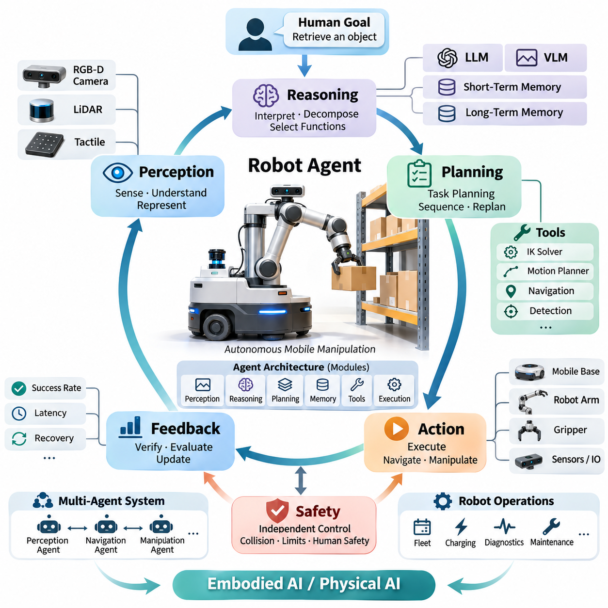
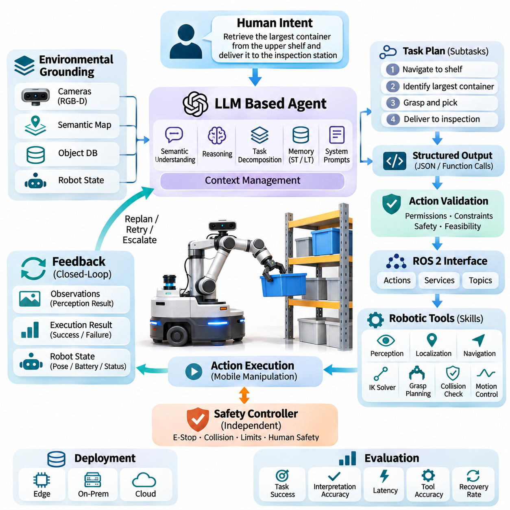
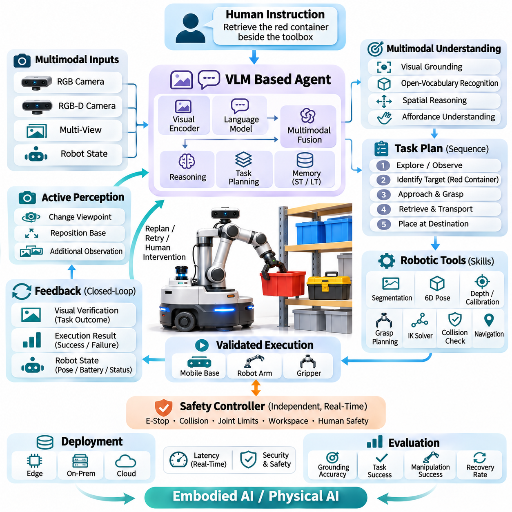
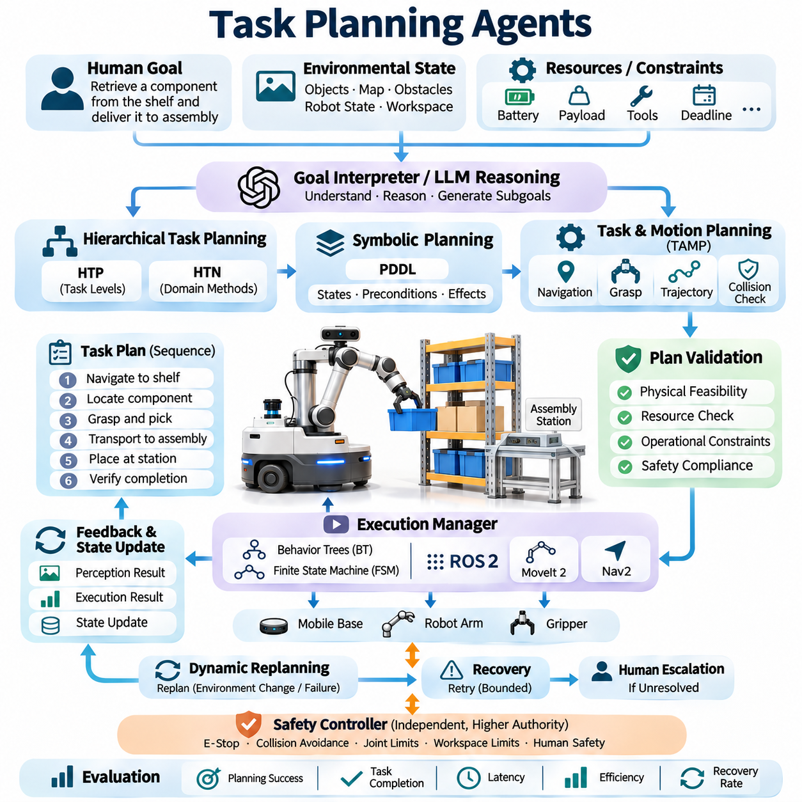
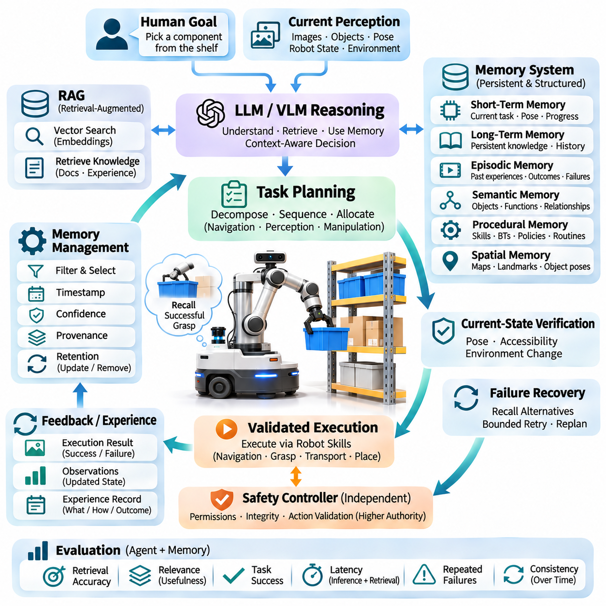
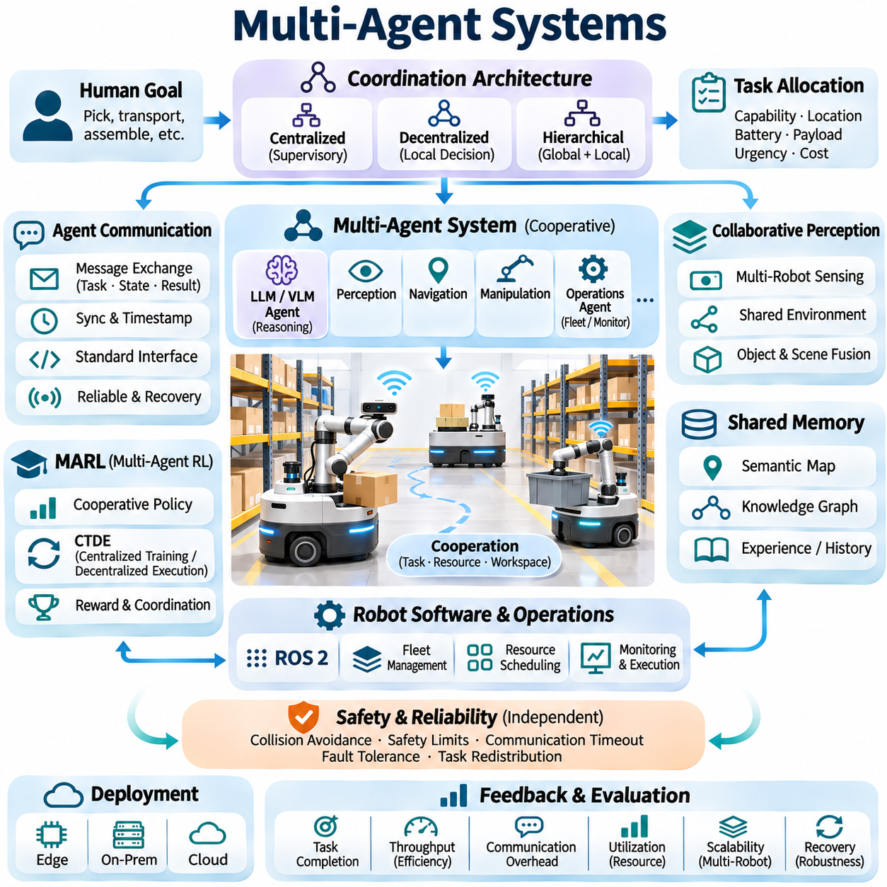
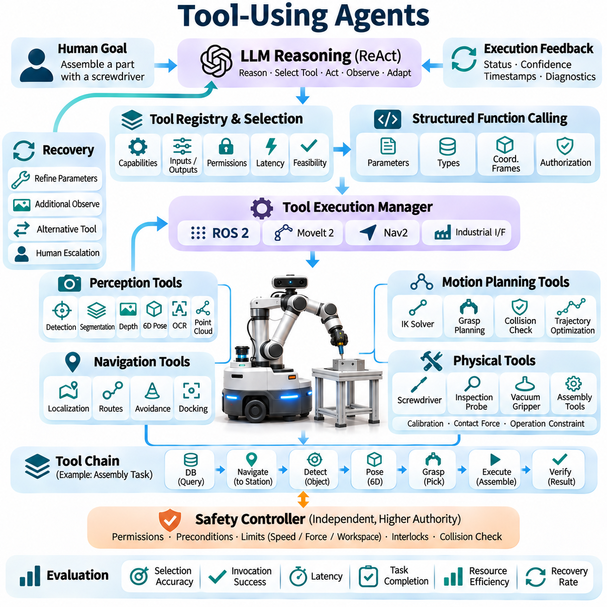
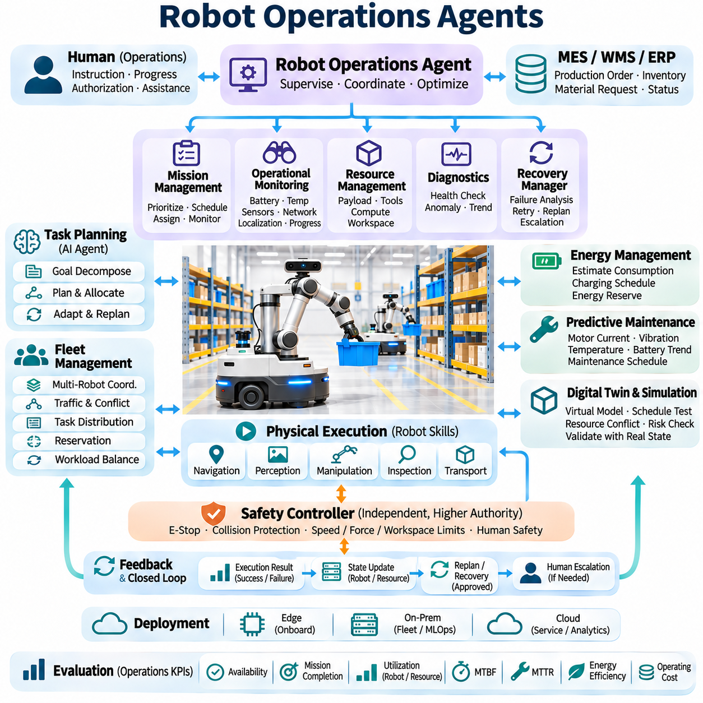
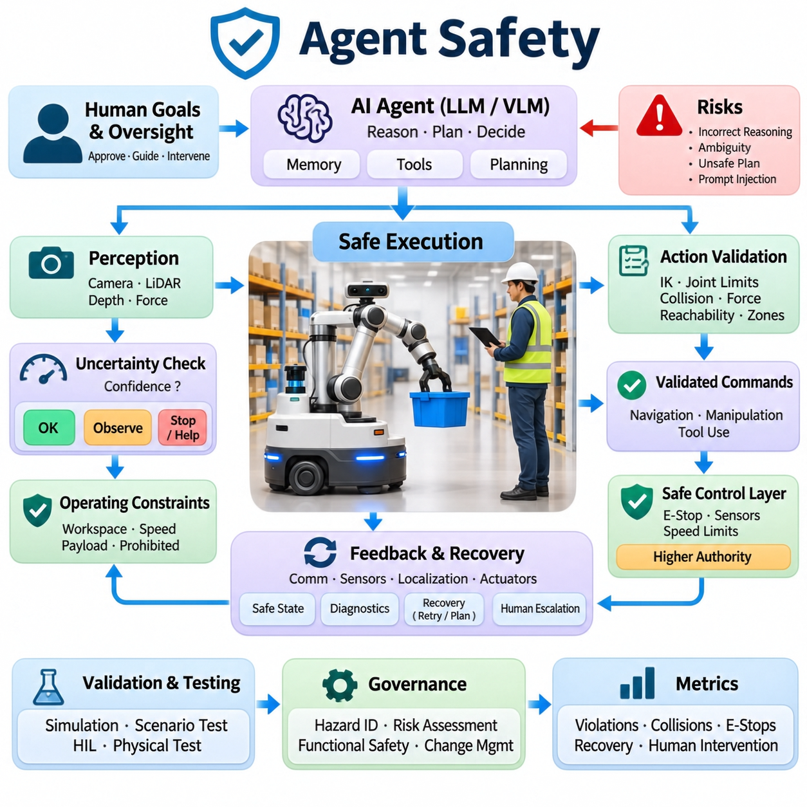
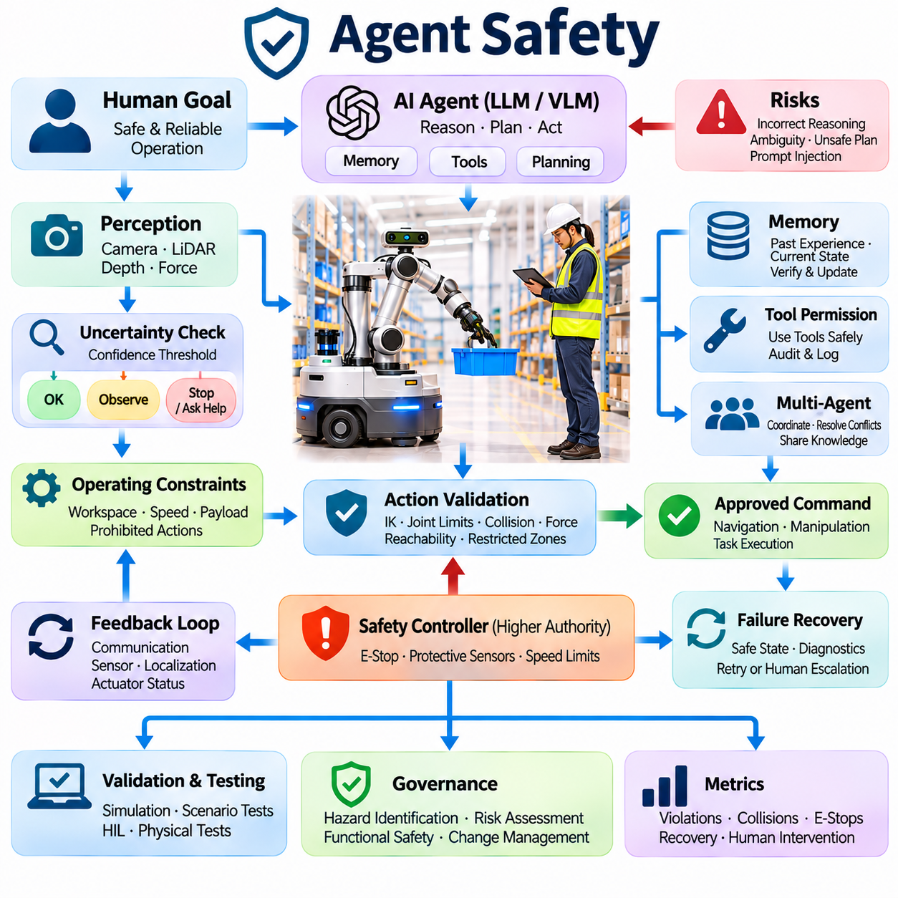

**Volume 03. Vision Manipulation and AI**

# Chapter 11. Robot Agents

## 01 Robot Agent Overview

{width="7.268055555555556in" height="7.268055555555556in"}

A robot agent is an intelligent computational entity capable of perceiving its environment, interpreting objectives, making decisions, executing actions, and evaluating operational outcomes. Unlike conventional robotic systems that primarily execute predefined instructions, robot agents can adapt their behavior according to environmental conditions, task requirements, and available resources. They provide a foundation for autonomous mobile manipulation.

The fundamental purpose of a robot agent is to transform high-level human intentions into executable physical actions. When an operator requests an object to be retrieved from a storage location, the agent interprets the instruction, identifies the target, determines its location, plans navigation and manipulation sequences, and verifies task completion. This process connects cognitive intelligence with physical execution.

A robot agent operates through a continuous perception, reasoning, planning, action, and feedback cycle. Sensory information is collected from cameras, LiDAR, tactile sensors, and robot state interfaces. The agent processes these observations to establish an internal representation of the environment, evaluates possible actions, and selects an appropriate strategy based on its objectives and operational constraints.

The architecture of a robot agent typically includes perception modules, reasoning engines, planning mechanisms, memory systems, action interfaces, and execution monitoring components. These elements cooperate to support autonomous decision-making. A modular architecture allows individual components to be independently developed, evaluated, replaced, and optimized without requiring complete reconstruction of the robotic system.

Large Language Models (LLMs) introduce advanced semantic reasoning capabilities into robot agents. An LLM-based agent can interpret natural language commands, decompose complex objectives into subtasks, generate execution sequences, and select appropriate robotic functions. However, language-generated decisions must be grounded in actual environmental conditions and validated against the physical capabilities of the robot.

Vision-Language Models (VLMs) extend robot agent intelligence by connecting visual observations with semantic understanding. A VLM-based agent can identify objects described through natural language, interpret spatial relationships, recognize functional properties, and understand contextual information. These capabilities are particularly valuable in unstructured environments where predefined object categories are insufficient.

Task planning represents a fundamental capability of robot agents. Complex missions are decomposed into manageable subtasks involving navigation, object detection, pose estimation, grasp planning, manipulation, and verification. The agent determines execution dependencies, evaluates resource availability, and reorganizes task sequences when unexpected environmental changes or execution failures occur.

Memory-augmented robot agents maintain information beyond immediate sensory observations. Short-term memory stores current task states and recent environmental changes, while long-term memory can preserve object locations, operational experiences, successful manipulation strategies, and historical failure patterns. Memory mechanisms improve contextual reasoning and support more consistent behavior across extended missions.

Tool-using robot agents extend their capabilities through structured interfaces to external software and physical resources. Available tools may include object detection models, motion planners, inverse kinematics solvers, navigation systems, databases, and robotic control services. The agent selects suitable tools according to task requirements and uses their returned results to guide subsequent decisions and actions.

In mobile manipulation systems, robot agents coordinate the autonomous mobile robot, robotic arm, end effector, perception sensors, and onboard computing resources. Navigation and manipulation must be treated as interconnected activities rather than independent operations. Base positioning influences arm reachability, grasp feasibility, sensor visibility, collision avoidance, and the overall efficiency of physical task execution.

Multi-agent systems distribute responsibilities among multiple intelligent agents. Individual agents may specialize in perception, navigation, manipulation, task scheduling, fleet coordination, or operational monitoring. Through structured communication and shared environmental information, these agents can cooperate to accomplish complex missions while reducing the computational and organizational burden placed on individual components.

Robot operations agents support continuous system operation beyond direct physical manipulation. Their responsibilities may include mission scheduling, battery monitoring, autonomous charging, resource allocation, equipment diagnostics, failure recovery, and maintenance coordination. These capabilities allow mobile manipulators to participate in larger industrial workflows while reducing unnecessary human intervention and operational interruptions.

Safety is an essential architectural requirement for robot agents because their decisions produce physical consequences. AI-generated plans must be evaluated against collision constraints, joint limitations, workspace boundaries, payload restrictions, and human safety requirements. Independent safety mechanisms and deterministic control layers must retain authority over agent-generated commands to prevent unsafe physical execution.

The performance of robot agents should be evaluated using both cognitive and physical operational metrics. Relevant indicators include task completion rate, planning accuracy, reasoning latency, manipulation success rate, recovery effectiveness, execution time, and human intervention frequency. Reliable evaluation requires testing under diverse environmental conditions, including uncertainty, sensor degradation, and unexpected obstacles.

Robot agents represent an important transition from instruction-driven automation toward goal-oriented physical intelligence. By integrating foundation models, visual perception, semantic reasoning, memory, planning, and physical control, they enable mobile manipulators to perform increasingly complex tasks. Their evolution toward dependable autonomous operation remains closely associated with advances in Embodied AI and Physical AI.

## 02 LLM Based Agents

{width="7.268055555555556in" height="7.268055555555556in"}

Large Language Model (LLM) based agents represent an advanced approach to robotic intelligence in which language models provide semantic understanding, contextual reasoning, task decomposition, and high-level decision-making capabilities. Unlike conventional robotic software that depends primarily on predefined rules and deterministic execution sequences, LLM-based agents can interpret diverse instructions and generate adaptive strategies for physical task execution.

The primary function of an LLM-based robot agent is to translate human intentions into structured robotic operations. Natural language instructions such as retrieving a component, transporting a container, or organizing objects can be interpreted without requiring operators to specify individual movements. The agent determines the intended objective, identifies relevant constraints, and generates a sequence of actions that can be executed by available robotic subsystems.

The architecture of an LLM-based agent typically consists of a language model, context management mechanism, reasoning engine, task planner, memory interface, tool execution framework, and feedback monitoring system. The language model serves as a high-level cognitive component, while specialized robotic modules remain responsible for perception, localization, navigation, motion planning, manipulation, and real-time physical control.

Natural language understanding enables robot agents to interpret instructions containing semantic relationships, conditional requirements, operational priorities, and contextual references. For example, an instruction to retrieve the largest container from an upper shelf and deliver it to an inspection station requires object identification, spatial interpretation, comparative reasoning, destination recognition, and physical task coordination.

Task decomposition allows LLM-based agents to transform complex objectives into smaller and more manageable subtasks. A mobile manipulation mission may involve navigating to a workstation, locating the target object, estimating its pose, generating grasp candidates, executing a manipulation trajectory, and transporting the object to another location. Each subtask is associated with specific execution requirements and completion conditions.

Reasoning capabilities allow LLM-based agents to evaluate alternative execution strategies when environmental conditions change. If a target object is obstructed, the agent may request additional visual observations, select an alternative approach position, or reorganize the manipulation sequence. Such decisions must be supported by reliable environmental information rather than depending exclusively on knowledge encoded within the language model.

Prompt engineering plays an important role in defining the behavior of LLM-based robot agents. System prompts can specify operational objectives, permitted actions, available tools, safety requirements, task constraints, and expected response formats. Structured prompts reduce ambiguity and encourage consistent decision-making by establishing explicit relationships between human instructions, environmental observations, and executable robotic operations.

Tool calling enables an LLM-based agent to interact with specialized robotic software through structured interfaces. Instead of directly calculating robot trajectories or joint commands, the agent can invoke object detection services, navigation planners, inverse kinematics solvers, grasp planning modules, and collision checking functions. Tool responses provide verified computational results that support subsequent reasoning and execution decisions.

Structured output generation provides a systematic mechanism for connecting language models with robotic execution frameworks. An agent may generate action descriptions using JSON schemas, predefined function signatures, symbolic representations, or task-specific command formats. These representations enable software components to validate required parameters, reject unsupported operations, and translate approved decisions into executable robotic requests.

LLM-based agents can be integrated with Robot Operating System 2 (ROS 2) through middleware interfaces that connect high-level reasoning with distributed robotic components. ROS 2 actions, services, and topics provide communication mechanisms for requesting navigation, manipulation, perception, and diagnostic operations. The agent receives execution feedback and updates its decisions according to reported robot states and task outcomes.

Environmental grounding is essential because language models do not inherently possess accurate knowledge of the current physical environment. Information from perception systems, semantic maps, object databases, and robot state interfaces must be incorporated into the reasoning context. Grounding reduces the likelihood of generating actions involving nonexistent objects, inaccessible locations, or physically impossible manipulation strategies.

Closed-loop execution allows an LLM-based agent to continuously evaluate the progress of a robotic mission. After each significant action, the agent receives updated observations and execution results to determine whether the expected state has been achieved. When discrepancies are detected, the agent may revise its plan, request additional information, retry an operation within permitted limits, or escalate the problem to a human operator.

Computational efficiency remains an important consideration when deploying LLM-based agents on mobile manipulators. Large models may require cloud or on-premises computing resources, while smaller language models can support selected reasoning tasks on edge devices. Hybrid architectures can distribute computational responsibilities according to inference latency, communication reliability, memory capacity, data confidentiality, and operational requirements.

Safety and reliability represent fundamental challenges because LLMs may generate inaccurate information, inconsistent plans, or unsupported commands. Independent safety controllers, deterministic validation mechanisms, permission management, and execution boundaries must prevent unsafe actions. Performance evaluation should include instruction interpretation accuracy, task completion rates, planning latency, tool selection accuracy, and failure recovery effectiveness.

LLM-based robot agents provide a cognitive interface between human objectives and physical robotic capabilities. Their practical value emerges from combining semantic reasoning with reliable perception, structured planning, validated tool execution, and deterministic control. Within mobile manipulation and Physical AI architectures, language models should enhance autonomous decision-making without replacing specialized control systems or independent safety mechanisms.

## 03 VLM Based Agents

{width="7.268055555555556in" height="7.268055555555556in"}

Vision-Language Model (VLM) based agents represent an intelligent robotic architecture that integrates visual perception, natural language understanding, semantic reasoning, and physical task execution. Unlike language-only agents that primarily process textual information, VLM-based agents can interpret visual observations and establish meaningful relationships between human instructions, physical objects, and environmental conditions.

The primary objective of a VLM-based robot agent is to establish a direct connection between visual information and goal-oriented robotic behavior. When an operator requests the retrieval of a specific object, the agent analyzes visual observations, interprets the linguistic description, identifies relevant objects, and determines appropriate actions. This capability reduces dependence on predefined object categories and fixed operational scenarios.

The architecture of a VLM-based agent typically incorporates a visual encoder, language processing model, multimodal fusion mechanism, reasoning engine, task planner, memory system, and robotic execution interface. Visual and linguistic representations are integrated to support contextual decision-making. Specialized robotic subsystems subsequently translate high-level decisions into physically feasible navigation and manipulation operations.

Multimodal perception enables VLM-based agents to interpret images, natural language descriptions, and additional environmental information within a unified reasoning framework. Visual inputs may originate from RGB cameras, RGB-D sensors, or multiple camera perspectives. Geometric information and robot state measurements can be incorporated through complementary perception modules to improve spatial understanding and operational reliability.

Visual grounding represents a fundamental capability of VLM-based robot agents. It establishes correspondence between linguistic expressions and specific regions, objects, or relationships within visual observations. For example, an instruction to retrieve the red container beside the toolbox requires the agent to associate descriptive language with visible object properties and spatial relationships before initiating physical manipulation.

Open-vocabulary recognition allows VLM-based agents to identify objects beyond conventional fixed-category detection frameworks. Through knowledge acquired during multimodal pretraining, these agents may recognize unfamiliar components, tools, packages, and household objects using natural language descriptions. However, recognition confidence and geometric accuracy must be independently evaluated before consequential physical actions are authorized.

Spatial reasoning enables VLM-based agents to understand relative object positions, environmental arrangements, and task-relevant relationships. Concepts such as above, below, inside, behind, and adjacent to can be interpreted in connection with visual observations. Accurate physical manipulation nevertheless requires coordinate transformations, depth estimation, camera calibration, and dedicated three-dimensional perception mechanisms.

Affordance understanding allows VLM-based agents to reason about potential interactions between robots and physical objects. A model may associate handles with pulling, buttons with pressing, containers with holding, and tools with particular functions. These semantic predictions provide useful guidance for action selection, while dedicated grasp planning and motion planning algorithms determine whether the proposed interactions are physically feasible.

Task planning integrates multimodal understanding with sequential robotic execution. A VLM-based agent may decompose a warehouse retrieval mission into visual exploration, target identification, approach planning, grasp selection, object retrieval, transportation, and placement. Each subtask must incorporate execution constraints and measurable completion conditions to maintain consistency between semantic objectives and physical outcomes.

Active perception enables VLM-based agents to request additional observations when existing visual information is insufficient. The robot may reposition its mobile base, adjust a wrist-mounted camera, or observe an object from another perspective. These actions can reduce uncertainty caused by occlusion, unfavorable viewing angles, environmental clutter, and incomplete observations before manipulation decisions are finalized.

Tool integration extends VLM-based agents beyond multimodal reasoning by connecting them with specialized robotic functions. Object detection, instance segmentation, six-dimensional pose estimation, grasp generation, inverse kinematics, collision checking, and navigation services can be invoked through structured interfaces. Their computational outputs provide physical and geometric information that complements the semantic understanding of the model.

In mobile manipulation systems, VLM-based agents coordinate visual reasoning with mobile platform navigation and robotic arm operations. The agent evaluates whether the target is visible, accessible, and suitable for manipulation from the current robot position. When necessary, it may request mobile base repositioning to improve sensor visibility, arm reachability, grasp feasibility, and overall task execution efficiency.

Closed-loop execution enables VLM-based agents to compare expected outcomes with updated visual observations. After grasping or placing an object, the agent evaluates whether the intended environmental change has occurred. When discrepancies are detected, additional perception, bounded retries, alternative manipulation strategies, or human intervention may be requested through predefined recovery mechanisms and operational policies.

Deployment of VLM-based agents requires careful consideration of computational resources, inference latency, communication reliability, and data security. Large multimodal models may operate on cloud or on-premises infrastructure, while compact models support selected edge-based perception and reasoning functions. Independent real-time control and safety systems must remain operational regardless of multimodal inference availability.

Safety validation and performance evaluation are essential because visual-language models may misidentify objects, misunderstand spatial relationships, or generate physically unsuitable actions. Evaluation should include visual grounding accuracy, instruction interpretation, task completion rates, manipulation success, inference latency, and recovery effectiveness. Independent safety mechanisms must retain authority over physical execution.

VLM-based robot agents provide an important connection between multimodal intelligence and autonomous physical interaction. By integrating semantic perception, visual grounding, spatial reasoning, task planning, and validated robotic execution, they expand mobile manipulation capabilities in dynamic environments. Their development contributes to the broader evolution of Embodied AI and Physical AI toward adaptable, reliable robotic autonomy.

## 04 Task Planning Agents

{width="7.268055555555556in" height="7.268055555555556in"}

Task planning agents represent a specialized form of robotic intelligence responsible for transforming high-level objectives into structured sequences of executable robotic actions. Unlike conventional automation systems that primarily follow predefined workflows, task planning agents evaluate environmental conditions, available resources, operational constraints, and execution dependencies to generate adaptive strategies for accomplishing complex missions.

The fundamental purpose of a task planning agent is to establish a connection between human intentions and physically executable operations. An instruction to retrieve a component from a storage shelf and deliver it to an assembly station requires multiple coordinated activities. The agent determines the necessary navigation, perception, grasping, transportation, and placement operations while maintaining consistency with the original objective.

The architecture of a task planning agent typically includes a goal interpreter, environmental state representation, task decomposition mechanism, planning engine, execution manager, and feedback interface. These components cooperate to determine what actions should be performed, in which sequence they should occur, and under what conditions execution can proceed. Modular architectures support integration with specialized robotic subsystems.

Hierarchical Task Planning (HTP) enables complex missions to be decomposed into multiple levels of abstraction. High-level objectives are divided into intermediate tasks, which are subsequently translated into executable robotic skills. For mobile manipulators, a material handling mission may be decomposed into workstation navigation, target localization, object manipulation, transportation, and destination verification.

Symbolic planning provides a formal mechanism for representing goals, environmental states, actions, preconditions, and effects. Planning Domain Definition Language (PDDL) is commonly used to describe these relationships within classical planning frameworks. A symbolic planner searches for an action sequence that transforms the initial environmental state into a desired goal state according to predefined domain rules and constraints.

Hierarchical Task Network (HTN) planning extends task decomposition by incorporating domain-specific knowledge about how complex activities should be performed. Compound tasks are recursively decomposed into simpler tasks using predefined methods until executable actions are obtained. This approach is useful in industrial robotic environments where established operating procedures and process dependencies must be consistently maintained.

Large Language Models (LLMs) introduce semantic reasoning and flexible task generation into robotic planning agents. An LLM can interpret natural language objectives, propose intermediate goals, and generate candidate action sequences using contextual information. However, generated plans must be validated through symbolic reasoning, geometric analysis, resource availability checks, and physical feasibility assessment before execution.

Task and Motion Planning (TAMP) integrates high-level symbolic task planning with continuous geometric motion planning. A logically valid task sequence does not necessarily guarantee physical executability. TAMP evaluates whether navigation paths, grasp configurations, robot arm trajectories, and manipulation operations satisfy kinematic constraints, collision avoidance requirements, and environmental limitations.

Preconditions and postconditions establish explicit requirements for determining whether individual robotic actions can be executed and whether they have been successfully completed. Before grasping an object, the target must be identified, localized, reachable, and suitable for manipulation. After execution, sensory feedback should confirm that the object has been securely grasped and that the expected environmental state has been achieved.

Dynamic replanning enables task planning agents to revise execution strategies when unexpected conditions arise. An obstacle may block a navigation route, an object may become inaccessible, or a manipulation attempt may fail. The agent updates its environmental state representation, evaluates alternative actions, and regenerates the affected portion of the task plan without unnecessarily restarting the entire mission.

Behavior Trees (BTs) and Finite State Machines (FSMs) provide practical mechanisms for organizing and executing planned robotic behaviors. Behavior trees support hierarchical execution, conditional branching, fallback strategies, and reactive task management. Finite state machines represent operational states and transitions, enabling predictable execution. Both approaches can complement higher-level AI-based planning agents.

In mobile manipulation systems, task planning agents must coordinate navigation and manipulation within a unified planning framework. Mobile base positioning directly affects robotic arm reachability, sensor visibility, grasp feasibility, and collision avoidance. Effective planning therefore considers the combined configuration of the mobile platform, manipulator, end effector, target object, and surrounding physical environment.

Resource-aware planning incorporates operational factors such as battery capacity, computational availability, payload limits, tool availability, task deadlines, and shared workspace accessibility. A task planning agent may prioritize urgent missions, schedule autonomous charging, or select alternative execution resources. These capabilities become particularly important when mobile manipulators operate continuously within industrial workflows.

Integration with Robot Operating System 2 (ROS 2), MoveIt 2, and Navigation 2 (Nav2) enables task planning agents to connect high-level decisions with specialized robotic execution frameworks. Structured actions, services, and status interfaces provide mechanisms for requesting navigation, motion planning, grasp execution, and environmental verification. Execution feedback supports continuous monitoring and adaptive planning.

Safety-aware task planning requires every proposed action to comply with operational boundaries, human safety requirements, collision constraints, and equipment limitations. AI-generated plans must not bypass independent safety controllers or deterministic validation mechanisms. When uncertainty exceeds acceptable limits, the agent should request additional observations, initiate an approved recovery procedure, or escalate the decision to a human operator.

The effectiveness of task planning agents should be evaluated through planning success rate, task completion rate, computational latency, execution efficiency, replanning frequency, and failure recovery performance. Task planning agents provide a critical connection between cognitive intelligence and physical execution, enabling mobile manipulators to perform increasingly complex missions within Embodied AI and Physical AI architectures.

## 05 Memory Augmented Agents

{width="7.268055555555556in" height="7.268055555555556in"}

Memory-augmented agents represent an intelligent robotic architecture that incorporates persistent information storage and retrieval mechanisms into perception, reasoning, planning, and physical task execution. Unlike agents that rely exclusively on immediate sensory observations or temporary inference contexts, memory-augmented agents can utilize historical experiences and accumulated environmental knowledge to support more consistent and adaptive autonomous behavior.

The primary objective of memory augmentation is to provide continuity between previous experiences, current environmental observations, and future operational decisions. A mobile manipulator may remember object locations, successful grasp configurations, navigation routes, workstation layouts, and historical execution failures. This accumulated information reduces repetitive computation and supports more informed decisions during subsequent robotic missions.

The architecture of a memory-augmented robot agent typically includes a perception system, reasoning engine, memory storage mechanism, retrieval interface, task planner, and robotic execution framework. Memory operates as an external or internal information resource that complements the knowledge encoded within artificial intelligence models. Relevant information is retrieved according to task objectives, environmental conditions, and operational context.

Short-term memory maintains information associated with an ongoing robotic mission. This information may include current task objectives, recently detected objects, estimated object poses, navigation progress, completed subtasks, and temporary execution constraints. Short-term memory enables the agent to maintain contextual continuity across multiple reasoning and execution cycles without repeatedly reconstructing the entire operational state.

Long-term memory preserves information across multiple missions and extended operational periods. A robot agent may retain historical manipulation outcomes, frequently accessed storage locations, equipment characteristics, environmental structures, and effective recovery strategies. Persistent memory allows the system to accumulate operational knowledge while reducing dependence on repeated exploration and redundant perception processes.

Episodic memory stores information about specific events and previous robotic experiences. Each recorded episode may contain the initial environmental state, task objective, selected action sequence, sensory observations, execution results, and encountered failures. By retrieving comparable historical experiences, an agent can identify potentially effective strategies and avoid repeating previously unsuccessful actions under similar conditions.

Semantic memory represents generalized knowledge concerning objects, environments, operational procedures, and relationships between physical entities. Unlike episodic memory, which preserves individual experiences, semantic memory organizes information into reusable concepts and factual representations. A mobile manipulator may use semantic knowledge to associate particular tools with functions, storage locations with object categories, and workstations with operational requirements.

Procedural memory preserves knowledge about how specific robotic activities should be performed. It may contain validated manipulation skills, navigation procedures, grasping strategies, equipment operating sequences, and approved failure recovery routines. Procedural memory can be implemented through reusable skill libraries, behavior trees, symbolic action templates, or learned policies that remain accessible to higher-level reasoning agents.

Spatial memory enables robot agents to retain information concerning environmental geometry, object distributions, navigation landmarks, and spatial relationships. Semantic maps, occupancy grids, three-dimensional representations, and object pose databases can provide persistent environmental knowledge. Because physical environments may change over time, stored spatial information must be periodically verified against current sensory observations.

Retrieval-Augmented Generation (RAG) provides a mechanism for connecting large language models and vision-language models with external memory resources. Relevant information is retrieved from operational documents, historical records, semantic databases, or vector databases and incorporated into the reasoning context. This approach enables robot agents to access domain-specific knowledge without continuously retraining their underlying foundation models.

Vector-based memory systems represent textual descriptions, visual observations, and selected operational experiences as numerical embeddings. Similarity search enables the agent to retrieve information associated with comparable objects, environmental conditions, or task objectives. However, semantic similarity does not guarantee physical relevance, and retrieved experiences must be evaluated against current geometric and operational constraints.

Memory management determines which information should be recorded, updated, consolidated, retrieved, or removed throughout robotic operation. Accumulating every observation without filtering can increase storage requirements, retrieval latency, and information redundancy. Effective memory management incorporates relevance assessment, timestamps, confidence levels, information provenance, consistency verification, and retention policies to maintain useful operational knowledge.

In mobile manipulation systems, memory-augmented agents can coordinate historical navigation experiences with object perception and manipulation knowledge. A robot may recall a previously successful approach position, arm configuration, or grasp strategy when returning to a familiar workstation. Before reusing stored information, the agent must verify current object poses, workspace accessibility, equipment conditions, and environmental changes.

Memory augmentation also supports failure recovery and continuous operational improvement. When a grasping attempt fails or a navigation route becomes inaccessible, the agent can record the circumstances and evaluate alternative strategies encountered during earlier missions. Such experience-based adaptation improves decision-making without necessarily modifying model parameters or retraining the underlying robotic control policies.

Safety and reliability require memory-augmented agents to distinguish validated information from outdated, incomplete, or unverified records. Incorrect historical knowledge may lead to inappropriate task planning or unsafe physical actions. Independent safety controllers, access permissions, memory integrity checks, and execution validation mechanisms must prevent retrieved information from overriding current environmental evidence or established safety constraints.

The performance of memory-augmented agents should be evaluated through retrieval accuracy, contextual relevance, task completion rate, repeated failure frequency, planning latency, and long-term operational consistency. By integrating persistent memory with perception, reasoning, planning, and validated physical execution, these agents provide an important foundation for experience-driven robotic autonomy within Embodied AI and Physical AI architectures.

## 06 Multi Agent Systems

{width="7.268055555555556in" height="7.268055555555556in"}

Multi-Agent Systems (MAS) represent a distributed robotic intelligence architecture in which multiple autonomous or semi-autonomous agents cooperate, communicate, and coordinate their activities to accomplish common or individual objectives. Within mobile manipulation systems, these agents may represent individual robots, specialized software components, perception services, planning modules, or operational management functions.

The fundamental objective of a multi-agent system is to distribute intelligence, computational responsibilities, and operational decision-making across multiple entities. Instead of relying exclusively on a centralized agent, specialized agents can independently evaluate local conditions and contribute to collective task execution. This architecture improves scalability, operational flexibility, and resource utilization in complex robotic environments.

A multi-agent architecture typically consists of individual agents, communication interfaces, coordination mechanisms, shared environmental representations, and task allocation frameworks. Each agent maintains defined responsibilities, available capabilities, operational constraints, and internal states. Collective behavior emerges through information exchange, coordinated planning, and structured interactions among participating agents.

Centralized coordination uses a supervisory agent to manage task allocation, scheduling, resource distribution, and conflict resolution. This architecture simplifies global optimization and provides consistent operational control across multiple robotic systems. However, excessive dependence on centralized decision-making may introduce computational bottlenecks, communication delays, and single points of failure as the number of agents increases.

Decentralized coordination enables individual agents to make decisions using local observations and information exchanged with neighboring agents. Distributed decision-making improves scalability and resilience by reducing dependence on a central controller. Nevertheless, maintaining consistent environmental knowledge, resolving conflicting objectives, and achieving globally efficient behavior remain significant engineering challenges.

Hierarchical multi-agent architectures combine centralized supervision with decentralized execution. High-level agents manage mission objectives, task priorities, and resource allocation, while lower-level agents independently perform navigation, perception, and manipulation operations. This structure balances global operational coordination with local responsiveness and supports the integration of heterogeneous robotic capabilities.

Agent communication establishes the foundation for cooperative behavior within distributed robotic systems. Agents exchange task requests, environmental observations, execution states, resource availability, and failure notifications through structured communication protocols. Reliable message delivery, synchronized timestamps, standardized data representations, and communication recovery mechanisms are essential for maintaining consistent coordination.

Task allocation determines how operational responsibilities are distributed among available agents. Allocation decisions may consider robot capabilities, geographical location, battery status, payload capacity, task urgency, and estimated execution costs. Optimization algorithms, auction-based mechanisms, and negotiation strategies enable tasks to be assigned according to changing operational requirements and resource availability.

Collaborative perception allows multiple robotic agents to combine observations obtained from different sensors and geographical positions. Shared perception can improve environmental coverage, object localization, obstacle recognition, and semantic understanding. Spatial alignment, temporal synchronization, uncertainty estimation, and duplicate observation management are necessary to maintain accurate collective environmental representations.

Shared memory systems enable agents to access accumulated operational knowledge, semantic maps, object information, historical task outcomes, and validated execution strategies. Distributed databases and knowledge graphs can support information exchange across robotic systems. Version management, access control, and consistency verification ensure that shared knowledge remains relevant to current environmental conditions.

Large Language Models (LLMs) and Vision-Language Models (VLMs) introduce semantic reasoning capabilities into multi-agent architectures. Specialized agents may interpret human instructions, analyze visual observations, generate task plans, or evaluate execution outcomes. Model-generated decisions must be exchanged through structured interfaces and validated against physical constraints before robotic actions are authorized.

Multi-Agent Reinforcement Learning (MARL) enables multiple agents to develop cooperative or competitive policies through interaction with shared environments. Centralized Training with Decentralized Execution (CTDE) allows agents to utilize collective information during training while operating independently during deployment. Reward design, coordination stability, and transfer to physical environments remain important technical challenges.

In mobile manipulation applications, multiple robotic agents may cooperate to retrieve objects, transport materials, replenish inventory, or support industrial assembly operations. Coordination mechanisms must consider navigation conflicts, overlapping manipulation workspaces, shared equipment, and interdependent tasks. Reservation policies and synchronized execution schedules help prevent resource conflicts and operational interference.

Fault tolerance and safety are fundamental requirements in multi-agent robotic systems. When an agent becomes unavailable, remaining agents may redistribute unfinished tasks or initiate approved recovery procedures. Independent safety controllers, communication timeouts, collision avoidance mechanisms, and operational boundaries must prevent coordination errors or inconsistent decisions from producing hazardous physical behavior.

Integration with Robot Operating System 2 (ROS 2), fleet management systems, and distributed computing infrastructure provides a practical foundation for multi-agent deployment. Edge devices support local perception and execution, while on-premises or cloud resources can coordinate larger missions and maintain shared knowledge. System design must account for communication reliability, computational latency, and network security.

The effectiveness of multi-agent systems should be evaluated through collective task completion rates, throughput, communication overhead, resource utilization, scalability, and failure recovery performance. By integrating distributed reasoning, collaborative perception, shared memory, and coordinated physical execution, multi-agent systems establish a foundation for collective robotic intelligence within Embodied AI and Physical AI architectures.

## 07 Tool Using Agents

{width="7.268055555555556in" height="7.268055555555556in"}

Tool-using agents represent a specialized form of robotic intelligence capable of extending their reasoning and execution capabilities through interaction with external software tools, computational services, robotic subsystems, and physical instruments. Rather than relying exclusively on knowledge encoded within artificial intelligence models, these agents dynamically access specialized resources required to accomplish complex operational objectives.

The fundamental objective of a tool-using agent is to establish a practical connection between cognitive reasoning and executable capabilities. A Large Language Model (LLM) may understand a human instruction but lack the ability to calculate robot trajectories, identify precise object coordinates, or directly control actuators. External tools provide these specialized functions through structured and validated execution interfaces.

The architecture of a tool-using agent typically includes a reasoning engine, tool registry, tool selection mechanism, invocation interface, execution manager, and feedback processing module. The reasoning engine determines which capabilities are required, while the execution manager coordinates tool operations and monitors their results. This modular architecture enables independent development and replacement of specialized robotic functions.

A tool registry provides structured descriptions of available tools, including their functional capabilities, input parameters, output formats, execution constraints, and access permissions. These descriptions enable the agent to identify appropriate tools according to task requirements and environmental conditions. Maintaining accurate tool specifications is essential for preventing incorrect invocation and unsupported operational requests.

Tool selection represents the decision-making process through which an agent identifies the most appropriate resource for accomplishing a specific objective. Selection may depend on semantic relevance, computational requirements, execution latency, physical feasibility, and tool availability. An effective agent must distinguish between operations requiring additional information and operations requiring direct interaction with robotic equipment.

Function calling enables artificial intelligence models to invoke external capabilities through structured requests rather than unrestricted natural language commands. A function call may specify an object identification request, target coordinates, navigation destination, or motion planning objective. Parameter validation, data type verification, coordinate frame identification, and execution authorization ensure that requests satisfy the requirements of receiving subsystems.

Perception tools enable robot agents to obtain specialized information concerning their surrounding environments. These tools may include object detection, instance segmentation, depth estimation, six-degree-of-freedom pose estimation, optical character recognition, and point cloud processing. The agent selects appropriate perception capabilities according to the information required for subsequent reasoning, planning, and manipulation operations.

Motion planning tools translate high-level robotic objectives into physically executable trajectories. Inverse kinematics solvers, collision detection libraries, grasp planning algorithms, and trajectory optimization frameworks provide specialized computational capabilities. Tool-using agents should delegate these calculations to validated planning systems instead of attempting to generate precise robotic motion directly through language model inference.

Navigation tools provide capabilities for localization, route planning, obstacle avoidance, docking, and autonomous movement. A mobile manipulator agent may invoke navigation services to reach a workstation before requesting object perception and manipulation operations. Continuous execution feedback enables the agent to verify arrival conditions and determine whether subsequent activities can safely proceed within the available workspace.

Physical tool utilization extends robotic capabilities beyond conventional grasping and object transportation. Mobile manipulators may select and operate screwdrivers, inspection probes, vacuum grippers, cutting instruments, or specialized assembly equipment. Successful physical tool use requires consideration of tool geometry, attachment mechanisms, functional affordances, contact forces, calibration requirements, and task-specific operating constraints.

Tool chaining enables multiple specialized capabilities to be organized into coordinated execution sequences. A material handling mission may require database retrieval, autonomous navigation, object detection, pose estimation, grasp planning, motion execution, and final placement verification. Each tool produces information or physical state changes that establish the necessary conditions for subsequent operations within the overall task workflow.

Reasoning and Acting (ReAct) provides an agent design pattern that interleaves reasoning, tool invocation, and observation processing. Rather than generating a complete execution sequence without environmental feedback, the agent progressively evaluates intermediate results and determines subsequent actions. This approach supports adaptive decision-making when operational conditions change or initial assumptions prove incorrect during physical execution.

Tool execution monitoring enables agents to identify unsuccessful requests, unexpected results, communication failures, and incomplete physical operations. Structured status codes, confidence estimates, execution timestamps, and diagnostic information support systematic failure analysis. Recovery strategies may include parameter refinement, additional sensory observations, alternative tool selection, or controlled escalation to human operators.

Integration with Robot Operating System 2 (ROS 2), MoveIt 2, Navigation 2 (Nav2), and industrial equipment interfaces provides a practical foundation for tool-using robotic agents. ROS 2 services and actions can expose specialized capabilities through standardized interfaces. Middleware adapters connect higher-level reasoning models with robotic execution systems while maintaining separation from real-time control functions.

Safety-aware tool utilization requires strict operational boundaries between artificial intelligence reasoning and physical equipment control. Tool permissions, execution preconditions, parameter limits, collision verification, and independent safety controllers must prevent unauthorized or hazardous actions. AI-generated tool requests should never bypass deterministic safety mechanisms, equipment interlocks, or established human supervision requirements.

The effectiveness of tool-using agents should be evaluated through tool selection accuracy, invocation success rate, execution latency, task completion rate, resource efficiency, and failure recovery performance. By combining semantic reasoning with validated computational tools and physical capabilities, these agents establish an essential architectural connection between cognitive intelligence and practical robotic execution within Embodied AI and Physical AI systems.

## 08 Robot Operations Agents

{width="7.268055555555556in" height="7.268055555555556in"}

Robot operations agents represent an intelligent supervisory architecture responsible for coordinating, monitoring, and optimizing the operational activities of robotic systems throughout their deployment lifecycles. Unlike agents primarily focused on individual perception, reasoning, or manipulation tasks, robot operations agents manage the broader operational context in which autonomous robots continuously perform physical missions.

The fundamental objective of a robot operations agent is to maintain reliable, efficient, and sustainable robotic operation under changing environmental conditions and organizational requirements. A mobile manipulator must not only execute individual navigation and manipulation tasks but also manage mission priorities, resource availability, equipment readiness, operational interruptions, and interactions with surrounding industrial systems.

The architecture of a robot operations agent typically includes a mission management module, operational state monitor, resource management engine, diagnostic interface, recovery manager, and communication framework. These components cooperate to establish continuous awareness of robotic activities and operational conditions. Integration with specialized task planning agents enables high-level operational decisions to be translated into executable missions.

Mission management enables robot operations agents to receive, prioritize, schedule, assign, and monitor operational missions. A mission may consist of multiple navigation, perception, manipulation, inspection, and transportation activities. The agent maintains awareness of mission dependencies, completion criteria, execution deadlines, and resource requirements while adapting operational schedules to changing production or logistical demands.

Operational state monitoring provides continuous information concerning the condition and availability of robotic systems. Relevant information may include battery charge levels, actuator temperatures, sensor availability, computational utilization, network connectivity, localization confidence, and mission execution progress. Real-time monitoring and historical trend analysis enable agents to identify operational degradation before it develops into significant failures.

Resource management determines how robotic capabilities and supporting infrastructure should be utilized throughout continuous operation. Robot operations agents evaluate battery capacity, payload limitations, computational resources, tool availability, charging infrastructure, and shared workspace accessibility. Resource-aware decisions improve operational efficiency while reducing unnecessary downtime, equipment conflicts, and interruptions to ongoing robotic missions.

Energy management is particularly important for mobile manipulation systems operating independently of fixed power supplies. Robot operations agents monitor battery conditions, estimate mission energy consumption, and schedule autonomous charging activities. Predictive energy management enables robots to complete assigned missions while maintaining sufficient energy reserves for safe transportation, docking, and recovery procedures.

Fleet management integration enables robot operations agents to coordinate multiple autonomous mobile robots and mobile manipulators within shared operational environments. Fleet-level information supports task distribution, traffic coordination, charging schedules, resource reservations, and workload balancing. Individual robot operations agents can cooperate with supervisory fleet management systems while maintaining local operational awareness.

Predictive maintenance enables robot operations agents to identify potential equipment degradation through historical operating records and continuously collected sensor information. Motor currents, actuator temperatures, vibration measurements, battery degradation, and recurring communication errors may indicate developing problems. Diagnostic models can support maintenance scheduling and reduce unexpected equipment failures during critical missions.

Failure management and operational recovery allow robotic systems to respond systematically to interrupted missions, unavailable equipment, perception failures, and unsuccessful manipulation attempts. The operations agent evaluates diagnostic information, identifies affected operational processes, and selects approved recovery procedures. Unrecoverable conditions must be escalated to human operators or supervisory management systems.

Human-Robot Interaction (HRI) provides an important operational interface between autonomous robotic systems and human supervisors. Robot operations agents may interpret operator instructions, report mission progress, explain operational failures, and request assistance when necessary. Natural language interfaces can improve operational accessibility while structured authorization mechanisms maintain accountability and appropriate human oversight.

Integration with Manufacturing Execution Systems (MES), Warehouse Management Systems (WMS), and Enterprise Resource Planning (ERP) enables robot operations agents to participate in broader industrial workflows. Production orders, inventory requirements, material transportation requests, and equipment availability can influence robotic mission scheduling. Standardized interfaces facilitate coordinated information exchange between robotic and enterprise systems.

Digital twins and simulation environments provide additional capabilities for operational analysis, mission validation, and performance optimization. Robot operations agents may use virtual representations of physical equipment and workspaces to evaluate alternative schedules, identify resource conflicts, and estimate operational consequences. Simulation results must be validated against actual equipment conditions before influencing physical execution.

Edge, on-premises, and cloud computing architectures support different levels of robot operations management. Edge computing enables local monitoring and immediate operational responses, while on-premises infrastructure supports facility-level coordination and shared resource management. Cloud platforms can provide centralized analytics, historical performance evaluation, knowledge sharing, and large-scale operational optimization.

Safety-aware robot operations require continuous compliance with established operational boundaries, equipment limitations, and human safety requirements. Artificial intelligence agents must not override independent safety controllers, emergency stop mechanisms, or validated protective functions. Communication failures, uncertain operational states, and unauthorized requests must trigger appropriate restrictive behaviors or controlled recovery procedures.

The effectiveness of robot operations agents should be evaluated through operational availability, mission completion rate, equipment utilization, mean time between failures, mean time to recovery, energy efficiency, and total operating costs. By integrating mission orchestration, operational monitoring, resource optimization, and continuous recovery management, these agents provide a foundation for sustainable robotic autonomy within Embodied AI and Physical AI systems.

## 09 Agent Safety

{width="7.268055555555556in" height="7.268055555555556in"}

{width="7.268055555555556in" height="7.268055555555556in"}

Agent safety is a fundamental requirement for deploying autonomous robot agents in real-world environments. As robot agents become increasingly capable of interpreting instructions, reasoning about complex situations, planning tasks, and executing physical actions, their decisions can directly affect human safety, equipment integrity, and operational reliability. Agent safety therefore requires more than accurate artificial intelligence. It requires systematic mechanisms that constrain decisions, validate actions, manage uncertainty, and maintain human oversight throughout autonomous operation.

Unlike conventional robotic controllers that execute predefined control logic, AI-based agents may generate plans dynamically using Large Language Models (LLMs), Vision-Language Models (VLMs), memory systems, and external tools. This flexibility introduces additional risks, including incorrect reasoning, ambiguous instructions, unexpected tool usage, and unsafe action sequences. A safe agent architecture must ensure that intelligent decision-making remains within explicitly defined operational boundaries.

The first principle of agent safety is to establish clear operational constraints before autonomous execution. These constraints define what the robot is permitted to do, where it can operate, which objects it can manipulate, and under what conditions specific actions are allowed. Safety constraints should include physical limits, workspace boundaries, velocity restrictions, payload capacities, collision avoidance requirements, and prohibited operations. These conditions must be enforced independently of the agent\'s language-based reasoning.

Perception uncertainty is another important safety consideration. Robot agents rely on cameras, LiDAR, depth sensors, force sensors, and other perception systems to understand their environments. However, sensor noise, occlusion, incorrect object recognition, and localization errors can produce incomplete or misleading observations. Agents should evaluate perception confidence and recognize situations in which available information is insufficient. When uncertainty exceeds acceptable thresholds, the robot should stop, request additional observations, or ask for human assistance.

Action validation provides a critical protection mechanism between agent reasoning and physical execution. Before executing a proposed action, the system should verify its feasibility, safety, and consistency with current operational conditions. For example, a manipulation command should be checked against joint limits, inverse kinematics, collision constraints, force limitations, and reachable workspace boundaries. A navigation command should be evaluated against obstacle information, restricted zones, and safety-rated speed limitations.

A safety architecture should separate high-level agent reasoning from low-level deterministic control and protection mechanisms. The AI agent may generate mission objectives, select skills, and propose action sequences, while validated controllers execute the approved commands. Independent safety controllers should supervise emergency stopping, protective sensor responses, speed limitations, and other safety-critical functions. This separation prevents an incorrect language-model decision from directly overriding essential physical protection mechanisms.

Tool-using agents introduce additional security and safety concerns because they can interact with external software, APIs, databases, robot controllers, and operational systems. Each available tool should have clearly defined permissions, input validation, execution limits, and authorization requirements. Agents should not receive unrestricted access to critical robot functions or administrative interfaces. High-impact operations should require explicit authorization, while all tool interactions should be recorded for traceability and subsequent investigation.

Human oversight is essential when autonomous agents encounter unfamiliar situations, conflicting objectives, or potentially hazardous conditions. Human-in-the-loop mechanisms allow operators to approve critical actions, resolve ambiguous instructions, and intervene when automated reasoning becomes unreliable. The required level of supervision should depend on operational risk. Routine activities may operate autonomously, whereas high-risk manipulation, equipment recovery, and safety-sensitive decisions may require explicit human confirmation.

Multi-agent systems require additional safety coordination because several agents may independently generate decisions or control different components of a shared robotic environment. Conflicting commands, duplicated task execution, inconsistent environmental information, and competing resource allocations can create hazardous conditions. A coordination framework should establish clear responsibility, authority boundaries, shared operational states, and conflict-resolution mechanisms. Safety-critical decisions should remain subject to centralized or independently validated authorization.

Memory-augmented agents must also manage the reliability and integrity of stored information. Historical observations, previously executed actions, learned procedures, and external knowledge may become outdated or inconsistent with current operating conditions. Agents should distinguish verified operational knowledge from uncertain or outdated information. Memory retrieval must not automatically authorize physical actions, and previously successful procedures should be revalidated whenever environmental conditions or equipment configurations change.

Prompt injection and malicious instructions represent another important risk for LLM-based and VLM-based robot agents. Instructions embedded in documents, images, external messages, or connected applications may attempt to manipulate agent behavior or bypass established restrictions. Agents should distinguish trusted system instructions from untrusted environmental content. Permission boundaries, input filtering, tool authorization, and independent action validation should prevent untrusted information from becoming an unauthorized physical command.

Safe agent behavior also requires effective handling of failures and unexpected events. Communication interruptions, sensor malfunctions, localization degradation, actuator errors, and unsuccessful task execution may invalidate previously generated plans. Agents should continuously monitor execution feedback and compare actual system states with expected outcomes. When a failure is detected, the robot should transition into an appropriate safe state, preserve relevant diagnostic information, and execute only validated recovery procedures.

Simulation and testing provide essential methods for evaluating agent safety before deployment. Virtual environments can reproduce hazardous scenarios, unexpected object configurations, communication failures, and complex interactions between robots and humans. Scenario-based testing should examine both normal operations and exceptional conditions. Hardware-in-the-loop testing and controlled physical experiments can further verify that agent decisions remain consistent with real equipment limitations and independently enforced safety requirements.

Safety evaluation should consider not only task completion but also the frequency and severity of unsafe decisions. Relevant metrics include constraint violation rate, collision rate, emergency stop frequency, unauthorized action rate, perception uncertainty handling, recovery success rate, and human intervention frequency. Testing should also examine whether the agent consistently refuses unsafe requests and whether its decisions remain reliable under unfamiliar conditions. Continuous evaluation is necessary because changes in models, tools, prompts, and operational environments can introduce new risks.

In industrial applications, agent safety should be integrated with established robot safety engineering practices, applicable machinery regulations, and relevant functional safety requirements. Risk assessment, hazard identification, safety validation, access control, operational logging, and change management should form part of the deployment process. AI-based reasoning must complement rather than replace certified safety functions and validated protective systems. Responsibility for safety must remain clearly defined across system developers, integrators, operators, and equipment manufacturers.

Ultimately, agent safety is not a single algorithm or protective component but a system-wide engineering discipline that connects intelligent reasoning with controlled physical execution. By combining operational constraints, independent safety supervision, action validation, uncertainty management, cybersecurity, human oversight, and continuous verification, robot agents can operate more reliably in dynamic environments. These principles provide an essential foundation for trustworthy autonomy in Embodied AI, mobile
