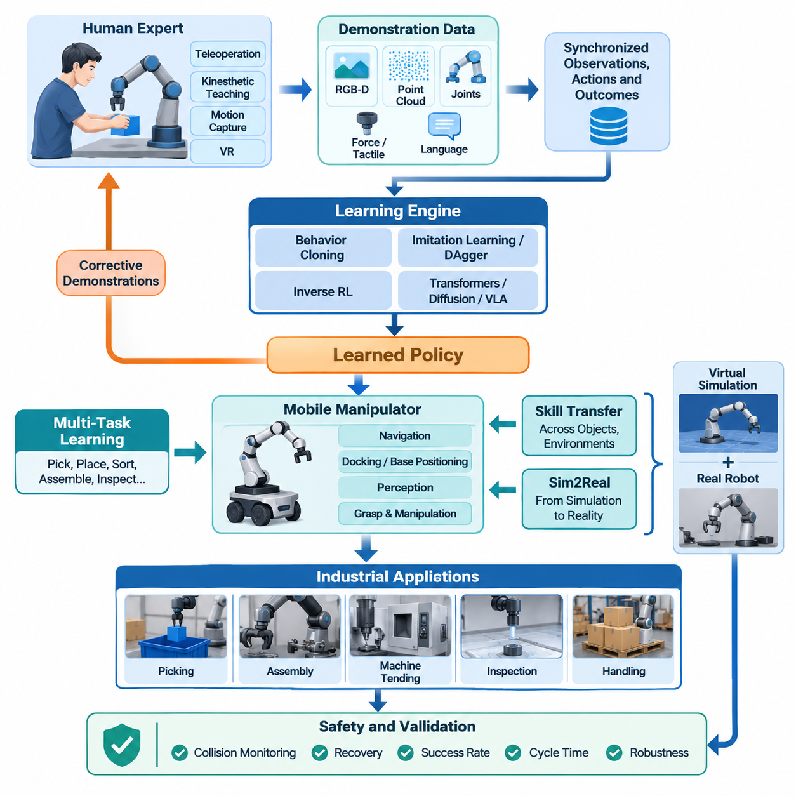
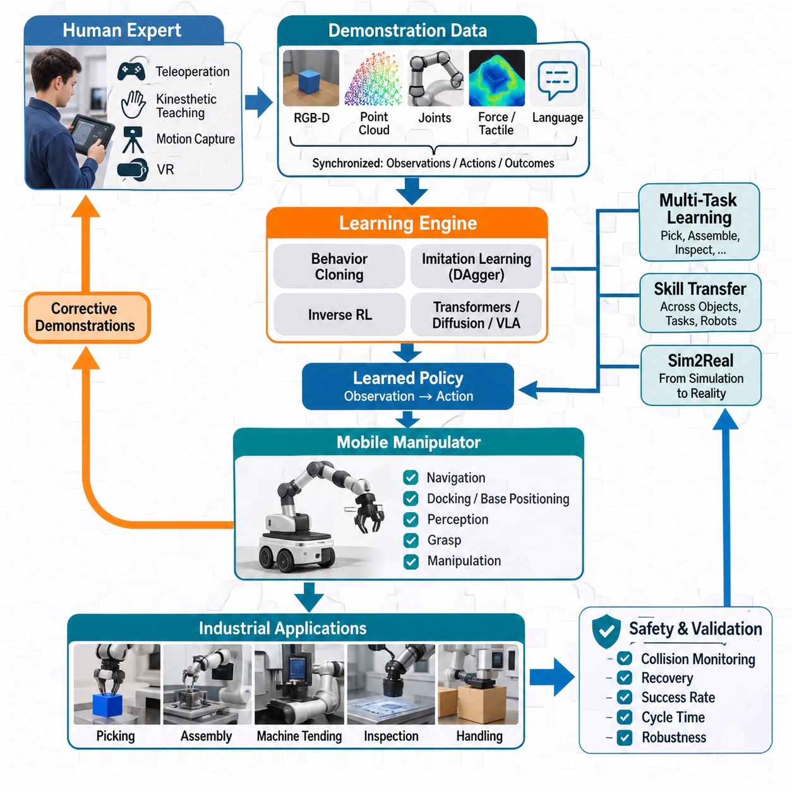
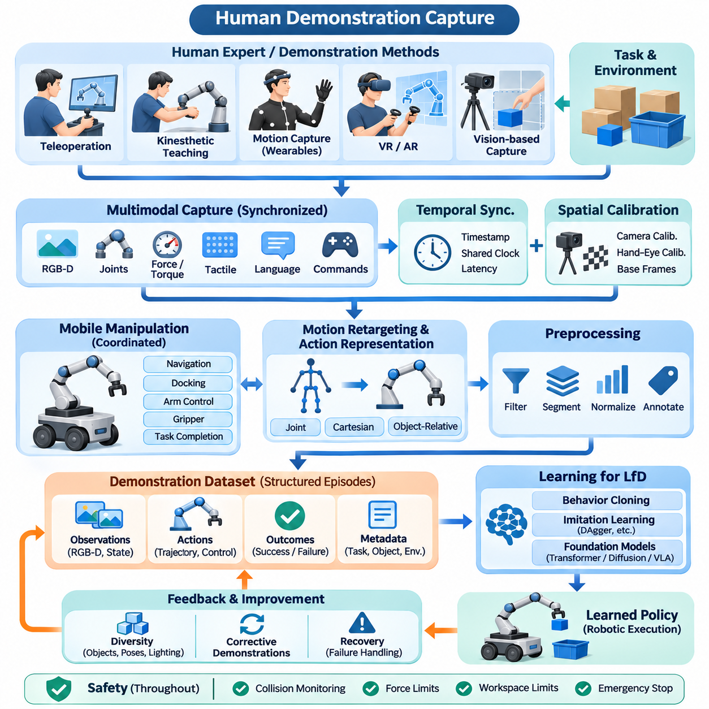
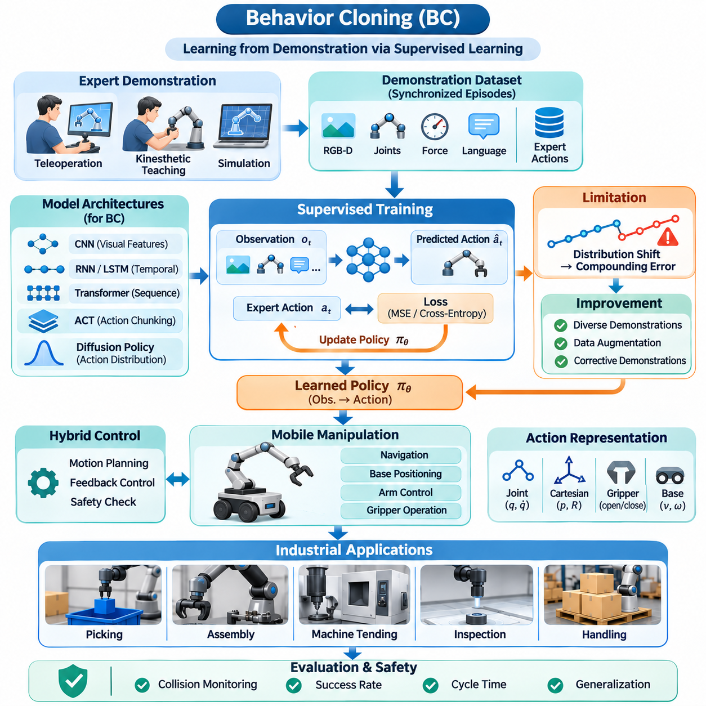
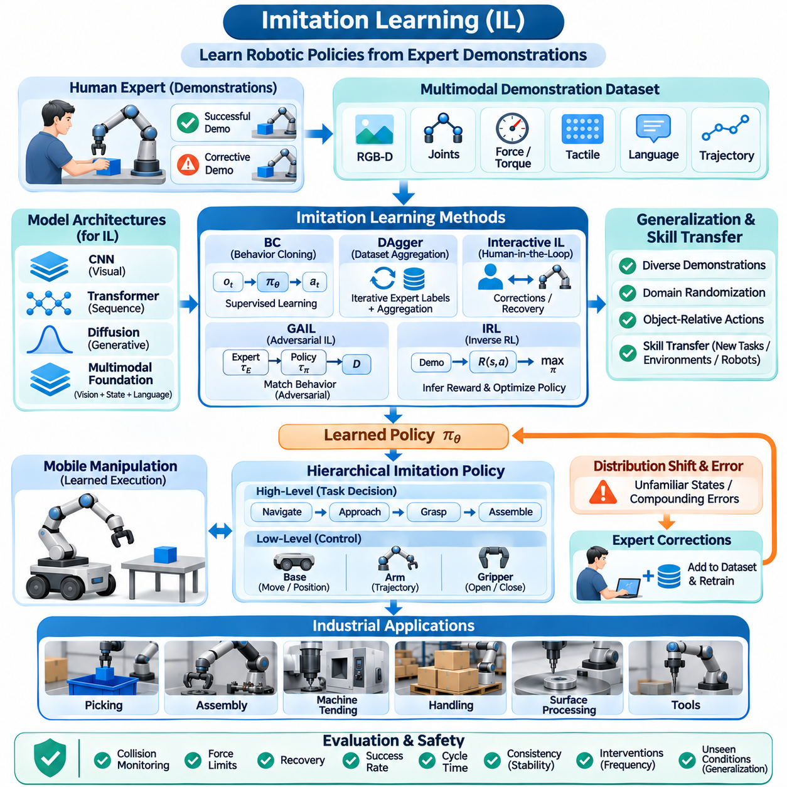
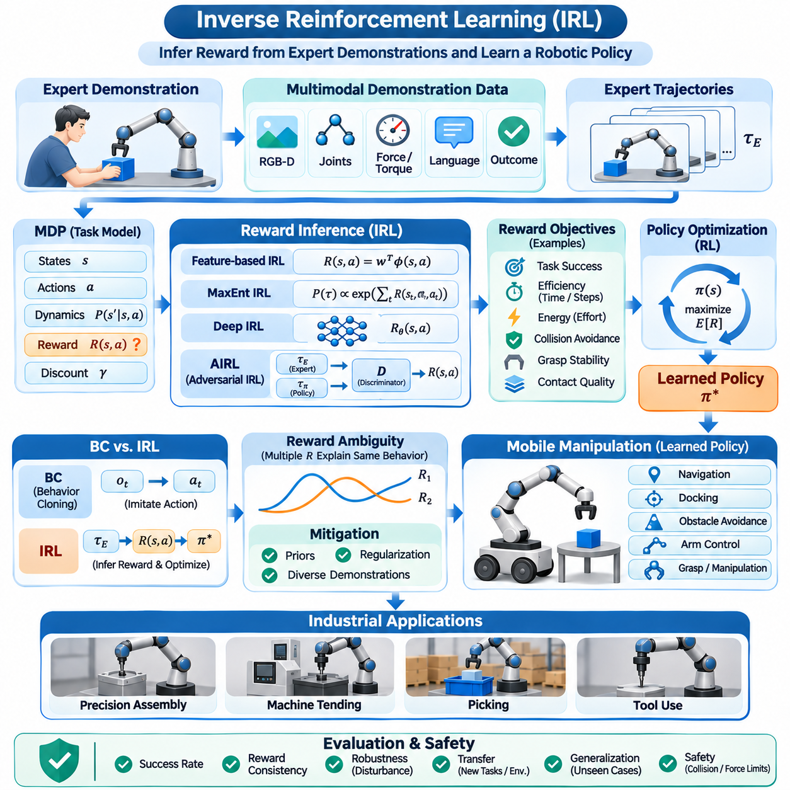
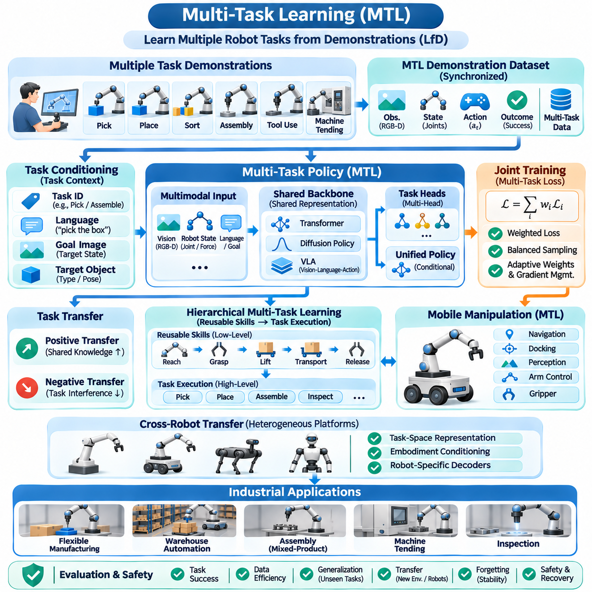
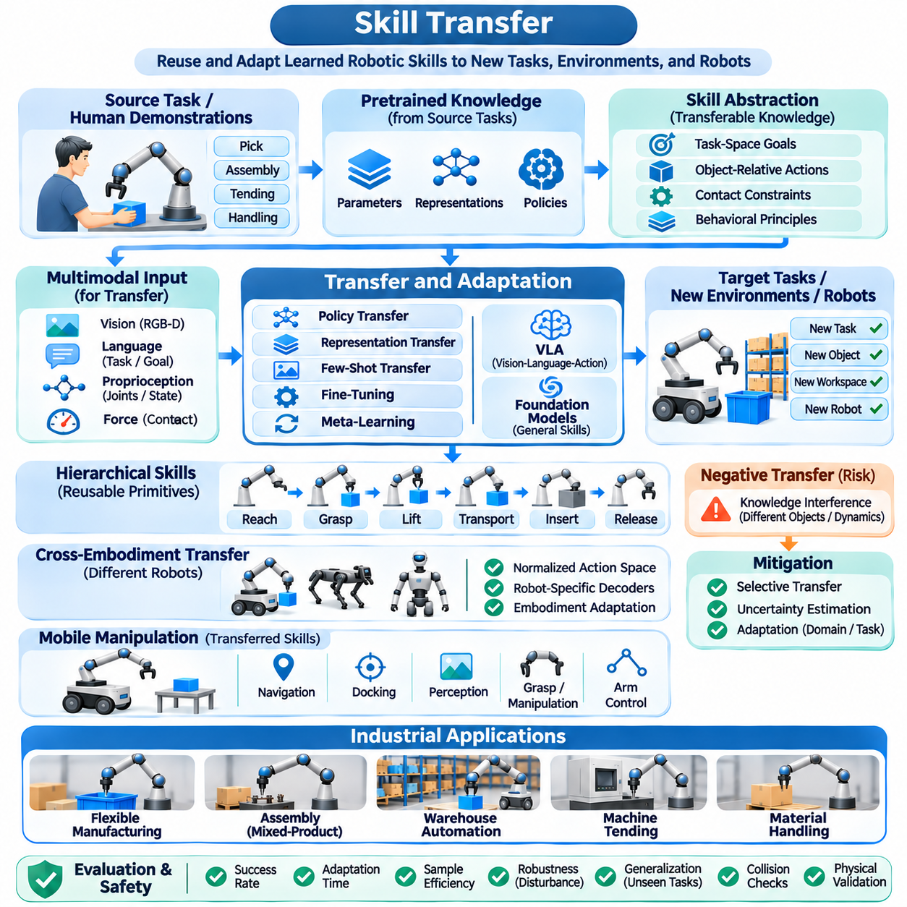
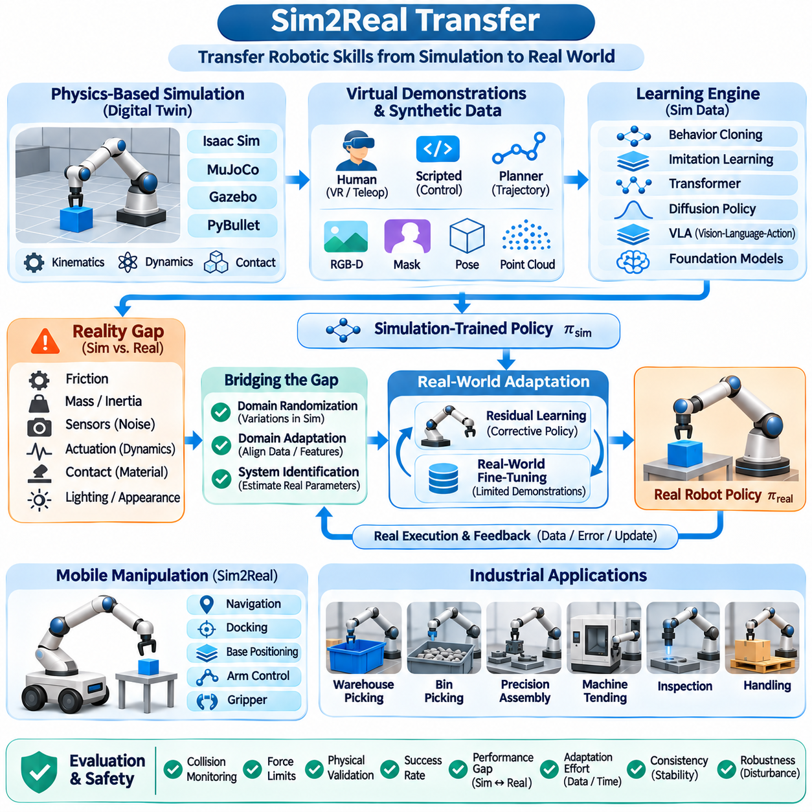
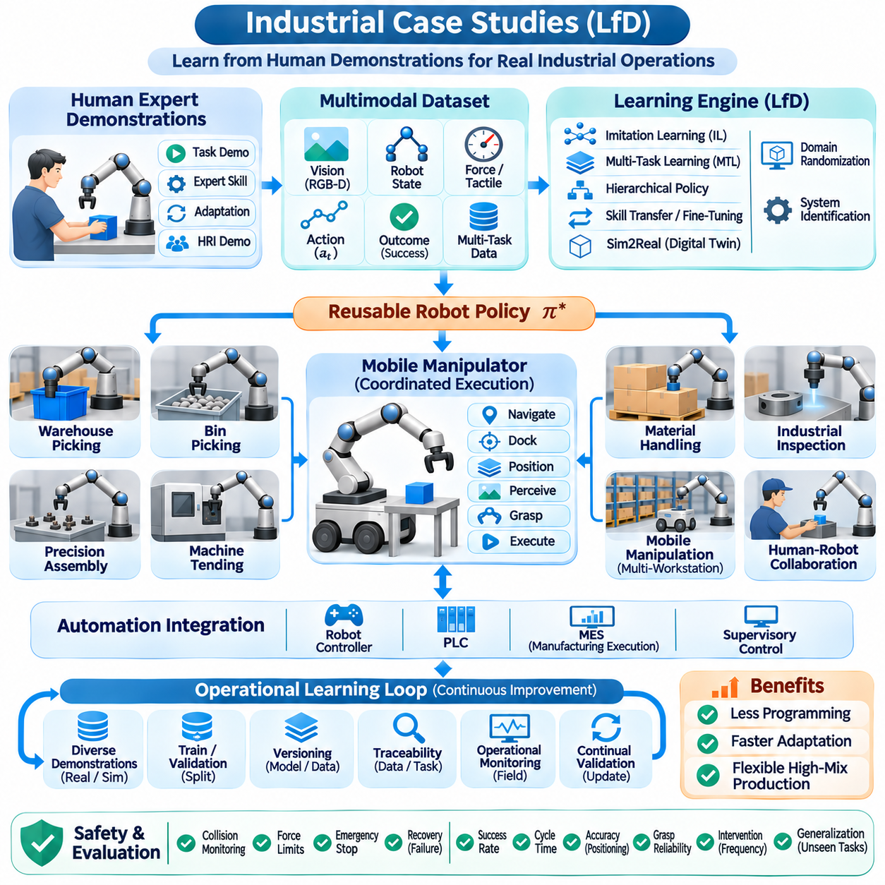

**Volume 03. Vision Manipulation and AI**

# Chapter 12. Learning from Demonstration

## 01 LfD Overview

{width="7.268055555555556in" height="7.268055555555556in"}

{width="7.268055555555556in" height="7.268055555555556in"}

Learning from Demonstration (LfD) is a robotic learning paradigm in which robots acquire new behaviors and manipulation skills by observing demonstrations provided by human experts or other robots. Instead of explicitly programming every movement, decision, and control sequence, LfD enables robots to learn relationships between environmental observations, actions, and task objectives. This approach reduces manual programming effort and supports adaptive robotic manipulation.

Traditional robotic programming relies on predefined trajectories, mathematical models, deterministic rules, and manually configured control parameters. Although these approaches remain effective in structured industrial environments, they become increasingly difficult to maintain when objects, operating conditions, and task requirements frequently change. LfD addresses these limitations by extracting behavioral knowledge directly from demonstrated task executions.

The fundamental objective of LfD is to construct a policy that maps observed environmental states to appropriate robotic actions. A demonstration typically consists of a sequence of observations, robot states, control commands, and task outcomes. During training, the learning algorithm identifies patterns within these sequences and develops a policy capable of reproducing demonstrated behaviors and potentially generalizing them to previously unseen situations.

In mobile manipulation, LfD extends beyond learning robotic arm movements. A mobile manipulator must coordinate autonomous navigation, environmental perception, base positioning, object localization, grasp planning, manipulation, and task completion. Demonstrations may therefore represent complete operational sequences in which the mobile robot and robotic arm cooperate to accomplish complex physical tasks within dynamic environments.

Human demonstrations can be collected through multiple interaction methods, including teleoperation, kinesthetic teaching, motion capture, virtual reality interfaces, and wearable sensing devices. Each method provides different levels of accuracy, accessibility, and data richness. Teleoperation allows an operator to control the robot remotely, while kinesthetic teaching enables direct physical guidance of robotic arm movements when supported by the hardware.

Demonstration datasets may incorporate multimodal information such as RGB images, depth images, point clouds, joint positions, joint velocities, end-effector poses, forces, torques, tactile measurements, and mobile base states. Language instructions can also provide semantic information about task objectives. Accurate synchronization and calibration across these data sources are essential for establishing reliable relationships between perception and action.

Behavior Cloning (BC) represents one of the most fundamental approaches to LfD. It formulates robotic skill acquisition as a supervised learning problem in which demonstrated observations serve as inputs and corresponding expert actions serve as training targets. Neural networks learn to approximate the expert policy and generate appropriate actions during autonomous execution. However, prediction errors may accumulate when the robot encounters unfamiliar states.

Imitation Learning encompasses a broader range of techniques designed to reproduce expert behavior while improving robustness and generalization. Interactive methods such as Dataset Aggregation (DAgger) incorporate corrective demonstrations collected from states encountered by the learned policy. These additional examples help address distribution shifts between expert demonstrations and autonomous execution, reducing cumulative errors during sequential manipulation.

Inverse Reinforcement Learning (IRL) approaches demonstration-based learning from a different perspective. Rather than directly reproducing expert actions, IRL attempts to infer an underlying reward function that explains demonstrated behavior. The robot subsequently optimizes its policy according to the inferred reward function. This approach can support behavioral adaptation, although reward ambiguity and computational complexity remain significant challenges.

Modern LfD architectures increasingly employ deep neural networks, Transformers, Diffusion Policies, and Vision-Language-Action (VLA) models. These architectures can process high-dimensional sensory observations and generate complex action sequences. By combining visual perception, language understanding, and robotic control, they provide a foundation for learning manipulation behaviors that extend beyond narrowly predefined industrial operations.

Multi-Task Learning enables a robotic system to acquire multiple manipulation skills through shared representations and training datasets. Instead of developing independent models for every operation, a shared policy may learn picking, placing, sorting, tool handling, and assembly tasks. Task identifiers, goal images, or natural language instructions can condition the policy, supporting flexible behavior selection according to operational requirements.

Skill Transfer extends LfD by enabling previously acquired knowledge to be reused across different objects, environments, tasks, and robotic platforms. Transferability depends on the representation of learned skills, similarities between task conditions, and differences in robot morphology. Object-relative coordinates, task-space actions, and reusable motion primitives can improve adaptation while reducing the required volume of additional demonstrations.

Simulation-to-Reality (Sim2Real) transfer provides another important mechanism for expanding demonstration-based learning. Virtual environments allow researchers to generate large quantities of demonstrations without excessive physical equipment usage. Domain randomization, sensor noise modeling, and physics parameter variation can improve robustness, although real-world demonstrations and calibration remain important for addressing residual simulation-to-reality gaps.

Industrial applications of LfD include warehouse picking, machine tending, component assembly, material handling, inspection, and tool manipulation. Demonstration-based learning is particularly valuable in high-mix, low-volume manufacturing, where frequent product changes make conventional programming expensive. However, reliable implementation requires safety constraints, collision monitoring, workspace limitations, recovery mechanisms, and systematic performance validation.

The effectiveness of LfD should be evaluated using task success rate, cycle time, trajectory accuracy, intervention frequency, generalization capability, and robustness against environmental disturbances. Demonstration quality and diversity frequently influence performance more than dataset size alone. Ultimately, LfD establishes a practical connection between human expertise and robotic intelligence, supporting the development of adaptable mobile manipulators and future Physical AI systems.

## 02 Human Demonstration Capture

{width="7.268055555555556in" height="7.268055555555556in"}

Human Demonstration Capture is the process of recording human expertise, physical movements, control commands, and environmental interactions to create training datasets for Learning from Demonstration (LfD). In robotic manipulation, its primary objective is to transform human task execution into structured information that can be interpreted by learning algorithms and converted into autonomous robotic behaviors under varying operational conditions.

Unlike conventional robotic programming, human demonstration capture allows experienced operators to transfer practical knowledge without explicitly defining every movement or decision rule. Human experts naturally adjust their actions according to object geometry, environmental constraints, contact conditions, and unexpected disturbances. Capturing these adaptive behaviors enables robots to acquire skills that may be difficult to describe through analytical models alone.

Teleoperation is one of the most widely used methods for collecting robotic demonstrations. Human operators remotely control robotic arms, grippers, and mobile platforms using joysticks, motion controllers, haptic interfaces, or specialized control devices. The robotic system simultaneously records operator commands, sensor measurements, and execution states, generating synchronized observation-action sequences suitable for training robotic manipulation policies.

Kinesthetic Teaching provides an alternative demonstration capture method in which human operators physically guide a robotic arm through desired movements. Robots equipped with compliant joints, torque sensing, or gravity compensation can follow external guidance while recording joint configurations, end-effector trajectories, and interaction forces. This approach is particularly useful for assembly, precision positioning, and contact-rich manipulation tasks.

Motion Capture systems enable the recording of human body movements, hand gestures, and manipulation trajectories without requiring direct physical interaction with a robot. Optical tracking cameras, inertial measurement units, and wearable sensors can estimate human motion in three-dimensional space. Motion retargeting algorithms subsequently transform captured human movements into trajectories compatible with the robot\'s mechanical structure and physical constraints.

Virtual Reality (VR) and Augmented Reality (AR) interfaces provide immersive environments for human demonstration capture. Operators can manipulate virtual or physical objects through intuitive hand tracking and spatial controllers while receiving visual feedback about robot movements. These technologies support remote data collection, simulated manipulation, and interactive teaching while potentially reducing the operational risks associated with direct physical robot control.

Vision-based demonstration capture uses RGB cameras, depth cameras, and multi-view imaging systems to observe human manipulation activities. Computer vision algorithms extract hand poses, object positions, interaction sequences, and task-relevant environmental features. Although video-based demonstrations offer considerable scalability, converting observed human behavior into executable robotic actions requires accurate spatial reasoning and motion retargeting.

Multimodal demonstration capture integrates visual observations, proprioceptive measurements, force signals, tactile information, and language instructions into unified robotic learning datasets. RGB-D cameras provide environmental geometry, joint encoders describe robot configurations, and force-torque sensors characterize physical interactions. Language annotations identify task objectives and semantic relationships that may not be directly observable from motion trajectories.

Temporal synchronization is a critical requirement for reliable demonstration capture. Cameras, robotic controllers, tactile sensors, and mobile platforms frequently operate at different sampling frequencies and communication latencies. Accurate timestamps, shared clock references, interpolation, and latency compensation help establish consistent temporal relationships between sensory observations and executed actions throughout each recorded demonstration.

Spatial calibration ensures that captured observations and actions are represented within consistent coordinate systems. Camera intrinsic calibration, camera extrinsic calibration, hand-eye calibration, and robot base transformations establish geometric relationships between sensors, robotic components, and environmental objects. Inaccurate calibration can introduce systematic errors that reduce the reliability of learned manipulation policies during physical execution.

Demonstration data representation influences how efficiently robotic learning algorithms can acquire transferable manipulation skills. Actions may be expressed as joint positions, joint velocities, Cartesian poses, relative transformations, gripper commands, or control signals. Object-relative representations can improve generalization by describing manipulation behaviors independently of fixed workspace coordinates and specific robot starting configurations.

In mobile manipulation systems, demonstration capture must include interactions between the autonomous mobile robot and its robotic arm. Recorded information may incorporate navigation trajectories, localization estimates, base orientation, docking positions, arm configurations, and manipulation outcomes. Coordinating these measurements enables learning algorithms to recognize dependencies between mobile positioning, workspace accessibility, and manipulation performance.

Demonstration quality and diversity directly influence the generalization capabilities of learned robotic policies. Data collection should incorporate variations in object positions, orientations, lighting conditions, workspace arrangements, and task execution strategies. Corrective demonstrations and recovery behaviors are also valuable because datasets containing only successful nominal executions may insufficiently represent disturbances encountered during autonomous operation.

Dataset preprocessing transforms raw demonstration recordings into consistent training samples through filtering, segmentation, normalization, synchronization, and annotation. Individual task executions are commonly organized as episodes containing sequential observations, actions, and outcome indicators. Metadata describing robot configurations, operator identities, sensor specifications, and task conditions supports reproducibility, traceability, and systematic dataset quality management.

Human demonstration capture must incorporate appropriate safety mechanisms, particularly when operators interact directly with physical robotic systems. Independent collision monitoring, force limitations, workspace restrictions, emergency stopping mechanisms, and supervised operation reduce risks during data collection. Ultimately, well-designed demonstration capture pipelines provide the foundation for Behavior Cloning, Imitation Learning, robot foundation models, and scalable Physical AI development.

## 03 Behavior Cloning

{width="7.268055555555556in" height="7.268055555555556in"}

Behavior Cloning (BC) is a fundamental approach to Learning from Demonstration (LfD) in which a robot learns to reproduce expert behavior through supervised learning. Instead of explicitly designing control rules or reward functions, Behavior Cloning trains a policy to predict appropriate actions from observed environmental states. This approach enables robots to acquire complex manipulation skills directly from human demonstrations or previously recorded robotic experiences.

The fundamental principle of Behavior Cloning involves learning a mapping between observations and actions. Expert demonstrations provide sequences of sensory observations, robot states, and corresponding control commands. During training, a machine learning model identifies relationships between these inputs and outputs. Once trained, the resulting policy generates robotic actions based on current observations without requiring continuous human supervision.

A Behavior Cloning dataset typically consists of multiple demonstration episodes representing complete or partial task executions. Each episode contains synchronized observation-action pairs collected through teleoperation, kinesthetic teaching, simulation, or other demonstration capture methods. Observations may include RGB images, depth information, joint configurations, force measurements, and task instructions, while actions describe the intended robotic movements.

The training process is generally formulated as a supervised optimization problem in which the predicted actions are compared with expert actions. Continuous control tasks commonly employ Mean Squared Error (MSE) or probabilistic objectives, while discrete action prediction may use Cross-Entropy Loss. The optimization algorithm adjusts model parameters to minimize prediction errors and approximate the behavioral distribution represented by expert demonstrations.

Action representation plays an important role in Behavior Cloning performance. Robotic actions may be represented as joint positions, joint velocities, Cartesian poses, relative end-effector displacements, gripper commands, or mobile base control signals. Selecting an appropriate representation improves learning efficiency and facilitates generalization. Relative action representations can reduce dependence on specific initial robot configurations and workspace coordinates.

Deep learning architectures enable Behavior Cloning policies to process high-dimensional sensory observations. Convolutional Neural Networks (CNNs) extract visual features, while Recurrent Neural Networks (RNNs), Long Short-Term Memory (LSTM) networks, and Transformers capture temporal dependencies. Multimodal architectures combine visual, proprioceptive, tactile, and linguistic information to generate context-aware robotic actions under varying operational conditions.

End-to-End Behavior Cloning directly maps raw or minimally processed sensory observations to robotic control commands. This approach reduces dependence on manually designed intermediate perception and planning modules. However, end-to-end architectures generally require sufficient training data, computational resources, and comprehensive validation. Hybrid architectures can combine learned policies with conventional motion planning, geometric reasoning, and feedback controllers.

A major limitation of Behavior Cloning is distribution shift between expert demonstrations and autonomous execution. Small prediction errors may cause the robot to enter unfamiliar states that were not represented in the training dataset. Subsequent actions may become increasingly inaccurate, producing a phenomenon known as compounding error. This limitation becomes particularly significant in long-horizon manipulation tasks involving multiple sequential decisions.

Dataset diversity and corrective demonstrations help mitigate distribution shift and improve policy robustness. Demonstrations should cover variations in object positions, orientations, lighting conditions, environmental disturbances, and robot starting configurations. Data augmentation, observation perturbation, and carefully designed action noise can further improve robustness, provided that augmented samples preserve physically meaningful observation-action relationships.

Action Chunking is an advanced Behavior Cloning strategy in which the policy predicts a sequence of future actions rather than a single immediate command. Predicting coordinated action segments can improve temporal consistency and reduce fluctuations between consecutive predictions. Architectures such as Action Chunking with Transformers (ACT) support complex manipulation tasks by learning structured action sequences from demonstration trajectories.

Diffusion Policy extends Behavior Cloning through conditional generative modeling of robotic actions. Instead of predicting a single deterministic action sequence, diffusion-based models learn action distributions and generate candidate trajectories through iterative denoising. This approach can represent multiple valid manipulation strategies, making it particularly useful for tasks involving different grasp configurations, approach directions, and movement patterns.

In mobile manipulation, Behavior Cloning can learn coordinated behaviors involving autonomous navigation, mobile base positioning, robotic arm movements, and gripper operation. A unified policy may generate commands for multiple robotic subsystems, while hierarchical architectures can separate navigation and manipulation skills. Reliable implementation requires consistent coordinate transformations, sensor synchronization, and coordination between learned policies and conventional controllers.

Industrial applications of Behavior Cloning include warehouse picking, component assembly, machine tending, tool manipulation, material handling, and repetitive inspection tasks. Its ability to acquire demonstrated skills can reduce programming efforts when introducing new products or operational procedures. However, learned policies must operate within independently enforced safety constraints, collision avoidance mechanisms, and validated physical operating limits.

Behavior Cloning performance should be evaluated using task success rate, action prediction error, cycle time, trajectory consistency, intervention frequency, and generalization capability. Validation datasets should contain independent demonstration episodes, while physical testing should examine previously unseen configurations. Ultimately, Behavior Cloning provides a practical foundation for advanced Imitation Learning, robot foundation models, and scalable Physical AI systems.

## 04 Imitation Learning

{width="7.268055555555556in" height="7.268055555555556in"}

Imitation Learning (IL) is a robotic learning paradigm in which an artificial intelligence system acquires behaviors by observing and reproducing expert demonstrations. Rather than relying entirely on manually programmed rules or explicitly designed reward functions, Imitation Learning enables robots to develop policies that approximate expert decision-making processes and adapt learned behaviors to physical operating environments.

Imitation Learning represents a major family of approaches within Learning from Demonstration (LfD). While Behavior Cloning directly learns relationships between observations and expert actions, advanced imitation methods address additional challenges such as sequential decision-making, distribution shift, behavioral generalization, and recovery from unexpected states. These capabilities are particularly important for complex robotic manipulation.

The fundamental objective of Imitation Learning is to develop a policy that generates appropriate actions according to environmental observations, robot states, and task objectives. Expert demonstrations provide examples of successful or corrective behaviors, including perception responses, movement trajectories, and physical interactions. The learning algorithm extracts behavioral patterns and encodes them into a computational policy.

Behavior Cloning (BC) provides the simplest implementation of Imitation Learning by treating expert demonstrations as supervised training examples. However, a policy trained exclusively on expert trajectories may encounter unfamiliar states during autonomous execution. Small action prediction errors can accumulate over time, causing the robot to deviate from demonstrated behaviors and increasing the probability of task failure.

Dataset Aggregation (DAgger) addresses this limitation through an iterative learning process that incorporates expert corrections during policy execution. The robot initially executes a learned policy while an expert provides appropriate actions for the states encountered. These additional observation-action pairs are incorporated into the training dataset, gradually improving policy robustness and reducing the effects of distribution shift.

Interactive Imitation Learning extends demonstration-based training by allowing human experts to intervene during robotic task execution. Interventions may involve corrective commands, trajectory modifications, or physical guidance when undesirable behavior occurs. This approach enables the learning system to acquire recovery strategies and decision-making capabilities that may not be sufficiently represented in initial demonstration datasets.

Generative Adversarial Imitation Learning (GAIL) introduces an adversarial learning framework in which a discriminator attempts to distinguish expert behavior from behavior generated by the learned policy. The policy is optimized to produce trajectories resembling expert demonstrations. By learning similarities between behavioral distributions, GAIL can reproduce expert strategies without requiring a manually specified task reward function.

Inverse Reinforcement Learning (IRL) provides another approach to imitation by estimating the underlying reward function associated with expert behavior. Instead of directly copying demonstrated actions, the robot attempts to identify objectives that explain expert decisions. The inferred reward function can subsequently guide policy optimization and behavioral adaptation when environmental conditions differ from those observed during demonstrations.

Modern Imitation Learning architectures utilize Convolutional Neural Networks (CNNs), Transformers, Diffusion Models, and multimodal foundation models to process complex sensory information. These architectures integrate visual observations, proprioceptive measurements, tactile feedback, and language instructions. Temporal modeling and generative action prediction enable policies to represent diverse manipulation strategies and sequential behaviors.

Hierarchical Imitation Learning decomposes complex robotic operations into higher-level task decisions and lower-level execution skills. A high-level policy may determine whether the robot should navigate, approach an object, grasp a component, or perform an assembly operation. Lower-level policies execute the corresponding physical actions, improving behavioral modularity, skill reusability, and scalability across long-horizon tasks.

In mobile manipulation, Imitation Learning enables coordinated behaviors involving autonomous navigation, mobile base positioning, robotic arm control, and end-effector operation. Demonstrations may capture complete operational sequences from approaching a workstation to completing a manipulation task. Learned policies must account for spatial relationships, robot kinematics, environmental constraints, and interactions between robotic subsystems.

Multimodal Imitation Learning combines demonstrations collected from various sensory and instructional sources. RGB-D images describe environmental geometry, joint measurements represent robot configurations, and force-torque signals characterize physical contact. Natural language instructions provide semantic task objectives, enabling conditional policies to select and execute appropriate behaviors according to different operational requirements.

Generalization and skill transfer remain essential challenges in Imitation Learning. Policies trained on limited demonstrations may become dependent on specific objects, environmental arrangements, or robotic hardware. Diverse training datasets, domain randomization, object-relative action representations, and transfer learning can improve adaptability while reducing the number of additional demonstrations required for new tasks and environments.

Industrial applications of Imitation Learning include warehouse picking, machine tending, component assembly, material handling, surface processing, and tool manipulation. Demonstration-based skill acquisition can reduce engineering effort in high-mix manufacturing environments. Nevertheless, industrial deployment requires independently enforced safety constraints, collision monitoring, force limitations, and validated error recovery mechanisms.

Imitation Learning performance should be evaluated using task success rate, execution consistency, cycle time, intervention frequency, recovery capability, and generalization to unseen conditions. Evaluation must distinguish between reproducing recorded demonstrations and successfully completing physical tasks. Ultimately, Imitation Learning connects human expertise with autonomous robotic intelligence and supports scalable, adaptable Physical AI systems.

## 05 Inverse Reinforcement Learning

{width="7.268055555555556in" height="7.268055555555556in"}

Inverse Reinforcement Learning (IRL) is a learning paradigm in which a robotic system attempts to infer the underlying reward function that explains demonstrated expert behavior. Unlike conventional Reinforcement Learning (RL), where a reward function is explicitly defined before policy optimization, IRL derives possible task objectives from observed actions. This approach enables robots to acquire knowledge about why experts perform particular behaviors.

Traditional robotic learning methods frequently focus on reproducing demonstrated movements or control commands. However, identical task objectives can often be achieved through multiple valid trajectories and manipulation strategies. Inverse Reinforcement Learning addresses this challenge by estimating the objectives and preferences that influence expert decisions rather than simply replicating the demonstrated sequence of physical actions.

The theoretical foundation of IRL is commonly described using a Markov Decision Process (MDP), which consists of states, actions, transition dynamics, a reward function, and a discount factor. While conventional Reinforcement Learning assumes that the reward function is available, IRL treats it as an unknown component. Expert trajectories provide evidence from which candidate reward functions can be estimated under assumptions about expert behavior.

Reward inference represents the central computational problem in Inverse Reinforcement Learning. The learning algorithm analyzes demonstrated trajectories to identify reward functions under which expert behavior appears preferable to alternative behaviors. These functions may incorporate task completion, movement efficiency, energy consumption, collision avoidance, grasp stability, and physical interaction quality as relevant optimization objectives.

Feature-based Inverse Reinforcement Learning represents reward functions through combinations of predefined state and action features. In robotic manipulation, these features may describe object distances, end-effector orientations, joint configurations, contact forces, and obstacle proximity. The learning algorithm estimates feature weights that explain expert preferences, providing a potentially interpretable representation of demonstrated task objectives.

A fundamental challenge in IRL is reward ambiguity, because multiple reward functions may explain the same demonstrated behavior. Observing a successful manipulation trajectory does not necessarily reveal a unique underlying objective. Regularization, prior knowledge, additional demonstrations, and environmental variations can help constrain the solution space and improve the meaningfulness of inferred reward representations.

Maximum Entropy Inverse Reinforcement Learning addresses reward ambiguity by introducing a probabilistic representation of demonstrated behavior. Trajectories with higher cumulative rewards receive higher probabilities, while alternative feasible trajectories remain represented within the distribution. This framework accommodates variability in expert demonstrations without assuming that humans always execute a single perfectly optimal trajectory.

Deep Inverse Reinforcement Learning extends conventional approaches by representing reward functions using deep neural networks. These networks can process high-dimensional sensory inputs, including RGB images, depth observations, point clouds, and proprioceptive measurements. Nonlinear reward representations enable the learning system to capture complex relationships between environmental conditions, physical interactions, and task objectives.

Adversarial Inverse Reinforcement Learning (AIRL) combines reward inference with adversarial learning mechanisms. A discriminator distinguishes expert trajectories from trajectories generated by a learned policy, while the policy attempts to reproduce expert behavior. Under suitable assumptions, AIRL can recover reward representations that are more transferable across changes in environmental dynamics than direct behavioral imitation alone.

Inverse Reinforcement Learning differs from Behavior Cloning (BC) in both learning objectives and computational requirements. Behavior Cloning directly predicts expert actions from observed states, whereas IRL estimates the reward structure associated with demonstrated decisions and subsequently optimizes a policy. Although IRL generally requires greater computational effort, inferred rewards may support adaptation when task conditions or feasible trajectories change.

In mobile manipulation, IRL can model objectives involving autonomous navigation, mobile base positioning, obstacle avoidance, robotic arm movements, and object manipulation. Expert demonstrations may reveal preferences for accessible docking locations, stable grasp configurations, efficient approach trajectories, and coordinated subsystem operation. Inferred rewards can guide planning and policy optimization across alternative physical configurations.

Multimodal demonstration datasets provide important information for robotic reward inference. Visual observations describe environmental geometry, joint measurements represent robot configurations, and force-torque signals characterize contact interactions. Language instructions and task outcome annotations can provide additional evidence about intended objectives. Combining these information sources can improve the contextual relevance of inferred reward functions.

Industrial applications of IRL include precision assembly, machine tending, warehouse picking, tool manipulation, and contact-rich manufacturing operations. Human experts often balance movement efficiency, positioning accuracy, component protection, and interaction forces during task execution. Capturing these implicit preferences through demonstrations may reduce the effort required to formulate complex reward functions for adaptive robotic systems.

Practical deployment of IRL requires careful consideration of demonstration quality, reward misspecification, computational complexity, and environmental uncertainty. An inferred reward function may encourage undesirable behavior when optimized under conditions not represented in the demonstration dataset. Independent safety constraints, collision monitoring, force limits, and physical operating boundaries must therefore remain active throughout robotic execution.

Inverse Reinforcement Learning performance should be evaluated using task success rate, reward consistency, behavioral similarity, policy robustness, transferability, and generalization under unseen operating conditions. Evaluation should examine whether inferred objectives produce meaningful physical outcomes rather than merely reproducing recorded trajectories. Ultimately, IRL provides a foundation for objective-driven robotic learning and adaptable Physical AI systems.

## 06 Multi Task Learning

{width="7.268055555555556in" height="7.268055555555556in"}

Multi-Task Learning (MTL) is a machine learning paradigm in which a single model learns multiple related tasks by utilizing shared knowledge, representations, and computational resources. Within Learning from Demonstration (LfD), Multi-Task Learning enables robots to acquire diverse manipulation skills from multiple demonstration datasets, reducing the need to develop independent learning models for every individual robotic operation.

Traditional robotic learning frequently employs task-specific models optimized for predetermined operational objectives. Although these models may achieve high performance within restricted environments, maintaining separate policies for numerous tasks increases development complexity and computational requirements. Multi-Task Learning addresses these limitations by exploiting common characteristics and relationships among different robotic tasks.

The fundamental principle of Multi-Task Learning involves extracting shared representations from observations associated with multiple tasks. Visual features, spatial relationships, object properties, and physical interaction patterns may remain relevant across different manipulation activities. By learning these common representations, robotic systems can improve data efficiency, knowledge reuse, and generalization across diverse operational conditions.

Multi-task demonstration datasets typically contain multiple categories of robotic activities, including picking, placing, sorting, assembly, tool manipulation, and machine tending. Each demonstration episode includes sensory observations, robotic states, executed actions, task identifiers, and outcome information. Consistent data structures and standardized action representations facilitate the integration of heterogeneous demonstrations into a unified learning framework.

Task conditioning enables a shared robotic policy to distinguish between different operational objectives. Task identifiers, natural language instructions, goal images, or target object representations can provide contextual information that guides action generation. Conditional policies utilize these inputs together with environmental observations to select appropriate manipulation behaviors without requiring independent models for every task.

Shared-backbone architectures represent a common implementation of Multi-Task Learning. A shared neural network extracts general features from sensory observations, while task-specific output heads generate actions or predictions for individual tasks. Alternatively, a unified conditional policy may generate all actions through a common output mechanism, providing greater flexibility as the number and diversity of supported robotic tasks increase.

Multi-Task Learning optimization typically combines individual task losses into a unified training objective. Each task contributes according to its assigned loss weight, dataset distribution, or operational importance. Imbalanced task datasets may cause dominant tasks to influence shared model parameters excessively. Adaptive loss weighting, balanced sampling, and gradient management techniques can improve learning stability across multiple tasks.

Positive transfer occurs when knowledge acquired from one task improves learning performance on another related task. For example, grasping skills learned during warehouse picking may support component handling and assembly operations. Negative transfer occurs when conflicting task requirements interfere with shared representations. Identifying task relationships and managing conflicting gradients are therefore essential for effective Multi-Task Learning.

Modern multi-task robotic learning architectures increasingly employ Transformers, Diffusion Policies, and Vision-Language-Action (VLA) models. These architectures integrate multimodal observations with task-specific instructions and generate context-dependent action sequences. Large-scale pretraining on diverse robotic demonstrations can establish reusable representations that support multiple manipulation skills and subsequent adaptation to additional tasks.

Hierarchical Multi-Task Learning organizes complex robotic behaviors into reusable skills and higher-level task execution strategies. Fundamental skills such as reaching, grasping, lifting, transporting, and releasing objects can be combined to accomplish different operational objectives. This modular organization improves skill reusability and enables complex robotic tasks to be constructed from previously acquired behavioral capabilities.

In mobile manipulation, Multi-Task Learning extends beyond robotic arm control to incorporate autonomous navigation, mobile base positioning, docking, environmental perception, and coordinated manipulation. A shared learning architecture may support multiple operational scenarios involving different locations, objects, and workstations. Hierarchical policies can coordinate reusable navigation and manipulation skills according to mission-level objectives.

Multi-Task Learning can also support knowledge sharing across heterogeneous robotic platforms with different mechanical structures, sensor configurations, and control interfaces. Standardized task-space representations, robot-specific action decoders, and embodiment conditioning help accommodate these differences. However, variations in kinematics, physical capabilities, and sensor characteristics must be considered when integrating cross-robot demonstrations.

Industrial applications of Multi-Task Learning include flexible manufacturing, warehouse automation, machine tending, mixed-product assembly, and automated inspection. A mobile manipulator equipped with multiple learned skills can perform different operations without extensive task-specific reprogramming. Industrial deployment nevertheless requires independent safety mechanisms, validated task transitions, reliable error recovery, and compliance with physical operating constraints.

Multi-Task Learning performance should be evaluated using individual task success rates, average task performance, generalization capability, data efficiency, computational requirements, and knowledge transfer effectiveness. Evaluation must also identify performance degradation caused by negative transfer or insufficient task coverage. When additional tasks are introduced, previously acquired skills should be tested for potential catastrophic forgetting.

Ultimately, Multi-Task Learning establishes a transition from isolated robotic skill acquisition toward reusable and scalable robotic intelligence. By integrating diverse demonstrations, shared representations, conditional policies, and hierarchical skill execution, robots can progressively expand their operational capabilities. This learning paradigm provides an important foundation for robot foundation models, general-purpose mobile manipulators, and adaptable Physical AI systems.

## 07 Skill Transfer

{width="7.268055555555556in" height="7.268055555555556in"}

Skill Transfer is a robotic learning approach that enables previously acquired knowledge, behaviors, and manipulation capabilities to be applied to new tasks, environments, or robotic platforms. Within Learning from Demonstration (LfD), Skill Transfer reduces the requirement for repeated human demonstrations by allowing robotic systems to reuse and adapt learned skills under different operational conditions.

Traditional robotic systems frequently rely on task-specific programming and independently developed control strategies. When environmental conditions, object properties, or operational requirements change, additional programming and calibration may become necessary. Skill Transfer addresses these limitations by extracting reusable behavioral knowledge and adapting it to new physical and operational contexts.

The fundamental principle of Skill Transfer involves separating transferable task knowledge from environment-specific execution details. A robotic grasping skill, for example, may contain general knowledge about approaching objects, establishing stable contact, and maintaining grasp stability. These behavioral principles can remain applicable even when object geometry, position, orientation, or surrounding conditions change.

Transfer Learning provides a computational foundation for implementing Skill Transfer in robotic systems. Neural networks trained on source tasks provide pretrained parameters, feature representations, or behavioral policies that can be adapted to target tasks. Instead of training entirely new models from randomly initialized parameters, robotic systems can exploit previously acquired knowledge to improve learning efficiency.

Policy transfer enables robotic systems to reuse learned decision-making strategies across related tasks and operating environments. A policy trained to manipulate objects within one workstation may be adapted to another workstation with different spatial arrangements. Successful policy transfer requires compatible observation representations, action definitions, task objectives, and sufficient adaptation to environmental differences.

Representation transfer focuses on reusing internal features learned through previous robotic experiences. Visual encoders may recognize object geometry, spatial relationships, and manipulation affordances across multiple tasks. Shared representations can reduce the amount of additional training data required when robots encounter unfamiliar objects, updated manufacturing processes, or previously unseen operational environments.

Skill abstraction enables robotic behaviors to be represented independently of specific movement trajectories and hardware configurations. Manipulation skills can be described through task-space objectives, object-relative transformations, contact conditions, and behavioral constraints. Such representations allow robotic systems to adapt execution trajectories while preserving the essential functional objectives of previously learned skills.

Hierarchical Skill Transfer organizes robotic capabilities into reusable behavioral primitives and higher-level task execution strategies. Fundamental skills such as reaching, grasping, lifting, transporting, inserting, and releasing objects can be combined into different operational sequences. This approach enables robots to construct complex behaviors without repeatedly learning every physical action from the beginning.

Few-shot Skill Transfer enables robotic systems to adapt previously learned capabilities using a limited number of additional demonstrations. Pretrained policies and generalized feature representations provide initial knowledge that can accelerate adaptation to new tasks. Fine-tuning, parameter-efficient adaptation, and meta-learning techniques can further reduce demonstration requirements and computational training costs.

Cross-embodiment Skill Transfer addresses the challenge of transferring knowledge between robotic platforms with different mechanical structures, degrees of freedom, sensor configurations, and control interfaces. Object-centric representations, normalized action spaces, and robot-specific action decoders can facilitate knowledge sharing. Physical feasibility must still be validated according to the capabilities of each target robot.

In mobile manipulation, Skill Transfer enables previously acquired navigation, docking, object perception, grasping, and manipulation capabilities to be applied across different workstations and operational environments. A mobile manipulator may reuse learned material handling skills while adapting its base positioning, arm configuration, and end-effector trajectories to local geometric and physical constraints.

Multimodal Skill Transfer integrates visual observations, language instructions, proprioceptive measurements, and physical interaction feedback into transferable behavioral representations. Vision-Language-Action (VLA) models and robotic foundation models can support this process through large-scale pretraining. Such architectures may enable robots to associate previously learned physical skills with new semantic task objectives.

Negative transfer represents an important challenge when previously acquired knowledge interferes with learning or execution in a target environment. Differences in object properties, robot dynamics, contact conditions, or task requirements may invalidate learned assumptions. Selective parameter transfer, adaptation mechanisms, and uncertainty estimation can reduce the risk of inappropriate behavioral reuse.

Industrial applications of Skill Transfer include flexible manufacturing, mixed-product assembly, warehouse automation, machine tending, and automated material handling. Previously demonstrated skills can be adapted to different product variants, production layouts, and workstation configurations. Nevertheless, transferred behaviors must undergo independent safety verification, collision checking, and physical performance validation.

Skill Transfer performance should be evaluated using target task success rate, adaptation time, additional demonstration requirements, sample efficiency, policy robustness, and generalization capability. Evaluation should compare transferred policies with independently trained policies under equivalent operating conditions. Ultimately, Skill Transfer provides an important foundation for reusable robotic intelligence and scalable Physical AI.

The supplied chapter outline identifies Skill Transfer as a subsection of Learning from Demonstration, following Multi-Task Learning and preceding Sim2Real Transfer. The technical explanations above expand upon that outline using established robotic learning concepts.

## 08 Sim2Real Transfer

{width="7.268055555555556in" height="7.268055555555556in"}

Sim2Real Transfer, or Simulation-to-Reality Transfer, is a robotic learning approach that enables knowledge, policies, and manipulation skills acquired in simulated environments to be applied to physical robotic systems. Within Learning from Demonstration (LfD), Sim2Real Transfer supports scalable skill acquisition by combining virtual demonstrations, synthetic training data, and physical execution experience while reducing dependence on real-world experiments.

Physical robotic learning frequently requires extensive demonstrations, repeated experimental trials, and continuous environmental preparation. These activities increase development costs, equipment utilization, and exposure to potential hardware damage. Simulation environments provide controlled and repeatable training conditions in which robotic systems can acquire manipulation capabilities before deployment into physical operating environments.

The fundamental challenge of Sim2Real Transfer is the reality gap, which represents differences between simulated environments and physical systems. These differences may originate from inaccurate physical models, sensor noise, friction coefficients, actuator dynamics, contact interactions, and environmental variability. Policies trained exclusively under idealized simulation conditions may therefore exhibit significant performance degradation during real-world execution.

Physics-based simulation provides a computational environment for modeling robotic kinematics, rigid-body dynamics, collision interactions, actuator responses, and environmental constraints. Simulation platforms such as NVIDIA Isaac Sim, MuJoCo, Gazebo, and PyBullet support robotic learning experiments involving diverse physical scenarios. Simulation fidelity must be selected according to the characteristics and accuracy requirements of target manipulation tasks.

Domain Randomization is a widely adopted technique for improving Sim2Real Transfer by introducing systematic variations into simulated training environments. Parameters such as object mass, friction, lighting conditions, textures, camera positions, and actuator responses can be randomized during training. Exposure to diverse simulated conditions encourages policies to develop robust behaviors that are less dependent on specific environmental assumptions.

Domain Adaptation addresses differences between simulated and real-world data distributions by learning representations that remain meaningful across both domains. Visual adaptation techniques may reduce discrepancies in image appearance, illumination, and sensor characteristics. Feature alignment and representation learning can improve the transferability of perception models and manipulation policies trained primarily with synthetic data.

System Identification improves simulation accuracy by estimating physical parameters from measurements collected during real-world robotic operation. These parameters may include joint friction, actuator response characteristics, inertial properties, control latency, and contact behavior. Incorporating identified parameters into simulation models reduces discrepancies between predicted and observed robotic behavior, thereby supporting more reliable policy transfer.

Simulation-based demonstration generation enables robotic systems to acquire large quantities of training data without requiring equivalent physical demonstrations. Human operators, scripted controllers, motion planners, and optimized policies can generate virtual manipulation trajectories. These demonstrations may include sensory observations, robot configurations, action sequences, and task outcomes that support Behavior Cloning and other imitation learning approaches.

Synthetic data generation supports Sim2Real Transfer by producing annotated visual observations and physical interaction data under diverse environmental conditions. Simulated cameras can generate RGB images, depth maps, segmentation masks, object poses, and point clouds. Automatically generated annotations reduce manual labeling requirements while expanding the diversity of training datasets used for robotic perception and manipulation.

Residual Learning provides an adaptation mechanism in which a policy trained in simulation is supplemented by corrective behaviors learned from physical robotic experiences. Instead of replacing the complete pretrained policy, a residual model compensates for discrepancies between simulated and real-world execution. This approach can improve manipulation accuracy and contact interaction performance while preserving previously acquired behavioral knowledge.

Real-world Fine-Tuning enables simulation-trained policies to adapt using additional physical demonstrations and operational feedback. Limited real-world datasets can be used to update selected model parameters, recalibrate perception representations, or refine action generation. Combining large-scale simulated training with targeted physical adaptation can reduce data acquisition costs while improving reliability under actual operating conditions.

In mobile manipulation, Sim2Real Transfer must address the combined behavior of autonomous navigation, mobile base positioning, docking, robotic arm control, and end-effector operation. Simulation-trained policies must accommodate localization uncertainty, positioning deviations, sensor limitations, and physical contact variability. Coordinated simulation of mobility and manipulation supports the development of integrated mission-level robotic behaviors.

Modern Sim2Real learning architectures increasingly utilize Transformers, Diffusion Policies, Vision-Language-Action (VLA) models, and robotic foundation models. Large-scale training datasets may combine simulated demonstrations, synthetic sensory observations, and real-world robotic trajectories. Shared multimodal representations can facilitate knowledge transfer across environments, manipulation tasks, and heterogeneous robotic platforms.

Industrial applications of Sim2Real Transfer include warehouse picking, bin picking, precision assembly, machine tending, automated inspection, and material handling. Digital Twins can provide virtual representations of manufacturing facilities, robotic equipment, and production processes for training and validation. Nevertheless, physical deployment requires independent safety mechanisms, collision monitoring, force limitations, and progressive operational verification.

Sim2Real Transfer performance should be evaluated using real-world task success rates, simulation-to-reality performance degradation, adaptation requirements, execution consistency, and policy robustness. Evaluation must verify physical task completion rather than relying exclusively on simulated performance. Ultimately, Sim2Real Transfer connects scalable virtual learning with reliable physical execution and provides an essential foundation for adaptable Physical AI systems.

## 09 Industrial Case Studies

{width="7.268055555555556in" height="7.268055555555556in"}

Industrial applications of Learning from Demonstration (LfD) demonstrate how robots can acquire practical skills by observing human experts and reproducing their task execution strategies. In manufacturing, logistics, and automated production environments, demonstration-based learning provides an alternative to extensive manual programming. By capturing human expertise and converting it into reusable robotic policies, industrial systems can improve flexibility, reduce engineering effort, and adapt to changing operational requirements.

Industrial robotic applications traditionally depend on predefined trajectories, manually configured control parameters, and task-specific programming. These approaches are effective for repetitive operations under stable conditions but become expensive when product variants, workpiece positions, or production processes change frequently. LfD enables robots to learn operational procedures from demonstrations, making it particularly valuable in high-mix, low-volume manufacturing environments.

Warehouse picking represents an important application of demonstration-based manipulation. Human operators demonstrate how to identify objects, select appropriate grasping points, approach items, and transfer them to designated containers. Learning algorithms extract relationships between visual observations and manipulation actions. Robots can subsequently reuse these learned behaviors to handle different object categories while adapting grasp configurations to changing positions and orientations.

Bin picking provides another challenging industrial application because objects are frequently arranged randomly, partially occluded, and physically entangled. Demonstrations can provide examples of object selection, grasp planning, collision avoidance, and extraction strategies. By combining imitation learning with three-dimensional perception and force feedback, robots can acquire manipulation policies that improve their ability to handle complex arrangements and recover from unsuccessful grasp attempts.

In assembly operations, LfD enables robots to learn complex sequences involving component alignment, insertion, fastening, and verification. Human experts naturally adjust their movements according to contact conditions, mechanical tolerances, and assembly resistance. Capturing these behaviors provides valuable information for learning compliant manipulation strategies. Force-torque measurements and tactile sensing can further improve the robot\'s ability to reproduce precise contact-rich assembly operations.

Machine tending is another practical application in which robots interact with industrial equipment such as CNC machines, injection molding machines, and automated production stations. Demonstrations can capture machine loading, unloading, part positioning, door operation, and process handover procedures. Learned policies can reproduce these activities while coordinating robotic arm movements with machine status signals and production cycle requirements.

Material handling applications involve transferring components, containers, tools, and industrial materials between workstations. Demonstrations provide examples of object grasping, lifting, transportation, placement, and release under different load conditions. Robots can learn reusable handling skills and adapt their execution according to object dimensions, payload characteristics, and destination requirements. Integrating mobile platforms further extends these capabilities across distributed manufacturing environments.

Industrial inspection provides additional opportunities for LfD through the acquisition of expert inspection procedures. Human operators demonstrate how to approach inspection locations, position sensors, adjust viewing angles, and examine specific product features. Robots can learn inspection trajectories and sensor positioning strategies from these demonstrations. Combining learned behaviors with machine vision and defect detection models supports repeatable inspection operations across large and complex products.

Mobile manipulation introduces additional challenges because navigation and manipulation must operate as a coordinated system. In industrial environments, a mobile manipulator may need to navigate between workstations, identify docking locations, position its mobile base, and perform manipulation tasks within a limited workspace. Demonstrations can capture complete operational sequences, enabling learning algorithms to acquire relationships between navigation decisions, base positioning, arm movements, and task completion.

Human-robot collaboration provides another important industrial scenario for demonstration-based learning. Human experts can demonstrate how to exchange components, hand over tools, coordinate assembly activities, and respond to changing work conditions. Robots learn appropriate movement patterns and interaction strategies while considering human proximity and operational constraints. Safe collaborative operation nevertheless requires independently validated safety functions and appropriate monitoring mechanisms.

Multi-Task Learning allows industrial robots to acquire multiple operational skills using shared representations and demonstration datasets. A single robotic platform may learn picking, sorting, assembly, inspection, and material handling through related training experiences. Task conditioning and hierarchical policies enable the system to select appropriate skills according to production requirements. This approach reduces dependence on independently developed models for every manufacturing operation.

Skill Transfer further extends industrial applicability by enabling previously learned behaviors to be reused across different products, workstations, and robotic platforms. A grasping strategy learned for one component may provide useful initial knowledge for handling similar components with different dimensions. Fine-tuning and additional demonstrations can adapt transferred policies to new conditions. However, differences in geometry, dynamics, payload, and robot capabilities must be considered before deployment.

Simulation-to-Reality (Sim2Real) transfer provides a practical approach to reducing the cost and risk of industrial skill development. Virtual manufacturing environments allow engineers to generate demonstrations, test manipulation policies, and evaluate operational scenarios before physical deployment. Domain randomization and system identification improve the correspondence between simulation and real-world behavior. Limited physical demonstrations can subsequently refine policies to accommodate actual equipment characteristics and environmental disturbances.

Industrial implementation requires systematic attention to demonstration quality, dataset management, model validation, and operational safety. Demonstrations should represent realistic variations in object configurations, lighting, sensor observations, and physical interactions. Training and validation datasets must be separated appropriately to measure generalization. Independent collision monitoring, force limitations, emergency stopping, and recovery procedures must remain active regardless of the learning architecture.

Performance evaluation should consider task success rate, cycle time, positioning accuracy, grasp reliability, intervention frequency, recovery capability, and operational consistency. Comparisons between conventional programming and demonstration-based approaches should account for initial development effort, adaptation time, maintenance requirements, and long-term productivity. Evaluation should also determine whether learned policies remain reliable when encountering previously unseen objects and operating conditions.

Successful industrial deployment of LfD requires integration with existing automation infrastructure. Robotic learning policies must communicate with robot controllers, programmable logic controllers (PLCs), manufacturing execution systems (MES), and supervisory control systems. Operational monitoring, version management, dataset traceability, and continuous validation support reliable lifecycle management. Learning-based capabilities should complement rather than bypass established industrial safety and control architectures.

Ultimately, industrial case studies demonstrate that Learning from Demonstration can transform human operational expertise into reusable robotic capabilities. By combining human demonstrations, perception, imitation learning, skill transfer, and simulation-based development, industrial robots can become more adaptable to changing production environments. These capabilities provide an important foundation for intelligent manufacturing, autonomous mobile manipulation, and the broader development of Physical AI systems.
