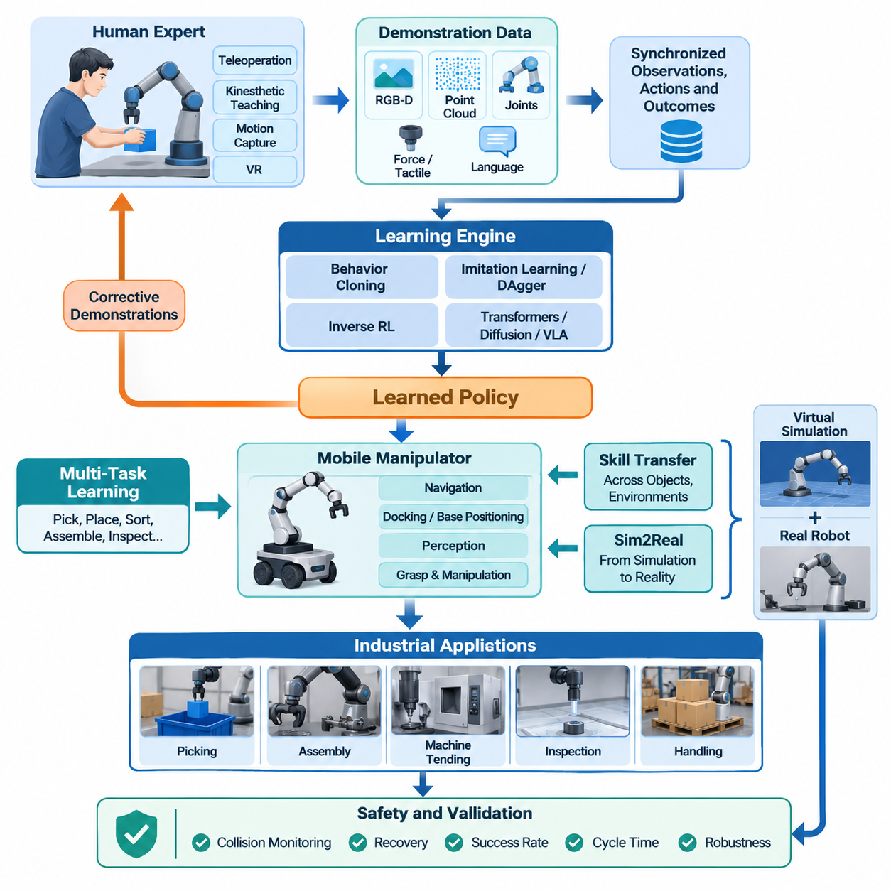
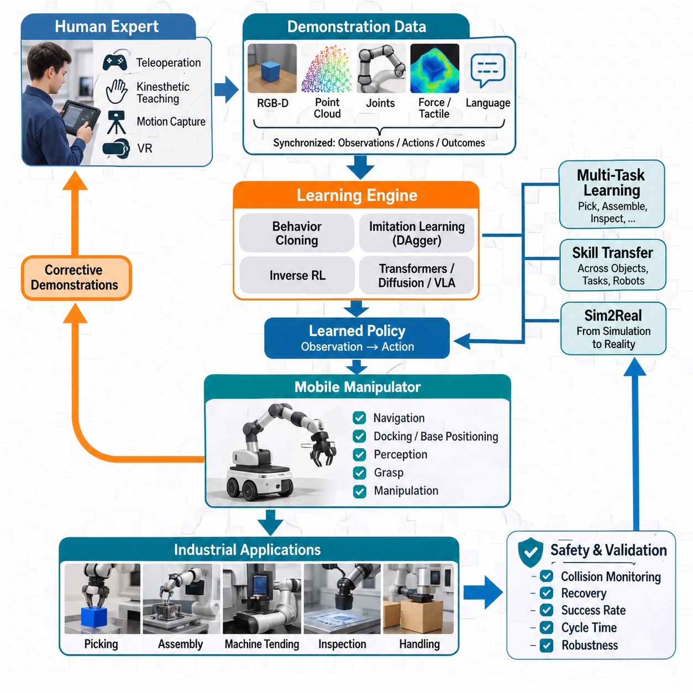
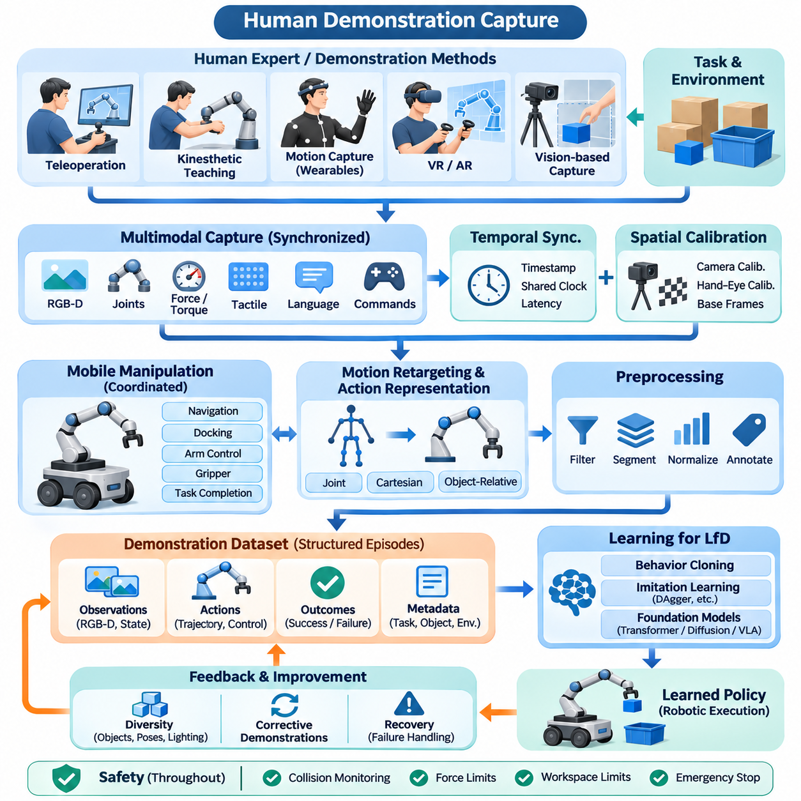
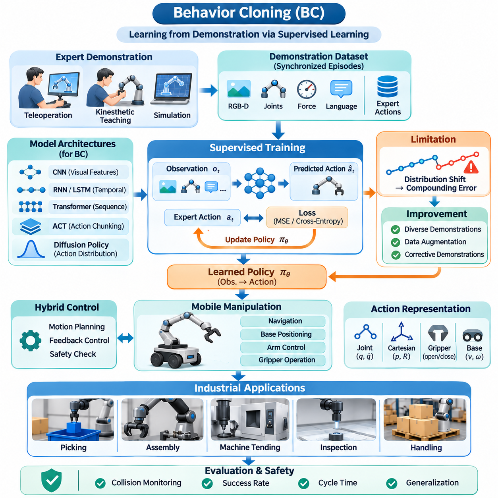
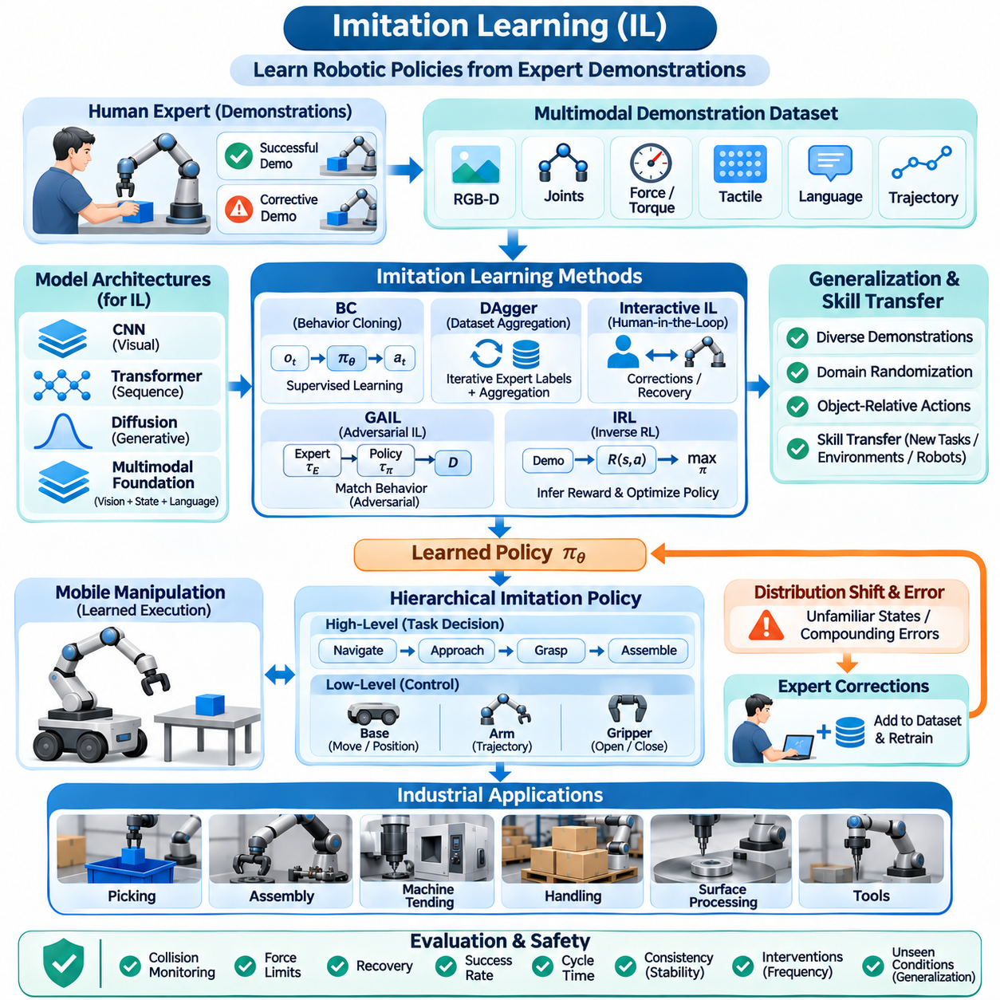
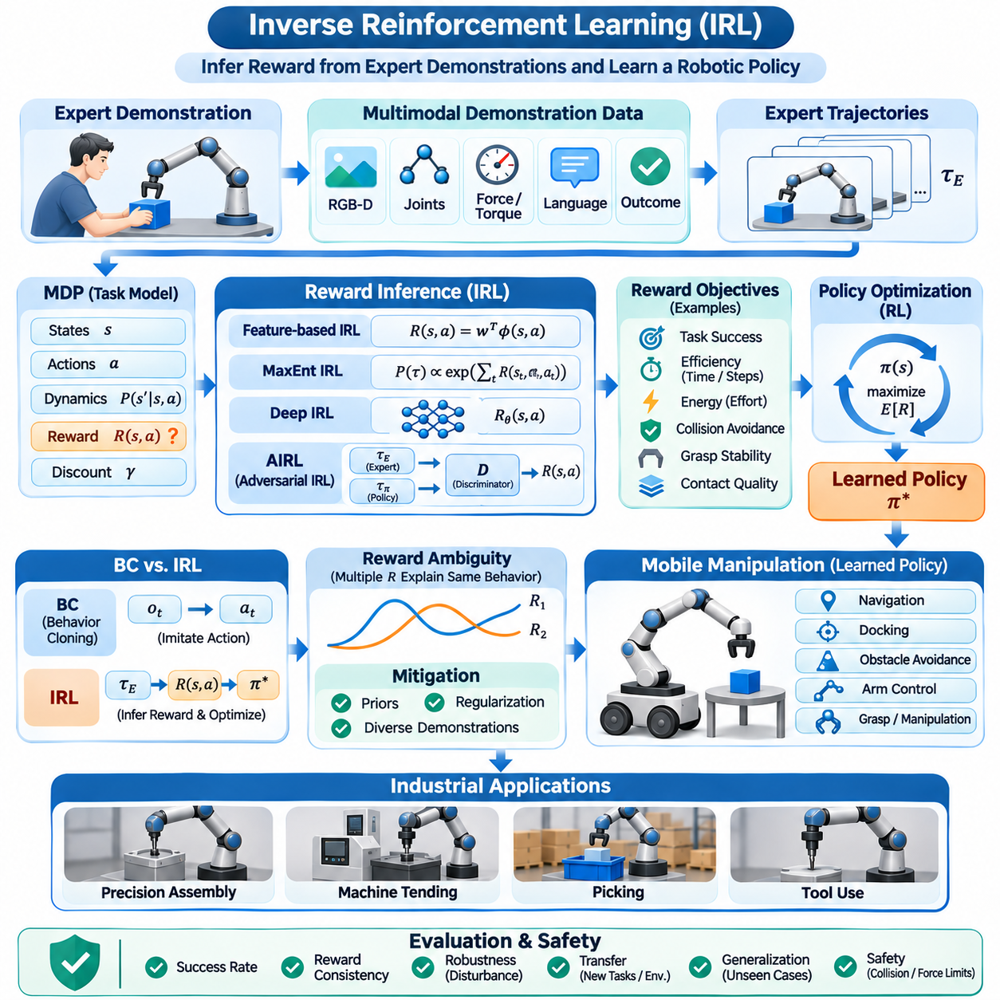
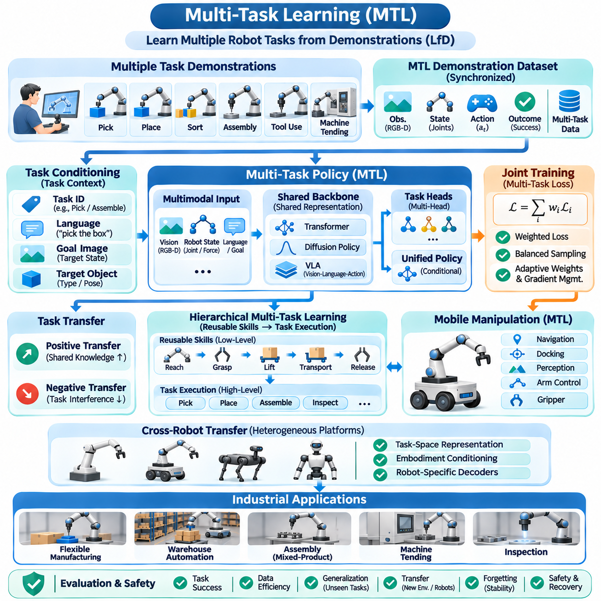
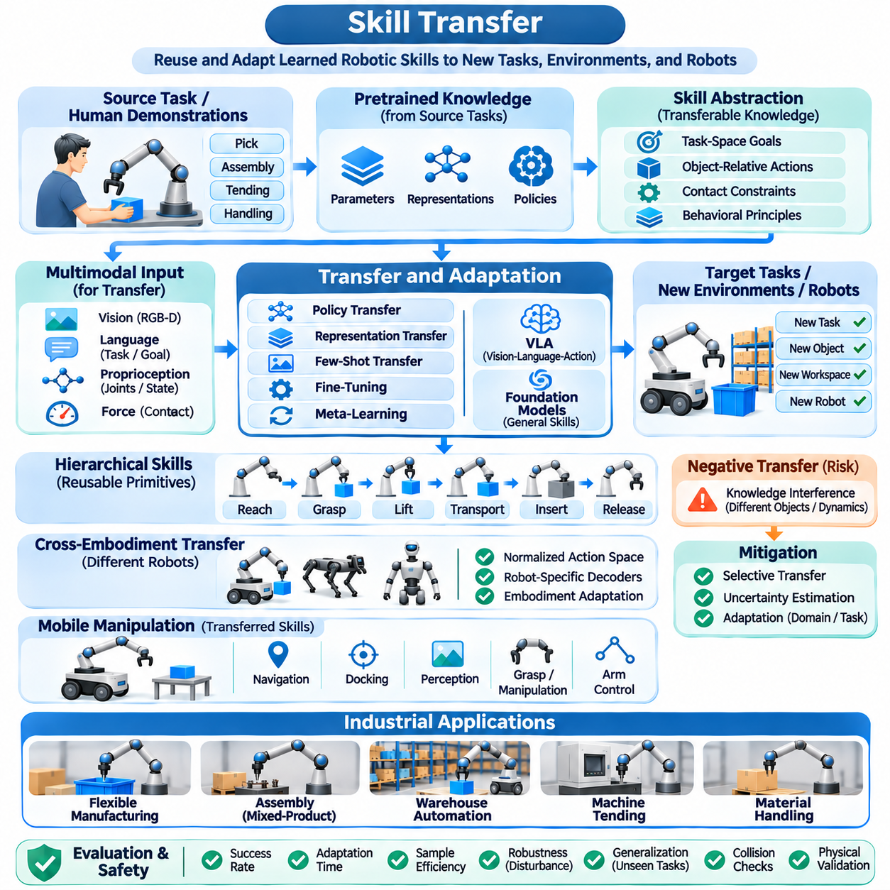
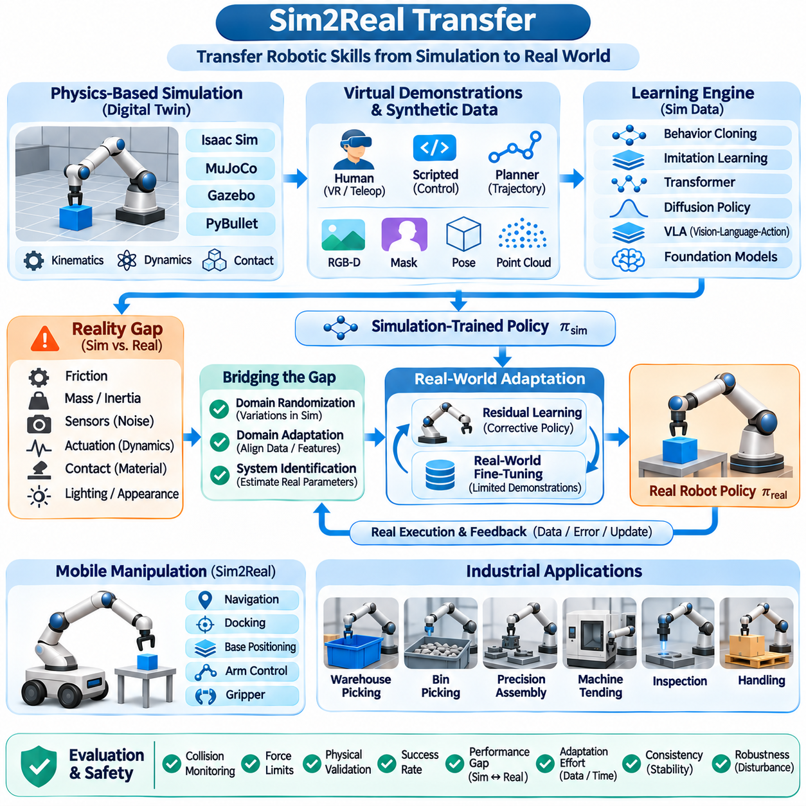
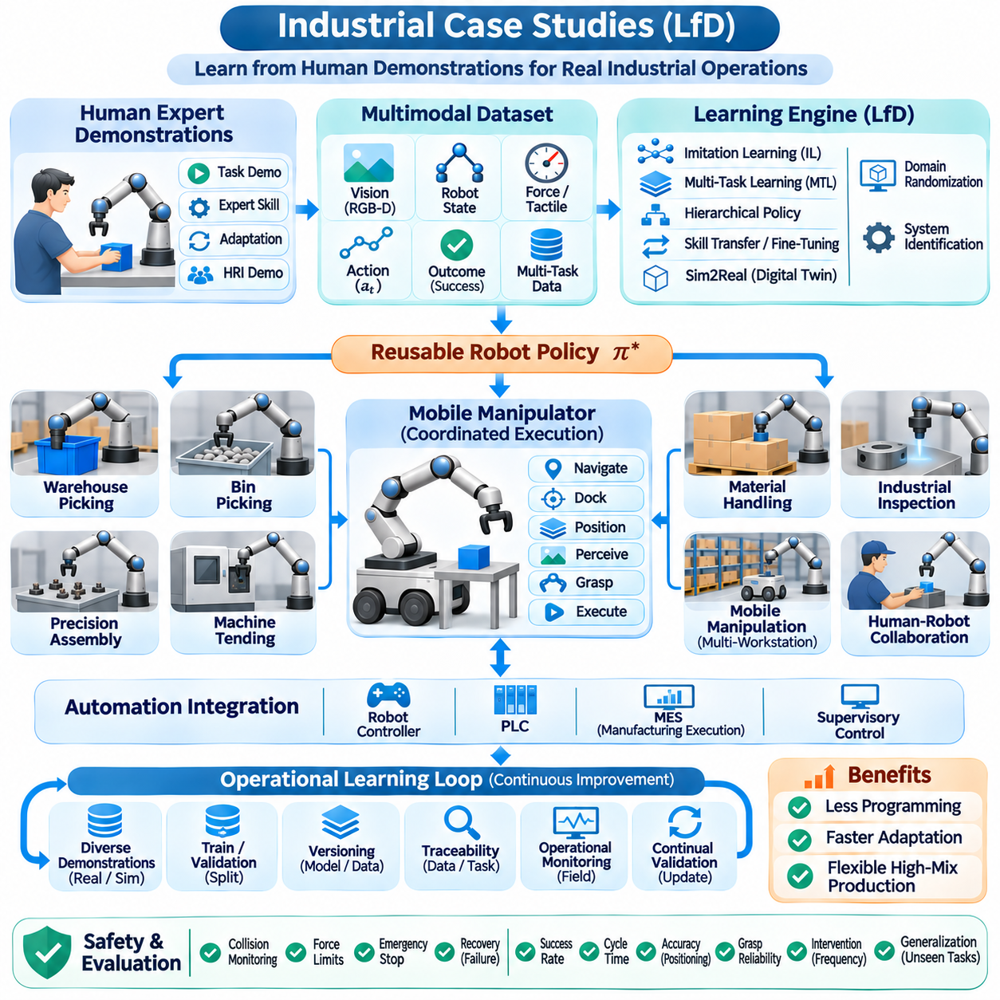

# Chapter 12. Learning from Demonstration

## 01 LfD Overview

{width="7.268055555555556in" height="7.268055555555556in"}

{width="7.268055555555556in" height="7.268055555555556in"}

시연 학습(Learning from Demonstration, LfD)은 로봇이 인간 전문가 또는 다른 로봇이 제공하는 시연(Demonstration)을 관찰하여 새로운 행동과 조작 기술(Manipulation Skills)을 습득하는 로봇 학습 패러다임(Robotic Learning Paradigm)이다. 모든 움직임, 의사결정 및 제어 시퀀스를 명시적으로 프로그래밍하는 대신, 환경 관측(Environmental Observation), 행동(Action), 작업 목표(Task Objective) 사이의 관계를 학습하도록 한다. 이러한 접근 방식은 수동 프로그래밍에 필요한 노력을 줄이고 적응형 로봇 조작(Adaptive Robotic Manipulation)을 지원한다.

전통적인 로봇 프로그래밍(Traditional Robotic Programming)은 사전에 정의된 궤적(Trajectory), 수학적 모델(Mathematical Model), 결정론적 규칙(Deterministic Rule), 수동으로 설정된 제어 매개변수(Control Parameter)에 의존한다. 이러한 접근 방식은 구조화된 산업 환경에서 여전히 효과적이지만, 객체, 운영 조건 및 작업 요구사항이 빈번하게 변경되는 경우 유지관리가 점차 어려워진다. 시연 학습(LfD)은 시연된 작업 수행 과정에서 행동 지식(Behavioral Knowledge)을 직접 추출함으로써 이러한 한계를 해결한다.

시연 학습(LfD)의 근본적인 목적은 관측된 환경 상태(Environmental State)를 적절한 로봇 행동(Robotic Action)으로 매핑(Mapping)하는 정책(Policy)을 구축하는 것이다. 일반적으로 시연은 관측 정보(Observation), 로봇 상태(Robot State), 제어 명령(Control Command), 작업 결과(Task Outcome)의 연속적인 시퀀스로 구성된다. 학습 과정에서 학습 알고리즘(Learning Algorithm)은 이러한 시퀀스에 포함된 패턴을 식별하고, 시연된 행동을 재현하며 이전에 경험하지 못한 상황에도 일반화(Generalization)할 수 있는 정책을 개발한다.

이동형 조작(Mobile Manipulation)에서 시연 학습(LfD)은 단순한 로봇 팔 움직임의 학습을 넘어선다. 이동형 매니퓰레이터(Mobile Manipulator)는 자율주행(Autonomous Navigation), 환경 인식(Environmental Perception), 이동 기반체 위치 결정(Base Positioning), 객체 위치 추정(Object Localization), 파지 계획(Grasp Planning), 조작(Manipulation), 작업 완료(Task Completion)를 통합적으로 조정해야 한다. 따라서 시연은 이동 로봇과 로봇 팔이 협력하여 동적인 환경에서 복잡한 물리적 작업을 수행하는 전체 운영 시퀀스(Operational Sequence)를 나타낼 수 있다.

인간 시연(Human Demonstration)은 원격 조작(Teleoperation), 운동 감각 교시(Kinesthetic Teaching), 동작 포착(Motion Capture), 가상현실 인터페이스(Virtual Reality Interface), 착용형 감지 장치(Wearable Sensing Device) 등 다양한 상호작용 방식을 통해 수집할 수 있다. 각 방식은 정확도(Accuracy), 접근성(Accessibility), 데이터 풍부성(Data Richness) 측면에서 서로 다른 특성을 제공한다. 원격 조작은 작업자가 원격으로 로봇을 제어하도록 하며, 운동 감각 교시는 하드웨어가 지원하는 경우 로봇 팔의 움직임을 물리적으로 직접 유도할 수 있도록 한다.

시연 데이터셋(Demonstration Dataset)은 RGB 영상(RGB Image), 깊이 영상(Depth Image), 포인트 클라우드(Point Cloud), 관절 위치(Joint Position), 관절 속도(Joint Velocity), 말단장치 자세(End-Effector Pose), 힘(Force), 토크(Torque), 촉각 측정값(Tactile Measurement), 이동 기반체 상태(Mobile Base State)와 같은 다중 모달 정보(Multimodal Information)를 포함할 수 있다. 언어 명령(Language Instruction)은 작업 목표에 대한 의미론적 정보(Semantic Information)를 제공할 수 있다. 이러한 데이터 소스 간의 정확한 동기화(Synchronization)와 교정(Calibration)은 인식과 행동 사이의 신뢰성 있는 관계를 구축하는 데 필수적이다.

행동 복제(Behavior Cloning, BC)는 시연 학습(LfD)의 가장 기본적인 접근 방식 중 하나이다. 행동 복제는 시연에서 수집된 관측 정보를 입력으로 사용하고 이에 대응하는 전문가 행동(Expert Action)을 학습 목표로 사용하는 지도 학습(Supervised Learning) 문제로 로봇 기술 습득을 정의한다. 신경망(Neural Network)은 전문가 정책(Expert Policy)을 근사하도록 학습하며, 자율 실행(Autonomous Execution) 과정에서 적절한 행동을 생성한다. 그러나 로봇이 익숙하지 않은 상태에 직면하면 예측 오차(Prediction Error)가 누적될 수 있다.

모방 학습(Imitation Learning)은 강건성(Robustness)과 일반화 성능(Generalization Performance)을 개선하면서 전문가 행동을 재현하기 위한 보다 광범위한 기술을 포함한다. 데이터셋 집계(Dataset Aggregation, DAgger)와 같은 상호작용형 학습 방법(Interactive Learning Method)은 학습된 정책이 실제로 경험하는 상태에서 수집된 교정 시연(Corrective Demonstration)을 활용한다. 이러한 추가적인 학습 사례는 전문가 시연과 자율 실행 사이의 분포 변화(Distribution Shift) 문제를 해결하고 연속적인 조작 과정에서 발생하는 누적 오차(Cumulative Error)를 감소시키는 데 도움을 준다.

역강화 학습(Inverse Reinforcement Learning, IRL)은 시연 기반 학습(Demonstration-Based Learning)을 다른 관점에서 접근한다. 전문가 행동을 직접 재현하는 대신, 시연된 행동을 설명할 수 있는 근본적인 보상 함수(Reward Function)를 추론한다. 이후 로봇은 추론된 보상 함수에 따라 자신의 정책을 최적화(Optimization)한다. 이러한 접근 방식은 행동 적응(Behavioral Adaptation)을 지원할 수 있지만, 보상 함수의 모호성(Reward Ambiguity)과 계산 복잡도(Computational Complexity)는 여전히 중요한 해결 과제로 남아 있다.

현대적인 시연 학습 아키텍처(LfD Architecture)는 심층 신경망(Deep Neural Network), 트랜스포머(Transformer), 확산 정책(Diffusion Policy), 시각-언어-행동 모델(Vision-Language-Action Model, VLA)을 점차 적극적으로 활용하고 있다. 이러한 아키텍처는 고차원 감각 관측 정보(High-Dimensional Sensory Observation)를 처리하고 복잡한 행동 시퀀스(Action Sequence)를 생성할 수 있다. 시각 인식(Visual Perception), 언어 이해(Language Understanding), 로봇 제어(Robotic Control)를 결합함으로써 제한적으로 사전 정의된 산업 작업의 범위를 넘어서는 조작 행동을 학습할 수 있는 기반을 제공한다.

다중 작업 학습(Multi-Task Learning)은 공유 표현(Shared Representation)과 학습 데이터셋(Training Dataset)을 통해 로봇 시스템이 여러 조작 기술을 습득할 수 있도록 한다. 각 작업에 대해 독립적인 모델을 개발하는 대신, 공유 정책(Shared Policy)은 피킹(Picking), 배치(Placing), 분류(Sorting), 도구 취급(Tool Handling), 조립(Assembly) 작업을 학습할 수 있다. 작업 식별자(Task Identifier), 목표 영상(Goal Image), 자연어 명령(Natural Language Instruction)을 정책의 조건으로 활용함으로써 운영 요구사항에 따른 유연한 행동 선택(Behavior Selection)을 지원할 수 있다.

기술 전이(Skill Transfer)는 이전에 습득한 지식을 서로 다른 객체, 환경, 작업 및 로봇 플랫폼에서 재사용할 수 있도록 시연 학습(LfD)의 적용 범위를 확장한다. 전이 가능성(Transferability)은 학습된 기술의 표현 방식, 작업 조건 간의 유사성, 로봇 형태(Robot Morphology)의 차이에 따라 달라진다. 객체 상대 좌표(Object-Relative Coordinate), 작업 공간 행동(Task-Space Action), 재사용 가능한 동작 기본 요소(Motion Primitive)는 추가로 필요한 시연 데이터의 양을 줄이면서 적응 능력(Adaptability)을 향상시킬 수 있다.

시뮬레이션-현실 전이(Simulation-to-Reality Transfer, Sim2Real)는 시연 기반 학습을 확장하기 위한 또 다른 중요한 방법을 제공한다. 가상 환경(Virtual Environment)은 실제 물리적 장비를 과도하게 사용하지 않고도 대량의 시연 데이터를 생성할 수 있도록 한다. 도메인 무작위화(Domain Randomization), 센서 잡음 모델링(Sensor Noise Modeling), 물리 매개변수 변화(Physics Parameter Variation)는 강건성을 향상시킬 수 있다. 그러나 시뮬레이션과 현실 사이에 남아 있는 차이(Sim2Real Gap)를 해결하기 위해서는 실제 환경에서의 시연과 교정이 여전히 중요하다.

시연 학습(LfD)의 산업적 활용 분야(Industrial Application)에는 물류창고 피킹(Warehouse Picking), 기계 보조 작업(Machine Tending), 부품 조립(Component Assembly), 자재 취급(Material Handling), 검사(Inspection), 도구 조작(Tool Manipulation)이 포함된다. 시연 기반 학습은 제품 변경이 빈번하여 기존 프로그래밍 비용이 증가하는 다품종 소량 생산(High-Mix, Low-Volume Manufacturing) 환경에서 특히 높은 가치를 제공한다. 그러나 신뢰성 있는 구현을 위해서는 안전 제약조건(Safety Constraint), 충돌 모니터링(Collision Monitoring), 작업 공간 제한(Workspace Limitation), 복구 메커니즘(Recovery Mechanism), 체계적인 성능 검증(Performance Validation)이 필요하다.

시연 학습(LfD)의 효과는 작업 성공률(Task Success Rate), 작업 주기 시간(Cycle Time), 궤적 정확도(Trajectory Accuracy), 개입 빈도(Intervention Frequency), 일반화 능력(Generalization Capability), 환경 외란에 대한 강건성(Robustness against Environmental Disturbance)을 활용하여 평가해야 한다. 시연 데이터의 품질(Quality)과 다양성(Diversity)은 단순한 데이터셋의 크기보다 성능에 더 큰 영향을 미치는 경우가 많다. 궁극적으로 시연 학습은 인간의 전문 지식(Human Expertise)과 로봇 지능(Robotic Intelligence)을 실질적으로 연결하며, 적응형 이동형 매니퓰레이터(Adaptive Mobile Manipulator)와 미래의 물리 인공지능(Physical AI) 시스템 개발을 지원한다.

## 02 Human Demonstration Capture

{width="7.268055555555556in" height="7.268055555555556in"}

인간 시연 수집(Human Demonstration Capture)은 인간의 전문 지식(Human Expertise), 물리적 움직임(Physical Movement), 제어 명령(Control Command), 환경 상호작용(Environmental Interaction)을 기록하여 시연 학습(Learning from Demonstration, LfD)을 위한 학습 데이터셋(Training Dataset)을 구축하는 과정이다. 로봇 조작(Robotic Manipulation)에서 주요 목적은 인간의 작업 수행 과정을 학습 알고리즘(Learning Algorithm)이 해석할 수 있는 구조화된 정보(Structured Information)로 변환하고, 다양한 운영 조건에서 자율적인 로봇 행동(Autonomous Robotic Behavior)으로 구현하는 것이다.

기존의 로봇 프로그래밍(Conventional Robotic Programming)과 달리 인간 시연 수집은 숙련된 작업자가 모든 움직임이나 의사결정 규칙(Decision Rule)을 명시적으로 정의하지 않고도 실무 지식(Practical Knowledge)을 전달할 수 있도록 한다. 인간 전문가는 객체 형상(Object Geometry), 환경 제약조건(Environmental Constraint), 접촉 조건(Contact Condition), 예상하지 못한 외란(Disturbance)에 따라 자연스럽게 행동을 조정한다. 이러한 적응형 행동(Adaptive Behavior)을 수집함으로써 로봇은 해석적 모델(Analytical Model)만으로 표현하기 어려운 기술을 습득할 수 있다.

원격 조작(Teleoperation)은 로봇 시연 데이터를 수집하기 위해 가장 널리 사용되는 방법 중 하나이다. 인간 작업자는 조이스틱(Joystick), 모션 제어기(Motion Controller), 햅틱 인터페이스(Haptic Interface), 특수 제어 장치(Specialized Control Device)를 사용하여 로봇 팔, 그리퍼 및 이동 플랫폼(Mobile Platform)을 원격으로 제어한다. 로봇 시스템은 작업자 명령(Operator Command), 센서 측정값(Sensor Measurement), 실행 상태(Execution State)를 동시에 기록하며, 로봇 조작 정책(Robotic Manipulation Policy)을 학습하기 위한 동기화된 관측-행동 시퀀스(Observation-Action Sequence)를 생성한다.

운동 감각 교시(Kinesthetic Teaching)는 인간 작업자가 로봇 팔을 물리적으로 직접 움직여 원하는 동작을 수행하도록 유도하는 또 다른 시연 수집 방법이다. 순응형 관절(Compliant Joint), 토크 감지(Torque Sensing), 중력 보상(Gravity Compensation) 기능을 갖춘 로봇은 외부 유도에 따라 움직이면서 관절 구성(Joint Configuration), 말단장치 궤적(End-Effector Trajectory), 상호작용 힘(Interaction Force)을 기록할 수 있다. 이러한 접근 방식은 조립(Assembly), 정밀 위치 결정(Precision Positioning), 접촉 중심 조작(Contact-Rich Manipulation) 작업에 특히 유용하다.

동작 포착(Motion Capture) 시스템은 로봇과 직접적으로 물리적 상호작용을 하지 않고도 인간의 신체 움직임(Body Movement), 손동작(Hand Gesture), 조작 궤적(Manipulation Trajectory)을 기록할 수 있도록 한다. 광학 추적 카메라(Optical Tracking Camera), 관성 측정 장치(Inertial Measurement Unit, IMU), 착용형 센서(Wearable Sensor)는 3차원 공간에서 인간의 움직임을 추정할 수 있다. 이후 동작 재매핑 알고리즘(Motion Retargeting Algorithm)은 수집된 인간의 움직임을 로봇의 기계적 구조(Mechanical Structure)와 물리적 제약조건(Physical Constraint)에 적합한 궤적으로 변환한다.

가상현실(Virtual Reality, VR) 및 증강현실(Augmented Reality, AR) 인터페이스는 인간 시연 수집을 위한 몰입형 환경(Immersive Environment)을 제공한다. 작업자는 직관적인 손 추적(Hand Tracking) 및 공간 제어기(Spatial Controller)를 이용하여 가상 객체 또는 물리적 객체를 조작하면서 로봇 움직임에 대한 시각적 피드백(Visual Feedback)을 받을 수 있다. 이러한 기술은 원격 데이터 수집(Remote Data Collection), 시뮬레이션 기반 조작(Simulated Manipulation), 상호작용형 교시(Interactive Teaching)를 지원하며, 직접적인 물리적 로봇 제어와 관련된 운영 위험(Operational Risk)을 줄일 수 있다.

시각 기반 시연 수집(Vision-Based Demonstration Capture)은 RGB 카메라(RGB Camera), 깊이 카메라(Depth Camera), 다중 시점 영상 시스템(Multi-View Imaging System)을 사용하여 인간의 조작 활동을 관찰한다. 컴퓨터 비전 알고리즘(Computer Vision Algorithm)은 손 자세(Hand Pose), 객체 위치(Object Position), 상호작용 시퀀스(Interaction Sequence), 작업 관련 환경 특징(Task-Relevant Environmental Feature)을 추출한다. 영상 기반 시연(Video-Based Demonstration)은 높은 확장성(Scalability)을 제공하지만, 관찰된 인간 행동을 실행 가능한 로봇 행동으로 변환하기 위해서는 정확한 공간 추론(Spatial Reasoning)과 동작 재매핑(Motion Retargeting)이 필요하다.

다중 모달 시연 수집(Multimodal Demonstration Capture)은 시각적 관측(Visual Observation), 고유수용감각 측정(Proprioceptive Measurement), 힘 신호(Force Signal), 촉각 정보(Tactile Information), 언어 명령(Language Instruction)을 통합된 로봇 학습 데이터셋(Robotic Learning Dataset)으로 결합한다. RGB-D 카메라는 환경의 기하학적 정보(Environmental Geometry)를 제공하고, 관절 엔코더(Joint Encoder)는 로봇의 관절 구성을 나타내며, 힘-토크 센서(Force-Torque Sensor)는 물리적 상호작용의 특성을 측정한다. 언어 주석(Language Annotation)은 동작 궤적에서 직접 관찰하기 어려운 작업 목표(Task Objective)와 의미론적 관계(Semantic Relationship)를 식별한다.

시간 동기화(Temporal Synchronization)는 신뢰성 있는 시연 수집을 위한 핵심 요구사항이다. 카메라, 로봇 제어기(Robotic Controller), 촉각 센서(Tactile Sensor), 이동 플랫폼은 서로 다른 샘플링 주파수(Sampling Frequency)와 통신 지연시간(Communication Latency)으로 동작하는 경우가 많다. 정확한 타임스탬프(Timestamp), 공유 시간 기준(Shared Clock Reference), 보간(Interpolation), 지연 보상(Latency Compensation)은 기록된 각 시연 과정에서 감각 관측 정보(Sensory Observation)와 실행된 행동 사이의 일관된 시간적 관계(Temporal Relationship)를 구축하는 데 도움을 준다.

공간 교정(Spatial Calibration)은 수집된 관측 정보와 행동이 일관된 좌표계(Coordinate System) 내에서 표현되도록 보장한다. 카메라 내부 교정(Camera Intrinsic Calibration), 카메라 외부 교정(Camera Extrinsic Calibration), 손-눈 교정(Hand-Eye Calibration), 로봇 기반체 좌표 변환(Robot Base Transformation)은 센서, 로봇 구성요소 및 환경 내 객체 사이의 기하학적 관계(Geometric Relationship)를 설정한다. 부정확한 교정은 계통 오차(Systematic Error)를 발생시켜 실제 물리적 실행 과정에서 학습된 조작 정책의 신뢰성(Reliability)을 저하시킬 수 있다.

시연 데이터 표현(Demonstration Data Representation)은 로봇 학습 알고리즘이 전이 가능한 조작 기술(Transferable Manipulation Skill)을 얼마나 효율적으로 습득할 수 있는지에 영향을 미친다. 행동은 관절 위치(Joint Position), 관절 속도(Joint Velocity), 직교 좌표계 자세(Cartesian Pose), 상대 좌표 변환(Relative Transformation), 그리퍼 명령(Gripper Command), 제어 신호(Control Signal) 등으로 표현할 수 있다. 객체 상대 표현(Object-Relative Representation)은 고정된 작업 공간 좌표와 특정 로봇 초기 구성에 독립적으로 조작 행동을 표현함으로써 일반화 능력(Generalization Capability)을 향상시킬 수 있다.

이동형 조작 시스템(Mobile Manipulation System)에서 시연 수집은 자율이동로봇(Autonomous Mobile Robot, AMR)과 로봇 팔 사이의 상호작용을 포함해야 한다. 기록되는 정보에는 주행 궤적(Navigation Trajectory), 위치 추정값(Localization Estimate), 이동 기반체 방향(Base Orientation), 도킹 위치(Docking Position), 로봇 팔 구성(Arm Configuration), 조작 결과(Manipulation Outcome)가 포함될 수 있다. 이러한 측정 정보를 통합적으로 연계함으로써 학습 알고리즘은 이동 플랫폼의 위치 결정(Mobile Positioning), 작업 공간 접근성(Workspace Accessibility), 조작 성능(Manipulation Performance) 사이의 의존 관계(Dependency)를 인식할 수 있다.

시연 데이터의 품질(Demonstration Quality)과 다양성(Demonstration Diversity)은 학습된 로봇 정책의 일반화 능력에 직접적인 영향을 미친다. 데이터 수집 과정에는 객체 위치(Object Position), 객체 방향(Object Orientation), 조명 조건(Lighting Condition), 작업 공간 배치(Workspace Arrangement), 작업 실행 전략(Task Execution Strategy)의 다양한 변화가 포함되어야 한다. 정상적으로 성공한 작업 수행 사례만을 포함하는 데이터셋은 자율 운영(Autonomous Operation) 중에 발생하는 외란을 충분히 표현하지 못할 수 있으므로, 교정 시연(Corrective Demonstration)과 복구 행동(Recovery Behavior) 역시 중요한 가치를 가진다.

데이터셋 전처리(Dataset Preprocessing)는 필터링(Filtering), 분할(Segmentation), 정규화(Normalization), 동기화(Synchronization), 주석 처리(Annotation)를 통해 원시 시연 기록(Raw Demonstration Recording)을 일관된 학습 샘플(Training Sample)로 변환한다. 개별 작업 수행 과정은 일반적으로 연속적인 관측 정보, 행동, 결과 지표(Outcome Indicator)를 포함하는 에피소드(Episode) 단위로 구성된다. 로봇 구성, 작업자 식별 정보(Operator Identity), 센서 사양(Sensor Specification), 작업 조건(Task Condition)을 설명하는 메타데이터(Metadata)는 재현성(Reproducibility), 추적성(Traceability), 체계적인 데이터셋 품질 관리(Dataset Quality Management)를 지원한다.

인간 시연 수집은 적절한 안전 메커니즘(Safety Mechanism)을 포함해야 하며, 특히 작업자가 실제 물리적 로봇 시스템과 직접 상호작용하는 경우 더욱 중요하다. 독립적인 충돌 모니터링(Independent Collision Monitoring), 힘 제한(Force Limitation), 작업 공간 제한(Workspace Restriction), 비상 정지 메커니즘(Emergency Stopping Mechanism), 감독하의 운영(Supervised Operation)은 데이터 수집 과정에서 발생할 수 있는 위험을 줄인다. 궁극적으로 체계적으로 설계된 시연 수집 파이프라인(Demonstration Capture Pipeline)은 행동 복제(Behavior Cloning, BC), 모방 학습(Imitation Learning), 로봇 기반 모델(Robot Foundation Model), 확장 가능한 물리 인공지능(Scalable Physical AI) 개발을 위한 핵심 기반을 제공한다.

## 03 Behavior Cloning

{width="7.268055555555556in" height="7.268055555555556in"}

행동 복제(Behavior Cloning, BC)는 로봇이 지도 학습(Supervised Learning)을 통해 전문가의 행동을 재현하도록 학습하는 시연 학습(Learning from Demonstration, LfD)의 기본적인 접근 방식이다. 제어 규칙(Control Rule)이나 보상 함수(Reward Function)를 명시적으로 설계하는 대신, 행동 복제는 관측된 환경 상태(Environmental State)로부터 적절한 행동을 예측하도록 정책(Policy)을 학습시킨다. 이러한 접근 방식은 로봇이 인간 시연(Human Demonstration)이나 이전에 기록된 로봇 경험(Robotic Experience)으로부터 복잡한 조작 기술(Manipulation Skill)을 직접 습득할 수 있도록 한다.

행동 복제(Behavior Cloning)의 근본적인 원리는 관측(Observation)과 행동(Action) 사이의 매핑(Mapping)을 학습하는 것이다. 전문가 시연(Expert Demonstration)은 감각 관측 정보(Sensory Observation), 로봇 상태(Robot State), 이에 대응하는 제어 명령(Control Command)의 시퀀스를 제공한다. 학습 과정에서 기계 학습 모델(Machine Learning Model)은 이러한 입력(Input)과 출력(Output) 사이의 관계를 식별한다. 학습이 완료되면 생성된 정책은 지속적인 인간의 감독(Human Supervision) 없이 현재 관측 정보를 기반으로 로봇 행동을 생성한다.

행동 복제 데이터셋(Behavior Cloning Dataset)은 일반적으로 전체 또는 부분적인 작업 수행 과정을 나타내는 여러 시연 에피소드(Demonstration Episode)로 구성된다. 각 에피소드는 원격 조작(Teleoperation), 운동 감각 교시(Kinesthetic Teaching), 시뮬레이션(Simulation) 또는 기타 시연 수집 방법을 통해 획득한 동기화된 관측-행동 쌍(Observation-Action Pair)을 포함한다. 관측 정보에는 RGB 영상(RGB Image), 깊이 정보(Depth Information), 관절 구성(Joint Configuration), 힘 측정값(Force Measurement), 작업 명령(Task Instruction)이 포함될 수 있으며, 행동은 의도된 로봇 움직임을 나타낸다.

학습 과정(Training Process)은 일반적으로 예측된 행동(Predicted Action)과 전문가 행동(Expert Action)을 비교하는 지도 학습 기반 최적화 문제(Supervised Optimization Problem)로 정의된다. 연속 제어 작업(Continuous Control Task)은 일반적으로 평균 제곱 오차(Mean Squared Error, MSE) 또는 확률적 목적 함수(Probabilistic Objective)를 사용하며, 이산 행동 예측(Discrete Action Prediction)은 교차 엔트로피 손실(Cross-Entropy Loss)을 사용할 수 있다. 최적화 알고리즘(Optimization Algorithm)은 예측 오차(Prediction Error)를 최소화하고 전문가 시연에 의해 표현된 행동 분포(Behavioral Distribution)를 근사하도록 모델 매개변수(Model Parameter)를 조정한다.

행동 표현(Action Representation)은 행동 복제의 성능에 중요한 역할을 한다. 로봇 행동은 관절 위치(Joint Position), 관절 속도(Joint Velocity), 직교 좌표계 자세(Cartesian Pose), 상대적인 말단장치 변위(Relative End-Effector Displacement), 그리퍼 명령(Gripper Command), 이동 기반체 제어 신호(Mobile Base Control Signal) 등으로 표현할 수 있다. 적절한 행동 표현을 선택하면 학습 효율성(Learning Efficiency)이 향상되고 일반화(Generalization)가 촉진된다. 상대적 행동 표현(Relative Action Representation)은 특정 로봇 초기 구성과 작업 공간 좌표(Workspace Coordinate)에 대한 의존성을 감소시킬 수 있다.

딥러닝 아키텍처(Deep Learning Architecture)는 행동 복제 정책이 고차원 감각 관측 정보(High-Dimensional Sensory Observation)를 처리할 수 있도록 한다. 합성곱 신경망(Convolutional Neural Network, CNN)은 시각적 특징(Visual Feature)을 추출하며, 순환 신경망(Recurrent Neural Network, RNN), 장단기 기억 신경망(Long Short-Term Memory, LSTM), 트랜스포머(Transformer)는 시간적 의존성(Temporal Dependency)을 학습한다. 다중 모달 아키텍처(Multimodal Architecture)는 시각 정보, 고유수용감각 정보(Proprioceptive Information), 촉각 정보(Tactile Information), 언어 정보(Linguistic Information)를 결합하여 다양한 운영 조건에서 상황 인식형 로봇 행동(Context-Aware Robotic Action)을 생성한다.

종단간 행동 복제(End-to-End Behavior Cloning)는 원시 감각 관측 정보(Raw Sensory Observation) 또는 최소한으로 처리된 감각 관측 정보를 로봇 제어 명령(Robotic Control Command)으로 직접 매핑한다. 이러한 접근 방식은 수동으로 설계된 중간 인식 및 계획 모듈(Intermediate Perception and Planning Module)에 대한 의존성을 감소시킨다. 그러나 종단간 아키텍처(End-to-End Architecture)는 일반적으로 충분한 학습 데이터(Training Data), 컴퓨팅 자원(Computational Resource), 포괄적인 검증(Comprehensive Validation)을 필요로 한다. 하이브리드 아키텍처(Hybrid Architecture)는 학습된 정책을 기존의 동작 계획(Motion Planning), 기하학적 추론(Geometric Reasoning), 피드백 제어기(Feedback Controller)와 결합할 수 있다.

행동 복제의 주요 한계 중 하나는 전문가 시연과 자율 실행(Autonomous Execution) 사이에서 발생하는 분포 변화(Distribution Shift)이다. 작은 예측 오차로 인해 로봇은 학습 데이터셋에 포함되지 않은 익숙하지 않은 상태(Unfamiliar State)에 진입할 수 있다. 이후의 행동은 점차 부정확해질 수 있으며, 이러한 현상을 누적 오차(Compounding Error)라고 한다. 이러한 한계는 여러 단계의 순차적 의사결정(Sequential Decision-Making)을 포함하는 장기 시계열 조작 작업(Long-Horizon Manipulation Task)에서 특히 중요하게 나타난다.

데이터셋 다양성(Dataset Diversity)과 교정 시연(Corrective Demonstration)은 분포 변화를 완화하고 정책의 강건성(Policy Robustness)을 향상시키는 데 도움을 준다. 시연 데이터에는 객체 위치(Object Position), 객체 방향(Object Orientation), 조명 조건(Lighting Condition), 환경 외란(Environmental Disturbance), 로봇 초기 구성(Robot Starting Configuration)의 다양한 변화가 포함되어야 한다. 데이터 증강(Data Augmentation), 관측 교란(Observation Perturbation), 신중하게 설계된 행동 잡음(Action Noise)은 증강된 샘플이 물리적으로 의미 있는 관측-행동 관계(Observation-Action Relationship)를 유지하는 조건에서 강건성을 추가적으로 향상시킬 수 있다.

행동 청킹(Action Chunking)은 정책이 단일 즉각적인 명령을 예측하는 대신 미래 행동의 시퀀스를 예측하는 고도화된 행동 복제 전략이다. 상호 조정된 행동 구간(Action Segment)을 예측함으로써 시간적 일관성(Temporal Consistency)을 향상시키고 연속적인 예측 사이에서 발생하는 변동(Fluctuation)을 줄일 수 있다. 트랜스포머 기반 행동 청킹(Action Chunking with Transformers, ACT)과 같은 아키텍처는 시연 궤적(Demonstration Trajectory)으로부터 구조화된 행동 시퀀스(Structured Action Sequence)를 학습하여 복잡한 조작 작업을 지원한다.

확산 정책(Diffusion Policy)은 로봇 행동에 대한 조건부 생성 모델링(Conditional Generative Modeling)을 통해 행동 복제의 적용 범위를 확장한다. 확산 기반 모델(Diffusion-Based Model)은 단일 결정론적 행동 시퀀스(Deterministic Action Sequence)를 예측하는 대신 행동 분포(Action Distribution)를 학습하고 반복적인 잡음 제거(Iterative Denoising)를 통해 후보 궤적(Candidate Trajectory)을 생성한다. 이러한 접근 방식은 여러 가지 유효한 조작 전략(Manipulation Strategy)을 표현할 수 있으므로 다양한 파지 구성(Grasp Configuration), 접근 방향(Approach Direction), 움직임 패턴(Motion Pattern)을 포함하는 작업에 특히 유용하다.

이동형 조작(Mobile Manipulation)에서 행동 복제는 자율주행(Autonomous Navigation), 이동 기반체 위치 결정(Mobile Base Positioning), 로봇 팔 움직임(Robotic Arm Movement), 그리퍼 작동(Gripper Operation)을 포함하는 협조 행동(Coordinated Behavior)을 학습할 수 있다. 통합 정책(Unified Policy)은 여러 로봇 하위 시스템(Robotic Subsystem)에 대한 명령을 생성할 수 있으며, 계층적 아키텍처(Hierarchical Architecture)는 주행 기술(Navigation Skill)과 조작 기술(Manipulation Skill)을 분리할 수 있다. 신뢰성 있는 구현을 위해서는 일관된 좌표 변환(Coordinate Transformation), 센서 동기화(Sensor Synchronization), 학습된 정책과 기존 제어기 사이의 협조 제어가 필요하다.

행동 복제의 산업적 활용 분야(Industrial Application)에는 물류창고 피킹(Warehouse Picking), 부품 조립(Component Assembly), 기계 보조 작업(Machine Tending), 도구 조작(Tool Manipulation), 자재 취급(Material Handling), 반복적인 검사 작업(Repetitive Inspection Task)이 포함된다. 시연된 기술을 습득할 수 있는 능력은 새로운 제품이나 운영 절차(Operational Procedure)를 도입할 때 필요한 프로그래밍 노력을 감소시킬 수 있다. 그러나 학습된 정책은 독립적으로 적용되는 안전 제약조건(Safety Constraint), 충돌 회피 메커니즘(Collision Avoidance Mechanism), 검증된 물리적 운영 한계(Validated Physical Operating Limit) 내에서 동작해야 한다.

행동 복제의 성능은 작업 성공률(Task Success Rate), 행동 예측 오차(Action Prediction Error), 작업 주기 시간(Cycle Time), 궤적 일관성(Trajectory Consistency), 개입 빈도(Intervention Frequency), 일반화 능력(Generalization Capability)을 활용하여 평가해야 한다. 검증 데이터셋(Validation Dataset)은 학습 데이터와 독립적인 시연 에피소드를 포함해야 하며, 실제 물리적 시험(Physical Testing)은 이전에 경험하지 못한 구성을 대상으로 수행되어야 한다. 궁극적으로 행동 복제는 고도화된 모방 학습(Imitation Learning), 로봇 기반 모델(Robot Foundation Model), 확장 가능한 물리 인공지능 시스템(Scalable Physical AI System) 개발을 위한 실질적인 기반을 제공한다.

## 04 Imitation Learning

{width="7.268055555555556in" height="7.268055555555556in"}

모방 학습(Imitation Learning, IL)은 인공지능 시스템(Artificial Intelligence System)이 전문가 시연(Expert Demonstration)을 관찰하고 재현함으로써 행동을 습득하는 로봇 학습 패러다임(Robotic Learning Paradigm)이다. 수동으로 프로그래밍된 규칙이나 명시적으로 설계된 보상 함수(Reward Function)에 전적으로 의존하는 대신, 모방 학습은 로봇이 전문가의 의사결정 과정(Decision-Making Process)을 근사하는 정책(Policy)을 개발하고 학습된 행동을 물리적 운영 환경(Physical Operating Environment)에 적응시킬 수 있도록 한다.

모방 학습(Imitation Learning)은 시연 학습(Learning from Demonstration, LfD)에 속하는 주요 접근 방식의 하나이다. 행동 복제(Behavior Cloning)가 관측 정보와 전문가 행동 사이의 관계를 직접 학습하는 반면, 고도화된 모방 학습 방법은 순차적 의사결정(Sequential Decision-Making), 분포 변화(Distribution Shift), 행동 일반화(Behavioral Generalization), 예상하지 못한 상태로부터의 복구(Recovery from Unexpected States)와 같은 추가적인 문제를 해결한다. 이러한 능력은 복잡한 로봇 조작(Robotic Manipulation)에서 특히 중요하다.

모방 학습의 근본적인 목적은 환경 관측 정보(Environmental Observation), 로봇 상태(Robot State), 작업 목표(Task Objective)에 따라 적절한 행동을 생성하는 정책을 개발하는 것이다. 전문가 시연은 인식 반응(Perception Response), 움직임 궤적(Motion Trajectory), 물리적 상호작용(Physical Interaction)을 포함하는 성공적인 행동 또는 교정 행동(Corrective Behavior)의 사례를 제공한다. 학습 알고리즘(Learning Algorithm)은 이러한 행동 패턴(Behavioral Pattern)을 추출하고 이를 계산 가능한 정책(Computational Policy)으로 인코딩(Encoding)한다.

행동 복제(Behavior Cloning, BC)는 전문가 시연을 지도 학습용 사례(Supervised Training Example)로 처리함으로써 모방 학습을 구현하는 가장 기본적인 방법을 제공한다. 그러나 전문가 궤적(Expert Trajectory)만을 기반으로 학습된 정책은 자율 실행(Autonomous Execution) 과정에서 익숙하지 않은 상태에 직면할 수 있다. 작은 행동 예측 오차(Action Prediction Error)가 시간에 따라 누적되면 로봇은 시연된 행동으로부터 점차 벗어나게 되며, 작업 실패(Task Failure)의 확률이 증가한다.

데이터셋 집계(Dataset Aggregation, DAgger)는 정책 실행(Policy Execution) 과정에서 전문가의 교정(Expert Correction)을 통합하는 반복적 학습 과정(Iterative Learning Process)을 통해 이러한 한계를 해결한다. 로봇은 초기에 학습된 정책을 실행하고, 전문가는 로봇이 직면한 상태에 대해 적절한 행동을 제공한다. 이러한 추가적인 관측-행동 쌍(Observation-Action Pair)은 학습 데이터셋(Training Dataset)에 통합되어 정책의 강건성(Policy Robustness)을 점진적으로 향상시키고 분포 변화의 영향을 감소시킨다.

상호작용형 모방 학습(Interactive Imitation Learning)은 로봇의 작업 수행 과정에서 인간 전문가가 개입할 수 있도록 함으로써 시연 기반 학습(Demonstration-Based Training)의 적용 범위를 확장한다. 바람직하지 않은 행동이 발생할 경우 교정 명령(Corrective Command), 궤적 수정(Trajectory Modification), 물리적 유도(Physical Guidance) 등의 형태로 개입할 수 있다. 이러한 접근 방식은 초기 시연 데이터셋(Initial Demonstration Dataset)에 충분히 표현되지 않았을 수 있는 복구 전략(Recovery Strategy)과 의사결정 능력(Decision-Making Capability)을 학습 시스템이 습득할 수 있도록 한다.

생성적 적대 모방 학습(Generative Adversarial Imitation Learning, GAIL)은 판별기(Discriminator)가 전문가 행동과 학습된 정책에 의해 생성된 행동을 구별하도록 하는 적대적 학습 프레임워크(Adversarial Learning Framework)를 도입한다. 정책은 전문가 시연과 유사한 궤적을 생성하도록 최적화(Optimization)된다. 생성적 적대 모방 학습은 행동 분포(Behavioral Distribution) 사이의 유사성을 학습함으로써 수동으로 정의된 작업 보상 함수(Task Reward Function) 없이도 전문가의 행동 전략을 재현할 수 있다.

역강화 학습(Inverse Reinforcement Learning, IRL)은 전문가 행동과 관련된 근본적인 보상 함수를 추정함으로써 모방 학습을 구현하는 또 다른 접근 방식을 제공한다. 시연된 행동을 직접 복제하는 대신, 로봇은 전문가의 의사결정을 설명할 수 있는 목표(Objective)를 식별하고자 한다. 이후 추론된 보상 함수(Inferred Reward Function)는 정책 최적화(Policy Optimization)를 유도하고, 환경 조건이 시연 과정에서 관찰된 조건과 달라질 때 행동 적응(Behavioral Adaptation)을 지원할 수 있다.

현대적인 모방 학습 아키텍처(Imitation Learning Architecture)는 복잡한 감각 정보(Sensory Information)를 처리하기 위해 합성곱 신경망(Convolutional Neural Network, CNN), 트랜스포머(Transformer), 확산 모델(Diffusion Model), 다중 모달 기반 모델(Multimodal Foundation Model)을 활용한다. 이러한 아키텍처는 시각적 관측 정보(Visual Observation), 고유수용감각 측정값(Proprioceptive Measurement), 촉각 피드백(Tactile Feedback), 언어 명령(Language Instruction)을 통합한다. 시간적 모델링(Temporal Modeling)과 생성적 행동 예측(Generative Action Prediction)은 정책이 다양한 조작 전략(Manipulation Strategy)과 순차적 행동(Sequential Behavior)을 표현할 수 있도록 한다.

계층적 모방 학습(Hierarchical Imitation Learning)은 복잡한 로봇 작업을 상위 수준의 작업 의사결정(High-Level Task Decision)과 하위 수준의 실행 기술(Low-Level Execution Skill)로 분해한다. 상위 수준 정책(High-Level Policy)은 로봇이 주행해야 하는지, 객체에 접근해야 하는지, 부품을 파지해야 하는지 또는 조립 작업을 수행해야 하는지를 결정할 수 있다. 하위 수준 정책(Low-Level Policy)은 이에 대응하는 물리적 행동(Physical Action)을 실행함으로써 장기 작업(Long-Horizon Task) 전반에서 행동 모듈화(Behavioral Modularity), 기술 재사용성(Skill Reusability), 확장성(Scalability)을 향상시킨다.

이동형 조작(Mobile Manipulation)에서 모방 학습은 자율주행(Autonomous Navigation), 이동 기반체 위치 결정(Mobile Base Positioning), 로봇 팔 제어(Robotic Arm Control), 말단장치 작동(End-Effector Operation)을 포함하는 협조 행동(Coordinated Behavior)을 가능하게 한다. 시연은 작업 스테이션(Workstation)에 접근하는 단계부터 조작 작업을 완료하는 단계까지 전체 운영 시퀀스(Operational Sequence)를 포함할 수 있다. 학습된 정책은 공간적 관계(Spatial Relationship), 로봇 기구학(Robot Kinematics), 환경 제약조건(Environmental Constraint), 로봇 하위 시스템(Robotic Subsystem) 사이의 상호작용을 고려해야 한다.

다중 모달 모방 학습(Multimodal Imitation Learning)은 다양한 감각 정보 및 명령 정보 소스로부터 수집된 시연을 결합한다. RGB-D 영상(RGB-D Image)은 환경의 기하학적 정보(Environmental Geometry)를 설명하며, 관절 측정값(Joint Measurement)은 로봇 구성(Robot Configuration)을 나타내고, 힘-토크 신호(Force-Torque Signal)는 물리적 접촉(Physical Contact)의 특성을 표현한다. 자연어 명령(Natural Language Instruction)은 의미론적 작업 목표(Semantic Task Objective)를 제공하여 조건부 정책(Conditional Policy)이 다양한 운영 요구사항에 따라 적절한 행동을 선택하고 실행할 수 있도록 한다.

일반화(Generalization)와 기술 전이(Skill Transfer)는 모방 학습에서 여전히 중요한 해결 과제이다. 제한된 시연 데이터를 기반으로 학습된 정책은 특정 객체, 환경 배치(Environmental Arrangement), 로봇 하드웨어(Robotic Hardware)에 의존하게 될 수 있다. 다양한 학습 데이터셋(Diverse Training Dataset), 도메인 무작위화(Domain Randomization), 객체 상대 행동 표현(Object-Relative Action Representation), 전이 학습(Transfer Learning)은 새로운 작업과 환경에 필요한 추가 시연의 수를 줄이면서 적응 능력(Adaptability)을 향상시킬 수 있다.

모방 학습의 산업적 활용 분야(Industrial Application)에는 물류창고 피킹(Warehouse Picking), 기계 보조 작업(Machine Tending), 부품 조립(Component Assembly), 자재 취급(Material Handling), 표면 가공(Surface Processing), 도구 조작(Tool Manipulation)이 포함된다. 시연 기반 기술 습득(Demonstration-Based Skill Acquisition)은 다품종 생산 환경(High-Mix Manufacturing Environment)에서 필요한 엔지니어링 노력을 감소시킬 수 있다. 그러나 산업 현장 배포(Industrial Deployment)를 위해서는 독립적으로 적용되는 안전 제약조건(Safety Constraint), 충돌 모니터링(Collision Monitoring), 힘 제한(Force Limitation), 검증된 오류 복구 메커니즘(Validated Error Recovery Mechanism)이 필요하다.

모방 학습의 성능은 작업 성공률(Task Success Rate), 실행 일관성(Execution Consistency), 작업 주기 시간(Cycle Time), 개입 빈도(Intervention Frequency), 복구 능력(Recovery Capability), 이전에 경험하지 못한 조건에 대한 일반화(Generalization to Unseen Conditions)를 활용하여 평가해야 한다. 성능 평가(Evaluation)는 기록된 시연을 재현하는 것과 실제 물리적 작업을 성공적으로 완료하는 것을 구분해야 한다. 궁극적으로 모방 학습은 인간의 전문 지식(Human Expertise)과 자율 로봇 지능(Autonomous Robotic Intelligence)을 연결하며, 확장 가능하고 적응력 있는 물리 인공지능 시스템(Scalable and Adaptable Physical AI System)의 개발을 지원한다.

## 05 Inverse Reinforcement Learning

{width="7.268055555555556in" height="7.268055555555556in"}

역강화 학습(Inverse Reinforcement Learning, IRL)은 로봇 시스템이 시연된 전문가 행동(Expert Behavior)을 설명할 수 있는 근본적인 보상 함수(Reward Function)를 추론하는 학습 패러다임(Learning Paradigm)이다. 정책 최적화(Policy Optimization) 이전에 보상 함수를 명시적으로 정의하는 기존의 강화 학습(Reinforcement Learning, RL)과 달리, 역강화 학습은 관측된 행동(Observed Action)으로부터 가능한 작업 목표(Task Objective)를 도출한다. 이러한 접근 방식은 로봇이 전문가가 특정 행동을 수행하는 이유에 대한 지식을 습득할 수 있도록 한다.

기존의 로봇 학습 방법(Traditional Robotic Learning Method)은 주로 시연된 움직임이나 제어 명령(Control Command)을 재현하는 데 초점을 맞춘다. 그러나 동일한 작업 목표는 여러 가지 유효한 궤적(Trajectory)과 조작 전략(Manipulation Strategy)을 통해 달성할 수 있다. 역강화 학습은 시연된 물리적 행동(Physical Action)의 시퀀스를 단순히 복제하는 대신, 전문가의 의사결정(Expert Decision)에 영향을 미치는 목표(Objective)와 선호도(Preference)를 추정함으로써 이러한 문제를 해결한다.

역강화 학습의 이론적 기반(Theoretical Foundation)은 일반적으로 상태(State), 행동(Action), 상태 전이 동역학(Transition Dynamics), 보상 함수(Reward Function), 할인율(Discount Factor)로 구성되는 마르코프 의사결정 과정(Markov Decision Process, MDP)을 통해 설명된다. 기존의 강화 학습은 보상 함수가 주어져 있다고 가정하는 반면, 역강화 학습은 이를 알려지지 않은 구성요소(Unknown Component)로 취급한다. 전문가 궤적(Expert Trajectory)은 전문가 행동에 대한 가정하에서 후보 보상 함수(Candidate Reward Function)를 추정할 수 있는 근거를 제공한다.

보상 추론(Reward Inference)은 역강화 학습의 핵심적인 계산 문제(Computational Problem)이다. 학습 알고리즘(Learning Algorithm)은 시연된 궤적을 분석하여 전문가 행동이 대안적 행동(Alternative Behavior)보다 선호되는 것으로 나타나는 보상 함수를 식별한다. 이러한 보상 함수는 작업 완료(Task Completion), 움직임 효율성(Movement Efficiency), 에너지 소비(Energy Consumption), 충돌 회피(Collision Avoidance), 파지 안정성(Grasp Stability), 물리적 상호작용 품질(Physical Interaction Quality)을 관련 최적화 목표(Optimization Objective)로 포함할 수 있다.

특징 기반 역강화 학습(Feature-Based Inverse Reinforcement Learning)은 사전에 정의된 상태 및 행동 특징(State and Action Feature)의 조합을 통해 보상 함수를 표현한다. 로봇 조작(Robotic Manipulation)에서 이러한 특징은 객체 거리(Object Distance), 말단장치 방향(End-Effector Orientation), 관절 구성(Joint Configuration), 접촉력(Contact Force), 장애물 근접도(Obstacle Proximity)를 나타낼 수 있다. 학습 알고리즘은 전문가의 선호도를 설명하는 특징 가중치(Feature Weight)를 추정하여 시연된 작업 목표를 해석할 수 있는 표현(Interpretable Representation)을 제공할 수 있다.

역강화 학습의 근본적인 해결 과제 중 하나는 여러 보상 함수가 동일한 시연 행동을 설명할 수 있다는 보상 모호성(Reward Ambiguity)이다. 성공적인 조작 궤적(Manipulation Trajectory)을 관찰한다고 해서 반드시 유일한 근본적 목표(Underlying Objective)를 식별할 수 있는 것은 아니다. 정규화(Regularization), 사전 지식(Prior Knowledge), 추가 시연(Additional Demonstration), 환경적 변화(Environmental Variation)는 해 공간(Solution Space)을 제한하고 추론된 보상 표현(Inferred Reward Representation)의 의미적 타당성을 향상시키는 데 도움을 줄 수 있다.

최대 엔트로피 역강화 학습(Maximum Entropy Inverse Reinforcement Learning)은 시연된 행동에 대한 확률적 표현(Probabilistic Representation)을 도입함으로써 보상 모호성 문제에 대응한다. 더 높은 누적 보상(Cumulative Reward)을 가지는 궤적에는 더 높은 확률(Probability)이 부여되는 반면, 실행 가능한 대안 궤적(Alternative Feasible Trajectory)도 확률 분포(Probability Distribution) 내에 유지된다. 이러한 프레임워크(Framework)는 인간이 항상 하나의 완벽하게 최적화된 궤적(Optimal Trajectory)을 실행한다고 가정하지 않으면서 전문가 시연에 존재하는 변동성(Variability)을 수용한다.

심층 역강화 학습(Deep Inverse Reinforcement Learning)은 심층 신경망(Deep Neural Network)을 사용하여 보상 함수를 표현함으로써 기존 접근 방식의 적용 범위를 확장한다. 이러한 신경망은 RGB 영상(RGB Image), 깊이 관측 정보(Depth Observation), 포인트 클라우드(Point Cloud), 고유수용감각 측정값(Proprioceptive Measurement)을 포함하는 고차원 감각 입력(High-Dimensional Sensory Input)을 처리할 수 있다. 비선형 보상 표현(Nonlinear Reward Representation)은 학습 시스템이 환경 조건(Environmental Condition), 물리적 상호작용(Physical Interaction), 작업 목표 사이의 복잡한 관계를 학습할 수 있도록 한다.

적대적 역강화 학습(Adversarial Inverse Reinforcement Learning, AIRL)은 보상 추론과 적대적 학습 메커니즘(Adversarial Learning Mechanism)을 결합한다. 판별기(Discriminator)는 전문가 궤적과 학습된 정책(Learned Policy)에 의해 생성된 궤적을 구별하며, 정책은 전문가 행동을 재현하도록 학습된다. 적절한 가정하에서 적대적 역강화 학습은 단순한 직접적 행동 모방(Direct Behavioral Imitation)보다 환경 동역학(Environmental Dynamics)의 변화에 대해 더 높은 전이 가능성(Transferability)을 가지는 보상 표현을 복원할 수 있다.

역강화 학습은 학습 목표(Learning Objective)와 계산 요구사항(Computational Requirement) 측면에서 행동 복제(Behavior Cloning, BC)와 차이가 있다. 행동 복제는 관측된 상태로부터 전문가 행동을 직접 예측하는 반면, 역강화 학습은 시연된 의사결정과 관련된 보상 구조(Reward Structure)를 추정한 후 정책을 최적화한다. 역강화 학습은 일반적으로 더 많은 계산 노력(Computational Effort)을 필요로 하지만, 추론된 보상(Inferred Reward)은 작업 조건이나 실행 가능한 궤적(Feasible Trajectory)이 변경될 때 행동 적응(Behavioral Adaptation)을 지원할 수 있다.

이동형 조작(Mobile Manipulation)에서 역강화 학습은 자율주행(Autonomous Navigation), 이동 기반체 위치 결정(Mobile Base Positioning), 장애물 회피(Obstacle Avoidance), 로봇 팔 움직임(Robotic Arm Movement), 객체 조작(Object Manipulation)과 관련된 목표를 모델링할 수 있다. 전문가 시연은 접근 가능한 도킹 위치(Accessible Docking Location), 안정적인 파지 구성(Stable Grasp Configuration), 효율적인 접근 궤적(Efficient Approach Trajectory), 하위 시스템 협조 운영(Coordinated Subsystem Operation)에 대한 선호도를 나타낼 수 있다. 추론된 보상은 다양한 물리적 구성(Physical Configuration)에서 계획 수립(Planning)과 정책 최적화를 유도할 수 있다.

다중 모달 시연 데이터셋(Multimodal Demonstration Dataset)은 로봇의 보상 추론을 위한 중요한 정보를 제공한다. 시각적 관측 정보(Visual Observation)는 환경의 기하학적 정보(Environmental Geometry)를 설명하며, 관절 측정값(Joint Measurement)은 로봇 구성(Robot Configuration)을 나타내고, 힘-토크 신호(Force-Torque Signal)는 접촉 상호작용(Contact Interaction)의 특성을 표현한다. 언어 명령(Language Instruction)과 작업 결과 주석(Task Outcome Annotation)은 의도된 목표(Intended Objective)에 대한 추가적인 근거를 제공할 수 있다. 이러한 정보 소스를 결합하면 추론된 보상 함수의 상황적 관련성(Contextual Relevance)을 향상시킬 수 있다.

역강화 학습의 산업적 활용 분야(Industrial Application)에는 정밀 조립(Precision Assembly), 기계 보조 작업(Machine Tending), 물류창고 피킹(Warehouse Picking), 도구 조작(Tool Manipulation), 접촉 중심 제조 작업(Contact-Rich Manufacturing Operation)이 포함된다. 인간 전문가는 작업 수행 과정에서 움직임 효율성(Movement Efficiency), 위치 결정 정확도(Positioning Accuracy), 부품 보호(Component Protection), 상호작용 힘(Interaction Force) 사이의 균형을 유지하는 경우가 많다. 시연을 통해 이러한 암묵적 선호도(Implicit Preference)를 수집함으로써 적응형 로봇 시스템(Adaptive Robotic System)을 위한 복잡한 보상 함수를 정의하는 데 필요한 노력을 감소시킬 수 있다.

역강화 학습의 실제 현장 배포(Practical Deployment)를 위해서는 시연 품질(Demonstration Quality), 보상 함수의 잘못된 명세(Reward Misspecification), 계산 복잡도(Computational Complexity), 환경 불확실성(Environmental Uncertainty)을 신중하게 고려해야 한다. 추론된 보상 함수는 시연 데이터셋에 포함되지 않은 조건에서 최적화될 경우 바람직하지 않은 행동(Undesirable Behavior)을 유도할 수 있다. 따라서 독립적인 안전 제약조건(Independent Safety Constraint), 충돌 모니터링(Collision Monitoring), 힘 제한(Force Limit), 물리적 운영 경계(Physical Operating Boundary)는 로봇의 전체 실행 과정에서 지속적으로 활성화되어야 한다.

역강화 학습의 성능은 작업 성공률(Task Success Rate), 보상 일관성(Reward Consistency), 행동 유사성(Behavioral Similarity), 정책 강건성(Policy Robustness), 전이 가능성(Transferability), 이전에 경험하지 못한 운영 조건에 대한 일반화(Generalization under Unseen Operating Conditions)를 활용하여 평가해야 한다. 성능 평가(Evaluation)는 추론된 목표가 기록된 궤적을 단순히 재현하는 것이 아니라 의미 있는 물리적 결과(Meaningful Physical Outcome)를 생성하는지를 검증해야 한다. 궁극적으로 역강화 학습은 목표 중심 로봇 학습(Objective-Driven Robotic Learning)과 적응형 물리 인공지능 시스템(Adaptable Physical AI System) 개발을 위한 핵심 기반을 제공한다.

## 06 Multi Task Learning

{width="7.268055555555556in" height="7.268055555555556in"}

다중 작업 학습(Multi-Task Learning, MTL)은 단일 모델이 공유 지식(Shared Knowledge), 공유 표현(Shared Representation), 컴퓨팅 자원(Computational Resource)을 활용하여 서로 관련된 여러 작업을 학습하는 기계 학습 패러다임(Machine Learning Paradigm)이다. 시연 학습(Learning from Demonstration, LfD)에서 다중 작업 학습은 로봇이 여러 시연 데이터셋(Demonstration Dataset)으로부터 다양한 조작 기술(Manipulation Skill)을 습득할 수 있도록 하며, 개별 로봇 작업마다 독립적인 학습 모델(Learning Model)을 개발해야 하는 필요성을 감소시킨다.

기존의 로봇 학습(Traditional Robotic Learning)은 사전에 정의된 운영 목표(Operational Objective)에 최적화된 작업 특화 모델(Task-Specific Model)을 주로 활용한다. 이러한 모델은 제한된 환경에서 높은 성능을 달성할 수 있지만, 수많은 작업에 대해 개별 정책(Individual Policy)을 유지하는 것은 개발 복잡도(Development Complexity)와 컴퓨팅 요구사항(Computational Requirement)을 증가시킨다. 다중 작업 학습은 서로 다른 로봇 작업 사이의 공통적인 특성(Common Characteristic)과 상호 관계(Relationship)를 활용함으로써 이러한 한계를 해결한다.

다중 작업 학습의 근본적인 원리는 여러 작업과 관련된 관측 정보(Observation)로부터 공유 표현(Shared Representation)을 추출하는 것이다. 시각적 특징(Visual Feature), 공간적 관계(Spatial Relationship), 객체 속성(Object Property), 물리적 상호작용 패턴(Physical Interaction Pattern)은 서로 다른 조작 활동에서도 공통적으로 활용될 수 있다. 이러한 공통 표현(Common Representation)을 학습함으로써 로봇 시스템은 다양한 운영 조건(Operational Condition)에서 데이터 효율성(Data Efficiency), 지식 재사용성(Knowledge Reusability), 일반화 능력(Generalization Capability)을 향상시킬 수 있다.

다중 작업 시연 데이터셋(Multi-Task Demonstration Dataset)은 일반적으로 피킹(Picking), 배치(Placing), 분류(Sorting), 조립(Assembly), 도구 조작(Tool Manipulation), 기계 보조 작업(Machine Tending)을 포함하는 여러 유형의 로봇 활동으로 구성된다. 각 시연 에피소드(Demonstration Episode)는 감각 관측 정보(Sensory Observation), 로봇 상태(Robot State), 실행된 행동(Executed Action), 작업 식별자(Task Identifier), 결과 정보(Outcome Information)를 포함한다. 일관된 데이터 구조(Data Structure)와 표준화된 행동 표현(Standardized Action Representation)은 이질적인 시연 데이터를 통합 학습 프레임워크(Unified Learning Framework)로 결합하는 것을 용이하게 한다.

작업 조건화(Task Conditioning)는 공유 로봇 정책(Shared Robotic Policy)이 서로 다른 운영 목표를 구분할 수 있도록 한다. 작업 식별자(Task Identifier), 자연어 명령(Natural Language Instruction), 목표 영상(Goal Image), 목표 객체 표현(Target Object Representation)은 행동 생성(Action Generation)을 유도하는 상황 정보(Contextual Information)를 제공할 수 있다. 조건부 정책(Conditional Policy)은 이러한 입력 정보를 환경 관측 정보(Environmental Observation)와 함께 활용하여 개별 작업마다 독립적인 모델을 요구하지 않고 적절한 조작 행동(Manipulation Behavior)을 선택한다.

공유 백본 아키텍처(Shared-Backbone Architecture)는 다중 작업 학습을 구현하는 대표적인 방식이다. 공유 신경망(Shared Neural Network)은 감각 관측 정보로부터 일반화된 특징(General Feature)을 추출하며, 작업 특화 출력 헤드(Task-Specific Output Head)는 개별 작업에 필요한 행동이나 예측값을 생성한다. 또는 통합 조건부 정책(Unified Conditional Policy)은 공통 출력 메커니즘(Common Output Mechanism)을 통해 모든 행동을 생성할 수 있으며, 지원되는 로봇 작업의 수와 다양성이 증가함에 따라 더욱 높은 유연성(Flexibility)을 제공한다.

다중 작업 학습 최적화(Multi-Task Learning Optimization)는 일반적으로 개별 작업 손실(Task Loss)을 통합 학습 목적 함수(Unified Training Objective)로 결합한다. 각 작업은 할당된 손실 가중치(Loss Weight), 데이터셋 분포(Dataset Distribution), 운영 중요도(Operational Importance)에 따라 학습에 기여한다. 불균형한 작업 데이터셋(Imbalanced Task Dataset)은 지배적인 작업(Dominant Task)이 공유 모델 매개변수(Shared Model Parameter)에 과도한 영향을 미치도록 할 수 있다. 적응형 손실 가중치(Adaptive Loss Weighting), 균형 샘플링(Balanced Sampling), 기울기 관리 기법(Gradient Management Technique)은 여러 작업에 대한 학습 안정성(Learning Stability)을 향상시킬 수 있다.

긍정적 전이(Positive Transfer)는 하나의 작업에서 습득한 지식이 다른 관련 작업의 학습 성능(Learning Performance)을 향상시킬 때 발생한다. 예를 들어 물류창고 피킹(Warehouse Picking) 과정에서 학습한 파지 기술(Grasping Skill)은 부품 취급(Component Handling)과 조립 작업(Assembly Operation)을 지원할 수 있다. 부정적 전이(Negative Transfer)는 서로 충돌하는 작업 요구사항(Task Requirement)이 공유 표현의 학습을 방해할 때 발생한다. 따라서 효과적인 다중 작업 학습을 위해서는 작업 간 관계(Task Relationship)를 식별하고 상충하는 기울기(Conflicting Gradient)를 관리하는 것이 필수적이다.

현대적인 다중 작업 로봇 학습 아키텍처(Multi-Task Robotic Learning Architecture)는 트랜스포머(Transformer), 확산 정책(Diffusion Policy), 시각-언어-행동 모델(Vision-Language-Action Model, VLA)을 점차 적극적으로 활용하고 있다. 이러한 아키텍처는 다중 모달 관측 정보(Multimodal Observation)와 작업 특화 명령(Task-Specific Instruction)을 통합하여 상황 의존적 행동 시퀀스(Context-Dependent Action Sequence)를 생성한다. 다양한 로봇 시연 데이터를 활용한 대규모 사전 학습(Large-Scale Pretraining)은 여러 조작 기술과 추가 작업에 대한 후속 적응(Subsequent Adaptation)을 지원하는 재사용 가능한 표현(Reusable Representation)을 구축할 수 있다.

계층적 다중 작업 학습(Hierarchical Multi-Task Learning)은 복잡한 로봇 행동을 재사용 가능한 기술(Reusable Skill)과 상위 수준의 작업 실행 전략(High-Level Task Execution Strategy)으로 구성한다. 접근(Back-reaching이 아닌 Reaching), 파지(Grasping), 들어 올리기(Lifting), 운반(Transporting), 객체 놓기(Releasing)와 같은 기본 기술(Fundamental Skill)을 결합하여 서로 다른 운영 목표를 달성할 수 있다. 이러한 모듈형 구성(Modular Organization)은 기술 재사용성(Skill Reusability)을 향상시키고, 이전에 습득한 행동 능력(Behavioral Capability)을 기반으로 복잡한 로봇 작업을 구성할 수 있도록 한다.

이동형 조작(Mobile Manipulation)에서 다중 작업 학습은 로봇 팔 제어(Robotic Arm Control)를 넘어 자율주행(Autonomous Navigation), 이동 기반체 위치 결정(Mobile Base Positioning), 도킹(Docking), 환경 인식(Environmental Perception), 협조 조작(Coordinated Manipulation)을 포함하는 영역으로 확장된다. 공유 학습 아키텍처(Shared Learning Architecture)는 서로 다른 위치, 객체 및 작업 스테이션(Workstation)을 포함하는 여러 운영 시나리오(Operational Scenario)를 지원할 수 있다. 계층적 정책(Hierarchical Policy)은 임무 수준 목표(Mission-Level Objective)에 따라 재사용 가능한 주행 기술(Navigation Skill)과 조작 기술(Manipulation Skill)을 통합적으로 조정할 수 있다.

다중 작업 학습은 서로 다른 기계적 구조(Mechanical Structure), 센서 구성(Sensor Configuration), 제어 인터페이스(Control Interface)를 가진 이기종 로봇 플랫폼(Heterogeneous Robotic Platform) 사이의 지식 공유(Knowledge Sharing)도 지원할 수 있다. 표준화된 작업 공간 표현(Standardized Task-Space Representation), 로봇 특화 행동 디코더(Robot-Specific Action Decoder), 로봇 신체 특성 기반 조건화(Embodiment Conditioning)는 이러한 차이를 수용하는 데 도움을 준다. 그러나 서로 다른 로봇에서 수집된 시연 데이터(Cross-Robot Demonstration)를 통합할 때에는 기구학(Kinematics), 물리적 능력(Physical Capability), 센서 특성(Sensor Characteristic)의 차이를 고려해야 한다.

다중 작업 학습의 산업적 활용 분야(Industrial Application)에는 유연 생산(Flexible Manufacturing), 물류창고 자동화(Warehouse Automation), 기계 보조 작업(Machine Tending), 다품종 조립(Mixed-Product Assembly), 자동 검사(Automated Inspection)가 포함된다. 여러 학습된 기술(Learned Skill)을 갖춘 이동형 매니퓰레이터(Mobile Manipulator)는 광범위한 작업 특화 재프로그래밍(Task-Specific Reprogramming) 없이도 다양한 작업을 수행할 수 있다. 그러나 산업 현장 배포(Industrial Deployment)를 위해서는 독립적인 안전 메커니즘(Independent Safety Mechanism), 검증된 작업 전환(Validated Task Transition), 신뢰성 있는 오류 복구(Reliable Error Recovery), 물리적 운영 제약조건(Physical Operating Constraint)의 준수가 필요하다.

다중 작업 학습의 성능은 개별 작업 성공률(Individual Task Success Rate), 평균 작업 성능(Average Task Performance), 일반화 능력(Generalization Capability), 데이터 효율성(Data Efficiency), 컴퓨팅 요구사항(Computational Requirement), 지식 전이 효과(Knowledge Transfer Effectiveness)를 활용하여 평가해야 한다. 성능 평가(Evaluation)는 부정적 전이 또는 불충분한 작업 포괄 범위(Insufficient Task Coverage)로 인해 발생하는 성능 저하(Performance Degradation)도 식별해야 한다. 추가적인 작업이 도입될 경우 이전에 습득한 기술에 치명적 망각(Catastrophic Forgetting)이 발생하는지도 검증해야 한다.

궁극적으로 다중 작업 학습은 개별적으로 분리된 로봇 기술 습득(Isolated Robotic Skill Acquisition)에서 재사용 가능하고 확장 가능한 로봇 지능(Reusable and Scalable Robotic Intelligence)으로의 전환을 확립한다. 다양한 시연 데이터(Diverse Demonstration), 공유 표현(Shared Representation), 조건부 정책(Conditional Policy), 계층적 기술 실행(Hierarchical Skill Execution)을 통합함으로써 로봇은 자신의 운영 능력(Operational Capability)을 점진적으로 확장할 수 있다. 이러한 학습 패러다임은 로봇 기반 모델(Robot Foundation Model), 범용 이동형 매니퓰레이터(General-Purpose Mobile Manipulator), 적응형 물리 인공지능 시스템(Adaptable Physical AI System)의 개발을 위한 중요한 기반을 제공한다.

## 07 Skill Transfer

{width="7.268055555555556in" height="7.268055555555556in"}

기술 전이(Skill Transfer)는 이전에 습득한 지식(Knowledge), 행동(Behavior), 조작 능력(Manipulation Capability)을 새로운 작업, 환경 또는 로봇 플랫폼(Robotic Platform)에 적용할 수 있도록 하는 로봇 학습 접근 방식(Robotic Learning Approach)이다. 시연 학습(Learning from Demonstration, LfD)에서 기술 전이는 로봇 시스템이 서로 다른 운영 조건(Operational Condition)에서 학습된 기술을 재사용하고 적응시킬 수 있도록 함으로써 반복적인 인간 시연(Human Demonstration)의 필요성을 감소시킨다.

기존의 로봇 시스템(Traditional Robotic System)은 주로 작업 특화 프로그래밍(Task-Specific Programming)과 독립적으로 개발된 제어 전략(Control Strategy)에 의존한다. 환경 조건(Environmental Condition), 객체 속성(Object Property), 운영 요구사항(Operational Requirement)이 변경될 경우 추가적인 프로그래밍(Programming)과 보정(Calibration)이 필요할 수 있다. 기술 전이는 재사용 가능한 행동 지식(Reusable Behavioral Knowledge)을 추출하고 이를 새로운 물리적 및 운영 상황(Physical and Operational Context)에 적응시킴으로써 이러한 한계를 해결한다.

기술 전이의 근본적인 원리는 전이 가능한 작업 지식(Transferable Task Knowledge)을 환경 특화 실행 세부사항(Environment-Specific Execution Detail)으로부터 분리하는 것이다. 예를 들어 로봇 파지 기술(Robotic Grasping Skill)은 객체 접근(Object Approaching), 안정적인 접촉 형성(Stable Contact Establishment), 파지 안정성(Grasp Stability) 유지에 관한 일반적인 지식을 포함할 수 있다. 이러한 행동 원리(Behavioral Principle)는 객체의 기하학적 형상(Object Geometry), 위치(Position), 방향(Orientation), 주변 환경 조건이 변경되더라도 지속적으로 적용될 수 있다.

전이 학습(Transfer Learning)은 로봇 시스템에서 기술 전이를 구현하기 위한 계산적 기반(Computational Foundation)을 제공한다. 원천 작업(Source Task)을 기반으로 학습된 신경망(Neural Network)은 목표 작업(Target Task)에 적응할 수 있는 사전 학습된 매개변수(Pretrained Parameter), 특징 표현(Feature Representation), 행동 정책(Behavioral Policy)을 제공한다. 로봇 시스템은 무작위로 초기화된 매개변수(Randomly Initialized Parameter)로부터 완전히 새로운 모델을 학습하는 대신, 이전에 습득한 지식을 활용하여 학습 효율성(Learning Efficiency)을 향상시킬 수 있다.

정책 전이(Policy Transfer)는 로봇 시스템이 서로 관련된 작업과 운영 환경 전반에서 학습된 의사결정 전략(Decision-Making Strategy)을 재사용할 수 있도록 한다. 특정 작업 스테이션(Workstation)에서 객체를 조작하도록 학습된 정책은 서로 다른 공간 배치(Spatial Arrangement)를 가진 다른 작업 스테이션에 적응할 수 있다. 성공적인 정책 전이를 위해서는 호환 가능한 관측 표현(Observation Representation), 행동 정의(Action Definition), 작업 목표(Task Objective), 환경적 차이에 대한 충분한 적응(Adaptation)이 필요하다.

표현 전이(Representation Transfer)는 이전의 로봇 경험(Robotic Experience)을 통해 학습된 내부 특징(Internal Feature)을 재사용하는 데 초점을 맞춘다. 시각 인코더(Visual Encoder)는 여러 작업에 걸쳐 객체의 기하학적 형상, 공간적 관계(Spatial Relationship), 조작 행동 유도성(Manipulation Affordance)을 인식할 수 있다. 공유 표현(Shared Representation)은 로봇이 익숙하지 않은 객체(Unfamiliar Object), 변경된 제조 공정(Updated Manufacturing Process), 이전에 경험하지 못한 운영 환경에 직면했을 때 필요한 추가 학습 데이터(Additional Training Data)의 양을 감소시킬 수 있다.

기술 추상화(Skill Abstraction)는 로봇 행동을 특정 움직임 궤적(Motion Trajectory)과 하드웨어 구성(Hardware Configuration)으로부터 독립적으로 표현할 수 있도록 한다. 조작 기술은 작업 공간 목표(Task-Space Objective), 객체 상대 변환(Object-Relative Transformation), 접촉 조건(Contact Condition), 행동 제약조건(Behavioral Constraint)을 통해 표현할 수 있다. 이러한 표현은 로봇 시스템이 이전에 학습한 기술의 핵심 기능적 목표(Functional Objective)를 유지하면서 실행 궤적(Execution Trajectory)을 적응시킬 수 있도록 한다.

계층적 기술 전이(Hierarchical Skill Transfer)는 로봇의 능력을 재사용 가능한 기본 행동(Reusable Behavioral Primitive)과 상위 수준의 작업 실행 전략(High-Level Task Execution Strategy)으로 구성한다. 객체에 접근하기(Reaching), 파지하기(Grasping), 들어 올리기(Lifting), 운반하기(Transporting), 삽입하기(Inserting), 놓기(Releasing)와 같은 기본 기술(Fundamental Skill)을 서로 다른 운영 시퀀스(Operational Sequence)로 결합할 수 있다. 이러한 접근 방식은 로봇이 모든 물리적 행동(Physical Action)을 처음부터 반복적으로 학습하지 않고도 복잡한 행동(Complex Behavior)을 구성할 수 있도록 한다.

소수 시연 기반 기술 전이(Few-Shot Skill Transfer)는 로봇 시스템이 제한된 수의 추가 시연(Additional Demonstration)을 활용하여 이전에 학습한 능력을 새로운 작업에 적응시킬 수 있도록 한다. 사전 학습된 정책(Pretrained Policy)과 일반화된 특징 표현(Generalized Feature Representation)은 새로운 작업에 대한 적응을 가속화할 수 있는 초기 지식(Initial Knowledge)을 제공한다. 미세 조정(Fine-Tuning), 매개변수 효율적 적응(Parameter-Efficient Adaptation), 메타 학습(Meta-Learning) 기법은 시연 요구사항(Demonstration Requirement)과 컴퓨팅 학습 비용(Computational Training Cost)을 더욱 감소시킬 수 있다.

이기종 로봇 간 기술 전이(Cross-Embodiment Skill Transfer)는 서로 다른 기계적 구조(Mechanical Structure), 자유도(Degrees of Freedom, DoF), 센서 구성(Sensor Configuration), 제어 인터페이스(Control Interface)를 가진 로봇 플랫폼 사이에서 지식을 전이하는 문제를 해결한다. 객체 중심 표현(Object-Centric Representation), 정규화된 행동 공간(Normalized Action Space), 로봇 특화 행동 디코더(Robot-Specific Action Decoder)는 지식 공유(Knowledge Sharing)를 용이하게 할 수 있다. 그러나 물리적 실행 가능성(Physical Feasibility)은 각 목표 로봇(Target Robot)의 능력에 따라 검증되어야 한다.

이동형 조작(Mobile Manipulation)에서 기술 전이는 이전에 습득한 주행(Navigation), 도킹(Docking), 객체 인식(Object Perception), 파지(Grasping), 조작(Manipulation) 능력을 서로 다른 작업 스테이션과 운영 환경에 적용할 수 있도록 한다. 이동형 매니퓰레이터(Mobile Manipulator)는 학습된 자재 취급 기술(Material Handling Skill)을 재사용하면서 이동 기반체 위치 결정(Mobile Base Positioning), 로봇 팔 구성(Robotic Arm Configuration), 말단장치 궤적(End-Effector Trajectory)을 현지의 기하학적 및 물리적 제약조건(Geometric and Physical Constraint)에 적응시킬 수 있다.

다중 모달 기술 전이(Multimodal Skill Transfer)는 시각적 관측 정보(Visual Observation), 언어 명령(Language Instruction), 고유수용감각 측정값(Proprioceptive Measurement), 물리적 상호작용 피드백(Physical Interaction Feedback)을 전이 가능한 행동 표현(Transferable Behavioral Representation)으로 통합한다. 시각-언어-행동 모델(Vision-Language-Action Model, VLA)과 로봇 기반 모델(Robotic Foundation Model)은 대규모 사전 학습(Large-Scale Pretraining)을 통해 이러한 과정을 지원할 수 있다. 이러한 아키텍처(Architecture)는 로봇이 이전에 학습한 물리적 기술(Physical Skill)을 새로운 의미론적 작업 목표(Semantic Task Objective)와 연결할 수 있도록 한다.

부정적 전이(Negative Transfer)는 이전에 습득한 지식이 목표 환경(Target Environment)에서의 학습이나 실행을 방해할 때 발생하는 중요한 해결 과제이다. 객체 속성(Object Property), 로봇 동역학(Robot Dynamics), 접촉 조건(Contact Condition), 작업 요구사항(Task Requirement)의 차이는 학습 과정에서 형성된 가정(Learned Assumption)을 무효화할 수 있다. 선택적 매개변수 전이(Selective Parameter Transfer), 적응 메커니즘(Adaptation Mechanism), 불확실성 추정(Uncertainty Estimation)은 부적절한 행동 재사용(Inappropriate Behavioral Reuse)의 위험을 감소시킬 수 있다.

기술 전이의 산업적 활용 분야(Industrial Application)에는 유연 생산(Flexible Manufacturing), 다품종 조립(Mixed-Product Assembly), 물류창고 자동화(Warehouse Automation), 기계 보조 작업(Machine Tending), 자동화된 자재 취급(Automated Material Handling)이 포함된다. 이전에 시연된 기술은 서로 다른 제품 변형(Product Variant), 생산 레이아웃(Production Layout), 작업 스테이션 구성(Workstation Configuration)에 적응할 수 있다. 그러나 전이된 행동(Transferred Behavior)은 독립적인 안전 검증(Independent Safety Verification), 충돌 검사(Collision Checking), 물리적 성능 검증(Physical Performance Validation) 과정을 거쳐야 한다.

기술 전이의 성능은 목표 작업 성공률(Target Task Success Rate), 적응 시간(Adaptation Time), 추가 시연 요구사항(Additional Demonstration Requirement), 표본 효율성(Sample Efficiency), 정책 강건성(Policy Robustness), 일반화 능력(Generalization Capability)을 활용하여 평가해야 한다. 성능 평가(Evaluation)는 동일한 운영 조건에서 전이된 정책(Transferred Policy)과 독립적으로 학습된 정책(Independently Trained Policy)을 비교해야 한다. 궁극적으로 기술 전이는 재사용 가능한 로봇 지능(Reusable Robotic Intelligence)과 확장 가능한 물리 인공지능(Scalable Physical AI)의 개발을 위한 중요한 기반을 제공한다.

제공된 장 구성(Chapter Outline)에서는 기술 전이(Skill Transfer)를 시연 학습(Learning from Demonstration)의 하위 절로 정의하고 있으며, 다중 작업 학습(Multi-Task Learning) 다음과 시뮬레이션-현실 전이(Sim2Real Transfer) 이전에 배치하고 있다. 위의 기술적 설명은 이러한 구성에 기반하여 확립된 로봇 학습 개념(Robotic Learning Concept)을 활용해 내용을 확장한 것이다.

## 08 Sim2Real Transfer

{width="7.268055555555556in" height="7.268055555555556in"}

시뮬레이션-현실 전이(Simulation-to-Reality Transfer, Sim2Real Transfer)는 시뮬레이션 환경(Simulated Environment)에서 습득한 지식(Knowledge), 정책(Policy), 조작 기술(Manipulation Skill)을 실제 물리적 로봇 시스템(Physical Robotic System)에 적용할 수 있도록 하는 로봇 학습 접근 방식(Robotic Learning Approach)이다. 시연 학습(Learning from Demonstration, LfD)에서 시뮬레이션-현실 전이는 가상 시연(Virtual Demonstration), 합성 학습 데이터(Synthetic Training Data), 물리적 실행 경험(Physical Execution Experience)을 결합하여 실제 환경 실험에 대한 의존성을 줄이면서 확장 가능한 기술 습득(Scalable Skill Acquisition)을 지원한다.

물리적 로봇 학습(Physical Robotic Learning)은 광범위한 시연, 반복적인 실험, 지속적인 환경 준비를 필요로 하는 경우가 많다. 이러한 활동은 개발 비용(Development Cost), 장비 사용량(Equipment Utilization), 잠재적인 하드웨어 손상 위험(Potential Hardware Damage Risk)을 증가시킨다. 시뮬레이션 환경(Simulation Environment)은 실제 운영 환경에 배포하기 전에 로봇 시스템이 조작 능력(Manipulation Capability)을 습득할 수 있도록 통제되고 반복 가능한 학습 조건(Repeatable Training Condition)을 제공한다.

시뮬레이션-현실 전이의 근본적인 해결 과제는 시뮬레이션 환경과 실제 시스템 사이의 차이를 나타내는 현실 격차(Reality Gap)이다. 이러한 차이는 부정확한 물리 모델(Physical Model), 센서 잡음(Sensor Noise), 마찰 계수(Friction Coefficient), 액추에이터 동역학(Actuator Dynamics), 접촉 상호작용(Contact Interaction), 환경적 변동성(Environmental Variability)에서 발생할 수 있다. 따라서 이상적인 시뮬레이션 조건에서만 학습된 정책은 실제 환경에서 실행될 때 상당한 성능 저하(Performance Degradation)를 나타낼 수 있다.

물리 기반 시뮬레이션(Physics-Based Simulation)은 로봇 기구학(Robotic Kinematics), 강체 동역학(Rigid-Body Dynamics), 충돌 상호작용(Collision Interaction), 액추에이터 응답(Actuator Response), 환경 제약조건(Environmental Constraint)을 모델링하기 위한 계산 환경(Computational Environment)을 제공한다. NVIDIA Isaac Sim, MuJoCo, Gazebo, PyBullet과 같은 시뮬레이션 플랫폼(Simulation Platform)은 다양한 물리적 시나리오를 포함하는 로봇 학습 실험을 지원한다. 시뮬레이션 충실도(Simulation Fidelity)는 대상 조작 작업(Target Manipulation Task)의 특성과 정확도 요구사항(Accuracy Requirement)에 따라 선택해야 한다.

도메인 무작위화(Domain Randomization)는 시뮬레이션 학습 환경에 체계적인 변화를 도입하여 시뮬레이션-현실 전이를 향상시키는 널리 사용되는 기법이다. 객체 질량(Object Mass), 마찰(Friction), 조명 조건(Lighting Condition), 텍스처(Texture), 카메라 위치(Camera Position), 액추에이터 응답(Actuator Response)과 같은 매개변수를 학습 과정에서 무작위로 변경할 수 있다. 다양한 시뮬레이션 조건에 노출되면 정책은 특정 환경 가정(Environmental Assumption)에 대한 의존성이 낮은 강건한 행동(Robust Behavior)을 개발할 수 있다.

도메인 적응(Domain Adaptation)은 시뮬레이션 데이터와 실제 데이터의 분포 차이를 해결하기 위해 두 환경에서 모두 의미 있는 표현(Representation)을 학습하는 접근 방식이다. 시각적 적응 기법(Visual Adaptation Technique)은 영상의 외관(Image Appearance), 조명(Illumination), 센서 특성(Sensor Characteristic)에서 발생하는 차이를 줄일 수 있다. 특징 정렬(Feature Alignment)과 표현 학습(Representation Learning)은 주로 합성 데이터를 사용하여 학습된 인식 모델(Perception Model)과 조작 정책(Manipulation Policy)의 전이 가능성(Transferability)을 향상시킬 수 있다.

시스템 식별(System Identification)은 실제 로봇 운영 과정에서 수집된 측정값을 활용하여 물리적 매개변수(Physical Parameter)를 추정함으로써 시뮬레이션 정확도(Simulation Accuracy)를 향상시킨다. 이러한 매개변수에는 관절 마찰(Joint Friction), 액추에이터 응답 특성(Actuator Response Characteristic), 관성 특성(Inertial Property), 제어 지연(Control Latency), 접촉 거동(Contact Behavior)이 포함될 수 있다. 식별된 매개변수를 시뮬레이션 모델에 반영하면 예측된 로봇 행동과 실제 관측된 행동 사이의 차이를 줄여 보다 신뢰성 있는 정책 전이(Policy Transfer)를 지원할 수 있다.

시뮬레이션 기반 시연 생성(Simulation-Based Demonstration Generation)은 실제 물리적 시연에 상응하는 자원을 사용하지 않고도 로봇 시스템이 대량의 학습 데이터를 확보할 수 있도록 한다. 인간 작업자(Human Operator), 스크립트 기반 제어기(Scripted Controller), 동작 계획기(Motion Planner), 최적화된 정책(Optimized Policy)은 가상 조작 궤적(Virtual Manipulation Trajectory)을 생성할 수 있다. 이러한 시연에는 행동 복제(Behavior Cloning)와 기타 모방 학습(Imitation Learning) 접근 방식에 활용할 수 있는 감각 관측 정보(Sensory Observation), 로봇 구성(Robot Configuration), 행동 시퀀스(Action Sequence), 작업 결과(Task Outcome)가 포함될 수 있다.

합성 데이터 생성(Synthetic Data Generation)은 다양한 환경 조건에서 주석이 포함된 시각적 관측 정보(Annotated Visual Observation)와 물리적 상호작용 데이터를 생성함으로써 시뮬레이션-현실 전이를 지원한다. 시뮬레이션 카메라(Simulated Camera)는 RGB 영상(RGB Image), 깊이 맵(Depth Map), 분할 마스크(Segmentation Mask), 객체 자세(Object Pose), 포인트 클라우드(Point Cloud)를 생성할 수 있다. 자동으로 생성되는 주석(Automatic Annotation)은 수동 라벨링(Manual Labeling)의 필요성을 줄이는 동시에 로봇 인식 및 조작에 사용되는 학습 데이터셋(Training Dataset)의 다양성을 확대한다.

잔차 학습(Residual Learning)은 시뮬레이션에서 학습된 정책에 실제 로봇 경험을 통해 학습된 교정 행동(Corrective Behavior)을 추가하는 적응 메커니즘(Adaptation Mechanism)을 제공한다. 사전 학습된 정책(Pretrained Policy) 전체를 교체하는 대신 잔차 모델(Residual Model)이 시뮬레이션 실행과 실제 실행 사이의 차이를 보정한다. 이러한 접근 방식은 이전에 습득한 행동 지식(Behavioral Knowledge)을 유지하면서 조작 정확도(Manipulation Accuracy)와 접촉 상호작용 성능(Contact Interaction Performance)을 향상시킬 수 있다.

실제 환경 미세 조정(Real-World Fine-Tuning)은 시뮬레이션에서 학습된 정책이 추가적인 물리적 시연과 운영 피드백(Operational Feedback)을 활용하여 적응할 수 있도록 한다. 제한된 실제 환경 데이터셋(Limited Real-World Dataset)은 선택된 모델 매개변수(Model Parameter)를 갱신하거나, 인식 표현(Perception Representation)을 재보정하거나, 행동 생성을 개선하는 데 사용할 수 있다. 대규모 시뮬레이션 학습과 목표 지향적인 물리적 적응(Targeted Physical Adaptation)을 결합하면 실제 운영 조건에서의 신뢰성을 향상시키면서 데이터 수집 비용(Data Acquisition Cost)을 줄일 수 있다.

이동형 조작(Mobile Manipulation)에서 시뮬레이션-현실 전이는 자율주행(Autonomous Navigation), 이동 기반체 위치 결정(Mobile Base Positioning), 도킹(Docking), 로봇 팔 제어(Robotic Arm Control), 말단장치 작동(End-Effector Operation)의 통합적인 행동을 고려해야 한다. 시뮬레이션에서 학습된 정책은 위치 추정 불확실성(Localization Uncertainty), 위치 편차(Positioning Deviation), 센서 한계(Sensor Limitation), 물리적 접촉 변동성(Physical Contact Variability)을 수용해야 한다. 이동성과 조작을 통합적으로 시뮬레이션하면 임무 수준의 통합 로봇 행동(Integrated Mission-Level Robotic Behavior) 개발을 지원할 수 있다.

현대적인 시뮬레이션-현실 학습 아키텍처(Sim2Real Learning Architecture)는 트랜스포머(Transformer), 확산 정책(Diffusion Policy), 시각-언어-행동 모델(Vision-Language-Action Model, VLA), 로봇 기반 모델(Robotic Foundation Model)을 점차 적극적으로 활용하고 있다. 대규모 학습 데이터셋(Large-Scale Training Dataset)은 시뮬레이션 시연(Simulated Demonstration), 합성 감각 관측 정보(Synthetic Sensory Observation), 실제 로봇 궤적(Real-World Robotic Trajectory)을 결합할 수 있다. 공유 다중 모달 표현(Shared Multimodal Representation)은 서로 다른 환경, 조작 작업, 이기종 로봇 플랫폼(Heterogeneous Robotic Platform) 사이의 지식 전이(Knowledge Transfer)를 용이하게 한다.

시뮬레이션-현실 전이의 산업적 활용 분야(Industrial Application)에는 물류창고 피킹(Warehouse Picking), 빈 피킹(Bin Picking), 정밀 조립(Precision Assembly), 기계 보조 작업(Machine Tending), 자동 검사(Automated Inspection), 자재 취급(Material Handling)이 포함된다. 디지털 트윈(Digital Twin)은 학습과 검증을 위해 제조 시설(Manufacturing Facility), 로봇 장비(Robotic Equipment), 생산 공정(Production Process)을 가상으로 표현할 수 있다. 그러나 실제 물리적 배포(Physical Deployment)를 위해서는 독립적인 안전 메커니즘(Independent Safety Mechanism), 충돌 모니터링(Collision Monitoring), 힘 제한(Force Limitation), 단계적인 운영 검증(Progressive Operational Verification)이 필요하다.

시뮬레이션-현실 전이의 성능은 실제 환경 작업 성공률(Real-World Task Success Rate), 시뮬레이션-현실 성능 저하(Simulation-to-Reality Performance Degradation), 적응 요구사항(Adaptation Requirement), 실행 일관성(Execution Consistency), 정책 강건성(Policy Robustness)을 활용하여 평가해야 한다. 성능 평가는 시뮬레이션 성능(Simulated Performance)에만 의존하지 않고 실제 물리적 작업 완료(Physical Task Completion)를 검증해야 한다. 궁극적으로 시뮬레이션-현실 전이는 확장 가능한 가상 학습(Scalable Virtual Learning)과 신뢰성 있는 물리적 실행(Reliable Physical Execution)을 연결하며, 적응형 물리 인공지능 시스템(Adaptable Physical AI System)을 위한 필수적인 기반을 제공한다.

## 09 Industrial Case Studies

{width="7.268055555555556in" height="7.268055555555556in"}

시연 학습(Learning from Demonstration, LfD)의 산업적 활용 사례(Industrial Application Case Study)는 로봇이 인간 전문가를 관찰하고 작업 수행 전략(Task Execution Strategy)을 재현함으로써 실질적인 기술을 습득할 수 있음을 보여준다. 제조, 물류, 자동화 생산 환경에서 시연 기반 학습(Demonstration-Based Learning)은 광범위한 수동 프로그래밍을 대체할 수 있는 접근 방식을 제공한다. 인간의 전문 지식(Human Expertise)을 수집하여 재사용 가능한 로봇 정책(Robotic Policy)으로 변환함으로써 산업 시스템은 유연성을 향상시키고 엔지니어링 노력을 줄이며 변화하는 운영 요구사항에 적응할 수 있다.

전통적인 산업용 로봇 응용(Industrial Robotic Application)은 일반적으로 사전에 정의된 궤적(Predefined Trajectory), 수동으로 설정된 제어 매개변수(Manually Configured Control Parameter), 작업 특화 프로그래밍(Task-Specific Programming)에 의존한다. 이러한 접근 방식은 안정적인 조건에서 반복적인 작업을 수행할 때 효과적이지만, 제품 종류(Product Variant), 작업물 위치(Workpiece Position), 생산 공정(Production Process)이 빈번하게 변경되면 비용이 증가한다. 시연 학습(LfD)은 로봇이 시연으로부터 운영 절차(Operational Procedure)를 학습할 수 있도록 하므로 다품종 소량 생산(High-Mix, Low-Volume Manufacturing) 환경에서 특히 높은 가치를 제공한다.

물류창고 피킹(Warehouse Picking)은 시연 기반 조작(Demonstration-Based Manipulation)의 중요한 활용 분야이다. 인간 작업자는 객체 식별(Object Identification), 적절한 파지 지점(Grasping Point) 선택, 객체 접근(Object Approach), 지정된 컨테이너로의 이송(Transfer) 방법을 시연한다. 학습 알고리즘(Learning Algorithm)은 시각적 관측 정보(Visual Observation)와 조작 행동(Manipulation Action) 사이의 관계를 추출한다. 이후 로봇은 이러한 학습된 행동을 재사용하여 서로 다른 객체 유형(Object Category)을 처리하면서 변경되는 위치와 방향에 맞게 파지 구성을 조정할 수 있다.

빈 피킹(Bin Picking)은 객체가 무작위로 배치되고 일부가 가려지거나 서로 물리적으로 얽혀 있는 경우가 많기 때문에 또 다른 어려운 산업 응용 분야이다. 시연은 객체 선택(Object Selection), 파지 계획(Grasp Planning), 충돌 회피(Collision Avoidance), 객체 추출 전략(Extraction Strategy)에 대한 사례를 제공할 수 있다. 모방 학습(Imitation Learning)을 3차원 인식(Three-Dimensional Perception) 및 힘 피드백(Force Feedback)과 결합하면 로봇은 복잡한 객체 배치를 처리하고 파지 실패 시 복구할 수 있는 조작 정책(Manipulation Policy)을 습득할 수 있다.

조립 작업(Assembly Operation)에서 시연 학습(LfD)은 부품 정렬(Component Alignment), 삽입(Insertion), 체결(Fastening), 검증(Verification)을 포함하는 복잡한 작업 시퀀스를 로봇이 학습할 수 있도록 한다. 인간 전문가는 접촉 조건(Contact Condition), 기계적 공차(Mechanical Tolerance), 조립 저항(Assembly Resistance)에 따라 자연스럽게 움직임을 조정한다. 이러한 행동을 수집하면 순응형 조작 전략(Compliant Manipulation Strategy)을 학습하는 데 유용한 정보를 제공할 수 있다. 힘-토크 측정(Force-Torque Measurement)과 촉각 센싱(Tactile Sensing)은 정밀한 접촉 중심 조립(Contact-Rich Assembly) 작업을 재현하는 로봇의 능력을 더욱 향상시킬 수 있다.

기계 보조 작업(Machine Tending)은 CNC 기계, 사출 성형기(Injection Molding Machine), 자동화 생산 스테이션(Automated Production Station)과 같은 산업 장비와 로봇이 상호작용하는 또 다른 실용적인 응용 분야이다. 시연은 기계 적재(Machine Loading), 하역(Unloading), 부품 위치 결정(Part Positioning), 도어 작동(Door Operation), 공정 인계(Process Handover) 절차를 기록할 수 있다. 학습된 정책은 로봇 팔의 움직임을 기계 상태 신호(Machine Status Signal) 및 생산 주기 요구사항(Production Cycle Requirement)과 조정하면서 이러한 작업을 재현할 수 있다.

자재 취급(Material Handling) 응용은 작업 스테이션 사이에서 부품, 컨테이너, 도구, 산업용 자재를 이동시키는 작업을 포함한다. 시연은 서로 다른 하중 조건(Load Condition)에서 객체 파지(Object Grasping), 들어 올리기(Lifting), 운반(Transportation), 배치(Placement), 놓기(Release)에 대한 사례를 제공한다. 로봇은 재사용 가능한 취급 기술(Reusable Handling Skill)을 학습하고 객체 크기(Object Dimension), 적재 특성(Payload Characteristic), 목적지 요구사항(Destination Requirement)에 따라 실행 방식을 조정할 수 있다. 이동 플랫폼(Mobile Platform)을 통합하면 분산된 제조 환경(Distributed Manufacturing Environment) 전반으로 이러한 능력을 확장할 수 있다.

산업 검사(Industrial Inspection)는 전문가의 검사 절차(Inspection Procedure)를 습득하는 시연 학습(LfD)의 추가적인 활용 기회를 제공한다. 인간 작업자는 검사 위치(Inspection Location)에 접근하고, 센서를 배치하며, 관측 각도(Viewing Angle)를 조정하고, 특정 제품 특징(Product Feature)을 검사하는 방법을 시연한다. 로봇은 이러한 시연으로부터 검사 궤적(Inspection Trajectory)과 센서 위치 결정 전략(Sensor Positioning Strategy)을 학습할 수 있다. 학습된 행동을 머신 비전(Machine Vision) 및 결함 검출 모델(Defect Detection Model)과 결합하면 크고 복잡한 제품에 대해 반복 가능한 검사 작업(Repeatable Inspection Operation)을 지원할 수 있다.

이동형 조작(Mobile Manipulation)은 주행(Navigation)과 조작(Manipulation)이 하나의 협조 시스템(Coordinated System)으로 작동해야 하므로 추가적인 어려움을 제시한다. 산업 환경에서 이동형 매니퓰레이터(Mobile Manipulator)는 작업 스테이션 사이를 주행하고, 도킹 위치(Docking Location)를 식별하며, 이동 기반체(Mobile Base)를 배치하고, 제한된 작업 공간 내에서 조작 작업을 수행해야 할 수 있다. 시연은 전체 운영 시퀀스(Operational Sequence)를 기록할 수 있으며, 이를 통해 학습 알고리즘은 주행 의사결정(Navigation Decision), 기반체 위치 결정(Base Positioning), 로봇 팔 움직임(Arm Movement), 작업 완료(Task Completion) 사이의 관계를 습득할 수 있다.

인간-로봇 협업(Human-Robot Collaboration)은 시연 기반 학습(Demonstration-Based Learning)의 또 다른 중요한 산업 시나리오이다. 인간 전문가는 부품 교환(Component Exchange), 도구 전달(Tool Handover), 조립 작업 조정(Assembly Coordination), 변화하는 작업 조건에 대한 대응 방법을 시연할 수 있다. 로봇은 인간과의 근접성(Human Proximity) 및 운영 제약조건(Operational Constraint)을 고려하면서 적절한 움직임 패턴과 상호작용 전략(Interaction Strategy)을 학습한다. 그러나 안전한 협업 운영(Safe Collaborative Operation)을 위해서는 독립적으로 검증된 안전 기능(Validated Safety Function)과 적절한 모니터링 메커니즘(Monitoring Mechanism)이 필요하다.

다중 작업 학습(Multi-Task Learning)은 산업용 로봇이 공유 표현(Shared Representation)과 시연 데이터셋(Demonstration Dataset)을 활용하여 여러 운영 기술(Operational Skill)을 습득할 수 있도록 한다. 하나의 로봇 플랫폼은 관련된 학습 경험(Training Experience)을 통해 피킹(Picking), 분류(Sorting), 조립(Assembly), 검사(Inspection), 자재 취급(Material Handling)을 학습할 수 있다. 작업 조건화(Task Conditioning)와 계층적 정책(Hierarchical Policy)은 생산 요구사항에 따라 적절한 기술을 선택할 수 있도록 한다. 이러한 접근 방식은 모든 제조 작업마다 독립적인 모델을 개발해야 하는 의존성을 줄여준다.

기술 전이(Skill Transfer)는 이전에 학습한 행동을 서로 다른 제품, 작업 스테이션, 로봇 플랫폼에서 재사용할 수 있도록 함으로써 산업적 적용 범위를 더욱 확장한다. 하나의 부품에 대해 학습한 파지 전략(Grasping Strategy)은 크기가 다른 유사 부품을 취급할 때 유용한 초기 지식을 제공할 수 있다. 미세 조정(Fine-Tuning)과 추가 시연(Additional Demonstration)은 전이된 정책(Transferred Policy)을 새로운 조건에 적응시킬 수 있다. 그러나 배포 전에 형상(Geometry), 동역학(Dynamics), 적재 하중(Payload), 로봇 능력(Robot Capability)의 차이를 고려해야 한다.

시뮬레이션-현실 전이(Simulation-to-Reality Transfer, Sim2Real)는 산업용 기술 개발의 비용과 위험을 줄이기 위한 실용적인 접근 방식을 제공한다. 가상 제조 환경(Virtual Manufacturing Environment)을 통해 엔지니어는 실제 물리적 배포 전에 시연을 생성하고, 조작 정책을 시험하며, 운영 시나리오를 평가할 수 있다. 도메인 무작위화(Domain Randomization)와 시스템 식별(System Identification)은 시뮬레이션과 실제 환경 행동 사이의 일치성을 향상시킨다. 이후 제한된 물리적 시연(Limited Physical Demonstration)을 통해 실제 장비 특성과 환경 외란(Environmental Disturbance)에 적응하도록 정책을 개선할 수 있다.

산업 현장 구현(Industrial Implementation)에서는 시연 품질(Demonstration Quality), 데이터셋 관리(Dataset Management), 모델 검증(Model Validation), 운영 안전성(Operational Safety)을 체계적으로 고려해야 한다. 시연에는 객체 구성(Object Configuration), 조명, 센서 관측 정보(Sensor Observation), 물리적 상호작용의 현실적인 변화가 포함되어야 한다. 일반화 능력(Generalization Capability)을 측정하기 위해 학습 데이터셋(Training Dataset)과 검증 데이터셋(Validation Dataset)을 적절히 분리해야 한다. 학습 아키텍처(Learning Architecture)와 관계없이 독립적인 충돌 모니터링(Collision Monitoring), 힘 제한(Force Limitation), 비상 정지(Emergency Stopping), 복구 절차(Recovery Procedure)는 항상 활성화되어 있어야 한다.

성능 평가는 작업 성공률(Task Success Rate), 작업 주기 시간(Cycle Time), 위치 결정 정확도(Positioning Accuracy), 파지 신뢰성(Grasp Reliability), 개입 빈도(Intervention Frequency), 복구 능력(Recovery Capability), 운영 일관성(Operational Consistency)을 고려해야 한다. 기존 프로그래밍 방식(Conventional Programming)과 시연 기반 접근 방식(Demonstration-Based Approach)을 비교할 때는 초기 개발 노력(Initial Development Effort), 적응 시간(Adaptation Time), 유지보수 요구사항(Maintenance Requirement), 장기 생산성(Long-Term Productivity)을 함께 고려해야 한다. 또한 학습된 정책이 이전에 경험하지 못한 객체와 운영 조건에서도 신뢰성 있게 작동하는지를 평가해야 한다.

시연 학습(LfD)의 성공적인 산업 현장 배포(Industrial Deployment)를 위해서는 기존 자동화 인프라(Automation Infrastructure)와의 통합이 필요하다. 로봇 학습 정책(Robotic Learning Policy)은 로봇 제어기(Robot Controller), 프로그래머블 로직 컨트롤러(Programmable Logic Controller, PLC), 제조 실행 시스템(Manufacturing Execution System, MES), 상위 감시 제어 시스템(Supervisory Control System)과 통신할 수 있어야 한다. 운영 모니터링(Operational Monitoring), 버전 관리(Version Management), 데이터셋 추적성(Dataset Traceability), 지속적인 검증(Continuous Validation)은 신뢰성 있는 수명주기 관리(Lifecycle Management)를 지원한다. 학습 기반 기능(Learning-Based Capability)은 기존의 산업 안전 및 제어 아키텍처(Industrial Safety and Control Architecture)를 우회하는 것이 아니라 이를 보완해야 한다.

궁극적으로 산업적 적용 사례(Industrial Case Study)는 시연 학습(Learning from Demonstration)이 인간의 운영 전문 지식(Human Operational Expertise)을 재사용 가능한 로봇 능력(Reusable Robotic Capability)으로 전환할 수 있음을 보여준다. 인간 시연(Human Demonstration), 인식(Perception), 모방 학습(Imitation Learning), 기술 전이(Skill Transfer), 시뮬레이션 기반 개발(Simulation-Based Development)을 결합함으로써 산업용 로봇은 변화하는 생산 환경에 더욱 유연하게 적응할 수 있다. 이러한 능력은 지능형 제조(Intelligent Manufacturing), 자율 이동형 조작(Autonomous Mobile Manipulation), 그리고 보다 광범위한 물리 인공지능(Physical AI) 시스템 개발을 위한 중요한 기반을 제공한다.
