**Volume 03. Vision Manipulation and AI**


# Chapter 13. Reinforcement Learning

##  

## 01 RL Fundamentals

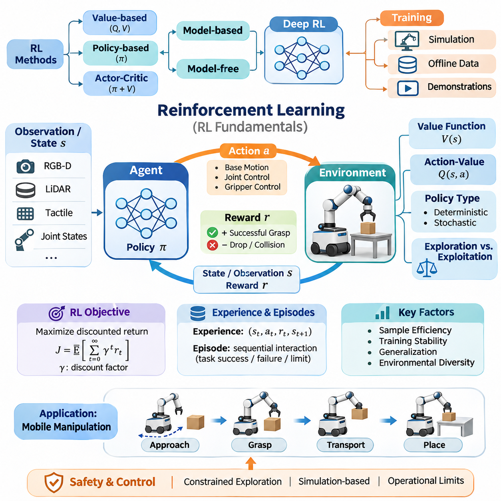{width="7.268055555555556in" height="7.268055555555556in"}

Reinforcement Learning (RL) is a machine learning paradigm in which an intelligent agent learns how to make decisions by interacting with an environment and receiving feedback through rewards. Unlike supervised learning, which relies on labeled examples, reinforcement learning discovers effective behavior through experience. In mobile manipulation, this approach enables robots to develop adaptive skills for navigation, grasping, object handling, and physical interaction.

The fundamental structure of reinforcement learning consists of an agent, an environment, states, actions, rewards, and a policy. The agent represents the decision-making system, while the environment encompasses the physical or simulated world in which the robot operates. The agent observes its surroundings, selects an action, receives feedback, and updates its decision-making strategy to improve future performance.

A state represents the relevant condition of the environment at a particular moment. In robotic manipulation, state information may include joint positions, joint velocities, end-effector poses, object locations, contact forces, and mobile platform coordinates. When complete state information is unavailable, the agent relies on observations obtained from cameras, tactile sensors, LiDAR, and other perception systems.

An action represents a decision or command executed by the agent to influence the environment. Robotic actions may include joint position commands, velocity commands, torque commands, gripper adjustments, or mobile platform movements. Depending on the system architecture, the action space may be discrete or continuous. Continuous action spaces are particularly important for precise robotic manipulation and coordinated motion control.

The reward function defines the feedback that guides the learning process. Positive rewards encourage desirable behaviors, while negative rewards discourage undesirable outcomes. For example, a robot may receive a positive reward for successfully grasping an object and a negative reward for dropping it or approaching an obstacle. Effective reward design is essential because the agent optimizes the specified reward rather than an independently understood objective.

The primary objective of reinforcement learning is to maximize the expected cumulative reward over time rather than simply obtaining the highest immediate reward. A discount factor determines the relative importance of future rewards compared with immediate rewards. This mechanism allows robots to learn sequential behaviors in which intermediate actions contribute to long-term objectives, such as approaching, grasping, transporting, and placing an object.

A policy defines how an agent selects actions based on its current state or observation. A deterministic policy produces a specific action for a given input, whereas a stochastic policy defines a probability distribution over possible actions. In deep reinforcement learning, policies are frequently represented by neural networks capable of processing complex sensory information and generating appropriate robotic control commands.

The value function estimates the expected cumulative future reward associated with a particular state under a policy. Similarly, the action-value function estimates the expected return obtained by executing a particular action in a state and subsequently following the policy. These functions provide a mechanism for evaluating alternative decisions and identifying behaviors that contribute to successful long-term task execution.

Reinforcement learning requires an appropriate balance between exploration and exploitation. Exploration allows the agent to investigate unfamiliar actions and discover potentially superior strategies, while exploitation utilizes previously acquired knowledge to maximize expected performance. In physical robotic systems, uncontrolled exploration can cause equipment damage, making constrained exploration and simulation-based experimentation particularly important.

The interaction between an agent and its environment generates a sequence of experiences consisting of observations, actions, rewards, and subsequent observations. These experiences provide the information required to improve the policy or value function. An episode represents a bounded interaction sequence that may terminate when a task is completed, a failure occurs, or a predefined operational limit is reached.

Deep Reinforcement Learning (DRL) combines reinforcement learning with deep neural networks to address high-dimensional perception and control problems. Neural networks can extract meaningful representations from RGB images, depth measurements, point clouds, and proprioceptive data. This capability enables robots to learn complex relationships between environmental conditions, physical actions, and task outcomes without manually defining every decision rule.

Reinforcement learning algorithms are commonly categorized into value-based, policy-based, and actor-critic methods. Value-based methods estimate the quality of possible decisions, while policy-based methods directly optimize the action-selection strategy. Actor-critic methods combine policy optimization with value estimation. Model-based and model-free approaches provide another distinction based on whether environmental dynamics are explicitly modeled.

The effectiveness of reinforcement learning depends on sample efficiency, training stability, generalization, and environmental diversity. Simulation environments support large-scale experimentation without repeatedly operating physical equipment. Offline reinforcement learning can additionally utilize previously collected interaction datasets, while demonstration-based initialization can reduce the amount of exploration required to acquire useful robotic skills.

In mobile manipulators, reinforcement learning can support coordinated decision-making between the mobile base, robotic arm, and end effector. Learned policies may optimize approach positions, grasp selection, contact-rich manipulation, and recovery from unexpected disturbances. However, industrial deployment requires independent safety mechanisms, validated motion constraints, reliable perception, and conventional control systems to maintain predictable operation.

강화학습(Reinforcement Learning, RL)은 지능형 에이전트(Intelligent Agent)가 환경(Environment)과 상호작용하고 보상(Reward)을 통해 피드백(Feedback)을 받으면서 의사결정(Decision-Making) 방법을 학습하는 기계학습(Machine Learning) 패러다임이다. 레이블이 지정된 예제에 의존하는 지도학습(Supervised Learning)과 달리, 강화학습은 경험(Experience)을 통해 효과적인 행동을 발견한다. 모바일 매니퓰레이션(Mobile Manipulation)에서 이러한 접근 방식은 로봇이 자율주행, 파지, 물체 취급 및 물리적 상호작용을 위한 적응형 기술(Adaptive Skills)을 개발할 수 있도록 한다.

강화학습의 기본 구조는 에이전트(Agent), 환경(Environment), 상태(State), 행동(Action), 보상(Reward) 및 정책(Policy)으로 구성된다. 에이전트는 의사결정 시스템(Decision-Making System)을 의미하며, 환경은 로봇이 작동하는 물리적 또는 가상 세계를 포함한다. 에이전트는 주변 환경을 관측하고, 행동을 선택하며, 피드백을 수신하고, 향후 성능을 향상시키기 위해 의사결정 전략(Decision-Making Strategy)을 갱신한다.

상태(State)는 특정 시점에서 환경의 관련 조건을 나타낸다. 로봇 매니퓰레이션(Robotic Manipulation)에서 상태 정보는 관절 위치(Joint Position), 관절 속도(Joint Velocity), 말단장치 자세(End-Effector Pose), 물체 위치(Object Location), 접촉력(Contact Force) 및 모바일 플랫폼 좌표(Mobile Platform Coordinates)를 포함할 수 있다. 완전한 상태 정보를 확보할 수 없는 경우, 에이전트는 카메라, 촉각 센서(Tactile Sensor), LiDAR 및 기타 인식 시스템(Perception System)에서 획득한 관측 정보(Observation)에 의존한다.

행동(Action)은 환경에 영향을 미치기 위해 에이전트가 실행하는 의사결정 또는 명령을 의미한다. 로봇의 행동에는 관절 위치 명령(Joint Position Command), 속도 명령(Velocity Command), 토크 명령(Torque Command), 그리퍼 조정(Gripper Adjustment) 또는 모바일 플랫폼의 이동이 포함될 수 있다. 시스템 아키텍처(System Architecture)에 따라 행동 공간(Action Space)은 이산적(Discrete)이거나 연속적(Continuous)일 수 있다. 연속 행동 공간(Continuous Action Space)은 정밀한 로봇 매니퓰레이션과 협조 모션 제어(Coordinated Motion Control)에 특히 중요하다.

보상 함수(Reward Function)는 학습 과정을 유도하는 피드백을 정의한다. 양의 보상(Positive Reward)은 바람직한 행동을 장려하는 반면, 음의 보상(Negative Reward)은 바람직하지 않은 결과를 억제한다. 예를 들어, 로봇은 물체를 성공적으로 파지하면 양의 보상을 받고, 물체를 떨어뜨리거나 장애물에 접근하면 음의 보상을 받을 수 있다. 에이전트는 목표 자체를 독립적으로 이해하는 것이 아니라 지정된 보상을 최적화하므로 효과적인 보상 설계(Reward Design)가 필수적이다.

강화학습의 주요 목적은 단순히 가장 높은 즉각적 보상(Immediate Reward)을 획득하는 것이 아니라 시간에 따른 기대 누적 보상(Expected Cumulative Reward)을 최대화하는 것이다. 할인 계수(Discount Factor)는 즉각적 보상과 비교하여 미래 보상(Future Reward)이 가지는 상대적 중요도를 결정한다. 이러한 메커니즘을 통해 로봇은 물체에 접근하고, 파지하고, 운반하고, 배치하는 것과 같이 중간 행동이 장기 목표(Long-Term Objective)에 기여하는 순차적 행동(Sequential Behavior)을 학습할 수 있다.

정책(Policy)은 에이전트가 현재 상태 또는 관측 정보를 기반으로 행동을 선택하는 방법을 정의한다. 결정론적 정책(Deterministic Policy)은 주어진 입력에 대해 특정 행동을 생성하는 반면, 확률적 정책(Stochastic Policy)은 가능한 행동에 대한 확률 분포(Probability Distribution)를 정의한다. 심층 강화학습(Deep Reinforcement Learning)에서 정책은 복잡한 감각 정보를 처리하고 적절한 로봇 제어 명령(Robotic Control Command)을 생성할 수 있는 신경망(Neural Network)으로 표현되는 경우가 많다.

가치 함수(Value Function)는 특정 정책에 따라 특정 상태에서 기대할 수 있는 미래 누적 보상을 추정한다. 이와 유사하게 행동 가치 함수(Action-Value Function)는 특정 상태에서 특정 행동을 실행한 후 해당 정책을 따를 때 획득할 것으로 기대되는 누적 보상(Return)을 추정한다. 이러한 함수는 대안적 의사결정을 평가하고 장기적인 작업 수행(Task Execution)의 성공에 기여하는 행동을 식별하기 위한 메커니즘을 제공한다.

강화학습에서는 탐색(Exploration)과 활용(Exploitation) 사이의 적절한 균형이 필요하다. 탐색은 에이전트가 익숙하지 않은 행동을 조사하고 잠재적으로 더 우수한 전략을 발견할 수 있도록 하며, 활용은 이전에 획득한 지식을 사용하여 기대 성능(Expected Performance)을 최대화한다. 물리적 로봇 시스템(Physical Robotic System)에서는 통제되지 않은 탐색이 장비 손상을 유발할 수 있으므로 제약 기반 탐색(Constrained Exploration)과 시뮬레이션 기반 실험(Simulation-Based Experimentation)이 특히 중요하다.

에이전트와 환경 사이의 상호작용은 관측 정보, 행동, 보상 및 후속 관측 정보(Subsequent Observation)로 구성된 일련의 경험을 생성한다. 이러한 경험은 정책 또는 가치 함수를 개선하는 데 필요한 정보를 제공한다. 에피소드(Episode)는 일정한 범위로 제한된 상호작용 시퀀스(Interaction Sequence)를 의미하며, 작업이 완료되거나 실패가 발생하거나 사전에 정의된 운용 한계(Operational Limit)에 도달할 때 종료될 수 있다.

심층 강화학습(Deep Reinforcement Learning, DRL)은 고차원 인식(High-Dimensional Perception) 및 제어 문제를 해결하기 위해 강화학습과 심층 신경망(Deep Neural Network)을 결합한다. 신경망은 RGB 이미지, 깊이 측정값(Depth Measurement), 포인트 클라우드(Point Cloud) 및 고유수용감각 데이터(Proprioceptive Data)에서 의미 있는 표현(Representation)을 추출할 수 있다. 이러한 능력을 통해 로봇은 모든 의사결정 규칙을 수동으로 정의하지 않고도 환경 조건, 물리적 행동 및 작업 결과 사이의 복잡한 관계를 학습할 수 있다.

강화학습 알고리즘(Reinforcement Learning Algorithm)은 일반적으로 가치 기반 방법(Value-Based Method), 정책 기반 방법(Policy-Based Method) 및 액터-크리틱 방법(Actor-Critic Method)으로 분류된다. 가치 기반 방법은 가능한 의사결정의 품질을 추정하며, 정책 기반 방법은 행동 선택 전략(Action Selection Strategy)을 직접 최적화한다. 액터-크리틱 방법은 정책 최적화(Policy Optimization)와 가치 추정(Value Estimation)을 결합한다. 또한 환경 동역학(Environmental Dynamics)을 명시적으로 모델링하는지에 따라 모델 기반 접근 방식(Model-Based Approach)과 모델 프리 접근 방식(Model-Free Approach)으로 구분할 수 있다.

강화학습의 효과는 샘플 효율성(Sample Efficiency), 학습 안정성(Training Stability), 일반화(Generalization) 및 환경 다양성(Environmental Diversity)에 따라 달라진다. 시뮬레이션 환경(Simulation Environment)은 물리적 장비를 반복적으로 작동시키지 않고도 대규모 실험을 수행할 수 있도록 지원한다. 오프라인 강화학습(Offline Reinforcement Learning)은 이전에 수집된 상호작용 데이터셋(Interaction Dataset)을 추가적으로 활용할 수 있으며, 시연 기반 초기화(Demonstration-Based Initialization)는 유용한 로봇 기술을 획득하는 데 필요한 탐색량을 줄일 수 있다.

모바일 매니퓰레이터(Mobile Manipulator)에서 강화학습은 모바일 베이스(Mobile Base), 로봇 팔(Robotic Arm) 및 말단장치(End Effector) 사이의 협조 의사결정(Coordinated Decision-Making)을 지원할 수 있다. 학습된 정책(Learned Policy)은 접근 위치(Approach Position), 파지 선택(Grasp Selection), 접촉 중심 매니퓰레이션(Contact-Rich Manipulation) 및 예상하지 못한 외란(Disturbance)으로부터의 복구를 최적화할 수 있다. 그러나 산업 현장 적용(Industrial Deployment)에서는 예측 가능한 운용을 유지하기 위해 독립적인 안전 메커니즘(Safety Mechanism), 검증된 모션 제약조건(Motion Constraint), 신뢰성 높은 인식 및 기존 제어 시스템(Conventional Control System)이 필요하다.

##  

## 02 MDP Formulation

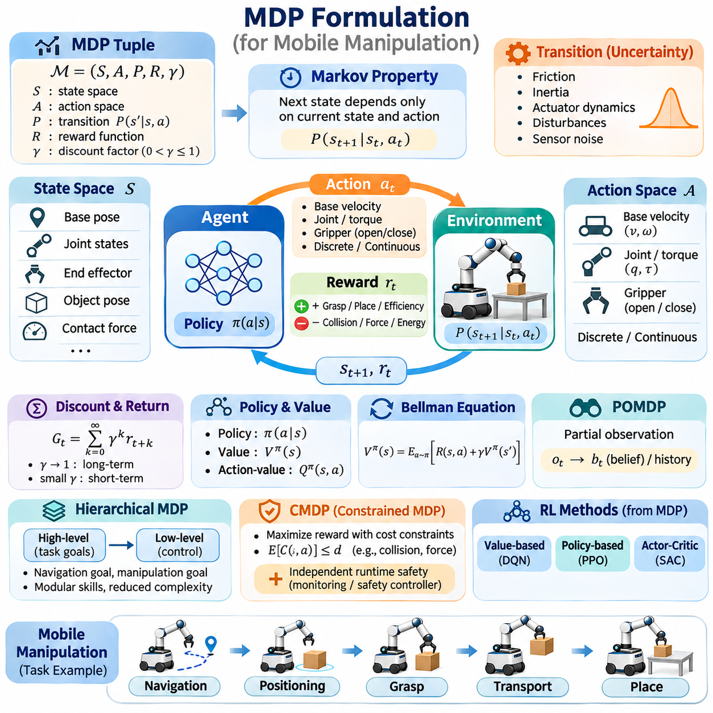{width="7.268055555555556in" height="7.268055555555556in"}

A Markov Decision Process (MDP) provides a mathematical framework for modeling sequential decision-making problems in reinforcement learning. It describes how an intelligent agent interacts with an environment, selects actions, experiences state transitions, and receives rewards. In mobile manipulation, MDP formulation establishes the mathematical foundation for learning robotic behaviors that optimize long-term operational objectives under uncertain environmental conditions.

An MDP is conventionally represented by a tuple consisting of a state space S, an action space A, a transition probability function P, a reward function R, and a discount factor γ. Each component describes a fundamental aspect of the decision-making problem. Together, these elements establish a structured representation of the relationships among environmental conditions, robotic actions, physical consequences, and expected task performance.

The Markov property is the fundamental assumption underlying an MDP. It states that the probability distribution of the next state depends only on the current state and selected action rather than the complete history of previous interactions. This assumption simplifies sequential decision-making by allowing the agent to evaluate future consequences using the current state, provided that the state representation contains sufficient information about the system.

The state space defines all possible conditions that the robotic system and its environment may occupy. For a mobile manipulator, the state may include mobile base position, orientation, joint configurations, joint velocities, end-effector pose, gripper status, object poses, and contact forces. Environmental information such as obstacle locations, workspace geometry, and task progress may also be incorporated to support informed decision-making.

The action space represents all possible decisions available to the agent. In mobile manipulation, actions may consist of mobile base velocity commands, joint position adjustments, joint torque commands, Cartesian displacement commands, and gripper operations. While discrete action spaces simplify decision selection, continuous action spaces provide greater flexibility for coordinated motion and precise interaction with physical objects.

The transition probability function describes the likelihood of reaching a particular next state after executing an action in the current state. In physical robotic systems, state transitions are affected by actuator dynamics, friction, inertia, external disturbances, sensor uncertainty, and environmental interactions. Consequently, even identical actions executed under apparently similar conditions may produce different physical outcomes.

The reward function assigns numerical feedback to the consequences of robotic actions and provides the optimization objective for reinforcement learning. A manipulation task may reward successful grasping, accurate placement, and efficient movement while penalizing collisions, excessive contact forces, energy consumption, and operational delays. Appropriate reward formulation is essential for aligning learned behavior with actual task requirements.

The discount factor determines how strongly the agent values future rewards relative to immediate rewards. A discount factor approaching one encourages consideration of long-term consequences, whereas a smaller value emphasizes short-term outcomes. Mobile manipulation frequently requires long-horizon decision-making because navigation, positioning, grasping, transportation, and placement must be coordinated to accomplish a complete operational objective.

The return represents the cumulative discounted reward obtained during a sequence of interactions. Reinforcement learning attempts to identify a policy that maximizes the expected return across possible trajectories. A trajectory consists of successive states, actions, and rewards generated through interaction with the environment. This formulation enables robotic agents to evaluate individual actions according to their contributions to overall task completion.

A policy defines the relationship between states and actions, while value functions estimate the expected long-term consequences of following that policy. The Bellman equation establishes a recursive relationship between the value of the current state and the expected value of subsequent states. This recursive structure provides the mathematical foundation for evaluating policies, improving action selection, and developing optimal decision-making strategies.

Real-world robotic environments frequently violate the assumption that the complete state can be directly observed. Objects may be occluded, contact conditions may be uncertain, and sensor measurements may contain noise. A Partially Observable Markov Decision Process (POMDP) extends the conventional MDP framework by distinguishing underlying environmental states from observations and allowing decisions to incorporate observation histories or belief states.

Hierarchical MDP formulation can reduce the complexity of mobile manipulation tasks by organizing decisions across multiple levels of abstraction. High-level policies may select navigation goals, manipulation objectives, or recovery strategies, while low-level policies generate continuous control commands. This separation supports modular skill development and reduces the complexity of coordinating mobile platforms, robotic arms, and end effectors.

Safety-critical applications can incorporate operational constraints through a Constrained Markov Decision Process (CMDP). This formulation introduces additional cost functions and constraints associated with undesirable outcomes, such as collisions, excessive forces, or unstable configurations. However, satisfying expected cost constraints does not necessarily guarantee physical safety, making independent runtime monitoring and protective control mechanisms essential.

Effective MDP formulation requires careful consideration of state representation, action dimensionality, reward consistency, control frequency, episode termination, and environmental uncertainty. The mathematical model should reflect the physical capabilities and operational limitations of the robotic platform. Within mobile manipulation, a well-defined MDP provides the foundation for subsequent value-based, policy-based, and actor-critic learning methods.

마르코프 의사결정 과정(Markov Decision Process, MDP)은 강화학습(Reinforcement Learning)에서 순차적 의사결정 문제(Sequential Decision-Making Problem)를 모델링하기 위한 수학적 프레임워크(Mathematical Framework)를 제공한다. 이는 지능형 에이전트(Intelligent Agent)가 환경과 상호작용하고, 행동을 선택하며, 상태 전이(State Transition)를 경험하고, 보상을 받는 과정을 설명한다. 모바일 매니퓰레이션(Mobile Manipulation)에서 MDP 정식화(MDP Formulation)는 불확실한 환경 조건에서 장기적인 운용 목표를 최적화하는 로봇 행동을 학습하기 위한 수학적 기반을 확립한다.

MDP는 일반적으로 상태 공간(State Space) S, 행동 공간(Action Space) A, 전이 확률 함수(Transition Probability Function) P, 보상 함수(Reward Function) R 및 할인 계수(Discount Factor) γ로 구성된 튜플(Tuple)로 표현된다. 각 구성요소는 의사결정 문제의 기본적인 측면을 설명한다. 이러한 요소들은 환경 조건(Environmental Condition), 로봇 행동(Robotic Action), 물리적 결과(Physical Consequence) 및 기대 작업 성능(Expected Task Performance) 사이의 관계를 구조적으로 표현한다.

마르코프 속성(Markov Property)은 MDP의 기반이 되는 핵심 가정이다. 이는 다음 상태의 확률 분포(Probability Distribution)가 이전 상호작용의 전체 이력이 아니라 현재 상태와 선택된 행동에만 의존한다는 것을 의미한다. 이러한 가정은 상태 표현(State Representation)이 시스템에 관한 충분한 정보를 포함한다는 전제하에 에이전트가 현재 상태를 사용하여 미래의 결과를 평가할 수 있도록 함으로써 순차적 의사결정 과정을 단순화한다.

상태 공간(State Space)은 로봇 시스템과 환경이 가질 수 있는 모든 가능한 상태를 정의한다. 모바일 매니퓰레이터(Mobile Manipulator)의 상태에는 모바일 베이스 위치(Mobile Base Position), 방향(Orientation), 관절 구성(Joint Configuration), 관절 속도(Joint Velocity), 말단장치 자세(End-Effector Pose), 그리퍼 상태(Gripper Status), 물체 자세(Object Pose) 및 접촉력(Contact Force)이 포함될 수 있다. 장애물 위치(Obstacle Location), 작업 공간 형상(Workspace Geometry) 및 작업 진행 상태(Task Progress)와 같은 환경 정보도 합리적인 의사결정을 지원하기 위해 포함될 수 있다.

행동 공간(Action Space)은 에이전트가 선택할 수 있는 모든 가능한 의사결정을 나타낸다. 모바일 매니퓰레이션에서 행동은 모바일 베이스 속도 명령(Mobile Base Velocity Command), 관절 위치 조정(Joint Position Adjustment), 관절 토크 명령(Joint Torque Command), 직교좌표계 변위 명령(Cartesian Displacement Command) 및 그리퍼 작동(Gripper Operation)으로 구성될 수 있다. 이산 행동 공간(Discrete Action Space)은 의사결정 선택을 단순화하는 반면, 연속 행동 공간(Continuous Action Space)은 협조 모션(Coordinated Motion)과 물리적 객체와의 정밀한 상호작용에 더 높은 유연성을 제공한다.

전이 확률 함수(Transition Probability Function)는 현재 상태에서 특정 행동을 실행한 후 특정한 다음 상태에 도달할 가능성을 설명한다. 물리적 로봇 시스템(Physical Robotic System)에서 상태 전이는 액추에이터 동역학(Actuator Dynamics), 마찰(Friction), 관성(Inertia), 외부 외란(External Disturbance), 센서 불확실성(Sensor Uncertainty) 및 환경과의 상호작용에 의해 영향을 받는다. 따라서 외견상 유사한 조건에서 동일한 행동을 실행하더라도 서로 다른 물리적 결과가 발생할 수 있다.

보상 함수(Reward Function)는 로봇 행동의 결과에 수치적 피드백(Numerical Feedback)을 부여하고 강화학습을 위한 최적화 목표(Optimization Objective)를 제공한다. 매니퓰레이션 작업에서는 성공적인 파지(Successful Grasping), 정확한 배치(Accurate Placement) 및 효율적인 이동(Efficient Movement)에 보상을 부여하는 동시에 충돌(Collision), 과도한 접촉력(Excessive Contact Force), 에너지 소비(Energy Consumption) 및 운용 지연(Operational Delay)에 페널티를 부여할 수 있다. 적절한 보상 정식화(Reward Formulation)는 학습된 행동을 실제 작업 요구사항과 일치시키기 위해 필수적이다.

할인 계수(Discount Factor)는 에이전트가 즉각적 보상(Immediate Reward)에 비해 미래 보상(Future Reward)을 얼마나 중요하게 평가하는지를 결정한다. 할인 계수가 1에 가까워질수록 장기적인 결과를 고려하도록 유도하는 반면, 작은 값은 단기적인 결과를 강조한다. 모바일 매니퓰레이션에서는 완전한 운용 목표를 달성하기 위해 자율주행(Navigation), 위치 정렬(Positioning), 파지(Grasping), 운반(Transportation) 및 배치(Placement)가 서로 연계되어야 하므로 장기 시계열 의사결정(Long-Horizon Decision-Making)이 빈번하게 요구된다.

누적 수익(Return)은 일련의 상호작용 과정에서 획득한 할인 누적 보상(Cumulative Discounted Reward)을 나타낸다. 강화학습은 가능한 여러 궤적(Trajectory)에 걸쳐 기대 누적 수익(Expected Return)을 최대화하는 정책(Policy)을 식별하고자 한다. 궤적은 환경과의 상호작용을 통해 생성되는 연속적인 상태, 행동 및 보상으로 구성된다. 이러한 정식화는 로봇 에이전트(Robot Agent)가 전체 작업 완료에 대한 기여도를 기준으로 개별 행동을 평가할 수 있도록 한다.

정책(Policy)은 상태와 행동 사이의 관계를 정의하며, 가치 함수(Value Function)는 해당 정책을 따를 때 발생하는 장기적인 기대 결과를 추정한다. 벨만 방정식(Bellman Equation)은 현재 상태의 가치와 후속 상태의 기대 가치(Expected Value of Subsequent States) 사이의 재귀적 관계(Recursive Relationship)를 확립한다. 이러한 재귀적 구조(Recursive Structure)는 정책을 평가하고, 행동 선택(Action Selection)을 개선하며, 최적 의사결정 전략(Optimal Decision-Making Strategy)을 개발하기 위한 수학적 기반을 제공한다.

실제 로봇 환경(Real-World Robotic Environment)에서는 완전한 상태를 직접 관측할 수 있다는 가정이 충족되지 않는 경우가 많다. 물체에 가려짐(Occlusion)이 발생하거나 접촉 조건(Contact Condition)이 불확실할 수 있으며, 센서 측정값(Sensor Measurement)에 잡음(Noise)이 포함될 수 있다. 부분 관측 마르코프 의사결정 과정(Partially Observable Markov Decision Process, POMDP)은 실제 환경 상태와 관측 정보(Observation)를 구분하고, 의사결정 과정에서 관측 이력(Observation History) 또는 신념 상태(Belief State)를 활용할 수 있도록 기존 MDP 프레임워크를 확장한다.

계층적 MDP 정식화(Hierarchical MDP Formulation)는 여러 추상화 수준(Abstraction Level)에 걸쳐 의사결정을 구성함으로써 모바일 매니퓰레이션 작업의 복잡성을 줄일 수 있다. 상위 수준 정책(High-Level Policy)은 자율주행 목표(Navigation Goal), 매니퓰레이션 목표(Manipulation Objective) 또는 복구 전략(Recovery Strategy)을 선택하며, 하위 수준 정책(Low-Level Policy)은 연속 제어 명령(Continuous Control Command)을 생성할 수 있다. 이러한 분리는 모듈형 기술 개발(Modular Skill Development)을 지원하고 모바일 플랫폼, 로봇 팔 및 말단장치 사이의 협조 제어 복잡성을 감소시킨다.

안전이 중요한 응용 분야(Safety-Critical Application)에서는 제약 마르코프 의사결정 과정(Constrained Markov Decision Process, CMDP)을 통해 운용 제약조건(Operational Constraint)을 포함할 수 있다. 이러한 정식화는 충돌, 과도한 힘 또는 불안정한 자세(Unstable Configuration)와 같은 바람직하지 않은 결과와 관련된 추가적인 비용 함수(Cost Function) 및 제약조건(Constraint)을 도입한다. 그러나 기대 비용 제약조건(Expected Cost Constraint)을 충족한다고 해서 반드시 물리적 안전(Physical Safety)이 보장되는 것은 아니므로 독립적인 실시간 운용 모니터링(Runtime Monitoring)과 보호 제어 메커니즘(Protective Control Mechanism)이 필수적이다.

효과적인 MDP 정식화는 상태 표현(State Representation), 행동 차원(Action Dimensionality), 보상 일관성(Reward Consistency), 제어 주파수(Control Frequency), 에피소드 종료(Episode Termination) 및 환경 불확실성(Environmental Uncertainty)에 대한 신중한 고려를 요구한다. 수학적 모델(Mathematical Model)은 로봇 플랫폼의 물리적 성능과 운용 한계(Operational Limitation)를 반영해야 한다. 모바일 매니퓰레이션에서 적절하게 정의된 MDP는 이후의 가치 기반 학습 방법(Value-Based Learning Method), 정책 기반 학습 방법(Policy-Based Learning Method) 및 액터-크리틱 학습 방법(Actor-Critic Learning Method)을 위한 기반을 제공한다.

##  

## 03 Value Based Methods

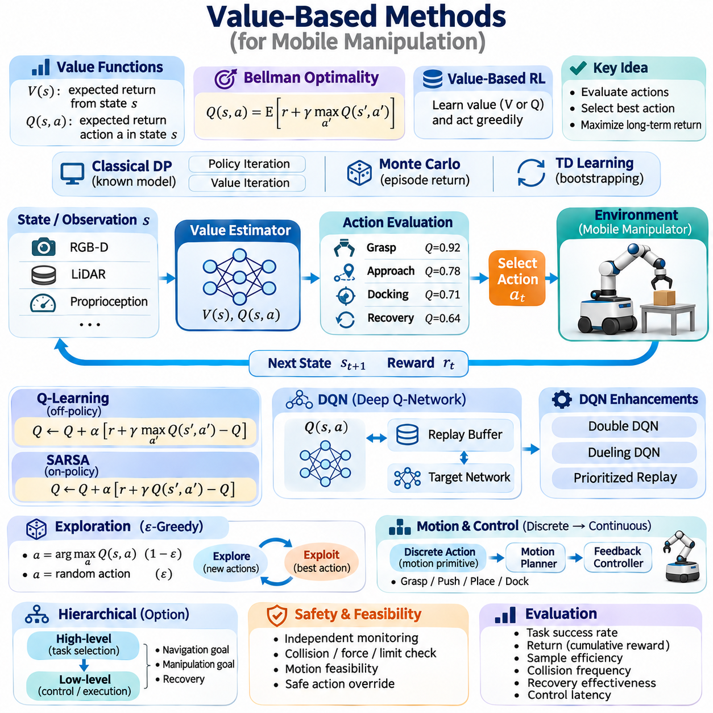{width="7.268055555555556in" height="7.268055555555556in"}

Value-based reinforcement learning methods estimate the expected long-term benefits of states or actions and use these estimates to guide decision-making. Rather than directly optimizing a policy, these methods learn a value function that identifies desirable behaviors. In mobile manipulation, value-based learning can support grasp selection, navigation decisions, object handling strategies, and recovery from unsuccessful physical interactions.

The state-value function, commonly represented as V(s), estimates the expected cumulative discounted reward when an agent starts from a particular state and subsequently follows a given policy. A state associated with a successful future outcome generally receives a higher value than a state associated with failure. This representation allows robotic agents to evaluate environmental conditions according to their expected contribution to long-term task completion.

The action-value function, commonly represented as Q(s,a), estimates the expected cumulative reward obtained by executing a specific action in a particular state and subsequently following a policy. Unlike the state-value function, the action-value function explicitly evaluates alternative actions. A mobile manipulator can therefore compare different grasp candidates, approach directions, navigation commands, or predefined manipulation strategies before selecting an action.

The Bellman equation provides the mathematical foundation for value-based reinforcement learning by expressing the value of a state or state-action pair through immediate rewards and expected future values. The Bellman optimality equation extends this relationship by considering the best available future action. Through recursive value estimation, the agent learns to associate individual decisions with their potential long-term consequences.

Dynamic Programming (DP) represents a classical approach to solving Markov Decision Processes when environmental transition probabilities and reward functions are known. Policy iteration alternates between policy evaluation and policy improvement, whereas value iteration repeatedly updates value estimates toward optimal values. However, explicitly modeling complex physical interactions is often impractical in high-dimensional robotic environments.

Monte Carlo methods estimate value functions using cumulative returns obtained from completed episodes without requiring an explicit environmental model. Temporal Difference (TD) learning instead updates value estimates using immediate rewards and estimates of subsequent states. This process, known as bootstrapping, enables incremental learning before an episode terminates and supports more frequent updates during robotic interaction.

Q-Learning is a widely recognized model-free, off-policy reinforcement learning algorithm that estimates the optimal action-value function. Its update mechanism combines the immediate reward with the maximum estimated action value of the next state. Under appropriate theoretical conditions, repeated exploration and value updates allow tabular Q-Learning to converge toward optimal action selection in finite Markov Decision Processes.

State-Action-Reward-State-Action (SARSA) is an on-policy learning algorithm that updates its action-value estimates using the actual subsequent action selected by the current policy. Unlike Q-Learning, SARSA incorporates the consequences of the agent\'s exploration strategy into its updates. This distinction can influence learned behavior when exploratory actions introduce additional operational risks or undesirable physical interactions.

Traditional tabular value-based methods become impractical when robotic systems involve large or continuous state spaces. Deep Q-Networks (DQN) address this limitation by using deep neural networks to approximate action-value functions. These networks can process visual observations, depth images, proprioceptive measurements, and other sensory inputs to estimate the expected utility of actions within a predefined discrete action space.

Experience replay improves deep value-based learning by storing interaction transitions in a replay buffer and sampling them during neural network training. This mechanism reduces temporal correlations between consecutive observations and allows previously collected experiences to be reused. A target network provides relatively stable learning targets, reducing instability caused by rapidly changing action-value estimates.

Advanced value-based algorithms address limitations of the original DQN architecture. Double DQN reduces action-value overestimation by separating action selection from target evaluation. Dueling DQN independently estimates state values and relative action advantages before combining them. Prioritized Experience Replay increases the sampling frequency of informative transitions, potentially improving learning efficiency and convergence behavior.

Value-based methods require effective exploration to identify actions that produce favorable long-term outcomes. The epsilon-greedy strategy selects a high-value action with probability one minus epsilon and explores randomly with probability epsilon. Other approaches introduce uncertainty estimates or additional exploration rewards. In robotics, exploratory actions must remain within validated mechanical, geometric, and operational constraints.

In robotic manipulation, value-based learning can estimate the expected success of actions associated with grasping, pushing, repositioning, or placing objects. High-level discrete action representations allow the agent to select among predefined motion primitives or candidate grasp configurations. Conventional motion planners and feedback controllers can then translate selected actions into physically feasible and executable robot trajectories.

Mobile manipulators can use hierarchical value-based architectures to coordinate navigation and manipulation decisions. A high-level action-value function may evaluate docking locations, object approach strategies, grasping opportunities, and recovery options. However, directly discretizing every mobile base and robotic arm control dimension causes combinatorial growth, making conventional value-based methods less suitable for unrestricted continuous control.

Successful deployment requires reliable value estimation, sufficient training diversity, and validation against unfamiliar environmental conditions. Performance should be evaluated using task success rates, cumulative rewards, sample efficiency, collision frequency, recovery effectiveness, and execution latency. Learned action values should support decision-making without replacing independent safety monitoring, motion feasibility checks, or deterministic protective control.

가치 기반 강화학습 방법(Value-Based Reinforcement Learning Method)은 상태(State) 또는 행동(Action)의 장기적인 기대 이익을 추정하고 이러한 추정값을 활용하여 의사결정(Decision-Making)을 유도한다. 이러한 방법은 정책(Policy)을 직접 최적화하는 대신 바람직한 행동을 식별하는 가치 함수(Value Function)를 학습한다. 모바일 매니퓰레이션(Mobile Manipulation)에서 가치 기반 학습(Value-Based Learning)은 파지 선택(Grasp Selection), 자율주행 의사결정(Navigation Decision), 물체 취급 전략(Object Handling Strategy) 및 실패한 물리적 상호작용으로부터의 복구를 지원할 수 있다.

일반적으로 V(s)로 표현되는 상태 가치 함수(State-Value Function)는 에이전트가 특정 상태에서 시작하여 이후 주어진 정책을 따를 때 획득할 것으로 기대되는 할인 누적 보상(Expected Cumulative Discounted Reward)을 추정한다. 성공적인 미래 결과와 관련된 상태는 일반적으로 실패와 관련된 상태보다 높은 가치를 가진다. 이러한 표현을 통해 로봇 에이전트(Robot Agent)는 장기적인 작업 완료에 대한 기대 기여도를 기준으로 환경 조건(Environmental Condition)을 평가할 수 있다.

일반적으로 Q(s,a)로 표현되는 행동 가치 함수(Action-Value Function)는 특정 상태에서 특정 행동을 실행하고 이후 정책을 따를 때 획득할 것으로 기대되는 누적 보상(Expected Cumulative Reward)을 추정한다. 상태 가치 함수와 달리 행동 가치 함수는 대안적 행동(Alternative Action)을 명시적으로 평가한다. 따라서 모바일 매니퓰레이터(Mobile Manipulator)는 행동을 선택하기 전에 다양한 파지 후보(Grasp Candidate), 접근 방향(Approach Direction), 자율주행 명령(Navigation Command) 또는 사전에 정의된 매니퓰레이션 전략(Manipulation Strategy)을 비교할 수 있다.

벨만 방정식(Bellman Equation)은 상태 또는 상태-행동 쌍(State-Action Pair)의 가치를 즉각적 보상(Immediate Reward)과 미래 기대 가치(Expected Future Value)를 통해 표현함으로써 가치 기반 강화학습의 수학적 기반을 제공한다. 벨만 최적 방정식(Bellman Optimality Equation)은 미래에 선택할 수 있는 최적의 행동을 고려하여 이러한 관계를 확장한다. 재귀적 가치 추정(Recursive Value Estimation)을 통해 에이전트는 개별 의사결정과 잠재적인 장기 결과 사이의 관계를 학습한다.

동적 계획법(Dynamic Programming, DP)은 환경의 전이 확률(Transition Probability)과 보상 함수(Reward Function)가 알려진 경우 마르코프 의사결정 과정(Markov Decision Process, MDP)을 해결하기 위한 고전적인 접근 방식이다. 정책 반복법(Policy Iteration)은 정책 평가(Policy Evaluation)와 정책 개선(Policy Improvement)을 번갈아 수행하는 반면, 가치 반복법(Value Iteration)은 가치 추정값을 최적 가치에 수렴하도록 반복적으로 갱신한다. 그러나 고차원 로봇 환경(High-Dimensional Robotic Environment)에서 복잡한 물리적 상호작용을 명시적으로 모델링하는 것은 실용적이지 않은 경우가 많다.

몬테카를로 방법(Monte Carlo Method)은 명시적인 환경 모델(Environmental Model) 없이 완료된 에피소드(Episode)에서 획득한 누적 수익(Cumulative Return)을 사용하여 가치 함수를 추정한다. 반면 시간차 학습(Temporal Difference Learning, TD Learning)은 즉각적 보상과 후속 상태의 추정값을 사용하여 가치 추정값을 갱신한다. 부트스트래핑(Bootstrapping)으로 알려진 이러한 과정은 에피소드가 종료되기 이전에도 점진적 학습(Incremental Learning)을 가능하게 하며, 로봇의 상호작용 과정에서 더욱 빈번한 갱신을 지원한다.

Q-학습(Q-Learning)은 최적 행동 가치 함수(Optimal Action-Value Function)를 추정하는 대표적인 모델 프리(Model-Free), 오프 정책(Off-Policy) 강화학습 알고리즘이다. 갱신 메커니즘(Update Mechanism)은 즉각적 보상과 다음 상태에서 추정된 최대 행동 가치(Maximum Action Value)를 결합한다. 적절한 이론적 조건하에서 반복적인 탐색(Exploration)과 가치 갱신(Value Update)을 수행하면 테이블 기반 Q-학습(Tabular Q-Learning)은 유한 마르코프 의사결정 과정(Finite Markov Decision Process)에서 최적 행동 선택(Optimal Action Selection)으로 수렴할 수 있다.

상태-행동-보상-상태-행동(State-Action-Reward-State-Action, SARSA)은 현재 정책에 의해 실제로 선택된 후속 행동(Subsequent Action)을 사용하여 행동 가치 추정값을 갱신하는 온 정책(On-Policy) 학습 알고리즘이다. Q-학습과 달리 SARSA는 에이전트의 탐색 전략(Exploration Strategy)에 따른 결과를 갱신 과정에 반영한다. 이러한 차이는 탐색적 행동(Exploratory Action)이 추가적인 운용 위험(Operational Risk)이나 바람직하지 않은 물리적 상호작용을 유발하는 경우 학습된 행동에 영향을 미칠 수 있다.

기존의 테이블 기반 가치 학습 방법(Tabular Value-Based Learning Method)은 로봇 시스템이 대규모 또는 연속 상태 공간(Continuous State Space)을 포함하는 경우 실용성이 저하된다. 심층 Q-신경망(Deep Q-Network, DQN)은 심층 신경망(Deep Neural Network)을 사용하여 행동 가치 함수를 근사함으로써 이러한 한계를 해결한다. 이러한 신경망은 시각적 관측 정보(Visual Observation), 깊이 이미지(Depth Image), 고유수용감각 측정값(Proprioceptive Measurement) 및 기타 감각 입력(Sensory Input)을 처리하여 사전에 정의된 이산 행동 공간(Discrete Action Space)에서 행동의 기대 효용(Expected Utility)을 추정할 수 있다.

경험 재생(Experience Replay)은 상호작용 전이 데이터(Interaction Transition Data)를 재생 버퍼(Replay Buffer)에 저장하고 신경망 학습 과정에서 이를 샘플링(Sampling)함으로써 심층 가치 기반 학습(Deep Value-Based Learning)을 개선한다. 이러한 메커니즘은 연속적인 관측 정보 사이의 시간적 상관관계(Temporal Correlation)를 감소시키고 이전에 수집된 경험을 재사용할 수 있도록 한다. 타깃 신경망(Target Network)은 상대적으로 안정적인 학습 목표(Training Target)를 제공하여 빠르게 변화하는 행동 가치 추정값으로 인해 발생하는 불안정성을 감소시킨다.

고급 가치 기반 알고리즘(Advanced Value-Based Algorithm)은 기존 DQN 아키텍처의 한계를 해결한다. 이중 DQN(Double DQN)은 행동 선택(Action Selection)과 타깃 평가(Target Evaluation)를 분리함으로써 행동 가치 과대 추정(Action-Value Overestimation)을 감소시킨다. 듀얼링 DQN(Dueling DQN)은 상태 가치(State Value)와 상대적 행동 우위(Action Advantage)를 독립적으로 추정한 후 이를 결합한다. 우선순위 경험 재생(Prioritized Experience Replay)은 유용한 정보를 포함하는 전이 데이터의 샘플링 빈도를 증가시켜 잠재적으로 학습 효율성(Learning Efficiency)과 수렴 특성(Convergence Behavior)을 향상시킨다.

가치 기반 방법은 바람직한 장기 결과를 생성하는 행동을 식별하기 위해 효과적인 탐색을 필요로 한다. 엡실론 탐욕 전략(Epsilon-Greedy Strategy)은 1에서 엡실론(Epsilon)을 뺀 확률로 높은 가치를 가진 행동을 선택하고, 엡실론에 해당하는 확률로 무작위 탐색(Random Exploration)을 수행한다. 다른 접근 방식에서는 불확실성 추정(Uncertainty Estimation) 또는 추가적인 탐색 보상(Exploration Reward)을 도입한다. 로봇 시스템에서 탐색적 행동은 검증된 기계적 제약조건(Mechanical Constraint), 기하학적 제약조건(Geometric Constraint) 및 운용 제약조건(Operational Constraint)의 범위 내에서 수행되어야 한다.

로봇 매니퓰레이션(Robotic Manipulation)에서 가치 기반 학습은 물체의 파지(Grasping), 밀기(Pushing), 위치 재조정(Repositioning) 또는 배치(Placing)와 관련된 행동의 기대 성공 가능성을 추정할 수 있다. 상위 수준 이산 행동 표현(High-Level Discrete Action Representation)은 에이전트가 사전에 정의된 모션 프리미티브(Motion Primitive) 또는 파지 구성 후보(Candidate Grasp Configuration) 중에서 적절한 행동을 선택할 수 있도록 한다. 이후 기존 모션 플래너(Motion Planner)와 피드백 제어기(Feedback Controller)는 선택된 행동을 물리적으로 실현 가능하고 실행 가능한 로봇 궤적(Robot Trajectory)으로 변환할 수 있다.

모바일 매니퓰레이터는 자율주행과 매니퓰레이션 의사결정을 조율하기 위해 계층적 가치 기반 아키텍처(Hierarchical Value-Based Architecture)를 활용할 수 있다. 상위 수준 행동 가치 함수(High-Level Action-Value Function)는 도킹 위치(Docking Location), 물체 접근 전략(Object Approach Strategy), 파지 기회(Grasping Opportunity) 및 복구 옵션(Recovery Option)을 평가할 수 있다. 그러나 모바일 베이스와 로봇 팔의 모든 제어 차원(Control Dimension)을 직접 이산화(Discretization)하면 조합적 증가(Combinatorial Growth)가 발생하므로 기존 가치 기반 방법은 제한 없는 연속 제어(Continuous Control)에 상대적으로 적합하지 않다.

성공적인 현장 적용(Deployment)을 위해서는 신뢰성 높은 가치 추정(Value Estimation), 충분한 학습 다양성(Training Diversity) 및 학습 과정에서 경험하지 못한 환경 조건에 대한 검증(Validation)이 필요하다. 성능은 작업 성공률(Task Success Rate), 누적 보상(Cumulative Reward), 샘플 효율성(Sample Efficiency), 충돌 빈도(Collision Frequency), 복구 효과성(Recovery Effectiveness) 및 실행 지연시간(Execution Latency)을 사용하여 평가해야 한다. 학습된 행동 가치(Learned Action Value)는 독립적인 안전 모니터링(Safety Monitoring), 모션 실현 가능성 검사(Motion Feasibility Check) 또는 결정론적 보호 제어(Deterministic Protective Control)를 대체하지 않으면서 의사결정을 지원해야 한다.

##  

## 04 Policy Based Methods

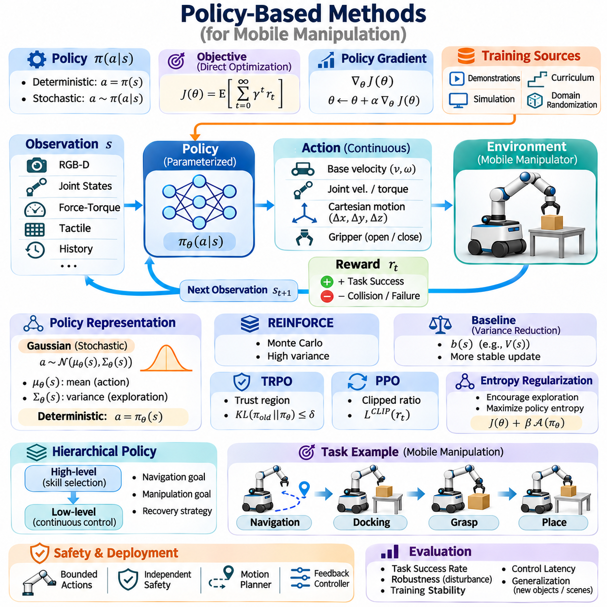{width="7.268055555555556in" height="7.268055555555556in"}

Policy-based reinforcement learning methods directly optimize the decision-making strategy of an intelligent agent rather than deriving actions exclusively from estimated value functions. The policy defines how the agent responds to environmental states or observations. In mobile manipulation, policy-based methods are particularly useful for learning continuous control behaviors, adaptive grasping strategies, and coordinated movement between robotic subsystems.

A policy is commonly represented as π(a\|s), which defines the probability of selecting action a when the agent operates in state s. A deterministic policy generates a specific action for a given state, whereas a stochastic policy produces a probability distribution over possible actions. Stochastic policies facilitate exploration during training and allow robotic agents to develop flexible responses to uncertain environmental conditions.

Parameterized policies represent decision-making strategies through adjustable parameters, commonly denoted by θ. In deep reinforcement learning, these parameters typically correspond to the weights and biases of a neural network. The network processes environmental observations, robotic configurations, and task-related information to generate actions, enabling complex control behaviors without explicitly defining every possible decision rule.

The fundamental objective of policy-based reinforcement learning is to maximize the expected cumulative reward obtained by following a parameterized policy. This objective considers the probability of different trajectories generated through interactions with the environment. Policy optimization modifies the parameters so that successful behaviors become more likely, while actions associated with unfavorable long-term consequences become less likely.

Policy gradient methods provide a mathematical mechanism for improving policies by estimating the gradient of expected cumulative reward with respect to policy parameters. Gradient ascent updates these parameters in directions associated with improved expected performance. Unlike conventional supervised learning, policy gradient methods do not require predefined optimal action labels and instead derive learning signals from environmental interaction.

REINFORCE is a fundamental Monte Carlo policy gradient algorithm that estimates policy gradients using cumulative rewards collected during completed episodes. Actions associated with higher returns receive stronger positive reinforcement relative to actions associated with lower returns. Although REINFORCE provides a conceptually straightforward optimization mechanism, its gradient estimates can exhibit high variance and require substantial training experience.

Variance reduction is an important consideration in policy gradient optimization. A baseline can be introduced to reduce gradient variance without changing the expected gradient when appropriately defined. Comparing observed returns against expected performance enables the learning algorithm to distinguish relatively successful decisions from unfavorable ones, providing more stable updates and improving the efficiency of robotic policy training.

Trust Region Policy Optimization (TRPO) improves learning stability by constraining the magnitude of policy changes between successive optimization iterations. Excessively large updates may destroy previously acquired robotic skills or generate unstable control behaviors. TRPO typically uses a constraint based on Kullback-Leibler divergence to limit changes in action probability distributions while seeking improved expected performance.

Proximal Policy Optimization (PPO) provides a more computationally practical approach to achieving stable policy updates. Its commonly used clipped objective limits the optimization incentive associated with excessively large probability ratio changes between previous and updated policies. PPO is widely applied in simulated robotic control because it provides a practical balance among implementation complexity, learning stability, and training performance.

Continuous action spaces represent a major advantage of policy-based reinforcement learning in robotics. A policy can directly generate joint velocities, torque commands, Cartesian position adjustments, or mobile platform velocity commands. Unlike conventional discrete value-based methods, continuous policies do not require exhaustive evaluation of discretized action combinations, making them suitable for high-dimensional robotic control systems.

Stochastic continuous policies frequently represent actions using Gaussian probability distributions whose parameters are produced or learned by neural networks. During training, sampling from these distributions encourages exploration, while deterministic deployment may use their mean values. Action scaling, bounded distributions, and output constraints help maintain compatibility with actuator capacities, joint limits, and physical operating conditions.

Entropy regularization encourages policies to maintain action diversity rather than prematurely converging toward narrow behavioral strategies. By incorporating policy entropy into the learning objective, the agent can preserve exploration opportunities and investigate alternative control solutions. In robotic manipulation, this mechanism may facilitate the discovery of alternative grasping configurations, approach trajectories, and contact interaction strategies.

Policy-based learning can integrate multiple sensory modalities into a unified decision-making architecture. Visual observations, depth measurements, joint states, force-torque measurements, and tactile feedback can be processed by neural networks to generate context-dependent control commands. Recurrent architectures may additionally incorporate observation histories when instantaneous sensor measurements are insufficient to determine the relevant environmental state.

In mobile manipulators, hierarchical policies can coordinate navigation, docking, object acquisition, and manipulation across different control frequencies. High-level policies determine operational objectives or select learned skills, while low-level policies generate continuous actions. Such architectures reduce decision-making complexity and support coordinated operation between autonomous mobile robots, robotic arms, and intelligent end effectors.

Policy-based methods can also benefit from demonstration learning, curriculum learning, and simulation-based training. Human demonstrations provide initial behavioral knowledge, while progressively increasing task difficulty supports systematic skill acquisition. Domain randomization exposes policies to varying physical parameters, sensor conditions, and environmental configurations, potentially improving generalization when transferring learned behaviors to physical robots.

Industrial deployment requires comprehensive evaluation of policy robustness, task success rates, control stability, execution latency, and generalization under unfamiliar conditions. Learned policies must operate within independently enforced safety constraints and validated motion boundaries. Combining policy-based learning with conventional feedback controllers and motion planners provides a practical foundation for adaptive and reliable mobile manipulation.

정책 기반 강화학습 방법(Policy-Based Reinforcement Learning Method)은 추정된 가치 함수(Value Function)에만 의존하여 행동을 결정하는 대신 지능형 에이전트(Intelligent Agent)의 의사결정 전략(Decision-Making Strategy)을 직접 최적화한다. 정책(Policy)은 에이전트가 환경 상태(Environmental State) 또는 관측 정보(Observation)에 대응하는 방법을 정의한다. 모바일 매니퓰레이션(Mobile Manipulation)에서 정책 기반 방법은 연속 제어 행동(Continuous Control Behavior), 적응형 파지 전략(Adaptive Grasping Strategy) 및 로봇 하위 시스템 사이의 협조 모션(Coordinated Motion)을 학습하는 데 특히 유용하다.

정책은 일반적으로 π(a\|s)로 표현되며, 이는 에이전트가 상태 s에서 작동할 때 행동 a를 선택할 확률을 정의한다. 결정론적 정책(Deterministic Policy)은 주어진 상태에 대해 특정 행동을 생성하는 반면, 확률적 정책(Stochastic Policy)은 가능한 행동에 대한 확률 분포(Probability Distribution)를 생성한다. 확률적 정책은 학습 과정에서 탐색(Exploration)을 촉진하고 로봇 에이전트(Robot Agent)가 불확실한 환경 조건에 유연하게 대응하는 능력을 개발할 수 있도록 한다.

매개변수화된 정책(Parameterized Policy)은 일반적으로 θ로 표시되는 조정 가능한 매개변수(Parameter)를 통해 의사결정 전략을 표현한다. 심층 강화학습(Deep Reinforcement Learning)에서 이러한 매개변수는 일반적으로 신경망(Neural Network)의 가중치(Weight)와 편향(Bias)에 해당한다. 신경망은 환경 관측 정보(Environmental Observation), 로봇 구성(Robot Configuration) 및 작업 관련 정보(Task-Related Information)를 처리하여 행동을 생성함으로써 가능한 모든 의사결정 규칙을 명시적으로 정의하지 않고도 복잡한 제어 행동을 구현할 수 있도록 한다.

정책 기반 강화학습의 기본적인 목적은 매개변수화된 정책을 따를 때 획득하는 기대 누적 보상(Expected Cumulative Reward)을 최대화하는 것이다. 이러한 목적은 환경과의 상호작용을 통해 생성되는 다양한 궤적(Trajectory)의 확률을 고려한다. 정책 최적화(Policy Optimization)는 성공적인 행동이 발생할 가능성을 증가시키고 바람직하지 않은 장기적 결과와 관련된 행동이 발생할 가능성을 감소시키도록 매개변수를 수정한다.

정책 경사 방법(Policy Gradient Method)은 정책 매개변수에 대한 기대 누적 보상의 경사(Gradient)를 추정함으로써 정책을 개선하는 수학적 메커니즘(Mathematical Mechanism)을 제공한다. 경사 상승법(Gradient Ascent)은 기대 성능(Expected Performance)이 향상되는 방향으로 이러한 매개변수를 갱신한다. 기존의 지도학습(Supervised Learning)과 달리 정책 경사 방법은 사전에 정의된 최적 행동 레이블(Optimal Action Label)을 필요로 하지 않으며, 대신 환경과의 상호작용에서 학습 신호(Learning Signal)를 획득한다.

REINFORCE는 완료된 에피소드(Episode)에서 수집한 누적 보상을 사용하여 정책 경사(Policy Gradient)를 추정하는 기본적인 몬테카를로 정책 경사 알고리즘(Monte Carlo Policy Gradient Algorithm)이다. 높은 누적 수익(Return)과 관련된 행동은 낮은 누적 수익과 관련된 행동에 비해 더욱 강한 양의 강화(Positive Reinforcement)를 받는다. REINFORCE는 개념적으로 단순한 최적화 메커니즘(Optimization Mechanism)을 제공하지만, 경사 추정값(Gradient Estimate)이 높은 분산(High Variance)을 나타낼 수 있으며 상당한 학습 경험을 필요로 한다.

분산 감소(Variance Reduction)는 정책 경사 최적화(Policy Gradient Optimization)에서 중요한 고려사항이다. 적절하게 정의된 기준값(Baseline)을 도입하면 기대 경사(Expected Gradient)를 변경하지 않으면서 경사 분산(Gradient Variance)을 감소시킬 수 있다. 관측된 누적 수익(Observed Return)을 기대 성능과 비교함으로써 학습 알고리즘은 상대적으로 성공적인 의사결정과 바람직하지 않은 의사결정을 구분할 수 있다. 이는 더욱 안정적인 매개변수 갱신을 제공하고 로봇 정책 학습(Robotic Policy Training)의 효율성을 향상시킨다.

신뢰 영역 정책 최적화(Trust Region Policy Optimization, TRPO)는 연속적인 최적화 반복 과정 사이에서 정책 변화의 크기를 제한함으로써 학습 안정성(Training Stability)을 향상시킨다. 과도하게 큰 갱신은 이전에 획득한 로봇 기술(Robotic Skill)을 손상시키거나 불안정한 제어 행동(Unstable Control Behavior)을 생성할 수 있다. TRPO는 일반적으로 쿨백-라이블러 발산(Kullback-Leibler Divergence, KL Divergence)에 기반한 제약조건을 사용하여 기대 성능의 향상을 추구하는 동시에 행동 확률 분포(Action Probability Distribution)의 변화를 제한한다.

근위 정책 최적화(Proximal Policy Optimization, PPO)는 안정적인 정책 갱신(Policy Update)을 달성하기 위한 계산적으로 더욱 실용적인 접근 방식을 제공한다. 일반적으로 사용되는 클리핑 목적 함수(Clipped Objective Function)는 이전 정책과 갱신된 정책 사이의 확률 비율(Probability Ratio)이 과도하게 변화할 때 발생하는 최적화 유인을 제한한다. PPO는 구현 복잡성(Implementation Complexity), 학습 안정성 및 학습 성능(Training Performance) 사이에서 실용적인 균형을 제공하므로 시뮬레이션 기반 로봇 제어(Simulation-Based Robotic Control)에 널리 적용된다.

연속 행동 공간(Continuous Action Space)은 로봇 분야에서 정책 기반 강화학습이 가지는 주요 장점이다. 정책은 관절 속도(Joint Velocity), 토크 명령(Torque Command), 직교좌표계 위치 조정(Cartesian Position Adjustment) 또는 모바일 플랫폼 속도 명령(Mobile Platform Velocity Command)을 직접 생성할 수 있다. 기존의 이산 가치 기반 방법(Discrete Value-Based Method)과 달리 연속 정책(Continuous Policy)은 이산화된 행동 조합(Discretized Action Combination)에 대한 전수 평가를 필요로 하지 않으므로 고차원 로봇 제어 시스템(High-Dimensional Robotic Control System)에 적합하다.

확률적 연속 정책(Stochastic Continuous Policy)은 신경망에 의해 생성되거나 학습된 매개변수를 갖는 가우시안 확률 분포(Gaussian Probability Distribution)를 사용하여 행동을 표현하는 경우가 많다. 학습 과정에서는 이러한 분포에서 수행되는 샘플링(Sampling)이 탐색을 장려하는 반면, 결정론적 현장 적용(Deterministic Deployment)에서는 분포의 평균값(Mean Value)을 사용할 수 있다. 행동 스케일링(Action Scaling), 범위 제한 분포(Bounded Distribution) 및 출력 제약조건(Output Constraint)은 액추에이터 성능(Actuator Capacity), 관절 한계(Joint Limit) 및 물리적 운용 조건과의 호환성을 유지하도록 지원한다.

엔트로피 정규화(Entropy Regularization)는 정책이 제한적인 행동 전략으로 조기에 수렴하는 대신 행동 다양성(Action Diversity)을 유지하도록 유도한다. 학습 목적 함수(Learning Objective Function)에 정책 엔트로피(Policy Entropy)를 포함함으로써 에이전트는 탐색 기회를 유지하고 대안적인 제어 솔루션(Control Solution)을 조사할 수 있다. 로봇 매니퓰레이션(Robotic Manipulation)에서 이러한 메커니즘은 대안적인 파지 구성(Grasp Configuration), 접근 궤적(Approach Trajectory) 및 접촉 상호작용 전략(Contact Interaction Strategy)의 발견을 촉진할 수 있다.

정책 기반 학습(Policy-Based Learning)은 다양한 감각 양식(Sensory Modality)을 통합된 의사결정 아키텍처(Decision-Making Architecture)에 결합할 수 있다. 시각적 관측 정보(Visual Observation), 깊이 측정값(Depth Measurement), 관절 상태(Joint State), 힘-토크 측정값(Force-Torque Measurement) 및 촉각 피드백(Tactile Feedback)은 신경망을 통해 처리되어 상황 의존적 제어 명령(Context-Dependent Control Command)을 생성할 수 있다. 순간적인 센서 측정값만으로 관련 환경 상태를 판단하기 어려운 경우 순환 신경망 아키텍처(Recurrent Neural Network Architecture)는 관측 이력(Observation History)을 추가적으로 활용할 수 있다.

모바일 매니퓰레이터(Mobile Manipulator)에서 계층적 정책(Hierarchical Policy)은 서로 다른 제어 주파수(Control Frequency)에 걸쳐 자율주행(Navigation), 도킹(Docking), 물체 획득(Object Acquisition) 및 매니퓰레이션을 조율할 수 있다. 상위 수준 정책(High-Level Policy)은 운용 목표(Operational Objective)를 결정하거나 학습된 기술(Learned Skill)을 선택하며, 하위 수준 정책(Low-Level Policy)은 연속 행동을 생성한다. 이러한 아키텍처는 의사결정 복잡성(Decision-Making Complexity)을 감소시키고 자율이동로봇(Autonomous Mobile Robot, AMR), 로봇 팔(Robotic Arm) 및 지능형 말단장치(Intelligent End Effector) 사이의 협조 운용(Coordinated Operation)을 지원한다.

정책 기반 방법은 시연 학습(Demonstration Learning), 커리큘럼 학습(Curriculum Learning) 및 시뮬레이션 기반 학습(Simulation-Based Training)을 통해서도 성능을 향상시킬 수 있다. 인간 시연(Human Demonstration)은 초기 행동 지식(Initial Behavioral Knowledge)을 제공하며, 작업 난이도(Task Difficulty)를 점진적으로 증가시키는 방식은 체계적인 기술 획득(Systematic Skill Acquisition)을 지원한다. 도메인 무작위화(Domain Randomization)는 정책을 다양한 물리적 매개변수(Physical Parameter), 센서 조건(Sensor Condition) 및 환경 구성(Environmental Configuration)에 노출시켜 학습된 행동을 실제 로봇으로 전이할 때 일반화 성능(Generalization Performance)을 향상시킬 수 있다.

산업 현장 적용(Industrial Deployment)을 위해서는 정책 강건성(Policy Robustness), 작업 성공률(Task Success Rate), 제어 안정성(Control Stability), 실행 지연시간(Execution Latency) 및 학습 과정에서 경험하지 못한 조건에서의 일반화(Generalization)에 대한 종합적인 평가가 필요하다. 학습된 정책은 독립적으로 강제되는 안전 제약조건(Safety Constraint)과 검증된 모션 경계(Motion Boundary) 내에서 작동해야 한다. 정책 기반 학습을 기존 피드백 제어기(Conventional Feedback Controller) 및 모션 플래너(Motion Planner)와 결합하는 것은 적응성과 신뢰성을 갖춘 모바일 매니퓰레이션을 구현하기 위한 실용적인 기반을 제공한다.

##  

## 05 Actor Critic Methods

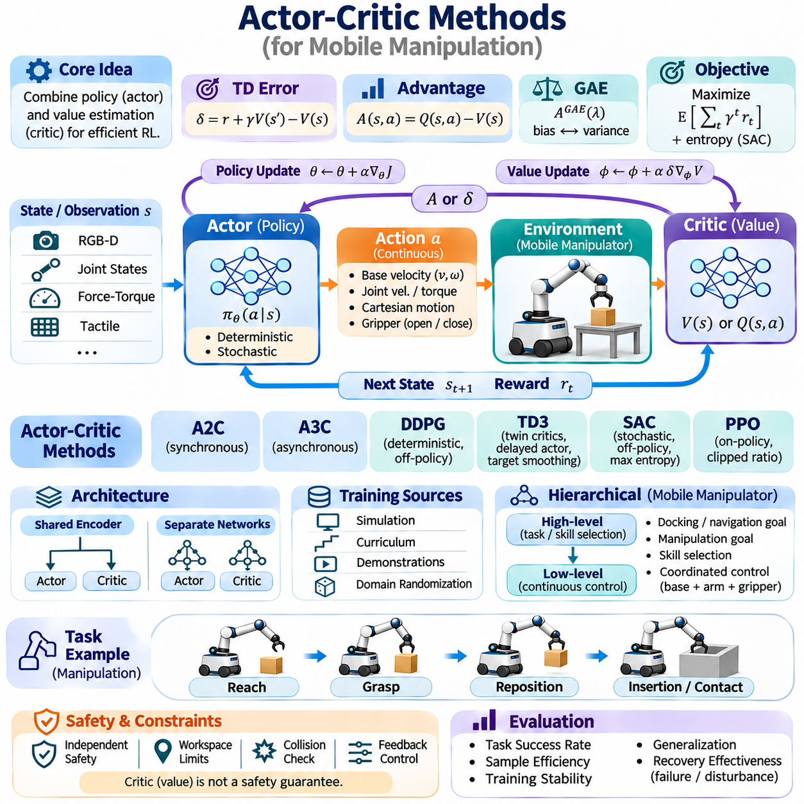{width="7.268055555555556in" height="7.268055555555556in"}

Actor-Critic methods represent a family of reinforcement learning algorithms that combine policy-based and value-based learning within a unified architecture. The actor determines which action the agent should execute, while the critic evaluates the expected consequences of that action. In mobile manipulation, this integrated approach provides an effective foundation for learning continuous control, adaptive decision-making, and coordinated robotic behaviors.

The actor represents a parameterized policy that generates actions according to environmental states or observations. Depending on the algorithm, the actor may implement either a deterministic or stochastic policy. In robotic applications, actor networks can generate joint velocity commands, Cartesian position adjustments, gripper commands, or mobile platform movements based on sensory information and operational objectives.

The critic estimates the expected cumulative reward associated with a state or state-action pair. It evaluates the actor\'s decisions by learning a state-value function or an action-value function. Rather than relying exclusively on observed episodic returns, the critic provides predictive feedback about future performance, enabling the actor to improve its decision-making strategy through more informative and frequent learning updates.

The interaction between the actor and critic establishes a continuous learning feedback mechanism. The actor selects an action, the environment produces a state transition and reward, and the critic evaluates the resulting experience. The actor subsequently updates its policy using feedback from the critic, while the critic improves its value estimates. Repeated interaction enables both components to progressively refine their respective functions.

Temporal Difference (TD) learning is frequently employed to train the critic by comparing predicted values against learning targets derived from immediate rewards and subsequent value estimates. The resulting TD error indicates whether an observed outcome is better or worse than expected. This error provides a learning signal that can guide policy improvement while reducing dependence on complete episodic returns.

The advantage function measures the relative benefit of executing a particular action compared with the expected performance of the current policy in a given state. Advantage estimation helps the actor distinguish favorable actions from unfavorable alternatives. Generalized Advantage Estimation (GAE) combines multiple temporal difference estimates to manage the trade-off between bias and variance during policy optimization.

Advantage Actor-Critic (A2C) uses advantage estimates to coordinate policy and value function updates, typically through synchronized experience collection across multiple environments. Asynchronous Advantage Actor-Critic (A3C) instead employs multiple agents that interact with separate environment instances and asynchronously update shared model parameters. Both approaches support parallel experience generation and improved training efficiency.

Deep Deterministic Policy Gradient (DDPG) extends the actor-critic architecture to continuous action spaces through deterministic policies and off-policy learning. The actor generates continuous actions, while the critic estimates their expected long-term values. Experience replay and target networks improve data reuse and learning stability, making DDPG applicable to robotic reaching, trajectory control, and manipulation tasks.

Twin Delayed Deep Deterministic Policy Gradient (TD3) addresses several limitations of DDPG, particularly action-value overestimation and unstable policy updates. TD3 employs two critic networks, delayed actor updates, and target policy smoothing. These mechanisms reduce sensitivity to inaccurate value estimates and improve learning stability in continuous robotic control tasks involving complex physical dynamics.

Soft Actor-Critic (SAC) incorporates maximum entropy reinforcement learning into an off-policy actor-critic architecture. Its objective encourages both cumulative reward maximization and policy entropy, allowing the agent to maintain diverse exploratory behaviors. SAC is particularly relevant to robotic manipulation because its stochastic policies and experience reuse can support sample-efficient learning in uncertain physical environments.

Proximal Policy Optimization (PPO) is also commonly implemented using an actor-critic architecture. The actor optimizes a constrained surrogate objective, typically through probability ratio clipping, while the critic estimates state values for advantage calculation. Although PPO generally requires newly collected on-policy experience, its implementation simplicity and training stability make it suitable for massively parallel robotic simulation.

Actor-critic architectures can employ separate neural networks or shared feature extraction layers for policy and value estimation. Shared visual encoders can reduce computational requirements, while separate networks may reduce interference between optimization objectives. Multimodal inputs, including RGB-D images, joint states, force-torque measurements, and tactile feedback, support context-dependent robotic decisions.

In manipulation tasks, the actor can learn continuous reaching, grasping, object repositioning, insertion, and contact interaction behaviors. The critic evaluates these behaviors according to expected task completion, positioning accuracy, energy efficiency, and other reward components. This architecture is particularly useful when successful manipulation requires continuous adjustment in response to uncertain object properties and physical contact.

Mobile manipulators introduce additional complexity because navigation and manipulation involve different motion characteristics, control frequencies, and operational constraints. Hierarchical actor-critic architectures can assign high-level policies to docking, task sequencing, and skill selection while low-level policies manage coordinated movement. Specialized critics may evaluate individual skills or the overall effectiveness of integrated robotic operations.

Successful actor-critic training requires appropriate reward design, learning rates, exploration strategies, network architectures, and experience collection methods. Simulation-based training, curriculum learning, human demonstrations, and domain randomization can improve learning efficiency and robustness. Performance evaluation should consider task success, sample efficiency, control stability, generalization, and recovery from unexpected disturbances.

Industrial deployment requires actor-critic policies to operate within independently enforced safety constraints, validated workspace boundaries, and reliable motion control architectures. A critic\'s estimated value must not be interpreted as a guarantee of physical safety. Combining learned policies with conventional controllers, collision checking, and protective monitoring provides a practical foundation for adaptive and reliable mobile manipulation.

액터-크리틱 방법(Actor-Critic Method)은 정책 기반 학습(Policy-Based Learning)과 가치 기반 학습(Value-Based Learning)을 통합된 아키텍처(Unified Architecture) 내에서 결합하는 강화학습 알고리즘(Reinforcement Learning Algorithm)의 한 유형이다. 액터(Actor)는 에이전트가 실행해야 하는 행동을 결정하며, 크리틱(Critic)은 해당 행동의 기대 결과(Expected Consequence)를 평가한다. 모바일 매니퓰레이션(Mobile Manipulation)에서 이러한 통합 접근 방식은 연속 제어(Continuous Control), 적응형 의사결정(Adaptive Decision-Making) 및 협조 로봇 행동(Coordinated Robotic Behavior)을 학습하기 위한 효과적인 기반을 제공한다.

액터(Actor)는 환경 상태(Environmental State) 또는 관측 정보(Observation)에 따라 행동을 생성하는 매개변수화된 정책(Parameterized Policy)을 나타낸다. 알고리즘에 따라 액터는 결정론적 정책(Deterministic Policy) 또는 확률적 정책(Stochastic Policy)을 구현할 수 있다. 로봇 응용 분야에서 액터 신경망(Actor Network)은 감각 정보(Sensory Information)와 운용 목표(Operational Objective)를 기반으로 관절 속도 명령(Joint Velocity Command), 직교좌표계 위치 조정(Cartesian Position Adjustment), 그리퍼 명령(Gripper Command) 또는 모바일 플랫폼 이동(Mobile Platform Movement)을 생성할 수 있다.

크리틱(Critic)은 특정 상태 또는 상태-행동 쌍(State-Action Pair)과 관련된 기대 누적 보상(Expected Cumulative Reward)을 추정한다. 크리틱은 상태 가치 함수(State-Value Function) 또는 행동 가치 함수(Action-Value Function)를 학습함으로써 액터의 의사결정을 평가한다. 관측된 에피소드 누적 수익(Episodic Return)에만 의존하는 대신 크리틱은 미래 성능에 대한 예측적 피드백(Predictive Feedback)을 제공하여 액터가 더욱 유용하고 빈번한 학습 갱신(Learning Update)을 통해 의사결정 전략을 개선할 수 있도록 한다.

액터와 크리틱 사이의 상호작용은 지속적인 학습 피드백 메커니즘(Learning Feedback Mechanism)을 형성한다. 액터는 행동을 선택하고, 환경은 상태 전이(State Transition)와 보상(Reward)을 생성하며, 크리틱은 그 결과로 획득된 경험(Experience)을 평가한다. 이후 액터는 크리틱으로부터 제공받은 피드백을 사용하여 정책을 갱신하는 동시에 크리틱은 자신의 가치 추정값(Value Estimate)을 개선한다. 반복적인 상호작용을 통해 두 구성요소는 각각의 기능을 점진적으로 개선할 수 있다.

시간차 학습(Temporal Difference Learning, TD Learning)은 즉각적 보상(Immediate Reward)과 후속 가치 추정값(Subsequent Value Estimate)으로부터 도출된 학습 목표(Training Target)를 예측값과 비교하여 크리틱을 학습시키는 데 자주 사용된다. 그 결과로 생성되는 시간차 오차(Temporal Difference Error, TD Error)는 관측된 결과가 예상보다 우수한지 또는 열등한지를 나타낸다. 이러한 오차는 완전한 에피소드 누적 수익에 대한 의존성을 감소시키면서 정책 개선(Policy Improvement)을 유도할 수 있는 학습 신호(Learning Signal)를 제공한다.

우위 함수(Advantage Function)는 특정 상태에서 현재 정책의 기대 성능(Expected Performance)과 비교하여 특정 행동을 실행함으로써 얻을 수 있는 상대적 이익을 측정한다. 우위 추정(Advantage Estimation)은 액터가 바람직한 행동과 바람직하지 않은 대안적 행동을 구분할 수 있도록 지원한다. 일반화 우위 추정(Generalized Advantage Estimation, GAE)은 여러 시간차 추정값(Temporal Difference Estimate)을 결합하여 정책 최적화(Policy Optimization) 과정에서 편향(Bias)과 분산(Variance) 사이의 상충 관계(Trade-Off)를 조절한다.

우위 액터-크리틱(Advantage Actor-Critic, A2C)은 일반적으로 여러 환경에서 동기화된 경험 수집(Synchronized Experience Collection)을 수행하고 우위 추정값을 사용하여 정책과 가치 함수의 갱신을 조율한다. 반면 비동기 우위 액터-크리틱(Asynchronous Advantage Actor-Critic, A3C)은 서로 독립적인 환경 인스턴스(Environment Instance)와 상호작용하고 공유 모델 매개변수(Shared Model Parameter)를 비동기적으로 갱신하는 여러 에이전트를 활용한다. 두 접근 방식 모두 병렬 경험 생성(Parallel Experience Generation)과 학습 효율성(Training Efficiency)의 향상을 지원한다.

심층 결정론적 정책 경사(Deep Deterministic Policy Gradient, DDPG)는 결정론적 정책(Deterministic Policy)과 오프 정책 학습(Off-Policy Learning)을 통해 액터-크리틱 아키텍처를 연속 행동 공간(Continuous Action Space)으로 확장한다. 액터는 연속 행동(Continuous Action)을 생성하는 반면, 크리틱은 이러한 행동의 장기적인 기대 가치를 추정한다. 경험 재생(Experience Replay)과 타깃 신경망(Target Network)은 데이터 재사용(Data Reuse) 및 학습 안정성(Training Stability)을 향상시키므로 DDPG는 로봇 도달 동작(Robotic Reaching), 궤적 제어(Trajectory Control) 및 매니퓰레이션 작업에 적용될 수 있다.

쌍둥이 지연 심층 결정론적 정책 경사(Twin Delayed Deep Deterministic Policy Gradient, TD3)는 DDPG의 여러 한계, 특히 행동 가치 과대 추정(Action-Value Overestimation)과 불안정한 정책 갱신(Unstable Policy Update)을 해결한다. TD3는 두 개의 크리틱 신경망(Critic Network), 지연된 액터 갱신(Delayed Actor Update) 및 타깃 정책 평활화(Target Policy Smoothing)를 활용한다. 이러한 메커니즘은 부정확한 가치 추정값에 대한 민감도(Sensitivity)를 감소시키고 복잡한 물리적 동역학(Physical Dynamics)을 포함하는 연속 로봇 제어 작업에서 학습 안정성을 향상시킨다.

소프트 액터-크리틱(Soft Actor-Critic, SAC)은 최대 엔트로피 강화학습(Maximum Entropy Reinforcement Learning)을 오프 정책 액터-크리틱 아키텍처에 통합한다. SAC의 목적 함수(Objective Function)는 누적 보상 최대화(Cumulative Reward Maximization)와 정책 엔트로피(Policy Entropy)를 동시에 장려하여 에이전트가 다양한 탐색적 행동(Exploratory Behavior)을 유지할 수 있도록 한다. SAC는 확률적 정책과 경험 재사용을 통해 불확실한 물리적 환경에서 높은 샘플 효율성을 갖는 학습(Sample-Efficient Learning)을 지원할 수 있으므로 로봇 매니퓰레이션(Robotic Manipulation)과 특히 밀접한 관련이 있다.

근위 정책 최적화(Proximal Policy Optimization, PPO) 역시 일반적으로 액터-크리틱 아키텍처를 사용하여 구현된다. 액터는 일반적으로 확률 비율 클리핑(Probability Ratio Clipping)을 통해 제약된 대리 목적 함수(Constrained Surrogate Objective Function)를 최적화하는 반면, 크리틱은 우위 계산(Advantage Calculation)을 위한 상태 가치(State Value)를 추정한다. PPO는 일반적으로 새롭게 수집된 온 정책 경험(On-Policy Experience)을 필요로 하지만, 구현의 단순성(Implementation Simplicity)과 학습 안정성으로 인해 대규모 병렬 로봇 시뮬레이션(Massively Parallel Robotic Simulation)에 적합하다.

액터-크리틱 아키텍처는 정책 및 가치 추정(Value Estimation)을 위해 독립적인 신경망(Separate Neural Network) 또는 공유 특징 추출 계층(Shared Feature Extraction Layer)을 활용할 수 있다. 공유 시각 인코더(Shared Visual Encoder)는 연산 요구사항(Computational Requirement)을 감소시킬 수 있으며, 독립적인 신경망은 서로 다른 최적화 목표(Optimization Objective) 사이의 간섭(Interference)을 감소시킬 수 있다. RGB-D 이미지, 관절 상태(Joint State), 힘-토크 측정값(Force-Torque Measurement) 및 촉각 피드백(Tactile Feedback)을 포함하는 멀티모달 입력(Multimodal Input)은 상황 의존적 로봇 의사결정(Context-Dependent Robotic Decision)을 지원한다.

매니퓰레이션 작업에서 액터는 연속적인 도달 동작(Reaching), 파지(Grasping), 물체 위치 재조정(Object Repositioning), 삽입(Insertion) 및 접촉 상호작용 행동(Contact Interaction Behavior)을 학습할 수 있다. 크리틱은 기대 작업 완료(Expected Task Completion), 위치 정밀도(Positioning Accuracy), 에너지 효율성(Energy Efficiency) 및 기타 보상 구성요소(Reward Component)를 기준으로 이러한 행동을 평가한다. 이러한 아키텍처는 성공적인 매니퓰레이션을 위해 불확실한 물체 특성(Object Property)과 물리적 접촉(Physical Contact)에 대응하여 지속적인 조정(Continuous Adjustment)이 필요한 경우 특히 유용하다.

모바일 매니퓰레이터(Mobile Manipulator)는 자율주행(Navigation)과 매니퓰레이션이 서로 다른 모션 특성(Motion Characteristic), 제어 주파수(Control Frequency) 및 운용 제약조건(Operational Constraint)을 포함하기 때문에 추가적인 복잡성을 발생시킨다. 계층적 액터-크리틱 아키텍처(Hierarchical Actor-Critic Architecture)는 도킹(Docking), 작업 순서화(Task Sequencing) 및 기술 선택(Skill Selection)에 상위 수준 정책(High-Level Policy)을 할당하는 동시에 하위 수준 정책(Low-Level Policy)을 통해 협조 모션(Coordinated Motion)을 관리할 수 있다. 특화된 크리틱(Specialized Critic)은 개별 기술 또는 통합 로봇 운용(Integrated Robotic Operation)의 전체적인 효과성을 평가할 수 있다.

성공적인 액터-크리틱 학습(Actor-Critic Training)을 위해서는 적절한 보상 설계(Reward Design), 학습률(Learning Rate), 탐색 전략(Exploration Strategy), 신경망 아키텍처(Neural Network Architecture) 및 경험 수집 방법(Experience Collection Method)이 필요하다. 시뮬레이션 기반 학습(Simulation-Based Training), 커리큘럼 학습(Curriculum Learning), 인간 시연(Human Demonstration) 및 도메인 무작위화(Domain Randomization)는 학습 효율성(Learning Efficiency)과 강건성(Robustness)을 향상시킬 수 있다. 성능 평가(Performance Evaluation)에서는 작업 성공률(Task Success Rate), 샘플 효율성(Sample Efficiency), 제어 안정성(Control Stability), 일반화(Generalization) 및 예상하지 못한 외란(Disturbance)으로부터의 복구 능력을 고려해야 한다.

산업 현장 적용(Industrial Deployment)을 위해서는 액터-크리틱 정책이 독립적으로 강제되는 안전 제약조건(Safety Constraint), 검증된 작업 공간 경계(Workspace Boundary) 및 신뢰성 높은 모션 제어 아키텍처(Motion Control Architecture) 내에서 작동해야 한다. 크리틱의 가치 추정값(Estimated Value)을 물리적 안전(Physical Safety)에 대한 보장으로 해석해서는 안 된다. 학습된 정책(Learned Policy)을 기존 제어기(Conventional Controller), 충돌 검사(Collision Checking) 및 보호 모니터링(Protective Monitoring)과 결합하는 것은 적응성과 신뢰성을 갖춘 모바일 매니퓰레이션을 구현하기 위한 실용적인 기반을 제공한다.

##  

## 06 Offline RL

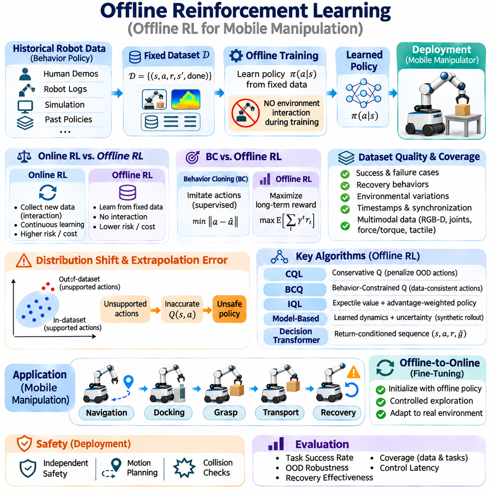{width="7.268055555555556in" height="7.268055555555556in"}

Offline Reinforcement Learning (Offline RL) is a reinforcement learning paradigm in which an agent learns an effective decision-making policy from previously collected interaction data without actively interacting with the environment during training. In mobile manipulation, this approach enables robots to acquire operational skills from historical experiences, human demonstrations, simulation datasets, and existing robotic system logs.

Unlike online reinforcement learning, which continuously collects new experiences through environmental interaction, offline reinforcement learning relies on a fixed dataset. This dataset typically contains states, actions, rewards, subsequent states, and episode termination indicators. The absence of direct environmental interaction during training reduces equipment utilization, operational interruptions, and risks associated with uncontrolled robotic exploration.

Offline reinforcement learning differs from conventional supervised learning and behavior cloning because its objective is to maximize expected cumulative reward rather than simply reproduce previously observed actions. By evaluating the long-term consequences of recorded decisions, an offline learning algorithm may identify policies that outperform the original data collection policy when sufficient relevant experience is available.

The behavior policy represents the decision-making strategy responsible for generating the training dataset. Recorded experiences may originate from human operators, conventional robotic controllers, previously trained reinforcement learning agents, or multiple heterogeneous policies. Dataset diversity and behavioral coverage strongly influence the range of actions and environmental conditions that an offline reinforcement learning algorithm can evaluate reliably.

Dataset quality is a fundamental consideration in offline reinforcement learning. Robotic datasets should include successful operations, unsuccessful attempts, recovery behaviors, environmental variations, and representative operational conditions. Accurate timestamps, synchronized sensor measurements, consistent coordinate systems, and reliable action records are essential for reconstructing the relationships between robotic decisions and physical consequences.

Distribution shift represents one of the principal challenges of offline reinforcement learning. During deployment, a learned policy may select actions or encounter states that are poorly represented in the training dataset. Because the agent cannot collect additional corrective experiences during offline training, inaccurate value estimates may encourage unreliable decisions, particularly in unfamiliar robotic configurations or complex manipulation environments.

Extrapolation error occurs when a learned value function assigns inaccurate values to state-action combinations that are insufficiently represented in the available dataset. Conventional off-policy reinforcement learning algorithms may overestimate the benefits of unsupported actions and progressively amplify these errors through bootstrapping. Offline RL algorithms introduce specialized mechanisms to reduce this problem and improve policy reliability.

Conservative Q-Learning (CQL) addresses distribution shift by introducing a conservative regularization objective into action-value estimation. The algorithm discourages excessively optimistic value estimates for actions outside the demonstrated data distribution. This mechanism encourages the learned policy to favor actions supported by recorded experiences, making CQL relevant to robotic applications where unreliable extrapolation may produce undesirable physical consequences.

Batch-Constrained Q-Learning (BCQ) restricts action selection to behaviors that remain sufficiently close to the distribution represented in the offline dataset. Generative models can produce candidate actions consistent with recorded experiences, while action-value functions evaluate their expected utility. This approach reduces unsupported action selection and provides a mechanism for learning continuous robotic control policies from fixed datasets.

Implicit Q-Learning (IQL) improves offline policy learning without explicitly evaluating unseen actions during value function training. It employs expectile regression to estimate state values and advantage-weighted regression to train the policy using recorded actions. This approach can extract relatively high-performing behaviors from diverse datasets while reducing reliance on unreliable out-of-distribution action-value estimates.

Model-based offline reinforcement learning constructs an approximate model of environmental dynamics from previously collected experiences. The learned model predicts possible state transitions and rewards, enabling policy optimization through synthetic interactions. Uncertainty estimation and conservative model utilization are important because inaccurate predictions may otherwise encourage behaviors that are physically infeasible or poorly supported by the original dataset.

Sequence modeling provides another approach to offline reinforcement learning. Decision Transformer architectures formulate decision-making as a conditional sequence prediction problem using historical states, actions, and desired returns. Transformer-based models can learn temporal relationships across extended robotic trajectories, potentially supporting complex manipulation tasks that require coordinated sequences of actions and long-horizon behavioral consistency.

In robotic manipulation, offline reinforcement learning can utilize previously recorded reaching, grasping, pushing, insertion, and pick-and-place trajectories. Successful and unsuccessful experiences provide complementary information about the consequences of physical interaction. Multimodal datasets containing RGB-D observations, joint states, force-torque measurements, and tactile feedback support the development of context-dependent manipulation policies.

Mobile manipulators can benefit from offline reinforcement learning by integrating historical navigation and manipulation experiences within a common training framework. Recorded docking operations, approach trajectories, grasping attempts, transportation behaviors, and recovery sequences can support coordinated policy development. Hierarchical learning architectures may additionally separate high-level operational decisions from low-level continuous control.

Offline-to-online reinforcement learning combines initial policy training on fixed datasets with subsequent environmental interaction and controlled policy refinement. This approach can reduce the exploration required during physical deployment while allowing the robot to adapt to previously unobserved conditions. Carefully managed online fine-tuning, simulation-based validation, and constrained exploration are important for maintaining operational reliability.

Industrial deployment of offline reinforcement learning requires systematic dataset management, policy validation, and independent safety mechanisms. Performance evaluation should consider task success rates, dataset coverage, generalization, execution latency, recovery effectiveness, and out-of-distribution behavior. Combining offline learning with conventional motion planning, feedback control, and protective monitoring provides a practical foundation for scalable mobile manipulation.

오프라인 강화학습(Offline Reinforcement Learning, Offline RL)은 에이전트(Agent)가 학습 과정에서 환경과 직접적으로 상호작용하지 않고 이전에 수집된 상호작용 데이터(Interaction Data)를 활용하여 효과적인 의사결정 정책(Decision-Making Policy)을 학습하는 강화학습 패러다임(Reinforcement Learning Paradigm)이다. 모바일 매니퓰레이션(Mobile Manipulation)에서 이러한 접근 방식은 로봇이 과거 경험(Historical Experience), 인간 시연(Human Demonstration), 시뮬레이션 데이터셋(Simulation Dataset) 및 기존 로봇 시스템 로그(Robotic System Log)를 활용하여 운용 기술(Operational Skill)을 획득할 수 있도록 한다.

환경과의 상호작용을 통해 새로운 경험을 지속적으로 수집하는 온라인 강화학습(Online Reinforcement Learning)과 달리, 오프라인 강화학습은 고정 데이터셋(Fixed Dataset)에 의존한다. 이러한 데이터셋에는 일반적으로 상태(State), 행동(Action), 보상(Reward), 후속 상태(Subsequent State) 및 에피소드 종료 지표(Episode Termination Indicator)가 포함된다. 학습 과정에서 환경과 직접적으로 상호작용하지 않으므로 장비 사용량(Equipment Utilization), 운용 중단(Operational Interruption) 및 통제되지 않은 로봇 탐색(Uncontrolled Robotic Exploration)과 관련된 위험을 감소시킬 수 있다.

오프라인 강화학습은 이전에 관측된 행동을 단순히 재현하는 것이 아니라 기대 누적 보상(Expected Cumulative Reward)을 최대화하는 것을 목표로 한다는 점에서 기존의 지도학습(Supervised Learning) 및 행동 복제(Behavior Cloning)와 차별화된다. 기록된 의사결정의 장기적인 결과를 평가함으로써 오프라인 학습 알고리즘(Offline Learning Algorithm)은 충분한 관련 경험이 확보된 경우 기존 데이터 수집 정책(Data Collection Policy)보다 우수한 성능을 나타내는 정책을 식별할 수 있다.

행동 정책(Behavior Policy)은 학습 데이터셋(Training Dataset)을 생성하는 데 사용된 의사결정 전략(Decision-Making Strategy)을 의미한다. 기록된 경험은 인간 작업자(Human Operator), 기존 로봇 제어기(Conventional Robotic Controller), 이전에 학습된 강화학습 에이전트(Reinforcement Learning Agent) 또는 여러 이기종 정책(Heterogeneous Policy)으로부터 획득될 수 있다. 데이터셋 다양성(Dataset Diversity)과 행동 포괄 범위(Behavioral Coverage)는 오프라인 강화학습 알고리즘이 신뢰성 있게 평가할 수 있는 행동 및 환경 조건의 범위에 상당한 영향을 미친다.

데이터셋 품질(Dataset Quality)은 오프라인 강화학습에서 기본적으로 고려해야 하는 요소이다. 로봇 데이터셋(Robotic Dataset)은 성공적인 작업, 실패한 시도, 복구 행동(Recovery Behavior), 환경 변화(Environmental Variation) 및 대표적인 운용 조건(Operational Condition)을 포함해야 한다. 정확한 타임스탬프(Timestamp), 동기화된 센서 측정값(Synchronized Sensor Measurement), 일관된 좌표계(Coordinate System) 및 신뢰성 높은 행동 기록(Action Record)은 로봇 의사결정과 물리적 결과(Physical Consequence) 사이의 관계를 재구성하기 위해 필수적이다.

분포 변화(Distribution Shift)는 오프라인 강화학습의 주요 해결 과제 중 하나이다. 현장 적용(Deployment) 과정에서 학습된 정책(Learned Policy)은 학습 데이터셋에 충분히 표현되지 않은 행동을 선택하거나 상태에 직면할 수 있다. 에이전트는 오프라인 학습 과정에서 추가적인 교정 경험(Corrective Experience)을 수집할 수 없으므로 부정확한 가치 추정값(Value Estimate)은 신뢰성이 낮은 의사결정을 유도할 수 있다. 이러한 문제는 특히 익숙하지 않은 로봇 구성(Robot Configuration)이나 복잡한 매니퓰레이션 환경(Manipulation Environment)에서 두드러질 수 있다.

외삽 오차(Extrapolation Error)는 학습된 가치 함수(Learned Value Function)가 가용 데이터셋에 충분히 표현되지 않은 상태-행동 조합(State-Action Combination)에 부정확한 가치를 할당할 때 발생한다. 기존의 오프 정책 강화학습 알고리즘(Off-Policy Reinforcement Learning Algorithm)은 데이터로 뒷받침되지 않는 행동의 이익을 과대 추정(Overestimation)하고 부트스트래핑(Bootstrapping)을 통해 이러한 오차를 점진적으로 증폭시킬 수 있다. 오프라인 강화학습 알고리즘은 이러한 문제를 감소시키고 정책 신뢰성(Policy Reliability)을 향상시키기 위해 특화된 메커니즘을 도입한다.

보수적 Q-학습(Conservative Q-Learning, CQL)은 행동 가치 추정(Action-Value Estimation)에 보수적 정규화 목적 함수(Conservative Regularization Objective)를 도입함으로써 분포 변화 문제를 해결한다. 이 알고리즘은 시연 데이터 분포(Demonstrated Data Distribution) 외부에 존재하는 행동에 대해 지나치게 낙관적인 가치 추정값을 부여하는 것을 억제한다. 이러한 메커니즘은 학습된 정책이 기록된 경험으로 뒷받침되는 행동을 선호하도록 유도하므로, 신뢰성이 낮은 외삽(Unreliable Extrapolation)이 바람직하지 않은 물리적 결과를 유발할 수 있는 로봇 응용 분야에서 중요하다.

배치 제약 Q-학습(Batch-Constrained Q-Learning, BCQ)은 행동 선택(Action Selection)을 오프라인 데이터셋에 표현된 분포와 충분히 유사한 행동으로 제한한다. 생성 모델(Generative Model)은 기록된 경험과 일치하는 행동 후보(Candidate Action)를 생성할 수 있으며, 행동 가치 함수(Action-Value Function)는 이러한 행동의 기대 효용(Expected Utility)을 평가한다. 이러한 접근 방식은 데이터로 뒷받침되지 않는 행동의 선택을 감소시키고 고정 데이터셋을 활용하여 연속 로봇 제어 정책(Continuous Robotic Control Policy)을 학습하기 위한 메커니즘을 제공한다.

암시적 Q-학습(Implicit Q-Learning, IQL)은 가치 함수 학습(Value Function Training) 과정에서 관측되지 않은 행동(Unseen Action)을 명시적으로 평가하지 않고 오프라인 정책 학습(Offline Policy Learning)을 개선한다. IQL은 상태 가치(State Value)를 추정하기 위해 기대분위수 회귀(Expectile Regression)를 사용하고, 기록된 행동을 활용하여 정책을 학습하기 위해 우위 가중 회귀(Advantage-Weighted Regression)를 사용한다. 이러한 접근 방식은 신뢰성이 낮은 분포 외 행동 가치 추정값(Out-of-Distribution Action-Value Estimate)에 대한 의존성을 감소시키면서 다양한 데이터셋으로부터 상대적으로 높은 성능을 가진 행동을 추출할 수 있다.

모델 기반 오프라인 강화학습(Model-Based Offline Reinforcement Learning)은 이전에 수집된 경험을 활용하여 환경 동역학(Environmental Dynamics)의 근사 모델(Approximate Model)을 구축한다. 학습된 모델(Learned Model)은 가능한 상태 전이(State Transition)와 보상을 예측하여 합성 상호작용(Synthetic Interaction)을 통한 정책 최적화(Policy Optimization)를 가능하게 한다. 부정확한 예측이 물리적으로 실현 불가능하거나 기존 데이터셋으로 충분히 뒷받침되지 않는 행동을 유도할 수 있으므로 불확실성 추정(Uncertainty Estimation)과 보수적 모델 활용(Conservative Model Utilization)이 중요하다.

시퀀스 모델링(Sequence Modeling)은 오프라인 강화학습을 위한 또 다른 접근 방식을 제공한다. 의사결정 트랜스포머(Decision Transformer) 아키텍처는 과거 상태(Historical State), 행동 및 목표 누적 수익(Desired Return)을 활용하여 의사결정을 조건부 시퀀스 예측 문제(Conditional Sequence Prediction Problem)로 정식화한다. 트랜스포머 기반 모델(Transformer-Based Model)은 장기간의 로봇 궤적(Robotic Trajectory)에 걸쳐 시간적 관계(Temporal Relationship)를 학습할 수 있으며, 협조적인 행동 시퀀스(Coordinated Action Sequence)와 장기 행동 일관성(Long-Horizon Behavioral Consistency)이 필요한 복잡한 매니퓰레이션 작업을 지원할 수 있다.

로봇 매니퓰레이션(Robotic Manipulation)에서 오프라인 강화학습은 이전에 기록된 도달 동작(Reaching), 파지(Grasping), 밀기(Pushing), 삽입(Insertion) 및 픽 앤 플레이스(Pick-and-Place) 궤적을 활용할 수 있다. 성공적인 경험과 실패한 경험은 물리적 상호작용(Physical Interaction)의 결과에 관한 상호 보완적인 정보를 제공한다. RGB-D 관측 정보(RGB-D Observation), 관절 상태(Joint State), 힘-토크 측정값(Force-Torque Measurement) 및 촉각 피드백(Tactile Feedback)을 포함하는 멀티모달 데이터셋(Multimodal Dataset)은 상황 의존적 매니퓰레이션 정책(Context-Dependent Manipulation Policy)의 개발을 지원한다.

모바일 매니퓰레이터(Mobile Manipulator)는 과거 자율주행 및 매니퓰레이션 경험(Historical Navigation and Manipulation Experience)을 공통 학습 프레임워크(Common Training Framework) 내에 통합함으로써 오프라인 강화학습의 이점을 활용할 수 있다. 기록된 도킹 작업(Docking Operation), 접근 궤적(Approach Trajectory), 파지 시도(Grasping Attempt), 운반 행동(Transportation Behavior) 및 복구 시퀀스(Recovery Sequence)는 협조 정책 개발(Coordinated Policy Development)을 지원할 수 있다. 계층적 학습 아키텍처(Hierarchical Learning Architecture)는 상위 수준 운용 의사결정(High-Level Operational Decision)과 하위 수준 연속 제어(Low-Level Continuous Control)를 추가적으로 분리할 수 있다.

오프라인-온라인 강화학습(Offline-to-Online Reinforcement Learning)은 고정 데이터셋을 활용한 초기 정책 학습(Initial Policy Training)과 이후의 환경 상호작용(Environmental Interaction) 및 통제된 정책 개선(Controlled Policy Refinement)을 결합한다. 이러한 접근 방식은 실제 로봇의 현장 적용 과정에서 필요한 탐색량을 감소시키는 동시에 로봇이 이전에 관측되지 않은 조건에 적응할 수 있도록 한다. 신중하게 관리되는 온라인 미세조정(Online Fine-Tuning), 시뮬레이션 기반 검증(Simulation-Based Validation) 및 제약 기반 탐색(Constrained Exploration)은 운용 신뢰성(Operational Reliability)을 유지하기 위해 중요하다.

오프라인 강화학습의 산업 현장 적용(Industrial Deployment)을 위해서는 체계적인 데이터셋 관리(Dataset Management), 정책 검증(Policy Validation) 및 독립적인 안전 메커니즘(Independent Safety Mechanism)이 필요하다. 성능 평가(Performance Evaluation)에서는 작업 성공률(Task Success Rate), 데이터셋 포괄 범위(Dataset Coverage), 일반화(Generalization), 실행 지연시간(Execution Latency), 복구 효과성(Recovery Effectiveness) 및 분포 외 행동(Out-of-Distribution Behavior)을 고려해야 한다. 오프라인 학습(Offline Learning)을 기존 모션 계획(Conventional Motion Planning), 피드백 제어(Feedback Control) 및 보호 모니터링(Protective Monitoring)과 결합하는 것은 확장 가능한 모바일 매니퓰레이션(Scalable Mobile Manipulation)을 구현하기 위한 실용적인 기반을 제공한다.

##  

## 07 RL for Manipulation

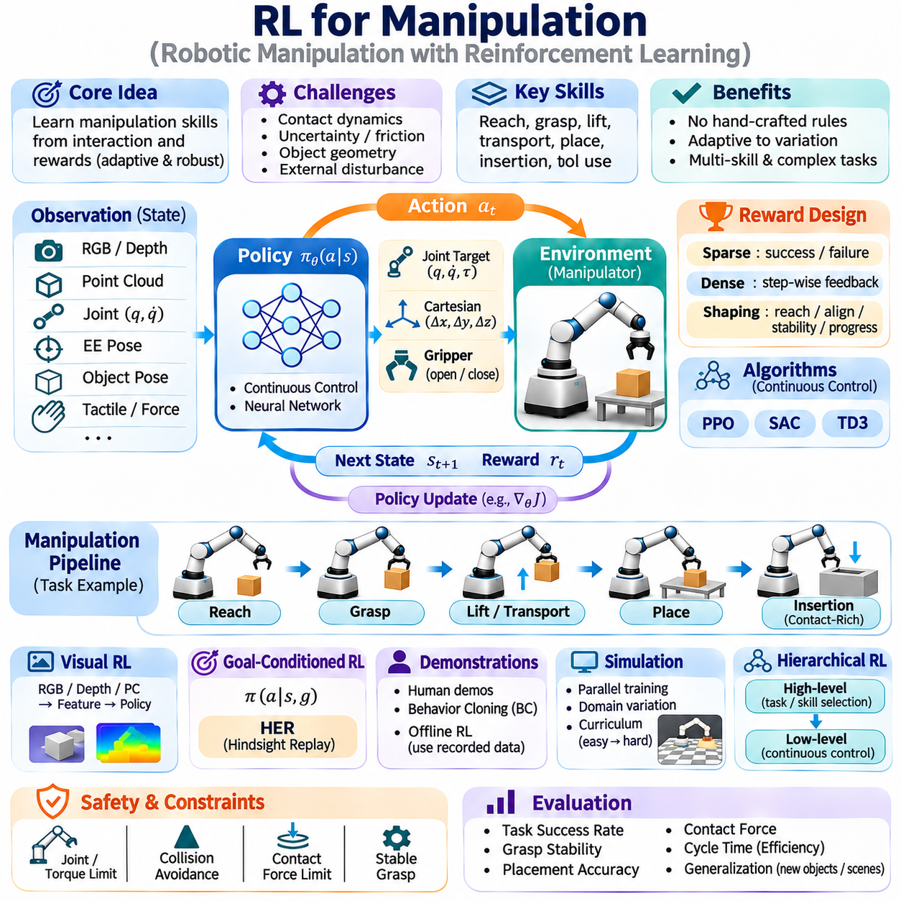{width="7.268055555555556in" height="7.268055555555556in"}

Reinforcement Learning (RL) for robotic manipulation enables robots to acquire physical interaction skills through experience and reward-driven optimization. Rather than relying exclusively on predefined motion trajectories or manually engineered control rules, reinforcement learning allows robots to develop adaptive strategies for reaching, grasping, pushing, lifting, inserting, and manipulating objects under varying environmental conditions.

Robotic manipulation presents significant challenges because physical interactions involve nonlinear dynamics, uncertain contact conditions, friction, object geometry, and external disturbances. Conventional analytical approaches require accurate mathematical models of these interactions, which can be difficult to obtain. Reinforcement learning provides an alternative mechanism for discovering effective manipulation behaviors through repeated interaction and performance feedback.

The state representation in manipulation-oriented reinforcement learning typically includes joint positions, joint velocities, end-effector poses, object positions, object orientations, and gripper configurations. Additional information may incorporate contact forces, tactile measurements, and visual observations. A well-designed state representation enables the agent to understand relevant physical conditions and select appropriate actions throughout a manipulation task.

The action space defines the commands available to the reinforcement learning agent. Manipulation policies may generate joint position targets, joint velocities, torque commands, Cartesian displacements, or gripper opening adjustments. High-level actions can alternatively represent predefined manipulation primitives. Selecting an appropriate action representation is essential for balancing control precision, learning complexity, and physical execution reliability.

Reward design determines which manipulation behaviors the agent attempts to optimize. Positive rewards may encourage successful grasping, accurate object placement, stable contact, and task completion, while penalties may discourage collisions, excessive forces, unnecessary movement, and object damage. Reward functions should reflect actual operational objectives while avoiding unintended behaviors that exploit weaknesses in the specified learning objective.

Sparse rewards provide feedback primarily when a manipulation task succeeds or fails, whereas dense rewards provide intermediate feedback throughout task execution. Although sparse rewards simplify objective definition, they can make exploration difficult in complex manipulation tasks. Reward shaping introduces intermediate learning signals associated with reaching accuracy, object alignment, grasp stability, and progress toward successful task completion.

Continuous control algorithms such as Proximal Policy Optimization (PPO), Soft Actor-Critic (SAC), and Twin Delayed Deep Deterministic Policy Gradient (TD3) are commonly applied to robotic manipulation. These algorithms support learning within high-dimensional continuous action spaces. Their suitability depends on factors such as sample efficiency, computational resources, environmental complexity, and the availability of simulated or physical interaction data.

Reinforcement learning for robotic grasping focuses on discovering effective strategies for approaching, contacting, gripping, and lifting objects. Policies can incorporate visual observations, depth information, and tactile feedback to adapt grasp configurations according to object characteristics. Unlike fixed grasp execution strategies, learned policies can potentially adjust their behavior in response to object movement, slippage, and unexpected contact conditions.

Contact-rich manipulation represents an important application of reinforcement learning because tasks such as insertion, assembly, tool utilization, and surface interaction require precise adaptation to physical contact. Force-torque sensors and tactile sensing provide feedback about interaction conditions. Learned policies can adjust end-effector motion and contact behavior while operating alongside conventional impedance or force controllers.

Visual reinforcement learning integrates perception and manipulation by allowing policies to process image-based observations directly or through learned feature representations. RGB images, depth images, and point clouds can provide information about object geometry, spatial relationships, and environmental conditions. Visual encoders help transform high-dimensional sensory inputs into compact representations suitable for policy learning and action generation.

Goal-conditioned reinforcement learning enables a single policy to perform manipulation tasks associated with different desired outcomes. Goal representations may specify target object positions, orientations, or desired configurations. Hindsight Experience Replay (HER) improves learning from unsuccessful attempts by relabeling recorded trajectories with goals that were actually achieved, particularly benefiting manipulation tasks with sparse rewards.

Human demonstrations can improve reinforcement learning efficiency by providing examples of successful manipulation behaviors. Behavior cloning may initialize a policy before reinforcement learning begins, while demonstration transitions can guide subsequent exploration. Offline reinforcement learning further enables the utilization of previously recorded manipulation experiences without requiring continuous physical interaction during initial policy training.

Simulation environments provide scalable platforms for training manipulation policies across large numbers of virtual robotic instances. Parallel simulation accelerates experience collection and enables systematic variation of object properties, initial configurations, and environmental conditions. Curriculum learning can progressively increase manipulation difficulty, allowing agents to acquire foundational skills before attempting more complex tasks.

Hierarchical reinforcement learning decomposes complex manipulation tasks into manageable behavioral components. High-level policies may select skills such as reaching, grasping, transporting, or placing, while low-level policies generate continuous control commands. This modular architecture supports skill reuse, long-horizon task execution, and integration with task planning systems in advanced robotic manipulation applications.

Performance evaluation should consider manipulation success rates, grasp stability, placement accuracy, contact force, cycle time, sample efficiency, and recovery effectiveness. Generalization must be evaluated using previously unseen objects, workspace configurations, and physical conditions. Independent collision detection, actuator limits, and protective control mechanisms remain essential for industrial deployment.

Within mobile manipulation systems, reinforcement learning for manipulation establishes the foundation for integrating learned robotic arm and end-effector behaviors with autonomous mobile platforms. Combining adaptive manipulation policies with reliable perception, conventional motion planning, feedback control, and independent safety architectures supports flexible robotic operation across diverse industrial and service environments.

로봇 매니퓰레이션을 위한 강화학습(Reinforcement Learning for Robotic Manipulation, RL)은 로봇이 경험(Experience)과 보상 기반 최적화(Reward-Driven Optimization)를 통해 물리적 상호작용 기술(Physical Interaction Skill)을 획득할 수 있도록 한다. 사전에 정의된 모션 궤적(Motion Trajectory)이나 수동으로 설계된 제어 규칙(Control Rule)에만 의존하는 대신, 강화학습은 로봇이 다양한 환경 조건에서 도달 동작(Reaching), 파지(Grasping), 밀기(Pushing), 들어 올리기(Lifting), 삽입(Insertion) 및 물체 조작(Manipulation)을 위한 적응형 전략(Adaptive Strategy)을 개발할 수 있도록 한다.

로봇 매니퓰레이션(Robotic Manipulation)은 물리적 상호작용에 비선형 동역학(Nonlinear Dynamics), 불확실한 접촉 조건(Uncertain Contact Condition), 마찰(Friction), 물체 형상(Object Geometry) 및 외부 외란(External Disturbance)이 포함되므로 상당한 기술적 해결 과제를 가진다. 기존의 해석적 접근 방식(Analytical Approach)은 이러한 상호작용에 대한 정확한 수학적 모델(Mathematical Model)을 필요로 하지만 이를 확보하기 어려울 수 있다. 강화학습은 반복적인 상호작용과 성능 피드백(Performance Feedback)을 통해 효과적인 매니퓰레이션 행동을 발견하기 위한 대안적 메커니즘(Alternative Mechanism)을 제공한다.

매니퓰레이션 중심 강화학습(Manipulation-Oriented Reinforcement Learning)의 상태 표현(State Representation)은 일반적으로 관절 위치(Joint Position), 관절 속도(Joint Velocity), 말단장치 자세(End-Effector Pose), 물체 위치(Object Position), 물체 방향(Object Orientation) 및 그리퍼 구성(Gripper Configuration)을 포함한다. 추가적인 정보에는 접촉력(Contact Force), 촉각 측정값(Tactile Measurement) 및 시각적 관측 정보(Visual Observation)가 포함될 수 있다. 적절하게 설계된 상태 표현은 에이전트가 관련 물리적 조건을 이해하고 매니퓰레이션 작업 전반에 걸쳐 적절한 행동을 선택할 수 있도록 한다.

행동 공간(Action Space)은 강화학습 에이전트(Reinforcement Learning Agent)가 사용할 수 있는 명령을 정의한다. 매니퓰레이션 정책(Manipulation Policy)은 관절 위치 목표값(Joint Position Target), 관절 속도(Joint Velocity), 토크 명령(Torque Command), 직교좌표계 변위(Cartesian Displacement) 또는 그리퍼 개방 조정(Gripper Opening Adjustment)을 생성할 수 있다. 상위 수준 행동(High-Level Action)은 사전에 정의된 매니퓰레이션 프리미티브(Manipulation Primitive)를 나타낼 수도 있다. 적절한 행동 표현(Action Representation)을 선택하는 것은 제어 정밀도(Control Precision), 학습 복잡성(Learning Complexity) 및 물리적 실행 신뢰성(Physical Execution Reliability) 사이의 균형을 유지하기 위해 필수적이다.

보상 설계(Reward Design)는 에이전트가 최적화하고자 하는 매니퓰레이션 행동을 결정한다. 양의 보상(Positive Reward)은 성공적인 파지(Successful Grasping), 정확한 물체 배치(Accurate Object Placement), 안정적인 접촉(Stable Contact) 및 작업 완료(Task Completion)를 장려할 수 있으며, 페널티(Penalty)는 충돌(Collision), 과도한 힘(Excessive Force), 불필요한 움직임(Unnecessary Movement) 및 물체 손상(Object Damage)을 억제할 수 있다. 보상 함수(Reward Function)는 실제 운용 목표(Operational Objective)를 반영하는 동시에 정의된 학습 목표의 취약점을 악용하는 의도하지 않은 행동(Unintended Behavior)을 방지해야 한다.

희소 보상(Sparse Reward)은 주로 매니퓰레이션 작업의 성공 또는 실패 시점에 피드백을 제공하는 반면, 밀집 보상(Dense Reward)은 작업 실행 과정 전반에 걸쳐 중간 피드백(Intermediate Feedback)을 제공한다. 희소 보상은 목표 정의(Objective Definition)를 단순화하지만 복잡한 매니퓰레이션 작업에서 탐색(Exploration)을 어렵게 할 수 있다. 보상 형성(Reward Shaping)은 도달 정밀도(Reaching Accuracy), 물체 정렬(Object Alignment), 파지 안정성(Grasp Stability) 및 성공적인 작업 완료를 향한 진행 상태와 관련된 중간 학습 신호(Intermediate Learning Signal)를 도입한다.

근위 정책 최적화(Proximal Policy Optimization, PPO), 소프트 액터-크리틱(Soft Actor-Critic, SAC) 및 쌍둥이 지연 심층 결정론적 정책 경사(Twin Delayed Deep Deterministic Policy Gradient, TD3)와 같은 연속 제어 알고리즘(Continuous Control Algorithm)은 로봇 매니퓰레이션에 일반적으로 적용된다. 이러한 알고리즘은 고차원 연속 행동 공간(High-Dimensional Continuous Action Space) 내에서의 학습을 지원한다. 각 알고리즘의 적합성은 샘플 효율성(Sample Efficiency), 연산 자원(Computational Resource), 환경 복잡성(Environmental Complexity) 및 시뮬레이션 또는 물리적 상호작용 데이터의 가용성에 따라 달라진다.

로봇 파지를 위한 강화학습(Reinforcement Learning for Robotic Grasping)은 물체에 접근하고, 접촉하고, 파지하고, 들어 올리기 위한 효과적인 전략을 발견하는 데 중점을 둔다. 정책은 시각적 관측 정보(Visual Observation), 깊이 정보(Depth Information) 및 촉각 피드백(Tactile Feedback)을 통합하여 물체 특성(Object Characteristic)에 따라 파지 구성(Grasp Configuration)을 적응적으로 변경할 수 있다. 고정된 파지 실행 전략(Fixed Grasp Execution Strategy)과 달리 학습된 정책(Learned Policy)은 물체 움직임(Object Movement), 미끄러짐(Slippage) 및 예상하지 못한 접촉 조건에 대응하여 행동을 조정할 수 있다.

접촉 중심 매니퓰레이션(Contact-Rich Manipulation)은 삽입(Insertion), 조립(Assembly), 도구 활용(Tool Utilization) 및 표면 상호작용(Surface Interaction)과 같은 작업에서 물리적 접촉에 대한 정밀한 적응이 요구되므로 강화학습의 중요한 응용 분야이다. 힘-토크 센서(Force-Torque Sensor)와 촉각 감지(Tactile Sensing)는 상호작용 조건에 대한 피드백을 제공한다. 학습된 정책은 기존의 임피던스 제어기(Impedance Controller) 또는 힘 제어기(Force Controller)와 함께 작동하면서 말단장치 모션(End-Effector Motion)과 접촉 행동(Contact Behavior)을 조정할 수 있다.

시각 강화학습(Visual Reinforcement Learning)은 정책이 이미지 기반 관측 정보(Image-Based Observation)를 직접 처리하거나 학습된 특징 표현(Learned Feature Representation)을 통해 처리할 수 있도록 함으로써 인식(Perception)과 매니퓰레이션을 통합한다. RGB 이미지, 깊이 이미지(Depth Image) 및 포인트 클라우드(Point Cloud)는 물체 형상(Object Geometry), 공간적 관계(Spatial Relationship) 및 환경 조건에 관한 정보를 제공할 수 있다. 시각 인코더(Visual Encoder)는 고차원 감각 입력(High-Dimensional Sensory Input)을 정책 학습(Policy Learning)과 행동 생성(Action Generation)에 적합한 압축된 표현(Compact Representation)으로 변환하도록 지원한다.

목표 조건부 강화학습(Goal-Conditioned Reinforcement Learning)은 단일 정책(Single Policy)이 서로 다른 목표 결과와 관련된 매니퓰레이션 작업을 수행할 수 있도록 한다. 목표 표현(Goal Representation)은 목표 물체 위치(Target Object Position), 방향(Orientation) 또는 원하는 구성(Desired Configuration)을 지정할 수 있다. 사후 경험 재생(Hindsight Experience Replay, HER)은 기록된 궤적의 목표를 실제로 달성된 목표로 재지정(Relabeling)함으로써 실패한 시도로부터의 학습을 개선하며, 특히 희소 보상을 사용하는 매니퓰레이션 작업에 유용하다.

인간 시연(Human Demonstration)은 성공적인 매니퓰레이션 행동의 사례를 제공함으로써 강화학습 효율성(Reinforcement Learning Efficiency)을 향상시킬 수 있다. 행동 복제(Behavior Cloning)는 강화학습이 시작되기 전에 정책을 초기화(Policy Initialization)할 수 있으며, 시연 전이 데이터(Demonstration Transition Data)는 이후의 탐색을 유도할 수 있다. 오프라인 강화학습(Offline Reinforcement Learning)은 초기 정책 학습(Initial Policy Training) 과정에서 지속적인 물리적 상호작용 없이도 이전에 기록된 매니퓰레이션 경험을 활용할 수 있도록 한다.

시뮬레이션 환경(Simulation Environment)은 대규모 가상 로봇 인스턴스(Virtual Robotic Instance)를 활용하여 매니퓰레이션 정책을 학습시키기 위한 확장 가능한 플랫폼(Scalable Platform)을 제공한다. 병렬 시뮬레이션(Parallel Simulation)은 경험 수집(Experience Collection)을 가속화하고 물체 특성(Object Property), 초기 구성(Initial Configuration) 및 환경 조건(Environmental Condition)을 체계적으로 변화시킬 수 있도록 한다. 커리큘럼 학습(Curriculum Learning)은 매니퓰레이션 난이도를 점진적으로 증가시켜 에이전트가 더욱 복잡한 작업을 시도하기 전에 기초 기술(Foundational Skill)을 획득할 수 있도록 한다.

계층적 강화학습(Hierarchical Reinforcement Learning)은 복잡한 매니퓰레이션 작업을 관리 가능한 행동 구성요소(Behavioral Component)로 분해한다. 상위 수준 정책(High-Level Policy)은 도달 동작(Reaching), 파지(Grasping), 운반(Transporting) 또는 배치(Placing)와 같은 기술을 선택할 수 있으며, 하위 수준 정책(Low-Level Policy)은 연속 제어 명령(Continuous Control Command)을 생성한다. 이러한 모듈형 아키텍처(Modular Architecture)는 고급 로봇 매니퓰레이션 응용 분야에서 기술 재사용(Skill Reuse), 장기 시계열 작업 실행(Long-Horizon Task Execution) 및 작업 계획 시스템(Task Planning System)과의 통합을 지원한다.

성능 평가(Performance Evaluation)는 매니퓰레이션 성공률(Manipulation Success Rate), 파지 안정성(Grasp Stability), 배치 정밀도(Placement Accuracy), 접촉력(Contact Force), 사이클 타임(Cycle Time), 샘플 효율성(Sample Efficiency) 및 복구 효과성(Recovery Effectiveness)을 고려해야 한다. 일반화(Generalization)는 학습 과정에서 경험하지 못한 물체, 작업 공간 구성(Workspace Configuration) 및 물리적 조건을 사용하여 평가해야 한다. 독립적인 충돌 감지(Independent Collision Detection), 액추에이터 한계(Actuator Limit) 및 보호 제어 메커니즘(Protective Control Mechanism)은 산업 현장 적용(Industrial Deployment)을 위해 여전히 필수적이다.

모바일 매니퓰레이션 시스템(Mobile Manipulation System)에서 매니퓰레이션을 위한 강화학습은 학습된 로봇 팔(Robotic Arm) 및 말단장치(End Effector)의 행동을 자율이동 플랫폼(Autonomous Mobile Platform)과 통합하기 위한 기반을 확립한다. 적응형 매니퓰레이션 정책(Adaptive Manipulation Policy)을 신뢰성 높은 인식(Reliable Perception), 기존 모션 계획(Conventional Motion Planning), 피드백 제어(Feedback Control) 및 독립적인 안전 아키텍처(Independent Safety Architecture)와 결합하는 것은 다양한 산업 및 서비스 환경에서 유연한 로봇 운용(Flexible Robotic Operation)을 지원한다.

##  

## 08 RL for Mobile Manipulators

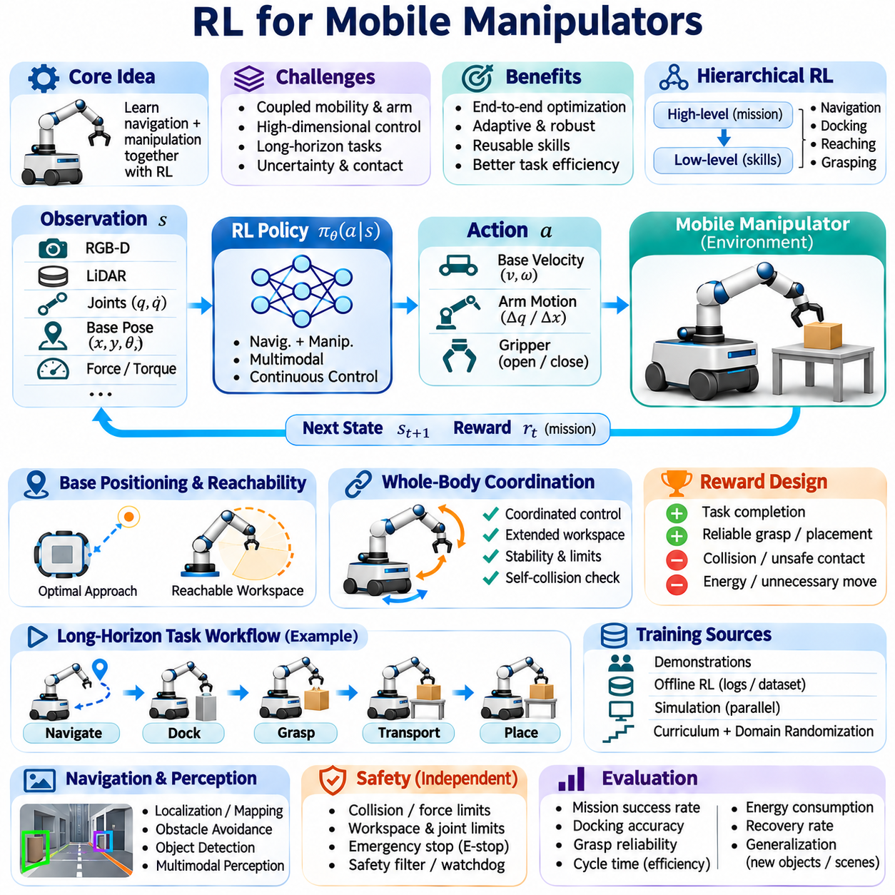{width="7.268055555555556in" height="7.268055555555556in"}

Reinforcement Learning (RL) for mobile manipulators extends conventional robotic learning by integrating autonomous navigation and physical manipulation within a unified decision-making framework. Unlike stationary robotic arms, mobile manipulators must coordinate platform movement, object perception, manipulator positioning, and physical interaction. Reinforcement learning enables these systems to acquire adaptive behaviors through experience-driven optimization.

Mobile manipulators combine the mobility of Autonomous Mobile Robots (AMRs) with the physical interaction capabilities of robotic manipulators. This combination introduces complex dependencies between base positioning, manipulator reachability, environmental accessibility, and task execution. Reinforcement learning can optimize these interdependent behaviors according to overall mission objectives rather than treating navigation and manipulation as entirely independent processes.

The state representation for mobile manipulation includes mobile base position, orientation, velocity, manipulator joint states, end-effector pose, gripper configuration, and environmental observations. Additional information may incorporate obstacle locations, object poses, battery status, and task progress. Multimodal state representations enable the learning agent to evaluate both navigation-related and manipulation-related operational conditions.

The action space of a mobile manipulator may include linear and angular base velocities, steering commands, joint position targets, Cartesian displacements, and gripper commands. Whole-body reinforcement learning combines these actions within an integrated policy, whereas modular approaches maintain separate control policies. Action representation must account for platform kinematics, actuator limitations, and differences in subsystem control frequencies.

Reward design for mobile manipulation should reflect overall mission performance rather than individual subsystem performance alone. Positive rewards may encourage successful navigation, accurate docking, reliable grasping, object transportation, and task completion. Penalties may discourage collisions, excessive energy consumption, unstable movements, unnecessary repositioning, and unsuccessful manipulation attempts.

Hierarchical Reinforcement Learning (HRL) provides an effective architecture for managing complex mobile manipulation tasks. High-level policies determine operational objectives, select target locations, and coordinate task sequences, while low-level policies execute navigation, docking, reaching, and grasping behaviors. This decomposition reduces learning complexity and supports reusable robotic skills across different operational scenarios.

Navigation-oriented reinforcement learning enables mobile manipulators to develop adaptive movement strategies in dynamic and partially observable environments. Policies may learn obstacle avoidance, local trajectory adjustment, target approach, and recovery behaviors. Integration with conventional localization, mapping, and global path planning systems allows learned navigation strategies to operate within structured autonomous mobility architectures.

Base positioning is particularly important because the location and orientation of the mobile platform directly influence manipulator reachability, visibility, and task feasibility. Reinforcement learning can optimize approach positions according to target object locations, workspace accessibility, collision constraints, and arm manipulability. Effective positioning reduces unnecessary platform movements and improves overall manipulation efficiency.

Whole-body reinforcement learning coordinates mobile base and robotic arm movements simultaneously to achieve shared manipulation objectives. This approach can extend the effective workspace, improve access to constrained locations, and support continuous object interaction during platform movement. Physical stability, payload distribution, acceleration limits, and self-collision constraints must be considered when learning coordinated behaviors.

Perception-driven reinforcement learning integrates RGB cameras, depth sensors, LiDAR, proprioceptive measurements, and force-torque feedback into the decision-making process. Multimodal neural networks transform sensory observations into compact representations suitable for policy learning. Recurrent networks or temporal observation histories can help compensate for incomplete environmental information and temporary sensor occlusion.

Long-horizon mobile manipulation tasks require the execution of multiple interconnected behaviors, including navigation, object identification, approach, grasping, transportation, and placement. Reinforcement learning must address delayed rewards and temporal credit assignment across these stages. Skill-based policies, intermediate objectives, and structured task representations can improve learning efficiency and execution consistency.

Human demonstrations and offline reinforcement learning can reduce the amount of physical exploration required during mobile manipulator development. Previously recorded navigation trajectories, docking operations, grasping attempts, and object transportation sequences provide valuable training experiences. Demonstration-based initialization and offline policy optimization can establish foundational competencies before controlled interactive refinement.

Simulation-based reinforcement learning enables mobile manipulators to acquire coordinated behaviors across numerous virtual environments. Parallel simulation supports large-scale experience collection, while curriculum learning progressively introduces more complex layouts, object configurations, and manipulation requirements. Domain randomization helps prepare learned policies for variations in real-world physical and sensory conditions.

Industrial applications include warehouse order picking, production line material handling, machine tending, autonomous inspection, and flexible assembly operations. Reinforcement learning can improve adaptability when object locations, workstation configurations, and operational conditions change. Learned policies can also support recovery strategies when docking, grasping, or transportation operations fail unexpectedly.

Performance evaluation should consider mission success rate, navigation efficiency, docking accuracy, grasp reliability, task cycle time, energy consumption, and recovery effectiveness. Validation must include previously unseen environments, payload variations, sensor disturbances, and unexpected obstacles. Independent safety supervision, collision monitoring, and conventional feedback controllers remain essential for reliable physical deployment.

Reinforcement learning for mobile manipulators establishes a technical foundation for integrated physical intelligence by connecting mobility, perception, manipulation, and adaptive decision-making. Combining learned policies with task planning, motion planning, real-time control, and safety architectures supports scalable robotic autonomy. Simulation-to-reality transfer and safety-aware reinforcement learning further extend this foundation toward practical deployment.

모바일 매니퓰레이터를 위한 강화학습(Reinforcement Learning for Mobile Manipulators, RL)은 자율주행(Autonomous Navigation)과 물리적 매니퓰레이션(Physical Manipulation)을 통합된 의사결정 프레임워크(Unified Decision-Making Framework) 내에서 결합함으로써 기존 로봇 학습(Robotic Learning)을 확장한다. 고정형 로봇 팔(Stationary Robotic Arm)과 달리 모바일 매니퓰레이터(Mobile Manipulator)는 플랫폼 이동(Platform Movement), 물체 인식(Object Perception), 매니퓰레이터 위치 결정(Manipulator Positioning) 및 물리적 상호작용(Physical Interaction)을 조율해야 한다. 강화학습은 경험 기반 최적화(Experience-Driven Optimization)를 통해 이러한 시스템이 적응형 행동(Adaptive Behavior)을 획득할 수 있도록 한다.

모바일 매니퓰레이터는 자율이동로봇(Autonomous Mobile Robot, AMR)의 이동성과 로봇 매니퓰레이터(Robotic Manipulator)의 물리적 상호작용 능력을 결합한다. 이러한 결합은 베이스 위치 결정(Base Positioning), 매니퓰레이터 도달 가능성(Manipulator Reachability), 환경 접근성(Environmental Accessibility) 및 작업 실행(Task Execution) 사이에 복잡한 상호 의존성을 발생시킨다. 강화학습은 자율주행과 매니퓰레이션을 완전히 독립적인 프로세스로 취급하는 대신 전체 임무 목표(Overall Mission Objective)에 따라 이러한 상호 의존적인 행동을 최적화할 수 있다.

모바일 매니퓰레이션을 위한 상태 표현(State Representation)은 모바일 베이스의 위치(Position), 방향(Orientation), 속도(Velocity), 매니퓰레이터 관절 상태(Joint State), 말단장치 자세(End-Effector Pose), 그리퍼 구성(Gripper Configuration) 및 환경 관측 정보(Environmental Observation)를 포함한다. 추가적인 정보에는 장애물 위치(Obstacle Location), 물체 자세(Object Pose), 배터리 상태(Battery Status) 및 작업 진행 상태(Task Progress)가 포함될 수 있다. 멀티모달 상태 표현(Multimodal State Representation)은 학습 에이전트(Learning Agent)가 자율주행 및 매니퓰레이션과 관련된 운용 조건을 모두 평가할 수 있도록 한다.

모바일 매니퓰레이터의 행동 공간(Action Space)은 선속도(Linear Velocity)와 각속도(Angular Velocity), 조향 명령(Steering Command), 관절 위치 목표값(Joint Position Target), 직교좌표계 변위(Cartesian Displacement) 및 그리퍼 명령(Gripper Command)을 포함할 수 있다. 전신 강화학습(Whole-Body Reinforcement Learning)은 이러한 행동을 통합된 정책(Integrated Policy) 내에서 결합하는 반면, 모듈형 접근 방식(Modular Approach)은 독립적인 제어 정책(Separate Control Policy)을 유지한다. 행동 표현(Action Representation)은 플랫폼 기구학(Platform Kinematics), 액추에이터 제한(Actuator Limitation) 및 하위 시스템별 제어 주파수(Control Frequency)의 차이를 고려해야 한다.

모바일 매니퓰레이션을 위한 보상 설계(Reward Design)는 개별 하위 시스템의 성능만이 아니라 전체 임무 성능(Overall Mission Performance)을 반영해야 한다. 양의 보상(Positive Reward)은 성공적인 자율주행, 정확한 도킹(Accurate Docking), 신뢰성 높은 파지(Reliable Grasping), 물체 운반(Object Transportation) 및 작업 완료(Task Completion)를 장려할 수 있다. 페널티(Penalty)는 충돌(Collision), 과도한 에너지 소비(Excessive Energy Consumption), 불안정한 움직임(Unstable Movement), 불필요한 위치 재조정(Unnecessary Repositioning) 및 실패한 매니퓰레이션 시도(Unsuccessful Manipulation Attempt)를 억제할 수 있다.

계층적 강화학습(Hierarchical Reinforcement Learning, HRL)은 복잡한 모바일 매니퓰레이션 작업을 관리하기 위한 효과적인 아키텍처(Architecture)를 제공한다. 상위 수준 정책(High-Level Policy)은 운용 목표(Operational Objective)를 결정하고 목표 위치(Target Location)를 선택하며 작업 순서(Task Sequence)를 조율하는 반면, 하위 수준 정책(Low-Level Policy)은 자율주행, 도킹, 도달 동작(Reaching) 및 파지 행동(Grasping Behavior)을 실행한다. 이러한 분해 방식은 학습 복잡성(Learning Complexity)을 감소시키고 서로 다른 운용 시나리오(Operational Scenario)에서 재사용 가능한 로봇 기술(Reusable Robotic Skill)을 지원한다.

자율주행 중심 강화학습(Navigation-Oriented Reinforcement Learning)은 모바일 매니퓰레이터가 동적이고 부분적으로 관측 가능한 환경(Dynamic and Partially Observable Environment)에서 적응형 이동 전략(Adaptive Movement Strategy)을 개발할 수 있도록 한다. 정책은 장애물 회피(Obstacle Avoidance), 지역 궤적 조정(Local Trajectory Adjustment), 목표 접근(Target Approach) 및 복구 행동(Recovery Behavior)을 학습할 수 있다. 기존의 위치 추정(Localization), 지도 작성(Mapping) 및 전역 경로 계획(Global Path Planning) 시스템과 통합하면 학습된 자율주행 전략을 체계적인 자율이동 아키텍처(Autonomous Mobility Architecture) 내에서 운용할 수 있다.

베이스 위치 결정(Base Positioning)은 모바일 플랫폼의 위치와 방향이 매니퓰레이터의 도달 가능성(Manipulator Reachability), 가시성(Visibility) 및 작업 실행 가능성(Task Feasibility)에 직접적인 영향을 미치므로 특히 중요하다. 강화학습은 목표 물체 위치(Target Object Location), 작업 공간 접근성(Workspace Accessibility), 충돌 제약조건(Collision Constraint) 및 팔의 조작성(Arm Manipulability)을 기준으로 접근 위치(Approach Position)를 최적화할 수 있다. 효과적인 위치 결정은 불필요한 플랫폼 이동을 줄이고 전체 매니퓰레이션 효율성(Overall Manipulation Efficiency)을 향상시킨다.

전신 강화학습(Whole-Body Reinforcement Learning)은 공동의 매니퓰레이션 목표(Shared Manipulation Objective)를 달성하기 위해 모바일 베이스와 로봇 팔의 움직임을 동시에 조율한다. 이러한 접근 방식은 유효 작업 공간(Effective Workspace)을 확장하고 제한된 위치(Constrained Location)에 대한 접근성을 개선하며 플랫폼 이동 중에도 지속적인 물체 상호작용(Object Interaction)을 지원할 수 있다. 협조 행동(Coordinated Behavior)을 학습할 때는 물리적 안정성(Physical Stability), 적재물 분포(Payload Distribution), 가속도 제한(Acceleration Limit) 및 자체 충돌 제약조건(Self-Collision Constraint)을 고려해야 한다.

인식 기반 강화학습(Perception-Driven Reinforcement Learning)은 RGB 카메라, 깊이 센서(Depth Sensor), 라이다(LiDAR), 고유수용감각 측정값(Proprioceptive Measurement) 및 힘-토크 피드백(Force-Torque Feedback)을 의사결정 과정에 통합한다. 멀티모달 신경망(Multimodal Neural Network)은 감각 관측 정보(Sensory Observation)를 정책 학습에 적합한 압축 표현(Compact Representation)으로 변환한다. 순환 신경망(Recurrent Neural Network) 또는 시간적 관측 이력(Temporal Observation History)은 불완전한 환경 정보와 일시적인 센서 가림(Sensor Occlusion)을 보완하는 데 도움을 줄 수 있다.

장기 모바일 매니퓰레이션 작업(Long-Horizon Mobile Manipulation Task)은 자율주행, 물체 식별(Object Identification), 접근(Approach), 파지, 운반 및 배치를 포함하는 여러 상호 연결된 행동을 실행해야 한다. 강화학습은 이러한 단계 전반에 걸쳐 지연 보상(Delayed Reward)과 시간적 신용 할당(Temporal Credit Assignment) 문제를 해결해야 한다. 기술 기반 정책(Skill-Based Policy), 중간 목표(Intermediate Objective) 및 구조화된 작업 표현(Structured Task Representation)은 학습 효율성(Learning Efficiency)과 실행 일관성(Execution Consistency)을 향상시킬 수 있다.

인간 시연(Human Demonstration)과 오프라인 강화학습(Offline Reinforcement Learning)은 모바일 매니퓰레이터 개발 과정에서 필요한 물리적 탐색량(Physical Exploration)을 감소시킬 수 있다. 이전에 기록된 자율주행 궤적(Navigation Trajectory), 도킹 작업(Docking Operation), 파지 시도(Grasping Attempt) 및 물체 운반 시퀀스(Object Transportation Sequence)는 가치 있는 학습 경험(Training Experience)을 제공한다. 시연 기반 초기화(Demonstration-Based Initialization)와 오프라인 정책 최적화(Offline Policy Optimization)는 통제된 상호작용 기반 개선(Controlled Interactive Refinement)에 앞서 기본적인 운용 능력(Foundational Competency)을 확보할 수 있도록 한다.

시뮬레이션 기반 강화학습(Simulation-Based Reinforcement Learning)은 모바일 매니퓰레이터가 다수의 가상 환경(Virtual Environment)에서 협조 행동(Coordinated Behavior)을 획득할 수 있도록 한다. 병렬 시뮬레이션(Parallel Simulation)은 대규모 경험 수집(Large-Scale Experience Collection)을 지원하며, 커리큘럼 학습(Curriculum Learning)은 더욱 복잡한 레이아웃(Layout), 물체 구성(Object Configuration) 및 매니퓰레이션 요구사항(Manipulation Requirement)을 점진적으로 도입한다. 도메인 무작위화(Domain Randomization)는 실제 물리적 조건과 감각 조건의 변화에 대응할 수 있도록 학습된 정책을 준비시키는 데 도움을 준다.

산업 응용 분야(Industrial Application)에는 창고 주문 피킹(Warehouse Order Picking), 생산 라인 자재 취급(Production Line Material Handling), 머신 텐딩(Machine Tending), 자율 검사(Autonomous Inspection) 및 유연 조립(Flexible Assembly) 작업이 포함된다. 강화학습은 물체 위치(Object Location), 작업 스테이션 구성(Workstation Configuration) 및 운용 조건(Operational Condition)이 변경될 때 적응성을 향상시킬 수 있다. 학습된 정책은 도킹, 파지 또는 운반 작업이 예기치 않게 실패하는 경우 복구 전략(Recovery Strategy)을 지원할 수도 있다.

성능 평가는 임무 성공률(Mission Success Rate), 자율주행 효율성(Navigation Efficiency), 도킹 정밀도(Docking Accuracy), 파지 신뢰성(Grasp Reliability), 작업 사이클 타임(Task Cycle Time), 에너지 소비(Energy Consumption) 및 복구 효과성(Recovery Effectiveness)을 고려해야 한다. 검증 과정에는 이전에 경험하지 못한 환경, 적재물 변화(Payload Variation), 센서 외란(Sensor Disturbance) 및 예상하지 못한 장애물(Unexpected Obstacle)이 포함되어야 한다. 신뢰성 높은 물리적 현장 적용(Physical Deployment)을 위해서는 독립적인 안전 감독(Independent Safety Supervision), 충돌 모니터링(Collision Monitoring) 및 기존 피드백 제어기(Conventional Feedback Controller)가 여전히 필수적이다.

모바일 매니퓰레이터를 위한 강화학습은 이동성(Mobility), 인식(Perception), 매니퓰레이션(Manipulation) 및 적응형 의사결정(Adaptive Decision-Making)을 연결함으로써 통합 물리 지능(Integrated Physical Intelligence)을 구현하기 위한 기술적 기반을 확립한다. 학습된 정책을 작업 계획(Task Planning), 모션 계획(Motion Planning), 실시간 제어(Real-Time Control) 및 안전 아키텍처(Safety Architecture)와 결합하면 확장 가능한 로봇 자율성(Scalable Robotic Autonomy)을 지원할 수 있다. 시뮬레이션-현실 전이(Simulation-to-Reality Transfer)와 안전 인식 강화학습(Safety-Aware Reinforcement Learning)은 이러한 기반을 실제 산업 현장 적용으로 확장한다.

##  

## 09 Sim2Real RL

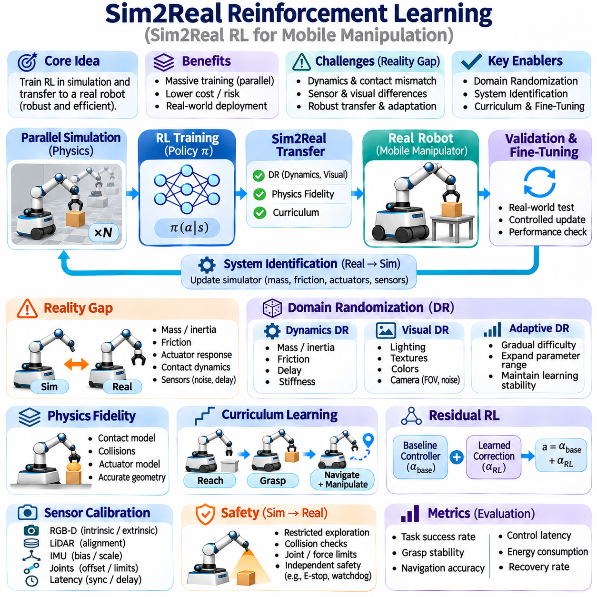{width="7.268055555555556in" height="7.268055555555556in"}

Sim-to-Real Reinforcement Learning (Sim2Real RL) is an approach that transfers reinforcement learning policies trained in simulated environments to physical robotic systems. It addresses the difficulty of acquiring sufficient training experience directly from real robots, where experimentation can be expensive, time-consuming, and potentially hazardous. In mobile manipulation, Sim2Real enables robots to develop navigation, grasping, and coordinated control skills through extensive simulation before physical deployment.

Simulation provides a controlled environment in which reinforcement learning agents can interact with virtual robots and objects without the operational risks associated with physical experimentation. Large numbers of training episodes can be executed in parallel, allowing policies to explore different actions, environmental conditions, and task configurations. This capability significantly increases training throughput and reduces dependence on expensive physical data collection.

However, simulated environments cannot perfectly reproduce real-world physical behavior. Differences in mass, friction, inertia, actuator response, contact dynamics, sensor characteristics, and environmental geometry create a phenomenon known as the reality gap. A policy that performs successfully in simulation may experience unexpected failures when transferred to physical hardware because the learned behavior depends on assumptions that are not fully satisfied in the real environment.

Domain Randomization is one of the most widely used techniques for reducing sensitivity to simulation inaccuracies. During training, physical parameters such as object mass, friction coefficients, joint damping, actuator delays, and sensor noise are randomly varied. Environmental conditions, lighting, object positions, and obstacle configurations can also be randomized. Exposure to these variations encourages policies to learn robust behaviors rather than overfitting to a single simulated configuration.

Dynamics Randomization specifically focuses on variations in the physical properties and motion characteristics of robotic systems. Parameters such as link mass, inertia, joint friction, motor strength, and contact stiffness are modified across training episodes. This approach helps reinforcement learning agents develop policies that remain effective despite uncertainties in the physical dynamics of real robotic platforms and manipulation systems.

Visual Domain Randomization introduces variations in image appearance, including lighting intensity, shadows, textures, colors, backgrounds, and camera parameters. These modifications reduce the dependence of learned policies on specific visual characteristics of simulation environments. For mobile manipulators using RGB or RGB-D cameras, visual randomization improves the ability to recognize objects and interpret workspace conditions under changing real-world illumination.

System Identification provides an alternative or complementary approach by estimating the physical parameters of the real robot and incorporating them into the simulation model. Experimental measurements can be used to identify mass properties, friction, actuator response, motion delays, and sensor characteristics. Improving the accuracy of the simulation model reduces the reality gap and can make subsequent reinforcement learning and policy transfer more reliable.

Adaptive Domain Randomization adjusts the distribution of randomized simulation parameters according to the learning progress of the agent. Instead of applying arbitrary parameter variations throughout training, the simulation gradually introduces increasingly challenging conditions. This approach helps maintain a balance between learning difficulty and policy performance while improving robustness across a broader range of environmental configurations.

Simulation environments must reproduce relevant physical interactions with sufficient accuracy to support meaningful policy learning. Contact modeling is particularly important for robotic grasping, insertion, pushing, and assembly tasks. Inaccurate collision geometry, friction models, or contact resolution can produce unrealistic manipulation behaviors. Appropriate physics engines, collision detection, and actuator models are therefore essential components of reliable Sim2Real development.

Parallel simulation is an important advantage of modern reinforcement learning platforms. Multiple virtual robots can simultaneously collect experiences under different environmental conditions, accelerating policy optimization. GPU-accelerated simulation environments can support large-scale training of perception and control policies, while physics-based simulation provides the interaction feedback required for learning physically meaningful robotic behaviors.

Curriculum Learning can improve Sim2Real training by progressively increasing task complexity. A mobile manipulator may initially learn basic reaching and grasping under simplified conditions before progressing to cluttered environments, uncertain object positions, dynamic obstacles, and coordinated navigation-manipulation tasks. Gradual difficulty increases help the agent acquire foundational behaviors before addressing more challenging operational scenarios.

Residual Reinforcement Learning provides another strategy for transferring learned policies to physical systems. A conventional controller generates a baseline control command, while a learned policy produces an additional corrective action. This architecture combines the predictability of established control methods with the adaptability of reinforcement learning. It is particularly useful when transferring manipulation policies that require precise motion and contact adjustment.

Real-world fine-tuning can further improve policies after their initial transfer from simulation. A pretrained policy is deployed under controlled physical conditions, and additional interaction data is collected to refine its behavior. Limited real-world training can compensate for residual differences between simulation and reality. Safety constraints, restricted exploration, and continuous performance monitoring are necessary to prevent equipment damage during this process.

Sim2Real transfer for mobile manipulators must address differences across both the mobile platform and the robotic arm. Navigation policies must account for actual wheel dynamics, floor friction, localization errors, braking characteristics, and payload-dependent motion. Manipulation policies must additionally handle real contact forces, grasp uncertainty, joint compliance, and object variation. Coordinated transfer requires consistent calibration and accurate relationships between the mobile base, arm, sensors, and workspace.

Sensor calibration and synchronization are critical for successful Sim2Real deployment. Camera extrinsic parameters, depth measurement characteristics, LiDAR alignment, IMU orientation, and joint feedback must correspond to the physical robot configuration. Differences in sensor latency, noise, resolution, and coordinate transformations can significantly affect learned policies. Sensor randomization during simulation and accurate hardware calibration help reduce these transfer-related problems.

Performance validation should compare simulation results with physical robot experiments using consistent evaluation metrics. Task success rate, grasp stability, navigation accuracy, control latency, energy consumption, collision frequency, and recovery performance provide useful indicators. Testing should include different objects, payloads, environmental layouts, lighting conditions, and operational disturbances to determine whether the transferred policy generalizes beyond its original training scenarios.

Sim-to-Real Reinforcement Learning provides an important foundation for scalable robotic learning by combining the experimentation capacity of simulation with the physical adaptability of real robotic systems. Integrating domain randomization, system identification, parallel simulation, controlled fine-tuning, and safety supervision enables more reliable policy transfer. For mobile manipulators, this approach supports the development of adaptive physical intelligence while reducing the cost and risks of learning directly in industrial environments.

시뮬레이션-현실 강화학습(Sim-to-Real Reinforcement Learning, Sim2Real RL)은 시뮬레이션 환경(Simulated Environment)에서 학습한 강화학습 정책(Reinforcement Learning Policy)을 실제 로봇 시스템(Physical Robotic System)으로 전이(Transfer)하는 접근 방식이다. 실제 로봇에서 충분한 학습 경험(Training Experience)을 확보하는 과정은 비용이 많이 들고 시간이 오래 걸리며 잠재적으로 위험할 수 있다. 모바일 매니퓰레이션(Mobile Manipulation)에서 Sim2Real은 실제 현장에 배치하기 전에 광범위한 시뮬레이션을 통해 로봇이 자율주행, 파지 및 협조 제어 기술(Coordinated Control Skill)을 개발할 수 있도록 한다.

시뮬레이션(Simulation)은 강화학습 에이전트(Reinforcement Learning Agent)가 물리적 실험과 관련된 운용 위험 없이 가상 로봇(Virtual Robot) 및 물체와 상호작용할 수 있는 통제된 환경(Controlled Environment)을 제공한다. 대량의 학습 에피소드(Training Episode)를 병렬로 실행할 수 있으므로 정책은 다양한 행동, 환경 조건 및 작업 구성을 탐색할 수 있다. 이러한 기능은 학습 처리량(Training Throughput)을 크게 증가시키고 비용이 많이 드는 실제 데이터 수집(Physical Data Collection)에 대한 의존성을 감소시킨다.

그러나 시뮬레이션 환경은 실제 세계의 물리적 행동을 완벽하게 재현할 수 없다. 질량(Mass), 마찰(Friction), 관성(Inertia), 액추에이터 응답(Actuator Response), 접촉 동역학(Contact Dynamics), 센서 특성(Sensor Characteristic) 및 환경 형상(Environmental Geometry)의 차이는 현실 격차(Reality Gap)라는 현상을 발생시킨다. 시뮬레이션에서 성공적으로 작동하는 정책이라도 학습된 행동이 실제 환경에서 완전히 충족되지 않는 가정에 의존하기 때문에 실제 하드웨어로 전이할 때 예상하지 못한 실패를 경험할 수 있다.

도메인 무작위화(Domain Randomization)는 시뮬레이션 부정확성(Simulation Inaccuracy)에 대한 민감도를 감소시키기 위해 가장 널리 사용되는 기법 중 하나이다. 학습 과정에서 물체 질량(Object Mass), 마찰 계수(Friction Coefficient), 관절 감쇠(Joint Damping), 액추에이터 지연(Actuator Delay) 및 센서 노이즈(Sensor Noise)와 같은 물리적 매개변수(Physical Parameter)를 무작위로 변경한다. 환경 조건(Environmental Condition), 조명(Lighting), 물체 위치(Object Position) 및 장애물 구성(Obstacle Configuration)도 무작위화할 수 있다. 이러한 변화에 노출되면 정책은 단일 시뮬레이션 구성(Simulated Configuration)에 과적합(Overfitting)하는 대신 강건한 행동(Robust Behavior)을 학습하게 된다.

동역학 무작위화(Dynamics Randomization)는 로봇 시스템의 물리적 특성과 운동 특성(Physical Properties and Motion Characteristics)의 변화에 구체적으로 초점을 맞춘다. 링크 질량(Link Mass), 관성(Inertia), 관절 마찰(Joint Friction), 모터 출력(Motor Strength) 및 접촉 강성(Contact Stiffness)과 같은 매개변수는 학습 에피소드마다 변경된다. 이러한 접근 방식은 실제 로봇 플랫폼과 매니퓰레이션 시스템의 물리적 동역학(Physical Dynamics)에 불확실성이 존재하더라도 강화학습 에이전트가 효과적으로 작동하는 정책을 개발할 수 있도록 한다.

시각 도메인 무작위화(Visual Domain Randomization)는 조명 강도(Lighting Intensity), 그림자(Shadow), 텍스처(Texture), 색상(Color), 배경(Background) 및 카메라 매개변수(Camera Parameter)를 포함한 이미지 외관(Image Appearance)의 변화를 도입한다. 이러한 변경은 학습된 정책이 시뮬레이션 환경의 특정 시각적 특성에 의존하는 것을 감소시킨다. RGB 또는 RGB-D 카메라를 사용하는 모바일 매니퓰레이터에서 시각 무작위화는 실제 조명 조건이 변화하더라도 물체를 인식하고 작업 공간 조건(Workspace Condition)을 해석하는 능력을 향상시킨다.

시스템 식별(System Identification)은 실제 로봇의 물리적 매개변수를 추정하고 이를 시뮬레이션 모델(Simulation Model)에 반영하는 대안적이거나 보완적인 접근 방식이다. 실험 측정값(Experimental Measurement)은 질량 특성(Mass Property), 마찰(Friction), 액추에이터 응답, 모션 지연(Motion Delay) 및 센서 특성을 식별하는 데 사용될 수 있다. 시뮬레이션 모델의 정확도를 향상시키면 현실 격차가 감소하고 후속 강화학습과 정책 전이(Policy Transfer)의 신뢰성을 높일 수 있다.

적응형 도메인 무작위화(Adaptive Domain Randomization)는 에이전트의 학습 진행 상태(Learning Progress)에 따라 무작위화된 시뮬레이션 매개변수의 분포(Distribution)를 조정한다. 학습 전반에 걸쳐 임의의 매개변수 변화를 적용하는 대신 시뮬레이션은 점진적으로 더욱 어려운 조건을 도입한다. 이러한 접근 방식은 학습 난이도(Learning Difficulty)와 정책 성능(Policy Performance) 사이의 균형을 유지하면서 더욱 광범위한 환경 구성에 대한 강건성을 향상시킨다.

시뮬레이션 환경은 의미 있는 정책 학습(Policy Learning)을 지원하기 위해 관련 물리적 상호작용(Physical Interaction)을 충분히 정확하게 재현해야 한다. 접촉 모델링(Contact Modeling)은 로봇 파지(Robotic Grasping), 삽입(Insertion), 밀기(Pushing) 및 조립(Assembly) 작업에서 특히 중요하다. 부정확한 충돌 형상(Collision Geometry), 마찰 모델(Friction Model) 또는 접촉 해석(Contact Resolution)은 비현실적인 매니퓰레이션 행동을 생성할 수 있다. 따라서 적절한 물리 엔진(Physics Engine), 충돌 감지(Collision Detection) 및 액추에이터 모델(Actuator Model)은 신뢰성 높은 Sim2Real 개발의 필수 구성요소이다.

병렬 시뮬레이션(Parallel Simulation)은 최신 강화학습 플랫폼이 제공하는 중요한 장점이다. 여러 가상 로봇이 서로 다른 환경 조건에서 동시에 경험을 수집하여 정책 최적화(Policy Optimization)를 가속화할 수 있다. GPU 가속 시뮬레이션 환경(GPU-Accelerated Simulation Environment)은 인식 정책(Perception Policy)과 제어 정책(Control Policy)의 대규모 학습을 지원할 수 있으며, 물리 기반 시뮬레이션(Physics-Based Simulation)은 물리적으로 의미 있는 로봇 행동을 학습하는 데 필요한 상호작용 피드백(Interaction Feedback)을 제공한다.

커리큘럼 학습(Curriculum Learning)은 작업 복잡성(Task Complexity)을 점진적으로 증가시켜 Sim2Real 학습을 개선할 수 있다. 모바일 매니퓰레이터는 처음에 단순화된 조건에서 기본적인 도달 동작(Reaching)과 파지(Grasping)를 학습한 다음, 복잡한 환경, 불확실한 물체 위치, 동적 장애물(Dynamic Obstacle) 및 자율주행과 매니퓰레이션이 결합된 작업으로 발전할 수 있다. 난이도를 점진적으로 증가시키면 에이전트가 더욱 어려운 운용 시나리오(Operational Scenario)를 처리하기 전에 기초 행동(Foundational Behavior)을 획득할 수 있다.

잔차 강화학습(Residual Reinforcement Learning)은 실제 시스템으로 학습된 정책을 전이하기 위한 또 다른 전략을 제공한다. 기존 제어기(Conventional Controller)는 기본 제어 명령(Baseline Control Command)을 생성하고, 학습된 정책은 추가적인 보정 행동(Corrective Action)을 생성한다. 이러한 아키텍처는 기존 제어 방식의 예측 가능성(Predictability)과 강화학습의 적응성(Adaptability)을 결합한다. 이는 정밀한 모션과 접촉 조정(Contact Adjustment)이 필요한 매니퓰레이션 정책을 전이할 때 특히 유용하다.

실제 환경 미세조정(Real-World Fine-Tuning)은 시뮬레이션에서 실제 시스템으로 초기 전이한 이후 정책을 추가적으로 개선할 수 있다. 사전 학습된 정책(Pretrained Policy)은 통제된 물리적 조건에서 배치되고, 추가적인 상호작용 데이터를 수집하여 행동을 개선한다. 제한적인 실제 환경 학습(Real-World Training)만으로도 시뮬레이션과 현실 사이에 남아 있는 차이를 보완할 수 있다. 이 과정에서 장비 손상을 방지하기 위해 안전 제약조건(Safety Constraint), 제한된 탐색(Restricted Exploration) 및 지속적인 성능 모니터링(Performance Monitoring)이 필요하다.

모바일 매니퓰레이터를 위한 Sim2Real 전이(Sim2Real Transfer)는 모바일 플랫폼과 로봇 팔 모두에서 발생하는 차이를 해결해야 한다. 자율주행 정책(Navigation Policy)은 실제 바퀴 동역학(Wheel Dynamics), 바닥 마찰(Floor Friction), 위치 추정 오차(Localization Error), 제동 특성(Braking Characteristic) 및 적재물에 따른 움직임(Payload-Dependent Motion)을 고려해야 한다. 매니퓰레이션 정책(Manipulation Policy)은 실제 접촉력(Contact Force), 파지 불확실성(Grasp Uncertainty), 관절 컴플라이언스(Joint Compliance) 및 물체 변화를 추가적으로 처리해야 한다. 협조적인 전이를 위해서는 모바일 베이스, 로봇 팔, 센서 및 작업 공간 사이의 일관된 보정(Calibration)과 정확한 관계 설정이 필요하다.

센서 보정(Sensor Calibration)과 동기화(Synchronization)는 성공적인 Sim2Real 현장 적용(Deployment)에 매우 중요하다. 카메라 외부 매개변수(Camera Extrinsic Parameter), 깊이 측정 특성(Depth Measurement Characteristic), 라이다 정렬(LiDAR Alignment), IMU 방향(IMU Orientation) 및 관절 피드백(Joint Feedback)은 실제 로봇 구성에 부합해야 한다. 센서 지연시간(Sensor Latency), 노이즈, 해상도(Resolution) 및 좌표 변환(Coordinate Transformation)의 차이는 학습된 정책에 상당한 영향을 미칠 수 있다. 시뮬레이션 과정에서 센서 무작위화를 적용하고 정확한 하드웨어 보정(Hardware Calibration)을 수행하면 이러한 전이 관련 문제를 감소시킬 수 있다.

성능 검증(Performance Validation)은 일관된 평가 지표(Evaluation Metric)를 사용하여 시뮬레이션 결과와 실제 로봇 실험을 비교해야 한다. 작업 성공률(Task Success Rate), 파지 안정성(Grasp Stability), 자율주행 정확도(Navigation Accuracy), 제어 지연시간(Control Latency), 에너지 소비(Energy Consumption), 충돌 빈도(Collision Frequency) 및 복구 성능(Recovery Performance)은 유용한 평가 지표를 제공한다. 전이된 정책이 기존 학습 시나리오를 넘어 일반화되는지를 판단하기 위해 다양한 물체, 적재물, 환경 배치(Environmental Layout), 조명 조건 및 운용 외란(Operational Disturbance)을 포함한 시험을 수행해야 한다.

시뮬레이션-현실 강화학습(Sim-to-Real Reinforcement Learning)은 시뮬레이션의 실험 역량(Experimentation Capacity)과 실제 로봇 시스템의 물리적 적응성(Physical Adaptability)을 결합함으로써 확장 가능한 로봇 학습(Scalable Robotic Learning)을 위한 중요한 기반을 제공한다. 도메인 무작위화, 시스템 식별, 병렬 시뮬레이션, 통제된 미세조정 및 안전 감독(Safety Supervision)을 통합하면 더욱 신뢰성 높은 정책 전이가 가능하다. 모바일 매니퓰레이터에서 이러한 접근 방식은 산업 환경에서 직접 학습하는 데 필요한 비용과 위험을 감소시키면서 적응형 물리 지능(Adaptive Physical Intelligence)의 개발을 지원한다.

##  

## 10 Safety RL

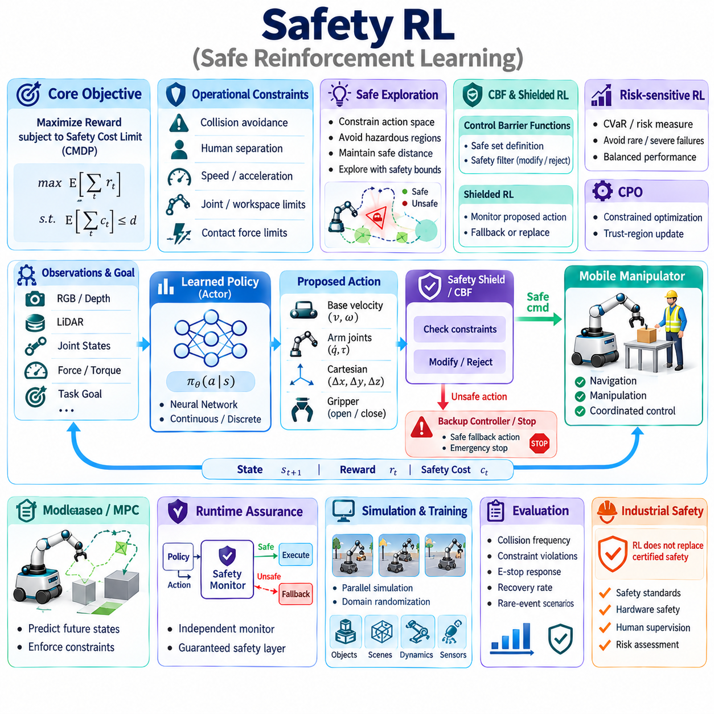{width="7.268055555555556in" height="7.268055555555556in"}

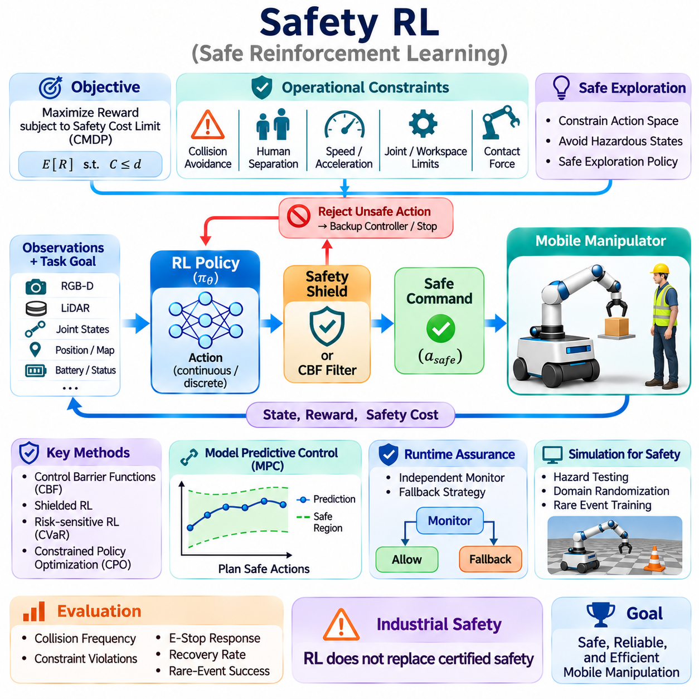{width="7.268055555555556in" height="7.268055555555556in"}

Safety Reinforcement Learning (Safety RL) is an approach to reinforcement learning that incorporates safety requirements and operational constraints into the learning and decision-making process. Unlike conventional reinforcement learning, which primarily focuses on maximizing cumulative rewards, Safety RL explicitly considers the risks associated with actions and their potential consequences. In robotics, this approach is essential for developing intelligent systems that can learn adaptive behaviors while maintaining acceptable levels of operational safety.

Physical robotic systems operate in environments where incorrect decisions may cause collisions, equipment damage, human injuries, or operational interruptions. Reinforcement learning agents frequently require exploration to discover effective strategies, but unrestricted exploration can create unacceptable risks. Safety RL addresses this challenge by introducing constraints, risk evaluation, and protective mechanisms that limit unsafe behaviors during training and deployment.

Constrained Markov Decision Processes (CMDPs) provide a mathematical foundation for modeling safety requirements in reinforcement learning. In addition to conventional state transitions and reward functions, CMDPs introduce cost functions and constraints that represent undesirable outcomes. An agent must maximize its expected cumulative reward while ensuring that accumulated safety costs remain within predefined limits.

Safety constraints can represent different types of operational restrictions, including collision avoidance, maximum contact forces, joint position limits, velocity restrictions, acceleration limits, and workspace boundaries. These constraints may be defined at the system level or for individual robotic components. A well-structured constraint representation enables reinforcement learning algorithms to consider physical limitations alongside task performance objectives.

Safe Exploration is a fundamental requirement during reinforcement learning because agents must discover effective behaviors without repeatedly generating dangerous actions. Exploration constraints can restrict the available action space, prevent entry into hazardous regions, and enforce minimum separation distances from obstacles. These mechanisms allow agents to investigate alternative strategies while maintaining predefined operational safety conditions.

Control Barrier Functions (CBFs) provide a mathematical mechanism for enforcing safety constraints in dynamical systems. A barrier function defines a safe region of the system state space and determines whether an action may cause the system to leave that region. A safety filter can modify or reject unsafe control commands before execution, allowing learned policies to operate under additional mathematical safety guarantees when the underlying model and assumptions are valid.

Shielded Reinforcement Learning introduces an independent safety mechanism that monitors actions proposed by a learned policy. When an action is predicted to violate predefined safety conditions, a safety shield can replace it with a verified alternative or prevent its execution. This architecture separates performance-oriented learning from safety enforcement and is particularly useful when deploying adaptive policies on physical robotic platforms.

Risk-sensitive reinforcement learning extends conventional reward optimization by explicitly considering the probability and severity of undesirable outcomes. Instead of evaluating performance only through expected cumulative rewards, risk-sensitive methods may incorporate measures such as Conditional Value at Risk (CVaR). These approaches help distinguish policies with similar average performance but substantially different exposure to rare or severe failures.

Safe Policy Optimization methods attempt to improve learned policies while maintaining specified safety constraints. Constrained Policy Optimization (CPO), for example, formulates policy updates as an optimization problem that considers both expected rewards and constraint violations. Trust-region mechanisms can limit policy changes between iterations, reducing the likelihood that optimization produces significantly less safe behaviors.

Model Predictive Control (MPC) can complement Safety RL by evaluating candidate control actions over a finite prediction horizon. The controller predicts future system states and selects actions that satisfy motion and safety constraints. Combining MPC with learned policies allows reinforcement learning to provide adaptive decision-making while model-based control handles short-term trajectory feasibility and constraint enforcement.

In mobile manipulation, safety requirements extend across the mobile platform, robotic arm, and end effector. Navigation policies must avoid obstacles, maintain safe distances from people, and respect platform velocity and acceleration limits. Manipulation policies must consider joint limits, collision geometry, contact forces, grasp stability, and object handling constraints. Coordinated safety management is necessary because an individually acceptable action from one subsystem may create hazardous conditions for another.

Human-Robot Interaction (HRI) introduces additional safety requirements because mobile manipulators frequently operate near workers and other people. Safety-aware policies should consider human proximity, movement patterns, restricted areas, and unexpected interactions. Human detection, protective separation monitoring, emergency stopping, and speed reduction can operate independently of the learned policy to maintain appropriate protection levels.

Simulation-based Safety RL enables agents to explore hazardous situations without exposing physical equipment or personnel to direct risk. Simulated environments can reproduce obstacle encounters, unstable grasping, excessive contact forces, localization failures, and emergency conditions. Domain randomization and scenario-based testing help evaluate policy behavior across different environmental configurations and operational disturbances.

Runtime Assurance provides an additional protection architecture for deployed reinforcement learning systems. A learned controller operates as the primary performance-oriented controller, while an independent safety controller continuously monitors system behavior. If the learned policy violates predefined safety conditions or enters an uncertain operational state, control can be transferred to a verified backup controller or the system can enter a controlled stop condition.

Safety validation requires more than measuring average task success rates. Evaluation should include collision frequency, constraint violation rates, maximum contact forces, emergency stop response, recovery effectiveness, and behavior under unexpected disturbances. Rare-event testing and systematic scenario coverage are important because policies that perform well under normal conditions may still exhibit unsafe behavior in unusual situations.

Industrial deployment requires Safety RL to be integrated with established functional safety mechanisms, hardware protection, emergency stopping systems, and validated control architectures. Reinforcement learning should not replace certified safety functions or independent protective systems. Instead, it should operate within clearly defined safety boundaries established through system engineering, risk assessment, and verification.

Safety Reinforcement Learning provides a foundation for developing adaptive robotic intelligence without treating operational safety as a secondary consideration. Combining constrained learning, safe exploration, control barrier functions, policy shielding, risk-sensitive optimization, and runtime assurance supports more reliable autonomous behavior. For mobile manipulators, this integration is essential for achieving flexible physical interaction while protecting equipment, operators, and surrounding environments.

안전 강화학습(Safety Reinforcement Learning, Safety RL)은 학습 및 의사결정 과정에 안전 요구사항(Safety Requirement)과 운용 제약조건(Operational Constraint)을 통합하는 강화학습 접근 방식이다. 누적 보상(Cumulative Reward) 최대화에 주로 초점을 맞추는 기존 강화학습과 달리, 안전 강화학습은 행동과 그 잠재적 결과에 수반되는 위험(Risk)을 명시적으로 고려한다. 로봇 분야에서 이러한 접근 방식은 허용 가능한 운용 안전 수준을 유지하면서 적응형 행동(Adaptive Behavior)을 학습할 수 있는 지능형 시스템을 개발하는 데 필수적이다.

실제 로봇 시스템(Physical Robotic System)은 잘못된 의사결정으로 인해 충돌(Collision), 장비 손상(Equipment Damage), 인명 부상(Human Injury) 또는 운용 중단(Operational Interruption)이 발생할 수 있는 환경에서 작동한다. 강화학습 에이전트(Reinforcement Learning Agent)는 효과적인 전략을 발견하기 위해 탐색(Exploration)이 필요한 경우가 많지만, 통제되지 않은 탐색은 허용할 수 없는 위험을 초래할 수 있다. 안전 강화학습은 학습과 현장 적용 과정에서 안전하지 않은 행동을 제한하는 제약조건(Constraint), 위험 평가(Risk Evaluation) 및 보호 메커니즘(Protective Mechanism)을 도입하여 이러한 문제를 해결한다.

제약 마르코프 결정 과정(Constrained Markov Decision Process, CMDP)은 강화학습에서 안전 요구사항을 모델링하기 위한 수학적 기반을 제공한다. CMDP는 기존의 상태 전이(State Transition)와 보상 함수(Reward Function)에 더하여 바람직하지 않은 결과를 나타내는 비용 함수(Cost Function)와 제약조건을 도입한다. 에이전트는 누적된 안전 비용(Safety Cost)이 사전에 정의된 한계 내에 유지되도록 하면서 기대 누적 보상(Expected Cumulative Reward)을 최대화해야 한다.

안전 제약조건(Safety Constraint)은 충돌 회피(Collision Avoidance), 최대 접촉력(Maximum Contact Force), 관절 위치 한계(Joint Position Limit), 속도 제한(Velocity Restriction), 가속도 제한(Acceleration Limit) 및 작업 공간 경계(Workspace Boundary)와 같은 다양한 운용 제한사항을 나타낼 수 있다. 이러한 제약조건은 시스템 수준(System Level) 또는 개별 로봇 구성요소 수준(Individual Robotic Component Level)에서 정의할 수 있다. 체계적으로 구성된 제약조건 표현(Constraint Representation)은 강화학습 알고리즘이 작업 성능 목표(Task Performance Objective)와 함께 물리적 한계(Physical Limitation)를 고려할 수 있도록 한다.

안전 탐색(Safe Exploration)은 에이전트가 위험한 행동을 반복적으로 생성하지 않으면서 효과적인 행동을 발견해야 하므로 강화학습의 기본적인 요구사항이다. 탐색 제약조건(Exploration Constraint)은 사용 가능한 행동 공간(Action Space)을 제한하고 위험 지역(Hazardous Region)에 진입하는 것을 방지하며 장애물과의 최소 이격 거리(Minimum Separation Distance)를 강제할 수 있다. 이러한 메커니즘은 사전에 정의된 운용 안전 조건(Operational Safety Condition)을 유지하면서 에이전트가 대안적인 전략을 탐색할 수 있도록 한다.

제어 장벽 함수(Control Barrier Function, CBF)는 동역학 시스템(Dynamical System)에서 안전 제약조건을 강제하기 위한 수학적 메커니즘을 제공한다. 장벽 함수(Barrier Function)는 시스템 상태 공간(State Space)의 안전 영역(Safe Region)을 정의하고 특정 행동으로 인해 시스템이 해당 영역을 벗어날 수 있는지를 판단한다. 안전 필터(Safety Filter)는 실행 전에 안전하지 않은 제어 명령(Control Command)을 수정하거나 거부할 수 있다. 이를 통해 학습된 정책(Learned Policy)은 기반 모델과 가정이 유효한 경우 추가적인 수학적 안전 보장(Mathematical Safety Guarantee) 아래에서 작동할 수 있다.

보호 강화학습(Shielded Reinforcement Learning)은 학습된 정책이 제안하는 행동을 감시하는 독립적인 안전 메커니즘(Independent Safety Mechanism)을 도입한다. 특정 행동이 사전에 정의된 안전 조건을 위반할 것으로 예측되면 안전 보호기(Safety Shield)는 해당 행동을 검증된 대안으로 대체하거나 실행을 차단할 수 있다. 이러한 아키텍처는 성능 중심 학습(Performance-Oriented Learning)과 안전 강제(Safety Enforcement)를 분리하며, 물리적 로봇 플랫폼에 적응형 정책을 배치할 때 특히 유용하다.

위험 민감 강화학습(Risk-Sensitive Reinforcement Learning)은 바람직하지 않은 결과가 발생할 확률과 심각도를 명시적으로 고려함으로써 기존의 보상 최적화를 확장한다. 기대 누적 보상(Expected Cumulative Reward)만으로 성능을 평가하는 대신 조건부 위험 가치(Conditional Value at Risk, CVaR)와 같은 지표를 통합할 수 있다. 이러한 접근 방식은 평균 성능은 유사하지만 드물거나 심각한 실패에 대한 위험 노출 수준이 상당히 다른 정책을 구분하는 데 도움을 준다.

안전 정책 최적화(Safe Policy Optimization) 방법은 지정된 안전 제약조건을 유지하면서 학습된 정책을 개선하는 것을 목표로 한다. 예를 들어 제약 정책 최적화(Constrained Policy Optimization, CPO)는 기대 보상과 제약조건 위반을 모두 고려하는 최적화 문제로 정책 갱신(Policy Update)을 정식화한다. 신뢰 영역 메커니즘(Trust-Region Mechanism)은 반복 과정 사이의 정책 변화를 제한하여 최적화로 인해 안전성이 크게 저하되는 행동이 생성될 가능성을 감소시킨다.

모델 예측 제어(Model Predictive Control, MPC)는 유한한 예측 구간(Finite Prediction Horizon)에서 후보 제어 행동(Candidate Control Action)을 평가함으로써 안전 강화학습을 보완할 수 있다. 제어기는 미래 시스템 상태(Future System State)를 예측하고 모션 및 안전 제약조건을 만족하는 행동을 선택한다. MPC와 학습된 정책을 결합하면 강화학습은 적응형 의사결정(Adaptive Decision-Making)을 제공하고, 모델 기반 제어(Model-Based Control)는 단기 궤적의 실행 가능성과 제약조건 강제를 담당할 수 있다.

모바일 매니퓰레이션(Mobile Manipulation)에서 안전 요구사항은 모바일 플랫폼(Mobile Platform), 로봇 팔(Robotic Arm) 및 말단장치(End Effector) 전반으로 확장된다. 자율주행 정책(Navigation Policy)은 장애물을 회피하고 사람과의 안전거리를 유지하며 플랫폼의 속도 및 가속도 제한을 준수해야 한다. 매니퓰레이션 정책(Manipulation Policy)은 관절 한계(Joint Limit), 충돌 형상(Collision Geometry), 접촉력(Contact Force), 파지 안정성(Grasp Stability) 및 물체 취급 제약조건(Object Handling Constraint)을 고려해야 한다. 한 하위 시스템에서는 개별적으로 허용 가능한 행동이라도 다른 하위 시스템에는 위험한 조건을 발생시킬 수 있으므로 통합적인 안전 관리(Coordinated Safety Management)가 필요하다.

인간-로봇 상호작용(Human-Robot Interaction, HRI)은 모바일 매니퓰레이터가 작업자 및 다른 사람과 가까운 환경에서 작동하는 경우가 많으므로 추가적인 안전 요구사항을 발생시킨다. 안전 인식 정책(Safety-Aware Policy)은 사람과의 근접성(Human Proximity), 이동 패턴(Movement Pattern), 접근 제한 구역(Restricted Area) 및 예상하지 못한 상호작용(Unexpected Interaction)을 고려해야 한다. 사람 감지(Human Detection), 보호 이격거리 모니터링(Protective Separation Monitoring), 비상 정지(Emergency Stop) 및 속도 감소(Speed Reduction)는 학습된 정책과 독립적으로 작동하여 적절한 보호 수준을 유지할 수 있다.

시뮬레이션 기반 안전 강화학습(Simulation-Based Safety RL)은 물리적 장비나 작업자를 직접적인 위험에 노출하지 않고 에이전트가 위험 상황을 탐색할 수 있도록 한다. 시뮬레이션 환경은 장애물 조우(Obstacle Encounter), 불안정한 파지(Unstable Grasping), 과도한 접촉력(Excessive Contact Force), 위치 추정 실패(Localization Failure) 및 비상 상황(Emergency Condition)을 재현할 수 있다. 도메인 무작위화(Domain Randomization)와 시나리오 기반 테스트(Scenario-Based Testing)는 다양한 환경 구성과 운용 외란(Operational Disturbance)에서 정책의 행동을 평가하는 데 도움을 준다.

실행 시점 보증(Runtime Assurance)은 실제 배치된 강화학습 시스템을 위한 추가적인 보호 아키텍처를 제공한다. 학습된 제어기(Learned Controller)는 성능 중심의 기본 제어기로 작동하고, 독립적인 안전 제어기(Independent Safety Controller)는 시스템 동작을 지속적으로 감시한다. 학습된 정책이 사전에 정의된 안전 조건을 위반하거나 불확실한 운용 상태(Uncertain Operational State)에 진입하면 검증된 백업 제어기(Verified Backup Controller)로 제어를 이전하거나 시스템을 통제된 정지 상태(Controlled Stop Condition)로 전환할 수 있다.

안전 검증(Safety Validation)은 평균 작업 성공률(Average Task Success Rate)을 측정하는 것만으로 충분하지 않다. 평가에는 충돌 빈도(Collision Frequency), 제약조건 위반율(Constraint Violation Rate), 최대 접촉력(Maximum Contact Force), 비상 정지 응답(Emergency Stop Response), 복구 효과성(Recovery Effectiveness) 및 예상하지 못한 외란에 대한 행동이 포함되어야 한다. 정상적인 조건에서 우수한 성능을 보이는 정책이라도 비정상적인 상황에서는 안전하지 않은 행동을 나타낼 수 있으므로 희귀 사건 테스트(Rare-Event Testing)와 체계적인 시나리오 포괄성 평가(Systematic Scenario Coverage)가 중요하다.

산업 현장 적용(Industrial Deployment)을 위해서는 안전 강화학습을 기존의 기능 안전 메커니즘(Functional Safety Mechanism), 하드웨어 보호(Hardware Protection), 비상 정지 시스템(Emergency Stop System) 및 검증된 제어 아키텍처(Validated Control Architecture)와 통합해야 한다. 강화학습이 인증된 안전 기능(Certified Safety Function)이나 독립적인 보호 시스템(Independent Protective System)을 대체해서는 안 된다. 대신 시스템 엔지니어링(System Engineering), 위험 평가(Risk Assessment) 및 검증(Verification)을 통해 확립된 명확한 안전 경계(Safety Boundary) 내에서 작동해야 한다.

안전 강화학습(Safety Reinforcement Learning)은 운용 안전을 부차적인 고려사항으로 취급하지 않으면서 적응형 로봇 지능(Adaptive Robotic Intelligence)을 개발하기 위한 기반을 제공한다. 제약 기반 학습(Constrained Learning), 안전 탐색(Safe Exploration), 제어 장벽 함수(Control Barrier Function), 정책 보호(Policy Shielding), 위험 민감 최적화(Risk-Sensitive Optimization) 및 실행 시점 보증(Runtime Assurance)을 결합하면 더욱 신뢰성 높은 자율 행동(Reliable Autonomous Behavior)을 구현할 수 있다. 모바일 매니퓰레이터에서 이러한 통합은 장비, 작업자 및 주변 환경을 보호하면서 유연한 물리적 상호작용(Flexible Physical Interaction)을 달성하기 위해 필수적이다.
