**Volume 03. Vision Manipulation and AI**

# Chapter 13. Reinforcement Learning

## 01 RL Fundamentals

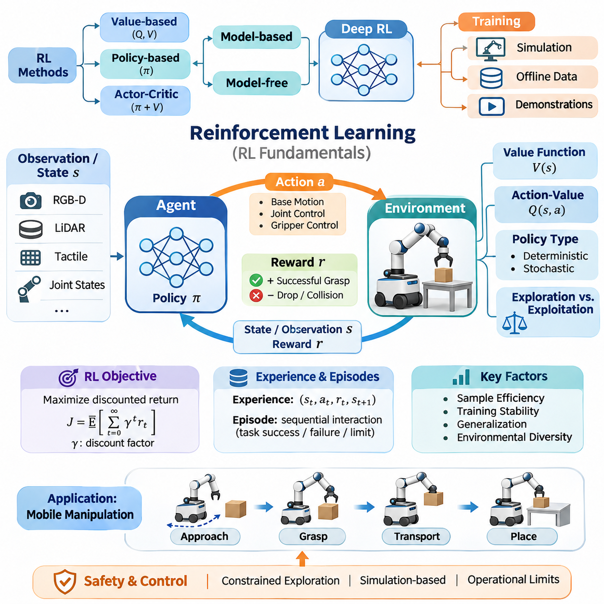{width="7.268055555555556in" height="7.268055555555556in"}

Reinforcement Learning (RL) is a machine learning paradigm in which an intelligent agent learns how to make decisions by interacting with an environment and receiving feedback through rewards. Unlike supervised learning, which relies on labeled examples, reinforcement learning discovers effective behavior through experience. In mobile manipulation, this approach enables robots to develop adaptive skills for navigation, grasping, object handling, and physical interaction.

The fundamental structure of reinforcement learning consists of an agent, an environment, states, actions, rewards, and a policy. The agent represents the decision-making system, while the environment encompasses the physical or simulated world in which the robot operates. The agent observes its surroundings, selects an action, receives feedback, and updates its decision-making strategy to improve future performance.

A state represents the relevant condition of the environment at a particular moment. In robotic manipulation, state information may include joint positions, joint velocities, end-effector poses, object locations, contact forces, and mobile platform coordinates. When complete state information is unavailable, the agent relies on observations obtained from cameras, tactile sensors, LiDAR, and other perception systems.

An action represents a decision or command executed by the agent to influence the environment. Robotic actions may include joint position commands, velocity commands, torque commands, gripper adjustments, or mobile platform movements. Depending on the system architecture, the action space may be discrete or continuous. Continuous action spaces are particularly important for precise robotic manipulation and coordinated motion control.

The reward function defines the feedback that guides the learning process. Positive rewards encourage desirable behaviors, while negative rewards discourage undesirable outcomes. For example, a robot may receive a positive reward for successfully grasping an object and a negative reward for dropping it or approaching an obstacle. Effective reward design is essential because the agent optimizes the specified reward rather than an independently understood objective.

The primary objective of reinforcement learning is to maximize the expected cumulative reward over time rather than simply obtaining the highest immediate reward. A discount factor determines the relative importance of future rewards compared with immediate rewards. This mechanism allows robots to learn sequential behaviors in which intermediate actions contribute to long-term objectives, such as approaching, grasping, transporting, and placing an object.

A policy defines how an agent selects actions based on its current state or observation. A deterministic policy produces a specific action for a given input, whereas a stochastic policy defines a probability distribution over possible actions. In deep reinforcement learning, policies are frequently represented by neural networks capable of processing complex sensory information and generating appropriate robotic control commands.

The value function estimates the expected cumulative future reward associated with a particular state under a policy. Similarly, the action-value function estimates the expected return obtained by executing a particular action in a state and subsequently following the policy. These functions provide a mechanism for evaluating alternative decisions and identifying behaviors that contribute to successful long-term task execution.

Reinforcement learning requires an appropriate balance between exploration and exploitation. Exploration allows the agent to investigate unfamiliar actions and discover potentially superior strategies, while exploitation utilizes previously acquired knowledge to maximize expected performance. In physical robotic systems, uncontrolled exploration can cause equipment damage, making constrained exploration and simulation-based experimentation particularly important.

The interaction between an agent and its environment generates a sequence of experiences consisting of observations, actions, rewards, and subsequent observations. These experiences provide the information required to improve the policy or value function. An episode represents a bounded interaction sequence that may terminate when a task is completed, a failure occurs, or a predefined operational limit is reached.

Deep Reinforcement Learning (DRL) combines reinforcement learning with deep neural networks to address high-dimensional perception and control problems. Neural networks can extract meaningful representations from RGB images, depth measurements, point clouds, and proprioceptive data. This capability enables robots to learn complex relationships between environmental conditions, physical actions, and task outcomes without manually defining every decision rule.

Reinforcement learning algorithms are commonly categorized into value-based, policy-based, and actor-critic methods. Value-based methods estimate the quality of possible decisions, while policy-based methods directly optimize the action-selection strategy. Actor-critic methods combine policy optimization with value estimation. Model-based and model-free approaches provide another distinction based on whether environmental dynamics are explicitly modeled.

The effectiveness of reinforcement learning depends on sample efficiency, training stability, generalization, and environmental diversity. Simulation environments support large-scale experimentation without repeatedly operating physical equipment. Offline reinforcement learning can additionally utilize previously collected interaction datasets, while demonstration-based initialization can reduce the amount of exploration required to acquire useful robotic skills.

In mobile manipulators, reinforcement learning can support coordinated decision-making between the mobile base, robotic arm, and end effector. Learned policies may optimize approach positions, grasp selection, contact-rich manipulation, and recovery from unexpected disturbances. However, industrial deployment requires independent safety mechanisms, validated motion constraints, reliable perception, and conventional control systems to maintain predictable operation.

## 02 MDP Formulation

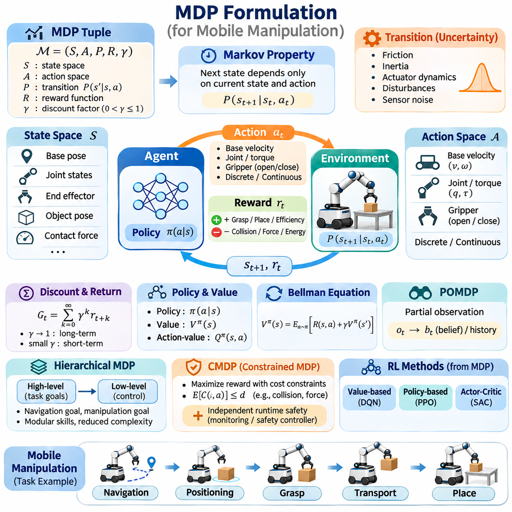{width="7.268055555555556in" height="7.268055555555556in"}

A Markov Decision Process (MDP) provides a mathematical framework for modeling sequential decision-making problems in reinforcement learning. It describes how an intelligent agent interacts with an environment, selects actions, experiences state transitions, and receives rewards. In mobile manipulation, MDP formulation establishes the mathematical foundation for learning robotic behaviors that optimize long-term operational objectives under uncertain environmental conditions.

An MDP is conventionally represented by a tuple consisting of a state space S, an action space A, a transition probability function P, a reward function R, and a discount factor γ. Each component describes a fundamental aspect of the decision-making problem. Together, these elements establish a structured representation of the relationships among environmental conditions, robotic actions, physical consequences, and expected task performance.

The Markov property is the fundamental assumption underlying an MDP. It states that the probability distribution of the next state depends only on the current state and selected action rather than the complete history of previous interactions. This assumption simplifies sequential decision-making by allowing the agent to evaluate future consequences using the current state, provided that the state representation contains sufficient information about the system.

The state space defines all possible conditions that the robotic system and its environment may occupy. For a mobile manipulator, the state may include mobile base position, orientation, joint configurations, joint velocities, end-effector pose, gripper status, object poses, and contact forces. Environmental information such as obstacle locations, workspace geometry, and task progress may also be incorporated to support informed decision-making.

The action space represents all possible decisions available to the agent. In mobile manipulation, actions may consist of mobile base velocity commands, joint position adjustments, joint torque commands, Cartesian displacement commands, and gripper operations. While discrete action spaces simplify decision selection, continuous action spaces provide greater flexibility for coordinated motion and precise interaction with physical objects.

The transition probability function describes the likelihood of reaching a particular next state after executing an action in the current state. In physical robotic systems, state transitions are affected by actuator dynamics, friction, inertia, external disturbances, sensor uncertainty, and environmental interactions. Consequently, even identical actions executed under apparently similar conditions may produce different physical outcomes.

The reward function assigns numerical feedback to the consequences of robotic actions and provides the optimization objective for reinforcement learning. A manipulation task may reward successful grasping, accurate placement, and efficient movement while penalizing collisions, excessive contact forces, energy consumption, and operational delays. Appropriate reward formulation is essential for aligning learned behavior with actual task requirements.

The discount factor determines how strongly the agent values future rewards relative to immediate rewards. A discount factor approaching one encourages consideration of long-term consequences, whereas a smaller value emphasizes short-term outcomes. Mobile manipulation frequently requires long-horizon decision-making because navigation, positioning, grasping, transportation, and placement must be coordinated to accomplish a complete operational objective.

The return represents the cumulative discounted reward obtained during a sequence of interactions. Reinforcement learning attempts to identify a policy that maximizes the expected return across possible trajectories. A trajectory consists of successive states, actions, and rewards generated through interaction with the environment. This formulation enables robotic agents to evaluate individual actions according to their contributions to overall task completion.

A policy defines the relationship between states and actions, while value functions estimate the expected long-term consequences of following that policy. The Bellman equation establishes a recursive relationship between the value of the current state and the expected value of subsequent states. This recursive structure provides the mathematical foundation for evaluating policies, improving action selection, and developing optimal decision-making strategies.

Real-world robotic environments frequently violate the assumption that the complete state can be directly observed. Objects may be occluded, contact conditions may be uncertain, and sensor measurements may contain noise. A Partially Observable Markov Decision Process (POMDP) extends the conventional MDP framework by distinguishing underlying environmental states from observations and allowing decisions to incorporate observation histories or belief states.

Hierarchical MDP formulation can reduce the complexity of mobile manipulation tasks by organizing decisions across multiple levels of abstraction. High-level policies may select navigation goals, manipulation objectives, or recovery strategies, while low-level policies generate continuous control commands. This separation supports modular skill development and reduces the complexity of coordinating mobile platforms, robotic arms, and end effectors.

Safety-critical applications can incorporate operational constraints through a Constrained Markov Decision Process (CMDP). This formulation introduces additional cost functions and constraints associated with undesirable outcomes, such as collisions, excessive forces, or unstable configurations. However, satisfying expected cost constraints does not necessarily guarantee physical safety, making independent runtime monitoring and protective control mechanisms essential.

Effective MDP formulation requires careful consideration of state representation, action dimensionality, reward consistency, control frequency, episode termination, and environmental uncertainty. The mathematical model should reflect the physical capabilities and operational limitations of the robotic platform. Within mobile manipulation, a well-defined MDP provides the foundation for subsequent value-based, policy-based, and actor-critic learning methods.

## 03 Value Based Methods

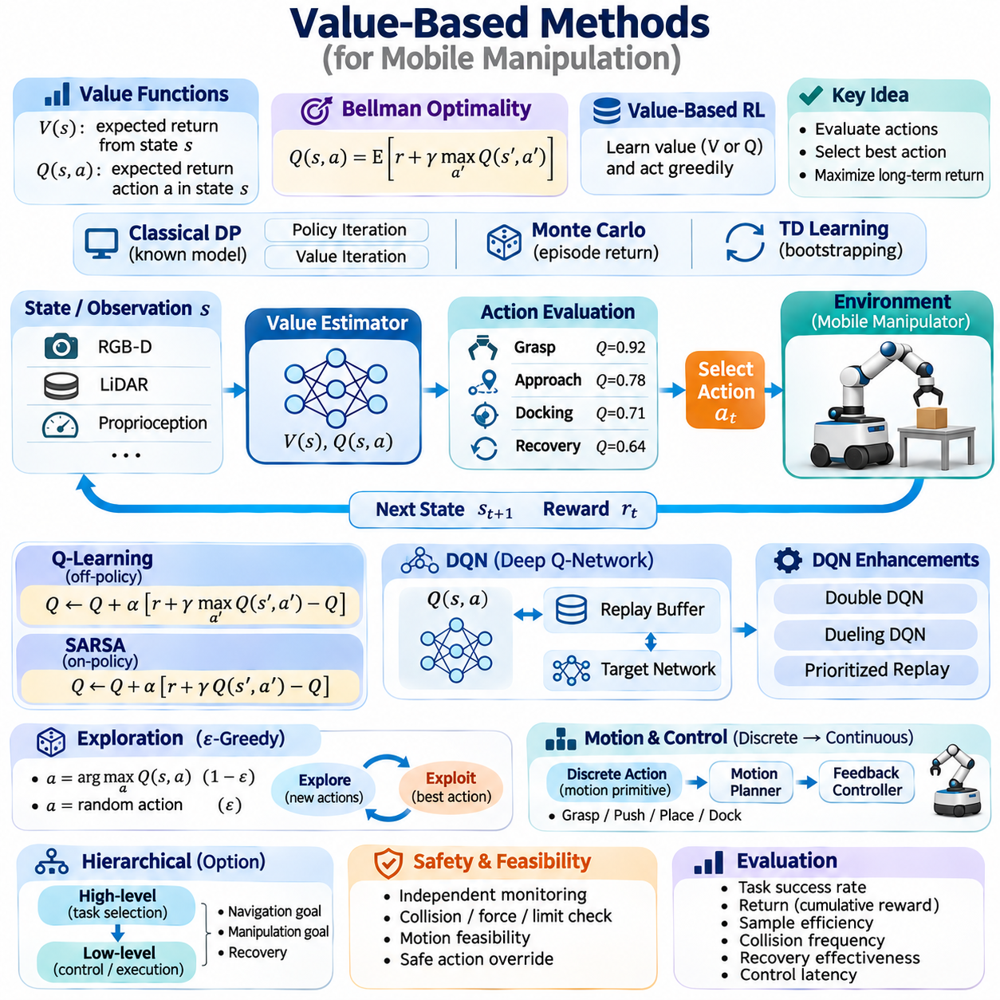{width="7.268055555555556in" height="7.268055555555556in"}

Value-based reinforcement learning methods estimate the expected long-term benefits of states or actions and use these estimates to guide decision-making. Rather than directly optimizing a policy, these methods learn a value function that identifies desirable behaviors. In mobile manipulation, value-based learning can support grasp selection, navigation decisions, object handling strategies, and recovery from unsuccessful physical interactions.

The state-value function, commonly represented as V(s), estimates the expected cumulative discounted reward when an agent starts from a particular state and subsequently follows a given policy. A state associated with a successful future outcome generally receives a higher value than a state associated with failure. This representation allows robotic agents to evaluate environmental conditions according to their expected contribution to long-term task completion.

The action-value function, commonly represented as Q(s,a), estimates the expected cumulative reward obtained by executing a specific action in a particular state and subsequently following a policy. Unlike the state-value function, the action-value function explicitly evaluates alternative actions. A mobile manipulator can therefore compare different grasp candidates, approach directions, navigation commands, or predefined manipulation strategies before selecting an action.

The Bellman equation provides the mathematical foundation for value-based reinforcement learning by expressing the value of a state or state-action pair through immediate rewards and expected future values. The Bellman optimality equation extends this relationship by considering the best available future action. Through recursive value estimation, the agent learns to associate individual decisions with their potential long-term consequences.

Dynamic Programming (DP) represents a classical approach to solving Markov Decision Processes when environmental transition probabilities and reward functions are known. Policy iteration alternates between policy evaluation and policy improvement, whereas value iteration repeatedly updates value estimates toward optimal values. However, explicitly modeling complex physical interactions is often impractical in high-dimensional robotic environments.

Monte Carlo methods estimate value functions using cumulative returns obtained from completed episodes without requiring an explicit environmental model. Temporal Difference (TD) learning instead updates value estimates using immediate rewards and estimates of subsequent states. This process, known as bootstrapping, enables incremental learning before an episode terminates and supports more frequent updates during robotic interaction.

Q-Learning is a widely recognized model-free, off-policy reinforcement learning algorithm that estimates the optimal action-value function. Its update mechanism combines the immediate reward with the maximum estimated action value of the next state. Under appropriate theoretical conditions, repeated exploration and value updates allow tabular Q-Learning to converge toward optimal action selection in finite Markov Decision Processes.

State-Action-Reward-State-Action (SARSA) is an on-policy learning algorithm that updates its action-value estimates using the actual subsequent action selected by the current policy. Unlike Q-Learning, SARSA incorporates the consequences of the agent\'s exploration strategy into its updates. This distinction can influence learned behavior when exploratory actions introduce additional operational risks or undesirable physical interactions.

Traditional tabular value-based methods become impractical when robotic systems involve large or continuous state spaces. Deep Q-Networks (DQN) address this limitation by using deep neural networks to approximate action-value functions. These networks can process visual observations, depth images, proprioceptive measurements, and other sensory inputs to estimate the expected utility of actions within a predefined discrete action space.

Experience replay improves deep value-based learning by storing interaction transitions in a replay buffer and sampling them during neural network training. This mechanism reduces temporal correlations between consecutive observations and allows previously collected experiences to be reused. A target network provides relatively stable learning targets, reducing instability caused by rapidly changing action-value estimates.

Advanced value-based algorithms address limitations of the original DQN architecture. Double DQN reduces action-value overestimation by separating action selection from target evaluation. Dueling DQN independently estimates state values and relative action advantages before combining them. Prioritized Experience Replay increases the sampling frequency of informative transitions, potentially improving learning efficiency and convergence behavior.

Value-based methods require effective exploration to identify actions that produce favorable long-term outcomes. The epsilon-greedy strategy selects a high-value action with probability one minus epsilon and explores randomly with probability epsilon. Other approaches introduce uncertainty estimates or additional exploration rewards. In robotics, exploratory actions must remain within validated mechanical, geometric, and operational constraints.

In robotic manipulation, value-based learning can estimate the expected success of actions associated with grasping, pushing, repositioning, or placing objects. High-level discrete action representations allow the agent to select among predefined motion primitives or candidate grasp configurations. Conventional motion planners and feedback controllers can then translate selected actions into physically feasible and executable robot trajectories.

Mobile manipulators can use hierarchical value-based architectures to coordinate navigation and manipulation decisions. A high-level action-value function may evaluate docking locations, object approach strategies, grasping opportunities, and recovery options. However, directly discretizing every mobile base and robotic arm control dimension causes combinatorial growth, making conventional value-based methods less suitable for unrestricted continuous control.

Successful deployment requires reliable value estimation, sufficient training diversity, and validation against unfamiliar environmental conditions. Performance should be evaluated using task success rates, cumulative rewards, sample efficiency, collision frequency, recovery effectiveness, and execution latency. Learned action values should support decision-making without replacing independent safety monitoring, motion feasibility checks, or deterministic protective control.

## 04 Policy Based Methods

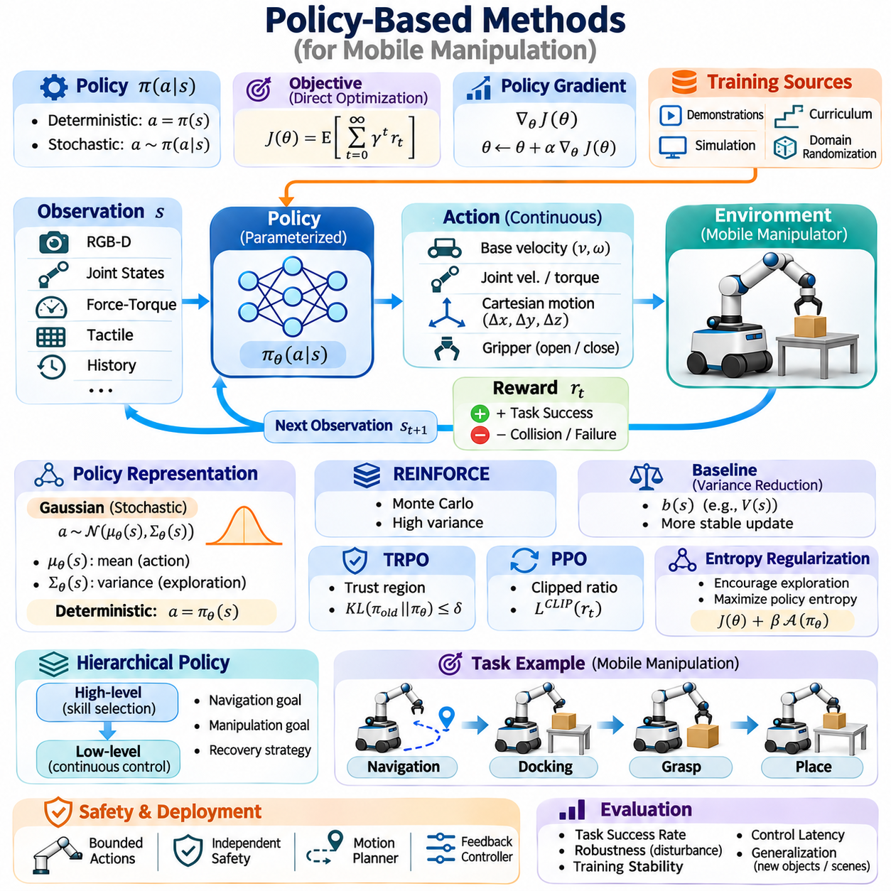{width="7.268055555555556in" height="7.268055555555556in"}

Policy-based reinforcement learning methods directly optimize the decision-making strategy of an intelligent agent rather than deriving actions exclusively from estimated value functions. The policy defines how the agent responds to environmental states or observations. In mobile manipulation, policy-based methods are particularly useful for learning continuous control behaviors, adaptive grasping strategies, and coordinated movement between robotic subsystems.

A policy is commonly represented as π(a\|s), which defines the probability of selecting action a when the agent operates in state s. A deterministic policy generates a specific action for a given state, whereas a stochastic policy produces a probability distribution over possible actions. Stochastic policies facilitate exploration during training and allow robotic agents to develop flexible responses to uncertain environmental conditions.

Parameterized policies represent decision-making strategies through adjustable parameters, commonly denoted by θ. In deep reinforcement learning, these parameters typically correspond to the weights and biases of a neural network. The network processes environmental observations, robotic configurations, and task-related information to generate actions, enabling complex control behaviors without explicitly defining every possible decision rule.

The fundamental objective of policy-based reinforcement learning is to maximize the expected cumulative reward obtained by following a parameterized policy. This objective considers the probability of different trajectories generated through interactions with the environment. Policy optimization modifies the parameters so that successful behaviors become more likely, while actions associated with unfavorable long-term consequences become less likely.

Policy gradient methods provide a mathematical mechanism for improving policies by estimating the gradient of expected cumulative reward with respect to policy parameters. Gradient ascent updates these parameters in directions associated with improved expected performance. Unlike conventional supervised learning, policy gradient methods do not require predefined optimal action labels and instead derive learning signals from environmental interaction.

REINFORCE is a fundamental Monte Carlo policy gradient algorithm that estimates policy gradients using cumulative rewards collected during completed episodes. Actions associated with higher returns receive stronger positive reinforcement relative to actions associated with lower returns. Although REINFORCE provides a conceptually straightforward optimization mechanism, its gradient estimates can exhibit high variance and require substantial training experience.

Variance reduction is an important consideration in policy gradient optimization. A baseline can be introduced to reduce gradient variance without changing the expected gradient when appropriately defined. Comparing observed returns against expected performance enables the learning algorithm to distinguish relatively successful decisions from unfavorable ones, providing more stable updates and improving the efficiency of robotic policy training.

Trust Region Policy Optimization (TRPO) improves learning stability by constraining the magnitude of policy changes between successive optimization iterations. Excessively large updates may destroy previously acquired robotic skills or generate unstable control behaviors. TRPO typically uses a constraint based on Kullback-Leibler divergence to limit changes in action probability distributions while seeking improved expected performance.

Proximal Policy Optimization (PPO) provides a more computationally practical approach to achieving stable policy updates. Its commonly used clipped objective limits the optimization incentive associated with excessively large probability ratio changes between previous and updated policies. PPO is widely applied in simulated robotic control because it provides a practical balance among implementation complexity, learning stability, and training performance.

Continuous action spaces represent a major advantage of policy-based reinforcement learning in robotics. A policy can directly generate joint velocities, torque commands, Cartesian position adjustments, or mobile platform velocity commands. Unlike conventional discrete value-based methods, continuous policies do not require exhaustive evaluation of discretized action combinations, making them suitable for high-dimensional robotic control systems.

Stochastic continuous policies frequently represent actions using Gaussian probability distributions whose parameters are produced or learned by neural networks. During training, sampling from these distributions encourages exploration, while deterministic deployment may use their mean values. Action scaling, bounded distributions, and output constraints help maintain compatibility with actuator capacities, joint limits, and physical operating conditions.

Entropy regularization encourages policies to maintain action diversity rather than prematurely converging toward narrow behavioral strategies. By incorporating policy entropy into the learning objective, the agent can preserve exploration opportunities and investigate alternative control solutions. In robotic manipulation, this mechanism may facilitate the discovery of alternative grasping configurations, approach trajectories, and contact interaction strategies.

Policy-based learning can integrate multiple sensory modalities into a unified decision-making architecture. Visual observations, depth measurements, joint states, force-torque measurements, and tactile feedback can be processed by neural networks to generate context-dependent control commands. Recurrent architectures may additionally incorporate observation histories when instantaneous sensor measurements are insufficient to determine the relevant environmental state.

In mobile manipulators, hierarchical policies can coordinate navigation, docking, object acquisition, and manipulation across different control frequencies. High-level policies determine operational objectives or select learned skills, while low-level policies generate continuous actions. Such architectures reduce decision-making complexity and support coordinated operation between autonomous mobile robots, robotic arms, and intelligent end effectors.

Policy-based methods can also benefit from demonstration learning, curriculum learning, and simulation-based training. Human demonstrations provide initial behavioral knowledge, while progressively increasing task difficulty supports systematic skill acquisition. Domain randomization exposes policies to varying physical parameters, sensor conditions, and environmental configurations, potentially improving generalization when transferring learned behaviors to physical robots.

Industrial deployment requires comprehensive evaluation of policy robustness, task success rates, control stability, execution latency, and generalization under unfamiliar conditions. Learned policies must operate within independently enforced safety constraints and validated motion boundaries. Combining policy-based learning with conventional feedback controllers and motion planners provides a practical foundation for adaptive and reliable mobile manipulation.

## 05 Actor Critic Methods

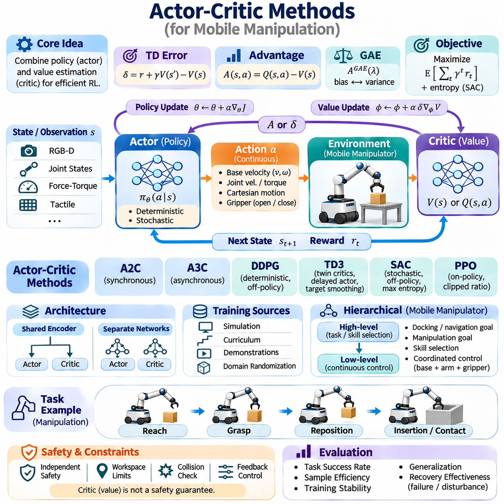{width="7.268055555555556in" height="7.268055555555556in"}

Actor-Critic methods represent a family of reinforcement learning algorithms that combine policy-based and value-based learning within a unified architecture. The actor determines which action the agent should execute, while the critic evaluates the expected consequences of that action. In mobile manipulation, this integrated approach provides an effective foundation for learning continuous control, adaptive decision-making, and coordinated robotic behaviors.

The actor represents a parameterized policy that generates actions according to environmental states or observations. Depending on the algorithm, the actor may implement either a deterministic or stochastic policy. In robotic applications, actor networks can generate joint velocity commands, Cartesian position adjustments, gripper commands, or mobile platform movements based on sensory information and operational objectives.

The critic estimates the expected cumulative reward associated with a state or state-action pair. It evaluates the actor\'s decisions by learning a state-value function or an action-value function. Rather than relying exclusively on observed episodic returns, the critic provides predictive feedback about future performance, enabling the actor to improve its decision-making strategy through more informative and frequent learning updates.

The interaction between the actor and critic establishes a continuous learning feedback mechanism. The actor selects an action, the environment produces a state transition and reward, and the critic evaluates the resulting experience. The actor subsequently updates its policy using feedback from the critic, while the critic improves its value estimates. Repeated interaction enables both components to progressively refine their respective functions.

Temporal Difference (TD) learning is frequently employed to train the critic by comparing predicted values against learning targets derived from immediate rewards and subsequent value estimates. The resulting TD error indicates whether an observed outcome is better or worse than expected. This error provides a learning signal that can guide policy improvement while reducing dependence on complete episodic returns.

The advantage function measures the relative benefit of executing a particular action compared with the expected performance of the current policy in a given state. Advantage estimation helps the actor distinguish favorable actions from unfavorable alternatives. Generalized Advantage Estimation (GAE) combines multiple temporal difference estimates to manage the trade-off between bias and variance during policy optimization.

Advantage Actor-Critic (A2C) uses advantage estimates to coordinate policy and value function updates, typically through synchronized experience collection across multiple environments. Asynchronous Advantage Actor-Critic (A3C) instead employs multiple agents that interact with separate environment instances and asynchronously update shared model parameters. Both approaches support parallel experience generation and improved training efficiency.

Deep Deterministic Policy Gradient (DDPG) extends the actor-critic architecture to continuous action spaces through deterministic policies and off-policy learning. The actor generates continuous actions, while the critic estimates their expected long-term values. Experience replay and target networks improve data reuse and learning stability, making DDPG applicable to robotic reaching, trajectory control, and manipulation tasks.

Twin Delayed Deep Deterministic Policy Gradient (TD3) addresses several limitations of DDPG, particularly action-value overestimation and unstable policy updates. TD3 employs two critic networks, delayed actor updates, and target policy smoothing. These mechanisms reduce sensitivity to inaccurate value estimates and improve learning stability in continuous robotic control tasks involving complex physical dynamics.

Soft Actor-Critic (SAC) incorporates maximum entropy reinforcement learning into an off-policy actor-critic architecture. Its objective encourages both cumulative reward maximization and policy entropy, allowing the agent to maintain diverse exploratory behaviors. SAC is particularly relevant to robotic manipulation because its stochastic policies and experience reuse can support sample-efficient learning in uncertain physical environments.

Proximal Policy Optimization (PPO) is also commonly implemented using an actor-critic architecture. The actor optimizes a constrained surrogate objective, typically through probability ratio clipping, while the critic estimates state values for advantage calculation. Although PPO generally requires newly collected on-policy experience, its implementation simplicity and training stability make it suitable for massively parallel robotic simulation.

Actor-critic architectures can employ separate neural networks or shared feature extraction layers for policy and value estimation. Shared visual encoders can reduce computational requirements, while separate networks may reduce interference between optimization objectives. Multimodal inputs, including RGB-D images, joint states, force-torque measurements, and tactile feedback, support context-dependent robotic decisions.

In manipulation tasks, the actor can learn continuous reaching, grasping, object repositioning, insertion, and contact interaction behaviors. The critic evaluates these behaviors according to expected task completion, positioning accuracy, energy efficiency, and other reward components. This architecture is particularly useful when successful manipulation requires continuous adjustment in response to uncertain object properties and physical contact.

Mobile manipulators introduce additional complexity because navigation and manipulation involve different motion characteristics, control frequencies, and operational constraints. Hierarchical actor-critic architectures can assign high-level policies to docking, task sequencing, and skill selection while low-level policies manage coordinated movement. Specialized critics may evaluate individual skills or the overall effectiveness of integrated robotic operations.

Successful actor-critic training requires appropriate reward design, learning rates, exploration strategies, network architectures, and experience collection methods. Simulation-based training, curriculum learning, human demonstrations, and domain randomization can improve learning efficiency and robustness. Performance evaluation should consider task success, sample efficiency, control stability, generalization, and recovery from unexpected disturbances.

Industrial deployment requires actor-critic policies to operate within independently enforced safety constraints, validated workspace boundaries, and reliable motion control architectures. A critic\'s estimated value must not be interpreted as a guarantee of physical safety. Combining learned policies with conventional controllers, collision checking, and protective monitoring provides a practical foundation for adaptive and reliable mobile manipulation.

## 06 Offline RL

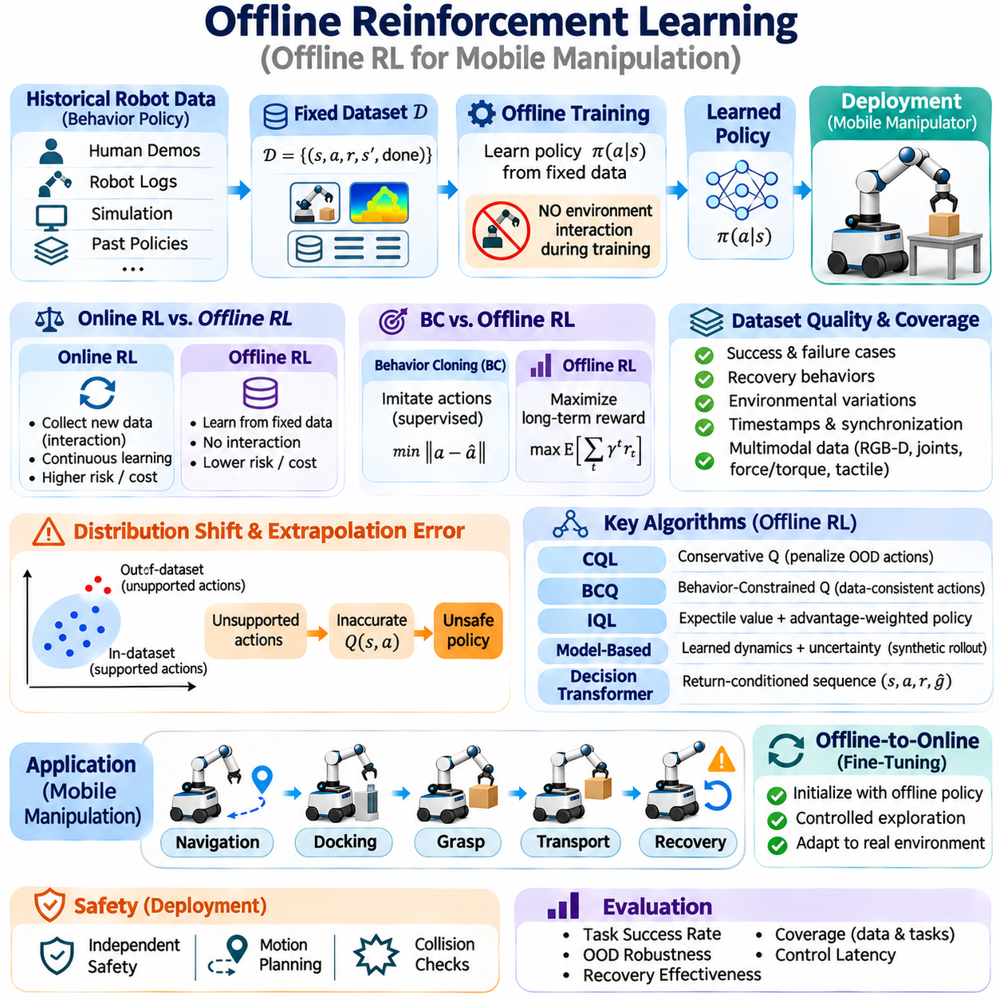{width="7.268055555555556in" height="7.268055555555556in"}

Offline Reinforcement Learning (Offline RL) is a reinforcement learning paradigm in which an agent learns an effective decision-making policy from previously collected interaction data without actively interacting with the environment during training. In mobile manipulation, this approach enables robots to acquire operational skills from historical experiences, human demonstrations, simulation datasets, and existing robotic system logs.

Unlike online reinforcement learning, which continuously collects new experiences through environmental interaction, offline reinforcement learning relies on a fixed dataset. This dataset typically contains states, actions, rewards, subsequent states, and episode termination indicators. The absence of direct environmental interaction during training reduces equipment utilization, operational interruptions, and risks associated with uncontrolled robotic exploration.

Offline reinforcement learning differs from conventional supervised learning and behavior cloning because its objective is to maximize expected cumulative reward rather than simply reproduce previously observed actions. By evaluating the long-term consequences of recorded decisions, an offline learning algorithm may identify policies that outperform the original data collection policy when sufficient relevant experience is available.

The behavior policy represents the decision-making strategy responsible for generating the training dataset. Recorded experiences may originate from human operators, conventional robotic controllers, previously trained reinforcement learning agents, or multiple heterogeneous policies. Dataset diversity and behavioral coverage strongly influence the range of actions and environmental conditions that an offline reinforcement learning algorithm can evaluate reliably.

Dataset quality is a fundamental consideration in offline reinforcement learning. Robotic datasets should include successful operations, unsuccessful attempts, recovery behaviors, environmental variations, and representative operational conditions. Accurate timestamps, synchronized sensor measurements, consistent coordinate systems, and reliable action records are essential for reconstructing the relationships between robotic decisions and physical consequences.

Distribution shift represents one of the principal challenges of offline reinforcement learning. During deployment, a learned policy may select actions or encounter states that are poorly represented in the training dataset. Because the agent cannot collect additional corrective experiences during offline training, inaccurate value estimates may encourage unreliable decisions, particularly in unfamiliar robotic configurations or complex manipulation environments.

Extrapolation error occurs when a learned value function assigns inaccurate values to state-action combinations that are insufficiently represented in the available dataset. Conventional off-policy reinforcement learning algorithms may overestimate the benefits of unsupported actions and progressively amplify these errors through bootstrapping. Offline RL algorithms introduce specialized mechanisms to reduce this problem and improve policy reliability.

Conservative Q-Learning (CQL) addresses distribution shift by introducing a conservative regularization objective into action-value estimation. The algorithm discourages excessively optimistic value estimates for actions outside the demonstrated data distribution. This mechanism encourages the learned policy to favor actions supported by recorded experiences, making CQL relevant to robotic applications where unreliable extrapolation may produce undesirable physical consequences.

Batch-Constrained Q-Learning (BCQ) restricts action selection to behaviors that remain sufficiently close to the distribution represented in the offline dataset. Generative models can produce candidate actions consistent with recorded experiences, while action-value functions evaluate their expected utility. This approach reduces unsupported action selection and provides a mechanism for learning continuous robotic control policies from fixed datasets.

Implicit Q-Learning (IQL) improves offline policy learning without explicitly evaluating unseen actions during value function training. It employs expectile regression to estimate state values and advantage-weighted regression to train the policy using recorded actions. This approach can extract relatively high-performing behaviors from diverse datasets while reducing reliance on unreliable out-of-distribution action-value estimates.

Model-based offline reinforcement learning constructs an approximate model of environmental dynamics from previously collected experiences. The learned model predicts possible state transitions and rewards, enabling policy optimization through synthetic interactions. Uncertainty estimation and conservative model utilization are important because inaccurate predictions may otherwise encourage behaviors that are physically infeasible or poorly supported by the original dataset.

Sequence modeling provides another approach to offline reinforcement learning. Decision Transformer architectures formulate decision-making as a conditional sequence prediction problem using historical states, actions, and desired returns. Transformer-based models can learn temporal relationships across extended robotic trajectories, potentially supporting complex manipulation tasks that require coordinated sequences of actions and long-horizon behavioral consistency.

In robotic manipulation, offline reinforcement learning can utilize previously recorded reaching, grasping, pushing, insertion, and pick-and-place trajectories. Successful and unsuccessful experiences provide complementary information about the consequences of physical interaction. Multimodal datasets containing RGB-D observations, joint states, force-torque measurements, and tactile feedback support the development of context-dependent manipulation policies.

Mobile manipulators can benefit from offline reinforcement learning by integrating historical navigation and manipulation experiences within a common training framework. Recorded docking operations, approach trajectories, grasping attempts, transportation behaviors, and recovery sequences can support coordinated policy development. Hierarchical learning architectures may additionally separate high-level operational decisions from low-level continuous control.

Offline-to-online reinforcement learning combines initial policy training on fixed datasets with subsequent environmental interaction and controlled policy refinement. This approach can reduce the exploration required during physical deployment while allowing the robot to adapt to previously unobserved conditions. Carefully managed online fine-tuning, simulation-based validation, and constrained exploration are important for maintaining operational reliability.

Industrial deployment of offline reinforcement learning requires systematic dataset management, policy validation, and independent safety mechanisms. Performance evaluation should consider task success rates, dataset coverage, generalization, execution latency, recovery effectiveness, and out-of-distribution behavior. Combining offline learning with conventional motion planning, feedback control, and protective monitoring provides a practical foundation for scalable mobile manipulation.

## 07 RL for Manipulation

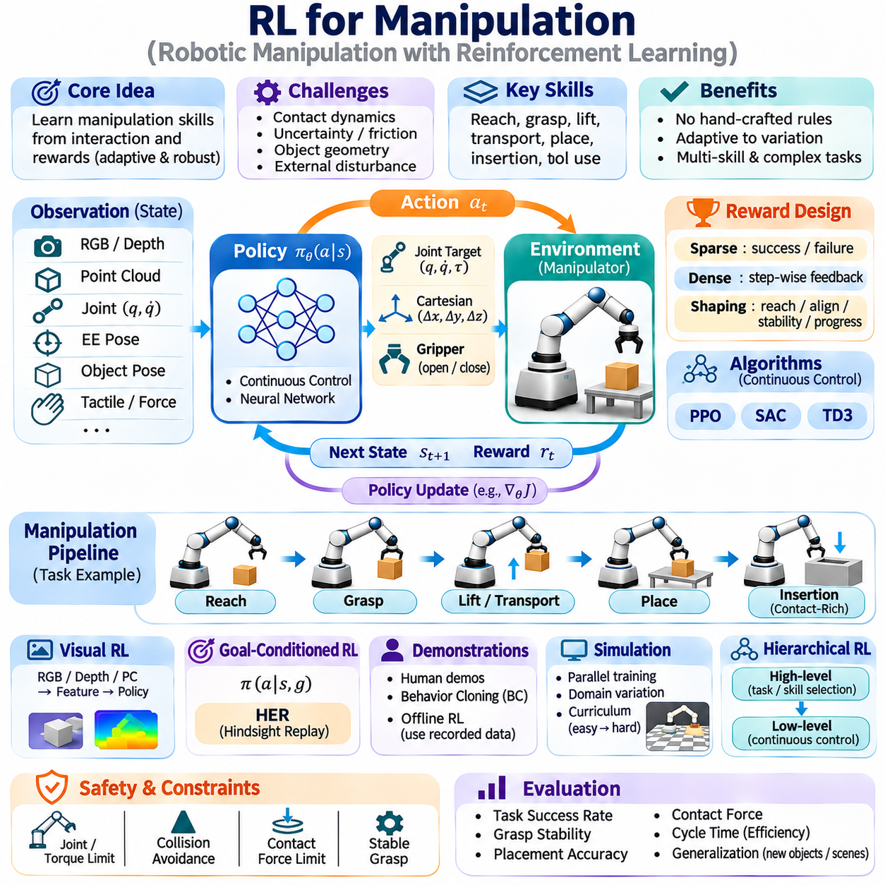{width="7.268055555555556in" height="7.268055555555556in"}

Reinforcement Learning (RL) for robotic manipulation enables robots to acquire physical interaction skills through experience and reward-driven optimization. Rather than relying exclusively on predefined motion trajectories or manually engineered control rules, reinforcement learning allows robots to develop adaptive strategies for reaching, grasping, pushing, lifting, inserting, and manipulating objects under varying environmental conditions.

Robotic manipulation presents significant challenges because physical interactions involve nonlinear dynamics, uncertain contact conditions, friction, object geometry, and external disturbances. Conventional analytical approaches require accurate mathematical models of these interactions, which can be difficult to obtain. Reinforcement learning provides an alternative mechanism for discovering effective manipulation behaviors through repeated interaction and performance feedback.

The state representation in manipulation-oriented reinforcement learning typically includes joint positions, joint velocities, end-effector poses, object positions, object orientations, and gripper configurations. Additional information may incorporate contact forces, tactile measurements, and visual observations. A well-designed state representation enables the agent to understand relevant physical conditions and select appropriate actions throughout a manipulation task.

The action space defines the commands available to the reinforcement learning agent. Manipulation policies may generate joint position targets, joint velocities, torque commands, Cartesian displacements, or gripper opening adjustments. High-level actions can alternatively represent predefined manipulation primitives. Selecting an appropriate action representation is essential for balancing control precision, learning complexity, and physical execution reliability.

Reward design determines which manipulation behaviors the agent attempts to optimize. Positive rewards may encourage successful grasping, accurate object placement, stable contact, and task completion, while penalties may discourage collisions, excessive forces, unnecessary movement, and object damage. Reward functions should reflect actual operational objectives while avoiding unintended behaviors that exploit weaknesses in the specified learning objective.

Sparse rewards provide feedback primarily when a manipulation task succeeds or fails, whereas dense rewards provide intermediate feedback throughout task execution. Although sparse rewards simplify objective definition, they can make exploration difficult in complex manipulation tasks. Reward shaping introduces intermediate learning signals associated with reaching accuracy, object alignment, grasp stability, and progress toward successful task completion.

Continuous control algorithms such as Proximal Policy Optimization (PPO), Soft Actor-Critic (SAC), and Twin Delayed Deep Deterministic Policy Gradient (TD3) are commonly applied to robotic manipulation. These algorithms support learning within high-dimensional continuous action spaces. Their suitability depends on factors such as sample efficiency, computational resources, environmental complexity, and the availability of simulated or physical interaction data.

Reinforcement learning for robotic grasping focuses on discovering effective strategies for approaching, contacting, gripping, and lifting objects. Policies can incorporate visual observations, depth information, and tactile feedback to adapt grasp configurations according to object characteristics. Unlike fixed grasp execution strategies, learned policies can potentially adjust their behavior in response to object movement, slippage, and unexpected contact conditions.

Contact-rich manipulation represents an important application of reinforcement learning because tasks such as insertion, assembly, tool utilization, and surface interaction require precise adaptation to physical contact. Force-torque sensors and tactile sensing provide feedback about interaction conditions. Learned policies can adjust end-effector motion and contact behavior while operating alongside conventional impedance or force controllers.

Visual reinforcement learning integrates perception and manipulation by allowing policies to process image-based observations directly or through learned feature representations. RGB images, depth images, and point clouds can provide information about object geometry, spatial relationships, and environmental conditions. Visual encoders help transform high-dimensional sensory inputs into compact representations suitable for policy learning and action generation.

Goal-conditioned reinforcement learning enables a single policy to perform manipulation tasks associated with different desired outcomes. Goal representations may specify target object positions, orientations, or desired configurations. Hindsight Experience Replay (HER) improves learning from unsuccessful attempts by relabeling recorded trajectories with goals that were actually achieved, particularly benefiting manipulation tasks with sparse rewards.

Human demonstrations can improve reinforcement learning efficiency by providing examples of successful manipulation behaviors. Behavior cloning may initialize a policy before reinforcement learning begins, while demonstration transitions can guide subsequent exploration. Offline reinforcement learning further enables the utilization of previously recorded manipulation experiences without requiring continuous physical interaction during initial policy training.

Simulation environments provide scalable platforms for training manipulation policies across large numbers of virtual robotic instances. Parallel simulation accelerates experience collection and enables systematic variation of object properties, initial configurations, and environmental conditions. Curriculum learning can progressively increase manipulation difficulty, allowing agents to acquire foundational skills before attempting more complex tasks.

Hierarchical reinforcement learning decomposes complex manipulation tasks into manageable behavioral components. High-level policies may select skills such as reaching, grasping, transporting, or placing, while low-level policies generate continuous control commands. This modular architecture supports skill reuse, long-horizon task execution, and integration with task planning systems in advanced robotic manipulation applications.

Performance evaluation should consider manipulation success rates, grasp stability, placement accuracy, contact force, cycle time, sample efficiency, and recovery effectiveness. Generalization must be evaluated using previously unseen objects, workspace configurations, and physical conditions. Independent collision detection, actuator limits, and protective control mechanisms remain essential for industrial deployment.

Within mobile manipulation systems, reinforcement learning for manipulation establishes the foundation for integrating learned robotic arm and end-effector behaviors with autonomous mobile platforms. Combining adaptive manipulation policies with reliable perception, conventional motion planning, feedback control, and independent safety architectures supports flexible robotic operation across diverse industrial and service environments.

## 08 RL for Mobile Manipulators

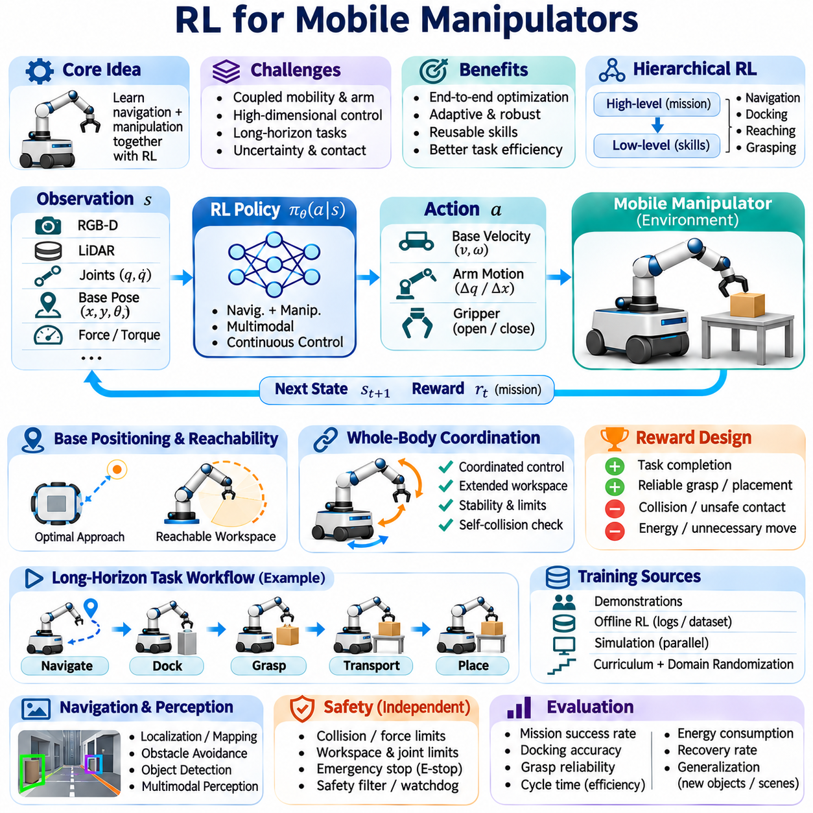{width="7.268055555555556in" height="7.268055555555556in"}

Reinforcement Learning (RL) for mobile manipulators extends conventional robotic learning by integrating autonomous navigation and physical manipulation within a unified decision-making framework. Unlike stationary robotic arms, mobile manipulators must coordinate platform movement, object perception, manipulator positioning, and physical interaction. Reinforcement learning enables these systems to acquire adaptive behaviors through experience-driven optimization.

Mobile manipulators combine the mobility of Autonomous Mobile Robots (AMRs) with the physical interaction capabilities of robotic manipulators. This combination introduces complex dependencies between base positioning, manipulator reachability, environmental accessibility, and task execution. Reinforcement learning can optimize these interdependent behaviors according to overall mission objectives rather than treating navigation and manipulation as entirely independent processes.

The state representation for mobile manipulation includes mobile base position, orientation, velocity, manipulator joint states, end-effector pose, gripper configuration, and environmental observations. Additional information may incorporate obstacle locations, object poses, battery status, and task progress. Multimodal state representations enable the learning agent to evaluate both navigation-related and manipulation-related operational conditions.

The action space of a mobile manipulator may include linear and angular base velocities, steering commands, joint position targets, Cartesian displacements, and gripper commands. Whole-body reinforcement learning combines these actions within an integrated policy, whereas modular approaches maintain separate control policies. Action representation must account for platform kinematics, actuator limitations, and differences in subsystem control frequencies.

Reward design for mobile manipulation should reflect overall mission performance rather than individual subsystem performance alone. Positive rewards may encourage successful navigation, accurate docking, reliable grasping, object transportation, and task completion. Penalties may discourage collisions, excessive energy consumption, unstable movements, unnecessary repositioning, and unsuccessful manipulation attempts.

Hierarchical Reinforcement Learning (HRL) provides an effective architecture for managing complex mobile manipulation tasks. High-level policies determine operational objectives, select target locations, and coordinate task sequences, while low-level policies execute navigation, docking, reaching, and grasping behaviors. This decomposition reduces learning complexity and supports reusable robotic skills across different operational scenarios.

Navigation-oriented reinforcement learning enables mobile manipulators to develop adaptive movement strategies in dynamic and partially observable environments. Policies may learn obstacle avoidance, local trajectory adjustment, target approach, and recovery behaviors. Integration with conventional localization, mapping, and global path planning systems allows learned navigation strategies to operate within structured autonomous mobility architectures.

Base positioning is particularly important because the location and orientation of the mobile platform directly influence manipulator reachability, visibility, and task feasibility. Reinforcement learning can optimize approach positions according to target object locations, workspace accessibility, collision constraints, and arm manipulability. Effective positioning reduces unnecessary platform movements and improves overall manipulation efficiency.

Whole-body reinforcement learning coordinates mobile base and robotic arm movements simultaneously to achieve shared manipulation objectives. This approach can extend the effective workspace, improve access to constrained locations, and support continuous object interaction during platform movement. Physical stability, payload distribution, acceleration limits, and self-collision constraints must be considered when learning coordinated behaviors.

Perception-driven reinforcement learning integrates RGB cameras, depth sensors, LiDAR, proprioceptive measurements, and force-torque feedback into the decision-making process. Multimodal neural networks transform sensory observations into compact representations suitable for policy learning. Recurrent networks or temporal observation histories can help compensate for incomplete environmental information and temporary sensor occlusion.

Long-horizon mobile manipulation tasks require the execution of multiple interconnected behaviors, including navigation, object identification, approach, grasping, transportation, and placement. Reinforcement learning must address delayed rewards and temporal credit assignment across these stages. Skill-based policies, intermediate objectives, and structured task representations can improve learning efficiency and execution consistency.

Human demonstrations and offline reinforcement learning can reduce the amount of physical exploration required during mobile manipulator development. Previously recorded navigation trajectories, docking operations, grasping attempts, and object transportation sequences provide valuable training experiences. Demonstration-based initialization and offline policy optimization can establish foundational competencies before controlled interactive refinement.

Simulation-based reinforcement learning enables mobile manipulators to acquire coordinated behaviors across numerous virtual environments. Parallel simulation supports large-scale experience collection, while curriculum learning progressively introduces more complex layouts, object configurations, and manipulation requirements. Domain randomization helps prepare learned policies for variations in real-world physical and sensory conditions.

Industrial applications include warehouse order picking, production line material handling, machine tending, autonomous inspection, and flexible assembly operations. Reinforcement learning can improve adaptability when object locations, workstation configurations, and operational conditions change. Learned policies can also support recovery strategies when docking, grasping, or transportation operations fail unexpectedly.

Performance evaluation should consider mission success rate, navigation efficiency, docking accuracy, grasp reliability, task cycle time, energy consumption, and recovery effectiveness. Validation must include previously unseen environments, payload variations, sensor disturbances, and unexpected obstacles. Independent safety supervision, collision monitoring, and conventional feedback controllers remain essential for reliable physical deployment.

Reinforcement learning for mobile manipulators establishes a technical foundation for integrated physical intelligence by connecting mobility, perception, manipulation, and adaptive decision-making. Combining learned policies with task planning, motion planning, real-time control, and safety architectures supports scalable robotic autonomy. Simulation-to-reality transfer and safety-aware reinforcement learning further extend this foundation toward practical deployment.

## 09 Sim2Real RL

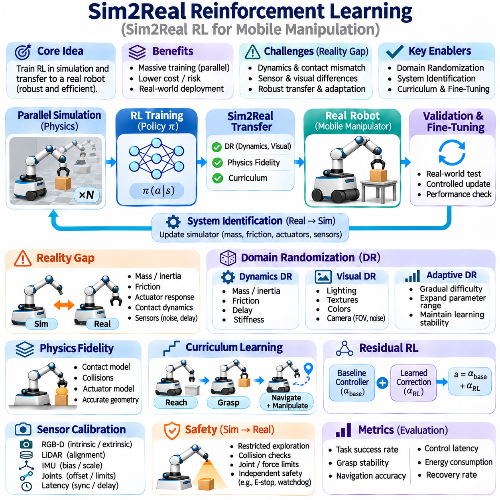{width="7.268055555555556in" height="7.268055555555556in"}

Sim-to-Real Reinforcement Learning (Sim2Real RL) is an approach that transfers reinforcement learning policies trained in simulated environments to physical robotic systems. It addresses the difficulty of acquiring sufficient training experience directly from real robots, where experimentation can be expensive, time-consuming, and potentially hazardous. In mobile manipulation, Sim2Real enables robots to develop navigation, grasping, and coordinated control skills through extensive simulation before physical deployment.

Simulation provides a controlled environment in which reinforcement learning agents can interact with virtual robots and objects without the operational risks associated with physical experimentation. Large numbers of training episodes can be executed in parallel, allowing policies to explore different actions, environmental conditions, and task configurations. This capability significantly increases training throughput and reduces dependence on expensive physical data collection.

However, simulated environments cannot perfectly reproduce real-world physical behavior. Differences in mass, friction, inertia, actuator response, contact dynamics, sensor characteristics, and environmental geometry create a phenomenon known as the reality gap. A policy that performs successfully in simulation may experience unexpected failures when transferred to physical hardware because the learned behavior depends on assumptions that are not fully satisfied in the real environment.

Domain Randomization is one of the most widely used techniques for reducing sensitivity to simulation inaccuracies. During training, physical parameters such as object mass, friction coefficients, joint damping, actuator delays, and sensor noise are randomly varied. Environmental conditions, lighting, object positions, and obstacle configurations can also be randomized. Exposure to these variations encourages policies to learn robust behaviors rather than overfitting to a single simulated configuration.

Dynamics Randomization specifically focuses on variations in the physical properties and motion characteristics of robotic systems. Parameters such as link mass, inertia, joint friction, motor strength, and contact stiffness are modified across training episodes. This approach helps reinforcement learning agents develop policies that remain effective despite uncertainties in the physical dynamics of real robotic platforms and manipulation systems.

Visual Domain Randomization introduces variations in image appearance, including lighting intensity, shadows, textures, colors, backgrounds, and camera parameters. These modifications reduce the dependence of learned policies on specific visual characteristics of simulation environments. For mobile manipulators using RGB or RGB-D cameras, visual randomization improves the ability to recognize objects and interpret workspace conditions under changing real-world illumination.

System Identification provides an alternative or complementary approach by estimating the physical parameters of the real robot and incorporating them into the simulation model. Experimental measurements can be used to identify mass properties, friction, actuator response, motion delays, and sensor characteristics. Improving the accuracy of the simulation model reduces the reality gap and can make subsequent reinforcement learning and policy transfer more reliable.

Adaptive Domain Randomization adjusts the distribution of randomized simulation parameters according to the learning progress of the agent. Instead of applying arbitrary parameter variations throughout training, the simulation gradually introduces increasingly challenging conditions. This approach helps maintain a balance between learning difficulty and policy performance while improving robustness across a broader range of environmental configurations.

Simulation environments must reproduce relevant physical interactions with sufficient accuracy to support meaningful policy learning. Contact modeling is particularly important for robotic grasping, insertion, pushing, and assembly tasks. Inaccurate collision geometry, friction models, or contact resolution can produce unrealistic manipulation behaviors. Appropriate physics engines, collision detection, and actuator models are therefore essential components of reliable Sim2Real development.

Parallel simulation is an important advantage of modern reinforcement learning platforms. Multiple virtual robots can simultaneously collect experiences under different environmental conditions, accelerating policy optimization. GPU-accelerated simulation environments can support large-scale training of perception and control policies, while physics-based simulation provides the interaction feedback required for learning physically meaningful robotic behaviors.

Curriculum Learning can improve Sim2Real training by progressively increasing task complexity. A mobile manipulator may initially learn basic reaching and grasping under simplified conditions before progressing to cluttered environments, uncertain object positions, dynamic obstacles, and coordinated navigation-manipulation tasks. Gradual difficulty increases help the agent acquire foundational behaviors before addressing more challenging operational scenarios.

Residual Reinforcement Learning provides another strategy for transferring learned policies to physical systems. A conventional controller generates a baseline control command, while a learned policy produces an additional corrective action. This architecture combines the predictability of established control methods with the adaptability of reinforcement learning. It is particularly useful when transferring manipulation policies that require precise motion and contact adjustment.

Real-world fine-tuning can further improve policies after their initial transfer from simulation. A pretrained policy is deployed under controlled physical conditions, and additional interaction data is collected to refine its behavior. Limited real-world training can compensate for residual differences between simulation and reality. Safety constraints, restricted exploration, and continuous performance monitoring are necessary to prevent equipment damage during this process.

Sim2Real transfer for mobile manipulators must address differences across both the mobile platform and the robotic arm. Navigation policies must account for actual wheel dynamics, floor friction, localization errors, braking characteristics, and payload-dependent motion. Manipulation policies must additionally handle real contact forces, grasp uncertainty, joint compliance, and object variation. Coordinated transfer requires consistent calibration and accurate relationships between the mobile base, arm, sensors, and workspace.

Sensor calibration and synchronization are critical for successful Sim2Real deployment. Camera extrinsic parameters, depth measurement characteristics, LiDAR alignment, IMU orientation, and joint feedback must correspond to the physical robot configuration. Differences in sensor latency, noise, resolution, and coordinate transformations can significantly affect learned policies. Sensor randomization during simulation and accurate hardware calibration help reduce these transfer-related problems.

Performance validation should compare simulation results with physical robot experiments using consistent evaluation metrics. Task success rate, grasp stability, navigation accuracy, control latency, energy consumption, collision frequency, and recovery performance provide useful indicators. Testing should include different objects, payloads, environmental layouts, lighting conditions, and operational disturbances to determine whether the transferred policy generalizes beyond its original training scenarios.

Sim-to-Real Reinforcement Learning provides an important foundation for scalable robotic learning by combining the experimentation capacity of simulation with the physical adaptability of real robotic systems. Integrating domain randomization, system identification, parallel simulation, controlled fine-tuning, and safety supervision enables more reliable policy transfer. For mobile manipulators, this approach supports the development of adaptive physical intelligence while reducing the cost and risks of learning directly in industrial environments.

## 10 Safety RL

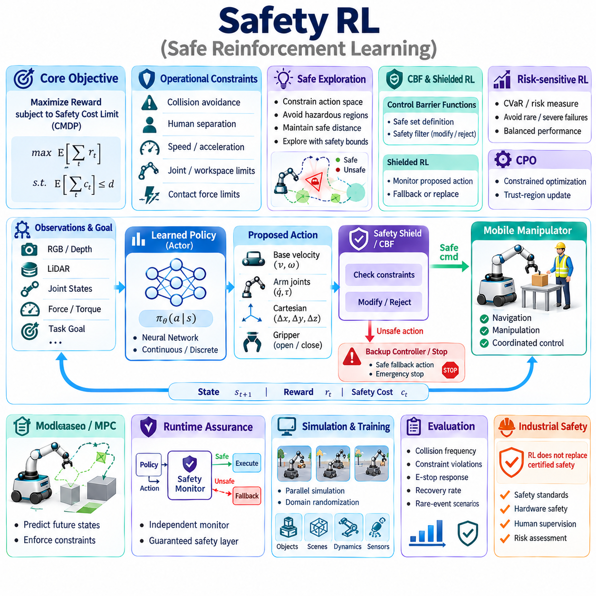{width="7.268055555555556in" height="7.268055555555556in"}

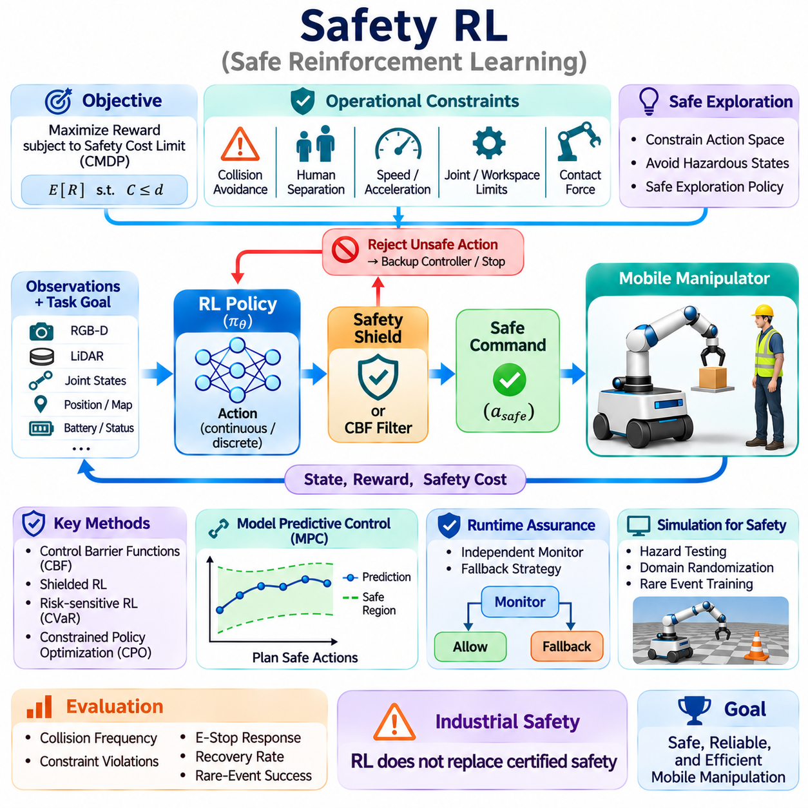{width="7.268055555555556in" height="7.268055555555556in"}

Safety Reinforcement Learning (Safety RL) is an approach to reinforcement learning that incorporates safety requirements and operational constraints into the learning and decision-making process. Unlike conventional reinforcement learning, which primarily focuses on maximizing cumulative rewards, Safety RL explicitly considers the risks associated with actions and their potential consequences. In robotics, this approach is essential for developing intelligent systems that can learn adaptive behaviors while maintaining acceptable levels of operational safety.

Physical robotic systems operate in environments where incorrect decisions may cause collisions, equipment damage, human injuries, or operational interruptions. Reinforcement learning agents frequently require exploration to discover effective strategies, but unrestricted exploration can create unacceptable risks. Safety RL addresses this challenge by introducing constraints, risk evaluation, and protective mechanisms that limit unsafe behaviors during training and deployment.

Constrained Markov Decision Processes (CMDPs) provide a mathematical foundation for modeling safety requirements in reinforcement learning. In addition to conventional state transitions and reward functions, CMDPs introduce cost functions and constraints that represent undesirable outcomes. An agent must maximize its expected cumulative reward while ensuring that accumulated safety costs remain within predefined limits.

Safety constraints can represent different types of operational restrictions, including collision avoidance, maximum contact forces, joint position limits, velocity restrictions, acceleration limits, and workspace boundaries. These constraints may be defined at the system level or for individual robotic components. A well-structured constraint representation enables reinforcement learning algorithms to consider physical limitations alongside task performance objectives.

Safe Exploration is a fundamental requirement during reinforcement learning because agents must discover effective behaviors without repeatedly generating dangerous actions. Exploration constraints can restrict the available action space, prevent entry into hazardous regions, and enforce minimum separation distances from obstacles. These mechanisms allow agents to investigate alternative strategies while maintaining predefined operational safety conditions.

Control Barrier Functions (CBFs) provide a mathematical mechanism for enforcing safety constraints in dynamical systems. A barrier function defines a safe region of the system state space and determines whether an action may cause the system to leave that region. A safety filter can modify or reject unsafe control commands before execution, allowing learned policies to operate under additional mathematical safety guarantees when the underlying model and assumptions are valid.

Shielded Reinforcement Learning introduces an independent safety mechanism that monitors actions proposed by a learned policy. When an action is predicted to violate predefined safety conditions, a safety shield can replace it with a verified alternative or prevent its execution. This architecture separates performance-oriented learning from safety enforcement and is particularly useful when deploying adaptive policies on physical robotic platforms.

Risk-sensitive reinforcement learning extends conventional reward optimization by explicitly considering the probability and severity of undesirable outcomes. Instead of evaluating performance only through expected cumulative rewards, risk-sensitive methods may incorporate measures such as Conditional Value at Risk (CVaR). These approaches help distinguish policies with similar average performance but substantially different exposure to rare or severe failures.

Safe Policy Optimization methods attempt to improve learned policies while maintaining specified safety constraints. Constrained Policy Optimization (CPO), for example, formulates policy updates as an optimization problem that considers both expected rewards and constraint violations. Trust-region mechanisms can limit policy changes between iterations, reducing the likelihood that optimization produces significantly less safe behaviors.

Model Predictive Control (MPC) can complement Safety RL by evaluating candidate control actions over a finite prediction horizon. The controller predicts future system states and selects actions that satisfy motion and safety constraints. Combining MPC with learned policies allows reinforcement learning to provide adaptive decision-making while model-based control handles short-term trajectory feasibility and constraint enforcement.

In mobile manipulation, safety requirements extend across the mobile platform, robotic arm, and end effector. Navigation policies must avoid obstacles, maintain safe distances from people, and respect platform velocity and acceleration limits. Manipulation policies must consider joint limits, collision geometry, contact forces, grasp stability, and object handling constraints. Coordinated safety management is necessary because an individually acceptable action from one subsystem may create hazardous conditions for another.

Human-Robot Interaction (HRI) introduces additional safety requirements because mobile manipulators frequently operate near workers and other people. Safety-aware policies should consider human proximity, movement patterns, restricted areas, and unexpected interactions. Human detection, protective separation monitoring, emergency stopping, and speed reduction can operate independently of the learned policy to maintain appropriate protection levels.

Simulation-based Safety RL enables agents to explore hazardous situations without exposing physical equipment or personnel to direct risk. Simulated environments can reproduce obstacle encounters, unstable grasping, excessive contact forces, localization failures, and emergency conditions. Domain randomization and scenario-based testing help evaluate policy behavior across different environmental configurations and operational disturbances.

Runtime Assurance provides an additional protection architecture for deployed reinforcement learning systems. A learned controller operates as the primary performance-oriented controller, while an independent safety controller continuously monitors system behavior. If the learned policy violates predefined safety conditions or enters an uncertain operational state, control can be transferred to a verified backup controller or the system can enter a controlled stop condition.

Safety validation requires more than measuring average task success rates. Evaluation should include collision frequency, constraint violation rates, maximum contact forces, emergency stop response, recovery effectiveness, and behavior under unexpected disturbances. Rare-event testing and systematic scenario coverage are important because policies that perform well under normal conditions may still exhibit unsafe behavior in unusual situations.

Industrial deployment requires Safety RL to be integrated with established functional safety mechanisms, hardware protection, emergency stopping systems, and validated control architectures. Reinforcement learning should not replace certified safety functions or independent protective systems. Instead, it should operate within clearly defined safety boundaries established through system engineering, risk assessment, and verification.

Safety Reinforcement Learning provides a foundation for developing adaptive robotic intelligence without treating operational safety as a secondary consideration. Combining constrained learning, safe exploration, control barrier functions, policy shielding, risk-sensitive optimization, and runtime assurance supports more reliable autonomous behavior. For mobile manipulators, this integration is essential for achieving flexible physical interaction while protecting equipment, operators, and surrounding environments.
