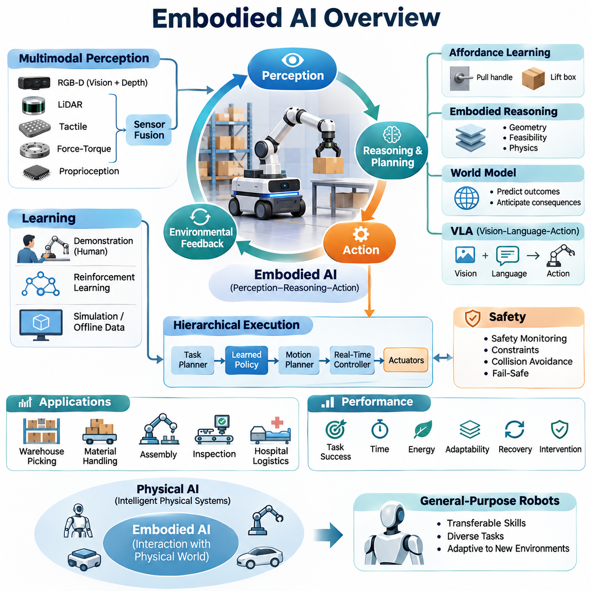
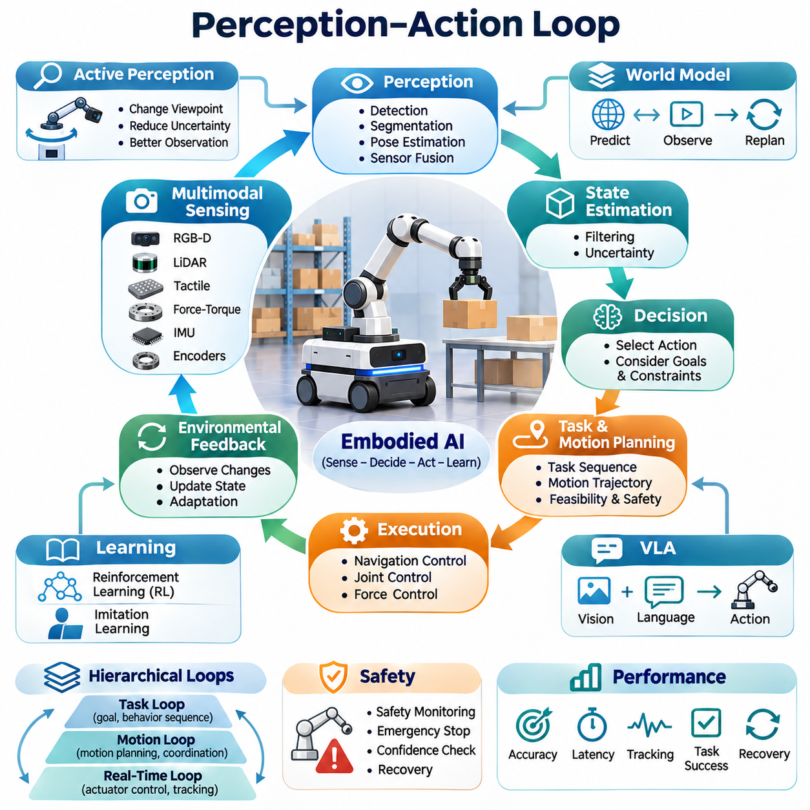
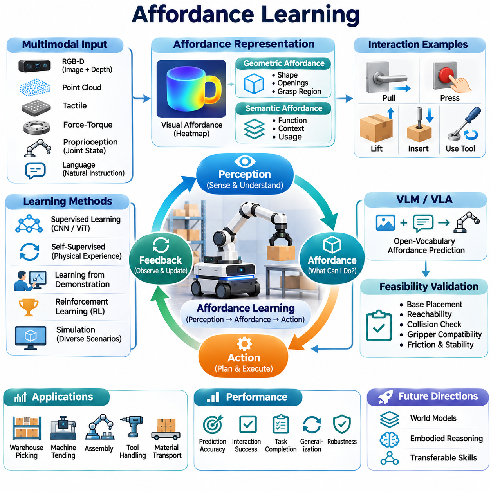
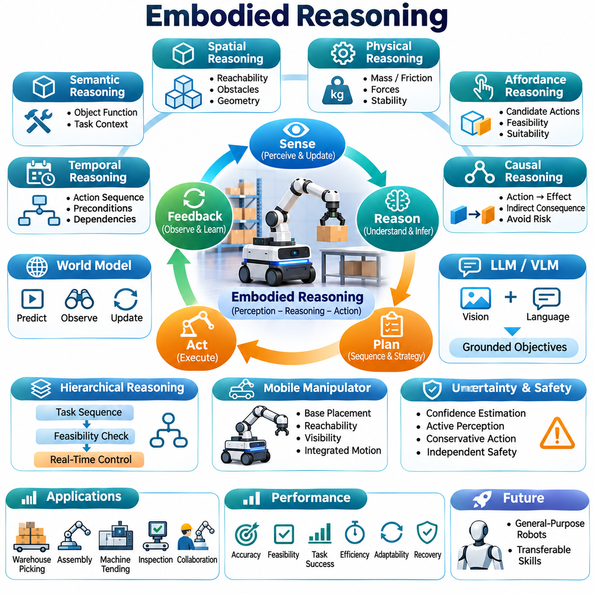
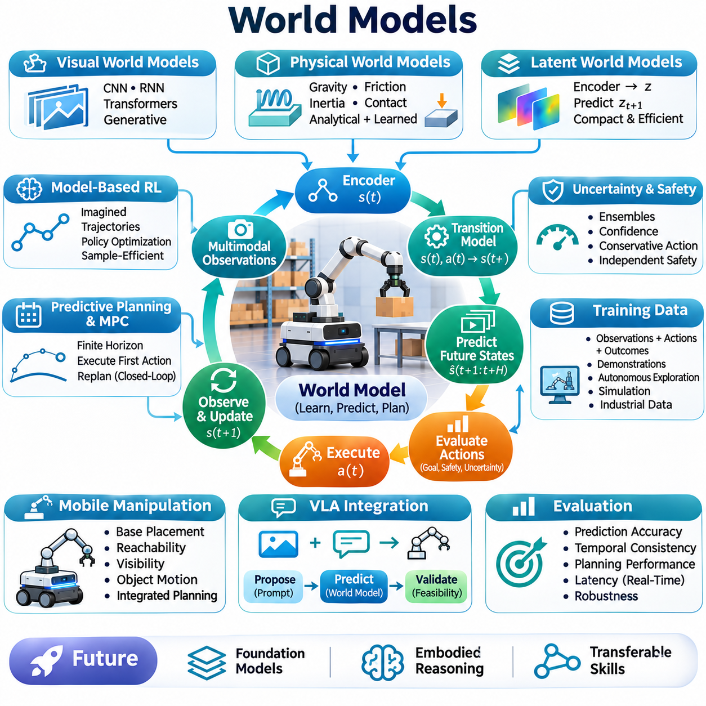
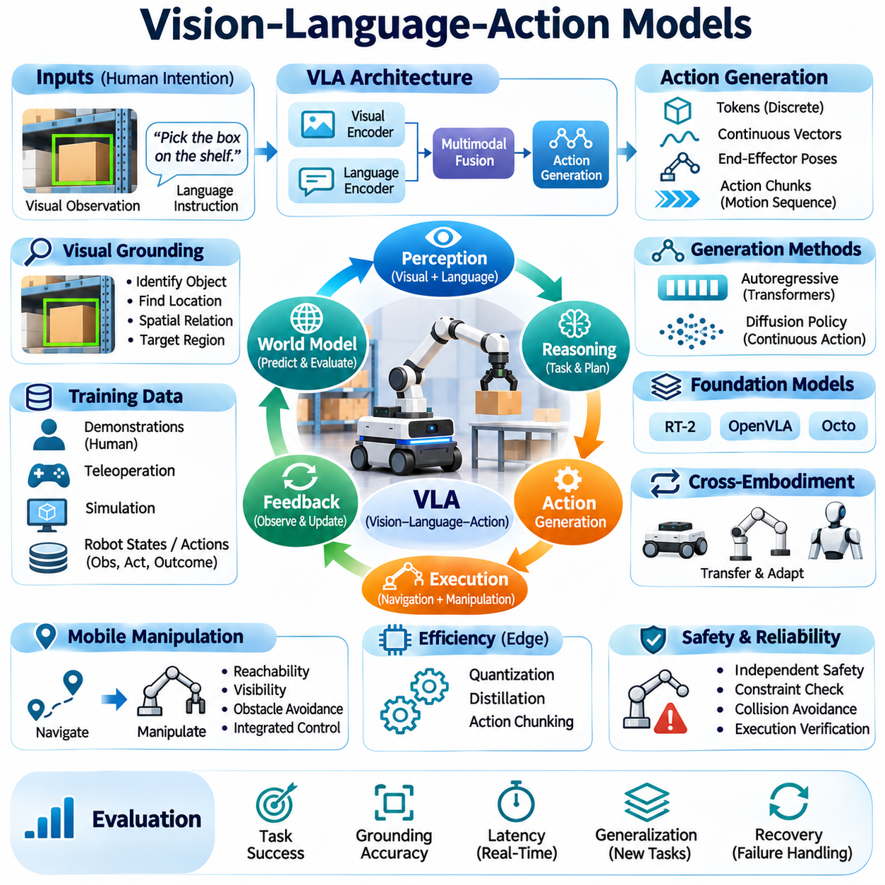
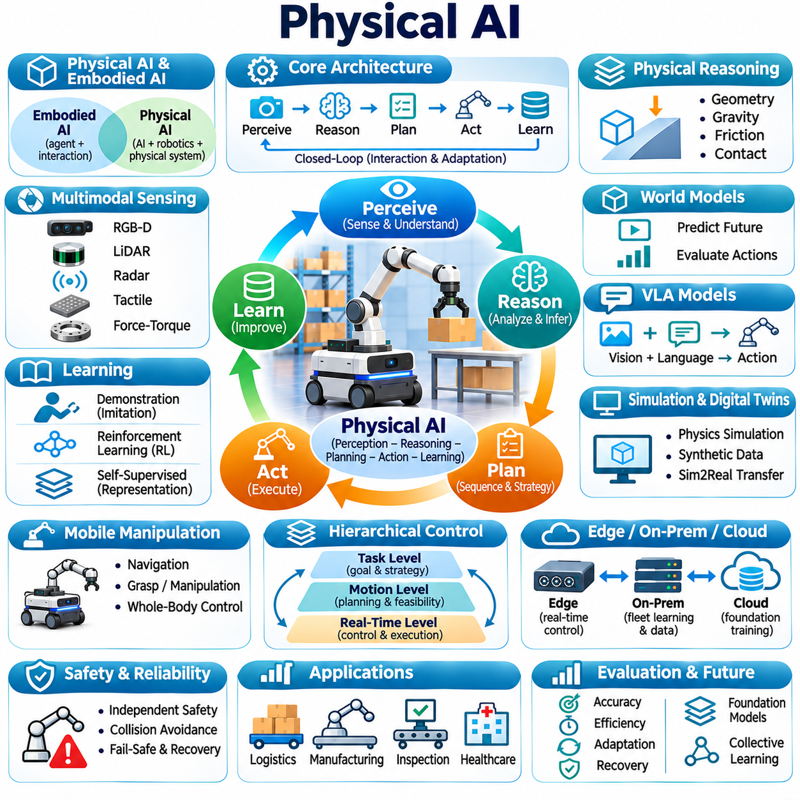
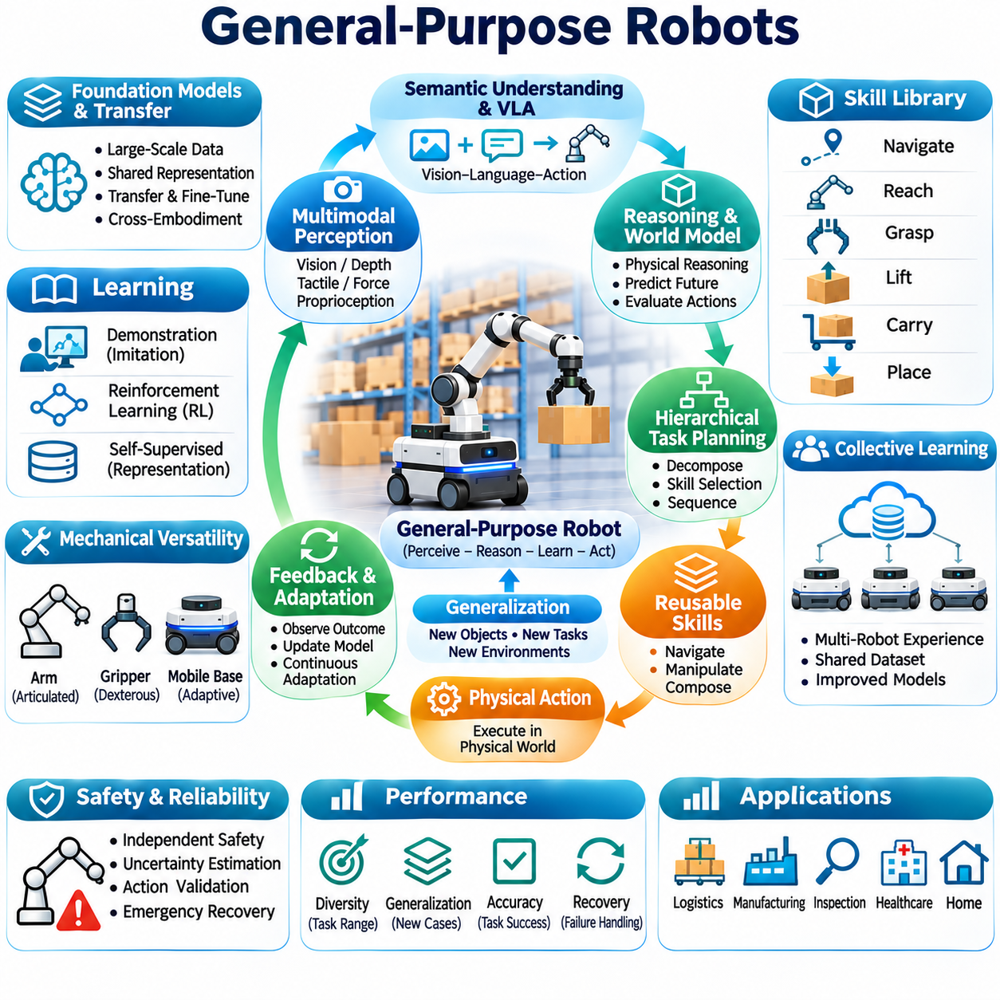
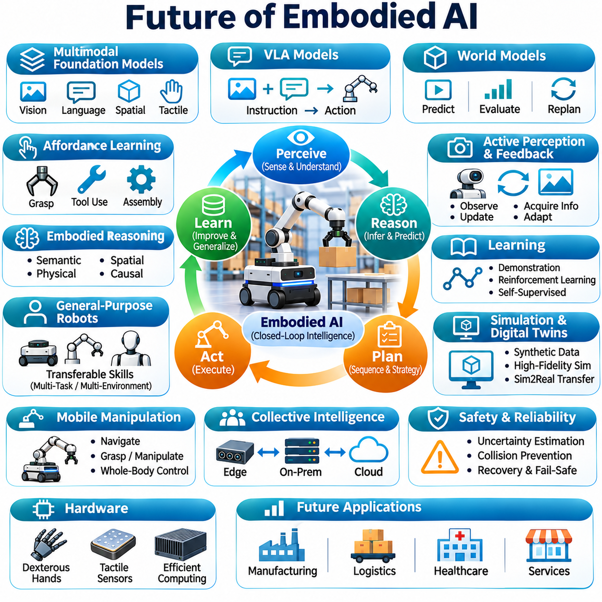

**Volume 03. Vision Manipulation and AI**

# Chapter 14. Embodied AI

## 01 Embodied AI Overview

{width="7.268055555555556in" height="7.268055555555556in"}

Embodied AI represents a paradigm in artificial intelligence in which intelligent behavior emerges through the interaction between an agent, its physical embodiment, and the surrounding environment. Unlike conventional AI systems that primarily process digital information, Embodied AI connects perception, reasoning, decision-making, and physical action. This integration enables robots to understand their surroundings and perform meaningful tasks in dynamic environments.

The fundamental concept of embodiment emphasizes that intelligence is influenced by the physical structure and interactive capabilities of an agent. Sensors, actuators, mechanical configurations, and computational resources collectively determine how a robot perceives and interacts with the world. Consequently, intelligent behavior cannot be understood solely through computational algorithms without considering physical constraints and environmental conditions.

Mobile manipulators provide a representative platform for implementing Embodied AI because they combine autonomous mobility with physical manipulation. An autonomous mobile robot extends the operational workspace, while a robotic arm and end effector enable direct interaction with objects. The integration of these capabilities allows a mobile manipulator to perform complex tasks that require navigation, environmental understanding, object manipulation, and adaptive decision-making.

The perception-action loop constitutes a fundamental operating mechanism of Embodied AI. Robots continuously acquire sensory information, interpret environmental conditions, select appropriate actions, and observe the consequences of their behavior. The resulting feedback updates internal representations and influences subsequent decisions. This closed-loop architecture enables adaptation to environmental changes, unexpected obstacles, and uncertainties during physical task execution.

Multimodal perception enables embodied agents to construct comprehensive representations of their surroundings. RGB cameras, depth cameras, LiDAR, tactile sensors, force-torque sensors, and proprioceptive measurements provide complementary information about external and internal states. Sensor fusion combines these observations to improve spatial awareness, object recognition, contact detection, and the reliability of decision-making under uncertain conditions.

Embodied intelligence requires understanding not only what objects are but also how they can be physically manipulated. Affordance learning addresses this requirement by identifying potential interactions associated with objects and environmental structures. A robot may recognize that a handle can be pulled, a container can be lifted, or a surface can support an object. Such capabilities establish connections between perception and physically executable actions.

Embodied reasoning extends conventional symbolic and semantic reasoning by incorporating spatial relationships, physical constraints, and action consequences. A robot must determine whether an intended operation is feasible within its workspace, whether an object can be reached safely, and whether an action may destabilize surrounding objects. Effective reasoning therefore integrates semantic knowledge with geometric understanding and physical interaction models.

World models provide internal representations that enable embodied agents to estimate environmental states and predict possible future outcomes. Instead of relying exclusively on immediate observations, a robot can use learned or analytical models to anticipate the consequences of candidate actions. Predictive capabilities support proactive planning, collision avoidance, manipulation strategy selection, and efficient execution of long-horizon tasks.

Vision-Language-Action models represent an important architectural approach to integrating visual perception, linguistic understanding, and robotic control. These models process visual observations and natural language instructions to generate action representations or control commands. By connecting semantic understanding with physical execution, they provide a foundation for flexible task specification and the development of increasingly generalizable robotic manipulation policies.

Learning from demonstration and reinforcement learning provide complementary mechanisms for acquiring embodied skills. Demonstration-based learning enables robots to reproduce behaviors observed from human operators, while reinforcement learning optimizes policies through interaction and reward feedback. Simulation, offline datasets, and controlled physical experiments can be combined to improve learning efficiency while reducing hardware wear and operational risks.

An Embodied AI architecture typically integrates perception modules, task planners, learned policies, motion planners, and low-level controllers. High-level intelligence interprets operational objectives and selects appropriate behaviors, while real-time control systems regulate movement, contact forces, and actuator responses. Hierarchical coordination allows advanced AI models to operate within the deterministic constraints required for reliable physical execution.

The relationship between Embodied AI and Physical AI reflects the broader convergence of artificial intelligence and physical systems. Embodied AI emphasizes intelligence grounded in an agent\'s interaction with its environment, while Physical AI encompasses intelligent technologies that perceive, model, and operate within the physical world. Mobile manipulators, humanoid robots, autonomous vehicles, and collaborative robots illustrate this convergence.

Industrial applications of Embodied AI include warehouse picking, autonomous material handling, machine tending, assembly, inspection, and hospital logistics. Unlike conventional automation systems designed around predefined operating conditions, embodied robots aim to accommodate variations in object positions, environmental layouts, and task requirements. Their adaptability can reduce dependence on rigid fixtures and extensive environment-specific programming.

Safety and reliability remain essential considerations because embodied agents directly influence physical environments. Incorrect perception, inaccurate predictions, or inappropriate actions may damage equipment or create hazards for nearby humans. Independent safety mechanisms, collision monitoring, operational constraints, uncertainty estimation, and fail-safe behaviors must complement learned intelligence throughout development and deployment.

The performance of Embodied AI must be evaluated beyond conventional AI accuracy metrics. Task completion rates, manipulation success, execution time, energy consumption, environmental adaptability, recovery capabilities, and human intervention frequency provide practical measures of intelligence. Future developments will increasingly focus on integrating these capabilities into general-purpose robots equipped with transferable skills, predictive reasoning, and physically grounded autonomy.

## 02 Perception Action Loop

{width="7.268055555555556in" height="7.268055555555556in"}

The perception-action loop is a fundamental operating mechanism of Embodied AI that connects sensory information, environmental understanding, decision-making, and physical execution within a continuous feedback process. Unlike conventional AI systems that process information without directly interacting with the physical world, embodied agents execute actions that modify their surroundings and generate new sensory observations for subsequent decisions.

The perception stage begins with the acquisition of sensory information from the robot and its surrounding environment. RGB cameras, depth cameras, LiDAR, tactile sensors, force-torque sensors, inertial measurement units, and joint encoders provide complementary observations. These sensory inputs enable the robot to identify objects, estimate spatial relationships, recognize environmental changes, and monitor its internal mechanical and operational states.

Sensory processing transforms raw measurements into meaningful environmental representations that support intelligent behavior. Object detection, semantic segmentation, pose estimation, depth reconstruction, and sensor fusion contribute to the construction of spatial and semantic information. The resulting representation must contain sufficient detail to support navigation, manipulation, collision avoidance, and interaction with surrounding objects.

State estimation establishes an internal understanding of the current conditions of the robot and its environment. Because individual sensor measurements may contain noise, uncertainty, or incomplete information, embodied agents integrate observations across multiple sensors and successive time steps. Probabilistic estimation, temporal filtering, and learned representations improve the consistency of environmental understanding during physical interactions.

The decision-making stage determines appropriate actions based on estimated environmental states, operational objectives, historical observations, and applicable constraints. A mobile manipulator may decide whether to approach an object, reposition its mobile base, adjust its grasping configuration, or acquire additional sensory information. Effective decisions must account for both immediate operational requirements and anticipated future consequences.

Action planning translates high-level decisions into physically executable behaviors. Task planning identifies the required operational sequence, while motion planning generates feasible trajectories for the mobile platform and robotic arm. Kinematic limitations, dynamic constraints, collision risks, grasp stability, and environmental accessibility must be evaluated to ensure that intended actions can be executed safely within the available workspace.

The execution stage converts planned behaviors into actuator commands through navigation controllers, joint controllers, trajectory tracking algorithms, and force control systems. During manipulation, the robot continuously monitors its movement, contact conditions, and interaction forces. Real-time feedback enables immediate corrections when actual physical behavior deviates from planned trajectories or expected environmental responses.

Feedback closes the perception-action loop by providing updated information regarding the consequences of physical actions. A grasping operation may change an object\'s position, reveal previously occluded surfaces, or produce unexpected contact forces. These changes become new sensory observations that update the robot\'s internal representation and influence subsequent decisions, enabling continuous adaptation throughout task execution.

Active perception extends the conventional perception-action loop by allowing robots to perform deliberate actions that improve sensory information quality. A mobile manipulator may reposition its camera, rotate its end effector, or move around an obstacle to obtain a more informative viewpoint. Such behaviors reduce uncertainty, resolve visual ambiguities, and improve the reliability of subsequent manipulation and navigation decisions.

Multiple perception-action loops can operate simultaneously at different temporal and functional levels within an embodied robotic architecture. High-level loops manage task objectives and behavioral sequences, intermediate loops coordinate motion planning and environmental interpretation, and low-level loops regulate actuator responses. This hierarchical organization balances computational complexity, decision flexibility, and real-time control requirements.

World models enhance perception-action loops by enabling robots to predict environmental changes before executing physical actions. By estimating the potential outcomes of candidate behaviors, embodied agents can evaluate alternative strategies and anticipate undesirable consequences. Predictions are subsequently compared with actual observations, allowing discrepancies to support state correction, model refinement, or adaptive replanning.

Learning-based perception-action loops incorporate experience to improve future decision-making and physical interaction capabilities. Reinforcement learning optimizes action policies through environmental feedback, while imitation learning extracts behavioral patterns from human demonstrations. These approaches can improve grasp selection, navigation efficiency, contact-rich manipulation, and recovery strategies under previously unfamiliar conditions.

Vision-Language-Action models provide an increasingly integrated approach to implementing perception-action loops. Visual observations and natural language instructions are processed together to generate action sequences or control representations. Nevertheless, reliable physical deployment requires updated sensory feedback, execution verification, and independent safety constraints to prevent semantic errors from propagating into unsafe actions.

Safety considerations are particularly important when perception-action loops operate in dynamic industrial environments. Processing delays, inaccurate state estimation, sensor failures, and unexpected human movements can compromise physical execution. Independent safety monitoring, emergency stopping mechanisms, confidence thresholds, and conservative recovery behaviors must operate alongside intelligent decision-making and learned control policies.

The effectiveness of a perception-action loop can be evaluated through sensing accuracy, processing latency, response time, trajectory tracking accuracy, task completion rates, and recovery performance. For mobile manipulators, coordination between autonomous navigation and physical manipulation is particularly important. A well-designed perception-action loop transforms isolated AI capabilities into adaptive, reliable, and physically grounded robotic intelligence.

## 03 Affordance Learning

{width="7.268055555555556in" height="7.268055555555556in"}

Affordance learning is a fundamental component of Embodied AI that enables robots to understand the potential physical interactions associated with objects and environmental structures. Rather than identifying objects solely through their semantic categories, embodied agents learn what actions can be performed on them, how those actions should be executed, and what physical consequences may result from the interactions.

The concept of affordance originates from ecological psychology, where it describes the opportunities for action provided by an environment relative to the capabilities of an agent. A handle may afford pulling, a button may afford pressing, and a horizontal surface may afford supporting an object. In robotics, these opportunities depend on object properties, environmental conditions, mechanical configurations, and available robotic skills.

Affordance learning establishes a direct relationship between perception and action within the perception-action loop. Sensory observations provide information about object geometry, texture, orientation, material properties, and spatial relationships. The robot interprets these observations to identify potential interaction opportunities and selects appropriate actions according to its operational objectives and physical capabilities.

Visual affordance detection identifies image regions or three-dimensional structures associated with particular physical interactions. RGB images, depth measurements, and point clouds provide complementary information for estimating graspable regions, contact surfaces, insertion openings, and movable components. Deep neural networks can generate pixel-level affordance maps or three-dimensional affordance representations for manipulation planning.

Geometric affordances are determined by the physical shape, dimensions, orientation, and structural characteristics of objects. A cylindrical component may support particular grasping configurations, while a recessed opening may provide an insertion opportunity. However, geometric suitability alone does not guarantee successful interaction because friction, weight distribution, material deformation, and environmental constraints also influence action feasibility.

Semantic affordances incorporate contextual knowledge about object functions, intended usage, and relationships with other objects. A robot may recognize that a screwdriver is associated with fastening operations or that a drawer provides access to stored components. Combining semantic understanding with geometric perception enables embodied agents to identify meaningful interactions beyond predefined object recognition categories.

Affordance learning can be implemented through supervised learning using annotated datasets containing interaction labels, grasp locations, contact points, and action outcomes. Convolutional neural networks and vision transformers extract relevant features and predict affordance distributions. The quality and diversity of training annotations significantly influence the ability of these models to generalize across unfamiliar objects and operating environments.

Self-supervised affordance learning enables robots to acquire interaction knowledge through physical experience without requiring extensive manual annotation. Robots execute exploratory actions, observe resulting environmental changes, and associate successful or unsuccessful interactions with sensory observations. This approach can reveal physical properties that are difficult to infer from static visual information alone, including friction and articulation constraints.

Learning from demonstration provides another mechanism for acquiring affordance knowledge by observing human interactions with objects. Human operators demonstrate grasping, pushing, pulling, tool usage, and assembly procedures, allowing robots to identify relevant contact locations and action patterns. Demonstration data must be adapted to account for differences between human physical capabilities and robotic embodiment.

Reinforcement learning extends affordance discovery by enabling embodied agents to explore potential interactions and optimize action policies through reward feedback. Successful physical outcomes reinforce useful interaction strategies, while unsuccessful attempts provide information about limitations. Simulation and constrained exploration can improve learning efficiency while reducing the risks associated with uncontrolled physical experimentation.

Multimodal affordance learning combines visual observations with tactile feedback, force-torque measurements, proprioception, and language descriptions. Visual information identifies potential interaction regions, while tactile and force measurements reveal contact stability, surface properties, and mechanical resistance. Integrating these complementary modalities improves affordance estimation during contact-rich manipulation and uncertain physical interactions.

Vision-Language Models and Vision-Language-Action Models introduce new opportunities for open-vocabulary affordance learning. By connecting visual features with linguistic concepts and action representations, these models can identify interaction opportunities described through natural language. Nevertheless, predicted affordances must be validated against geometric constraints, robot capabilities, and actual physical feedback before execution.

For mobile manipulators, affordance learning must consider the combined capabilities of the autonomous mobile platform and robotic arm. An object that is initially unreachable may become accessible after repositioning the mobile base. Affordance estimation must therefore incorporate base placement, manipulator reachability, collision constraints, end-effector compatibility, and environmental accessibility within a unified decision-making process.

Industrial applications of affordance learning include warehouse picking, bin picking, machine tending, assembly, tool handling, and autonomous material transportation. Instead of relying exclusively on predefined grasp coordinates and fixed operational sequences, robots can identify feasible interaction opportunities based on current environmental observations. This adaptability is particularly valuable in high-mix production and unstructured logistics environments.

The effectiveness of affordance learning can be evaluated through prediction accuracy, interaction success rates, task completion rates, generalization capabilities, and robustness under changing conditions. Future developments will increasingly integrate affordance representations with world models, embodied reasoning, and transferable robotic skills, enabling general-purpose robots to discover, evaluate, and execute meaningful physical interactions autonomously.

## 04 Embodied Reasoning

{width="7.268055555555556in" height="7.268055555555556in"}

Embodied reasoning is a fundamental capability of Embodied AI that enables intelligent agents to interpret environmental conditions, evaluate physical constraints, and determine appropriate actions within the physical world. Unlike conventional reasoning systems that operate primarily on abstract information, embodied reasoning integrates sensory observations, spatial knowledge, physical experience, and action consequences into the decision-making process.

The concept of embodied reasoning emphasizes that intelligent decisions must be grounded in the physical capabilities and limitations of an agent. A robot cannot determine an appropriate action solely from semantic knowledge because its mechanical configuration, actuator capabilities, sensor coverage, and operational environment influence action feasibility. Reasoning must therefore establish a connection between abstract objectives and physically executable behaviors.

Spatial reasoning enables embodied agents to understand the positions, orientations, distances, and geometric relationships of objects within an environment. A mobile manipulator must determine whether an object is within reach, whether an obstacle blocks its approach, and whether sufficient space exists for manipulation. Spatial representations such as occupancy maps, point clouds, and scene graphs support these reasoning processes.

Physical reasoning enables robots to understand and predict interactions governed by physical properties and mechanical principles. Object mass, friction, gravity, rigidity, inertia, and contact forces influence the consequences of manipulation. A robot attempting to lift or transport an object must consider whether the selected grasp can maintain stability and whether the intended movement may cause slipping, deformation, or unintended collisions.

Semantic reasoning incorporates contextual knowledge about objects, their functions, and their relationships with operational objectives. For example, a robot instructed to prepare a workstation must identify relevant tools, understand their intended usage, and determine appropriate placement locations. Semantic knowledge becomes operationally meaningful when it is connected to geometric information, physical constraints, and available robotic skills.

Affordance-based reasoning builds upon affordance learning by evaluating potential interaction opportunities according to task requirements and environmental conditions. Although an object may provide multiple graspable surfaces or movable components, not every interaction is suitable for a particular operation. The robot must compare candidate actions based on accessibility, stability, safety, and expected task outcomes before selecting an appropriate behavior.

Causal reasoning enables embodied agents to establish relationships between physical actions and their resulting environmental changes. Opening a drawer may expose previously hidden objects, while removing a supporting component may destabilize an assembly. Understanding such causal relationships allows robots to anticipate indirect consequences, avoid undesirable interactions, and construct more effective strategies for complex manipulation tasks.

Temporal reasoning addresses the sequence, duration, and dependencies of actions during extended robotic operations. Many physical tasks require specific preconditions to be satisfied before subsequent actions can begin. A mobile manipulator performing machine tending must approach the equipment, verify its operating state, manipulate the required component, and confirm successful completion before proceeding to the next operation.

World models enhance embodied reasoning by providing internal representations of environmental states and their possible evolution under candidate actions. Predictive simulations allow robots to evaluate alternative behaviors before physical execution. By comparing predicted outcomes with actual observations, embodied agents can identify unexpected environmental changes, correct inaccurate assumptions, and adapt their operational strategies.

Large Language Models and Vision-Language Models introduce advanced semantic and contextual reasoning capabilities into embodied robotic architectures. These models can interpret natural language instructions, decompose complex objectives, and identify relevant relationships between objects and tasks. However, their generated reasoning must be grounded in verified environmental observations and validated against the physical capabilities of the robot.

Hierarchical reasoning architectures distribute decision-making across multiple functional levels to address the complexity of embodied robotic operations. High-level reasoning interprets objectives and generates task sequences, intermediate-level reasoning evaluates spatial relationships and action feasibility, and low-level control manages physical execution. This separation enables flexible intelligence while maintaining deterministic and responsive control mechanisms.

For mobile manipulators, embodied reasoning must integrate autonomous navigation and robotic manipulation within a unified operational framework. The robot must determine not only how to manipulate an object but also where to position its mobile base to achieve an appropriate manipulation configuration. Joint consideration of mobility, reachability, visibility, and environmental constraints improves overall task feasibility and operational efficiency.

Uncertainty-aware reasoning is essential because physical environments are only partially observable and continuously changing. Sensor noise, object occlusion, inaccurate predictions, and unexpected contact conditions may reduce the reliability of internal representations. Probability distributions, confidence estimation, active perception, and conservative action selection allow embodied agents to manage uncertainty and obtain additional information when necessary.

Industrial applications of embodied reasoning include warehouse picking, autonomous assembly, machine tending, equipment inspection, and collaborative manufacturing. Robots must interpret varying environmental conditions, resolve task dependencies, and recover from execution failures without relying exclusively on predefined operational sequences. Independent safety supervision remains necessary to prevent reasoning errors from producing hazardous physical actions.

The effectiveness of embodied reasoning can be evaluated through decision accuracy, physical feasibility, task completion rates, planning efficiency, adaptability, and recovery performance. Future developments will increasingly integrate semantic reasoning, causal models, predictive world models, and transferable robotic skills. These capabilities will support the development of general-purpose robots capable of autonomous, context-aware, and physically grounded decision-making.

## 05 World Models

{width="7.268055555555556in" height="7.268055555555556in"}

World models are fundamental components of Embodied AI that enable intelligent agents to construct internal representations of their environments and predict the consequences of physical actions. Rather than responding exclusively to immediate sensory observations, robots equipped with world models can anticipate future environmental states, evaluate alternative behaviors, and develop strategies before executing actions in the physical world.

A world model represents the relationship between environmental states, agent actions, and subsequent state transitions. It captures relevant information about object properties, spatial relationships, physical dynamics, and interaction patterns. By learning or explicitly modeling these relationships, an embodied agent can estimate how its surroundings may change when a particular action is performed under specific environmental conditions.

State representation constitutes the foundation of a world model. Physical environments contain complex information that cannot always be processed efficiently in its original sensory form. World models can encode visual observations, depth measurements, proprioceptive information, and interaction feedback into compact latent representations that preserve essential features for prediction, reasoning, planning, and decision-making.

The transition model describes how the current environmental state evolves in response to an action. In robotic manipulation, these transitions may involve object displacement, changes in orientation, contact formation, or mechanical deformation. Accurate transition models enable robots to anticipate the physical consequences of candidate actions while accounting for environmental dynamics and uncertainties associated with physical interactions.

Model-based reinforcement learning utilizes world models to improve policy optimization and reduce dependence on physical experimentation. Instead of acquiring all experience directly from the environment, an agent can generate simulated trajectories through a learned transition model. These imagined experiences support policy evaluation, action selection, and strategic planning while potentially improving the efficiency of robotic skill acquisition.

Latent world models predict environmental changes within compressed feature spaces rather than reconstructing every detail of the physical environment. Neural encoders transform high-dimensional observations into latent states, while predictive networks estimate future representations conditioned on actions. This approach can reduce computational requirements and support efficient planning in complex, partially observable robotic environments.

Visual world models predict future visual observations based on historical image sequences, environmental conditions, and candidate actions. Convolutional networks, recurrent neural networks, transformers, and generative architectures can support visual prediction. For mobile manipulators, these predictions may help anticipate object movements, viewpoint changes, manipulation outcomes, and evolving spatial relationships during task execution.

Physical world models incorporate knowledge of mechanical interactions, gravity, friction, inertia, contact forces, and material properties. Analytical physics models provide structured representations of known physical principles, while data-driven models learn complex interaction patterns from experience. Hybrid architectures combine these approaches to improve prediction reliability when physical phenomena cannot be modeled accurately through either method alone.

Predictive planning enables embodied agents to evaluate multiple action sequences before committing to physical execution. A robot can estimate whether a selected grasp will remain stable, whether a movement may cause a collision, or whether repositioning its mobile base will improve accessibility. Candidate actions are evaluated according to predicted outcomes, operational objectives, uncertainty, and applicable safety constraints.

Model Predictive Control provides a practical mechanism for integrating world models into closed-loop robotic control. The controller predicts future states over a finite planning horizon, evaluates candidate control sequences, and executes the selected initial action. Updated observations are subsequently used to repeat the optimization process, allowing the robot to accommodate environmental disturbances and prediction errors.

Uncertainty estimation is essential because world models cannot perfectly represent all aspects of physical environments. Incomplete observations, unfamiliar objects, sensor noise, and previously unobserved interactions can produce inaccurate predictions. Probabilistic models, neural network ensembles, and confidence estimation mechanisms help embodied agents identify unreliable predictions and select conservative actions when necessary.

Training world models requires diverse datasets containing synchronized sensory observations, executed actions, environmental states, and resulting physical outcomes. Data can be collected through human demonstrations, autonomous exploration, simulation, and industrial operations. Temporal consistency, action diversity, sensor calibration, and environmental coverage significantly influence the generalization and predictive accuracy of learned models.

For mobile manipulators, world models must represent interactions between autonomous navigation, robotic manipulation, and environmental dynamics. Predictions should account for mobile base positioning, manipulator reachability, sensor visibility, object movement, and operational constraints. A unified representation enables the robot to evaluate how navigation decisions influence subsequent manipulation opportunities and overall task performance.

World models can complement Vision-Language-Action models by providing predictive capabilities that extend beyond immediate semantic understanding and action generation. While a language-conditioned policy may propose a sequence of robotic behaviors, a world model can estimate their potential physical consequences. This integration supports action validation, adaptive replanning, long-horizon reasoning, and more reliable autonomous task execution.

The effectiveness of world models can be evaluated through state prediction accuracy, temporal consistency, planning performance, computational latency, and robustness under unfamiliar conditions. Independent safety mechanisms remain necessary because realistic predictions do not guarantee physically safe outcomes. Future developments will increasingly integrate predictive world models with foundation models, embodied reasoning, and transferable robotic skills.

## 06 Vision Language Action Models

{width="7.268055555555556in" height="7.268055555555556in"}

Vision-Language-Action (VLA) models represent an integrated approach to Embodied AI that connects visual perception, natural language understanding, and physical action generation within a unified computational architecture. Unlike conventional vision and language models that primarily produce descriptive or semantic outputs, VLA models generate action representations that enable robots to execute tasks and interact with physical environments.

The fundamental objective of VLA models is to transform human intentions expressed through natural language into physically executable robotic behaviors. A robot receiving an instruction to retrieve an object must identify the target, interpret its spatial relationships, select an appropriate manipulation strategy, and generate corresponding actions. This integration connects semantic intelligence with physically grounded robotic capabilities.

A typical VLA architecture consists of visual encoders, language processing modules, multimodal feature integration mechanisms, and action generation networks. Visual encoders extract environmental information, while language modules interpret task objectives and contextual instructions. Multimodal representations combine these information sources, enabling the action generation component to produce task-specific robotic behaviors.

Visual grounding plays an essential role in connecting linguistic concepts with physical objects and environmental structures. A VLA model must associate expressions describing object categories, colors, locations, and spatial relationships with corresponding visual observations. Accurate grounding enables robots to identify intended targets, distinguish relevant objects from surrounding distractions, and select suitable interaction regions.

Action representation determines how VLA models express robotic behaviors. Actions may be represented as discrete tokens, continuous control vectors, end-effector poses, joint configurations, or temporally extended motion sequences. The representation must accommodate the mechanical capabilities of the robot while preserving sufficient precision for navigation, grasping, contact-rich manipulation, and coordinated physical execution.

Autoregressive action generation represents robotic behaviors as sequential predictions conditioned on visual observations, language instructions, and previous actions. Transformer architectures can learn relationships between these modalities and generate action tokens progressively. Continuous action prediction and diffusion-based policies provide alternative mechanisms for producing coordinated motion trajectories and complex manipulation behaviors.

Training VLA models requires diverse datasets connecting visual observations, linguistic instructions, robot states, executed actions, and physical outcomes. Human demonstrations, teleoperation, autonomous interaction, and simulation provide complementary training experiences. Accurate temporal synchronization and consistent action representations are particularly important for establishing reliable relationships between perception and physical execution.

Robot foundation models extend VLA capabilities through large-scale pretraining across multiple tasks, environments, and robotic platforms. Representative approaches include RT-2, OpenVLA, and Octo, although their architectures and language-conditioning mechanisms differ. Such models demonstrate how knowledge acquired from heterogeneous data can support transferable robotic policies and reduce task-specific programming requirements.

Cross-embodiment learning addresses differences in mechanical structures, sensor configurations, control interfaces, and operational capabilities among robots. A manipulation policy trained on one robotic platform may require adaptation before deployment on another. Action normalization, embodiment-specific conditioning, shared representations, and fine-tuning can facilitate knowledge transfer across heterogeneous robotic systems.

VLA models operate most effectively when integrated into a closed-loop perception-action architecture. After executing an action or a short action sequence, the robot acquires updated sensory observations and evaluates the resulting environmental state. This feedback allows the policy to modify subsequent behaviors, compensate for execution errors, and respond to unexpected changes rather than relying entirely on open-loop action generation.

For mobile manipulators, VLA architectures must coordinate autonomous navigation with robotic manipulation. Language-conditioned objectives may require a robot to locate an object, navigate toward an appropriate position, adjust its mobile base, and execute a grasping operation. Integrated policies or hierarchical planning mechanisms must account for reachability, visibility, obstacle avoidance, and whole-system physical constraints.

World models can complement VLA architectures by predicting the potential consequences of generated actions before physical execution. While a VLA policy proposes behaviors conditioned on visual and linguistic information, a world model estimates future environmental states. Combining these capabilities supports predictive planning, action feasibility assessment, uncertainty-aware decision-making, and long-horizon task execution.

Computational efficiency is an important consideration when deploying VLA models on physical robotic platforms. Large multimodal networks may require substantial memory, processing power, and inference time. Model quantization, knowledge distillation, action chunking, and distributed computing architectures can reduce computational overhead while supporting responsive interaction between AI inference and real-time robotic control.

Safety and reliability remain essential because incorrect language interpretation, inaccurate visual grounding, or unreliable action predictions may produce hazardous physical behaviors. VLA models must operate within independently enforced safety boundaries that include collision monitoring, velocity and force limits, workspace restrictions, and emergency stopping mechanisms. Generated actions should be validated before physical execution.

The effectiveness of VLA models can be evaluated through instruction-following accuracy, task completion rates, manipulation success, generalization capability, inference latency, and recovery performance. Future developments will increasingly integrate VLA architectures with world models, affordance learning, and embodied reasoning, supporting general-purpose robots capable of adaptive, transferable, and physically grounded autonomous behavior.

## 07 Physical AI

{width="7.268055555555556in" height="7.268055555555556in"}

Physical AI represents the convergence of artificial intelligence, robotics, computational modeling, and physical systems, enabling intelligent machines to perceive, understand, predict, and interact with the physical world. Unlike conventional AI applications that primarily operate within digital environments, Physical AI connects computational intelligence with physical execution through sensors, actuators, and continuous environmental feedback.

Physical AI and Embodied AI are closely related concepts with complementary perspectives. Embodied AI emphasizes intelligence grounded in the interaction between an agent, its physical embodiment, and the surrounding environment. Physical AI encompasses a broader engineering framework that integrates physical dynamics, intelligent control, predictive modeling, and autonomous systems to achieve reliable operation in real-world environments.

The foundation of Physical AI is the integration of perception, reasoning, planning, action, and learning within a continuous operational architecture. Sensors acquire information about environmental conditions, computational models interpret observations, and decision-making systems generate appropriate behaviors. Physical execution produces new observations, establishing a closed-loop mechanism that supports adaptation and environmental interaction.

Physical perception enables intelligent machines to construct spatial, semantic, and dynamic representations of their surroundings. RGB cameras, depth cameras, LiDAR, radar, tactile sensors, and force-torque sensors provide complementary information about physical conditions. Multimodal sensor fusion improves environmental understanding and enables robots to identify objects, recognize obstacles, estimate motion, and evaluate interaction opportunities.

Physical reasoning extends semantic intelligence by incorporating knowledge of geometry, mechanical constraints, material properties, and environmental dynamics. Intelligent robots must understand how gravity, friction, inertia, contact forces, and object relationships influence the consequences of their actions. Such reasoning supports physically feasible decision-making and reduces dependence on purely statistical associations.

World models provide predictive capabilities that allow Physical AI systems to estimate future environmental states and evaluate potential action outcomes. By combining historical observations, physical knowledge, and learned transition models, intelligent agents can anticipate environmental changes before executing actions. These capabilities support predictive planning, collision avoidance, manipulation stability, and adaptive task execution.

Vision-Language-Action models establish a connection between visual understanding, natural language instructions, and robotic action generation. Within Physical AI architectures, these models can translate human intentions into task-oriented behaviors while interacting with physical environments. Their outputs must be coordinated with motion planning, physical feasibility assessment, real-time controllers, and independent safety mechanisms.

Physics-based simulation provides an important development environment for Physical AI systems. Virtual environments allow robots to experience diverse operating conditions, physical interactions, and potential failure scenarios without requiring extensive real-world experimentation. Digital twins, physics engines, synthetic data generation, and domain randomization support scalable training, system validation, and simulation-to-reality transfer.

Learning mechanisms enable Physical AI systems to acquire and improve operational capabilities through experience. Learning from demonstration captures human expertise, reinforcement learning optimizes policies through environmental feedback, and self-supervised learning extracts useful representations from sensory data. These complementary approaches support skill acquisition, generalization, adaptation, and improved robotic decision-making.

Mobile manipulators represent a practical implementation platform for Physical AI because they integrate autonomous mobility, robotic manipulation, environmental perception, and intelligent task execution. Their operational capabilities depend on coordinated navigation, base positioning, object localization, grasp planning, and whole-system control. Physical AI enables these interconnected functions to operate within an adaptive and unified architecture.

Hierarchical intelligence architectures distribute Physical AI capabilities across different computational and operational levels. High-level intelligence interprets objectives and generates task strategies, intermediate-level intelligence evaluates environmental conditions and motion feasibility, and low-level controllers regulate physical execution. This separation balances advanced reasoning capabilities with deterministic real-time control requirements.

Distributed computing architectures can support Physical AI across edge devices, on-premises infrastructure, and cloud platforms. Edge systems execute latency-sensitive perception and control, while centralized infrastructure supports computationally intensive learning, fleet-level optimization, and experience aggregation. Cloud resources can facilitate large-scale foundation model training, simulation, and knowledge sharing across robotic platforms.

Industrial applications of Physical AI include autonomous logistics, warehouse picking, flexible manufacturing, machine tending, equipment inspection, agricultural automation, and healthcare robotics. Intelligent physical systems can adapt to variations in object configurations, environmental layouts, and operational requirements. Such adaptability can reduce dependence on rigid automation infrastructure and extensive task-specific programming.

Safety, reliability, and operational robustness are fundamental requirements because Physical AI systems directly influence people, equipment, and physical environments. Learned policies and predictive models may produce inaccurate or unsafe decisions under unfamiliar conditions. Independent safety supervision, uncertainty estimation, collision monitoring, operational constraints, and fail-safe mechanisms must remain integral to system architecture.

The effectiveness of Physical AI can be evaluated through task completion rates, physical execution accuracy, operational efficiency, energy consumption, adaptability, and recovery performance. Future developments will increasingly combine robot foundation models, predictive world models, embodied reasoning, and collective learning. These capabilities will establish a technological foundation for scalable, adaptive, and general-purpose intelligent physical systems.

## 08 General Purpose Robots

{width="7.268055555555556in" height="7.268055555555556in"}

General-purpose robots represent an important objective of Embodied AI, enabling intelligent robotic systems to perform diverse tasks across different environments without extensive task-specific programming. Unlike conventional industrial robots designed for repetitive and predefined operations, general-purpose robots combine environmental understanding, physical reasoning, adaptive planning, and transferable skills within a unified architecture.

The fundamental characteristic of general-purpose robots is their ability to generalize acquired knowledge and physical skills beyond their original training conditions. A robot trained to manipulate familiar objects should be able to adapt its behavior when encountering unfamiliar objects, alternative spatial arrangements, or modified task requirements. This capability reduces the need to develop independent control programs for every operational scenario.

General-purpose robotic intelligence requires multimodal perception to interpret complex and dynamically changing environments. Visual sensors, depth measurements, tactile information, force feedback, and proprioceptive observations provide complementary descriptions of physical conditions. Integrated perception systems enable robots to recognize objects, understand spatial relationships, and identify available interaction opportunities.

Semantic understanding allows general-purpose robots to interpret human instructions and associate abstract concepts with physical entities and executable behaviors. Natural language interfaces enable users to communicate objectives without explicitly specifying individual robot movements. The robot must translate these objectives into meaningful task representations while considering environmental conditions and operational constraints.

Robot foundation models provide a technological basis for developing general-purpose robotic capabilities through large-scale learning across diverse tasks, environments, and embodiments. Shared representations enable knowledge acquired during one task to contribute to performance in other tasks. Fine-tuning and adaptation mechanisms can further specialize generalized robotic intelligence for particular operational requirements.

Vision-Language-Action models integrate visual perception, natural language understanding, and physical action generation to support flexible robotic behavior. These models enable robots to interpret instructions, identify relevant objects, and generate task-oriented actions. Their integration with conventional motion planning and control systems helps transform generalized semantic intelligence into physically executable robotic behaviors.

World models extend general-purpose robotic intelligence by enabling robots to predict environmental changes and evaluate the potential consequences of alternative actions. Instead of relying exclusively on reactive behavior, robots can anticipate object movement, contact interactions, and possible task failures. Predictive capabilities support long-horizon planning, adaptive decision-making, and efficient physical execution.

Skill acquisition and composition are essential for enabling robots to perform complex tasks using previously learned capabilities. Fundamental skills such as navigation, reaching, grasping, lifting, carrying, and placing can be combined into more sophisticated operational sequences. Hierarchical task planning enables robots to select, organize, and execute these reusable skills according to specific objectives and environmental conditions.

Learning from demonstration, reinforcement learning, and self-supervised learning provide complementary mechanisms for acquiring generalized robotic capabilities. Human demonstrations communicate practical manipulation strategies, while reinforcement learning improves policies through interaction feedback. Self-supervised learning enables robots to extract useful environmental representations from large quantities of unlabeled sensory data.

Mobile manipulators provide a practical architectural foundation for general-purpose robots by combining autonomous mobility with physical manipulation. Unlike stationary robotic systems, mobile manipulators can access distributed workspaces, transport objects, operate equipment, and perform sequential tasks across multiple locations. Their capabilities depend on coordinated navigation, manipulation, perception, and whole-body control.

Mechanical versatility is another important requirement for general-purpose robotic systems. Articulated manipulators, interchangeable end effectors, dexterous grippers, compliant actuators, and adaptable mobility platforms enable robots to interact with diverse objects and operating environments. However, generalized intelligence must remain consistent with physical limitations such as payload capacity, reachability, stability, and energy availability.

Continuous adaptation and collective learning can improve general-purpose robotic capabilities throughout the operational lifecycle. Experiences collected from multiple robots can contribute to shared datasets, revised predictive models, and improved control policies. Distributed learning infrastructure enables knowledge gained in individual environments to support broader robotic populations while maintaining controlled model deployment.

Safety and reliability remain fundamental challenges because general-purpose robots may encounter unfamiliar objects, unpredictable human behavior, and previously unobserved physical interactions. Independent safety mechanisms, uncertainty estimation, action validation, and emergency recovery procedures are necessary to reduce operational risks. Generalization must never be interpreted as unrestricted physical execution capability.

The effectiveness of general-purpose robots can be evaluated through task diversity, generalization performance, adaptation efficiency, physical execution accuracy, and autonomous recovery capability. Future developments will increasingly integrate foundation models, world models, Embodied AI, and Physical AI. These technologies will support the transition from narrowly specialized automation toward versatile and scalable robotic systems.

Industrial and commercial adoption of general-purpose robots will depend on balancing intelligence, mechanical versatility, operational reliability, and economic feasibility. Applications may include warehouse logistics, flexible manufacturing, equipment inspection, healthcare assistance, and domestic services. Rather than replacing all specialized machines, general-purpose robots will complement existing automation where task variability requires greater flexibility.

## 09 Future of Embodied AI

{width="7.268055555555556in" height="7.268055555555556in"}

The future of Embodied AI will be shaped by the convergence of artificial intelligence, robotics, foundation models, and advanced physical systems. Intelligent robots will increasingly move beyond narrowly defined automation toward systems capable of understanding unfamiliar environments, learning new skills, and performing diverse physical tasks. This transition will establish a foundation for adaptive machines that interact naturally and intelligently with the physical world.

Advances in multimodal foundation models will significantly expand the cognitive capabilities of embodied agents. By integrating visual, linguistic, spatial, and sensory information, future systems will develop a more comprehensive understanding of objects, environments, and human intentions. These models will support flexible task interpretation, contextual reasoning, and knowledge transfer across different robotic platforms and operating conditions.

Vision-Language-Action models will continue evolving toward more capable and generalizable robotic intelligence. Future architectures will connect natural language instructions, visual observations, predictive reasoning, and continuous physical control. Rather than generating isolated actions, these systems will increasingly understand task objectives, organize complex action sequences, evaluate execution outcomes, and adapt their behavior through continuous environmental feedback.

World models will become increasingly important for predictive intelligence and autonomous decision-making. Future embodied agents will maintain internal representations of physical environments and use them to anticipate object movements, interaction outcomes, and potential failures. Improved predictive capabilities will enable robots to evaluate alternative strategies before execution, supporting safer manipulation, long-horizon planning, and more efficient physical operations.

The perception-action loop will evolve toward more sophisticated and tightly integrated interaction mechanisms. Future robots will continuously combine environmental observations, internal state estimation, action generation, and feedback-based learning. Active perception and uncertainty-aware decision-making will allow robots to acquire additional information when necessary, recognize unexpected conditions, and modify their actions without requiring complete task reprogramming.

Affordance learning will support increasingly flexible interactions with unfamiliar objects and environments. Future systems will identify potential physical actions based on object geometry, material properties, functional characteristics, and contextual relationships. By combining visual understanding with tactile feedback and physical experience, robots will develop more reliable grasping, manipulation, tool usage, and assembly capabilities across diverse operational conditions.

Embodied reasoning will increasingly integrate semantic understanding, spatial intelligence, physical knowledge, and causal prediction. Robots will need to understand not only what actions are possible but also why particular actions are appropriate and what consequences they may produce. This development will support more sophisticated autonomous planning, contextual problem-solving, and recovery from unexpected physical situations.

General-purpose robots will become an important direction for future robotic development. Instead of relying on independent systems for every operational task, organizations will increasingly explore platforms capable of performing multiple activities through reusable skills and adaptable intelligence. Such robots will combine navigation, manipulation, perception, reasoning, and learning to operate across manufacturing, logistics, healthcare, and service environments.

Mobile manipulators will play an important role in the transition toward general-purpose physical intelligence. Their combination of autonomous mobility and robotic manipulation provides access to distributed workspaces and diverse operational tasks. Future platforms will improve coordination between mobile navigation, manipulator positioning, dexterous grasping, and whole-body control, enabling more complex operations in environments that were previously difficult to automate.

Learning methodologies will increasingly combine human demonstrations, reinforcement learning, self-supervised learning, and large-scale robot interaction datasets. Human knowledge will provide practical task guidance, while autonomous exploration will allow robots to discover new interaction strategies. Shared experience across multiple platforms will improve skill transfer, reduce duplicated training efforts, and accelerate the development of more capable robotic systems.

Simulation and digital twin technologies will provide increasingly sophisticated environments for developing and validating embodied intelligence. High-fidelity physical simulation, synthetic data generation, and domain randomization will enable robots to experience diverse conditions before deployment. Improved simulation-to-reality transfer will reduce development costs and operational risks while supporting continuous testing and refinement of learned behaviors.

Collective intelligence and distributed learning will extend embodied capabilities beyond individual robotic systems. Robots operating in different environments will contribute operational experiences, interaction knowledge, and performance information to shared learning infrastructures. Edge computing will support immediate perception and control, on-premises infrastructure will enable coordinated intelligence, and cloud platforms will provide large-scale learning and foundation model capabilities.

Safety and reliability will remain critical requirements as embodied systems become more autonomous and physically capable. Future architectures will need to integrate independent safety supervision, uncertainty estimation, explainable decision processes, collision prevention, and reliable recovery mechanisms. Human-robot collaboration will also require improved environmental awareness and predictable behavior to establish trust in industrial and everyday applications.

The development of Embodied AI will also depend on improvements in hardware, including more capable actuators, dexterous robotic hands, tactile sensors, energy-efficient computing, and adaptable mechanical structures. These advances will expand the range of physical interactions available to intelligent agents. However, meaningful progress will require coordinated development of mechanical engineering, AI algorithms, control systems, and operational infrastructure.

The long-term direction of Embodied AI is the development of intelligent physical systems that can continuously perceive, reason, learn, and act with increasing autonomy. The integration of foundation models, world models, embodied reasoning, and transferable skills will support increasingly general-purpose robotic intelligence. Ultimately, Embodied AI will transform robotics from task-specific automation into adaptive physical intelligence capable of operating across complex and changing real-world environments.
