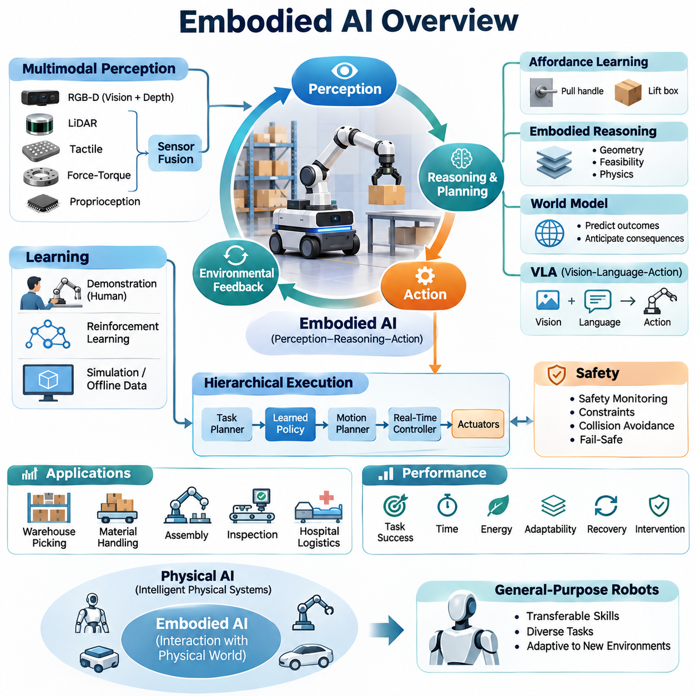
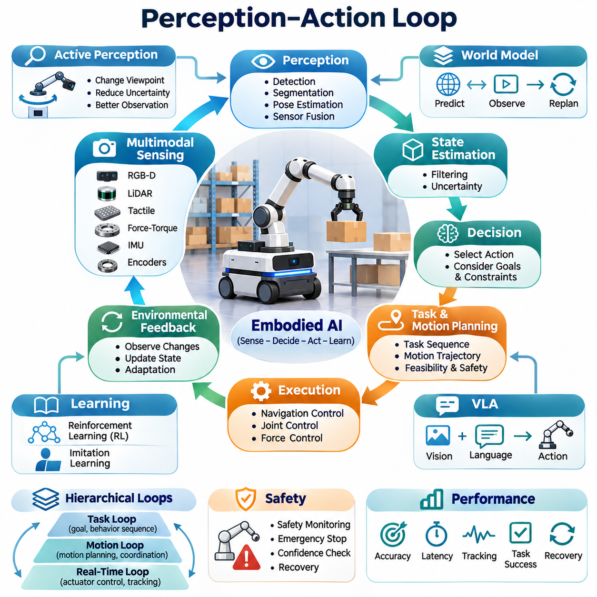
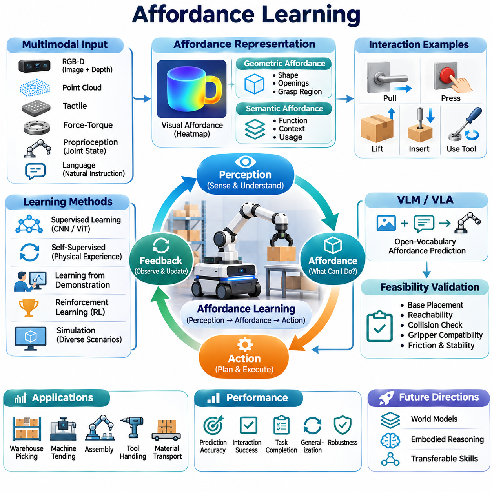
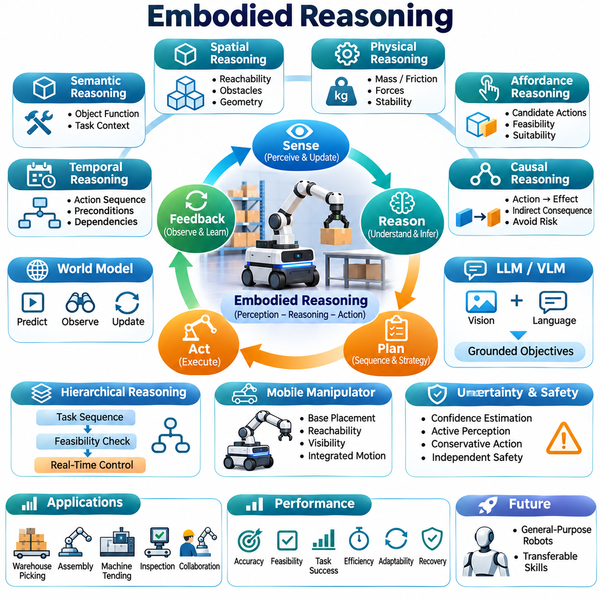
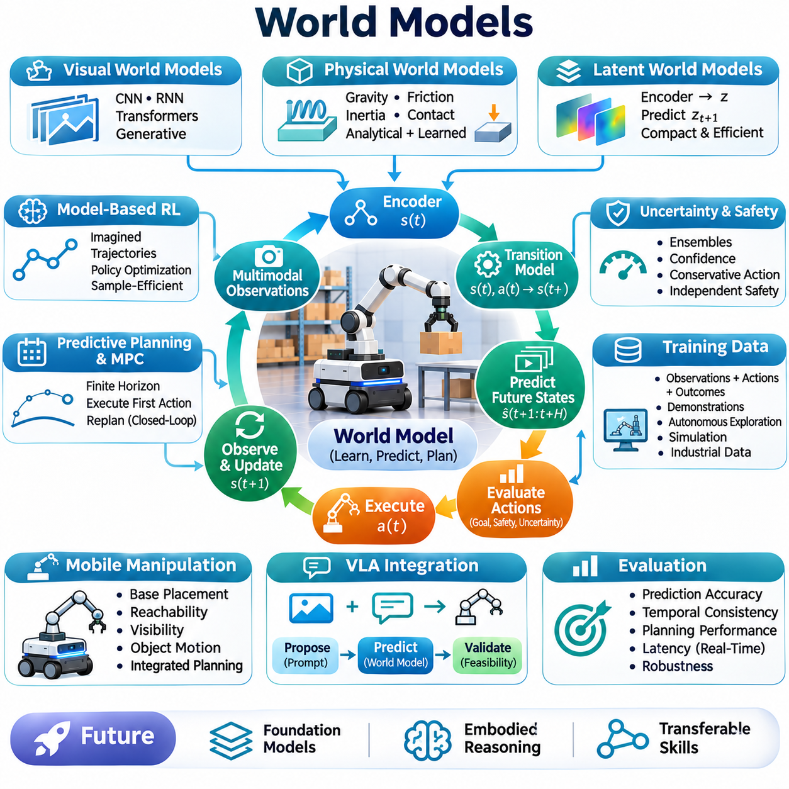
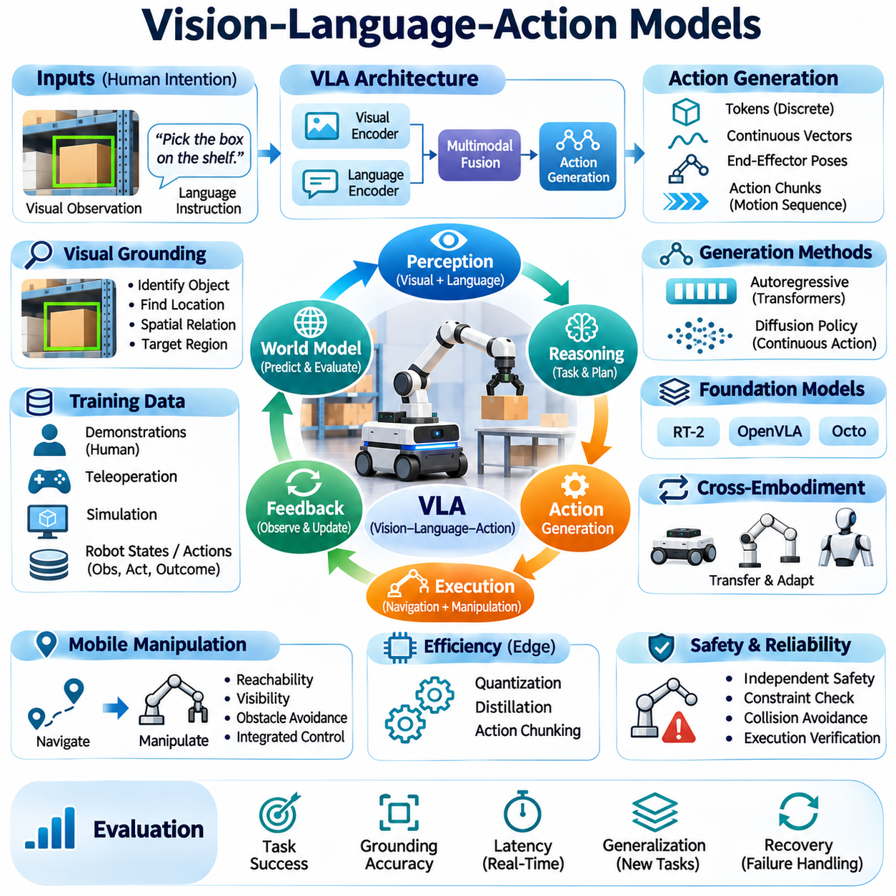
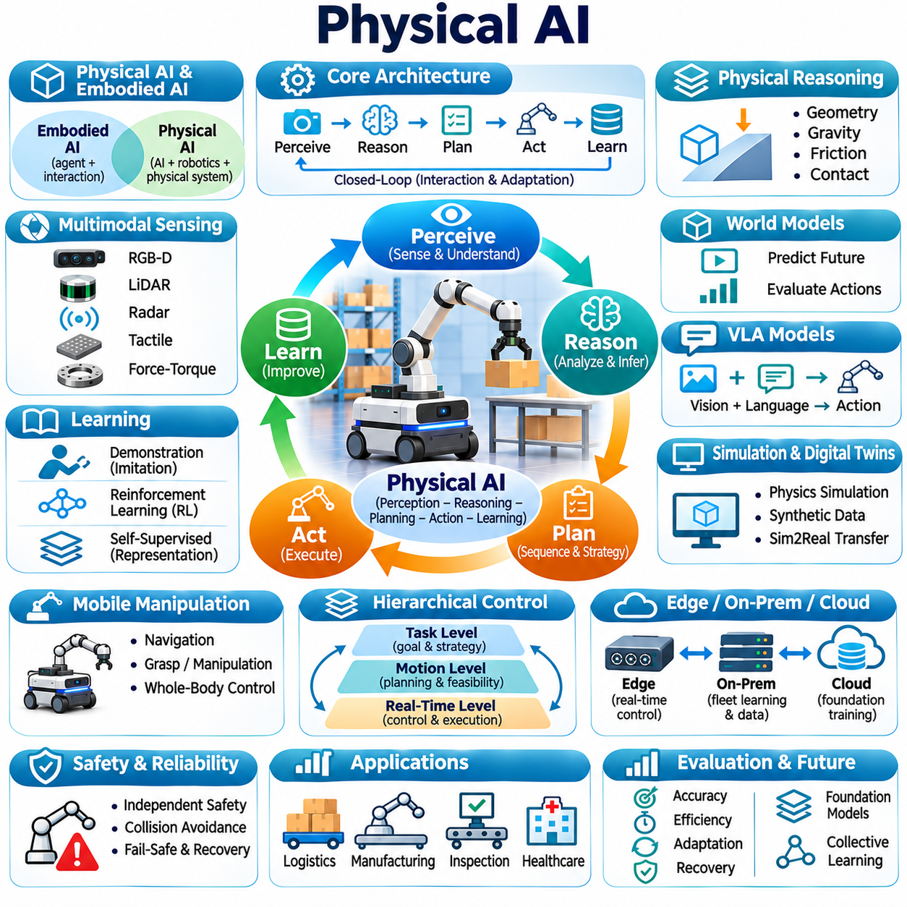
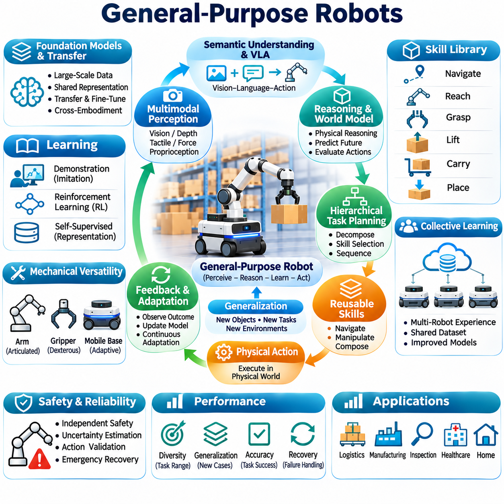
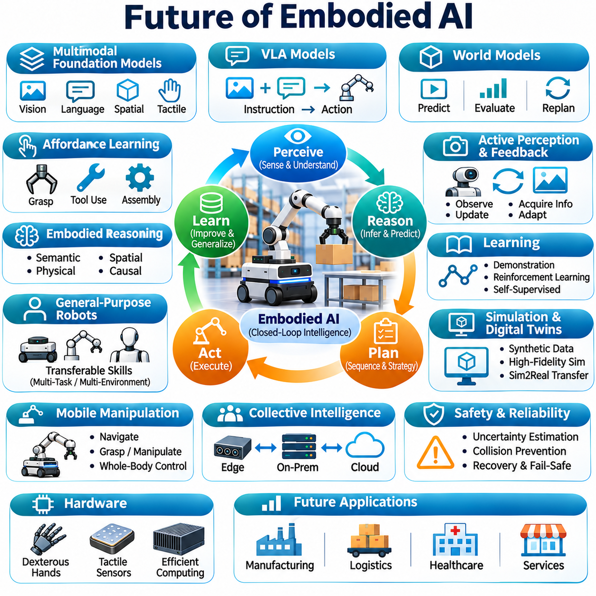

# Chapter 14. Embodied AI

## 01 Embodied AI Overview

{width="7.268055555555556in" height="7.268055555555556in"}

체화형 인공지능(Embodied AI)은 에이전트(Agent), 물리적 신체(Physical Embodiment), 주변 환경(Environment) 사이의 상호작용을 통해 지능적 행동이 발현되는 인공지능 패러다임(Artificial Intelligence Paradigm)을 의미한다. 주로 디지털 정보를 처리하는 기존 인공지능 시스템과 달리 체화형 인공지능은 인지(Perception), 추론(Reasoning), 의사결정(Decision-Making), 물리적 행동(Physical Action)을 연결한다. 이러한 통합을 통해 로봇은 주변 환경을 이해하고 동적인 환경에서 의미 있는 작업을 수행할 수 있다.

체화(Embodiment)의 기본 개념은 지능이 에이전트의 물리적 구조와 상호작용 능력에 의해 영향을 받는다는 점을 강조한다. 센서(Sensor), 액추에이터(Actuator), 기계적 구성(Mechanical Configuration), 컴퓨팅 자원(Computational Resource)은 로봇이 세계를 인식하고 상호작용하는 방식을 종합적으로 결정한다. 따라서 물리적 제약조건(Physical Constraint)과 환경적 조건(Environmental Condition)을 고려하지 않고 컴퓨팅 알고리즘만으로 지능적 행동을 이해하는 것은 어렵다.

모바일 매니퓰레이터(Mobile Manipulator)는 자율 이동(Autonomous Mobility)과 물리적 조작(Physical Manipulation)을 결합하므로 체화형 인공지능을 구현하기 위한 대표적인 플랫폼이다. 자율이동로봇(Autonomous Mobile Robot, AMR)은 작업공간(Workspace)을 확장하고, 로봇 팔(Robot Arm)과 말단장치(End Effector)는 객체와의 직접적인 상호작용을 가능하게 한다. 이러한 기능의 통합을 통해 모바일 매니퓰레이터는 자율주행(Navigation), 환경 이해(Environmental Understanding), 객체 조작(Object Manipulation), 적응형 의사결정(Adaptive Decision-Making)이 필요한 복잡한 작업을 수행할 수 있다.

인지-행동 루프(Perception-Action Loop)는 체화형 인공지능의 기본적인 작동 메커니즘을 구성한다. 로봇은 지속적으로 감각 정보(Sensory Information)를 획득하고, 환경 상태를 해석하며, 적절한 행동을 선택하고, 행동의 결과를 관찰한다. 이러한 피드백(Feedback)은 내부 표현(Internal Representation)을 갱신하고 후속 의사결정에 영향을 미친다. 이러한 폐루프 아키텍처(Closed-Loop Architecture)는 물리적 작업 수행 과정에서 발생하는 환경 변화, 예상하지 못한 장애물 및 불확실성에 대한 적응을 가능하게 한다.

멀티모달 인지(Multimodal Perception)는 체화형 에이전트(Embodied Agent)가 주변 환경에 대한 종합적인 표현을 구축할 수 있도록 한다. RGB 카메라(RGB Camera), 깊이 카메라(Depth Camera), 라이다(LiDAR), 촉각 센서(Tactile Sensor), 힘-토크 센서(Force-Torque Sensor), 고유수용성 감각 측정(Proprioceptive Measurement)은 외부 및 내부 상태에 대한 상호 보완적인 정보를 제공한다. 센서 융합(Sensor Fusion)은 이러한 관측 정보를 결합하여 불확실한 조건에서 공간 인식(Spatial Awareness), 객체 인식(Object Recognition), 접촉 감지(Contact Detection), 의사결정의 신뢰성을 향상시킨다.

체화형 지능(Embodied Intelligence)은 객체가 무엇인지를 이해하는 것뿐만 아니라 해당 객체를 물리적으로 어떻게 조작할 수 있는지에 대한 이해도 요구한다. 행동유도성 학습(Affordance Learning)은 객체 및 환경 구조와 관련된 잠재적인 상호작용을 식별함으로써 이러한 요구사항을 충족한다. 로봇은 손잡이를 당길 수 있고, 용기를 들어 올릴 수 있으며, 특정 표면이 객체를 지지할 수 있다는 사실을 인식할 수 있다. 이러한 능력은 인지와 물리적으로 실행 가능한 행동 사이의 연결을 형성한다.

체화형 추론(Embodied Reasoning)은 공간적 관계(Spatial Relationship), 물리적 제약조건(Physical Constraint), 행동 결과(Action Consequence)를 포함함으로써 기존의 기호적 추론(Symbolic Reasoning)과 의미론적 추론(Semantic Reasoning)을 확장한다. 로봇은 의도한 작업이 자신의 작업공간 내에서 실행 가능한지, 객체에 안전하게 접근할 수 있는지, 특정 행동이 주변 객체의 안정성을 저해할 가능성이 있는지를 판단해야 한다. 따라서 효과적인 추론은 의미론적 지식(Semantic Knowledge), 기하학적 이해(Geometric Understanding), 물리적 상호작용 모델(Physical Interaction Model)을 통합한다.

세계 모델(World Model)은 체화형 에이전트가 환경 상태(Environmental State)를 추정하고 발생 가능한 미래 결과를 예측할 수 있도록 내부 표현을 제공한다. 로봇은 즉각적인 관측 정보에만 의존하는 대신 학습 기반 모델(Learned Model)이나 해석적 모델(Analytical Model)을 활용하여 후보 행동(Candidate Action)의 결과를 예측할 수 있다. 이러한 예측 능력(Predictive Capability)은 선제적 계획(Proactive Planning), 충돌 회피(Collision Avoidance), 조작 전략 선택(Manipulation Strategy Selection), 장기 작업(Long-Horizon Task)의 효율적인 수행을 지원한다.

비전-언어-행동 모델(Vision-Language-Action Model, VLA)은 시각 인지(Visual Perception), 언어 이해(Linguistic Understanding), 로봇 제어(Robotic Control)를 통합하기 위한 중요한 아키텍처 접근법이다. 이러한 모델은 시각적 관측 정보(Visual Observation)와 자연어 명령(Natural Language Instruction)을 처리하여 행동 표현(Action Representation)이나 제어 명령(Control Command)을 생성한다. 의미론적 이해와 물리적 실행을 연결함으로써 유연한 작업 명세(Task Specification)와 더욱 높은 일반화 능력을 갖춘 로봇 조작 정책(Robotic Manipulation Policy)의 개발을 위한 기반을 제공한다.

시연 기반 학습(Learning from Demonstration, LfD)과 강화학습(Reinforcement Learning, RL)은 체화형 기술(Embodied Skill)을 획득하기 위한 상호 보완적인 메커니즘을 제공한다. 시연 기반 학습은 로봇이 인간 작업자로부터 관찰한 행동을 재현할 수 있도록 하며, 강화학습은 환경과의 상호작용 및 보상 피드백(Reward Feedback)을 통해 정책(Policy)을 최적화한다. 시뮬레이션(Simulation), 오프라인 데이터셋(Offline Dataset), 통제된 물리적 실험(Controlled Physical Experiment)을 결합하여 하드웨어의 마모와 운영 위험을 줄이면서 학습 효율성을 향상시킬 수 있다.

체화형 인공지능 아키텍처(Embodied AI Architecture)는 일반적으로 인지 모듈(Perception Module), 작업 계획기(Task Planner), 학습된 정책(Learned Policy), 모션 계획기(Motion Planner), 저수준 제어기(Low-Level Controller)를 통합한다. 고수준 지능(High-Level Intelligence)은 운영 목표를 해석하고 적절한 행동을 선택하는 반면, 실시간 제어 시스템(Real-Time Control System)은 움직임, 접촉력(Contact Force), 액추에이터의 응답을 제어한다. 계층적 조정(Hierarchical Coordination)을 통해 고도화된 인공지능 모델은 신뢰성 있는 물리적 실행에 필요한 결정론적 제약조건(Deterministic Constraint) 내에서 작동할 수 있다.

체화형 인공지능(Embodied AI)과 물리적 인공지능(Physical AI)의 관계는 인공지능과 물리적 시스템 사이의 광범위한 융합을 반영한다. 체화형 인공지능은 에이전트와 환경 사이의 상호작용에 기반한 지능을 강조하는 반면, 물리적 인공지능은 물리적 세계를 인식하고 모델링하며 그 안에서 작동하는 지능형 기술을 포괄한다. 모바일 매니퓰레이터(Mobile Manipulator), 휴머노이드 로봇(Humanoid Robot), 자율주행 차량(Autonomous Vehicle), 협동로봇(Collaborative Robot)은 이러한 융합을 보여주는 대표적인 사례이다.

체화형 인공지능의 산업적 응용 분야에는 창고 피킹(Warehouse Picking), 자율 자재 운반(Autonomous Material Handling), 머신 텐딩(Machine Tending), 조립(Assembly), 검사(Inspection), 병원 물류(Hospital Logistics) 등이 포함된다. 사전에 정의된 운영 조건을 기반으로 설계되는 기존 자동화 시스템과 달리 체화형 로봇(Embodied Robot)은 객체 위치, 환경 배치, 작업 요구사항의 변화에 대응하는 것을 목표로 한다. 이러한 적응성(Adaptability)은 고정형 치공구(Fixed Fixture)와 광범위한 환경별 프로그래밍(Environment-Specific Programming)에 대한 의존도를 줄일 수 있다.

체화형 에이전트는 물리적 환경에 직접적인 영향을 미치므로 안전성(Safety)과 신뢰성(Reliability)은 필수적인 고려사항이다. 잘못된 인지, 부정확한 예측, 부적절한 행동은 장비를 손상시키거나 주변 사람에게 위험을 초래할 수 있다. 독립적인 안전 메커니즘(Independent Safety Mechanism), 충돌 모니터링(Collision Monitoring), 운영 제약조건(Operational Constraint), 불확실성 추정(Uncertainty Estimation), 고장 안전 행동(Fail-Safe Behavior)은 개발 및 배포의 전 과정에서 학습된 지능을 보완해야 한다.

체화형 인공지능의 성능은 기존 인공지능의 정확도 지표(Accuracy Metric)를 넘어서는 관점에서 평가되어야 한다. 작업 완료율(Task Completion Rate), 조작 성공률(Manipulation Success Rate), 실행 시간(Execution Time), 에너지 소비량(Energy Consumption), 환경 적응성(Environmental Adaptability), 복구 능력(Recovery Capability), 인간 개입 빈도(Human Intervention Frequency)는 지능을 평가하기 위한 실질적인 지표를 제공한다. 향후 기술 발전은 이러한 능력을 전이 가능한 기술(Transferable Skill), 예측적 추론(Predictive Reasoning), 물리적 환경에 기반한 자율성(Physically Grounded Autonomy)을 갖춘 범용 로봇(General-Purpose Robot)에 통합하는 방향으로 더욱 집중될 것이다.

## 02 Perception Action Loop

{width="7.268055555555556in" height="7.268055555555556in"}

인지-행동 루프(Perception-Action Loop)는 감각 정보(Sensory Information), 환경 이해(Environmental Understanding), 의사결정(Decision-Making), 물리적 실행(Physical Execution)을 지속적인 피드백 프로세스(Feedback Process) 내에서 연결하는 체화형 인공지능(Embodied AI)의 기본적인 작동 메커니즘이다. 물리적 세계와 직접적으로 상호작용하지 않고 정보를 처리하는 기존 인공지능 시스템과 달리 체화형 에이전트(Embodied Agent)는 주변 환경을 변화시키는 행동을 실행하고, 후속 의사결정을 위한 새로운 감각적 관측 정보(Sensory Observation)를 생성한다.

인지 단계(Perception Stage)는 로봇과 주변 환경으로부터 감각 정보를 획득하는 과정에서 시작된다. RGB 카메라(RGB Camera), 깊이 카메라(Depth Camera), 라이다(LiDAR), 촉각 센서(Tactile Sensor), 힘-토크 센서(Force-Torque Sensor), 관성측정장치(Inertial Measurement Unit, IMU), 관절 엔코더(Joint Encoder)는 상호 보완적인 관측 정보를 제공한다. 이러한 감각 입력(Sensory Input)을 통해 로봇은 객체를 식별하고, 공간적 관계(Spatial Relationship)를 추정하며, 환경 변화를 인식하고, 내부의 기계적 상태와 운영 상태를 모니터링할 수 있다.

감각 정보 처리(Sensory Processing)는 원시 측정 데이터(Raw Measurement)를 지능적 행동을 지원하는 의미 있는 환경 표현(Environmental Representation)으로 변환한다. 객체 검출(Object Detection), 의미론적 분할(Semantic Segmentation), 자세 추정(Pose Estimation), 깊이 재구성(Depth Reconstruction), 센서 융합(Sensor Fusion)은 공간적 정보(Spatial Information)와 의미론적 정보(Semantic Information)를 구축하는 데 기여한다. 생성된 표현은 자율주행(Navigation), 조작(Manipulation), 충돌 회피(Collision Avoidance), 주변 객체와의 상호작용을 지원하기에 충분한 세부 정보를 포함해야 한다.

상태 추정(State Estimation)은 로봇과 주변 환경의 현재 상태에 대한 내부적 이해를 형성한다. 개별 센서의 측정값에는 잡음(Noise), 불확실성(Uncertainty), 불완전한 정보(Incomplete Information)가 포함될 수 있으므로 체화형 에이전트는 여러 센서와 연속적인 시간 단계(Time Step)에 걸쳐 획득한 관측 정보를 통합한다. 확률적 추정(Probabilistic Estimation), 시간적 필터링(Temporal Filtering), 학습된 표현(Learned Representation)은 물리적 상호작용 과정에서 환경 이해의 일관성을 향상시킨다.

의사결정 단계(Decision-Making Stage)는 추정된 환경 상태(Environmental State), 운영 목표(Operational Objective), 과거 관측 정보(Historical Observation), 적용 가능한 제약조건(Constraint)을 기반으로 적절한 행동을 결정한다. 모바일 매니퓰레이터(Mobile Manipulator)는 객체에 접근할 것인지, 이동 베이스(Mobile Base)의 위치를 재조정할 것인지, 파지 구성(Grasping Configuration)을 변경할 것인지, 추가적인 감각 정보를 획득할 것인지를 결정할 수 있다. 효과적인 의사결정은 즉각적인 운영 요구사항뿐만 아니라 예상되는 미래의 결과도 고려해야 한다.

행동 계획(Action Planning)은 고수준 의사결정(High-Level Decision)을 물리적으로 실행 가능한 행동으로 변환한다. 작업 계획(Task Planning)은 필요한 작업 순서(Operational Sequence)를 정의하고, 모션 계획(Motion Planning)은 이동 플랫폼(Mobile Platform)과 로봇 팔(Robot Arm)을 위한 실행 가능한 궤적(Feasible Trajectory)을 생성한다. 의도한 행동이 가용 작업공간(Available Workspace) 내에서 안전하게 수행될 수 있도록 기구학적 한계(Kinematic Limitation), 동역학적 제약조건(Dynamic Constraint), 충돌 위험(Collision Risk), 파지 안정성(Grasp Stability), 환경 접근성(Environmental Accessibility)을 평가해야 한다.

실행 단계(Execution Stage)는 자율주행 제어기(Navigation Controller), 관절 제어기(Joint Controller), 궤적 추종 알고리즘(Trajectory Tracking Algorithm), 힘 제어 시스템(Force Control System)을 통해 계획된 행동을 액추에이터 명령(Actuator Command)으로 변환한다. 조작 과정에서 로봇은 자신의 움직임, 접촉 상태(Contact Condition), 상호작용 힘(Interaction Force)을 지속적으로 모니터링한다. 실시간 피드백(Real-Time Feedback)은 실제 물리적 행동이 계획된 궤적이나 예상된 환경 반응에서 벗어날 경우 즉각적인 보정을 가능하게 한다.

피드백(Feedback)은 물리적 행동의 결과에 대한 갱신된 정보를 제공함으로써 인지-행동 루프를 완성한다. 파지 작업(Grasping Operation)은 객체의 위치를 변화시키거나, 이전에 가려져 있던 표면을 노출시키거나, 예상하지 못한 접촉력(Contact Force)을 발생시킬 수 있다. 이러한 변화는 새로운 감각적 관측 정보가 되어 로봇의 내부 표현(Internal Representation)을 갱신하고 후속 의사결정에 영향을 미치며, 전체 작업 수행 과정에서 지속적인 적응(Continuous Adaptation)을 가능하게 한다.

능동 인지(Active Perception)는 로봇이 감각 정보의 품질을 향상시키기 위한 의도적인 행동을 수행할 수 있도록 기존의 인지-행동 루프를 확장한다. 모바일 매니퓰레이터는 더 많은 정보를 제공하는 관측 시점(Viewpoint)을 확보하기 위해 카메라의 위치를 재조정하거나, 말단장치(End Effector)를 회전시키거나, 장애물 주변으로 이동할 수 있다. 이러한 행동은 불확실성을 감소시키고, 시각적 모호성(Visual Ambiguity)을 해소하며, 후속 조작 및 자율주행 의사결정의 신뢰성을 향상시킨다.

체화형 로봇 아키텍처(Embodied Robotic Architecture) 내에서는 여러 인지-행동 루프가 서로 다른 시간적 수준(Temporal Level)과 기능적 수준(Functional Level)에서 동시에 작동할 수 있다. 고수준 루프(High-Level Loop)는 작업 목표와 행동 순서를 관리하고, 중간수준 루프(Intermediate-Level Loop)는 모션 계획과 환경 해석을 조정하며, 저수준 루프(Low-Level Loop)는 액추에이터 응답을 제어한다. 이러한 계층적 구성(Hierarchical Organization)은 계산 복잡도(Computational Complexity), 의사결정 유연성(Decision Flexibility), 실시간 제어 요구사항(Real-Time Control Requirement) 사이의 균형을 유지한다.

세계 모델(World Model)은 로봇이 물리적 행동을 실행하기 전에 환경 변화를 예측할 수 있도록 함으로써 인지-행동 루프를 향상시킨다. 체화형 에이전트는 후보 행동(Candidate Behavior)의 잠재적인 결과를 추정하여 대안 전략(Alternative Strategy)을 평가하고 바람직하지 않은 결과를 사전에 예측할 수 있다. 이후 예측 결과를 실제 관측 정보와 비교하며, 이 과정에서 발생하는 불일치(Discrepancy)는 상태 보정(State Correction), 모델 개선(Model Refinement), 적응형 재계획(Adaptive Replanning)을 지원하는 데 활용된다.

학습 기반 인지-행동 루프(Learning-Based Perception-Action Loop)는 경험을 활용하여 미래의 의사결정과 물리적 상호작용 능력을 향상시킨다. 강화학습(Reinforcement Learning, RL)은 환경 피드백(Environmental Feedback)을 통해 행동 정책(Action Policy)을 최적화하는 반면, 모방학습(Imitation Learning)은 인간의 시연(Human Demonstration)으로부터 행동 패턴(Behavioral Pattern)을 추출한다. 이러한 접근법은 이전에 경험하지 못한 환경 조건에서 파지 선택(Grasp Selection), 자율주행 효율성(Navigation Efficiency), 접촉 중심 조작(Contact-Rich Manipulation), 복구 전략(Recovery Strategy)을 개선할 수 있다.

비전-언어-행동 모델(Vision-Language-Action Model, VLA)은 인지-행동 루프를 구현하기 위한 더욱 통합적인 접근법을 제공한다. 시각적 관측 정보(Visual Observation)와 자연어 명령(Natural Language Instruction)은 행동 시퀀스(Action Sequence) 또는 제어 표현(Control Representation)을 생성하기 위해 함께 처리된다. 그러나 신뢰성 있는 물리적 환경 배포(Physical Deployment)를 위해서는 의미론적 오류(Semantic Error)가 위험한 행동으로 전파되는 것을 방지하도록 갱신된 감각 피드백(Sensory Feedback), 실행 검증(Execution Verification), 독립적인 안전 제약조건(Independent Safety Constraint)이 필요하다.

인지-행동 루프가 동적인 산업 환경(Dynamic Industrial Environment)에서 작동할 경우 안전성(Safety)에 대한 고려는 특히 중요하다. 처리 지연(Processing Delay), 부정확한 상태 추정(Inaccurate State Estimation), 센서 고장(Sensor Failure), 예상하지 못한 인간의 움직임은 물리적 실행의 안전성과 신뢰성을 저해할 수 있다. 독립적인 안전 모니터링(Independent Safety Monitoring), 비상 정지 메커니즘(Emergency Stopping Mechanism), 신뢰도 임계값(Confidence Threshold), 보수적 복구 행동(Conservative Recovery Behavior)은 지능적 의사결정 및 학습 기반 제어 정책(Learned Control Policy)과 함께 작동해야 한다.

인지-행동 루프의 효과성(Effectiveness)은 센싱 정확도(Sensing Accuracy), 처리 지연시간(Processing Latency), 응답 시간(Response Time), 궤적 추종 정확도(Trajectory Tracking Accuracy), 작업 완료율(Task Completion Rate), 복구 성능(Recovery Performance)을 통해 평가할 수 있다. 모바일 매니퓰레이터의 경우 자율주행(Autonomous Navigation)과 물리적 조작(Physical Manipulation) 사이의 조정(Coordination)이 특히 중요하다. 체계적으로 설계된 인지-행동 루프는 개별적으로 분리된 인공지능 기능을 적응성(Adaptability), 신뢰성(Reliability), 물리적 환경에 대한 기반성(Physical Grounding)을 갖춘 로봇 지능(Robotic Intelligence)으로 발전시킨다.

## 03 Affordance Learning

{width="7.268055555555556in" height="7.268055555555556in"}

행동유도성 학습(Affordance Learning)은 로봇이 객체 및 환경 구조와 관련된 잠재적인 물리적 상호작용(Physical Interaction)을 이해할 수 있도록 하는 체화형 인공지능(Embodied AI)의 핵심 구성요소이다. 체화형 에이전트(Embodied Agent)는 객체를 의미론적 범주(Semantic Category)만으로 식별하는 것이 아니라, 해당 객체에 대해 어떤 행동을 수행할 수 있는지, 이러한 행동을 어떻게 실행해야 하는지, 상호작용으로부터 어떠한 물리적 결과(Physical Consequence)가 발생할 수 있는지를 학습한다.

행동유도성(Affordance)의 개념은 생태심리학(Ecological Psychology)에서 유래하였으며, 에이전트의 능력에 따라 환경이 제공하는 행동 기회(Action Opportunity)를 의미한다. 손잡이는 당기는 행동을, 버튼은 누르는 행동을, 수평 표면은 객체를 지지하는 행동을 가능하게 한다. 로봇공학(Robotics)에서 이러한 행동 기회는 객체의 특성(Object Property), 환경 조건(Environmental Condition), 기계적 구성(Mechanical Configuration), 가용 로봇 기술(Robotic Skill)에 따라 결정된다.

행동유도성 학습은 인지-행동 루프(Perception-Action Loop) 내에서 인지(Perception)와 행동(Action) 사이의 직접적인 관계를 구축한다. 감각적 관측 정보(Sensory Observation)는 객체의 기하학적 구조(Geometry), 질감(Texture), 방향(Orientation), 재료 특성(Material Property), 공간적 관계(Spatial Relationship)에 대한 정보를 제공한다. 로봇은 이러한 관측 정보를 해석하여 잠재적인 상호작용 기회(Interaction Opportunity)를 식별하고, 운영 목표(Operational Objective)와 물리적 능력(Physical Capability)에 따라 적절한 행동을 선택한다.

시각적 행동유도성 검출(Visual Affordance Detection)은 특정 물리적 상호작용과 관련된 이미지 영역(Image Region) 또는 3차원 구조(Three-Dimensional Structure)를 식별한다. RGB 이미지(RGB Image), 깊이 측정값(Depth Measurement), 포인트 클라우드(Point Cloud)는 파지 가능 영역(Graspable Region), 접촉 표면(Contact Surface), 삽입 개구부(Insertion Opening), 가동 구성요소(Movable Component)를 추정하기 위한 상호 보완적인 정보를 제공한다. 심층신경망(Deep Neural Network)은 조작 계획(Manipulation Planning)을 위한 픽셀 수준 행동유도성 지도(Pixel-Level Affordance Map) 또는 3차원 행동유도성 표현(3D Affordance Representation)을 생성할 수 있다.

기하학적 행동유도성(Geometric Affordance)은 객체의 물리적 형상(Physical Shape), 치수(Dimension), 방향(Orientation), 구조적 특성(Structural Characteristic)에 의해 결정된다. 원통형 부품(Cylindrical Component)은 특정 파지 구성(Grasping Configuration)을 지원할 수 있으며, 안쪽으로 들어간 개구부(Recessed Opening)는 삽입 기회(Insertion Opportunity)를 제공할 수 있다. 그러나 마찰(Friction), 무게 분포(Weight Distribution), 재료 변형(Material Deformation), 환경적 제약조건(Environmental Constraint)도 행동 실행 가능성(Action Feasibility)에 영향을 미치므로 기하학적 적합성(Geometric Suitability)만으로 성공적인 상호작용을 보장할 수는 없다.

의미론적 행동유도성(Semantic Affordance)은 객체의 기능(Object Function), 의도된 사용 목적(Intended Usage), 다른 객체와의 관계에 대한 맥락적 지식(Contextual Knowledge)을 포함한다. 로봇은 스크루드라이버(Screwdriver)가 체결 작업(Fastening Operation)과 관련되어 있거나 서랍(Drawer)이 보관된 부품에 대한 접근을 제공한다는 사실을 인식할 수 있다. 의미론적 이해(Semantic Understanding)와 기하학적 인지(Geometric Perception)를 결합함으로써 체화형 에이전트는 사전에 정의된 객체 인식 범주(Object Recognition Category)를 넘어 의미 있는 상호작용을 식별할 수 있다.

행동유도성 학습은 상호작용 레이블(Interaction Label), 파지 위치(Grasp Location), 접촉점(Contact Point), 행동 결과(Action Outcome)를 포함하는 주석 데이터셋(Annotated Dataset)을 활용한 지도학습(Supervised Learning)을 통해 구현할 수 있다. 합성곱 신경망(Convolutional Neural Network, CNN)과 비전 트랜스포머(Vision Transformer, ViT)는 관련 특징(Feature)을 추출하고 행동유도성 분포(Affordance Distribution)를 예측한다. 학습 주석(Training Annotation)의 품질과 다양성은 이러한 모델이 익숙하지 않은 객체와 운영 환경에 대해 일반화(Generalization)할 수 있는 능력에 상당한 영향을 미친다.

자기지도 행동유도성 학습(Self-Supervised Affordance Learning)은 광범위한 수동 주석(Manual Annotation) 없이 로봇이 물리적 경험(Physical Experience)을 통해 상호작용 지식(Interaction Knowledge)을 획득할 수 있도록 한다. 로봇은 탐색적 행동(Exploratory Action)을 실행하고, 그 결과로 발생하는 환경 변화를 관찰하며, 성공하거나 실패한 상호작용을 감각적 관측 정보와 연관시킨다. 이러한 접근법은 마찰(Friction) 및 관절 운동 제약조건(Articulation Constraint)을 포함하여 정적인 시각 정보(Static Visual Information)만으로 추론하기 어려운 물리적 특성(Physical Property)을 파악할 수 있도록 한다.

시연 기반 학습(Learning from Demonstration, LfD)은 인간과 객체 사이의 상호작용을 관찰함으로써 행동유도성 지식(Affordance Knowledge)을 획득하는 또 다른 메커니즘을 제공한다. 인간 작업자(Human Operator)는 파지(Grasping), 밀기(Pushing), 당기기(Pulling), 도구 사용(Tool Usage), 조립 절차(Assembly Procedure)를 시연하여 로봇이 관련 접촉 위치(Contact Location)와 행동 패턴(Action Pattern)을 식별할 수 있도록 한다. 시연 데이터(Demonstration Data)는 인간의 물리적 능력과 로봇의 물리적 체화(Robotic Embodiment) 사이의 차이를 고려하여 적절하게 변환되어야 한다.

강화학습(Reinforcement Learning, RL)은 체화형 에이전트가 잠재적인 상호작용을 탐색하고 보상 피드백(Reward Feedback)을 통해 행동 정책(Action Policy)을 최적화할 수 있도록 함으로써 행동유도성 발견(Affordance Discovery)을 확장한다. 성공적인 물리적 결과는 유용한 상호작용 전략(Interaction Strategy)을 강화하는 반면, 실패한 시도는 행동의 한계에 대한 정보를 제공한다. 시뮬레이션(Simulation)과 제약 기반 탐색(Constrained Exploration)은 통제되지 않은 물리적 실험(Physical Experiment)과 관련된 위험을 줄이면서 학습 효율성(Learning Efficiency)을 향상시킬 수 있다.

멀티모달 행동유도성 학습(Multimodal Affordance Learning)은 시각적 관측 정보(Visual Observation)를 촉각 피드백(Tactile Feedback), 힘-토크 측정값(Force-Torque Measurement), 고유수용성 감각(Proprioception), 언어적 설명(Language Description)과 결합한다. 시각 정보는 잠재적인 상호작용 영역(Interaction Region)을 식별하는 반면, 촉각 및 힘 측정은 접촉 안정성(Contact Stability), 표면 특성(Surface Property), 기계적 저항(Mechanical Resistance)을 파악할 수 있도록 한다. 이러한 상호 보완적인 모달리티(Modality)의 통합은 접촉 중심 조작(Contact-Rich Manipulation)과 불확실한 물리적 상호작용 과정에서 행동유도성 추정(Affordance Estimation)의 성능을 향상시킨다.

비전-언어 모델(Vision-Language Model, VLM)과 비전-언어-행동 모델(Vision-Language-Action Model, VLA)은 개방형 어휘 행동유도성 학습(Open-Vocabulary Affordance Learning)을 위한 새로운 가능성을 제공한다. 이러한 모델은 시각적 특징(Visual Feature)을 언어적 개념(Linguistic Concept) 및 행동 표현(Action Representation)과 연결함으로써 자연어(Natural Language)로 설명된 상호작용 기회를 식별할 수 있다. 그러나 예측된 행동유도성(Predicted Affordance)은 실제 실행에 앞서 기하학적 제약조건(Geometric Constraint), 로봇의 능력(Robot Capability), 실제 물리적 피드백(Physical Feedback)을 기반으로 검증되어야 한다.

모바일 매니퓰레이터(Mobile Manipulator)의 행동유도성 학습은 자율이동 플랫폼(Autonomous Mobile Platform)과 로봇 팔(Robot Arm)의 결합된 능력을 고려해야 한다. 초기 상태에서 도달할 수 없는 객체도 이동 베이스(Mobile Base)의 위치를 재조정하면 접근할 수 있다. 따라서 행동유도성 추정은 이동 베이스 배치(Base Placement), 매니퓰레이터 도달 가능성(Manipulator Reachability), 충돌 제약조건(Collision Constraint), 말단장치 호환성(End-Effector Compatibility), 환경 접근성(Environmental Accessibility)을 통합된 의사결정 프로세스(Unified Decision-Making Process) 내에서 고려해야 한다.

행동유도성 학습의 산업적 응용 분야에는 창고 피킹(Warehouse Picking), 빈 피킹(Bin Picking), 머신 텐딩(Machine Tending), 조립(Assembly), 도구 취급(Tool Handling), 자율 자재 운반(Autonomous Material Transportation) 등이 포함된다. 로봇은 사전에 정의된 파지 좌표(Predefined Grasp Coordinate)와 고정된 작업 시퀀스(Fixed Operational Sequence)에만 의존하는 대신 현재 환경의 관측 정보를 기반으로 실행 가능한 상호작용 기회를 식별할 수 있다. 이러한 적응성(Adaptability)은 다품종 생산(High-Mix Production)과 비정형 물류 환경(Unstructured Logistics Environment)에서 특히 높은 가치를 제공한다.

행동유도성 학습의 효과성(Effectiveness)은 예측 정확도(Prediction Accuracy), 상호작용 성공률(Interaction Success Rate), 작업 완료율(Task Completion Rate), 일반화 능력(Generalization Capability), 변화하는 조건에서의 강건성(Robustness)을 통해 평가할 수 있다. 향후 기술 발전은 행동유도성 표현(Affordance Representation)을 세계 모델(World Model), 체화형 추론(Embodied Reasoning), 전이 가능한 로봇 기술(Transferable Robotic Skill)과 더욱 긴밀하게 통합하는 방향으로 진행될 것이다. 이를 통해 범용 로봇(General-Purpose Robot)은 의미 있는 물리적 상호작용을 자율적으로 발견하고 평가하며 실행할 수 있게 될 것이다.

## 04 Embodied Reasoning

{width="7.268055555555556in" height="7.268055555555556in"}

체화형 추론(Embodied Reasoning)은 지능형 에이전트(Intelligent Agent)가 환경 조건(Environmental Condition)을 해석하고, 물리적 제약조건(Physical Constraint)을 평가하며, 물리적 세계에서 적절한 행동을 결정할 수 있도록 하는 체화형 인공지능(Embodied AI)의 핵심 능력이다. 주로 추상적 정보(Abstract Information)를 기반으로 작동하는 기존 추론 시스템(Reasoning System)과 달리 체화형 추론은 감각적 관측 정보(Sensory Observation), 공간적 지식(Spatial Knowledge), 물리적 경험(Physical Experience), 행동 결과(Action Consequence)를 의사결정 프로세스(Decision-Making Process)에 통합한다.

체화형 추론의 개념은 지능적 의사결정(Intelligent Decision-Making)이 에이전트의 물리적 능력(Physical Capability)과 한계(Limitation)에 기반해야 한다는 점을 강조한다. 로봇의 기계적 구성(Mechanical Configuration), 액추에이터 성능(Actuator Capability), 센서 감지 범위(Sensor Coverage), 운영 환경(Operational Environment)은 행동 실행 가능성(Action Feasibility)에 영향을 미치므로 의미론적 지식(Semantic Knowledge)만으로 적절한 행동을 결정할 수 없다. 따라서 추론은 추상적 목표(Abstract Objective)와 물리적으로 실행 가능한 행동(Physically Executable Behavior) 사이의 연결을 형성해야 한다.

공간적 추론(Spatial Reasoning)은 체화형 에이전트(Embodied Agent)가 환경 내 객체의 위치(Position), 방향(Orientation), 거리(Distance), 기하학적 관계(Geometric Relationship)를 이해할 수 있도록 한다. 모바일 매니퓰레이터(Mobile Manipulator)는 객체가 도달 가능한 범위에 있는지, 장애물이 접근 경로를 차단하는지, 조작을 수행하기 위한 충분한 공간이 존재하는지를 판단해야 한다. 점유 지도(Occupancy Map), 포인트 클라우드(Point Cloud), 장면 그래프(Scene Graph)와 같은 공간적 표현(Spatial Representation)은 이러한 추론 프로세스를 지원한다.

물리적 추론(Physical Reasoning)은 로봇이 물리적 특성(Physical Property)과 기계적 원리(Mechanical Principle)에 의해 지배되는 상호작용을 이해하고 예측할 수 있도록 한다. 객체의 질량(Mass), 마찰(Friction), 중력(Gravity), 강성(Rigidity), 관성(Inertia), 접촉력(Contact Force)은 조작 결과에 영향을 미친다. 객체를 들어 올리거나 운반하려는 로봇은 선택된 파지(Grasp)가 안정성(Stability)을 유지할 수 있는지, 의도한 움직임이 미끄러짐(Slipping), 변형(Deformation), 의도하지 않은 충돌(Unintended Collision)을 발생시킬 수 있는지를 고려해야 한다.

의미론적 추론(Semantic Reasoning)은 객체와 객체의 기능(Object Function), 운영 목표(Operational Objective)와의 관계에 대한 맥락적 지식(Contextual Knowledge)을 포함한다. 예를 들어 작업대(Workstation)를 준비하라는 명령을 받은 로봇은 관련 도구를 식별하고, 각 도구의 사용 목적(Intended Usage)을 이해하며, 적절한 배치 위치(Placement Location)를 결정해야 한다. 의미론적 지식은 기하학적 정보(Geometric Information), 물리적 제약조건, 가용 로봇 기술(Robotic Skill)과 연결될 때 실제 작업에서 의미를 갖는다.

행동유도성 기반 추론(Affordance-Based Reasoning)은 작업 요구사항(Task Requirement)과 환경 조건에 따라 잠재적인 상호작용 기회(Interaction Opportunity)를 평가함으로써 행동유도성 학습(Affordance Learning)을 확장한다. 객체가 여러 개의 파지 가능 표면(Graspable Surface)이나 가동 구성요소(Movable Component)를 제공하더라도 모든 상호작용이 특정 작업에 적합한 것은 아니다. 로봇은 적절한 행동을 선택하기 전에 접근성(Accessibility), 안정성(Stability), 안전성(Safety), 예상 작업 결과(Expected Task Outcome)를 기반으로 후보 행동(Candidate Action)을 비교해야 한다.

인과적 추론(Causal Reasoning)은 체화형 에이전트가 물리적 행동(Physical Action)과 그 결과로 발생하는 환경 변화(Environmental Change) 사이의 관계를 형성할 수 있도록 한다. 서랍을 열면 이전에 가려져 있던 객체가 노출될 수 있으며, 지지 부품(Supporting Component)을 제거하면 조립체(Assembly)의 안정성이 저하될 수 있다. 이러한 인과관계(Causal Relationship)를 이해함으로써 로봇은 간접적인 결과(Indirect Consequence)를 예측하고, 바람직하지 않은 상호작용을 방지하며, 복잡한 조작 작업을 위한 더욱 효과적인 전략을 수립할 수 있다.

시간적 추론(Temporal Reasoning)은 장시간에 걸친 로봇 작업에서 행동의 순서(Sequence), 지속시간(Duration), 의존관계(Dependency)를 다룬다. 많은 물리적 작업은 후속 행동이 시작되기 전에 특정 사전조건(Precondition)이 충족되어야 한다. 머신 텐딩(Machine Tending)을 수행하는 모바일 매니퓰레이터는 장비에 접근하고, 장비의 작동 상태(Operating State)를 검증하며, 필요한 부품을 조작하고, 작업이 성공적으로 완료되었는지를 확인한 후 다음 작업으로 진행해야 한다.

세계 모델(World Model)은 환경 상태(Environmental State)와 후보 행동에 따라 발생할 수 있는 상태 변화(State Evolution)에 대한 내부 표현(Internal Representation)을 제공함으로써 체화형 추론을 향상시킨다. 예측 시뮬레이션(Predictive Simulation)은 로봇이 물리적 실행(Physical Execution)에 앞서 대안 행동(Alternative Behavior)을 평가할 수 있도록 한다. 체화형 에이전트는 예측 결과(Predicted Outcome)와 실제 관측 정보(Actual Observation)를 비교함으로써 예상하지 못한 환경 변화를 식별하고, 부정확한 가정(Assumption)을 수정하며, 운영 전략(Operational Strategy)을 적응적으로 변경할 수 있다.

대규모 언어 모델(Large Language Model, LLM)과 비전-언어 모델(Vision-Language Model, VLM)은 체화형 로봇 아키텍처(Embodied Robotic Architecture)에 고도화된 의미론적 추론과 맥락적 추론(Contextual Reasoning) 능력을 제공한다. 이러한 모델은 자연어 명령(Natural Language Instruction)을 해석하고, 복잡한 목표를 세부 작업으로 분해하며, 객체와 작업 사이의 관련 관계를 식별할 수 있다. 그러나 모델이 생성한 추론 결과는 검증된 환경 관측 정보(Verified Environmental Observation)에 기반해야 하며, 로봇의 물리적 능력을 기준으로 검증되어야 한다.

계층적 추론 아키텍처(Hierarchical Reasoning Architecture)는 체화형 로봇 작업의 복잡성(Complexity)을 해결하기 위해 의사결정을 여러 기능적 수준(Functional Level)에 분산시킨다. 고수준 추론(High-Level Reasoning)은 목표를 해석하고 작업 시퀀스(Task Sequence)를 생성하며, 중간수준 추론(Intermediate-Level Reasoning)은 공간적 관계와 행동 실행 가능성을 평가하고, 저수준 제어(Low-Level Control)는 물리적 실행을 관리한다. 이러한 기능적 분리(Functional Separation)는 결정론적(Deterministic)이면서 응답성이 높은 제어 메커니즘(Control Mechanism)을 유지하는 동시에 유연한 지능(Flexible Intelligence)을 구현할 수 있도록 한다.

모바일 매니퓰레이터에서 체화형 추론은 자율주행(Autonomous Navigation)과 로봇 조작(Robotic Manipulation)을 통합된 운영 프레임워크(Unified Operational Framework) 내에서 결합해야 한다. 로봇은 객체를 어떻게 조작할 것인지뿐만 아니라 적절한 조작 구성(Manipulation Configuration)을 확보하기 위해 이동 베이스(Mobile Base)를 어디에 배치해야 하는지도 결정해야 한다. 이동성(Mobility), 도달 가능성(Reachability), 가시성(Visibility), 환경적 제약조건(Environmental Constraint)을 종합적으로 고려함으로써 전체 작업의 실행 가능성(Task Feasibility)과 운영 효율성(Operational Efficiency)을 향상시킬 수 있다.

불확실성 인식 추론(Uncertainty-Aware Reasoning)은 물리적 환경이 부분적으로만 관측 가능하고 지속적으로 변화하기 때문에 필수적이다. 센서 잡음(Sensor Noise), 객체 가림(Object Occlusion), 부정확한 예측(Inaccurate Prediction), 예상하지 못한 접촉 상태(Contact Condition)는 내부 표현의 신뢰성(Reliability)을 저하시킬 수 있다. 확률 분포(Probability Distribution), 신뢰도 추정(Confidence Estimation), 능동 인지(Active Perception), 보수적 행동 선택(Conservative Action Selection)은 체화형 에이전트가 불확실성(Uncertainty)을 관리하고 필요한 경우 추가 정보를 획득할 수 있도록 한다.

체화형 추론의 산업적 응용 분야에는 창고 피킹(Warehouse Picking), 자율 조립(Autonomous Assembly), 머신 텐딩(Machine Tending), 장비 검사(Equipment Inspection), 협업 제조(Collaborative Manufacturing) 등이 포함된다. 로봇은 사전에 정의된 작업 시퀀스(Predefined Operational Sequence)에만 의존하지 않고 변화하는 환경 조건을 해석하며, 작업 의존관계(Task Dependency)를 해결하고, 실행 실패(Execution Failure)로부터 복구할 수 있어야 한다. 추론 오류(Reasoning Error)가 위험한 물리적 행동(Hazardous Physical Action)으로 이어지는 것을 방지하기 위해 독립적인 안전 감독(Independent Safety Supervision)이 여전히 필요하다.

체화형 추론의 효과성(Effectiveness)은 의사결정 정확도(Decision Accuracy), 물리적 실행 가능성(Physical Feasibility), 작업 완료율(Task Completion Rate), 계획 효율성(Planning Efficiency), 적응성(Adaptability), 복구 성능(Recovery Performance)을 통해 평가할 수 있다. 향후 기술 발전은 의미론적 추론(Semantic Reasoning), 인과 모델(Causal Model), 예측적 세계 모델(Predictive World Model), 전이 가능한 로봇 기술(Transferable Robotic Skill)을 더욱 긴밀하게 통합하는 방향으로 진행될 것이다. 이러한 능력은 자율적이고 맥락을 인식하며 물리적 환경에 기반한 의사결정(Physically Grounded Decision-Making)을 수행할 수 있는 범용 로봇(General-Purpose Robot)의 개발을 지원할 것이다.

## 05 World Models

{width="7.268055555555556in" height="7.268055555555556in"}

세계 모델(World Model)은 지능형 에이전트(Intelligent Agent)가 주변 환경에 대한 내부 표현(Internal Representation)을 구축하고 물리적 행동(Physical Action)의 결과를 예측할 수 있도록 하는 체화형 인공지능(Embodied AI)의 핵심 구성요소이다. 세계 모델을 갖춘 로봇은 즉각적인 감각적 관측 정보(Sensory Observation)에만 반응하는 대신 미래의 환경 상태(Environmental State)를 예측하고, 대안 행동(Alternative Behavior)을 평가하며, 물리적 세계에서 행동을 실행하기 전에 전략을 수립할 수 있다.

세계 모델은 환경 상태(Environmental State), 에이전트 행동(Agent Action), 후속 상태 전이(State Transition) 사이의 관계를 표현한다. 세계 모델은 객체 특성(Object Property), 공간적 관계(Spatial Relationship), 물리적 동역학(Physical Dynamics), 상호작용 패턴(Interaction Pattern)에 관한 정보를 포함한다. 이러한 관계를 학습하거나 명시적으로 모델링(Modeling)함으로써 체화형 에이전트(Embodied Agent)는 특정 환경 조건에서 특정 행동을 수행할 경우 주변 환경이 어떻게 변화할 것인지를 추정할 수 있다.

상태 표현(State Representation)은 세계 모델의 기반을 구성한다. 물리적 환경에는 원래의 감각 정보 형태로 효율적으로 처리하기 어려운 복잡한 정보가 포함되어 있다. 세계 모델은 시각적 관측 정보(Visual Observation), 깊이 측정값(Depth Measurement), 고유수용성 감각 정보(Proprioceptive Information), 상호작용 피드백(Interaction Feedback)을 예측(Prediction), 추론(Reasoning), 계획(Planning), 의사결정(Decision-Making)에 필요한 핵심 특징을 보존하는 압축된 잠재 표현(Compact Latent Representation)으로 인코딩할 수 있다.

상태 전이 모델(Transition Model)은 현재의 환경 상태가 특정 행동에 반응하여 어떻게 변화하는지를 설명한다. 로봇 조작(Robotic Manipulation)에서 이러한 상태 전이는 객체 변위(Object Displacement), 방향 변화(Orientation Change), 접촉 형성(Contact Formation), 기계적 변형(Mechanical Deformation) 등을 포함할 수 있다. 정확한 상태 전이 모델은 로봇이 환경 동역학(Environmental Dynamics)과 물리적 상호작용에 수반되는 불확실성(Uncertainty)을 고려하면서 후보 행동(Candidate Action)의 물리적 결과를 예측할 수 있도록 한다.

모델 기반 강화학습(Model-Based Reinforcement Learning, MBRL)은 정책 최적화(Policy Optimization)를 개선하고 물리적 실험(Physical Experiment)에 대한 의존도를 감소시키기 위해 세계 모델을 활용한다. 에이전트는 모든 경험을 환경으로부터 직접 획득하는 대신 학습된 상태 전이 모델(Learned Transition Model)을 통해 가상 궤적(Simulated Trajectory)을 생성할 수 있다. 이러한 상상된 경험(Imagined Experience)은 정책 평가(Policy Evaluation), 행동 선택(Action Selection), 전략적 계획(Strategic Planning)을 지원하면서 로봇 기술 획득(Robotic Skill Acquisition)의 효율성을 향상시킬 수 있다.

잠재 세계 모델(Latent World Model)은 물리적 환경의 모든 세부 정보를 재구성하는 대신 압축된 특징 공간(Compressed Feature Space) 내에서 환경 변화를 예측한다. 신경망 인코더(Neural Encoder)는 고차원 관측 정보(High-Dimensional Observation)를 잠재 상태(Latent State)로 변환하며, 예측 신경망(Predictive Network)은 행동을 조건으로 하여 미래의 표현(Future Representation)을 추정한다. 이러한 접근법은 컴퓨팅 요구사항(Computational Requirement)을 감소시키고 복잡하며 부분적으로 관측 가능한 로봇 환경(Partially Observable Robotic Environment)에서 효율적인 계획을 지원할 수 있다.

시각적 세계 모델(Visual World Model)은 과거 이미지 시퀀스(Historical Image Sequence), 환경 조건(Environmental Condition), 후보 행동을 기반으로 미래의 시각적 관측 정보를 예측한다. 합성곱 신경망(Convolutional Neural Network, CNN), 순환 신경망(Recurrent Neural Network, RNN), 트랜스포머(Transformer), 생성형 아키텍처(Generative Architecture)는 시각적 예측(Visual Prediction)을 지원할 수 있다. 모바일 매니퓰레이터(Mobile Manipulator)의 경우 이러한 예측은 작업 수행 과정에서 객체 움직임(Object Movement), 관측 시점 변화(Viewpoint Change), 조작 결과(Manipulation Outcome), 변화하는 공간적 관계를 사전에 파악하는 데 도움을 줄 수 있다.

물리적 세계 모델(Physical World Model)은 기계적 상호작용(Mechanical Interaction), 중력(Gravity), 마찰(Friction), 관성(Inertia), 접촉력(Contact Force), 재료 특성(Material Property)에 관한 지식을 포함한다. 해석적 물리 모델(Analytical Physics Model)은 알려진 물리적 원리에 대한 구조화된 표현(Structured Representation)을 제공하는 반면, 데이터 기반 모델(Data-Driven Model)은 경험으로부터 복잡한 상호작용 패턴을 학습한다. 하이브리드 아키텍처(Hybrid Architecture)는 이러한 접근법을 결합하여 어느 한 가지 방법만으로 물리적 현상(Physical Phenomenon)을 정확하게 모델링하기 어려운 경우 예측 신뢰성(Prediction Reliability)을 향상시킨다.

예측적 계획(Predictive Planning)은 체화형 에이전트가 실제 물리적 실행(Physical Execution)에 앞서 여러 행동 시퀀스(Action Sequence)를 평가할 수 있도록 한다. 로봇은 선택된 파지(Grasp)가 안정성을 유지할 것인지, 특정 움직임이 충돌(Collision)을 발생시킬 수 있는지, 이동 베이스(Mobile Base)의 위치 재조정(Repositioning)이 접근성(Accessibility)을 향상시킬 것인지를 추정할 수 있다. 후보 행동은 예측 결과(Predicted Outcome), 운영 목표(Operational Objective), 불확실성, 적용 가능한 안전 제약조건(Safety Constraint)을 기반으로 평가된다.

모델 예측 제어(Model Predictive Control, MPC)는 세계 모델을 폐루프 로봇 제어(Closed-Loop Robotic Control)에 통합하기 위한 실질적인 메커니즘을 제공한다. 제어기(Controller)는 유한한 계획 구간(Finite Planning Horizon)에 걸쳐 미래 상태(Future State)를 예측하고, 후보 제어 시퀀스(Candidate Control Sequence)를 평가하며, 선택된 제어 시퀀스의 첫 번째 행동을 실행한다. 이후 갱신된 관측 정보를 활용하여 최적화 프로세스(Optimization Process)를 반복함으로써 로봇은 환경적 외란(Environmental Disturbance)과 예측 오차(Prediction Error)에 대응할 수 있다.

불확실성 추정(Uncertainty Estimation)은 세계 모델이 물리적 환경의 모든 측면을 완벽하게 표현할 수 없기 때문에 필수적이다. 불완전한 관측 정보(Incomplete Observation), 익숙하지 않은 객체(Unfamiliar Object), 센서 잡음(Sensor Noise), 이전에 관측되지 않은 상호작용(Unobserved Interaction)은 부정확한 예측을 초래할 수 있다. 확률적 모델(Probabilistic Model), 신경망 앙상블(Neural Network Ensemble), 신뢰도 추정 메커니즘(Confidence Estimation Mechanism)은 체화형 에이전트가 신뢰성이 낮은 예측을 식별하고 필요한 경우 보수적인 행동(Conservative Action)을 선택할 수 있도록 한다.

세계 모델의 학습(Training)에는 동기화된 감각적 관측 정보(Synchronized Sensory Observation), 실행된 행동(Executed Action), 환경 상태, 그 결과로 발생한 물리적 결과(Physical Outcome)를 포함하는 다양한 데이터셋(Dataset)이 필요하다. 데이터는 인간 시연(Human Demonstration), 자율 탐색(Autonomous Exploration), 시뮬레이션(Simulation), 산업적 운영(Industrial Operation)을 통해 수집할 수 있다. 시간적 일관성(Temporal Consistency), 행동 다양성(Action Diversity), 센서 보정(Sensor Calibration), 환경 포괄 범위(Environmental Coverage)는 학습된 모델의 일반화 능력(Generalization Capability)과 예측 정확도(Prediction Accuracy)에 상당한 영향을 미친다.

모바일 매니퓰레이터의 세계 모델은 자율주행(Autonomous Navigation), 로봇 조작(Robotic Manipulation), 환경 동역학 사이의 상호작용을 표현해야 한다. 예측은 이동 베이스 위치 설정(Mobile Base Positioning), 매니퓰레이터 도달 가능성(Manipulator Reachability), 센서 가시성(Sensor Visibility), 객체 움직임, 운영 제약조건(Operational Constraint)을 고려해야 한다. 통합된 표현(Unified Representation)을 통해 로봇은 자율주행에 관한 의사결정이 후속 조작 기회(Manipulation Opportunity)와 전체 작업 성능(Overall Task Performance)에 어떠한 영향을 미치는지를 평가할 수 있다.

세계 모델은 즉각적인 의미론적 이해(Semantic Understanding)와 행동 생성(Action Generation)을 넘어서는 예측 능력(Predictive Capability)을 제공함으로써 비전-언어-행동 모델(Vision-Language-Action Model, VLA)을 보완할 수 있다. 언어 조건부 정책(Language-Conditioned Policy)이 일련의 로봇 행동을 제안하면 세계 모델은 이러한 행동의 잠재적인 물리적 결과를 추정할 수 있다. 이러한 통합은 행동 검증(Action Validation), 적응형 재계획(Adaptive Replanning), 장기 추론(Long-Horizon Reasoning), 더욱 신뢰성 높은 자율 작업 수행(Autonomous Task Execution)을 지원한다.

세계 모델의 효과성(Effectiveness)은 상태 예측 정확도(State Prediction Accuracy), 시간적 일관성(Temporal Consistency), 계획 성능(Planning Performance), 컴퓨팅 지연시간(Computational Latency), 익숙하지 않은 환경 조건에서의 강건성(Robustness)을 통해 평가할 수 있다. 현실적인 예측(Realistic Prediction)이 물리적으로 안전한 결과를 보장하는 것은 아니므로 독립적인 안전 메커니즘(Independent Safety Mechanism)은 여전히 필요하다. 향후 기술 발전은 예측적 세계 모델(Predictive World Model)을 기반 모델(Foundation Model), 체화형 추론(Embodied Reasoning), 전이 가능한 로봇 기술(Transferable Robotic Skill)과 더욱 긴밀하게 통합하는 방향으로 진행될 것이다.

## 06 Vision Language Action Models

{width="7.268055555555556in" height="7.268055555555556in"}

비전-언어-행동 모델(Vision-Language-Action Model, VLA)은 시각 인지(Visual Perception), 자연어 이해(Natural Language Understanding), 물리적 행동 생성(Physical Action Generation)을 통합된 컴퓨팅 아키텍처(Unified Computational Architecture) 내에서 연결하는 체화형 인공지능(Embodied AI)의 통합적 접근법이다. 주로 서술적 출력(Descriptive Output)이나 의미론적 출력(Semantic Output)을 생성하는 기존 비전 및 언어 모델과 달리 VLA 모델은 로봇이 작업을 수행하고 물리적 환경과 상호작용할 수 있도록 행동 표현(Action Representation)을 생성한다.

VLA 모델의 기본적인 목표는 자연어(Natural Language)로 표현된 인간의 의도(Human Intention)를 물리적으로 실행 가능한 로봇 행동(Robotic Behavior)으로 변환하는 것이다. 객체를 가져오라는 명령을 받은 로봇은 대상 객체(Target Object)를 식별하고, 공간적 관계(Spatial Relationship)를 해석하며, 적절한 조작 전략(Manipulation Strategy)을 선택하고, 이에 대응하는 행동을 생성해야 한다. 이러한 통합은 의미론적 지능(Semantic Intelligence)과 물리적 환경에 기반한 로봇 능력(Physically Grounded Robotic Capability)을 연결한다.

일반적인 VLA 아키텍처(VLA Architecture)는 시각 인코더(Visual Encoder), 언어 처리 모듈(Language Processing Module), 멀티모달 특징 통합 메커니즘(Multimodal Feature Integration Mechanism), 행동 생성 신경망(Action Generation Network)으로 구성된다. 시각 인코더는 환경 정보를 추출하고, 언어 처리 모듈은 작업 목표(Task Objective)와 맥락적 명령(Contextual Instruction)을 해석한다. 멀티모달 표현(Multimodal Representation)은 이러한 정보원을 결합하여 행동 생성 구성요소가 작업별 로봇 행동(Task-Specific Robotic Behavior)을 생성할 수 있도록 한다.

시각적 근거화(Visual Grounding)는 언어적 개념(Linguistic Concept)을 물리적 객체(Physical Object) 및 환경 구조(Environmental Structure)와 연결하는 데 핵심적인 역할을 수행한다. VLA 모델은 객체의 범주(Category), 색상(Color), 위치(Location), 공간적 관계를 설명하는 표현을 이에 대응하는 시각적 관측 정보(Visual Observation)와 연관시켜야 한다. 정확한 시각적 근거화는 로봇이 의도된 대상을 식별하고, 관련 객체를 주변의 방해 요소(Distractor)와 구분하며, 적절한 상호작용 영역(Interaction Region)을 선택할 수 있도록 한다.

행동 표현(Action Representation)은 VLA 모델이 로봇 행동을 표현하는 방식을 결정한다. 행동은 이산 토큰(Discrete Token), 연속 제어 벡터(Continuous Control Vector), 말단장치 자세(End-Effector Pose), 관절 구성(Joint Configuration), 시간적으로 확장된 모션 시퀀스(Temporally Extended Motion Sequence) 등으로 표현될 수 있다. 이러한 표현은 로봇의 기계적 능력(Mechanical Capability)을 수용하는 동시에 자율주행(Navigation), 파지(Grasping), 접촉 중심 조작(Contact-Rich Manipulation), 협조적 물리 실행(Coordinated Physical Execution)에 필요한 충분한 정밀도를 유지해야 한다.

자기회귀적 행동 생성(Autoregressive Action Generation)은 시각적 관측 정보, 언어 명령(Language Instruction), 이전 행동(Previous Action)을 조건으로 하는 순차적 예측(Sequential Prediction)을 통해 로봇 행동을 표현한다. 트랜스포머 아키텍처(Transformer Architecture)는 이러한 모달리티(Modality) 사이의 관계를 학습하고 행동 토큰(Action Token)을 순차적으로 생성할 수 있다. 연속 행동 예측(Continuous Action Prediction)과 확산 기반 정책(Diffusion-Based Policy)은 협조적인 모션 궤적(Motion Trajectory)과 복잡한 조작 행동(Manipulation Behavior)을 생성하기 위한 대안적 메커니즘을 제공한다.

VLA 모델의 학습(Training)에는 시각적 관측 정보, 언어적 명령(Linguistic Instruction), 로봇 상태(Robot State), 실행된 행동(Executed Action), 물리적 결과(Physical Outcome)를 연결하는 다양한 데이터셋(Dataset)이 필요하다. 인간 시연(Human Demonstration), 원격조작(Teleoperation), 자율적 상호작용(Autonomous Interaction), 시뮬레이션(Simulation)은 상호 보완적인 학습 경험(Training Experience)을 제공한다. 정확한 시간 동기화(Temporal Synchronization)와 일관된 행동 표현은 인지(Perception)와 물리적 실행(Physical Execution) 사이의 신뢰성 있는 관계를 구축하는 데 특히 중요하다.

로봇 기반 모델(Robot Foundation Model)은 다양한 작업, 환경, 로봇 플랫폼(Robotic Platform)에 걸친 대규모 사전학습(Large-Scale Pretraining)을 통해 VLA의 능력을 확장한다. 대표적인 접근법에는 RT-2, OpenVLA, Octo 등이 포함되지만, 각각의 아키텍처와 언어 조건화 메커니즘(Language-Conditioning Mechanism)은 서로 다르다. 이러한 모델은 이기종 데이터(Heterogeneous Data)로부터 획득한 지식이 전이 가능한 로봇 정책(Transferable Robotic Policy)을 지원하고 작업별 프로그래밍(Task-Specific Programming) 요구사항을 감소시킬 수 있음을 보여준다.

교차 체화 학습(Cross-Embodiment Learning)은 로봇 간의 기계적 구조(Mechanical Structure), 센서 구성(Sensor Configuration), 제어 인터페이스(Control Interface), 운영 능력(Operational Capability)의 차이를 다룬다. 특정 로봇 플랫폼에서 학습된 조작 정책(Manipulation Policy)은 다른 플랫폼에 배포하기 전에 적응 과정(Adaptation)이 필요할 수 있다. 행동 정규화(Action Normalization), 체화 특화 조건화(Embodiment-Specific Conditioning), 공유 표현(Shared Representation), 미세조정(Fine-Tuning)은 이기종 로봇 시스템(Heterogeneous Robotic System) 사이의 지식 전이(Knowledge Transfer)를 촉진할 수 있다.

VLA 모델은 폐루프 인지-행동 아키텍처(Closed-Loop Perception-Action Architecture)에 통합될 때 가장 효과적으로 작동한다. 로봇은 하나의 행동이나 짧은 행동 시퀀스(Action Sequence)를 실행한 후 갱신된 감각적 관측 정보(Sensory Observation)를 획득하고 그 결과로 발생한 환경 상태(Environmental State)를 평가한다. 이러한 피드백(Feedback)은 정책이 개루프 행동 생성(Open-Loop Action Generation)에 전적으로 의존하지 않고 후속 행동을 수정하며, 실행 오류(Execution Error)를 보상하고, 예상하지 못한 변화에 대응할 수 있도록 한다.

모바일 매니퓰레이터(Mobile Manipulator)의 경우 VLA 아키텍처는 자율주행(Autonomous Navigation)과 로봇 조작(Robotic Manipulation)을 조정해야 한다. 언어 조건부 목표(Language-Conditioned Objective)는 로봇이 객체의 위치를 파악하고, 적절한 위치로 이동하며, 이동 베이스(Mobile Base)를 조정하고, 파지 작업(Grasping Operation)을 수행하도록 요구할 수 있다. 통합 정책(Integrated Policy) 또는 계층적 계획 메커니즘(Hierarchical Planning Mechanism)은 도달 가능성(Reachability), 가시성(Visibility), 장애물 회피(Obstacle Avoidance), 전체 시스템의 물리적 제약조건(Whole-System Physical Constraint)을 고려해야 한다.

세계 모델(World Model)은 물리적 실행 이전에 생성된 행동의 잠재적인 결과를 예측함으로써 VLA 아키텍처를 보완할 수 있다. VLA 정책(VLA Policy)은 시각적 정보와 언어적 정보를 조건으로 행동을 제안하는 반면, 세계 모델은 미래의 환경 상태(Future Environmental State)를 추정한다. 이러한 능력의 결합은 예측적 계획(Predictive Planning), 행동 실행 가능성 평가(Action Feasibility Assessment), 불확실성 인식 의사결정(Uncertainty-Aware Decision-Making), 장기 작업 수행(Long-Horizon Task Execution)을 지원한다.

컴퓨팅 효율성(Computational Efficiency)은 VLA 모델을 실제 로봇 플랫폼에 배포할 때 중요한 고려사항이다. 대규모 멀티모달 신경망(Large-Scale Multimodal Network)은 상당한 메모리(Memory), 처리 성능(Processing Power), 추론 시간(Inference Time)을 요구할 수 있다. 모델 양자화(Model Quantization), 지식 증류(Knowledge Distillation), 행동 청킹(Action Chunking), 분산 컴퓨팅 아키텍처(Distributed Computing Architecture)는 인공지능 추론(AI Inference)과 실시간 로봇 제어(Real-Time Robotic Control) 사이의 신속한 상호작용을 지원하면서 컴퓨팅 오버헤드(Computational Overhead)를 감소시킬 수 있다.

잘못된 언어 해석(Incorrect Language Interpretation), 부정확한 시각적 근거화(Inaccurate Visual Grounding), 신뢰성이 낮은 행동 예측(Unreliable Action Prediction)은 위험한 물리적 행동(Hazardous Physical Behavior)을 발생시킬 수 있으므로 안전성(Safety)과 신뢰성(Reliability)은 필수적인 요소이다. VLA 모델은 충돌 모니터링(Collision Monitoring), 속도 및 힘 제한(Velocity and Force Limit), 작업공간 제한(Workspace Restriction), 비상 정지 메커니즘(Emergency Stopping Mechanism)을 포함하는 독립적으로 강제된 안전 경계(Safety Boundary) 내에서 작동해야 한다. 생성된 행동은 물리적 실행 이전에 검증되어야 한다.

VLA 모델의 효과성(Effectiveness)은 명령 수행 정확도(Instruction-Following Accuracy), 작업 완료율(Task Completion Rate), 조작 성공률(Manipulation Success Rate), 일반화 능력(Generalization Capability), 추론 지연시간(Inference Latency), 복구 성능(Recovery Performance)을 통해 평가할 수 있다. 향후 기술 발전은 VLA 아키텍처를 세계 모델(World Model), 행동유도성 학습(Affordance Learning), 체화형 추론(Embodied Reasoning)과 더욱 긴밀하게 통합하는 방향으로 진행될 것이다. 이러한 발전은 적응 가능하고 전이 가능하며 물리적 환경에 기반한 자율 행동(Physically Grounded Autonomous Behavior)을 수행할 수 있는 범용 로봇(General-Purpose Robot)의 개발을 지원할 것이다.

## 07 Physical AI

{width="7.268055555555556in" height="7.268055555555556in"}

물리적 인공지능(Physical AI)은 인공지능(Artificial Intelligence), 로봇공학(Robotics), 컴퓨팅 모델링(Computational Modeling), 물리적 시스템(Physical System)의 융합을 의미하며, 지능형 기계(Intelligent Machine)가 물리적 세계를 인식하고, 이해하며, 예측하고, 상호작용할 수 있도록 한다. 주로 디지털 환경(Digital Environment)에서 작동하는 기존 인공지능 응용 시스템과 달리 물리적 인공지능은 센서(Sensor), 액추에이터(Actuator), 지속적인 환경 피드백(Environmental Feedback)을 통해 컴퓨팅 지능(Computational Intelligence)과 물리적 실행(Physical Execution)을 연결한다.

물리적 인공지능(Physical AI)과 체화형 인공지능(Embodied AI)은 상호 보완적인 관점을 가진 밀접하게 관련된 개념이다. 체화형 인공지능은 에이전트(Agent), 물리적 신체(Physical Embodiment), 주변 환경(Environment) 사이의 상호작용에 기반한 지능을 강조한다. 물리적 인공지능은 실제 환경(Real-World Environment)에서 신뢰성 있는 작동을 구현하기 위해 물리적 동역학(Physical Dynamics), 지능형 제어(Intelligent Control), 예측적 모델링(Predictive Modeling), 자율 시스템(Autonomous System)을 통합하는 더욱 광범위한 공학적 프레임워크(Engineering Framework)를 포괄한다.

물리적 인공지능의 기반은 인지(Perception), 추론(Reasoning), 계획(Planning), 행동(Action), 학습(Learning)을 지속적인 운영 아키텍처(Operational Architecture) 내에서 통합하는 것이다. 센서는 환경 조건(Environmental Condition)에 관한 정보를 획득하고, 컴퓨팅 모델(Computational Model)은 관측 정보를 해석하며, 의사결정 시스템(Decision-Making System)은 적절한 행동을 생성한다. 물리적 실행은 새로운 관측 정보를 생성하여 적응(Adaptation)과 환경적 상호작용(Environmental Interaction)을 지원하는 폐루프 메커니즘(Closed-Loop Mechanism)을 형성한다.

물리적 인지(Physical Perception)는 지능형 기계가 주변 환경에 대한 공간적 표현(Spatial Representation), 의미론적 표현(Semantic Representation), 동적 표현(Dynamic Representation)을 구축할 수 있도록 한다. RGB 카메라(RGB Camera), 깊이 카메라(Depth Camera), 라이다(LiDAR), 레이더(Radar), 촉각 센서(Tactile Sensor), 힘-토크 센서(Force-Torque Sensor)는 물리적 상태에 관한 상호 보완적인 정보를 제공한다. 멀티모달 센서 융합(Multimodal Sensor Fusion)은 환경 이해(Environmental Understanding)를 향상시키고 로봇이 객체를 식별하며, 장애물을 인식하고, 움직임을 추정하며, 상호작용 기회(Interaction Opportunity)를 평가할 수 있도록 한다.

물리적 추론(Physical Reasoning)은 기하학적 구조(Geometry), 기계적 제약조건(Mechanical Constraint), 재료 특성(Material Property), 환경 동역학(Environmental Dynamics)에 관한 지식을 포함함으로써 의미론적 지능(Semantic Intelligence)을 확장한다. 지능형 로봇은 중력(Gravity), 마찰(Friction), 관성(Inertia), 접촉력(Contact Force), 객체 간 관계(Object Relationship)가 자신의 행동 결과에 어떠한 영향을 미치는지를 이해해야 한다. 이러한 추론은 물리적으로 실행 가능한 의사결정(Physically Feasible Decision-Making)을 지원하고 순수한 통계적 연관성(Statistical Association)에 대한 의존도를 감소시킨다.

세계 모델(World Model)은 물리적 인공지능 시스템이 미래의 환경 상태(Future Environmental State)를 추정하고 잠재적인 행동 결과(Action Outcome)를 평가할 수 있도록 하는 예측 능력(Predictive Capability)을 제공한다. 과거 관측 정보(Historical Observation), 물리적 지식(Physical Knowledge), 학습된 상태 전이 모델(Learned Transition Model)을 결합함으로써 지능형 에이전트는 행동을 실행하기 전에 환경 변화를 예측할 수 있다. 이러한 능력은 예측적 계획(Predictive Planning), 충돌 회피(Collision Avoidance), 조작 안정성(Manipulation Stability), 적응형 작업 수행(Adaptive Task Execution)을 지원한다.

비전-언어-행동 모델(Vision-Language-Action Model, VLA)은 시각적 이해(Visual Understanding), 자연어 명령(Natural Language Instruction), 로봇 행동 생성(Robotic Action Generation) 사이의 연결을 형성한다. 물리적 인공지능 아키텍처(Physical AI Architecture) 내에서 이러한 모델은 물리적 환경과 상호작용하면서 인간의 의도(Human Intention)를 작업 지향적 행동(Task-Oriented Behavior)으로 변환할 수 있다. 이러한 모델의 출력은 모션 계획(Motion Planning), 물리적 실행 가능성 평가(Physical Feasibility Assessment), 실시간 제어기(Real-Time Controller), 독립적인 안전 메커니즘(Independent Safety Mechanism)과 연계되어야 한다.

물리 기반 시뮬레이션(Physics-Based Simulation)은 물리적 인공지능 시스템을 위한 중요한 개발 환경(Development Environment)을 제공한다. 가상 환경(Virtual Environment)은 광범위한 실제 환경 실험(Real-World Experimentation) 없이 로봇이 다양한 운영 조건(Operating Condition), 물리적 상호작용(Physical Interaction), 잠재적인 실패 시나리오(Failure Scenario)를 경험할 수 있도록 한다. 디지털 트윈(Digital Twin), 물리 엔진(Physics Engine), 합성 데이터 생성(Synthetic Data Generation), 도메인 무작위화(Domain Randomization)는 확장 가능한 학습(Scalable Training), 시스템 검증(System Validation), 시뮬레이션-현실 전이(Simulation-to-Reality Transfer, Sim2Real)를 지원한다.

학습 메커니즘(Learning Mechanism)은 물리적 인공지능 시스템이 경험을 통해 운영 능력(Operational Capability)을 획득하고 향상시킬 수 있도록 한다. 시연 기반 학습(Learning from Demonstration, LfD)은 인간의 전문 지식(Human Expertise)을 획득하고, 강화학습(Reinforcement Learning, RL)은 환경 피드백을 통해 정책(Policy)을 최적화하며, 자기지도학습(Self-Supervised Learning)은 감각 데이터(Sensory Data)로부터 유용한 표현(Representation)을 추출한다. 이러한 상호 보완적인 접근법은 기술 획득(Skill Acquisition), 일반화(Generalization), 적응(Adaptation), 향상된 로봇 의사결정(Robotic Decision-Making)을 지원한다.

모바일 매니퓰레이터(Mobile Manipulator)는 자율 이동(Autonomous Mobility), 로봇 조작(Robotic Manipulation), 환경 인지(Environmental Perception), 지능형 작업 수행(Intelligent Task Execution)을 통합하므로 물리적 인공지능을 구현하기 위한 실질적인 플랫폼(Implementation Platform)이다. 모바일 매니퓰레이터의 운영 능력은 협조적 자율주행(Coordinated Navigation), 이동 베이스 위치 설정(Base Positioning), 객체 위치 추정(Object Localization), 파지 계획(Grasp Planning), 전체 시스템 제어(Whole-System Control)에 의존한다. 물리적 인공지능은 이러한 상호 연결된 기능이 적응형 통합 아키텍처(Adaptive and Unified Architecture) 내에서 작동할 수 있도록 한다.

계층적 지능 아키텍처(Hierarchical Intelligence Architecture)는 물리적 인공지능의 능력을 서로 다른 컴퓨팅 수준(Computational Level)과 운영 수준(Operational Level)에 분산시킨다. 고수준 지능(High-Level Intelligence)은 목표를 해석하고 작업 전략(Task Strategy)을 생성하며, 중간수준 지능(Intermediate-Level Intelligence)은 환경 조건과 모션 실행 가능성(Motion Feasibility)을 평가하고, 저수준 제어기(Low-Level Controller)는 물리적 실행을 제어한다. 이러한 기능적 분리는 고도화된 추론 능력(Advanced Reasoning Capability)과 결정론적 실시간 제어 요구사항(Deterministic Real-Time Control Requirement) 사이의 균형을 유지한다.

분산 컴퓨팅 아키텍처(Distributed Computing Architecture)는 엣지 장치(Edge Device), 온프레미스 인프라(On-Premises Infrastructure), 클라우드 플랫폼(Cloud Platform)에 걸쳐 물리적 인공지능을 지원할 수 있다. 엣지 시스템(Edge System)은 지연시간에 민감한 인지 및 제어(Latency-Sensitive Perception and Control)를 수행하는 반면, 중앙집중형 인프라(Centralized Infrastructure)는 높은 연산 성능을 요구하는 학습(Computationally Intensive Learning), 플릿 수준 최적화(Fleet-Level Optimization), 경험 집계(Experience Aggregation)를 지원한다. 클라우드 자원(Cloud Resource)은 대규모 기반 모델 학습(Large-Scale Foundation Model Training), 시뮬레이션(Simulation), 로봇 플랫폼 간 지식 공유(Knowledge Sharing)를 촉진할 수 있다.

물리적 인공지능의 산업적 응용 분야에는 자율 물류(Autonomous Logistics), 창고 피킹(Warehouse Picking), 유연 제조(Flexible Manufacturing), 머신 텐딩(Machine Tending), 장비 검사(Equipment Inspection), 농업 자동화(Agricultural Automation), 헬스케어 로봇공학(Healthcare Robotics) 등이 포함된다. 지능형 물리 시스템(Intelligent Physical System)은 객체 구성(Object Configuration), 환경 배치(Environmental Layout), 운영 요구사항(Operational Requirement)의 변화에 적응할 수 있다. 이러한 적응성(Adaptability)은 경직된 자동화 인프라(Rigid Automation Infrastructure)와 광범위한 작업별 프로그래밍(Task-Specific Programming)에 대한 의존도를 감소시킬 수 있다.

물리적 인공지능 시스템은 사람, 장비, 물리적 환경에 직접적인 영향을 미치므로 안전성(Safety), 신뢰성(Reliability), 운영 강건성(Operational Robustness)은 기본적인 요구사항이다. 학습된 정책(Learned Policy)과 예측 모델(Predictive Model)은 익숙하지 않은 환경 조건에서 부정확하거나 위험한 의사결정을 생성할 수 있다. 독립적인 안전 감독(Independent Safety Supervision), 불확실성 추정(Uncertainty Estimation), 충돌 모니터링(Collision Monitoring), 운영 제약조건(Operational Constraint), 고장 안전 메커니즘(Fail-Safe Mechanism)은 시스템 아키텍처(System Architecture)의 필수적인 구성요소로 유지되어야 한다.

물리적 인공지능의 효과성(Effectiveness)은 작업 완료율(Task Completion Rate), 물리적 실행 정확도(Physical Execution Accuracy), 운영 효율성(Operational Efficiency), 에너지 소비량(Energy Consumption), 적응성(Adaptability), 복구 성능(Recovery Performance)을 통해 평가할 수 있다. 향후 기술 발전은 로봇 기반 모델(Robot Foundation Model), 예측적 세계 모델(Predictive World Model), 체화형 추론(Embodied Reasoning), 집단 학습(Collective Learning)을 더욱 긴밀하게 결합하는 방향으로 진행될 것이다. 이러한 능력은 확장 가능하고(Scalable), 적응 가능하며(Adaptive), 범용적인(General-Purpose) 지능형 물리 시스템(Intelligent Physical System)을 구현하기 위한 기술적 기반(Technological Foundation)을 형성할 것이다.

## 08 General Purpose Robots

{width="7.268055555555556in" height="7.268055555555556in"}

범용 로봇(General-Purpose Robot)은 체화형 인공지능(Embodied AI)의 중요한 목표로, 작업별 프로그래밍(Task-Specific Programming)을 광범위하게 수행하지 않고도 다양한 환경에서 여러 종류의 작업을 수행할 수 있는 지능형 로봇 시스템(Intelligent Robotic System)을 의미한다. 반복적이고 사전에 정의된 작업을 수행하도록 설계된 기존 산업용 로봇(Industrial Robot)과 달리 범용 로봇은 환경 이해(Environmental Understanding), 물리적 추론(Physical Reasoning), 적응형 계획(Adaptive Planning), 전이 가능한 기술(Transferable Skill)을 통합된 아키텍처(Unified Architecture) 내에서 결합한다.

범용 로봇의 근본적인 특징은 기존 학습 조건을 넘어 획득한 지식과 물리적 기술(Physical Skill)을 일반화(Generalization)할 수 있는 능력이다. 익숙한 객체를 조작하도록 학습된 로봇은 익숙하지 않은 객체, 다른 공간적 배치(Spatial Arrangement), 변경된 작업 요구사항(Task Requirement)을 만나더라도 자신의 행동을 적응시킬 수 있어야 한다. 이러한 능력은 모든 운영 시나리오(Operational Scenario)에 대해 별도의 제어 프로그램(Control Program)을 개발해야 하는 필요성을 감소시킨다.

범용 로봇 지능(General-Purpose Robotic Intelligence)은 복잡하고 동적으로 변화하는 환경을 해석하기 위해 멀티모달 인지(Multimodal Perception)를 필요로 한다. 시각 센서(Visual Sensor), 깊이 측정(Depth Measurement), 촉각 정보(Tactile Information), 힘 피드백(Force Feedback), 고유수용성 관측(Proprioceptive Observation)은 물리적 상태에 대한 상호 보완적인 정보를 제공한다. 통합 인지 시스템(Integrated Perception System)은 로봇이 객체를 인식하고, 공간적 관계를 이해하며, 활용 가능한 상호작용 기회(Interaction Opportunity)를 식별할 수 있도록 한다.

의미론적 이해(Semantic Understanding)는 범용 로봇이 인간의 명령을 해석하고 추상적인 개념(Abstract Concept)을 물리적 객체(Physical Entity) 및 실행 가능한 행동(Executable Behavior)과 연결할 수 있도록 한다. 자연어 인터페이스(Natural Language Interface)를 사용하면 사용자는 개별적인 로봇 움직임을 구체적으로 지정하지 않고도 작업 목표를 전달할 수 있다. 로봇은 환경 조건(Environmental Condition)과 운영 제약조건(Operational Constraint)을 고려하면서 이러한 목표를 의미 있는 작업 표현(Task Representation)으로 변환해야 한다.

로봇 기반 모델(Robot Foundation Model)은 다양한 작업, 환경, 체화 구조(Embodiment)에 걸친 대규모 학습(Large-Scale Learning)을 통해 범용 로봇 능력을 개발하기 위한 기술적 기반을 제공한다. 공유 표현(Shared Representation)은 한 작업에서 획득한 지식이 다른 작업의 성능 향상에도 기여할 수 있도록 한다. 미세조정(Fine-Tuning)과 적응 메커니즘(Adaptation Mechanism)은 특정 운영 요구사항에 맞춰 일반화된 로봇 지능을 더욱 특화할 수 있다.

비전-언어-행동 모델(Vision-Language-Action Model, VLA)은 시각 인지(Visual Perception), 자연어 이해(Natural Language Understanding), 물리적 행동 생성(Physical Action Generation)을 통합하여 유연한 로봇 행동(Flexible Robotic Behavior)을 지원한다. 이러한 모델은 로봇이 명령을 해석하고, 관련 객체를 식별하며, 작업 지향적 행동(Task-Oriented Action)을 생성할 수 있도록 한다. 기존 모션 계획(Motion Planning) 및 제어 시스템(Control System)과의 통합은 일반화된 의미론적 지능(Generalized Semantic Intelligence)을 물리적으로 실행 가능한 로봇 행동으로 변환하는 데 도움을 준다.

세계 모델(World Model)은 로봇이 환경 변화를 예측하고 대안 행동(Alternative Action)의 잠재적인 결과를 평가할 수 있도록 함으로써 범용 로봇 지능을 확장한다. 로봇은 반응적 행동(Reactive Behavior)에만 의존하는 대신 객체 움직임(Object Movement), 접촉 상호작용(Contact Interaction), 잠재적인 작업 실패(Task Failure)를 예측할 수 있다. 이러한 예측 능력은 장기 계획(Long-Horizon Planning), 적응형 의사결정(Adaptive Decision-Making), 효율적인 물리적 실행(Physical Execution)을 지원한다.

기술 획득(Skill Acquisition)과 기술 조합(Skill Composition)은 로봇이 이미 학습한 능력을 활용하여 복잡한 작업을 수행할 수 있도록 하는 핵심 요소이다. 자율주행(Navigation), 도달(Reach), 파지(Grasp), 들어 올리기(Lift), 운반(Carry), 배치(Place)와 같은 기본 기술은 더욱 정교한 작업 시퀀스(Operational Sequence)로 결합될 수 있다. 계층적 작업 계획(Hierarchical Task Planning)은 로봇이 특정 목표와 환경 조건에 따라 재사용 가능한 기술(Reusable Skill)을 선택하고, 구성하며, 실행할 수 있도록 한다.

시연 기반 학습(Learning from Demonstration), 강화학습(Reinforcement Learning), 자기지도학습(Self-Supervised Learning)은 일반화된 로봇 능력을 획득하기 위한 상호 보완적인 메커니즘을 제공한다. 인간의 시연(Human Demonstration)은 실용적인 조작 전략(Manipulation Strategy)을 전달하고, 강화학습은 상호작용 피드백(Interaction Feedback)을 통해 정책(Policy)을 개선한다. 자기지도학습은 대량의 비라벨 감각 데이터(Unlabeled Sensory Data)로부터 유용한 환경 표현(Environmental Representation)을 추출할 수 있도록 한다.

모바일 매니퓰레이터(Mobile Manipulator)는 자율 이동(Autonomous Mobility)과 물리적 조작(Physical Manipulation)을 결합하므로 범용 로봇을 위한 실용적인 아키텍처 기반을 제공한다. 고정형 로봇 시스템(Stationary Robotic System)과 달리 모바일 매니퓰레이터는 여러 작업공간에 접근하고, 객체를 운반하며, 장비를 작동시키고, 여러 위치에 걸친 연속적인 작업을 수행할 수 있다. 이러한 능력은 자율주행(Navigation), 조작(Manipulation), 인지(Perception), 전체 시스템 제어(Whole-Body Control)의 협조에 의존한다.

기계적 다기능성(Mechanical Versatility)은 범용 로봇 시스템의 또 다른 중요한 요구사항이다. 다관절 매니퓰레이터(Articulated Manipulator), 교체형 말단장치(Interchangeable End Effector), 손재주형 그리퍼(Dexterous Gripper), 컴플라이언트 액추에이터(Compliant Actuator), 적응형 이동 플랫폼(Adaptable Mobility Platform)은 로봇이 다양한 객체 및 운영 환경과 상호작용할 수 있도록 한다. 그러나 범용 지능은 페이로드 용량(Payload Capacity), 도달 가능성(Reachability), 안정성(Stability), 에너지 가용성(Energy Availability)과 같은 물리적 한계를 준수해야 한다.

지속적인 적응(Continuous Adaptation)과 집단 학습(Collective Learning)은 전체 운영 수명주기(Operational Lifecycle)에 걸쳐 범용 로봇의 능력을 향상시킬 수 있다. 여러 로봇에서 수집된 경험은 공유 데이터셋(Shared Dataset), 개선된 예측 모델(Predictive Model), 향상된 제어 정책(Control Policy)에 기여할 수 있다. 분산 학습 인프라(Distributed Learning Infrastructure)는 개별 환경에서 획득한 지식이 더 넓은 로봇 집단(Robotic Population)을 지원할 수 있도록 하며, 동시에 통제된 모델 배포(Controlled Model Deployment)를 유지한다.

범용 로봇은 익숙하지 않은 객체, 예측할 수 없는 인간의 행동, 이전에 관측되지 않은 물리적 상호작용에 직면할 수 있으므로 안전성(Safety)과 신뢰성(Reliability)은 여전히 핵심적인 과제이다. 독립적인 안전 메커니즘(Independent Safety Mechanism), 불확실성 추정(Uncertainty Estimation), 행동 검증(Action Validation), 비상 복구 절차(Emergency Recovery Procedure)는 운영 위험(Operational Risk)을 감소시키는 데 필요하다. 일반화 능력(Generalization Capability)을 제한 없는 물리적 실행 능력으로 해석해서는 안 된다.

범용 로봇의 효과성(Effectiveness)은 작업 다양성(Task Diversity), 일반화 성능(Generalization Performance), 적응 효율성(Adaptation Efficiency), 물리적 실행 정확도(Physical Execution Accuracy), 자율 복구 능력(Autonomous Recovery Capability)을 통해 평가할 수 있다. 향후 기술 발전은 기반 모델(Foundation Model), 세계 모델(World Model), 체화형 인공지능(Embodied AI), 물리적 인공지능(Physical AI)을 더욱 긴밀하게 통합하는 방향으로 진행될 것이다. 이러한 기술은 제한된 전문 분야에 특화된 자동화(Narrowly Specialized Automation)에서 다목적이며 확장 가능한 로봇 시스템(Versatile and Scalable Robotic System)으로의 전환을 지원할 것이다.

범용 로봇의 산업 및 상업적 도입(Industrial and Commercial Adoption)은 지능(Intelligence), 기계적 다기능성(Mechanical Versatility), 운영 신뢰성(Operational Reliability), 경제적 실현 가능성(Economic Feasibility) 사이의 균형에 달려 있다. 적용 분야에는 창고 물류(Warehouse Logistics), 유연 제조(Flexible Manufacturing), 장비 검사(Equipment Inspection), 헬스케어 지원(Healthcare Assistance), 가정 서비스(Domestic Service) 등이 포함될 수 있다. 범용 로봇은 모든 특수 목적 기계(Specialized Machine)를 대체하기보다는 작업의 가변성(Task Variability)으로 인해 더 높은 유연성이 요구되는 분야에서 기존 자동화 시스템을 보완하게 될 것이다.

## 09 Future of Embodied AI

{width="7.268055555555556in" height="7.268055555555556in"}

체화형 인공지능(Embodied AI)의 미래는 인공지능(Artificial Intelligence), 로봇공학(Robotics), 기반 모델(Foundation Model), 첨단 물리 시스템(Advanced Physical System)의 융합을 통해 형성될 것이다. 지능형 로봇(Intelligent Robot)은 점차 제한적으로 정의된 자동화(Narrowly Defined Automation)를 넘어 익숙하지 않은 환경을 이해하고, 새로운 기술을 학습하며, 다양한 물리적 작업을 수행할 수 있는 시스템으로 발전할 것이다. 이러한 변화는 물리적 세계(Physical World)와 자연스럽고 지능적으로 상호작용하는 적응형 기계(Adaptive Machine)의 기반을 구축할 것이다.

멀티모달 기반 모델(Multimodal Foundation Model)의 발전은 체화형 에이전트(Embodied Agent)의 인지 능력(Cognitive Capability)을 크게 확장할 것이다. 시각, 언어, 공간, 감각 정보를 통합함으로써 미래의 시스템은 객체, 환경, 인간의 의도에 대해 더욱 포괄적으로 이해할 수 있게 될 것이다. 이러한 모델은 유연한 작업 해석(Flexible Task Interpretation), 맥락적 추론(Contextual Reasoning), 다양한 로봇 플랫폼과 운영 조건 사이의 지식 전이(Knowledge Transfer)를 지원할 것이다.

비전-언어-행동 모델(Vision-Language-Action Model, VLA)은 더욱 뛰어나고 일반화 가능한 로봇 지능(Robotic Intelligence)으로 지속적으로 발전할 것이다. 미래의 아키텍처는 자연어 명령(Natural Language Instruction), 시각적 관측 정보(Visual Observation), 예측적 추론(Predictive Reasoning), 연속적인 물리적 제어(Continuous Physical Control)를 연결할 것이다. 이러한 시스템은 개별적인 행동을 생성하는 수준을 넘어 작업 목표를 이해하고, 복잡한 행동 시퀀스(Action Sequence)를 구성하며, 실행 결과를 평가하고, 지속적인 환경 피드백(Environmental Feedback)을 통해 행동을 적응시킬 것이다.

세계 모델(World Model)은 예측 지능(Predictive Intelligence)과 자율적 의사결정(Autonomous Decision-Making)에서 더욱 중요한 역할을 수행할 것이다. 미래의 체화형 에이전트는 물리적 환경에 대한 내부 표현(Internal Representation)을 유지하고 이를 활용하여 객체 움직임(Object Movement), 상호작용 결과(Interaction Outcome), 잠재적인 실패(Failure)를 예측할 것이다. 향상된 예측 능력(Predictive Capability)은 로봇이 실행 전에 다양한 대안 전략(Alternative Strategy)을 평가할 수 있도록 하여 더욱 안전한 조작(Safer Manipulation), 장기 계획(Long-Horizon Planning), 효율적인 물리적 작업(Physical Operation)을 지원할 것이다.

인지-행동 루프(Perception-Action Loop)는 더욱 정교하고 긴밀하게 통합된 상호작용 메커니즘(Interaction Mechanism)으로 발전할 것이다. 미래의 로봇은 환경 관측(Environmental Observation), 내부 상태 추정(Internal State Estimation), 행동 생성(Action Generation), 피드백 기반 학습(Feedback-Based Learning)을 지속적으로 결합할 것이다. 능동 인지(Active Perception)와 불확실성 인식 의사결정(Uncertainty-Aware Decision-Making)을 통해 로봇은 필요한 경우 추가 정보를 획득하고, 예상하지 못한 상황을 인식하며, 전체 작업을 다시 프로그래밍하지 않고도 행동을 수정할 수 있을 것이다.

행동유도성 학습(Affordance Learning)은 익숙하지 않은 객체 및 환경과 더욱 유연하게 상호작용할 수 있도록 지원할 것이다. 미래의 시스템은 객체의 기하학적 구조(Geometry), 재료 특성(Material Property), 기능적 특성(Functional Characteristic), 맥락적 관계(Contextual Relationship)를 기반으로 잠재적인 물리적 행동(Physical Action)을 식별할 것이다. 시각적 이해(Visual Understanding)를 촉각 피드백(Tactile Feedback) 및 물리적 경험(Physical Experience)과 결합함으로써 다양한 운영 조건에서 파지(Grasping), 조작(Manipulation), 도구 사용(Tool Usage), 조립(Assembly) 능력을 더욱 신뢰성 있게 발전시킬 것이다.

체화형 추론(Embodied Reasoning)은 의미론적 이해(Semantic Understanding), 공간 지능(Spatial Intelligence), 물리적 지식(Physical Knowledge), 인과적 예측(Causal Prediction)을 더욱 긴밀하게 통합할 것이다. 로봇은 어떤 행동이 가능한지를 이해하는 것뿐만 아니라 특정 행동이 왜 적절한지, 그리고 어떠한 결과를 초래할 수 있는지도 이해해야 한다. 이러한 발전은 더욱 정교한 자율 계획(Autonomous Planning), 맥락 기반 문제 해결(Contextual Problem-Solving), 예상하지 못한 물리적 상황으로부터의 복구(Recovery)를 지원할 것이다.

범용 로봇(General-Purpose Robot)은 미래 로봇 개발의 중요한 방향이 될 것이다. 모든 운영 작업마다 독립적인 시스템에 의존하는 대신, 조직들은 재사용 가능한 기술(Reusable Skill)과 적응형 지능(Adaptive Intelligence)을 통해 여러 작업을 수행할 수 있는 플랫폼을 더욱 적극적으로 모색할 것이다. 이러한 로봇은 자율주행(Navigation), 조작(Manipulation), 인지(Perception), 추론(Reasoning), 학습(Learning)을 결합하여 제조, 물류, 헬스케어, 서비스 환경 전반에서 작동할 것이다.

학습 방법론(Learning Methodology)은 인간 시연(Human Demonstration), 강화학습(Reinforcement Learning), 자기지도학습(Self-Supervised Learning), 대규모 로봇 상호작용 데이터셋(Large-Scale Robot Interaction Dataset)을 더욱 긴밀하게 결합할 것이다. 인간의 지식은 실용적인 작업 지침(Task Guidance)을 제공하는 반면, 자율 탐색(Autonomous Exploration)은 로봇이 새로운 상호작용 전략(Interaction Strategy)을 발견할 수 있도록 한다. 여러 플랫폼에 걸친 경험 공유(Shared Experience)는 기술 전이(Skill Transfer)를 향상시키고, 중복 학습 작업을 줄이며, 더욱 뛰어난 로봇 시스템의 개발을 가속화할 것이다.

시뮬레이션(Simulation)과 디지털 트윈(Digital Twin) 기술은 체화 지능(Embodied Intelligence)을 개발하고 검증하기 위한 더욱 정교한 환경을 제공할 것이다. 고충실도 물리 시뮬레이션(High-Fidelity Physical Simulation), 합성 데이터 생성(Synthetic Data Generation), 도메인 무작위화(Domain Randomization)는 로봇이 실제 배포 전에 다양한 조건을 경험할 수 있도록 한다. 향상된 시뮬레이션-현실 전이(Simulation-to-Reality Transfer, Sim2Real)는 개발 비용과 운영 위험을 줄이는 동시에 학습된 행동(Learned Behavior)의 지속적인 테스트와 개선을 지원할 것이다.

집단 지능(Collective Intelligence)과 분산 학습(Distributed Learning)은 개별 로봇 시스템을 넘어 체화형 인공지능의 능력을 확장할 것이다. 서로 다른 환경에서 작동하는 로봇들은 운영 경험(Operational Experience), 상호작용 지식(Interaction Knowledge), 성능 정보를 공유 학습 인프라(Shared Learning Infrastructure)에 제공할 것이다. 엣지 컴퓨팅(Edge Computing)은 즉각적인 인지와 제어를 지원하고, 온프레미스(On-Premises) 인프라는 협력적 지능(Coordinated Intelligence)을 구현하며, 클라우드 플랫폼(Cloud Platform)은 대규모 학습과 기반 모델(Foundation Model) 기능을 제공할 것이다.

체화형 시스템이 더욱 높은 자율성과 물리적 능력을 갖추게 됨에 따라 안전성(Safety)과 신뢰성(Reliability)은 여전히 핵심적인 요구사항으로 남을 것이다. 미래의 아키텍처는 독립적인 안전 감독(Independent Safety Supervision), 불확실성 추정(Uncertainty Estimation), 설명 가능한 의사결정(Explainable Decision Process), 충돌 방지(Collision Prevention), 신뢰성 있는 복구 메커니즘(Reliable Recovery Mechanism)을 통합해야 한다. 인간-로봇 협업(Human-Robot Collaboration) 역시 산업 및 일상생활에서 신뢰를 구축하기 위해 향상된 환경 인식(Environmental Awareness)과 예측 가능한 행동(Predictable Behavior)을 요구할 것이다.

체화형 인공지능의 발전은 더욱 뛰어난 액추에이터(Actuator), 손재주형 로봇 손(Dexterous Robotic Hand), 촉각 센서(Tactile Sensor), 에너지 효율적인 컴퓨팅(Energy-Efficient Computing), 적응형 기계 구조(Adaptable Mechanical Structure) 등 하드웨어의 개선에도 의존할 것이다. 이러한 발전은 지능형 에이전트(Intelligent Agent)가 수행할 수 있는 물리적 상호작용(Physical Interaction)의 범위를 확장할 것이다. 그러나 의미 있는 기술 발전을 위해서는 기계공학(Mechanical Engineering), 인공지능 알고리즘(AI Algorithm), 제어 시스템(Control System), 운영 인프라(Operational Infrastructure)의 협력적인 발전이 필요하다.

체화형 인공지능의 장기적인 방향은 점점 더 높은 자율성을 바탕으로 지속적으로 인지하고, 추론하며, 학습하고, 행동할 수 있는 지능형 물리 시스템(Intelligent Physical System)의 개발이다. 기반 모델(Foundation Model), 세계 모델(World Model), 체화형 추론(Embodied Reasoning), 전이 가능한 기술(Transferable Skill)의 통합은 더욱 범용적인 로봇 지능(General-Purpose Robotic Intelligence)을 지원할 것이다. 궁극적으로 체화형 인공지능은 로봇공학을 작업별 자동화(Task-Specific Automation)에서 벗어나 복잡하고 지속적으로 변화하는 실제 환경(Real-World Environment) 전반에서 작동할 수 있는 적응형 물리 지능(Adaptive Physical Intelligence)으로 발전시킬 것이다.
