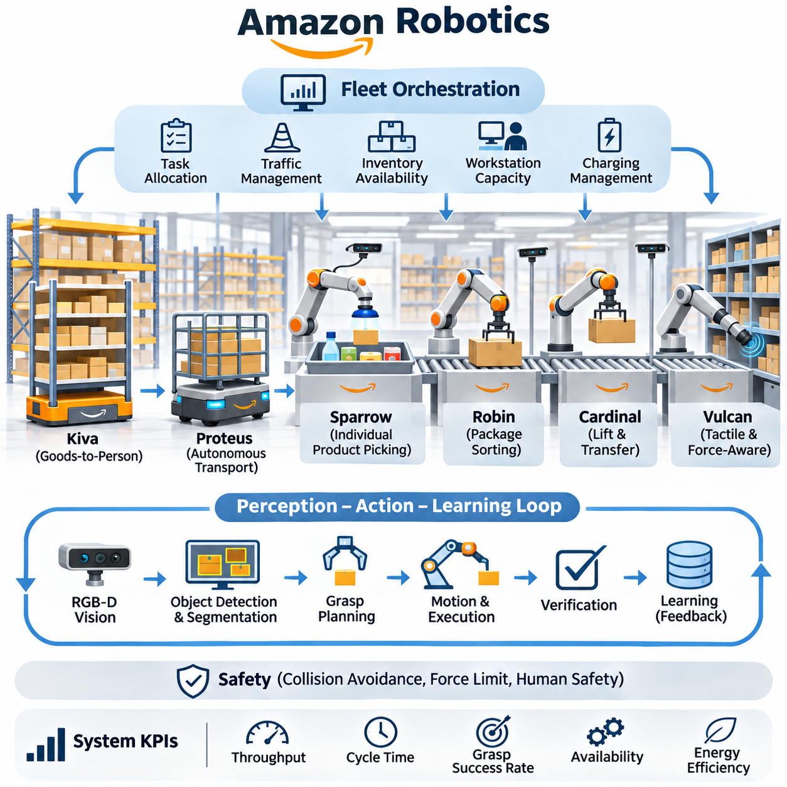
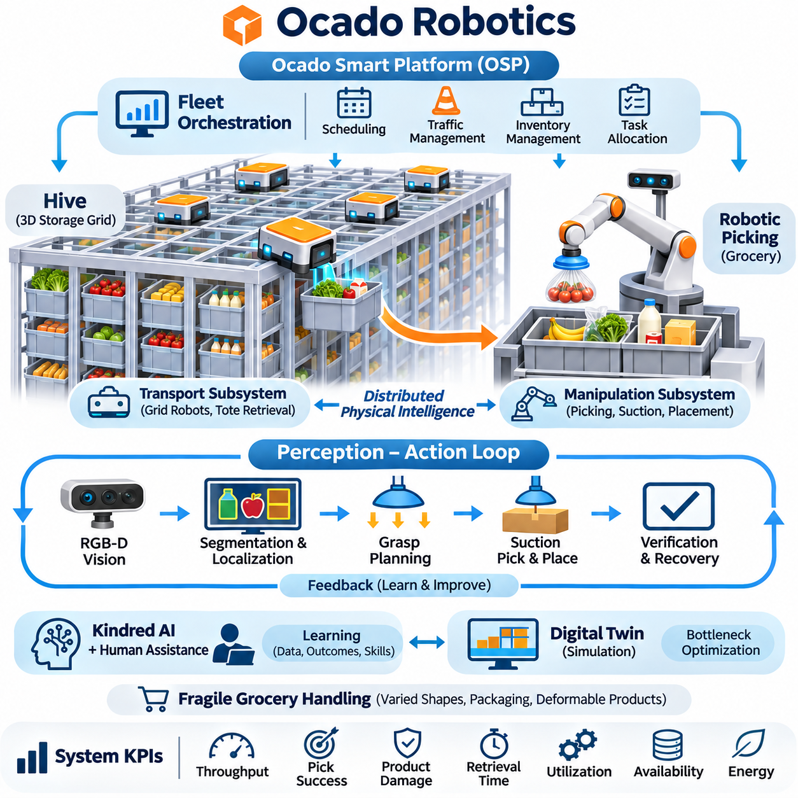
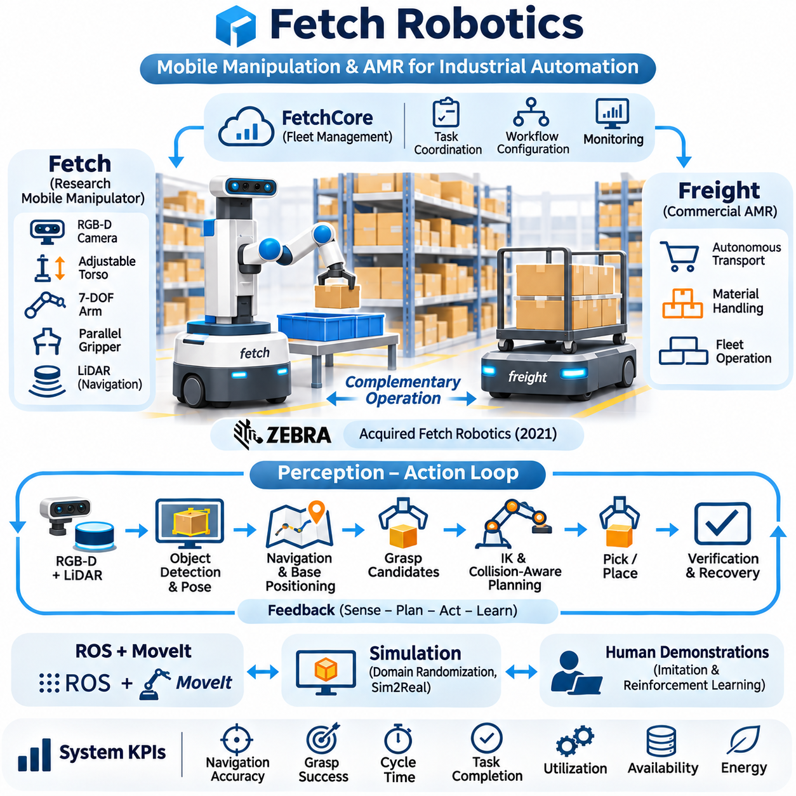
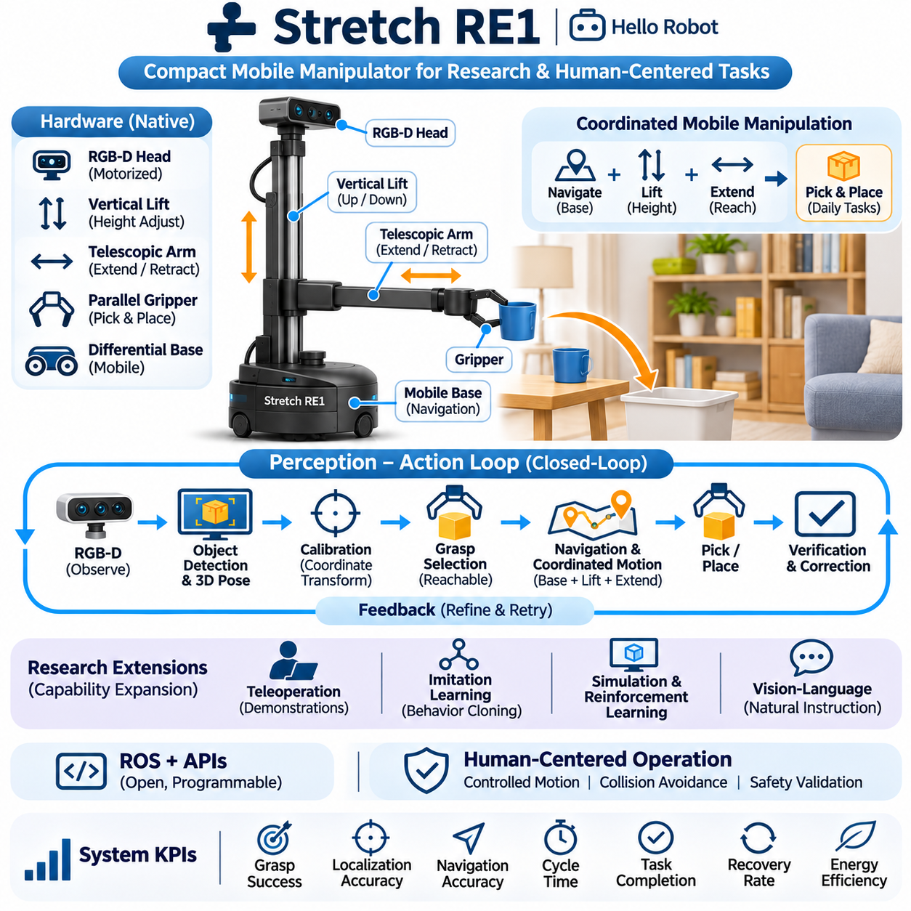
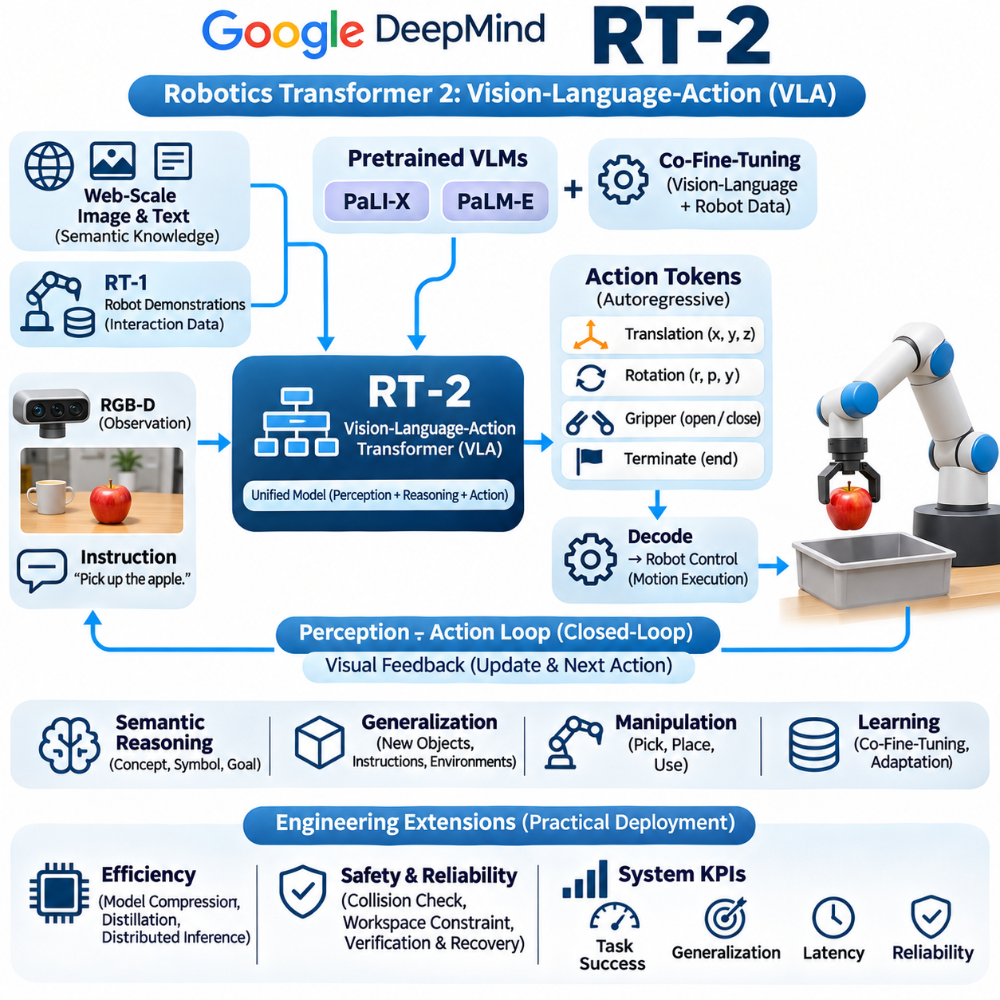
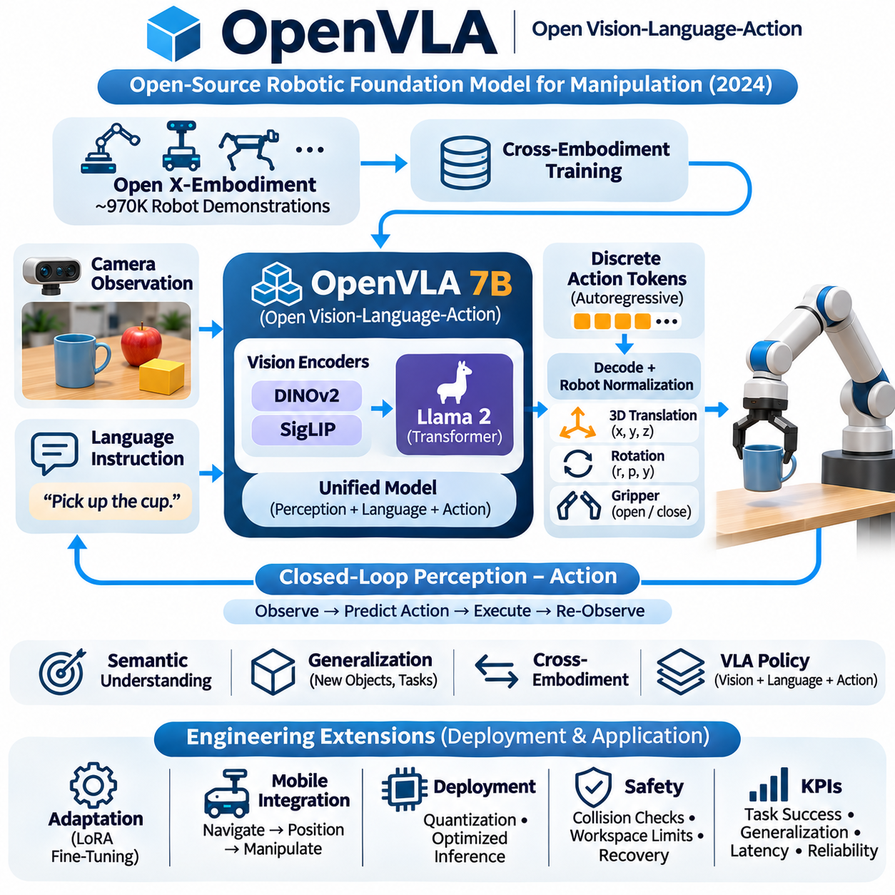
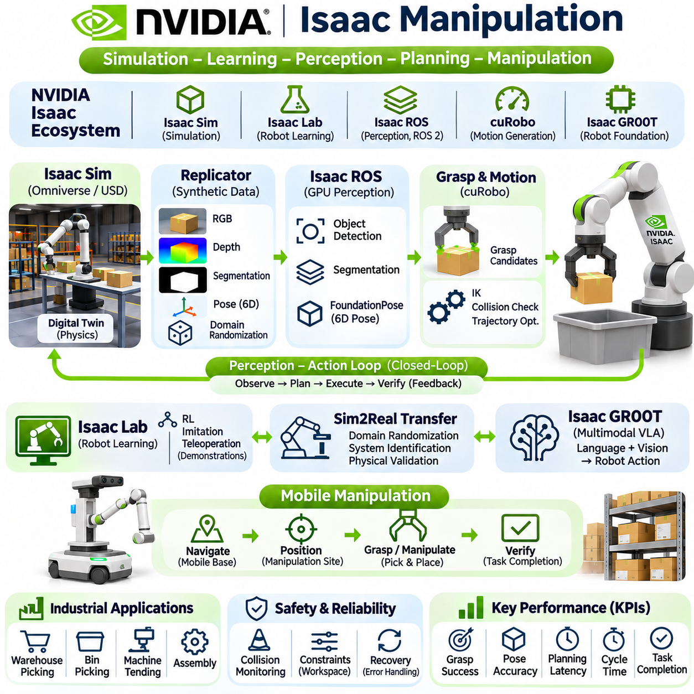

**Volume 03. Vision Manipulation and AI**


# Chapter 15. Case Studies

##  

## 01 Amazon Robotics

{width="7.268055555555556in" height="7.268055555555556in"}

Amazon Robotics represents one of the most significant examples of integrating artificial intelligence, robotic manipulation, computer vision, and autonomous mobility into large-scale logistics automation. Its robotic ecosystem demonstrates how perception, grasp planning, motion control, and intelligent decision-making can be combined to automate complex warehouse operations while improving productivity, operational consistency, scalability, and resource utilization.

The technological foundation of Amazon Robotics originated from Kiva Systems, which Amazon acquired in 2012. The original robotic architecture focused on transporting mobile storage shelves to human-operated picking stations. This goods-to-person approach significantly reduced unnecessary worker movement and established a scalable infrastructure for integrating autonomous mobile robots, intelligent inventory management, and automated manipulation systems.

Amazon Robotics subsequently expanded beyond autonomous transportation toward intelligent robotic manipulation. While mobile robots primarily transport inventory and containers, robotic manipulators perform object identification, grasping, sorting, and placement. The combination of these capabilities establishes a distributed automation architecture in which mobility and manipulation cooperate to execute complex fulfillment operations.

Visual perception is a fundamental component of Amazon\'s robotic manipulation systems. Cameras and depth-sensing technologies provide information about object geometry, spatial distribution, surface characteristics, and environmental conditions. Perception algorithms transform raw sensory observations into structured representations that support object detection, instance segmentation, grasp identification, and collision-aware manipulation planning.

Object recognition in fulfillment environments presents considerable technical challenges because products vary significantly in geometry, dimensions, packaging materials, texture, and weight. Deep learning techniques enable robotic systems to recognize and manipulate diverse inventory without requiring individually programmed trajectories for every product. Generalization across unfamiliar objects is particularly important for maintaining operational flexibility.

Grasp detection and grasp planning connect visual perception with physical manipulation. Robotic systems can evaluate potential contact locations, accessible surfaces, approach directions, and geometric constraints before selecting appropriate grasp configurations. Candidate grasps may be ranked according to estimated success probability, mechanical feasibility, collision risk, object stability, and compatibility with the available end effector.

Amazon\'s Sparrow robotic system illustrates the application of computer vision and artificial intelligence to individual product handling. Unlike conventional robots designed primarily for standardized packages, Sparrow was developed to identify, select, and manipulate a diverse range of inventory items. Its suction-based handling mechanism demonstrates the importance of coordinating perception, grasp selection, and task-specific end-effector design.

Other robotic manipulation systems, including Robin and Cardinal, address different stages of package handling and sorting. Robin performs robotic package handling within sorting operations, while Cardinal combines artificial intelligence and computer vision to identify, lift, and transfer packages. These systems illustrate how specialized robotic architectures can be optimized for distinct operational requirements within a shared logistics ecosystem.

Autonomous mobility provides another essential dimension of the Amazon Robotics architecture. Proteus, introduced as Amazon\'s first fully autonomous mobile robot, was designed to navigate operational environments and transport carts. Although Proteus is not itself an articulated mobile manipulator, its integration with robotic handling systems illustrates how autonomous transportation and stationary manipulation can collectively support flexible material flow.

Amazon\'s Vulcan robotic system further illustrates the importance of tactile and force-aware manipulation in warehouse automation. Handling products inside densely populated storage compartments requires more than visual recognition alone. Physical interaction feedback helps robots manage contact, adjust applied forces, and perform manipulation tasks where surrounding objects introduce geometric uncertainty and restricted accessibility.

Intelligent manipulation requires continuous coordination between perception, planning, execution, and feedback. A representative picking cycle begins with scene observation and object localization, followed by grasp candidate generation, approach planning, and physical execution. Subsequent observations verify task completion and provide information for corrective actions when grasp failure, object displacement, or unexpected environmental conditions occur.

Machine learning supports the improvement of robotic manipulation through systematic analysis of operational experience. Successful grasps, unsuccessful attempts, sensor observations, and execution outcomes can provide valuable training data. An appropriately designed learning infrastructure allows engineers to refine perception models, improve grasp selection strategies, and evaluate robotic performance under increasingly diverse operating conditions.

Fleet-level coordination is equally important because individual robot performance alone does not determine overall warehouse productivity. Task allocation, traffic management, inventory availability, workstation capacity, and charging requirements must be coordinated across the robotic ecosystem. Effective orchestration minimizes congestion, reduces idle time, and balances workloads between transportation systems and robotic manipulation stations.

Safety and reliability remain fundamental requirements for large-scale deployment. Robotic systems must incorporate appropriate protective mechanisms, collision prevention, operational monitoring, controlled stopping, and exception handling. AI-based perception and manipulation intelligence should operate within independently validated safety constraints rather than replacing deterministic protective functions required for dependable industrial operation.

Performance evaluation extends beyond individual grasp success rates to include picking throughput, cycle time, object coverage, intervention frequency, system availability, energy consumption, and operational cost. Amazon Robotics demonstrates the importance of evaluating automation at the system level, where improvements in perception or manipulation must ultimately contribute to measurable gains in overall fulfillment performance.

The Amazon Robotics ecosystem provides valuable architectural lessons for future mobile manipulator development. Modular perception pipelines, adaptive grasping, specialized end effectors, autonomous navigation, and centralized mission orchestration can establish a scalable foundation for Physical AI. The central engineering principle is that intelligence emerges from the coordinated integration of sensing, reasoning, physical execution, and operational feedback.

아마존 로보틱스(Amazon Robotics)는 인공지능(Artificial Intelligence), 로봇 조작(Robotic Manipulation), 컴퓨터 비전(Computer Vision), 자율 이동(Autonomous Mobility)을 대규모 물류 자동화(Logistics Automation)에 통합한 가장 대표적인 사례 중 하나이다. 아마존의 로봇 생태계(Robotic Ecosystem)는 인식(Perception), 파지 계획(Grasp Planning), 모션 제어(Motion Control), 지능형 의사결정(Intelligent Decision-Making)을 결합하여 복잡한 물류센터 운영을 자동화하고 생산성, 운영 일관성, 확장성 및 자원 활용 효율성을 향상시키는 방법을 보여준다.

아마존 로보틱스의 기술적 기반은 아마존이 2012년에 인수한 키바 시스템즈(Kiva Systems)에서 시작되었다. 초기 로봇 아키텍처(Robotic Architecture)는 이동식 재고 선반(Mobile Storage Shelf)을 작업자가 운영하는 피킹 스테이션(Picking Station)으로 운반하는 데 중점을 두었다. 이러한 상품 대 작업자 방식(Goods-to-Person)은 작업자의 불필요한 이동을 크게 줄이고, 자율 이동 로봇(Autonomous Mobile Robot, AMR), 지능형 재고 관리(Intelligent Inventory Management), 자동화된 조작 시스템(Automated Manipulation System)을 통합하기 위한 확장 가능한 인프라를 구축하였다.

아마존 로보틱스는 이후 자율 운송(Autonomous Transportation)을 넘어 지능형 로봇 조작(Intelligent Robotic Manipulation)으로 기술 영역을 확장하였다. 이동 로봇(Mobile Robot)이 주로 재고와 컨테이너를 운반하는 동안 로봇 매니퓰레이터(Robotic Manipulator)는 객체 식별(Object Identification), 파지(Grasping), 분류(Sorting), 배치(Placement)를 수행한다. 이러한 기능의 결합은 이동과 조작이 상호 협력하여 복잡한 주문 처리 작업(Fulfillment Operation)을 수행하는 분산형 자동화 아키텍처(Distributed Automation Architecture)를 형성한다.

시각 인식(Visual Perception)은 아마존 로봇 조작 시스템의 핵심 구성 요소이다. 카메라(Camera)와 깊이 감지 기술(Depth-Sensing Technology)은 객체의 기하학적 형상(Object Geometry), 공간적 분포(Spatial Distribution), 표면 특성(Surface Characteristics), 환경 조건(Environmental Conditions)에 관한 정보를 제공한다. 인식 알고리즘(Perception Algorithm)은 원시 센서 관측 데이터(Raw Sensory Observation)를 객체 감지(Object Detection), 인스턴스 분할(Instance Segmentation), 파지 식별(Grasp Identification), 충돌 인지형 조작 계획(Collision-Aware Manipulation Planning)을 지원하는 구조화된 표현(Structured Representation)으로 변환한다.

물류 주문 처리 환경(Fulfillment Environment)에서 객체 인식(Object Recognition)은 제품의 형상, 크기, 포장 재질, 질감 및 무게가 매우 다양하기 때문에 상당한 기술적 어려움을 수반한다. 딥러닝(Deep Learning) 기술을 적용하면 개별 제품마다 사전 프로그래밍된 궤적(Preprogrammed Trajectory)을 생성하지 않고도 다양한 재고 상품을 인식하고 조작할 수 있다. 특히 학습 과정에서 접하지 못한 객체에 대한 일반화(Generalization) 능력은 운영 유연성(Operational Flexibility)을 유지하는 데 매우 중요하다.

파지 감지(Grasp Detection)와 파지 계획(Grasp Planning)은 시각 인식과 물리적 조작(Physical Manipulation)을 연결한다. 로봇 시스템은 적절한 파지 구성을 선택하기 전에 잠재적인 접촉 위치(Contact Location), 접근 가능한 표면(Accessible Surface), 접근 방향(Approach Direction), 기하학적 제약조건(Geometric Constraint)을 평가할 수 있다. 파지 후보(Grasp Candidate)는 예상 성공 확률(Success Probability), 기계적 실현 가능성(Mechanical Feasibility), 충돌 위험(Collision Risk), 객체 안정성(Object Stability), 사용 가능한 말단 장치(End Effector)와의 적합성을 기준으로 평가하고 순위를 결정할 수 있다.

아마존의 스패로우(Sparrow) 로봇 시스템은 개별 제품 취급에 컴퓨터 비전과 인공지능을 적용한 사례이다. 표준화된 포장물을 처리하도록 설계된 기존 로봇과 달리, 스패로우는 다양한 재고 상품을 식별하고 선택하며 조작할 수 있도록 개발되었다. 흡착 기반 취급 메커니즘(Suction-Based Handling Mechanism)은 인식(Perception), 파지 선택(Grasp Selection), 작업 특화형 말단 장치 설계(Task-Specific End-Effector Design) 사이의 유기적인 협력이 중요하다는 점을 보여준다.

로빈(Robin)과 카디널(Cardinal)을 포함한 다른 로봇 조작 시스템은 포장물 취급 및 분류 과정의 서로 다른 단계를 담당한다. 로빈은 분류 작업(Sorting Operation)에서 로봇 기반 포장물 취급(Robotic Package Handling)을 수행하며, 카디널은 인공지능과 컴퓨터 비전을 결합하여 포장물을 식별하고 들어 올리며 운반한다. 이러한 시스템은 공통의 물류 생태계(Logistics Ecosystem) 내에서 특화된 로봇 아키텍처(Specialized Robotic Architecture)가 서로 다른 운영 요구사항(Operational Requirement)에 맞추어 최적화될 수 있음을 보여준다.

자율 이동(Autonomous Mobility)은 아마존 로보틱스 아키텍처의 또 다른 핵심 요소이다. 아마존 최초의 완전 자율 이동 로봇(Fully Autonomous Mobile Robot)으로 소개된 프로테우스(Proteus)는 실제 운영 환경에서 자율적으로 주행하고 운반용 카트(Cart)를 이동시키도록 설계되었다. 프로테우스 자체는 관절형 모바일 매니퓰레이터(Articulated Mobile Manipulator)가 아니지만, 로봇 취급 시스템과의 통합을 통해 자율 운송과 고정형 조작(Stationary Manipulation)이 협력하여 유연한 물류 흐름(Material Flow)을 지원할 수 있음을 보여준다.

아마존의 벌칸(Vulcan) 로봇 시스템은 물류 자동화에서 촉각 및 힘 인지형 조작(Tactile and Force-Aware Manipulation)의 중요성을 더욱 명확하게 보여준다. 제품이 밀집되어 있는 보관 공간(Storage Compartment)에서 물품을 취급하려면 단순한 시각 인식 이상의 능력이 필요하다. 물리적 상호작용 피드백(Physical Interaction Feedback)은 주변 객체로 인해 기하학적 불확실성(Geometric Uncertainty)이 발생하고 접근성이 제한되는 환경에서 로봇이 접촉을 관리하고 가해지는 힘을 조절하며 조작 작업을 수행하도록 지원한다.

지능형 조작(Intelligent Manipulation)은 인식(Perception), 계획(Planning), 실행(Execution), 피드백(Feedback) 사이의 지속적인 협력을 요구한다. 대표적인 피킹 사이클(Picking Cycle)은 장면 관측(Scene Observation)과 객체 위치 추정(Object Localization)으로 시작하여 파지 후보 생성(Grasp Candidate Generation), 접근 계획(Approach Planning), 물리적 실행(Physical Execution)으로 이어진다. 이후 추가적인 관측을 통해 작업 완료 여부를 검증하고, 파지 실패(Grasp Failure), 객체 변위(Object Displacement), 예상하지 못한 환경 조건이 발생했을 때 필요한 보정 동작(Corrective Action)을 위한 정보를 제공한다.

머신러닝(Machine Learning)은 운영 경험(Operational Experience)을 체계적으로 분석함으로써 로봇 조작 성능의 개선을 지원한다. 성공적인 파지, 실패한 시도, 센서 관측 데이터(Sensor Observation), 실행 결과(Execution Outcome)는 가치 있는 학습 데이터(Training Data)로 활용될 수 있다. 적절하게 설계된 학습 인프라(Learning Infrastructure)를 통해 엔지니어는 인식 모델(Perception Model)을 개선하고 파지 선택 전략(Grasp Selection Strategy)을 최적화하며, 더욱 다양해지는 운영 조건에서 로봇의 성능을 평가할 수 있다.

개별 로봇의 성능만으로 전체 물류센터의 생산성이 결정되는 것은 아니므로 플릿 수준 협조 제어(Fleet-Level Coordination) 역시 중요하다. 작업 할당(Task Allocation), 교통 관리(Traffic Management), 재고 가용성(Inventory Availability), 작업 스테이션 처리 용량(Workstation Capacity), 충전 요구사항(Charging Requirement)은 전체 로봇 생태계 차원에서 조정되어야 한다. 효과적인 통합 운용(Orchestration)은 혼잡을 최소화하고 유휴 시간(Idle Time)을 감소시키며 운송 시스템과 로봇 조작 스테이션 사이의 작업 부하(Workload)를 균형 있게 분배한다.

안전성(Safety)과 신뢰성(Reliability)은 대규모 로봇 배치(Large-Scale Deployment)를 위한 핵심 요구사항이다. 로봇 시스템은 적절한 보호 메커니즘(Protective Mechanism), 충돌 방지(Collision Prevention), 운영 모니터링(Operational Monitoring), 제어된 정지(Controlled Stopping), 예외 처리(Exception Handling) 기능을 포함해야 한다. 인공지능 기반 인식 및 조작 지능(Manipulation Intelligence)은 신뢰할 수 있는 산업 운영에 필요한 결정론적 보호 기능(Deterministic Protective Function)을 대체하는 것이 아니라, 독립적으로 검증된 안전 제약조건(Safety Constraint) 내에서 동작해야 한다.

성능 평가(Performance Evaluation)는 개별 파지 성공률(Grasp Success Rate)을 넘어 피킹 처리량(Picking Throughput), 사이클 시간(Cycle Time), 객체 처리 범위(Object Coverage), 개입 빈도(Intervention Frequency), 시스템 가용성(System Availability), 에너지 소비량(Energy Consumption), 운영 비용(Operational Cost)을 포함한다. 아마존 로보틱스는 시스템 수준(System Level)에서 자동화 성능을 평가하는 것의 중요성을 보여주며, 인식이나 조작 기술의 개선은 궁극적으로 전체 주문 처리 성능(Fulfillment Performance)의 정량적이고 측정 가능한 향상으로 이어져야 한다.

아마존 로보틱스 생태계는 미래 모바일 매니퓰레이터(Mobile Manipulator) 개발을 위한 가치 있는 아키텍처적 교훈을 제공한다. 모듈형 인식 파이프라인(Modular Perception Pipeline), 적응형 파지(Adaptive Grasping), 특화된 말단 장치(Specialized End Effector), 자율 주행(Autonomous Navigation), 중앙집중형 임무 통합 관리(Centralized Mission Orchestration)는 확장 가능한 물리 인공지능(Physical AI)의 기반을 구축할 수 있다. 핵심 공학적 원리는 지능이 감지(Sensing), 추론(Reasoning), 물리적 실행(Physical Execution), 운영 피드백(Operational Feedback)의 유기적인 통합을 통해 발현된다는 것이다.

##  

## 02 Ocado Robotics

{width="7.268055555555556in" height="7.268055555555556in"}

Ocado Robotics represents an advanced example of integrating robotic manipulation, computer vision, artificial intelligence, and autonomous transportation into large-scale automated grocery fulfillment. The Ocado Smart Platform (OSP) demonstrates how intelligent robotic systems can coordinate inventory storage, product retrieval, order preparation, and material transportation within a highly interconnected and data-driven logistics environment.

The fundamental architecture of Ocado\'s automated fulfillment system is based on a three-dimensional storage grid commonly referred to as the Hive. Inventory containers are stored vertically beneath a horizontal transportation grid, while autonomous robots travel across the upper surface to retrieve and relocate containers. This architecture achieves high storage density while supporting parallel transportation and dynamic inventory accessibility.

The grid-based robots operate as a coordinated robotic fleet rather than as independent transportation units. Centralized control systems continuously manage robot movements, task assignments, container accessibility, and transportation priorities. Intelligent scheduling enables numerous robots to operate simultaneously within a shared infrastructure while reducing congestion, preventing conflicts, and maintaining continuous material flow.

Although Ocado\'s grid-based transportation robots differ mechanically from conventional autonomous mobile robots and articulated mobile manipulators, their operational architecture provides valuable engineering insights. The separation of transportation and manipulation enables specialized robotic subsystems to perform specific functions efficiently while contributing to a unified fulfillment process through coordinated task execution.

Robotic picking represents an essential component of Ocado\'s automation strategy. Grocery products exhibit considerable variations in geometry, material properties, packaging structures, fragility, and weight distribution. Intelligent robotic manipulation must accommodate these variations while minimizing product damage, maintaining hygienic handling conditions, and satisfying operational requirements for high-throughput order fulfillment.

Computer vision enables robotic picking systems to interpret the spatial arrangement of products inside inventory containers. Visual perception algorithms can identify individual objects, estimate accessible surfaces, detect occlusions, and distinguish target products from surrounding items. Depth information provides additional geometric understanding for determining suitable grasp locations and generating collision-aware approach trajectories.

Instance segmentation and object localization are particularly relevant to grocery manipulation because products frequently overlap or occupy irregular positions inside containers. Learning-based perception models can generate object-specific representations that support the identification of graspable regions. Robust perception must also accommodate transparent packaging, reflective surfaces, deformable materials, and changing illumination conditions.

Grasp detection and grasp planning provide the connection between visual perception and physical product handling. Potential grasp configurations can be evaluated according to surface accessibility, object geometry, expected stability, collision risk, and end-effector compatibility. For grocery applications, grasp selection must additionally consider product fragility, packaging deformation, and the possibility of unintended contact with adjacent products.

Suction-based end effectors are particularly useful for many grocery picking applications because they can accommodate diverse product shapes without requiring individually customized mechanical fingers. However, porous surfaces, irregular packaging, and deformable products may reduce suction reliability. Intelligent manipulation therefore requires appropriate grasp selection, contact verification, and adaptive recovery strategies when acquisition attempts fail.

Ocado\'s acquisition of Kindred Systems expanded its capabilities in artificial intelligence and robotic manipulation. Kindred developed intelligent robotic systems for commercial picking and sorting applications, combining machine learning with physical manipulation and human-assisted operation. These technologies illustrate how operational experience and human intervention can contribute to the progressive improvement of autonomous robotic capabilities.

Learning-based manipulation enables robotic picking systems to improve their ability to handle diverse and previously unfamiliar products. Training datasets may incorporate visual observations, grasp configurations, execution outcomes, failure conditions, and corrective actions. Carefully validated learning pipelines can improve grasp prediction, object recognition, and manipulation robustness without requiring explicit programming for every individual product.

The perception-action loop is fundamental to reliable grocery manipulation. A representative robotic picking operation begins with scene observation, target selection, and grasp estimation, followed by approach planning, object acquisition, transportation, and placement. Visual observations and available sensor feedback can then verify successful execution and initiate corrective actions when unexpected conditions or manipulation failures are detected.

Digital twins and simulation provide important engineering capabilities for evaluating large-scale robotic fulfillment architectures. Virtual environments can represent transportation grids, robot movements, inventory distribution, workstation availability, and operational constraints. Simulation-based evaluation enables engineers to investigate scheduling strategies, identify system bottlenecks, and assess the effects of changing operational conditions before physical deployment.

Performance evaluation must consider the entire fulfillment ecosystem rather than focusing exclusively on individual robot capabilities. Important indicators include picking success rate, order fulfillment throughput, product damage rate, container retrieval time, robot utilization, intervention frequency, system availability, and energy consumption. Improvements in individual robotic functions must contribute to measurable system-level operational benefits.

Ocado Robotics provides valuable architectural lessons for mobile manipulator development and Physical AI. Its coordinated transportation infrastructure, intelligent picking technologies, learning-based perception, and centralized orchestration demonstrate the benefits of distributed physical intelligence. The case study also highlights the importance of modular integration, operational feedback, adaptive manipulation, and scalable coordination across heterogeneous robotic systems.

The architectural principles discussed here follow the supplied Chapter 15 structure and connect the Ocado case study with the preceding topics of visual perception, grasp planning, robotic learning, and Embodied AI. Since the supplied material defines the chapter organization rather than proprietary implementation details, the technical pipelines described above represent general engineering interpretations rather than verified specifications of Ocado\'s internal systems.

오카도 로보틱스(Ocado Robotics)는 로봇 조작(Robotic Manipulation), 컴퓨터 비전(Computer Vision), 인공지능(Artificial Intelligence), 자율 운송(Autonomous Transportation)을 대규모 식료품 주문 처리 자동화(Automated Grocery Fulfillment)에 통합한 대표적인 첨단 사례이다. 오카도 스마트 플랫폼(Ocado Smart Platform, OSP)은 지능형 로봇 시스템(Intelligent Robotic System)이 고도로 연결된 데이터 기반 물류 환경(Data-Driven Logistics Environment)에서 재고 보관, 제품 인출, 주문 준비 및 자재 운송을 어떻게 유기적으로 조정할 수 있는지를 보여준다.

오카도 자동화 주문 처리 시스템(Automated Fulfillment System)의 기본 아키텍처는 일반적으로 하이브(Hive)라고 불리는 3차원 보관 격자(Three-Dimensional Storage Grid)를 기반으로 한다. 재고 컨테이너(Inventory Container)는 수평 운송 격자(Horizontal Transportation Grid) 아래에 수직으로 적재되며, 자율 로봇(Autonomous Robot)은 격자의 상부 표면을 이동하면서 컨테이너를 인출하고 재배치한다. 이러한 아키텍처는 높은 보관 밀도(Storage Density)를 달성하는 동시에 병렬 운송(Parallel Transportation)과 동적 재고 접근성(Dynamic Inventory Accessibility)을 지원한다.

격자 기반 로봇(Grid-Based Robot)은 독립적인 운송 장치가 아니라 상호 협력하는 로봇 플릿(Robotic Fleet)으로 동작한다. 중앙집중형 제어 시스템(Centralized Control System)은 로봇 이동, 작업 할당(Task Assignment), 컨테이너 접근성(Container Accessibility), 운송 우선순위(Transportation Priority)를 지속적으로 관리한다. 지능형 스케줄링(Intelligent Scheduling)은 다수의 로봇이 공유 인프라(Shared Infrastructure)에서 동시에 동작하도록 지원하면서 혼잡 감소, 충돌 방지 및 연속적인 물류 흐름(Material Flow)을 유지한다.

오카도의 격자 기반 운송 로봇(Grid-Based Transportation Robot)은 기계적 구조 측면에서 일반적인 자율 이동 로봇(Autonomous Mobile Robot, AMR) 및 관절형 모바일 매니퓰레이터(Articulated Mobile Manipulator)와 다르지만, 그 운영 아키텍처(Operational Architecture)는 가치 있는 공학적 통찰을 제공한다. 운송(Transportation)과 조작(Manipulation)을 분리함으로써 특화된 로봇 서브시스템(Specialized Robotic Subsystem)이 개별 기능을 효율적으로 수행하고, 협조적 작업 실행(Coordinated Task Execution)을 통해 통합된 주문 처리 프로세스(Unified Fulfillment Process)에 기여할 수 있다.

로봇 피킹(Robotic Picking)은 오카도 자동화 전략(Automation Strategy)의 핵심 구성 요소이다. 식료품은 기하학적 형상(Geometry), 재료 특성(Material Properties), 포장 구조(Packaging Structure), 파손 민감도(Fragility), 무게 분포(Weight Distribution) 측면에서 상당한 다양성을 나타낸다. 지능형 로봇 조작(Intelligent Robotic Manipulation)은 이러한 다양성에 대응하면서 제품 손상을 최소화하고 위생적인 취급 조건(Hygienic Handling Condition)을 유지하며, 높은 처리량의 주문 처리(High-Throughput Order Fulfillment)에 필요한 운영 요구사항을 충족해야 한다.

컴퓨터 비전(Computer Vision)은 로봇 피킹 시스템(Robotic Picking System)이 재고 컨테이너 내부에 배치된 제품의 공간적 배열(Spatial Arrangement)을 해석할 수 있도록 지원한다. 시각 인식 알고리즘(Visual Perception Algorithm)은 개별 객체를 식별하고, 접근 가능한 표면(Accessible Surface)을 추정하며, 가려짐(Occlusion)을 감지하고, 주변 물품으로부터 목표 제품(Target Product)을 구분할 수 있다. 깊이 정보(Depth Information)는 적절한 파지 위치(Grasp Location)를 결정하고 충돌 인지형 접근 궤적(Collision-Aware Approach Trajectory)을 생성하기 위한 추가적인 기하학적 정보를 제공한다.

인스턴스 분할(Instance Segmentation)과 객체 위치 추정(Object Localization)은 제품이 서로 겹쳐 있거나 컨테이너 내부에 불규칙하게 배치되는 경우가 많기 때문에 식료품 조작(Grocery Manipulation)에서 특히 중요하다. 학습 기반 인식 모델(Learning-Based Perception Model)은 파지 가능 영역(Graspable Region)의 식별을 지원하는 객체별 표현(Object-Specific Representation)을 생성할 수 있다. 강건한 인식(Robust Perception)은 투명 포장재(Transparent Packaging), 반사 표면(Reflective Surface), 변형 가능한 재료(Deformable Material), 변화하는 조명 조건(Illumination Condition)에도 대응해야 한다.

파지 감지(Grasp Detection)와 파지 계획(Grasp Planning)은 시각 인식과 물리적 제품 취급(Physical Product Handling)을 연결하는 역할을 수행한다. 잠재적인 파지 구성(Grasp Configuration)은 표면 접근성(Surface Accessibility), 객체 형상(Object Geometry), 예상 안정성(Expected Stability), 충돌 위험(Collision Risk), 말단 장치 적합성(End-Effector Compatibility)을 기준으로 평가할 수 있다. 식료품 응용 분야에서는 파지 선택(Grasp Selection) 과정에서 제품의 파손 민감도, 포장 변형(Packaging Deformation), 인접 제품과의 의도하지 않은 접촉(Unintended Contact) 가능성도 추가적으로 고려해야 한다.

흡착 기반 말단 장치(Suction-Based End Effector)는 개별 제품에 맞춤화된 기계식 손가락(Mechanical Finger)을 필요로 하지 않으면서 다양한 제품 형상에 대응할 수 있기 때문에 많은 식료품 피킹 응용 분야에서 특히 유용하다. 그러나 다공성 표면(Porous Surface), 불규칙한 포장(Irregular Packaging), 변형 가능한 제품(Deformable Product)은 흡착 신뢰성(Suction Reliability)을 저하시킬 수 있다. 따라서 지능형 조작에는 적절한 파지 선택, 접촉 검증(Contact Verification), 객체 획득 실패 시 적응형 복구 전략(Adaptive Recovery Strategy)이 필요하다.

오카도는 킨드레드 시스템즈(Kindred Systems)를 인수함으로써 인공지능과 로봇 조작 분야의 기술 역량을 확장하였다. 킨드레드는 머신러닝(Machine Learning), 물리적 조작(Physical Manipulation), 인간 지원 운영(Human-Assisted Operation)을 결합하여 상업용 피킹 및 분류 작업(Commercial Picking and Sorting Application)을 위한 지능형 로봇 시스템을 개발하였다. 이러한 기술은 운영 경험(Operational Experience)과 인간 개입(Human Intervention)이 자율 로봇 역량(Autonomous Robotic Capability)의 점진적인 개선에 어떻게 기여할 수 있는지를 보여준다.

학습 기반 조작(Learning-Based Manipulation)은 로봇 피킹 시스템이 다양한 제품과 이전에 접하지 못한 제품을 처리하는 능력을 향상시킬 수 있도록 지원한다. 학습 데이터셋(Training Dataset)에는 시각적 관측(Visual Observation), 파지 구성(Grasp Configuration), 실행 결과(Execution Outcome), 실패 조건(Failure Condition), 보정 동작(Corrective Action)이 포함될 수 있다. 체계적으로 검증된 학습 파이프라인(Learning Pipeline)은 개별 제품마다 명시적인 프로그래밍을 수행하지 않고도 파지 예측(Grasp Prediction), 객체 인식(Object Recognition), 조작 강건성(Manipulation Robustness)을 향상시킬 수 있다.

인식-행동 루프(Perception-Action Loop)는 신뢰할 수 있는 식료품 조작을 구현하기 위한 핵심 요소이다. 대표적인 로봇 피킹 작업은 장면 관측(Scene Observation), 목표 선택(Target Selection), 파지 추정(Grasp Estimation)으로 시작하여 접근 계획(Approach Planning), 객체 획득(Object Acquisition), 운송(Transportation), 배치(Placement)로 이어진다. 이후 시각적 관측과 가용한 센서 피드백(Sensor Feedback)을 통해 성공적인 작업 실행 여부를 검증하고, 예상하지 못한 조건이나 조작 실패(Manipulation Failure)가 감지되면 보정 동작을 시작할 수 있다.

디지털 트윈(Digital Twin)과 시뮬레이션(Simulation)은 대규모 로봇 주문 처리 아키텍처(Large-Scale Robotic Fulfillment Architecture)를 평가하기 위한 중요한 공학적 기능을 제공한다. 가상 환경(Virtual Environment)은 운송 격자(Transportation Grid), 로봇 이동(Robot Movement), 재고 분포(Inventory Distribution), 작업 스테이션 가용성(Workstation Availability), 운영 제약조건(Operational Constraint)을 표현할 수 있다. 시뮬레이션 기반 평가(Simulation-Based Evaluation)를 통해 엔지니어는 실제 시스템 배치(Physical Deployment) 이전에 스케줄링 전략을 검토하고, 시스템 병목 현상(System Bottleneck)을 식별하며, 운영 조건 변화의 영향을 평가할 수 있다.

성능 평가(Performance Evaluation)는 개별 로봇의 기능에만 초점을 맞추는 것이 아니라 전체 주문 처리 생태계(Fulfillment Ecosystem)를 고려해야 한다. 주요 성능 지표에는 피킹 성공률(Picking Success Rate), 주문 처리량(Order Fulfillment Throughput), 제품 손상률(Product Damage Rate), 컨테이너 인출 시간(Container Retrieval Time), 로봇 활용률(Robot Utilization), 개입 빈도(Intervention Frequency), 시스템 가용성(System Availability), 에너지 소비량(Energy Consumption)이 포함된다. 개별 로봇 기능의 개선은 측정 가능한 시스템 수준의 운영 개선 효과(System-Level Operational Benefit)로 이어져야 한다.

오카도 로보틱스는 모바일 매니퓰레이터(Mobile Manipulator) 개발과 물리 인공지능(Physical AI)을 위한 가치 있는 아키텍처적 교훈을 제공한다. 협조형 운송 인프라(Coordinated Transportation Infrastructure), 지능형 피킹 기술(Intelligent Picking Technology), 학습 기반 인식(Learning-Based Perception), 중앙집중형 통합 운용(Centralized Orchestration)은 분산형 물리 지능(Distributed Physical Intelligence)의 이점을 보여준다. 또한 이 사례는 이기종 로봇 시스템(Heterogeneous Robotic System) 전반에 걸쳐 모듈형 통합(Modular Integration), 운영 피드백(Operational Feedback), 적응형 조작(Adaptive Manipulation), 확장 가능한 협조 제어(Scalable Coordination)의 중요성을 강조한다.

여기에서 설명한 아키텍처 원리(Architectural Principle)는 첨부된 제15장(Chapter 15)의 구조를 따르며, 오카도 사례 연구(Case Study)를 앞서 다룬 시각 인식(Visual Perception), 파지 계획(Grasp Planning), 로봇 학습(Robotic Learning), 체화형 인공지능(Embodied AI)과 연결한다. 첨부 자료는 독점적인 기술 구현 세부사항(Proprietary Implementation Details)이 아닌 장의 구성 체계를 정의하고 있으므로, 앞서 설명한 기술 파이프라인(Technical Pipeline)은 오카도 내부 시스템의 검증된 기술 사양이 아니라 일반적인 공학적 해석(Engineering Interpretation)을 나타낸다.

##  

## 03 Fetch Robotics

{width="7.268055555555556in" height="7.268055555555556in"}

Fetch Robotics provides an important example of integrating autonomous mobility, robotic manipulation, computer vision, and intelligent task execution into practical robotics systems. Its development illustrates the transition from research-oriented mobile manipulators to commercially deployed autonomous mobile robots, demonstrating how robotic perception, physical interaction, and operational coordination can support industrial automation.

Founded in 2014, Fetch Robotics developed robotic platforms for research, logistics, warehousing, and material handling applications. The company introduced two notable robotic platforms, Fetch and Freight, which represented complementary approaches to autonomous manipulation and transportation. Fetch combined a mobile base with an articulated robotic arm, while Freight focused primarily on autonomous material transportation.

The Fetch mobile manipulator incorporates a wheeled mobile base, a seven-degree-of-freedom robotic arm, a vertically adjustable torso, a parallel gripper, and an RGB-D perception system. This configuration enables the robot to navigate indoor environments, adjust its manipulation workspace, recognize surrounding objects, and perform physical tasks that require coordination between autonomous mobility and articulated manipulation.

Visual perception plays a fundamental role in the Fetch mobile manipulator architecture. RGB-D cameras provide color images and depth measurements that support three-dimensional environmental understanding. Combined with laser-based navigation sensors and robot state information, these observations enable object localization, obstacle detection, spatial reasoning, and the construction of representations required for manipulation planning.

Object detection and pose estimation establish the relationship between visual observations and physical manipulation targets. Detected objects must be represented within appropriate coordinate systems before the robotic arm can interact with them. Camera calibration, coordinate transformations, and accurate robot kinematic models are therefore essential for converting perception results into executable manipulation objectives.

Grasp detection enables the Fetch platform to identify potential object acquisition configurations from visual and geometric information. Candidate grasps can be generated using depth images, point clouds, analytical geometric methods, or deep learning models. Each candidate must be evaluated according to gripper compatibility, object stability, approach accessibility, collision risk, and the kinematic limitations of the robotic arm.

Grasp planning extends beyond identifying suitable contact locations by determining whether the robot can physically execute the selected grasp. Inverse kinematics, collision checking, trajectory generation, and workspace evaluation provide essential constraints for manipulation execution. When a target is outside the reachable workspace, the mobile base or adjustable torso can be repositioned to improve manipulation feasibility.

The integration of autonomous navigation and manipulation introduces additional challenges compared with stationary robotic systems. Navigation errors, base positioning uncertainty, environmental changes, and inaccurate object observations may affect the success of subsequent manipulation tasks. Closed-loop perception and local target refinement can compensate for these uncertainties before the robotic arm executes physical interactions.

The Robot Operating System (ROS) provides an important software foundation for the Fetch research platform. Its modular framework supports communication between perception components, navigation systems, manipulation controllers, and task execution modules. Integration with tools such as MoveIt enables researchers to investigate motion planning, collision avoidance, inverse kinematics, and coordinated mobile manipulation strategies.

Fetch has served as a research platform for learning from demonstration, imitation learning, reinforcement learning, and autonomous skill acquisition. Researchers can investigate how robots acquire manipulation capabilities through human demonstrations, simulated interactions, and physical experience. These approaches reduce dependence on explicitly programmed behaviors and support the development of adaptable robotic manipulation skills.

The perception-action loop provides a fundamental framework for autonomous task execution on mobile manipulation platforms. A representative operation begins with environmental observation, target identification, and navigation toward a suitable manipulation position. The robot subsequently generates grasp candidates, plans its motion, executes physical interaction, and evaluates the outcome through available sensory feedback.

Simulation environments allow mobile manipulation algorithms to be developed and evaluated before deployment on physical Fetch robots. Simulated experiments can reproduce object arrangements, navigation environments, robotic arm configurations, and manipulation tasks under controlled conditions. Domain randomization and simulation-to-reality transfer can help reduce discrepancies between virtual training environments and physical execution.

Fetch Robotics also expanded its commercial activities through autonomous mobile robots designed for warehouse transportation and material handling. Its cloud-based fleet management platform, FetchCore, supported task coordination, workflow configuration, robot monitoring, and integration with operational systems. Zebra Technologies acquired Fetch Robotics in 2021, linking its robotic capabilities with broader enterprise automation solutions.

The distinction between the Fetch research manipulator and commercial transportation robots is important when evaluating the company\'s technological contributions. The research platform supports embodied intelligence and integrated mobile manipulation, whereas commercial autonomous mobile robots primarily address scalable logistics workflows. Together, these approaches illustrate complementary pathways toward intelligent industrial automation.

Performance evaluation of mobile manipulators should consider navigation accuracy, object detection reliability, grasp success rate, manipulation cycle time, task completion rate, and recovery capability. Additional operational indicators include robot utilization, intervention frequency, system availability, and energy consumption. Successful deployment requires balancing individual robotic capabilities with overall operational efficiency.

Fetch Robotics provides valuable architectural lessons for the development of modern mobile manipulators and Physical AI systems. Its platforms illustrate the importance of modular perception, coordinated mobility, adaptive manipulation, learning-based skills, and scalable operational integration. The technical workflows described here represent general engineering interpretations aligned with the supplied chapter structure rather than verified proprietary implementation specifications.

페치 로보틱스(Fetch Robotics)는 자율 이동(Autonomous Mobility), 로봇 조작(Robotic Manipulation), 컴퓨터 비전(Computer Vision), 지능형 작업 실행(Intelligent Task Execution)을 실용적인 로봇 시스템에 통합한 중요한 사례이다. 페치 로보틱스의 발전 과정은 연구 중심의 모바일 매니퓰레이터(Research-Oriented Mobile Manipulator)에서 상용 자율 이동 로봇(Autonomous Mobile Robot, AMR)으로의 전환을 보여주며, 로봇 인식(Robotic Perception), 물리적 상호작용(Physical Interaction), 운영 협조 제어(Operational Coordination)가 산업 자동화(Industrial Automation)를 어떻게 지원할 수 있는지를 보여준다.

2014년에 설립된 페치 로보틱스는 연구, 물류, 창고 관리 및 자재 취급(Material Handling) 응용 분야를 위한 로봇 플랫폼(Robotic Platform)을 개발하였다. 이 회사는 자율 조작(Autonomous Manipulation)과 운송(Transportation)에 대한 상호 보완적인 접근 방식을 대표하는 페치(Fetch)와 프레이트(Freight)라는 두 가지 주요 로봇 플랫폼을 선보였다. 페치는 이동형 베이스(Mobile Base)와 관절형 로봇 팔(Articulated Robotic Arm)을 결합한 반면, 프레이트는 주로 자율 자재 운송(Autonomous Material Transportation)에 중점을 두었다.

페치 모바일 매니퓰레이터(Fetch Mobile Manipulator)는 바퀴형 이동 베이스(Wheeled Mobile Base), 7자유도 로봇 팔(Seven-Degree-of-Freedom Robotic Arm), 수직 조절형 몸체(Vertically Adjustable Torso), 평행 그리퍼(Parallel Gripper), RGB-D 인식 시스템(RGB-D Perception System)으로 구성된다. 이러한 구성은 로봇이 실내 환경에서 자율 주행하고, 조작 작업 공간(Manipulation Workspace)을 조정하며, 주변 객체를 인식하고, 자율 이동과 관절형 조작(Articulated Manipulation) 사이의 협력이 필요한 물리적 작업을 수행할 수 있도록 지원한다.

시각 인식(Visual Perception)은 페치 모바일 매니퓰레이터 아키텍처의 핵심적인 역할을 수행한다. RGB-D 카메라(RGB-D Camera)는 3차원 환경 이해(Three-Dimensional Environmental Understanding)를 지원하는 컬러 영상(Color Image)과 깊이 측정값(Depth Measurement)을 제공한다. 이러한 관측 정보는 레이저 기반 주행 센서(Laser-Based Navigation Sensor) 및 로봇 상태 정보(Robot State Information)와 결합되어 객체 위치 추정(Object Localization), 장애물 감지(Obstacle Detection), 공간 추론(Spatial Reasoning), 조작 계획(Manipulation Planning)에 필요한 환경 표현(Representation)의 생성을 가능하게 한다.

객체 감지(Object Detection)와 자세 추정(Pose Estimation)은 시각적 관측(Visual Observation)과 물리적 조작 대상(Physical Manipulation Target) 사이의 관계를 확립한다. 감지된 객체는 로봇 팔이 해당 객체와 상호작용하기 전에 적절한 좌표계(Coordinate System) 내에서 표현되어야 한다. 따라서 카메라 보정(Camera Calibration), 좌표 변환(Coordinate Transformation), 정확한 로봇 기구학 모델(Robot Kinematic Model)은 인식 결과(Perception Result)를 실행 가능한 조작 목표(Executable Manipulation Objective)로 변환하는 데 필수적이다.

파지 감지(Grasp Detection)는 페치 플랫폼이 시각적 정보(Visual Information)와 기하학적 정보(Geometric Information)를 기반으로 잠재적인 객체 획득 구성(Object Acquisition Configuration)을 식별할 수 있도록 한다. 파지 후보(Grasp Candidate)는 깊이 영상(Depth Image), 포인트 클라우드(Point Cloud), 해석적 기하학 방법(Analytical Geometric Method), 딥러닝 모델(Deep Learning Model)을 활용하여 생성할 수 있다. 각 후보는 그리퍼 적합성(Gripper Compatibility), 객체 안정성(Object Stability), 접근 가능성(Approach Accessibility), 충돌 위험(Collision Risk), 로봇 팔의 기구학적 한계(Kinematic Limitation)를 기준으로 평가되어야 한다.

파지 계획(Grasp Planning)은 적절한 접촉 위치(Contact Location)를 식별하는 것을 넘어 로봇이 선택된 파지를 물리적으로 실행할 수 있는지를 결정한다. 역기구학(Inverse Kinematics), 충돌 검사(Collision Checking), 궤적 생성(Trajectory Generation), 작업 공간 평가(Workspace Evaluation)는 조작 실행(Manipulation Execution)에 필요한 핵심 제약조건(Constraint)을 제공한다. 목표 객체가 도달 가능한 작업 공간(Reachable Workspace)을 벗어나는 경우 이동형 베이스 또는 높이 조절형 몸체의 위치를 변경하여 조작 실현 가능성(Manipulation Feasibility)을 향상시킬 수 있다.

자율 주행(Autonomous Navigation)과 조작(Manipulation)의 통합은 고정형 로봇 시스템(Stationary Robotic System)과 비교하여 추가적인 기술적 과제를 발생시킨다. 주행 오차(Navigation Error), 베이스 위치 결정의 불확실성(Base Positioning Uncertainty), 환경 변화(Environmental Change), 부정확한 객체 관측(Object Observation)은 후속 조작 작업의 성공 여부에 영향을 미칠 수 있다. 폐루프 인식(Closed-Loop Perception)과 국소 목표 정밀화(Local Target Refinement)는 로봇 팔이 물리적 상호작용을 실행하기 전에 이러한 불확실성을 보상할 수 있다.

로봇 운영체제(Robot Operating System, ROS)는 페치 연구 플랫폼의 중요한 소프트웨어 기반(Software Foundation)을 제공한다. 모듈형 프레임워크(Modular Framework)는 인식 구성 요소(Perception Component), 주행 시스템(Navigation System), 조작 제어기(Manipulation Controller), 작업 실행 모듈(Task Execution Module) 사이의 통신을 지원한다. MoveIt과 같은 도구와의 통합을 통해 연구자는 모션 계획(Motion Planning), 충돌 회피(Collision Avoidance), 역기구학(Inverse Kinematics), 협조형 모바일 조작 전략(Coordinated Mobile Manipulation Strategy)을 연구할 수 있다.

페치는 시연 기반 학습(Learning from Demonstration, LfD), 모방 학습(Imitation Learning), 강화학습(Reinforcement Learning, RL), 자율 기술 획득(Autonomous Skill Acquisition)을 위한 연구 플랫폼(Research Platform)으로 활용되어 왔다. 연구자는 로봇이 인간의 시연(Human Demonstration), 시뮬레이션 기반 상호작용(Simulated Interaction), 물리적 경험(Physical Experience)을 통해 조작 능력을 획득하는 방법을 연구할 수 있다. 이러한 접근 방식은 명시적으로 프로그래밍된 행동(Explicitly Programmed Behavior)에 대한 의존성을 줄이고 적응 가능한 로봇 조작 기술(Adaptable Robotic Manipulation Skill)의 개발을 지원한다.

인식-행동 루프(Perception-Action Loop)는 모바일 조작 플랫폼(Mobile Manipulation Platform)에서 자율 작업 실행(Autonomous Task Execution)을 구현하기 위한 기본 프레임워크를 제공한다. 대표적인 작업은 환경 관측(Environmental Observation), 목표 식별(Target Identification), 적절한 조작 위치(Manipulation Position)로의 자율 주행으로 시작된다. 이후 로봇은 파지 후보를 생성하고, 모션을 계획하며, 물리적 상호작용을 실행하고, 가용한 센서 피드백(Sensory Feedback)을 통해 실행 결과(Execution Outcome)를 평가한다.

시뮬레이션 환경(Simulation Environment)은 실제 페치 로봇(Physical Fetch Robot)에 배치하기 전에 모바일 조작 알고리즘(Mobile Manipulation Algorithm)을 개발하고 평가할 수 있도록 지원한다. 시뮬레이션 실험(Simulated Experiment)은 제어된 조건에서 객체 배열(Object Arrangement), 주행 환경(Navigation Environment), 로봇 팔 구성(Robotic Arm Configuration), 조작 작업(Manipulation Task)을 재현할 수 있다. 도메인 무작위화(Domain Randomization)와 시뮬레이션-현실 전이(Simulation-to-Reality Transfer, Sim2Real)는 가상 학습 환경(Virtual Training Environment)과 실제 물리적 실행(Physical Execution) 사이의 차이를 줄이는 데 기여할 수 있다.

페치 로보틱스는 창고 운송(Warehouse Transportation) 및 자재 취급(Material Handling)을 위해 설계된 자율 이동 로봇을 통해 상업적 사업 영역도 확장하였다. 클라우드 기반 플릿 관리 플랫폼(Cloud-Based Fleet Management Platform)인 페치코어(FetchCore)는 작업 협조 제어(Task Coordination), 워크플로 구성(Workflow Configuration), 로봇 모니터링(Robot Monitoring), 운영 시스템(Operational System)과의 통합을 지원하였다. 지브라 테크놀로지스(Zebra Technologies)는 2021년에 페치 로보틱스를 인수하여 로봇 기술 역량을 보다 광범위한 기업 자동화 솔루션(Enterprise Automation Solution)과 연결하였다.

페치 연구용 매니퓰레이터(Research Manipulator)와 상용 운송 로봇(Commercial Transportation Robot) 사이의 구분은 회사의 기술적 기여를 평가할 때 중요하다. 연구 플랫폼은 체화형 지능(Embodied Intelligence)과 통합형 모바일 조작(Integrated Mobile Manipulation)을 지원하는 반면, 상용 자율 이동 로봇은 주로 확장 가능한 물류 워크플로(Scalable Logistics Workflow)를 구현하는 데 중점을 둔다. 이러한 두 가지 접근 방식은 지능형 산업 자동화(Intelligent Industrial Automation)를 향한 상호 보완적인 발전 경로(Development Pathway)를 보여준다.

모바일 매니퓰레이터의 성능 평가(Performance Evaluation)는 주행 정확도(Navigation Accuracy), 객체 감지 신뢰성(Object Detection Reliability), 파지 성공률(Grasp Success Rate), 조작 사이클 시간(Manipulation Cycle Time), 작업 완료율(Task Completion Rate), 복구 능력(Recovery Capability)을 고려해야 한다. 추가적인 운영 성능 지표(Operational Performance Indicator)에는 로봇 활용률(Robot Utilization), 개입 빈도(Intervention Frequency), 시스템 가용성(System Availability), 에너지 소비량(Energy Consumption)이 포함된다. 성공적인 시스템 배치(System Deployment)를 위해서는 개별 로봇의 기술적 역량과 전체 운영 효율성(Overall Operational Efficiency) 사이의 균형을 확보해야 한다.

페치 로보틱스는 현대적인 모바일 매니퓰레이터와 물리 인공지능(Physical AI) 시스템의 개발을 위한 가치 있는 아키텍처적 교훈을 제공한다. 페치의 로봇 플랫폼은 모듈형 인식(Modular Perception), 협조형 이동(Coordinated Mobility), 적응형 조작(Adaptive Manipulation), 학습 기반 기술(Learning-Based Skill), 확장 가능한 운영 통합(Scalable Operational Integration)의 중요성을 보여준다. 여기에서 설명한 기술적 작업 흐름(Technical Workflow)은 검증된 독점 기술 구현 사양(Proprietary Implementation Specification)이 아니라 첨부된 장의 구성 체계에 부합하는 일반적인 공학적 해석(Engineering Interpretation)을 나타낸다.

##  

## 04 Stretch RE1

{width="7.268055555555556in" height="7.268055555555556in"}

Stretch RE1, developed by Hello Robot, represents an important example of a compact mobile manipulator designed for research, human-centered environments, and practical robotic assistance. Unlike conventional industrial manipulators that operate within fixed workstations, Stretch integrates autonomous mobility, visual perception, and physical manipulation into a lightweight robotic platform capable of interacting with everyday environments.

The mechanical architecture of Stretch RE1 combines a differential-drive mobile base, a vertical lifting mechanism, a horizontally extendable telescopic arm, a wrist assembly, and a robotic gripper. This configuration reduces mechanical complexity while providing an effective manipulation workspace. Coordinated movement of the mobile base, vertical lift, and telescopic arm enables the robot to access objects at different heights and distances.

A distinctive characteristic of Stretch RE1 is its minimalist approach to mobile manipulation. Instead of relying on a conventional multi-joint articulated robotic arm, the platform distributes manipulation capabilities across several mechanical subsystems. This design reduces hardware complexity, system weight, and manufacturing cost while maintaining sufficient functional flexibility for numerous indoor manipulation and assistance tasks.

Visual perception provides the foundation for autonomous environmental interaction. Stretch RE1 incorporates an RGB-D camera mounted on a motorized head, enabling the robot to observe surrounding objects and estimate their spatial relationships. Color images and depth measurements support object detection, scene understanding, surface identification, and three-dimensional localization required for intelligent manipulation.

Object detection and pose estimation are essential for transforming visual observations into actionable manipulation targets. Deep learning models can identify objects of interest, while depth information supports the estimation of their three-dimensional positions. Camera calibration and coordinate transformations establish the geometric relationship between the perception system, mobile base, robotic arm, and physical target objects.

Grasp detection enables Stretch RE1 to identify suitable object acquisition configurations from visual and geometric observations. Potential grasp locations can be evaluated according to object shape, surface accessibility, gripper compatibility, and surrounding obstacles. The relatively constrained mechanical architecture requires grasp selection algorithms to consider the directional accessibility and reachable workspace of the telescopic arm.

Mobile manipulation planning must coordinate autonomous navigation with the movement of the lifting mechanism and telescopic arm. When an object lies outside the immediate manipulation workspace, the robot can reposition its mobile base to improve accessibility. This coordinated approach expands the effective workspace without requiring a mechanically complex robotic arm with numerous independently controlled rotational joints.

Closed-loop visual feedback is particularly important because mobile base positioning errors and environmental uncertainties can affect manipulation accuracy. Continuous or repeated sensory observations allow the robot to refine target positions and adjust its approach before physical contact. Such perception-driven corrections improve operational robustness compared with manipulation strategies that depend exclusively on predetermined coordinates.

Stretch RE1 provides a practical platform for investigating pick-and-place operations in domestic and human-centered environments. Representative tasks include retrieving objects from tables, placing items into containers, transporting household products, and interacting with accessible furniture. Successful execution requires coordinated perception, navigation, grasp planning, physical interaction, and verification of task completion.

Learning from demonstration provides an important research direction for Stretch-based manipulation. Human operators can demonstrate desired behaviors through teleoperation, generating datasets that associate sensory observations with robotic actions. These demonstrations can support behavior cloning and imitation learning, enabling the development of manipulation policies without explicitly programming every operational sequence.

Reinforcement learning can also be investigated using Stretch as a physical embodiment for autonomous skill acquisition. Learning agents may optimize manipulation strategies through interactions involving object acquisition, placement accuracy, motion efficiency, and task completion. Simulation-based training and carefully constrained physical experimentation can reduce hardware risks while supporting iterative policy improvement.

Vision-language models provide additional opportunities for extending the semantic capabilities of mobile manipulation platforms. A Stretch-based research system could interpret natural language instructions, identify relevant objects, and translate high-level objectives into executable manipulation sequences. These capabilities require integration with geometric perception, motion planning, and physical execution rather than language reasoning alone.

The open software ecosystem is another important characteristic of Stretch RE1. Its programming interfaces and Robot Operating System integration support the development of customized perception, navigation, manipulation, and task execution applications. Researchers can integrate alternative machine learning models, develop experimental control strategies, and investigate different approaches to autonomous robotic behavior.

Human-centered operation introduces important requirements for safety, reliability, and interaction quality. Mobile manipulators operating near people must account for unexpected movement, restricted spaces, accidental contact, and uncertain object configurations. Lightweight construction, controlled motion, collision avoidance, and appropriate protective mechanisms contribute to safer interaction but do not eliminate the need for systematic safety validation.

Performance evaluation should consider grasp success rate, object localization accuracy, navigation reliability, manipulation cycle time, task completion rate, and recovery capability. For human-centered applications, additional indicators include intervention frequency, interaction safety, operational accessibility, energy efficiency, and ease of deployment. These metrics connect individual robotic capabilities with practical usefulness.

Stretch RE1 provides valuable architectural lessons for developing accessible mobile manipulators and Embodied AI systems. Its simplified mechanics, modular perception, coordinated mobility, and programmable interfaces demonstrate how physical intelligence can emerge from system integration rather than mechanical complexity alone. The AI workflows discussed here are engineering extensions of the supplied chapter structure, not verified native capabilities or proprietary implementation specifications.

헬로 로봇(Hello Robot)이 개발한 스트레치 RE1(Stretch RE1)은 연구, 인간 중심 환경(Human-Centered Environment), 실용적인 로봇 지원(Robotic Assistance)을 위해 설계된 소형 모바일 매니퓰레이터(Compact Mobile Manipulator)의 대표적인 사례이다. 고정된 작업 스테이션(Workstation)에서 동작하는 기존 산업용 매니퓰레이터(Industrial Manipulator)와 달리, 스트레치는 일상생활 환경과 상호작용할 수 있는 경량 로봇 플랫폼(Lightweight Robotic Platform)에 자율 이동(Autonomous Mobility), 시각 인식(Visual Perception), 물리적 조작(Physical Manipulation)을 통합하였다.

스트레치 RE1의 기계적 아키텍처(Mechanical Architecture)는 차동 구동형 이동 베이스(Differential-Drive Mobile Base), 수직 리프팅 메커니즘(Vertical Lifting Mechanism), 수평 확장형 텔레스코픽 암(Horizontally Extendable Telescopic Arm), 손목 어셈블리(Wrist Assembly), 로봇 그리퍼(Robotic Gripper)를 결합한다. 이러한 구성은 효과적인 조작 작업 공간(Manipulation Workspace)을 제공하면서 기계적 복잡성(Mechanical Complexity)을 감소시킨다. 이동 베이스, 수직 리프트 및 텔레스코픽 암의 협조 운동(Coordinated Movement)을 통해 로봇은 다양한 높이와 거리에 위치한 객체에 접근할 수 있다.

스트레치 RE1의 차별화된 특징은 모바일 조작(Mobile Manipulation)에 대한 최소주의적 접근 방식(Minimalist Approach)이다. 기존의 다관절 로봇 팔(Multi-Joint Articulated Robotic Arm)에 의존하는 대신, 이 플랫폼은 조작 기능(Manipulation Capability)을 여러 기계적 서브시스템(Mechanical Subsystem)에 분산시킨다. 이러한 설계는 다양한 실내 조작(Indoor Manipulation) 및 지원 작업(Assistance Task)에 필요한 충분한 기능적 유연성(Functional Flexibility)을 유지하면서 하드웨어 복잡성(Hardware Complexity), 시스템 중량(System Weight), 제조 비용(Manufacturing Cost)을 감소시킨다.

시각 인식(Visual Perception)은 자율적인 환경 상호작용(Autonomous Environmental Interaction)을 위한 기반을 제공한다. 스트레치 RE1은 모터 구동형 헤드(Motorized Head)에 장착된 RGB-D 카메라(RGB-D Camera)를 통합하여 주변 객체를 관측하고 객체 간의 공간적 관계(Spatial Relationship)를 추정할 수 있다. 컬러 영상(Color Image)과 깊이 측정값(Depth Measurement)은 지능형 조작(Intelligent Manipulation)에 필요한 객체 감지(Object Detection), 장면 이해(Scene Understanding), 표면 식별(Surface Identification), 3차원 위치 추정(Three-Dimensional Localization)을 지원한다.

객체 감지(Object Detection)와 자세 추정(Pose Estimation)은 시각적 관측(Visual Observation)을 실행 가능한 조작 대상(Actionable Manipulation Target)으로 변환하는 데 필수적이다. 딥러닝 모델(Deep Learning Model)은 관심 객체(Object of Interest)를 식별할 수 있으며, 깊이 정보(Depth Information)는 객체의 3차원 위치(Three-Dimensional Position) 추정을 지원한다. 카메라 보정(Camera Calibration)과 좌표 변환(Coordinate Transformation)은 인식 시스템(Perception System), 이동 베이스(Mobile Base), 로봇 팔(Robotic Arm), 물리적 목표 객체(Physical Target Object) 사이의 기하학적 관계(Geometric Relationship)를 확립한다.

파지 감지(Grasp Detection)는 스트레치 RE1이 시각적 관측과 기하학적 관측(Geometric Observation)을 기반으로 적절한 객체 획득 구성(Object Acquisition Configuration)을 식별할 수 있도록 한다. 잠재적인 파지 위치(Grasp Location)는 객체 형상(Object Shape), 표면 접근성(Surface Accessibility), 그리퍼 적합성(Gripper Compatibility), 주변 장애물(Surrounding Obstacle)을 기준으로 평가할 수 있다. 상대적으로 제약된 기계적 아키텍처로 인해 파지 선택 알고리즘(Grasp Selection Algorithm)은 텔레스코픽 암의 방향별 접근성(Directional Accessibility)과 도달 가능한 작업 공간(Reachable Workspace)을 고려해야 한다.

모바일 조작 계획(Mobile Manipulation Planning)은 자율 주행(Autonomous Navigation)과 리프팅 메커니즘 및 텔레스코픽 암의 움직임을 협조적으로 제어해야 한다. 객체가 즉각적으로 접근 가능한 조작 작업 공간을 벗어나는 경우, 로봇은 이동 베이스의 위치를 변경하여 객체 접근성(Object Accessibility)을 향상시킬 수 있다. 이러한 협조형 접근 방식(Coordinated Approach)은 독립적으로 제어되는 다수의 회전 관절(Rotational Joint)을 가진 기계적으로 복잡한 로봇 팔을 필요로 하지 않으면서 유효 작업 공간(Effective Workspace)을 확장한다.

폐루프 시각 피드백(Closed-Loop Visual Feedback)은 이동 베이스의 위치 결정 오차(Base Positioning Error)와 환경적 불확실성(Environmental Uncertainty)이 조작 정확도(Manipulation Accuracy)에 영향을 미칠 수 있기 때문에 특히 중요하다. 연속적이거나 반복적인 센서 관측(Sensory Observation)을 통해 로봇은 물리적 접촉(Physical Contact) 이전에 목표 위치(Target Position)를 정밀화하고 접근 동작(Approach Motion)을 조정할 수 있다. 이러한 인식 기반 보정(Perception-Driven Correction)은 사전에 정의된 좌표(Predetermined Coordinate)에만 의존하는 조작 전략과 비교하여 운영 강건성(Operational Robustness)을 향상시킨다.

스트레치 RE1은 가정용 환경(Domestic Environment)과 인간 중심 환경(Human-Centered Environment)에서 픽 앤 플레이스(Pick-and-Place) 작업을 연구하기 위한 실용적인 플랫폼을 제공한다. 대표적인 작업에는 테이블 위의 객체 인출(Object Retrieval), 컨테이너 내부로의 물품 배치(Item Placement), 생활용품 운송(Household Product Transportation), 접근 가능한 가구와의 상호작용(Furniture Interaction)이 포함된다. 성공적인 작업 실행을 위해서는 인식(Perception), 주행(Navigation), 파지 계획(Grasp Planning), 물리적 상호작용(Physical Interaction), 작업 완료 검증(Task Completion Verification)이 유기적으로 협력해야 한다.

시연 기반 학습(Learning from Demonstration, LfD)은 스트레치 기반 조작(Stretch-Based Manipulation)의 중요한 연구 방향을 제공한다. 인간 작업자(Human Operator)는 원격 조작(Teleoperation)을 통해 원하는 행동을 시연하고, 센서 관측(Sensory Observation)과 로봇 행동(Robotic Action)을 연결하는 데이터셋(Dataset)을 생성할 수 있다. 이러한 시연 데이터(Demonstration Data)는 행동 복제(Behavior Cloning, BC)와 모방 학습(Imitation Learning, IL)을 지원하여 모든 작업 실행 순서(Operational Sequence)를 명시적으로 프로그래밍하지 않고도 조작 정책(Manipulation Policy)을 개발할 수 있도록 한다.

강화학습(Reinforcement Learning, RL) 역시 스트레치를 자율 기술 획득(Autonomous Skill Acquisition)을 위한 물리적 체화 플랫폼(Physical Embodiment)으로 활용하여 연구할 수 있다. 학습 에이전트(Learning Agent)는 객체 획득(Object Acquisition), 배치 정확도(Placement Accuracy), 모션 효율성(Motion Efficiency), 작업 완료(Task Completion)와 관련된 상호작용을 통해 조작 전략(Manipulation Strategy)을 최적화할 수 있다. 시뮬레이션 기반 학습(Simulation-Based Training)과 신중하게 제약된 물리적 실험(Constrained Physical Experimentation)은 반복적인 정책 개선(Iterative Policy Improvement)을 지원하면서 하드웨어 위험(Hardware Risk)을 감소시킬 수 있다.

비전-언어 모델(Vision-Language Model, VLM)은 모바일 조작 플랫폼의 의미론적 역량(Semantic Capability)을 확장하기 위한 추가적인 기회를 제공한다. 스트레치 기반 연구 시스템(Stretch-Based Research System)은 자연어 지시(Natural Language Instruction)를 해석하고 관련 객체를 식별하며, 상위 수준의 목표(High-Level Objective)를 실행 가능한 조작 시퀀스(Executable Manipulation Sequence)로 변환할 수 있다. 이러한 기능을 구현하려면 언어 추론(Language Reasoning)만으로는 충분하지 않으며, 기하학적 인식(Geometric Perception), 모션 계획(Motion Planning), 물리적 실행(Physical Execution)과의 통합이 필요하다.

개방형 소프트웨어 생태계(Open Software Ecosystem)는 스트레치 RE1의 또 다른 중요한 특징이다. 프로그래밍 인터페이스(Programming Interface)와 로봇 운영체제(Robot Operating System, ROS)의 통합은 맞춤형 인식, 주행, 조작 및 작업 실행 애플리케이션(Task Execution Application)의 개발을 지원한다. 연구자는 다양한 머신러닝 모델(Machine Learning Model)을 통합하고, 실험적 제어 전략(Experimental Control Strategy)을 개발하며, 자율 로봇 행동(Autonomous Robotic Behavior)을 구현하기 위한 다양한 접근 방식을 연구할 수 있다.

인간 중심 운영(Human-Centered Operation)은 안전성(Safety), 신뢰성(Reliability), 상호작용 품질(Interaction Quality)에 대한 중요한 요구사항을 발생시킨다. 인간 주변에서 동작하는 모바일 매니퓰레이터는 예측하지 못한 움직임(Unexpected Movement), 제한된 공간(Restricted Space), 우발적 접촉(Accidental Contact), 불확실한 객체 배치(Uncertain Object Configuration)를 고려해야 한다. 경량 구조(Lightweight Construction), 제어된 모션(Controlled Motion), 충돌 회피(Collision Avoidance), 적절한 보호 메커니즘(Protective Mechanism)은 더욱 안전한 상호작용에 기여하지만, 체계적인 안전성 검증(Systematic Safety Validation)의 필요성을 제거하지는 않는다.

성능 평가(Performance Evaluation)는 파지 성공률(Grasp Success Rate), 객체 위치 추정 정확도(Object Localization Accuracy), 주행 신뢰성(Navigation Reliability), 조작 사이클 시간(Manipulation Cycle Time), 작업 완료율(Task Completion Rate), 복구 능력(Recovery Capability)을 고려해야 한다. 인간 중심 응용 분야(Human-Centered Application)에서는 개입 빈도(Intervention Frequency), 상호작용 안전성(Interaction Safety), 운영 접근성(Operational Accessibility), 에너지 효율성(Energy Efficiency), 배치 용이성(Ease of Deployment)도 추가적인 성능 지표로 활용된다. 이러한 지표는 개별 로봇의 기술적 역량을 실질적인 유용성(Practical Usefulness)과 연결한다.

스트레치 RE1은 접근성이 높은 모바일 매니퓰레이터(Accessible Mobile Manipulator)와 체화형 인공지능(Embodied AI) 시스템을 개발하기 위한 가치 있는 아키텍처적 교훈을 제공한다. 단순화된 기계 구조(Simplified Mechanics), 모듈형 인식(Modular Perception), 협조형 이동(Coordinated Mobility), 프로그래밍 가능한 인터페이스(Programmable Interface)는 물리 지능(Physical Intelligence)이 단순히 기계적 복잡성에 의존하는 것이 아니라 시스템 통합(System Integration)을 통해 발현될 수 있음을 보여준다. 여기에서 설명한 인공지능 워크플로(AI Workflow)는 첨부된 장의 구성 체계를 기반으로 확장한 공학적 해석이며, 검증된 기본 탑재 기능(Native Capability)이나 독점 기술 구현 사양(Proprietary Implementation Specification)을 의미하지는 않는다.

##  

## 05 Google RT2

{width="7.268055555555556in" height="7.268055555555556in"}

Google RT-2 (Robotics Transformer 2) represents a significant advancement in the development of Vision-Language-Action (VLA) models for intelligent robotic manipulation. Introduced by Google DeepMind in 2023, RT-2 demonstrates how knowledge acquired through large-scale vision-language pretraining can be transferred to physical robotic systems, enabling robots to interpret semantic instructions and generate executable actions.

Traditional robotic manipulation architectures typically separate visual perception, object recognition, task planning, grasp planning, and motion control into independently developed modules. RT-2 introduces a more unified learning-based approach in which visual observations and natural language instructions are processed within a shared model architecture to generate robot actions directly, reducing dependence on manually engineered intermediate representations.

The technological foundation of RT-2 builds upon RT-1, an earlier Robotics Transformer designed to learn robotic control policies from large-scale real-world manipulation demonstrations. While RT-1 primarily learns from robot interaction data, RT-2 extends this approach by incorporating pretrained vision-language models. This integration enables robotic policies to benefit from broader semantic knowledge acquired beyond physical robot experience.

RT-2 utilizes pretrained Vision-Language Models (VLMs), including PaLI-X and PaLM-E, as architectural foundations for robotic action generation. These models acquire visual and linguistic relationships through large-scale training involving images and textual descriptions. Subsequent co-fine-tuning with robotic manipulation data enables the models to associate semantic representations with physically executable robotic behaviors.

A distinctive architectural characteristic of RT-2 is the representation of robotic actions as tokens. Continuous control variables are discretized and encoded into token sequences that can be generated using the same autoregressive mechanisms employed by language models. These action tokens represent physical control parameters associated with end-effector translation, orientation, gripper operation, and episode termination.

Action tokenization establishes a unified representation between linguistic intelligence and physical execution. Instead of developing an entirely separate prediction architecture for robotic control, RT-2 adapts the language-model output mechanism to generate robot actions. These predicted tokens are subsequently decoded into control commands that can be executed by the robotic platform through its underlying motion control infrastructure.

Visual perception within RT-2 extends beyond conventional object detection and geometric localization. The pretrained vision-language architecture provides semantic understanding of objects, attributes, relationships, and contextual information. This capability enables the robot to interpret instructions involving object categories, relative properties, symbolic concepts, and semantic associations that may not have been explicitly represented in robot training demonstrations.

Generalization is one of the principal research contributions of RT-2. Conventional robotic policies frequently experience performance degradation when encountering unfamiliar objects, instructions, or environmental configurations. By transferring knowledge from large-scale vision-language training, RT-2 demonstrates improved capabilities for interpreting novel manipulation instructions and interacting with objects beyond its original robotic training distribution.

Semantic reasoning enables RT-2 to address manipulation tasks that involve more than direct object identification. For example, a robot may be instructed to select an object associated with a particular concept, recognize a numerical symbol, or identify an item suitable for a specified purpose. Such behaviors illustrate how pretrained semantic knowledge can influence physical action selection, although they do not guarantee unrestricted reasoning or reliable task execution.

The perception-action loop remains essential to RT-2-based robotic manipulation. Visual observations and natural language instructions are processed to generate action tokens, which are decoded and executed by the robot. Subsequent visual observations provide updated environmental information for generating further actions. This iterative process enables closed-loop control and adaptation during manipulation rather than relying entirely on fixed, predetermined trajectories.

Training RT-2 combines vision-language learning with robotic demonstration data through a co-fine-tuning strategy. Web-scale visual and linguistic datasets contribute semantic knowledge, while robot interaction datasets establish relationships between observations, instructions, and executable actions. Maintaining both training objectives helps preserve general semantic capabilities while adapting the model to the physical requirements of robotic control.

The RT-2 architecture introduces practical challenges involving computational resources, inference latency, and deployment scalability. Large transformer models require substantial memory and processing capacity, making direct deployment on resource-constrained edge computing platforms difficult. Model compression, knowledge distillation, and distributed inference represent potential engineering approaches for adapting similar VLA architectures to operational robotic systems.

Safety and reliability remain critical limitations of end-to-end robotic foundation models. Semantic understanding does not necessarily ensure geometric feasibility, collision avoidance, mechanical stability, or safe physical interaction. Industrial implementations based on RT-2 principles would therefore benefit from independently validated safety mechanisms, workspace constraints, motion verification, uncertainty monitoring, and structured error recovery.

Performance evaluation of RT-2 and related VLA models should consider task completion rate, generalization to unfamiliar objects, instruction comprehension, action prediction accuracy, inference latency, and physical execution reliability. Additional evaluation dimensions include manipulation robustness, recovery capability, and sensitivity to environmental changes. These metrics connect semantic intelligence with measurable physical performance.

RT-2 provides an important architectural foundation for future mobile manipulators and Embodied AI systems by connecting pretrained semantic intelligence with physical action generation. Its research demonstrates that knowledge acquired outside robotic environments can contribute to manipulation capabilities. The deployment and safety strategies discussed here are broader engineering interpretations, rather than verified native capabilities of the original RT-2 system.

구글 RT-2(Google RT-2, Robotics Transformer 2)는 지능형 로봇 조작(Intelligent Robotic Manipulation)을 위한 비전-언어-행동 모델(Vision-Language-Action Model, VLA)의 발전 과정에서 중요한 기술적 진보를 나타낸다. 2023년 구글 딥마인드(Google DeepMind)가 공개한 RT-2는 대규모 비전-언어 사전학습(Large-Scale Vision-Language Pretraining)을 통해 획득한 지식이 물리적 로봇 시스템(Physical Robotic System)으로 전이될 수 있음을 보여주며, 로봇이 의미론적 지시(Semantic Instruction)를 해석하고 실행 가능한 행동(Executable Action)을 생성할 수 있도록 한다.

전통적인 로봇 조작 아키텍처(Robotic Manipulation Architecture)는 일반적으로 시각 인식(Visual Perception), 객체 인식(Object Recognition), 작업 계획(Task Planning), 파지 계획(Grasp Planning), 모션 제어(Motion Control)를 독립적으로 개발된 모듈로 분리한다. RT-2는 시각적 관측(Visual Observation)과 자연어 지시(Natural Language Instruction)를 공유 모델 아키텍처(Shared Model Architecture) 내에서 처리하고 로봇 행동을 직접 생성하는 보다 통합적인 학습 기반 접근 방식(Learning-Based Approach)을 도입함으로써 수동으로 설계된 중간 표현(Manually Engineered Intermediate Representation)에 대한 의존성을 감소시킨다.

RT-2의 기술적 기반은 대규모 실제 환경 조작 시연(Large-Scale Real-World Manipulation Demonstration)으로부터 로봇 제어 정책(Robotic Control Policy)을 학습하도록 설계된 이전 세대의 로보틱스 트랜스포머(Robotics Transformer)인 RT-1에 기반한다. RT-1이 주로 로봇 상호작용 데이터(Robot Interaction Data)를 통해 학습하는 반면, RT-2는 사전학습된 비전-언어 모델(Pretrained Vision-Language Model)을 통합함으로써 이러한 접근 방식을 확장한다. 이러한 통합은 로봇 정책(Robotic Policy)이 물리적 로봇 경험(Physical Robot Experience) 이외의 영역에서 획득한 광범위한 의미론적 지식(Semantic Knowledge)을 활용할 수 있도록 한다.

RT-2는 로봇 행동 생성(Robotic Action Generation)을 위한 아키텍처 기반으로 PaLI-X와 PaLM-E를 포함한 사전학습된 비전-언어 모델(Vision-Language Model, VLM)을 활용한다. 이러한 모델은 이미지와 텍스트 설명(Textual Description)을 포함하는 대규모 학습을 통해 시각적 관계(Visual Relationship)와 언어적 관계(Linguistic Relationship)를 획득한다. 이후 로봇 조작 데이터(Robotic Manipulation Data)를 활용한 공동 미세조정(Co-Fine-Tuning)을 통해 모델은 의미론적 표현(Semantic Representation)을 물리적으로 실행 가능한 로봇 행동(Physically Executable Robotic Behavior)과 연결할 수 있다.

RT-2의 차별화된 아키텍처적 특징은 로봇 행동(Robotic Action)을 토큰(Token)으로 표현하는 것이다. 연속 제어 변수(Continuous Control Variable)는 이산화(Discretization) 과정을 거쳐 토큰 시퀀스(Token Sequence)로 인코딩되며, 언어 모델(Language Model)에서 사용하는 것과 동일한 자기회귀 메커니즘(Autoregressive Mechanism)을 통해 생성될 수 있다. 이러한 행동 토큰(Action Token)은 말단 장치의 병진 이동(End-Effector Translation), 방향(Orientation), 그리퍼 동작(Gripper Operation), 에피소드 종료(Episode Termination)와 관련된 물리적 제어 매개변수(Physical Control Parameter)를 표현한다.

행동 토큰화(Action Tokenization)는 언어 지능(Linguistic Intelligence)과 물리적 실행(Physical Execution) 사이에 통합된 표현(Unified Representation)을 확립한다. RT-2는 로봇 제어(Robotic Control)를 위해 완전히 독립적인 예측 아키텍처(Prediction Architecture)를 개발하는 대신, 언어 모델의 출력 메커니즘(Language-Model Output Mechanism)을 로봇 행동을 생성하도록 조정한다. 이후 예측된 토큰(Predicted Token)은 제어 명령(Control Command)으로 디코딩되며, 로봇 플랫폼(Robotic Platform)은 기반 모션 제어 인프라(Motion Control Infrastructure)를 통해 해당 명령을 실행할 수 있다.

RT-2의 시각 인식(Visual Perception)은 기존의 객체 감지(Object Detection)와 기하학적 위치 추정(Geometric Localization)을 넘어선다. 사전학습된 비전-언어 아키텍처(Pretrained Vision-Language Architecture)는 객체, 속성(Attribute), 관계(Relationship), 문맥 정보(Contextual Information)에 대한 의미론적 이해(Semantic Understanding)를 제공한다. 이러한 역량은 로봇이 기존 로봇 학습 시연(Robot Training Demonstration)에 명시적으로 포함되지 않았을 수 있는 객체 범주(Object Category), 상대적 속성(Relative Property), 상징적 개념(Symbolic Concept), 의미론적 연관성(Semantic Association)과 관련된 지시를 해석할 수 있도록 한다.

일반화(Generalization)는 RT-2의 핵심적인 연구 성과 중 하나이다. 기존의 로봇 정책은 익숙하지 않은 객체(Unfamiliar Object), 지시(Instruction), 환경 구성(Environmental Configuration)에 직면할 때 성능 저하(Performance Degradation)를 경험하는 경우가 많다. RT-2는 대규모 비전-언어 학습(Large-Scale Vision-Language Training)에서 획득한 지식을 전이함으로써 새로운 조작 지시(Novel Manipulation Instruction)를 해석하고 기존 로봇 학습 데이터 분포(Robotic Training Distribution)를 벗어나는 객체와 상호작용하는 능력이 향상될 수 있음을 보여준다.

의미론적 추론(Semantic Reasoning)은 RT-2가 직접적인 객체 식별(Object Identification) 이상의 능력을 요구하는 조작 작업(Manipulation Task)을 처리할 수 있도록 한다. 예를 들어, 로봇은 특정 개념과 연관된 객체를 선택하거나, 숫자 기호(Numerical Symbol)를 인식하거나, 지정된 목적에 적합한 물품을 식별하도록 지시받을 수 있다. 이러한 행동은 사전학습된 의미론적 지식(Pretrained Semantic Knowledge)이 물리적 행동 선택(Physical Action Selection)에 어떻게 영향을 미칠 수 있는지를 보여주지만, 제한 없는 추론 능력(Unrestricted Reasoning)이나 신뢰할 수 있는 작업 실행(Reliable Task Execution)을 보장하지는 않는다.

인식-행동 루프(Perception-Action Loop)는 RT-2 기반 로봇 조작에서도 핵심적인 요소이다. 시각적 관측과 자연어 지시는 행동 토큰(Action Token)을 생성하기 위해 처리되며, 생성된 토큰은 디코딩된 후 로봇에 의해 실행된다. 이후 추가적인 시각적 관측은 후속 행동(Further Action)을 생성하기 위한 갱신된 환경 정보(Updated Environmental Information)를 제공한다. 이러한 반복적 프로세스(Iterative Process)는 고정된 사전 정의 궤적(Predetermined Trajectory)에 전적으로 의존하지 않고 조작 과정에서 폐루프 제어(Closed-Loop Control)와 적응(Adaptation)을 가능하게 한다.

RT-2의 학습(Training)은 공동 미세조정 전략(Co-Fine-Tuning Strategy)을 통해 비전-언어 학습(Vision-Language Learning)과 로봇 시연 데이터(Robotic Demonstration Data)를 결합한다. 웹 규모의 시각 및 언어 데이터셋(Web-Scale Visual and Linguistic Dataset)은 의미론적 지식을 제공하는 반면, 로봇 상호작용 데이터셋(Robot Interaction Dataset)은 관측, 지시, 실행 가능한 행동 사이의 관계를 확립한다. 두 가지 학습 목표(Training Objective)를 함께 유지함으로써 모델을 로봇 제어의 물리적 요구사항(Physical Requirement)에 적응시키면서 일반적인 의미론적 역량(General Semantic Capability)을 보존할 수 있다.

RT-2 아키텍처는 컴퓨팅 자원(Computational Resource), 추론 지연시간(Inference Latency), 배치 확장성(Deployment Scalability)과 관련된 실질적인 기술적 과제를 발생시킨다. 대규모 트랜스포머 모델(Large Transformer Model)은 상당한 메모리와 연산 능력(Processing Capacity)을 요구하기 때문에 자원이 제한된 엣지 컴퓨팅 플랫폼(Resource-Constrained Edge Computing Platform)에 직접 배치하기 어렵다. 모델 압축(Model Compression), 지식 증류(Knowledge Distillation), 분산 추론(Distributed Inference)은 유사한 VLA 아키텍처를 실제 운영 로봇 시스템(Operational Robotic System)에 적용하기 위한 잠재적인 공학적 접근 방식이다.

안전성(Safety)과 신뢰성(Reliability)은 종단간 로봇 파운데이션 모델(End-to-End Robotic Foundation Model)의 중요한 한계로 남아 있다. 의미론적 이해가 반드시 기하학적 실현 가능성(Geometric Feasibility), 충돌 회피(Collision Avoidance), 기계적 안정성(Mechanical Stability), 안전한 물리적 상호작용(Safe Physical Interaction)을 보장하는 것은 아니다. 따라서 RT-2의 원리를 기반으로 하는 산업용 구현(Industrial Implementation)에서는 독립적으로 검증된 안전 메커니즘(Safety Mechanism), 작업 공간 제약조건(Workspace Constraint), 모션 검증(Motion Verification), 불확실성 모니터링(Uncertainty Monitoring), 구조화된 오류 복구(Structured Error Recovery)를 적용하는 것이 유용하다.

RT-2 및 관련 VLA 모델의 성능 평가(Performance Evaluation)는 작업 완료율(Task Completion Rate), 익숙하지 않은 객체에 대한 일반화(Generalization to Unfamiliar Objects), 지시 이해 능력(Instruction Comprehension), 행동 예측 정확도(Action Prediction Accuracy), 추론 지연시간(Inference Latency), 물리적 실행 신뢰성(Physical Execution Reliability)을 고려해야 한다. 추가적인 평가 항목(Evaluation Dimension)에는 조작 강건성(Manipulation Robustness), 복구 능력(Recovery Capability), 환경 변화에 대한 민감도(Sensitivity to Environmental Changes)가 포함된다. 이러한 성능 지표는 의미론적 지능(Semantic Intelligence)을 측정 가능한 물리적 성능(Measurable Physical Performance)과 연결한다.

RT-2는 사전학습된 의미론적 지능(Pretrained Semantic Intelligence)과 물리적 행동 생성(Physical Action Generation)을 연결함으로써 미래의 모바일 매니퓰레이터(Mobile Manipulator)와 체화형 인공지능(Embodied AI) 시스템을 위한 중요한 아키텍처적 기반(Architectural Foundation)을 제공한다. 이러한 연구는 로봇 환경 외부에서 획득한 지식이 로봇의 조작 역량(Manipulation Capability) 향상에 기여할 수 있음을 보여준다. 여기에서 설명한 배치 전략(Deployment Strategy)과 안전 전략(Safety Strategy)은 기존 RT-2 시스템에서 검증된 기본 탑재 기능(Native Capability)이 아니라 보다 광범위한 공학적 해석(Engineering Interpretation)을 나타낸다.

##  

## 06 OpenVLA

{width="7.268055555555556in" height="7.268055555555556in"}

OpenVLA (Open Vision-Language-Action) represents an important advancement in the development of open-source robotic foundation models for intelligent physical interaction. Introduced in 2024, OpenVLA integrates visual observations, natural language instructions, and robotic action generation within a unified learning architecture. Its open model ecosystem provides opportunities for reproducible research, customization, and robot-specific adaptation.

The fundamental objective of OpenVLA is to transfer the semantic understanding of pretrained vision-language models into executable robotic behaviors. Conventional robotic systems frequently rely on independently developed perception, planning, and control modules. OpenVLA provides an alternative approach in which a unified neural network directly predicts robotic actions from visual observations and task descriptions.

The original OpenVLA architecture is based on a seven-billion-parameter model that integrates pretrained visual encoders with a Llama 2 language model. Its visual representation combines DINOv2 and SigLIP features, providing complementary geometric and semantic information. These visual features are projected into the language model\'s representation space, enabling joint processing of environmental observations and linguistic instructions.

The combination of DINOv2 and SigLIP provides an important architectural advantage for robotic manipulation. DINOv2 contributes detailed visual representations that support spatial and structural understanding, while SigLIP contributes semantic relationships between images and language. Together, these representations help the model associate object characteristics and environmental context with natural language manipulation objectives.

OpenVLA represents robotic actions through discrete action tokens rather than directly predicting continuous control variables through a separate regression network. Continuous action dimensions are quantized into discrete bins and associated with tokens in the language model vocabulary. This representation enables autoregressive action prediction using the underlying transformer architecture and preserves compatibility with language-model training methods.

The standard action representation includes three-dimensional end-effector translation, rotational movement, and gripper control. Predicted action tokens are decoded and converted into numerical commands using robot-specific normalization statistics. Appropriate coordinate transformations and low-level control interfaces remain necessary to translate these predictions into physically meaningful and mechanically executable robotic movements.

A major contribution of OpenVLA is its use of approximately 970,000 real-world robotic demonstration episodes derived from the Open X-Embodiment dataset collection. These demonstrations encompass diverse robotic platforms, object configurations, environments, and manipulation tasks. Large-scale multi-robot training provides a foundation for learning transferable manipulation behaviors beyond individual hardware configurations.

Cross-embodiment learning is particularly important because robotic platforms differ in mechanical structure, workspace geometry, sensor configuration, and action representation. OpenVLA demonstrates the potential benefits of training robotic policies using heterogeneous demonstrations. Nevertheless, adapting the model to a new robotic embodiment generally requires compatible action representations, calibrated observations, and additional robot-specific training.

Natural language conditioning enables OpenVLA to associate manipulation objectives with visual information from the surrounding environment. A robot can receive instructions involving object selection, spatial relationships, and placement objectives. The model processes these instructions together with visual observations to predict context-dependent actions, reducing the need to explicitly define every individual manipulation sequence.

The perception-action loop establishes the operational foundation for OpenVLA-based manipulation. During execution, camera observations and natural language instructions are processed to generate robotic action predictions. After each action is executed, updated visual observations are acquired and processed again. This iterative interaction supports closed-loop manipulation and adaptation to changes in object positions and environmental conditions.

Parameter-efficient fine-tuning provides an important mechanism for adapting OpenVLA to specialized robotic applications. Techniques such as Low-Rank Adaptation (LoRA) enable selected model parameters to be adapted without retraining the entire foundation model. This approach reduces computational requirements and allows developers to incorporate application-specific demonstrations, manipulation strategies, and environmental characteristics.

Integrating OpenVLA into mobile manipulators requires coordination between learned manipulation policies and conventional autonomous navigation systems. A mobile base can transport the robot toward an appropriate manipulation position, while OpenVLA generates actions for physical object interaction. Additional mission orchestration, localization, workspace evaluation, and motion verification are necessary to establish dependable system-level behavior.

Computational efficiency remains an important consideration for practical OpenVLA deployment. Autoregressive action generation introduces inference latency, while large model parameters require substantial memory and processing resources. Model quantization, optimized inference engines, and distributed computing architectures provide potential approaches for improving deployment efficiency on edge or on-premises computing platforms.

Safety and reliability represent fundamental challenges for learning-based robotic control. OpenVLA action predictions do not inherently guarantee collision-free trajectories, mechanical feasibility, or safe human interaction. Independent safety mechanisms, joint constraints, workspace monitoring, action validation, and error recovery should therefore complement learned policies when developing dependable industrial mobile manipulation systems.

Performance evaluation should consider manipulation success rate, instruction comprehension, generalization to unfamiliar objects, action prediction accuracy, inference latency, and physical execution reliability. OpenVLA provides an open foundation for reproducible experimentation and the development of Embodied AI and Physical AI systems. The mobile integration and industrial deployment strategies described here are engineering extensions aligned with the supplied chapter structure, rather than verified native capabilities of the original model.

오픈 VLA(OpenVLA, Open Vision-Language-Action)는 지능형 물리적 상호작용(Intelligent Physical Interaction)을 위한 오픈소스 로봇 파운데이션 모델(Open-Source Robotic Foundation Model)의 발전 과정에서 중요한 기술적 진보를 나타낸다. 2024년에 공개된 OpenVLA는 시각적 관측(Visual Observation), 자연어 지시(Natural Language Instruction), 로봇 행동 생성(Robotic Action Generation)을 통합된 학습 아키텍처(Unified Learning Architecture) 내에서 결합한다. 개방형 모델 생태계(Open Model Ecosystem)는 재현 가능한 연구(Reproducible Research), 맞춤화(Customization), 로봇별 적응(Robot-Specific Adaptation)을 위한 기회를 제공한다.

OpenVLA의 근본적인 목표는 사전학습된 비전-언어 모델(Pretrained Vision-Language Model)의 의미론적 이해(Semantic Understanding)를 실행 가능한 로봇 행동(Executable Robotic Behavior)으로 전이하는 것이다. 기존 로봇 시스템(Conventional Robotic System)은 일반적으로 독립적으로 개발된 인식(Perception), 계획(Planning), 제어(Control) 모듈에 의존한다. OpenVLA는 통합 신경망(Unified Neural Network)이 시각적 관측과 작업 설명(Task Description)으로부터 로봇 행동을 직접 예측하는 대안적인 접근 방식(Alternative Approach)을 제공한다.

초기 OpenVLA 아키텍처는 사전학습된 시각 인코더(Pretrained Visual Encoder)와 Llama 2 언어 모델(Language Model)을 통합하는 70억 개의 매개변수(7 Billion Parameters)를 가진 모델을 기반으로 한다. 시각적 표현(Visual Representation)은 DINOv2와 SigLIP의 특징(Feature)을 결합하여 상호 보완적인 기하학적 정보(Geometric Information)와 의미론적 정보(Semantic Information)를 제공한다. 이러한 시각적 특징(Visual Feature)은 언어 모델의 표현 공간(Representation Space)으로 투영되어 환경 관측(Environmental Observation)과 언어적 지시(Linguistic Instruction)를 공동으로 처리할 수 있도록 한다.

DINOv2와 SigLIP의 결합은 로봇 조작(Robotic Manipulation)을 위한 중요한 아키텍처적 이점(Architectural Advantage)을 제공한다. DINOv2는 공간적 이해(Spatial Understanding)와 구조적 이해(Structural Understanding)를 지원하는 상세한 시각적 표현을 제공하는 반면, SigLIP은 이미지와 언어 사이의 의미론적 관계(Semantic Relationship)를 제공한다. 이러한 표현은 모델이 객체 특성(Object Characteristic)과 환경적 문맥(Environmental Context)을 자연어 기반 조작 목표(Natural Language Manipulation Objective)와 연결할 수 있도록 지원한다.

OpenVLA는 별도의 회귀 신경망(Regression Network)을 통해 연속 제어 변수(Continuous Control Variable)를 직접 예측하는 대신, 이산 행동 토큰(Discrete Action Token)을 통해 로봇 행동을 표현한다. 연속적인 행동 차원(Continuous Action Dimension)은 이산 구간(Discrete Bin)으로 양자화(Quantization)되며 언어 모델의 어휘 집합(Language Model Vocabulary)에 포함된 토큰과 연결된다. 이러한 표현 방식은 기반 트랜스포머 아키텍처(Transformer Architecture)를 활용한 자기회귀 행동 예측(Autoregressive Action Prediction)을 가능하게 하며 언어 모델 학습 방법(Language-Model Training Method)과의 호환성을 유지한다.

표준 행동 표현(Standard Action Representation)은 말단 장치의 3차원 병진 이동(Three-Dimensional End-Effector Translation), 회전 운동(Rotational Movement), 그리퍼 제어(Gripper Control)를 포함한다. 예측된 행동 토큰(Predicted Action Token)은 디코딩(Decoding) 과정을 거쳐 로봇별 정규화 통계(Robot-Specific Normalization Statistics)를 활용한 수치 명령(Numerical Command)으로 변환된다. 이러한 예측 결과를 물리적으로 의미 있고 기계적으로 실행 가능한 로봇 운동(Robotic Movement)으로 변환하기 위해서는 적절한 좌표 변환(Coordinate Transformation)과 저수준 제어 인터페이스(Low-Level Control Interface)가 여전히 필요하다.

OpenVLA의 주요 기술적 기여 중 하나는 오픈 X-임바디먼트(Open X-Embodiment, OXE) 데이터셋 모음에서 확보한 약 97만 개의 실제 환경 로봇 시연 에피소드(Real-World Robotic Demonstration Episode)를 활용한 것이다. 이러한 시연 데이터(Demonstration Data)는 다양한 로봇 플랫폼(Robotic Platform), 객체 구성(Object Configuration), 환경(Environment), 조작 작업(Manipulation Task)을 포함한다. 대규모 다중 로봇 학습(Large-Scale Multi-Robot Training)은 개별 하드웨어 구성(Hardware Configuration)을 넘어 전이 가능한 조작 행동(Transferable Manipulation Behavior)을 학습하기 위한 기반을 제공한다.

교차 체화 학습(Cross-Embodiment Learning)은 로봇 플랫폼마다 기계적 구조(Mechanical Structure), 작업 공간 형상(Workspace Geometry), 센서 구성(Sensor Configuration), 행동 표현(Action Representation)이 다르기 때문에 특히 중요하다. OpenVLA는 이기종 시연 데이터(Heterogeneous Demonstration)를 활용하여 로봇 정책(Robotic Policy)을 학습하는 방식의 잠재적인 이점을 보여준다. 그러나 새로운 로봇 체화 구조(Robotic Embodiment)에 모델을 적용하려면 일반적으로 호환 가능한 행동 표현(Compatible Action Representation), 보정된 관측 정보(Calibrated Observation), 추가적인 로봇 특화 학습(Robot-Specific Training)이 필요하다.

자연어 조건화(Natural Language Conditioning)는 OpenVLA가 조작 목표(Manipulation Objective)를 주변 환경의 시각적 정보(Visual Information)와 연결할 수 있도록 한다. 로봇은 객체 선택(Object Selection), 공간적 관계(Spatial Relationship), 배치 목표(Placement Objective)와 관련된 지시를 받을 수 있다. 모델은 이러한 지시를 시각적 관측과 함께 처리하여 문맥 의존적 행동(Context-Dependent Action)을 예측함으로써 개별 조작 시퀀스(Manipulation Sequence)를 모두 명시적으로 정의해야 하는 필요성을 감소시킨다.

인식-행동 루프(Perception-Action Loop)는 OpenVLA 기반 조작(OpenVLA-Based Manipulation)의 운영 기반(Operational Foundation)을 확립한다. 작업 실행 과정에서 카메라 관측(Camera Observation)과 자연어 지시는 로봇 행동 예측(Robotic Action Prediction)을 생성하기 위해 처리된다. 각각의 행동이 실행된 이후 갱신된 시각적 관측(Updated Visual Observation)이 획득되고 다시 처리된다. 이러한 반복적 상호작용(Iterative Interaction)은 폐루프 조작(Closed-Loop Manipulation)과 객체 위치 및 환경 조건 변화에 대한 적응(Adaptation)을 지원한다.

매개변수 효율적 미세조정(Parameter-Efficient Fine-Tuning, PEFT)은 OpenVLA를 특화된 로봇 응용 분야(Specialized Robotic Application)에 적용하기 위한 중요한 메커니즘을 제공한다. 저랭크 적응(Low-Rank Adaptation, LoRA)과 같은 기술은 전체 파운데이션 모델(Foundation Model)을 재학습하지 않고도 일부 모델 매개변수를 조정할 수 있도록 한다. 이러한 접근 방식은 컴퓨팅 요구사항(Computational Requirement)을 감소시키고 개발자가 응용 분야별 시연 데이터(Application-Specific Demonstration), 조작 전략(Manipulation Strategy), 환경적 특성(Environmental Characteristic)을 반영할 수 있도록 한다.

OpenVLA를 모바일 매니퓰레이터(Mobile Manipulator)에 통합하려면 학습된 조작 정책(Learned Manipulation Policy)과 기존 자율 주행 시스템(Conventional Autonomous Navigation System) 사이의 협조 제어(Coordination)가 필요하다. 이동 베이스(Mobile Base)는 로봇을 적절한 조작 위치(Manipulation Position)로 운송할 수 있으며, OpenVLA는 물리적 객체 상호작용(Physical Object Interaction)을 위한 행동을 생성한다. 신뢰할 수 있는 시스템 수준의 행동(System-Level Behavior)을 확립하기 위해서는 추가적인 임무 통합 관리(Mission Orchestration), 위치 추정(Localization), 작업 공간 평가(Workspace Evaluation), 모션 검증(Motion Verification)이 필요하다.

연산 효율성(Computational Efficiency)은 실용적인 OpenVLA 배치(Deployment)를 위한 중요한 고려사항으로 남아 있다. 자기회귀 행동 생성(Autoregressive Action Generation)은 추론 지연시간(Inference Latency)을 발생시키며, 대규모 모델 매개변수(Large Model Parameter)는 상당한 메모리와 연산 자원(Processing Resource)을 요구한다. 모델 양자화(Model Quantization), 최적화된 추론 엔진(Optimized Inference Engine), 분산 컴퓨팅 아키텍처(Distributed Computing Architecture)는 엣지 또는 온프레미스 컴퓨팅 플랫폼(Edge or On-Premises Computing Platform)에서 배치 효율성(Deployment Efficiency)을 향상시키기 위한 잠재적인 접근 방식을 제공한다.

안전성(Safety)과 신뢰성(Reliability)은 학습 기반 로봇 제어(Learning-Based Robotic Control)의 근본적인 기술적 과제이다. OpenVLA의 행동 예측(Action Prediction)은 본질적으로 충돌 없는 궤적(Collision-Free Trajectory), 기계적 실현 가능성(Mechanical Feasibility), 안전한 인간 상호작용(Safe Human Interaction)을 보장하지 않는다. 따라서 신뢰할 수 있는 산업용 모바일 조작 시스템(Industrial Mobile Manipulation System)을 개발할 때는 독립적인 안전 메커니즘(Independent Safety Mechanism), 관절 제약조건(Joint Constraint), 작업 공간 모니터링(Workspace Monitoring), 행동 검증(Action Validation), 오류 복구(Error Recovery)를 통해 학습된 정책을 보완해야 한다.

성능 평가(Performance Evaluation)는 조작 성공률(Manipulation Success Rate), 지시 이해 능력(Instruction Comprehension), 익숙하지 않은 객체에 대한 일반화(Generalization to Unfamiliar Objects), 행동 예측 정확도(Action Prediction Accuracy), 추론 지연시간(Inference Latency), 물리적 실행 신뢰성(Physical Execution Reliability)을 고려해야 한다. OpenVLA는 재현 가능한 실험(Reproducible Experimentation)과 체화형 인공지능(Embodied AI) 및 물리 인공지능(Physical AI) 시스템의 개발을 위한 개방형 기반(Open Foundation)을 제공한다. 여기에서 설명한 모바일 통합(Mobile Integration) 및 산업용 배치 전략(Industrial Deployment Strategy)은 첨부된 장의 구성 체계에 부합하는 공학적 확장(Engineering Extension)이며, 초기 모델에서 검증된 기본 탑재 기능(Native Capability)을 의미하지는 않는다.

##  

## 07 NVIDIA Isaac Manipulation

{width="7.268055555555556in" height="7.268055555555556in"}

NVIDIA Isaac Manipulation represents an integrated technological approach to developing intelligent robotic manipulation systems through accelerated computing, physics-based simulation, visual perception, and artificial intelligence. Rather than focusing on a single robotic platform, the NVIDIA Isaac ecosystem provides development tools and computational infrastructure for designing, training, validating, and deploying autonomous manipulation capabilities.

The NVIDIA Isaac ecosystem incorporates several complementary technologies, including Isaac Sim, Isaac Lab, Isaac ROS, and GPU-accelerated motion generation libraries. These components establish a development environment connecting virtual experimentation with physical robotic execution. Developers can integrate perception algorithms, manipulation policies, motion planning, and robot control within a coordinated engineering workflow.

NVIDIA Isaac Sim provides a physics-based simulation environment built upon NVIDIA Omniverse technologies. Robotic manipulators, mobile platforms, sensors, objects, and industrial environments can be represented using Universal Scene Description (USD). Physically based rendering and rigid-body dynamics enable developers to investigate robotic manipulation under simulated visual, mechanical, and environmental conditions.

Synthetic data generation represents an important capability of Isaac Sim for manipulation AI development. Virtual cameras can generate RGB images, depth maps, segmentation masks, bounding boxes, and object pose annotations. NVIDIA Replicator supports automated dataset generation and domain randomization, reducing dependence on manually annotated physical datasets while improving the diversity of training environments.

Visual perception pipelines within the Isaac ecosystem can incorporate GPU-accelerated object detection, instance segmentation, depth processing, and three-dimensional reconstruction. NVIDIA Isaac ROS provides accelerated software packages for integrating perception capabilities into ROS 2 environments. These technologies support the transformation of sensory observations into spatial information required for robotic manipulation.

Six-dimensional object pose estimation establishes an essential connection between visual perception and physical object interaction. Technologies such as NVIDIA FoundationPose support object pose estimation and tracking using visual observations and object representations. Accurate estimation of object position and orientation enables robotic systems to generate geometrically appropriate grasping and manipulation targets.

Grasp detection and grasp planning can be integrated with simulated object geometry, depth measurements, and learned grasp prediction models. Candidate grasps may be evaluated according to gripper compatibility, contact stability, accessibility, and collision constraints. Physics-based simulation enables developers to investigate grasping strategies across diverse object shapes, material properties, and environmental configurations.

GPU-accelerated motion generation represents another important component of the NVIDIA manipulation ecosystem. Libraries such as cuRobo support parallelized inverse kinematics, collision checking, trajectory optimization, and motion generation. These capabilities enable robotic systems to evaluate multiple candidate movements efficiently while considering robot geometry, workspace obstacles, and target pose constraints.

NVIDIA Isaac Lab provides a robot learning framework supporting reinforcement learning, imitation learning, and large-scale parallel simulation. Multiple virtual robotic environments can be executed concurrently using GPU acceleration, enabling the collection of extensive interaction experiences. This approach supports the development of manipulation policies for reaching, grasping, lifting, placement, and contact-rich tasks.

Learning from demonstration can complement reinforcement learning within the Isaac ecosystem. Human operators may generate robotic demonstrations through teleoperation in simulated or physical environments. Recorded observations, robot states, and action sequences can subsequently support behavior cloning and imitation learning, allowing manipulation policies to acquire complex skills without manually programming every movement.

Simulation-to-real transfer remains a fundamental requirement for deploying learned manipulation policies on physical robotic platforms. Differences between simulated and actual environments may involve friction, contact dynamics, sensor noise, actuator behavior, and object properties. Domain randomization, system identification, and physical validation help reduce these discrepancies and improve policy robustness.

Robot foundation models provide additional opportunities for extending manipulation intelligence within the NVIDIA ecosystem. Models such as NVIDIA Isaac GR00T investigate the integration of multimodal perception, language understanding, and physical action generation. Such models can complement conventional perception and motion planning by supporting adaptable robotic behaviors across diverse manipulation objectives.

Mobile manipulation introduces additional requirements involving autonomous navigation, base positioning, manipulator reachability, and coordinated task execution. Isaac-based development environments can support simulations in which a mobile robot approaches an object, establishes an appropriate manipulation configuration, performs a grasping operation, and verifies task completion through sensory feedback.

Industrial applications of Isaac-based manipulation may include warehouse picking, random bin picking, machine tending, component assembly, material handling, and product sorting. Digital twins enable developers to investigate operational scenarios before physical deployment. Independent safety mechanisms, motion constraints, collision monitoring, and error recovery remain necessary for dependable industrial operation.

Performance evaluation should consider grasp success rate, pose estimation accuracy, motion planning latency, manipulation cycle time, simulation-to-real transfer efficiency, and task completion reliability. NVIDIA Isaac illustrates how simulation, accelerated computing, perception, and robot learning can establish an integrated foundation for Physical AI. The workflows described here extend the supplied chapter outline using general engineering knowledge rather than independently verified deployment specifications.

엔비디아 아이작 매니퓰레이션(NVIDIA Isaac Manipulation)은 가속 컴퓨팅(Accelerated Computing), 물리 기반 시뮬레이션(Physics-Based Simulation), 시각 인식(Visual Perception), 인공지능(Artificial Intelligence)을 통해 지능형 로봇 조작 시스템(Intelligent Robotic Manipulation System)을 개발하기 위한 통합적인 기술적 접근 방식을 나타낸다. 엔비디아 아이작 생태계(NVIDIA Isaac Ecosystem)는 단일 로봇 플랫폼에 집중하는 대신 자율 조작 역량(Autonomous Manipulation Capability)을 설계, 학습, 검증 및 배치하기 위한 개발 도구(Development Tool)와 컴퓨팅 인프라(Computational Infrastructure)를 제공한다.

엔비디아 아이작 생태계는 아이작 심(Isaac Sim), 아이작 랩(Isaac Lab), 아이작 ROS(Isaac ROS), GPU 가속 모션 생성 라이브러리(GPU-Accelerated Motion Generation Library)를 포함하는 여러 상호 보완적인 기술을 통합한다. 이러한 구성 요소(Component)는 가상 실험(Virtual Experimentation)과 물리적 로봇 실행(Physical Robotic Execution)을 연결하는 개발 환경(Development Environment)을 확립한다. 개발자는 인식 알고리즘(Perception Algorithm), 조작 정책(Manipulation Policy), 모션 계획(Motion Planning), 로봇 제어(Robot Control)를 협조적인 공학적 워크플로(Engineering Workflow) 내에서 통합할 수 있다.

엔비디아 아이작 심(NVIDIA Isaac Sim)은 엔비디아 옴니버스(NVIDIA Omniverse) 기술을 기반으로 구축된 물리 기반 시뮬레이션 환경(Physics-Based Simulation Environment)을 제공한다. 로봇 매니퓰레이터(Robotic Manipulator), 이동 플랫폼(Mobile Platform), 센서(Sensor), 객체(Object), 산업 환경(Industrial Environment)은 범용 장면 기술(Universal Scene Description, USD)을 활용하여 표현할 수 있다. 물리 기반 렌더링(Physically Based Rendering)과 강체 동역학(Rigid-Body Dynamics)은 개발자가 시뮬레이션된 시각적, 기계적 및 환경적 조건에서 로봇 조작을 연구할 수 있도록 한다.

합성 데이터 생성(Synthetic Data Generation)은 조작 인공지능(Manipulation AI) 개발을 위한 아이작 심의 중요한 기능을 나타낸다. 가상 카메라(Virtual Camera)는 RGB 영상(RGB Image), 깊이 맵(Depth Map), 분할 마스크(Segmentation Mask), 경계 상자(Bounding Box), 객체 자세 주석(Object Pose Annotation)을 생성할 수 있다. 엔비디아 리플리케이터(NVIDIA Replicator)는 자동화된 데이터셋 생성(Automated Dataset Generation)과 도메인 무작위화(Domain Randomization)를 지원하여 수동으로 주석 처리된 실제 데이터셋(Manually Annotated Physical Dataset)에 대한 의존성을 감소시키면서 학습 환경의 다양성(Diversity of Training Environments)을 향상시킨다.

아이작 생태계의 시각 인식 파이프라인(Visual Perception Pipeline)은 GPU 가속 객체 감지(GPU-Accelerated Object Detection), 인스턴스 분할(Instance Segmentation), 깊이 정보 처리(Depth Processing), 3차원 재구성(Three-Dimensional Reconstruction)을 통합할 수 있다. 엔비디아 아이작 ROS(NVIDIA Isaac ROS)는 인식 기능(Perception Capability)을 ROS 2 환경에 통합하기 위한 가속 소프트웨어 패키지(Accelerated Software Package)를 제공한다. 이러한 기술은 센서 관측(Sensory Observation)을 로봇 조작에 필요한 공간 정보(Spatial Information)로 변환하는 과정을 지원한다.

6자유도 객체 자세 추정(Six-Dimensional Object Pose Estimation, 6D Object Pose Estimation)은 시각 인식과 물리적 객체 상호작용(Physical Object Interaction) 사이의 필수적인 연결 관계를 확립한다. 엔비디아 파운데이션포즈(NVIDIA FoundationPose)와 같은 기술은 시각적 관측(Visual Observation)과 객체 표현(Object Representation)을 활용하여 객체 자세 추정(Object Pose Estimation)과 추적(Tracking)을 지원한다. 객체의 위치(Position)와 방향(Orientation)을 정확하게 추정함으로써 로봇 시스템은 기하학적으로 적절한 파지 및 조작 목표(Grasping and Manipulation Target)를 생성할 수 있다.

파지 감지(Grasp Detection)와 파지 계획(Grasp Planning)은 시뮬레이션된 객체 형상(Simulated Object Geometry), 깊이 측정값(Depth Measurement), 학습 기반 파지 예측 모델(Learned Grasp Prediction Model)과 통합될 수 있다. 파지 후보(Candidate Grasp)는 그리퍼 적합성(Gripper Compatibility), 접촉 안정성(Contact Stability), 접근성(Accessibility), 충돌 제약조건(Collision Constraint)을 기준으로 평가할 수 있다. 물리 기반 시뮬레이션은 개발자가 다양한 객체 형상(Object Shape), 재료 특성(Material Property), 환경 구성(Environmental Configuration)에 대한 파지 전략(Grasping Strategy)을 연구할 수 있도록 한다.

GPU 가속 모션 생성(GPU-Accelerated Motion Generation)은 엔비디아 조작 생태계(NVIDIA Manipulation Ecosystem)의 또 다른 중요한 구성 요소이다. cuRobo와 같은 라이브러리는 병렬화된 역기구학(Parallelized Inverse Kinematics), 충돌 검사(Collision Checking), 궤적 최적화(Trajectory Optimization), 모션 생성(Motion Generation)을 지원한다. 이러한 기능은 로봇 시스템이 로봇의 기하학적 구조(Robot Geometry), 작업 공간 장애물(Workspace Obstacle), 목표 자세 제약조건(Target Pose Constraint)을 고려하면서 여러 후보 동작(Candidate Movement)을 효율적으로 평가할 수 있도록 한다.

엔비디아 아이작 랩(NVIDIA Isaac Lab)은 강화학습(Reinforcement Learning, RL), 모방학습(Imitation Learning, IL), 대규모 병렬 시뮬레이션(Large-Scale Parallel Simulation)을 지원하는 로봇 학습 프레임워크(Robot Learning Framework)를 제공한다. GPU 가속(GPU Acceleration)을 활용하여 다수의 가상 로봇 환경(Virtual Robotic Environment)을 동시에 실행할 수 있으므로 방대한 상호작용 경험(Interaction Experience)을 수집할 수 있다. 이러한 접근 방식은 도달( Reaching), 파지(Grasping), 들어 올리기(Lifting), 배치(Placement), 접촉 중심 작업(Contact-Rich Task)을 위한 조작 정책의 개발을 지원한다.

시연 기반 학습(Learning from Demonstration, LfD)은 아이작 생태계 내에서 강화학습을 보완할 수 있다. 인간 작업자(Human Operator)는 시뮬레이션 환경(Simulated Environment) 또는 물리적 환경(Physical Environment)에서 원격 조작(Teleoperation)을 통해 로봇 시연 데이터(Robotic Demonstration)를 생성할 수 있다. 기록된 관측 정보(Recorded Observation), 로봇 상태(Robot State), 행동 시퀀스(Action Sequence)는 이후 행동 복제(Behavior Cloning, BC)와 모방학습을 지원하여 모든 움직임을 수동으로 프로그래밍하지 않고도 조작 정책이 복잡한 기술(Complex Skill)을 획득할 수 있도록 한다.

시뮬레이션-현실 전이(Simulation-to-Real Transfer, Sim2Real Transfer)는 학습된 조작 정책(Learned Manipulation Policy)을 물리적 로봇 플랫폼에 배치하기 위한 근본적인 요구사항으로 남아 있다. 시뮬레이션 환경과 실제 환경 사이의 차이는 마찰(Friction), 접촉 동역학(Contact Dynamics), 센서 노이즈(Sensor Noise), 액추에이터 동작(Actuator Behavior), 객체 특성(Object Property)과 관련될 수 있다. 도메인 무작위화(Domain Randomization), 시스템 식별(System Identification), 물리적 검증(Physical Validation)은 이러한 차이를 감소시키고 정책 강건성(Policy Robustness)을 향상시키는 데 기여한다.

로봇 파운데이션 모델(Robot Foundation Model)은 엔비디아 생태계 내에서 조작 지능(Manipulation Intelligence)을 확장하기 위한 추가적인 기회를 제공한다. 엔비디아 아이작 GR00T(NVIDIA Isaac GR00T)와 같은 모델은 다중 모달 인식(Multimodal Perception), 언어 이해(Language Understanding), 물리적 행동 생성(Physical Action Generation)의 통합을 연구한다. 이러한 모델은 다양한 조작 목표(Manipulation Objective)에 대해 적응 가능한 로봇 행동(Adaptable Robotic Behavior)을 지원함으로써 기존의 인식 및 모션 계획 기술을 보완할 수 있다.

모바일 조작(Mobile Manipulation)은 자율 주행(Autonomous Navigation), 이동 베이스 위치 결정(Base Positioning), 매니퓰레이터 도달 가능성(Manipulator Reachability), 협조형 작업 실행(Coordinated Task Execution)과 관련된 추가적인 요구사항을 발생시킨다. 아이작 기반 개발 환경(Isaac-Based Development Environment)은 모바일 로봇(Mobile Robot)이 객체에 접근하고, 적절한 조작 구성(Manipulation Configuration)을 확립하며, 파지 작업(Grasping Operation)을 수행하고, 센서 피드백(Sensory Feedback)을 통해 작업 완료(Task Completion)를 검증하는 시뮬레이션을 지원할 수 있다.

아이작 기반 조작(Isaac-Based Manipulation)의 산업 응용 분야(Industrial Application)에는 물류창고 피킹(Warehouse Picking), 무작위 빈 피킹(Random Bin Picking), 공작기계 로딩 및 언로딩(Machine Tending), 부품 조립(Component Assembly), 자재 취급(Material Handling), 제품 분류(Product Sorting)가 포함될 수 있다. 디지털 트윈(Digital Twin)은 개발자가 실제 물리적 배치(Physical Deployment) 이전에 운영 시나리오(Operational Scenario)를 연구할 수 있도록 한다. 신뢰할 수 있는 산업 운영(Dependable Industrial Operation)을 위해서는 독립적인 안전 메커니즘(Independent Safety Mechanism), 모션 제약조건(Motion Constraint), 충돌 모니터링(Collision Monitoring), 오류 복구(Error Recovery)가 여전히 필요하다.

성능 평가(Performance Evaluation)는 파지 성공률(Grasp Success Rate), 자세 추정 정확도(Pose Estimation Accuracy), 모션 계획 지연시간(Motion Planning Latency), 조작 사이클 시간(Manipulation Cycle Time), 시뮬레이션-현실 전이 효율성(Simulation-to-Real Transfer Efficiency), 작업 완료 신뢰성(Task Completion Reliability)을 고려해야 한다. 엔비디아 아이작은 시뮬레이션, 가속 컴퓨팅, 인식, 로봇 학습(Robot Learning)이 어떻게 물리 인공지능(Physical AI)을 위한 통합적인 기반(Integrated Foundation)을 확립할 수 있는지를 보여준다. 여기에서 설명한 워크플로(Workflow)는 첨부된 장의 구성 체계를 일반적인 공학적 지식(Engineering Knowledge)을 활용하여 확장한 것이며, 독립적으로 검증된 배치 사양(Deployment Specification)을 의미하지는 않는다.
