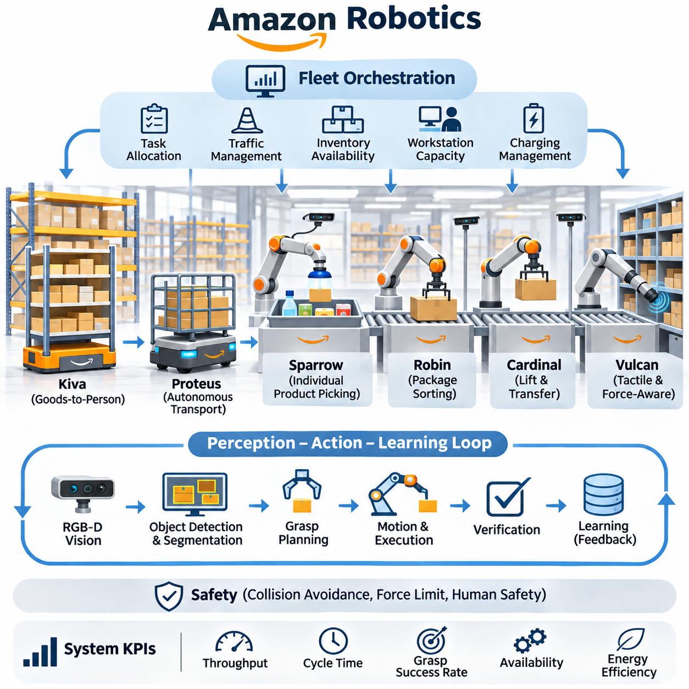
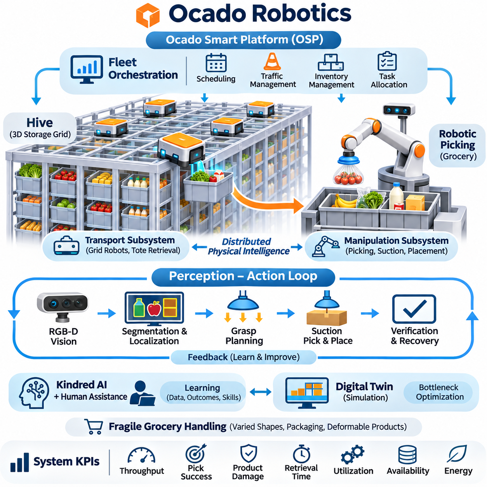
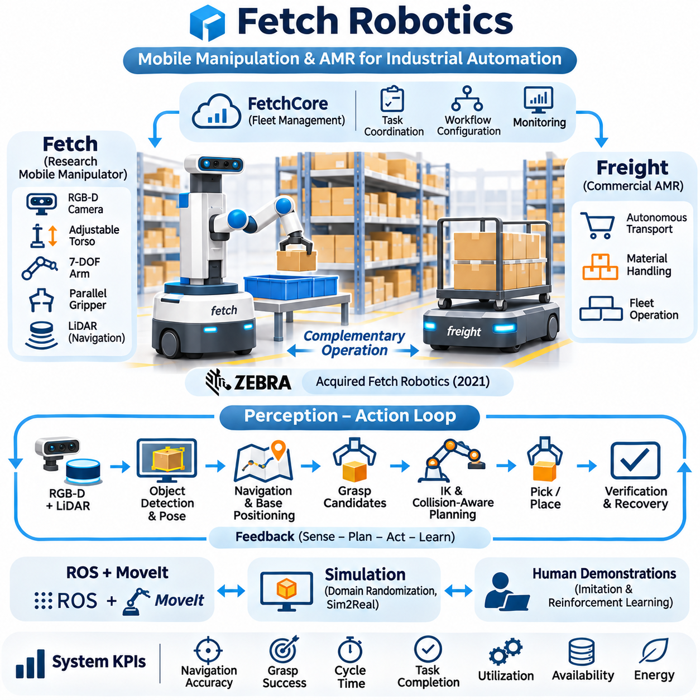
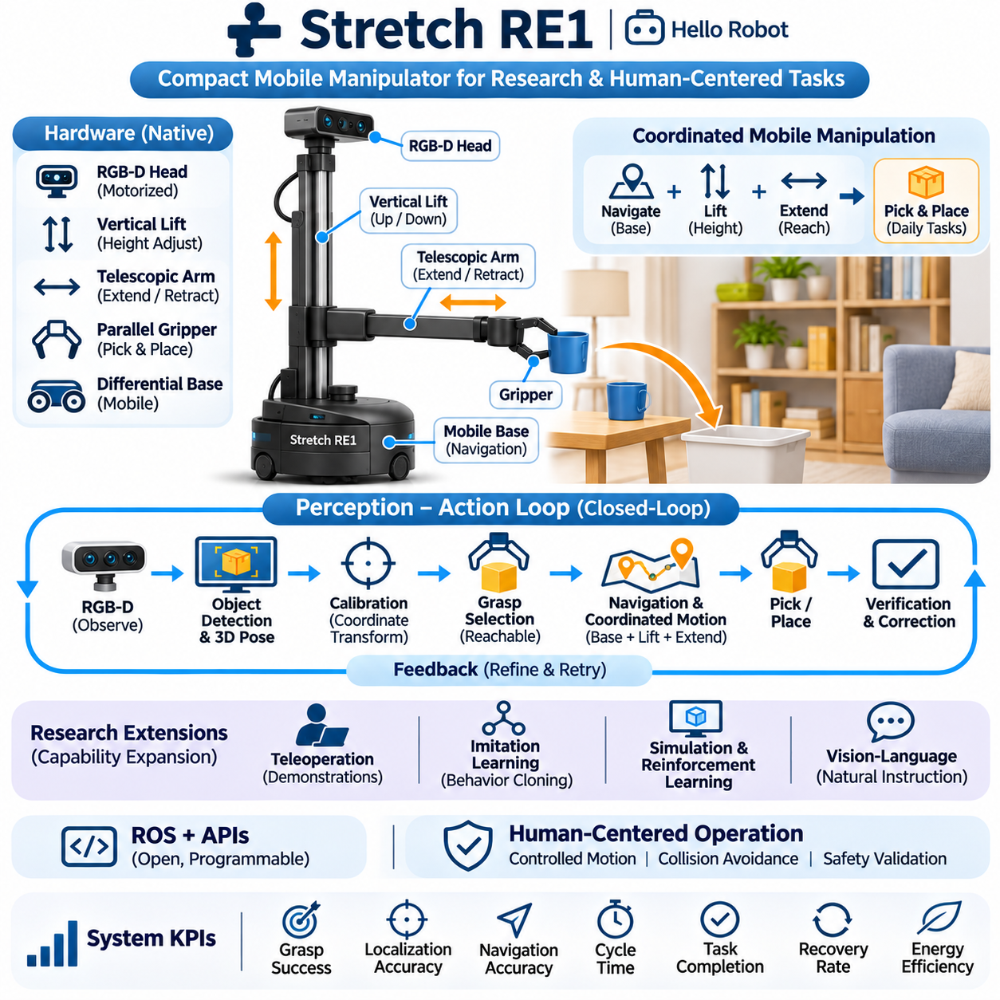
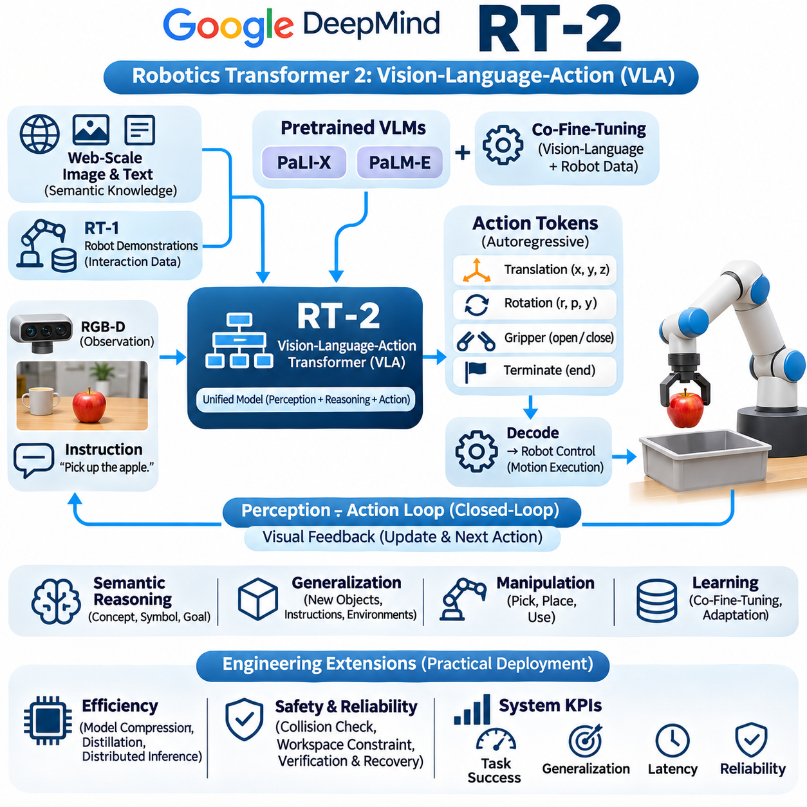
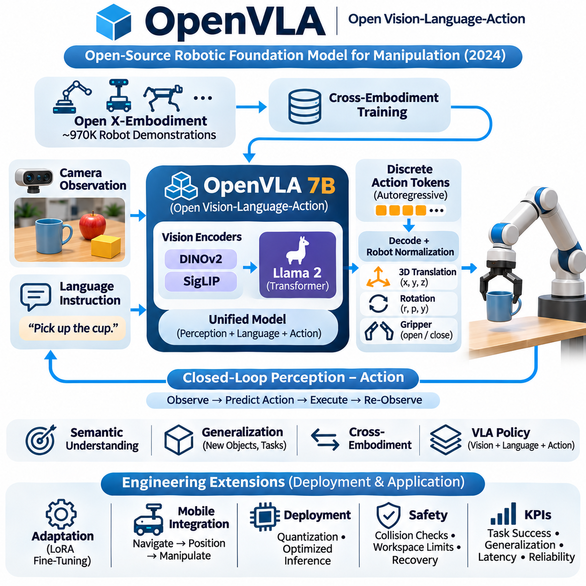
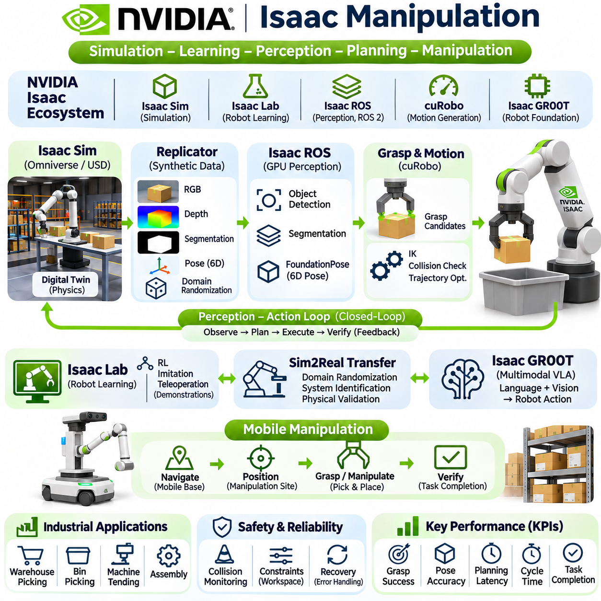

**Volume 03. Vision Manipulation and AI**

# Chapter 15. Case Studies

## 01 Amazon Robotics

{width="7.268055555555556in" height="7.268055555555556in"}

Amazon Robotics represents one of the most significant examples of integrating artificial intelligence, robotic manipulation, computer vision, and autonomous mobility into large-scale logistics automation. Its robotic ecosystem demonstrates how perception, grasp planning, motion control, and intelligent decision-making can be combined to automate complex warehouse operations while improving productivity, operational consistency, scalability, and resource utilization.

The technological foundation of Amazon Robotics originated from Kiva Systems, which Amazon acquired in 2012. The original robotic architecture focused on transporting mobile storage shelves to human-operated picking stations. This goods-to-person approach significantly reduced unnecessary worker movement and established a scalable infrastructure for integrating autonomous mobile robots, intelligent inventory management, and automated manipulation systems.

Amazon Robotics subsequently expanded beyond autonomous transportation toward intelligent robotic manipulation. While mobile robots primarily transport inventory and containers, robotic manipulators perform object identification, grasping, sorting, and placement. The combination of these capabilities establishes a distributed automation architecture in which mobility and manipulation cooperate to execute complex fulfillment operations.

Visual perception is a fundamental component of Amazon\'s robotic manipulation systems. Cameras and depth-sensing technologies provide information about object geometry, spatial distribution, surface characteristics, and environmental conditions. Perception algorithms transform raw sensory observations into structured representations that support object detection, instance segmentation, grasp identification, and collision-aware manipulation planning.

Object recognition in fulfillment environments presents considerable technical challenges because products vary significantly in geometry, dimensions, packaging materials, texture, and weight. Deep learning techniques enable robotic systems to recognize and manipulate diverse inventory without requiring individually programmed trajectories for every product. Generalization across unfamiliar objects is particularly important for maintaining operational flexibility.

Grasp detection and grasp planning connect visual perception with physical manipulation. Robotic systems can evaluate potential contact locations, accessible surfaces, approach directions, and geometric constraints before selecting appropriate grasp configurations. Candidate grasps may be ranked according to estimated success probability, mechanical feasibility, collision risk, object stability, and compatibility with the available end effector.

Amazon\'s Sparrow robotic system illustrates the application of computer vision and artificial intelligence to individual product handling. Unlike conventional robots designed primarily for standardized packages, Sparrow was developed to identify, select, and manipulate a diverse range of inventory items. Its suction-based handling mechanism demonstrates the importance of coordinating perception, grasp selection, and task-specific end-effector design.

Other robotic manipulation systems, including Robin and Cardinal, address different stages of package handling and sorting. Robin performs robotic package handling within sorting operations, while Cardinal combines artificial intelligence and computer vision to identify, lift, and transfer packages. These systems illustrate how specialized robotic architectures can be optimized for distinct operational requirements within a shared logistics ecosystem.

Autonomous mobility provides another essential dimension of the Amazon Robotics architecture. Proteus, introduced as Amazon\'s first fully autonomous mobile robot, was designed to navigate operational environments and transport carts. Although Proteus is not itself an articulated mobile manipulator, its integration with robotic handling systems illustrates how autonomous transportation and stationary manipulation can collectively support flexible material flow.

Amazon\'s Vulcan robotic system further illustrates the importance of tactile and force-aware manipulation in warehouse automation. Handling products inside densely populated storage compartments requires more than visual recognition alone. Physical interaction feedback helps robots manage contact, adjust applied forces, and perform manipulation tasks where surrounding objects introduce geometric uncertainty and restricted accessibility.

Intelligent manipulation requires continuous coordination between perception, planning, execution, and feedback. A representative picking cycle begins with scene observation and object localization, followed by grasp candidate generation, approach planning, and physical execution. Subsequent observations verify task completion and provide information for corrective actions when grasp failure, object displacement, or unexpected environmental conditions occur.

Machine learning supports the improvement of robotic manipulation through systematic analysis of operational experience. Successful grasps, unsuccessful attempts, sensor observations, and execution outcomes can provide valuable training data. An appropriately designed learning infrastructure allows engineers to refine perception models, improve grasp selection strategies, and evaluate robotic performance under increasingly diverse operating conditions.

Fleet-level coordination is equally important because individual robot performance alone does not determine overall warehouse productivity. Task allocation, traffic management, inventory availability, workstation capacity, and charging requirements must be coordinated across the robotic ecosystem. Effective orchestration minimizes congestion, reduces idle time, and balances workloads between transportation systems and robotic manipulation stations.

Safety and reliability remain fundamental requirements for large-scale deployment. Robotic systems must incorporate appropriate protective mechanisms, collision prevention, operational monitoring, controlled stopping, and exception handling. AI-based perception and manipulation intelligence should operate within independently validated safety constraints rather than replacing deterministic protective functions required for dependable industrial operation.

Performance evaluation extends beyond individual grasp success rates to include picking throughput, cycle time, object coverage, intervention frequency, system availability, energy consumption, and operational cost. Amazon Robotics demonstrates the importance of evaluating automation at the system level, where improvements in perception or manipulation must ultimately contribute to measurable gains in overall fulfillment performance.

The Amazon Robotics ecosystem provides valuable architectural lessons for future mobile manipulator development. Modular perception pipelines, adaptive grasping, specialized end effectors, autonomous navigation, and centralized mission orchestration can establish a scalable foundation for Physical AI. The central engineering principle is that intelligence emerges from the coordinated integration of sensing, reasoning, physical execution, and operational feedback.

## 02 Ocado Robotics

{width="7.268055555555556in" height="7.268055555555556in"}

Ocado Robotics represents an advanced example of integrating robotic manipulation, computer vision, artificial intelligence, and autonomous transportation into large-scale automated grocery fulfillment. The Ocado Smart Platform (OSP) demonstrates how intelligent robotic systems can coordinate inventory storage, product retrieval, order preparation, and material transportation within a highly interconnected and data-driven logistics environment.

The fundamental architecture of Ocado\'s automated fulfillment system is based on a three-dimensional storage grid commonly referred to as the Hive. Inventory containers are stored vertically beneath a horizontal transportation grid, while autonomous robots travel across the upper surface to retrieve and relocate containers. This architecture achieves high storage density while supporting parallel transportation and dynamic inventory accessibility.

The grid-based robots operate as a coordinated robotic fleet rather than as independent transportation units. Centralized control systems continuously manage robot movements, task assignments, container accessibility, and transportation priorities. Intelligent scheduling enables numerous robots to operate simultaneously within a shared infrastructure while reducing congestion, preventing conflicts, and maintaining continuous material flow.

Although Ocado\'s grid-based transportation robots differ mechanically from conventional autonomous mobile robots and articulated mobile manipulators, their operational architecture provides valuable engineering insights. The separation of transportation and manipulation enables specialized robotic subsystems to perform specific functions efficiently while contributing to a unified fulfillment process through coordinated task execution.

Robotic picking represents an essential component of Ocado\'s automation strategy. Grocery products exhibit considerable variations in geometry, material properties, packaging structures, fragility, and weight distribution. Intelligent robotic manipulation must accommodate these variations while minimizing product damage, maintaining hygienic handling conditions, and satisfying operational requirements for high-throughput order fulfillment.

Computer vision enables robotic picking systems to interpret the spatial arrangement of products inside inventory containers. Visual perception algorithms can identify individual objects, estimate accessible surfaces, detect occlusions, and distinguish target products from surrounding items. Depth information provides additional geometric understanding for determining suitable grasp locations and generating collision-aware approach trajectories.

Instance segmentation and object localization are particularly relevant to grocery manipulation because products frequently overlap or occupy irregular positions inside containers. Learning-based perception models can generate object-specific representations that support the identification of graspable regions. Robust perception must also accommodate transparent packaging, reflective surfaces, deformable materials, and changing illumination conditions.

Grasp detection and grasp planning provide the connection between visual perception and physical product handling. Potential grasp configurations can be evaluated according to surface accessibility, object geometry, expected stability, collision risk, and end-effector compatibility. For grocery applications, grasp selection must additionally consider product fragility, packaging deformation, and the possibility of unintended contact with adjacent products.

Suction-based end effectors are particularly useful for many grocery picking applications because they can accommodate diverse product shapes without requiring individually customized mechanical fingers. However, porous surfaces, irregular packaging, and deformable products may reduce suction reliability. Intelligent manipulation therefore requires appropriate grasp selection, contact verification, and adaptive recovery strategies when acquisition attempts fail.

Ocado\'s acquisition of Kindred Systems expanded its capabilities in artificial intelligence and robotic manipulation. Kindred developed intelligent robotic systems for commercial picking and sorting applications, combining machine learning with physical manipulation and human-assisted operation. These technologies illustrate how operational experience and human intervention can contribute to the progressive improvement of autonomous robotic capabilities.

Learning-based manipulation enables robotic picking systems to improve their ability to handle diverse and previously unfamiliar products. Training datasets may incorporate visual observations, grasp configurations, execution outcomes, failure conditions, and corrective actions. Carefully validated learning pipelines can improve grasp prediction, object recognition, and manipulation robustness without requiring explicit programming for every individual product.

The perception-action loop is fundamental to reliable grocery manipulation. A representative robotic picking operation begins with scene observation, target selection, and grasp estimation, followed by approach planning, object acquisition, transportation, and placement. Visual observations and available sensor feedback can then verify successful execution and initiate corrective actions when unexpected conditions or manipulation failures are detected.

Digital twins and simulation provide important engineering capabilities for evaluating large-scale robotic fulfillment architectures. Virtual environments can represent transportation grids, robot movements, inventory distribution, workstation availability, and operational constraints. Simulation-based evaluation enables engineers to investigate scheduling strategies, identify system bottlenecks, and assess the effects of changing operational conditions before physical deployment.

Performance evaluation must consider the entire fulfillment ecosystem rather than focusing exclusively on individual robot capabilities. Important indicators include picking success rate, order fulfillment throughput, product damage rate, container retrieval time, robot utilization, intervention frequency, system availability, and energy consumption. Improvements in individual robotic functions must contribute to measurable system-level operational benefits.

Ocado Robotics provides valuable architectural lessons for mobile manipulator development and Physical AI. Its coordinated transportation infrastructure, intelligent picking technologies, learning-based perception, and centralized orchestration demonstrate the benefits of distributed physical intelligence. The case study also highlights the importance of modular integration, operational feedback, adaptive manipulation, and scalable coordination across heterogeneous robotic systems.

The architectural principles discussed here follow the supplied Chapter 15 structure and connect the Ocado case study with the preceding topics of visual perception, grasp planning, robotic learning, and Embodied AI. Since the supplied material defines the chapter organization rather than proprietary implementation details, the technical pipelines described above represent general engineering interpretations rather than verified specifications of Ocado\'s internal systems.

## 03 Fetch Robotics

{width="7.268055555555556in" height="7.268055555555556in"}

Fetch Robotics provides an important example of integrating autonomous mobility, robotic manipulation, computer vision, and intelligent task execution into practical robotics systems. Its development illustrates the transition from research-oriented mobile manipulators to commercially deployed autonomous mobile robots, demonstrating how robotic perception, physical interaction, and operational coordination can support industrial automation.

Founded in 2014, Fetch Robotics developed robotic platforms for research, logistics, warehousing, and material handling applications. The company introduced two notable robotic platforms, Fetch and Freight, which represented complementary approaches to autonomous manipulation and transportation. Fetch combined a mobile base with an articulated robotic arm, while Freight focused primarily on autonomous material transportation.

The Fetch mobile manipulator incorporates a wheeled mobile base, a seven-degree-of-freedom robotic arm, a vertically adjustable torso, a parallel gripper, and an RGB-D perception system. This configuration enables the robot to navigate indoor environments, adjust its manipulation workspace, recognize surrounding objects, and perform physical tasks that require coordination between autonomous mobility and articulated manipulation.

Visual perception plays a fundamental role in the Fetch mobile manipulator architecture. RGB-D cameras provide color images and depth measurements that support three-dimensional environmental understanding. Combined with laser-based navigation sensors and robot state information, these observations enable object localization, obstacle detection, spatial reasoning, and the construction of representations required for manipulation planning.

Object detection and pose estimation establish the relationship between visual observations and physical manipulation targets. Detected objects must be represented within appropriate coordinate systems before the robotic arm can interact with them. Camera calibration, coordinate transformations, and accurate robot kinematic models are therefore essential for converting perception results into executable manipulation objectives.

Grasp detection enables the Fetch platform to identify potential object acquisition configurations from visual and geometric information. Candidate grasps can be generated using depth images, point clouds, analytical geometric methods, or deep learning models. Each candidate must be evaluated according to gripper compatibility, object stability, approach accessibility, collision risk, and the kinematic limitations of the robotic arm.

Grasp planning extends beyond identifying suitable contact locations by determining whether the robot can physically execute the selected grasp. Inverse kinematics, collision checking, trajectory generation, and workspace evaluation provide essential constraints for manipulation execution. When a target is outside the reachable workspace, the mobile base or adjustable torso can be repositioned to improve manipulation feasibility.

The integration of autonomous navigation and manipulation introduces additional challenges compared with stationary robotic systems. Navigation errors, base positioning uncertainty, environmental changes, and inaccurate object observations may affect the success of subsequent manipulation tasks. Closed-loop perception and local target refinement can compensate for these uncertainties before the robotic arm executes physical interactions.

The Robot Operating System (ROS) provides an important software foundation for the Fetch research platform. Its modular framework supports communication between perception components, navigation systems, manipulation controllers, and task execution modules. Integration with tools such as MoveIt enables researchers to investigate motion planning, collision avoidance, inverse kinematics, and coordinated mobile manipulation strategies.

Fetch has served as a research platform for learning from demonstration, imitation learning, reinforcement learning, and autonomous skill acquisition. Researchers can investigate how robots acquire manipulation capabilities through human demonstrations, simulated interactions, and physical experience. These approaches reduce dependence on explicitly programmed behaviors and support the development of adaptable robotic manipulation skills.

The perception-action loop provides a fundamental framework for autonomous task execution on mobile manipulation platforms. A representative operation begins with environmental observation, target identification, and navigation toward a suitable manipulation position. The robot subsequently generates grasp candidates, plans its motion, executes physical interaction, and evaluates the outcome through available sensory feedback.

Simulation environments allow mobile manipulation algorithms to be developed and evaluated before deployment on physical Fetch robots. Simulated experiments can reproduce object arrangements, navigation environments, robotic arm configurations, and manipulation tasks under controlled conditions. Domain randomization and simulation-to-reality transfer can help reduce discrepancies between virtual training environments and physical execution.

Fetch Robotics also expanded its commercial activities through autonomous mobile robots designed for warehouse transportation and material handling. Its cloud-based fleet management platform, FetchCore, supported task coordination, workflow configuration, robot monitoring, and integration with operational systems. Zebra Technologies acquired Fetch Robotics in 2021, linking its robotic capabilities with broader enterprise automation solutions.

The distinction between the Fetch research manipulator and commercial transportation robots is important when evaluating the company\'s technological contributions. The research platform supports embodied intelligence and integrated mobile manipulation, whereas commercial autonomous mobile robots primarily address scalable logistics workflows. Together, these approaches illustrate complementary pathways toward intelligent industrial automation.

Performance evaluation of mobile manipulators should consider navigation accuracy, object detection reliability, grasp success rate, manipulation cycle time, task completion rate, and recovery capability. Additional operational indicators include robot utilization, intervention frequency, system availability, and energy consumption. Successful deployment requires balancing individual robotic capabilities with overall operational efficiency.

Fetch Robotics provides valuable architectural lessons for the development of modern mobile manipulators and Physical AI systems. Its platforms illustrate the importance of modular perception, coordinated mobility, adaptive manipulation, learning-based skills, and scalable operational integration. The technical workflows described here represent general engineering interpretations aligned with the supplied chapter structure rather than verified proprietary implementation specifications.

## 04 Stretch RE1

{width="7.268055555555556in" height="7.268055555555556in"}

Stretch RE1, developed by Hello Robot, represents an important example of a compact mobile manipulator designed for research, human-centered environments, and practical robotic assistance. Unlike conventional industrial manipulators that operate within fixed workstations, Stretch integrates autonomous mobility, visual perception, and physical manipulation into a lightweight robotic platform capable of interacting with everyday environments.

The mechanical architecture of Stretch RE1 combines a differential-drive mobile base, a vertical lifting mechanism, a horizontally extendable telescopic arm, a wrist assembly, and a robotic gripper. This configuration reduces mechanical complexity while providing an effective manipulation workspace. Coordinated movement of the mobile base, vertical lift, and telescopic arm enables the robot to access objects at different heights and distances.

A distinctive characteristic of Stretch RE1 is its minimalist approach to mobile manipulation. Instead of relying on a conventional multi-joint articulated robotic arm, the platform distributes manipulation capabilities across several mechanical subsystems. This design reduces hardware complexity, system weight, and manufacturing cost while maintaining sufficient functional flexibility for numerous indoor manipulation and assistance tasks.

Visual perception provides the foundation for autonomous environmental interaction. Stretch RE1 incorporates an RGB-D camera mounted on a motorized head, enabling the robot to observe surrounding objects and estimate their spatial relationships. Color images and depth measurements support object detection, scene understanding, surface identification, and three-dimensional localization required for intelligent manipulation.

Object detection and pose estimation are essential for transforming visual observations into actionable manipulation targets. Deep learning models can identify objects of interest, while depth information supports the estimation of their three-dimensional positions. Camera calibration and coordinate transformations establish the geometric relationship between the perception system, mobile base, robotic arm, and physical target objects.

Grasp detection enables Stretch RE1 to identify suitable object acquisition configurations from visual and geometric observations. Potential grasp locations can be evaluated according to object shape, surface accessibility, gripper compatibility, and surrounding obstacles. The relatively constrained mechanical architecture requires grasp selection algorithms to consider the directional accessibility and reachable workspace of the telescopic arm.

Mobile manipulation planning must coordinate autonomous navigation with the movement of the lifting mechanism and telescopic arm. When an object lies outside the immediate manipulation workspace, the robot can reposition its mobile base to improve accessibility. This coordinated approach expands the effective workspace without requiring a mechanically complex robotic arm with numerous independently controlled rotational joints.

Closed-loop visual feedback is particularly important because mobile base positioning errors and environmental uncertainties can affect manipulation accuracy. Continuous or repeated sensory observations allow the robot to refine target positions and adjust its approach before physical contact. Such perception-driven corrections improve operational robustness compared with manipulation strategies that depend exclusively on predetermined coordinates.

Stretch RE1 provides a practical platform for investigating pick-and-place operations in domestic and human-centered environments. Representative tasks include retrieving objects from tables, placing items into containers, transporting household products, and interacting with accessible furniture. Successful execution requires coordinated perception, navigation, grasp planning, physical interaction, and verification of task completion.

Learning from demonstration provides an important research direction for Stretch-based manipulation. Human operators can demonstrate desired behaviors through teleoperation, generating datasets that associate sensory observations with robotic actions. These demonstrations can support behavior cloning and imitation learning, enabling the development of manipulation policies without explicitly programming every operational sequence.

Reinforcement learning can also be investigated using Stretch as a physical embodiment for autonomous skill acquisition. Learning agents may optimize manipulation strategies through interactions involving object acquisition, placement accuracy, motion efficiency, and task completion. Simulation-based training and carefully constrained physical experimentation can reduce hardware risks while supporting iterative policy improvement.

Vision-language models provide additional opportunities for extending the semantic capabilities of mobile manipulation platforms. A Stretch-based research system could interpret natural language instructions, identify relevant objects, and translate high-level objectives into executable manipulation sequences. These capabilities require integration with geometric perception, motion planning, and physical execution rather than language reasoning alone.

The open software ecosystem is another important characteristic of Stretch RE1. Its programming interfaces and Robot Operating System integration support the development of customized perception, navigation, manipulation, and task execution applications. Researchers can integrate alternative machine learning models, develop experimental control strategies, and investigate different approaches to autonomous robotic behavior.

Human-centered operation introduces important requirements for safety, reliability, and interaction quality. Mobile manipulators operating near people must account for unexpected movement, restricted spaces, accidental contact, and uncertain object configurations. Lightweight construction, controlled motion, collision avoidance, and appropriate protective mechanisms contribute to safer interaction but do not eliminate the need for systematic safety validation.

Performance evaluation should consider grasp success rate, object localization accuracy, navigation reliability, manipulation cycle time, task completion rate, and recovery capability. For human-centered applications, additional indicators include intervention frequency, interaction safety, operational accessibility, energy efficiency, and ease of deployment. These metrics connect individual robotic capabilities with practical usefulness.

Stretch RE1 provides valuable architectural lessons for developing accessible mobile manipulators and Embodied AI systems. Its simplified mechanics, modular perception, coordinated mobility, and programmable interfaces demonstrate how physical intelligence can emerge from system integration rather than mechanical complexity alone. The AI workflows discussed here are engineering extensions of the supplied chapter structure, not verified native capabilities or proprietary implementation specifications.

## 05 Google RT2

{width="7.268055555555556in" height="7.268055555555556in"}

Google RT-2 (Robotics Transformer 2) represents a significant advancement in the development of Vision-Language-Action (VLA) models for intelligent robotic manipulation. Introduced by Google DeepMind in 2023, RT-2 demonstrates how knowledge acquired through large-scale vision-language pretraining can be transferred to physical robotic systems, enabling robots to interpret semantic instructions and generate executable actions.

Traditional robotic manipulation architectures typically separate visual perception, object recognition, task planning, grasp planning, and motion control into independently developed modules. RT-2 introduces a more unified learning-based approach in which visual observations and natural language instructions are processed within a shared model architecture to generate robot actions directly, reducing dependence on manually engineered intermediate representations.

The technological foundation of RT-2 builds upon RT-1, an earlier Robotics Transformer designed to learn robotic control policies from large-scale real-world manipulation demonstrations. While RT-1 primarily learns from robot interaction data, RT-2 extends this approach by incorporating pretrained vision-language models. This integration enables robotic policies to benefit from broader semantic knowledge acquired beyond physical robot experience.

RT-2 utilizes pretrained Vision-Language Models (VLMs), including PaLI-X and PaLM-E, as architectural foundations for robotic action generation. These models acquire visual and linguistic relationships through large-scale training involving images and textual descriptions. Subsequent co-fine-tuning with robotic manipulation data enables the models to associate semantic representations with physically executable robotic behaviors.

A distinctive architectural characteristic of RT-2 is the representation of robotic actions as tokens. Continuous control variables are discretized and encoded into token sequences that can be generated using the same autoregressive mechanisms employed by language models. These action tokens represent physical control parameters associated with end-effector translation, orientation, gripper operation, and episode termination.

Action tokenization establishes a unified representation between linguistic intelligence and physical execution. Instead of developing an entirely separate prediction architecture for robotic control, RT-2 adapts the language-model output mechanism to generate robot actions. These predicted tokens are subsequently decoded into control commands that can be executed by the robotic platform through its underlying motion control infrastructure.

Visual perception within RT-2 extends beyond conventional object detection and geometric localization. The pretrained vision-language architecture provides semantic understanding of objects, attributes, relationships, and contextual information. This capability enables the robot to interpret instructions involving object categories, relative properties, symbolic concepts, and semantic associations that may not have been explicitly represented in robot training demonstrations.

Generalization is one of the principal research contributions of RT-2. Conventional robotic policies frequently experience performance degradation when encountering unfamiliar objects, instructions, or environmental configurations. By transferring knowledge from large-scale vision-language training, RT-2 demonstrates improved capabilities for interpreting novel manipulation instructions and interacting with objects beyond its original robotic training distribution.

Semantic reasoning enables RT-2 to address manipulation tasks that involve more than direct object identification. For example, a robot may be instructed to select an object associated with a particular concept, recognize a numerical symbol, or identify an item suitable for a specified purpose. Such behaviors illustrate how pretrained semantic knowledge can influence physical action selection, although they do not guarantee unrestricted reasoning or reliable task execution.

The perception-action loop remains essential to RT-2-based robotic manipulation. Visual observations and natural language instructions are processed to generate action tokens, which are decoded and executed by the robot. Subsequent visual observations provide updated environmental information for generating further actions. This iterative process enables closed-loop control and adaptation during manipulation rather than relying entirely on fixed, predetermined trajectories.

Training RT-2 combines vision-language learning with robotic demonstration data through a co-fine-tuning strategy. Web-scale visual and linguistic datasets contribute semantic knowledge, while robot interaction datasets establish relationships between observations, instructions, and executable actions. Maintaining both training objectives helps preserve general semantic capabilities while adapting the model to the physical requirements of robotic control.

The RT-2 architecture introduces practical challenges involving computational resources, inference latency, and deployment scalability. Large transformer models require substantial memory and processing capacity, making direct deployment on resource-constrained edge computing platforms difficult. Model compression, knowledge distillation, and distributed inference represent potential engineering approaches for adapting similar VLA architectures to operational robotic systems.

Safety and reliability remain critical limitations of end-to-end robotic foundation models. Semantic understanding does not necessarily ensure geometric feasibility, collision avoidance, mechanical stability, or safe physical interaction. Industrial implementations based on RT-2 principles would therefore benefit from independently validated safety mechanisms, workspace constraints, motion verification, uncertainty monitoring, and structured error recovery.

Performance evaluation of RT-2 and related VLA models should consider task completion rate, generalization to unfamiliar objects, instruction comprehension, action prediction accuracy, inference latency, and physical execution reliability. Additional evaluation dimensions include manipulation robustness, recovery capability, and sensitivity to environmental changes. These metrics connect semantic intelligence with measurable physical performance.

RT-2 provides an important architectural foundation for future mobile manipulators and Embodied AI systems by connecting pretrained semantic intelligence with physical action generation. Its research demonstrates that knowledge acquired outside robotic environments can contribute to manipulation capabilities. The deployment and safety strategies discussed here are broader engineering interpretations, rather than verified native capabilities of the original RT-2 system.

## 06 OpenVLA

{width="7.268055555555556in" height="7.268055555555556in"}

OpenVLA (Open Vision-Language-Action) represents an important advancement in the development of open-source robotic foundation models for intelligent physical interaction. Introduced in 2024, OpenVLA integrates visual observations, natural language instructions, and robotic action generation within a unified learning architecture. Its open model ecosystem provides opportunities for reproducible research, customization, and robot-specific adaptation.

The fundamental objective of OpenVLA is to transfer the semantic understanding of pretrained vision-language models into executable robotic behaviors. Conventional robotic systems frequently rely on independently developed perception, planning, and control modules. OpenVLA provides an alternative approach in which a unified neural network directly predicts robotic actions from visual observations and task descriptions.

The original OpenVLA architecture is based on a seven-billion-parameter model that integrates pretrained visual encoders with a Llama 2 language model. Its visual representation combines DINOv2 and SigLIP features, providing complementary geometric and semantic information. These visual features are projected into the language model\'s representation space, enabling joint processing of environmental observations and linguistic instructions.

The combination of DINOv2 and SigLIP provides an important architectural advantage for robotic manipulation. DINOv2 contributes detailed visual representations that support spatial and structural understanding, while SigLIP contributes semantic relationships between images and language. Together, these representations help the model associate object characteristics and environmental context with natural language manipulation objectives.

OpenVLA represents robotic actions through discrete action tokens rather than directly predicting continuous control variables through a separate regression network. Continuous action dimensions are quantized into discrete bins and associated with tokens in the language model vocabulary. This representation enables autoregressive action prediction using the underlying transformer architecture and preserves compatibility with language-model training methods.

The standard action representation includes three-dimensional end-effector translation, rotational movement, and gripper control. Predicted action tokens are decoded and converted into numerical commands using robot-specific normalization statistics. Appropriate coordinate transformations and low-level control interfaces remain necessary to translate these predictions into physically meaningful and mechanically executable robotic movements.

A major contribution of OpenVLA is its use of approximately 970,000 real-world robotic demonstration episodes derived from the Open X-Embodiment dataset collection. These demonstrations encompass diverse robotic platforms, object configurations, environments, and manipulation tasks. Large-scale multi-robot training provides a foundation for learning transferable manipulation behaviors beyond individual hardware configurations.

Cross-embodiment learning is particularly important because robotic platforms differ in mechanical structure, workspace geometry, sensor configuration, and action representation. OpenVLA demonstrates the potential benefits of training robotic policies using heterogeneous demonstrations. Nevertheless, adapting the model to a new robotic embodiment generally requires compatible action representations, calibrated observations, and additional robot-specific training.

Natural language conditioning enables OpenVLA to associate manipulation objectives with visual information from the surrounding environment. A robot can receive instructions involving object selection, spatial relationships, and placement objectives. The model processes these instructions together with visual observations to predict context-dependent actions, reducing the need to explicitly define every individual manipulation sequence.

The perception-action loop establishes the operational foundation for OpenVLA-based manipulation. During execution, camera observations and natural language instructions are processed to generate robotic action predictions. After each action is executed, updated visual observations are acquired and processed again. This iterative interaction supports closed-loop manipulation and adaptation to changes in object positions and environmental conditions.

Parameter-efficient fine-tuning provides an important mechanism for adapting OpenVLA to specialized robotic applications. Techniques such as Low-Rank Adaptation (LoRA) enable selected model parameters to be adapted without retraining the entire foundation model. This approach reduces computational requirements and allows developers to incorporate application-specific demonstrations, manipulation strategies, and environmental characteristics.

Integrating OpenVLA into mobile manipulators requires coordination between learned manipulation policies and conventional autonomous navigation systems. A mobile base can transport the robot toward an appropriate manipulation position, while OpenVLA generates actions for physical object interaction. Additional mission orchestration, localization, workspace evaluation, and motion verification are necessary to establish dependable system-level behavior.

Computational efficiency remains an important consideration for practical OpenVLA deployment. Autoregressive action generation introduces inference latency, while large model parameters require substantial memory and processing resources. Model quantization, optimized inference engines, and distributed computing architectures provide potential approaches for improving deployment efficiency on edge or on-premises computing platforms.

Safety and reliability represent fundamental challenges for learning-based robotic control. OpenVLA action predictions do not inherently guarantee collision-free trajectories, mechanical feasibility, or safe human interaction. Independent safety mechanisms, joint constraints, workspace monitoring, action validation, and error recovery should therefore complement learned policies when developing dependable industrial mobile manipulation systems.

Performance evaluation should consider manipulation success rate, instruction comprehension, generalization to unfamiliar objects, action prediction accuracy, inference latency, and physical execution reliability. OpenVLA provides an open foundation for reproducible experimentation and the development of Embodied AI and Physical AI systems. The mobile integration and industrial deployment strategies described here are engineering extensions aligned with the supplied chapter structure, rather than verified native capabilities of the original model.

## 07 NVIDIA Isaac Manipulation

{width="7.268055555555556in" height="7.268055555555556in"}

NVIDIA Isaac Manipulation represents an integrated technological approach to developing intelligent robotic manipulation systems through accelerated computing, physics-based simulation, visual perception, and artificial intelligence. Rather than focusing on a single robotic platform, the NVIDIA Isaac ecosystem provides development tools and computational infrastructure for designing, training, validating, and deploying autonomous manipulation capabilities.

The NVIDIA Isaac ecosystem incorporates several complementary technologies, including Isaac Sim, Isaac Lab, Isaac ROS, and GPU-accelerated motion generation libraries. These components establish a development environment connecting virtual experimentation with physical robotic execution. Developers can integrate perception algorithms, manipulation policies, motion planning, and robot control within a coordinated engineering workflow.

NVIDIA Isaac Sim provides a physics-based simulation environment built upon NVIDIA Omniverse technologies. Robotic manipulators, mobile platforms, sensors, objects, and industrial environments can be represented using Universal Scene Description (USD). Physically based rendering and rigid-body dynamics enable developers to investigate robotic manipulation under simulated visual, mechanical, and environmental conditions.

Synthetic data generation represents an important capability of Isaac Sim for manipulation AI development. Virtual cameras can generate RGB images, depth maps, segmentation masks, bounding boxes, and object pose annotations. NVIDIA Replicator supports automated dataset generation and domain randomization, reducing dependence on manually annotated physical datasets while improving the diversity of training environments.

Visual perception pipelines within the Isaac ecosystem can incorporate GPU-accelerated object detection, instance segmentation, depth processing, and three-dimensional reconstruction. NVIDIA Isaac ROS provides accelerated software packages for integrating perception capabilities into ROS 2 environments. These technologies support the transformation of sensory observations into spatial information required for robotic manipulation.

Six-dimensional object pose estimation establishes an essential connection between visual perception and physical object interaction. Technologies such as NVIDIA FoundationPose support object pose estimation and tracking using visual observations and object representations. Accurate estimation of object position and orientation enables robotic systems to generate geometrically appropriate grasping and manipulation targets.

Grasp detection and grasp planning can be integrated with simulated object geometry, depth measurements, and learned grasp prediction models. Candidate grasps may be evaluated according to gripper compatibility, contact stability, accessibility, and collision constraints. Physics-based simulation enables developers to investigate grasping strategies across diverse object shapes, material properties, and environmental configurations.

GPU-accelerated motion generation represents another important component of the NVIDIA manipulation ecosystem. Libraries such as cuRobo support parallelized inverse kinematics, collision checking, trajectory optimization, and motion generation. These capabilities enable robotic systems to evaluate multiple candidate movements efficiently while considering robot geometry, workspace obstacles, and target pose constraints.

NVIDIA Isaac Lab provides a robot learning framework supporting reinforcement learning, imitation learning, and large-scale parallel simulation. Multiple virtual robotic environments can be executed concurrently using GPU acceleration, enabling the collection of extensive interaction experiences. This approach supports the development of manipulation policies for reaching, grasping, lifting, placement, and contact-rich tasks.

Learning from demonstration can complement reinforcement learning within the Isaac ecosystem. Human operators may generate robotic demonstrations through teleoperation in simulated or physical environments. Recorded observations, robot states, and action sequences can subsequently support behavior cloning and imitation learning, allowing manipulation policies to acquire complex skills without manually programming every movement.

Simulation-to-real transfer remains a fundamental requirement for deploying learned manipulation policies on physical robotic platforms. Differences between simulated and actual environments may involve friction, contact dynamics, sensor noise, actuator behavior, and object properties. Domain randomization, system identification, and physical validation help reduce these discrepancies and improve policy robustness.

Robot foundation models provide additional opportunities for extending manipulation intelligence within the NVIDIA ecosystem. Models such as NVIDIA Isaac GR00T investigate the integration of multimodal perception, language understanding, and physical action generation. Such models can complement conventional perception and motion planning by supporting adaptable robotic behaviors across diverse manipulation objectives.

Mobile manipulation introduces additional requirements involving autonomous navigation, base positioning, manipulator reachability, and coordinated task execution. Isaac-based development environments can support simulations in which a mobile robot approaches an object, establishes an appropriate manipulation configuration, performs a grasping operation, and verifies task completion through sensory feedback.

Industrial applications of Isaac-based manipulation may include warehouse picking, random bin picking, machine tending, component assembly, material handling, and product sorting. Digital twins enable developers to investigate operational scenarios before physical deployment. Independent safety mechanisms, motion constraints, collision monitoring, and error recovery remain necessary for dependable industrial operation.

Performance evaluation should consider grasp success rate, pose estimation accuracy, motion planning latency, manipulation cycle time, simulation-to-real transfer efficiency, and task completion reliability. NVIDIA Isaac illustrates how simulation, accelerated computing, perception, and robot learning can establish an integrated foundation for Physical AI. The workflows described here extend the supplied chapter outline using general engineering knowledge rather than independently verified deployment specifications.
