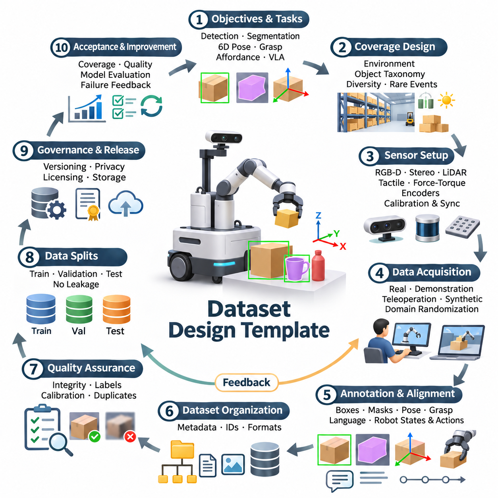
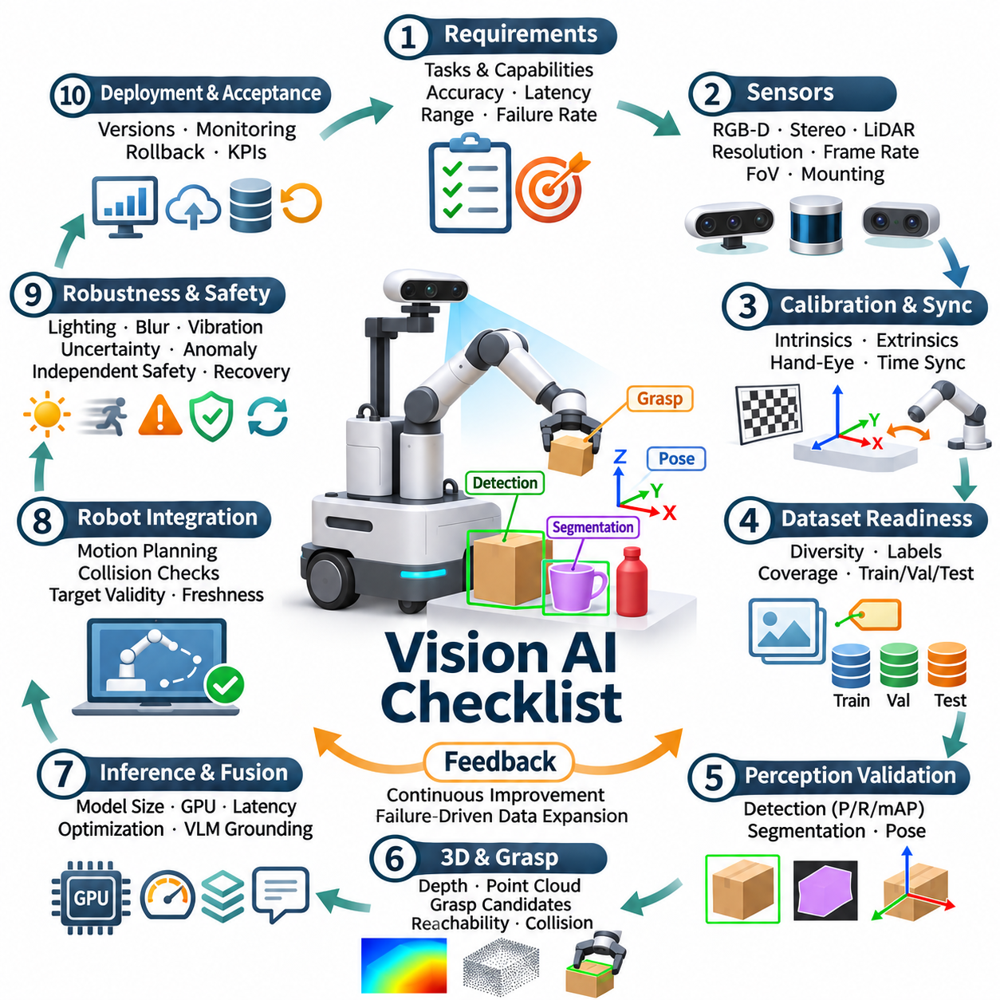
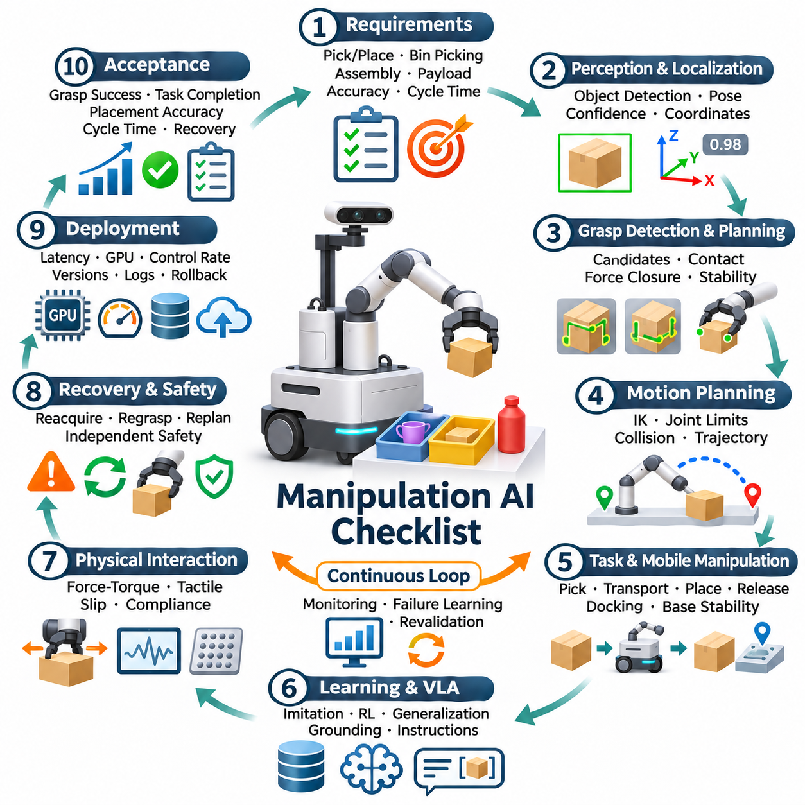
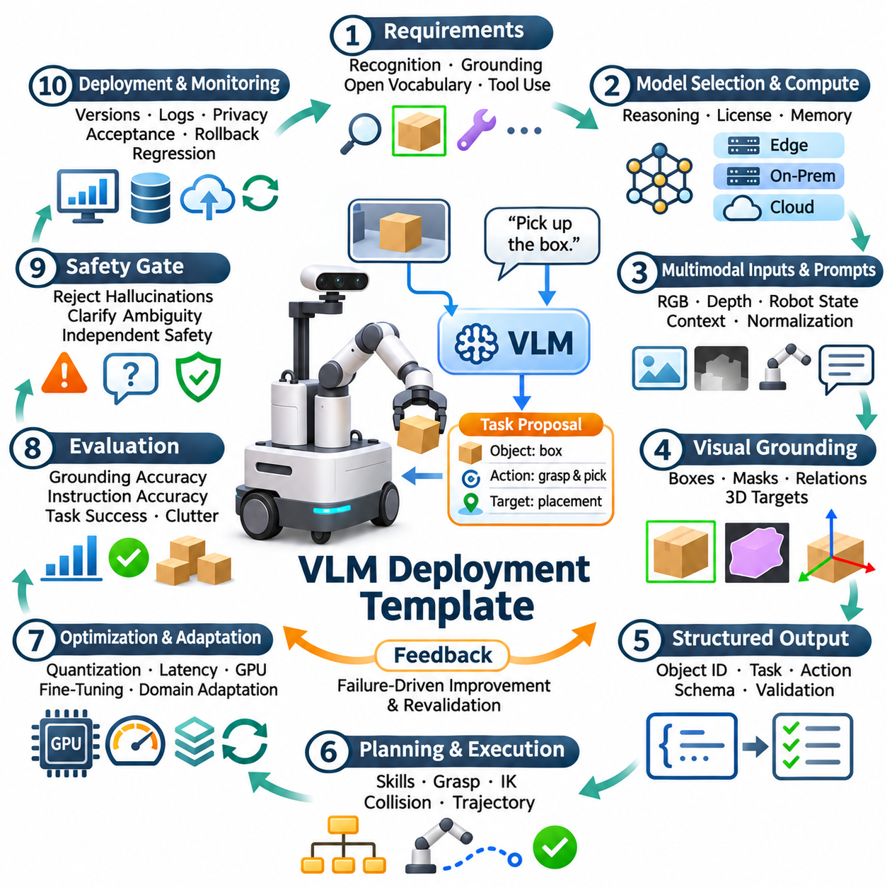
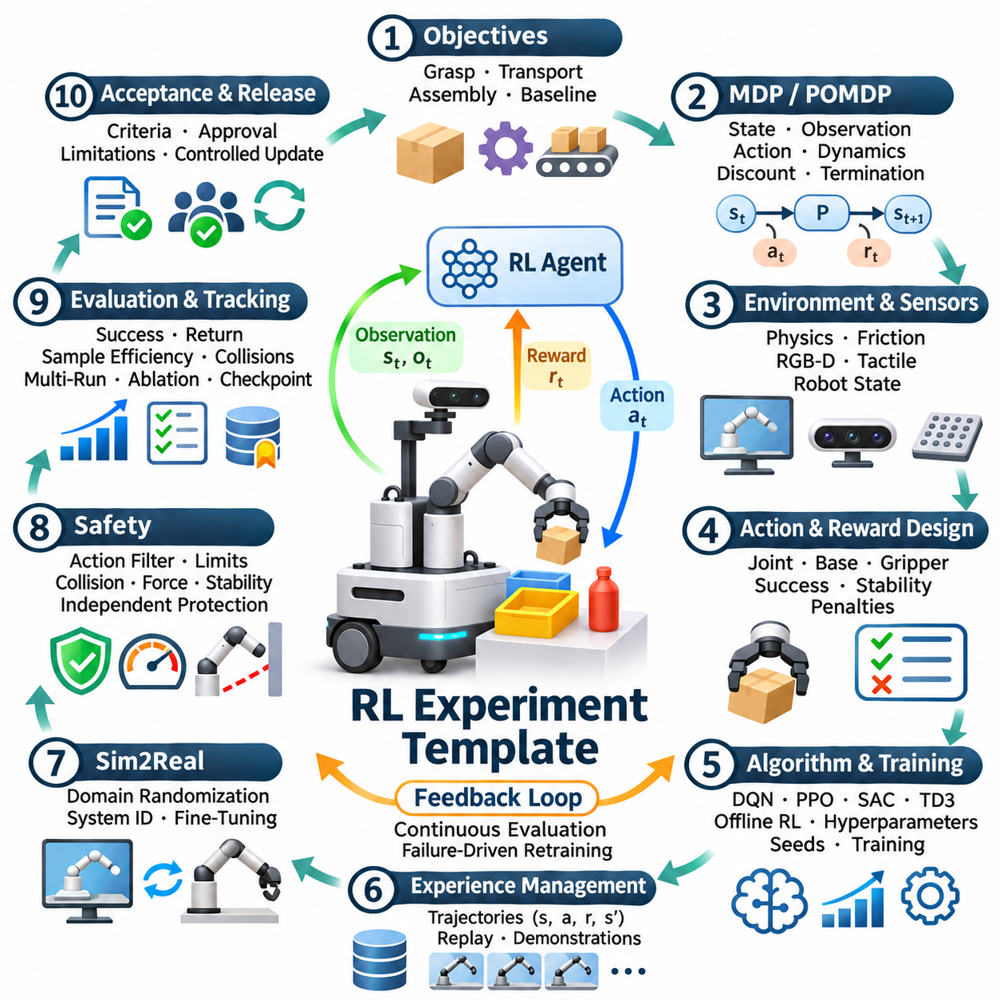
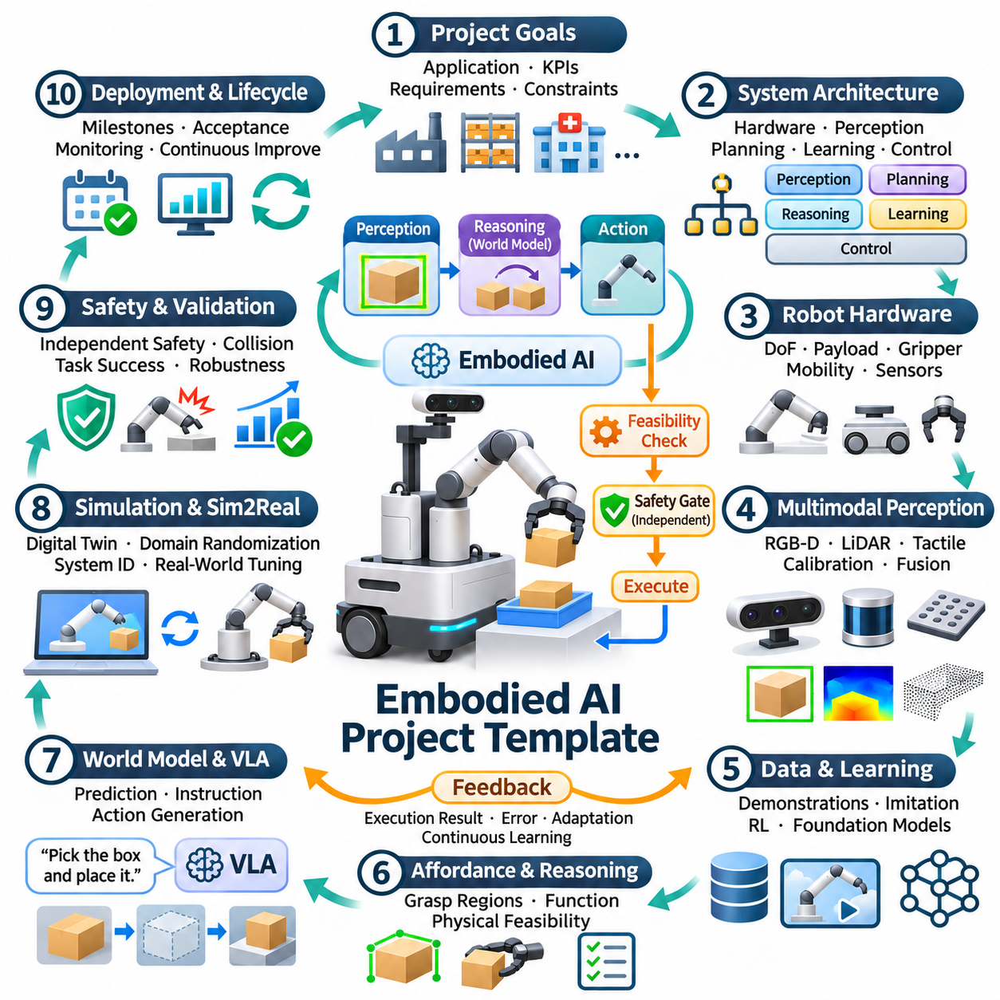

**Volume 03. Vision Manipulation and AI**


# Chapter 16. Checklists and Templates

##  

## 01 Dataset Design Template

{width="7.268055555555556in" height="7.268055555555556in"}

A dataset design template provides a standardized framework for developing high-quality datasets that support visual perception, object detection, pose estimation, grasp planning, and intelligent manipulation in mobile manipulator systems. The template establishes a systematic process for defining data requirements, acquisition methods, annotation standards, quality assurance, and dataset management throughout the artificial intelligence development lifecycle.

The dataset design process begins with defining the project objectives and target applications. Engineers should identify whether the dataset will support object detection, instance segmentation, 6D object pose estimation, grasp detection, affordance learning, or vision-language-action models. Each application requires different data representations, annotation formats, environmental conditions, and evaluation criteria that must be established before data collection begins.

The operational environment must be clearly defined to ensure that the dataset represents realistic deployment conditions. Mobile manipulators may operate in manufacturing facilities, warehouses, hospitals, laboratories, and unstructured environments. The dataset should include variations in illumination, background complexity, object density, surface materials, environmental obstacles, human presence, and dynamic operating conditions.

Sensor configuration represents a fundamental component of the dataset design template. Depending on the application, data acquisition systems may incorporate RGB cameras, depth cameras, stereo cameras, 3D LiDAR, tactile sensors, force-torque sensors, and robot joint encoders. Sensor specifications, mounting positions, sampling frequencies, calibration parameters, coordinate systems, and synchronization requirements should be systematically documented.

Object taxonomy defines the categories and characteristics of objects that the mobile manipulator must recognize and manipulate. The taxonomy should consider object geometry, dimensions, weight, material properties, transparency, reflectivity, deformability, and available grasping surfaces. Hierarchical classification structures can support conventional object detection, semantic perception, and open-vocabulary manipulation applications.

Data diversity is essential for developing robust artificial intelligence models capable of generalizing beyond training environments. Dataset designers should establish coverage requirements for object orientations, camera viewpoints, distances, occlusion levels, clutter densities, lighting conditions, and object arrangements. Rare events and challenging manipulation scenarios should be intentionally included to reduce operational vulnerabilities.

The data acquisition strategy should define the procedures used to collect real-world sensor observations and robot interaction data. Fixed acquisition stations, mobile manipulators, human demonstrations, teleoperation systems, and automated robotic experiments can generate complementary datasets. Collection procedures should specify equipment configurations, environmental settings, task sequences, recording durations, and operator responsibilities.

Synthetic data generation can supplement real-world datasets by providing scalable training samples with automatically generated ground truth. Simulation environments enable variations in object geometry, textures, lighting, camera positions, physical properties, and manipulation configurations. Domain randomization should be incorporated where appropriate to improve model generalization and reduce the simulation-to-reality performance gap.

Annotation requirements must be defined according to the intended learning objectives. Object detection datasets generally require bounding boxes and class labels, while instance segmentation requires pixel-level masks. Pose estimation datasets may require keypoints, translation vectors, rotation representations, and coordinate transformations. Grasping datasets should include grasp poses, contact points, gripper configurations, and execution outcomes.

Multimodal datasets require additional consideration because intelligent mobile manipulators integrate perception, reasoning, and physical interaction. Images, depth maps, point clouds, language instructions, robot states, and executed actions should be associated using consistent timestamps and identifiers. Temporal alignment enables the development of robot foundation models, imitation learning policies, and vision-language-action architectures.

Dataset organization should follow a standardized directory structure, naming convention, metadata schema, and storage format. Each sample should be associated with relevant information such as acquisition date, sensor configuration, environmental conditions, object identifiers, robot configuration, and annotation status. Consistent organization improves traceability, reproducibility, interoperability, and collaboration among development teams.

Quality assurance procedures should verify sensor data integrity, annotation accuracy, calibration consistency, synchronization reliability, and dataset completeness. Automated validation tools can identify corrupted files, duplicate samples, missing labels, invalid coordinate transformations, and inconsistent metadata. Manual inspection should complement automated verification, particularly for ambiguous objects and complex manipulation scenarios.

Dataset partitioning should establish independent training, validation, and testing subsets. The partitioning strategy must prevent data leakage by considering object instances, acquisition sessions, physical environments, and temporally adjacent observations. Additional evaluation subsets may contain previously unseen objects, unfamiliar environments, or challenging operational conditions to assess model generalization and robustness.

Dataset management should incorporate version control, access permissions, data licensing, privacy protection, and storage lifecycle planning. Each dataset release should document its intended applications, acquisition procedures, known limitations, annotation conventions, and changes from previous versions. Large-scale robotics datasets may require dedicated storage infrastructure, compression strategies, and automated backup mechanisms.

The dataset design template should ultimately establish measurable acceptance criteria covering data diversity, annotation quality, environmental coverage, and suitability for downstream learning tasks. Model evaluation results and operational failure cases should guide subsequent data collection and refinement. This continuous improvement process transforms dataset management into an integral component of reliable mobile manipulation and Physical AI development.

데이터셋 설계 템플릿(Dataset Design Template)은 모바일 매니퓰레이터 시스템(Mobile Manipulator System)의 시각 인식(Visual Perception), 객체 탐지(Object Detection), 자세 추정(Pose Estimation), 파지 계획(Grasp Planning), 지능형 조작(Intelligent Manipulation)을 지원하는 고품질 데이터셋(High-Quality Dataset)을 개발하기 위한 표준화된 프레임워크(Framework)를 제공한다. 이 템플릿은 인공지능 개발 수명주기(AI Development Lifecycle) 전반에 걸쳐 데이터 요구사항, 획득 방법, 어노테이션 표준(Annotation Standards), 품질 보증(Quality Assurance), 데이터셋 관리를 정의하기 위한 체계적인 프로세스를 확립한다.

데이터셋 설계 프로세스(Dataset Design Process)는 프로젝트 목표와 대상 응용 분야(Target Applications)를 정의하는 것에서 시작된다. 엔지니어는 데이터셋이 객체 탐지(Object Detection), 인스턴스 분할(Instance Segmentation), 6D 객체 자세 추정(6D Object Pose Estimation), 파지 탐지(Grasp Detection), 행동유도성 학습(Affordance Learning) 또는 비전-언어-행동 모델(Vision-Language-Action Model)을 지원하는지 식별해야 한다. 각 응용 분야는 서로 다른 데이터 표현(Data Representation), 어노테이션 형식(Annotation Format), 환경 조건 및 평가 기준을 요구하며, 이러한 사항은 데이터 수집 이전에 확립되어야 한다.

데이터셋이 실제 배포 조건(Deployment Conditions)을 반영할 수 있도록 운영 환경(Operational Environment)을 명확하게 정의해야 한다. 모바일 매니퓰레이터(Mobile Manipulator)는 제조 시설, 물류 창고, 병원, 연구실 및 비정형 환경(Unstructured Environment)에서 운영될 수 있다. 데이터셋에는 조명, 배경 복잡도(Background Complexity), 객체 밀도(Object Density), 표면 재질, 환경 장애물, 사람의 존재 및 동적 운영 조건(Dynamic Operating Conditions)의 다양한 변화가 포함되어야 한다.

센서 구성(Sensor Configuration)은 데이터셋 설계 템플릿의 핵심 구성 요소이다. 응용 분야에 따라 데이터 획득 시스템(Data Acquisition System)은 RGB 카메라(RGB Camera), 깊이 카메라(Depth Camera), 스테레오 카메라(Stereo Camera), 3D 라이다(3D LiDAR), 촉각 센서(Tactile Sensor), 힘-토크 센서(Force-Torque Sensor), 로봇 관절 엔코더(Robot Joint Encoder)를 통합할 수 있다. 센서 사양, 장착 위치, 샘플링 주파수(Sampling Frequency), 보정 매개변수(Calibration Parameters), 좌표계(Coordinate System) 및 동기화 요구사항(Synchronization Requirements)을 체계적으로 문서화해야 한다.

객체 분류 체계(Object Taxonomy)는 모바일 매니퓰레이터가 인식하고 조작해야 하는 객체의 범주와 특성을 정의한다. 분류 체계는 객체의 기하학적 형상(Object Geometry), 치수, 무게, 재료 특성(Material Properties), 투명도(Transparency), 반사율(Reflectivity), 변형 가능성(Deformability) 및 파지 가능한 표면(Grasping Surfaces)을 고려해야 한다. 계층적 분류 구조(Hierarchical Classification Structure)는 기존의 객체 탐지, 의미론적 인식(Semantic Perception) 및 개방형 어휘 조작(Open-Vocabulary Manipulation) 응용 분야를 지원할 수 있다.

데이터 다양성(Data Diversity)은 학습 환경을 넘어 일반화할 수 있는 강건한 인공지능 모델(Robust AI Model)을 개발하는 데 필수적이다. 데이터셋 설계자는 객체 방향(Object Orientation), 카메라 시점(Camera Viewpoint), 거리, 가림 수준(Occlusion Level), 혼잡도(Clutter Density), 조명 조건 및 객체 배치에 대한 데이터 포괄 범위(Coverage Requirements)를 확립해야 한다. 운영상의 취약성(Operational Vulnerability)을 줄이기 위해 희귀 사건(Rare Events)과 난도가 높은 조작 시나리오(Manipulation Scenario)를 의도적으로 포함해야 한다.

데이터 획득 전략(Data Acquisition Strategy)은 실제 환경의 센서 관측 데이터(Sensor Observation Data)와 로봇 상호작용 데이터(Robot Interaction Data)를 수집하는 절차를 정의해야 한다. 고정형 획득 스테이션(Fixed Acquisition Station), 모바일 매니퓰레이터, 인간 시연(Human Demonstration), 원격 조작 시스템(Teleoperation System) 및 자동화된 로봇 실험(Automated Robotic Experiment)은 상호 보완적인 데이터셋을 생성할 수 있다. 수집 절차에는 장비 구성, 환경 설정, 작업 순서(Task Sequence), 기록 시간 및 운영자 책임이 명시되어야 한다.

합성 데이터 생성(Synthetic Data Generation)은 자동으로 생성된 정답 데이터(Ground Truth)를 포함하는 확장 가능한 학습 샘플(Scalable Training Samples)을 제공함으로써 실제 환경의 데이터셋을 보완할 수 있다. 시뮬레이션 환경(Simulation Environment)은 객체의 기하학적 형상, 텍스처(Texture), 조명, 카메라 위치, 물리적 특성(Physical Properties) 및 조작 구성(Manipulation Configuration)을 다양하게 변경할 수 있도록 한다. 모델의 일반화 성능(Generalization Performance)을 향상하고 시뮬레이션과 현실 간의 성능 격차(Simulation-to-Reality Performance Gap)를 줄이기 위해 적절한 경우 도메인 무작위화(Domain Randomization)를 적용해야 한다.

어노테이션 요구사항(Annotation Requirements)은 목표 학습 목적(Learning Objectives)에 따라 정의되어야 한다. 객체 탐지 데이터셋은 일반적으로 경계 상자(Bounding Box)와 클래스 레이블(Class Label)을 요구하며, 인스턴스 분할은 픽셀 단위 마스크(Pixel-Level Mask)를 요구한다. 자세 추정 데이터셋에는 주요 특징점(Keypoint), 이동 벡터(Translation Vector), 회전 표현(Rotation Representation) 및 좌표 변환(Coordinate Transformation)이 필요할 수 있다. 파지 데이터셋(Grasping Dataset)에는 파지 자세(Grasp Pose), 접촉점(Contact Point), 그리퍼 구성(Gripper Configuration) 및 실행 결과(Execution Outcome)가 포함되어야 한다.

멀티모달 데이터셋(Multimodal Dataset)은 지능형 모바일 매니퓰레이터가 인식(Perception), 추론(Reasoning) 및 물리적 상호작용(Physical Interaction)을 통합하기 때문에 추가적인 고려가 필요하다. 이미지(Image), 깊이 맵(Depth Map), 포인트 클라우드(Point Cloud), 언어 명령(Language Instruction), 로봇 상태(Robot State) 및 실행된 행동(Executed Action)은 일관된 타임스탬프(Timestamp)와 식별자(Identifier)를 사용하여 연계되어야 한다. 시간적 정렬(Temporal Alignment)은 로봇 파운데이션 모델(Robot Foundation Model), 모방 학습 정책(Imitation Learning Policy) 및 비전-언어-행동 아키텍처(Vision-Language-Action Architecture)의 개발을 가능하게 한다.

데이터셋 구성(Dataset Organization)은 표준화된 디렉터리 구조(Directory Structure), 명명 규칙(Naming Convention), 메타데이터 스키마(Metadata Schema) 및 저장 형식(Storage Format)을 따라야 한다. 각 데이터 샘플에는 획득 날짜, 센서 구성, 환경 조건, 객체 식별자(Object Identifier), 로봇 구성(Robot Configuration) 및 어노테이션 상태(Annotation Status)와 같은 관련 정보가 연계되어야 한다. 일관된 데이터 구성은 추적성(Traceability), 재현성(Reproducibility), 상호운용성(Interoperability) 및 개발팀 간의 협업(Collaboration)을 향상한다.

품질 보증 절차(Quality Assurance Procedure)는 센서 데이터 무결성(Sensor Data Integrity), 어노테이션 정확도(Annotation Accuracy), 보정 일관성(Calibration Consistency), 동기화 신뢰성(Synchronization Reliability) 및 데이터셋 완전성(Dataset Completeness)을 검증해야 한다. 자동화된 검증 도구(Automated Validation Tool)는 손상된 파일, 중복 샘플, 누락된 레이블, 유효하지 않은 좌표 변환 및 일관성이 부족한 메타데이터를 식별할 수 있다. 특히 모호한 객체와 복잡한 조작 시나리오에 대해서는 수동 검사(Manual Inspection)를 통해 자동화된 검증을 보완해야 한다.

데이터셋 분할(Dataset Partitioning)은 서로 독립적인 학습 데이터셋(Training Dataset), 검증 데이터셋(Validation Dataset) 및 테스트 데이터셋(Test Dataset)을 구성해야 한다. 분할 전략(Partitioning Strategy)은 개별 객체 인스턴스(Object Instance), 데이터 획득 세션(Acquisition Session), 물리적 환경(Physical Environment) 및 시간적으로 인접한 관측 데이터(Temporally Adjacent Observations)를 고려하여 데이터 누출(Data Leakage)을 방지해야 한다. 추가적인 평가용 데이터 부분집합(Evaluation Subset)에는 이전에 관측하지 않은 객체, 익숙하지 않은 환경 또는 난도가 높은 운영 조건을 포함하여 모델의 일반화 성능과 강건성(Robustness)을 평가할 수 있다.

데이터셋 관리(Dataset Management)는 버전 관리(Version Control), 접근 권한(Access Permission), 데이터 라이선스(Data Licensing), 개인정보 보호(Privacy Protection) 및 저장 수명주기 계획(Storage Lifecycle Planning)을 통합해야 한다. 각 데이터셋 릴리스(Dataset Release)는 목표 응용 분야, 획득 절차, 알려진 한계점(Known Limitations), 어노테이션 규칙(Annotation Convention) 및 이전 버전 대비 변경사항을 문서화해야 한다. 대규모 로보틱스 데이터셋(Large-Scale Robotics Dataset)은 전용 저장 인프라(Dedicated Storage Infrastructure), 데이터 압축 전략(Compression Strategy) 및 자동화된 백업 메커니즘(Automated Backup Mechanism)을 요구할 수 있다.

데이터셋 설계 템플릿(Dataset Design Template)은 궁극적으로 데이터 다양성, 어노테이션 품질(Annotation Quality), 환경 포괄 범위(Environmental Coverage) 및 후속 학습 작업(Downstream Learning Task)에 대한 적합성을 포함하는 측정 가능한 인수 기준(Acceptance Criteria)을 확립해야 한다. 모델 평가 결과(Model Evaluation Results)와 운영 실패 사례(Operational Failure Cases)는 후속 데이터 수집 및 개선 방향을 결정하는 데 활용되어야 한다. 이러한 지속적 개선 프로세스(Continuous Improvement Process)는 데이터셋 관리를 신뢰성 높은 모바일 조작(Mobile Manipulation)과 물리적 인공지능(Physical AI) 개발의 핵심 구성 요소로 발전시킨다.

##  

## 02 Vision AI Checklist

{width="7.268055555555556in" height="7.268055555555556in"}

A Vision AI checklist provides a systematic framework for designing, developing, integrating, and validating artificial intelligence-based visual perception systems for mobile manipulators. It establishes engineering verification criteria across sensor configuration, image acquisition, dataset preparation, model development, inference optimization, and operational deployment, ensuring that visual intelligence supports reliable physical interaction.

The verification process begins with defining functional requirements and operational objectives. Engineers should identify the required perception capabilities, including object detection, instance segmentation, semantic recognition, pose estimation, and grasp detection. Target accuracy, processing latency, operating distance, environmental limitations, and acceptable failure rates must be established according to the intended manipulation tasks.

Camera system verification should evaluate sensor resolution, frame rate, field of view, exposure settings, dynamic range, and image acquisition stability. RGB cameras, depth cameras, stereo vision systems, and 3D LiDAR sensors should be selected according to operational requirements. Sensor mounting positions must provide sufficient visibility throughout the robot workspace while minimizing blind spots, mechanical interference, and self-occlusion.

Calibration and synchronization must be verified before integrating visual perception with robotic manipulation. Camera intrinsic parameters, extrinsic transformations, depth accuracy, and hand-eye calibration should satisfy predefined tolerances. Coordinate transformations between the camera, robot arm, mobile platform, and world reference frames must remain consistent, while synchronized timestamps ensure reliable multimodal sensor fusion.

Dataset readiness should be evaluated by examining data diversity, annotation accuracy, environmental coverage, and class distributions. Training samples must represent realistic variations in illumination, viewing angles, object orientations, surface materials, and cluttered environments. Independent validation and testing datasets should be established to prevent data leakage and provide objective assessments of model generalization.

Object detection verification should assess the ability of the Vision AI system to recognize and localize relevant objects under representative operating conditions. Precision, recall, mean Average Precision, false-positive rates, and missed detection rates should be measured. Particular attention must be given to partially occluded objects, unfamiliar appearances, overlapping objects, reflective surfaces, and small targets within the manipulation workspace.

Segmentation and pose estimation capabilities should be evaluated according to downstream manipulation requirements. Instance segmentation must provide sufficiently accurate object boundaries, while pose estimation should determine object positions and orientations within acceptable translational and rotational tolerances. Symmetric objects, ambiguous geometries, depth measurement errors, and coordinate transformation uncertainties must be considered during validation.

Three-dimensional perception and grasp detection require additional verification to ensure that visual information can be converted into executable manipulation targets. Depth maps and point clouds should be evaluated for completeness, spatial accuracy, noise, and missing measurements. Generated grasp candidates must be assessed for geometric feasibility, approach clearance, gripper compatibility, collision risk, and accessibility within the robot workspace.

Model architecture and inference performance should be reviewed against available computational resources. Engineers must evaluate model size, GPU memory consumption, processing throughput, inference latency, and computational utilization. Techniques such as quantization, pruning, hardware acceleration, and optimized inference engines should be validated to ensure that performance improvements do not introduce unacceptable reductions in perception accuracy.

Multimodal perception systems should be tested for consistency across visual, spatial, semantic, and robotic state information. Sensor fusion algorithms must accommodate differences in sampling frequencies, measurement uncertainties, coordinate frames, and communication delays. Vision-language models should additionally be evaluated for visual grounding accuracy, instruction interpretation, object-reference consistency, and unsupported semantic predictions.

Integration with robot control and motion planning must ensure that perception outputs are correctly translated into physical actions. Detected object positions, estimated orientations, grasp candidates, and confidence scores should be transmitted through standardized interfaces. The manipulation system must verify target validity, kinematic reachability, collision constraints, and perception freshness before initiating robot movements.

Operational robustness should be evaluated under conditions that differ from controlled laboratory environments. Testing should include changing illumination, motion blur, sensor contamination, vibration, communication interruptions, dynamic obstacles, and mobile platform positioning errors. The Vision AI system should detect degraded perception conditions and initiate appropriate corrective actions, such as reacquisition, viewpoint adjustment, or task suspension.

Safety-related verification must establish how the system responds to uncertain, inconsistent, or unavailable perception information. Confidence thresholds, uncertainty estimation, anomaly detection, and out-of-distribution recognition can support operational risk reduction. However, conventional Vision AI models must not replace independently validated safety functions. Unsafe or ambiguous perception outputs should prevent uncontrolled manipulation and trigger predefined recovery procedures.

Deployment readiness should include verification of software dependencies, model versions, hardware compatibility, communication interfaces, configuration parameters, and diagnostic capabilities. Runtime monitoring should record perception latency, detection confidence, resource utilization, sensor availability, and operational failures. Version-controlled deployment packages and rollback procedures should support reproducibility, controlled updates, and reliable system maintenance.

The final Vision AI checklist should establish measurable acceptance criteria for perception accuracy, spatial precision, computational performance, environmental robustness, and manipulation success. Verification results, unresolved limitations, corrective actions, and approval responsibilities must be documented. Continuous monitoring, failure-driven dataset expansion, and model revalidation establish a sustainable improvement process for intelligent mobile manipulation and Physical AI systems.

비전 AI 체크리스트(Vision AI Checklist)는 모바일 매니퓰레이터(Mobile Manipulator)를 위한 인공지능 기반 시각 인식 시스템(AI-Based Visual Perception System)의 설계, 개발, 통합 및 검증을 위한 체계적인 프레임워크(Framework)를 제공한다. 센서 구성(Sensor Configuration), 이미지 획득(Image Acquisition), 데이터셋 준비(Dataset Preparation), 모델 개발(Model Development), 추론 최적화(Inference Optimization) 및 운영 배포(Operational Deployment) 전반에 걸쳐 공학적 검증 기준(Engineering Verification Criteria)을 확립함으로써 시각 지능(Visual Intelligence)이 신뢰성 높은 물리적 상호작용(Physical Interaction)을 지원하도록 한다.

검증 프로세스(Verification Process)는 기능적 요구사항(Functional Requirements)과 운영 목표(Operational Objectives)를 정의하는 것에서 시작된다. 엔지니어는 객체 탐지(Object Detection), 인스턴스 분할(Instance Segmentation), 의미론적 인식(Semantic Recognition), 자세 추정(Pose Estimation) 및 파지 탐지(Grasp Detection)를 포함하여 필요한 인식 능력(Perception Capability)을 식별해야 한다. 목표 정확도(Target Accuracy), 처리 지연시간(Processing Latency), 작동 거리(Operating Distance), 환경적 제약사항(Environmental Limitations) 및 허용 실패율(Acceptable Failure Rate)은 목표 조작 작업(Manipulation Task)에 따라 확립되어야 한다.

카메라 시스템 검증(Camera System Verification)은 센서 해상도(Sensor Resolution), 프레임 속도(Frame Rate), 시야각(Field of View), 노출 설정(Exposure Settings), 동적 범위(Dynamic Range) 및 이미지 획득 안정성(Image Acquisition Stability)을 평가해야 한다. RGB 카메라(RGB Camera), 깊이 카메라(Depth Camera), 스테레오 비전 시스템(Stereo Vision System) 및 3D 라이다(3D LiDAR)는 운영 요구사항(Operational Requirements)에 따라 선정되어야 한다. 센서 장착 위치(Sensor Mounting Position)는 사각지대(Blind Spot), 기계적 간섭(Mechanical Interference) 및 자기 가림(Self-Occlusion)을 최소화하면서 로봇 작업공간(Robot Workspace) 전체에서 충분한 가시성(Visibility)을 제공해야 한다.

시각 인식(Visual Perception)을 로봇 조작(Robotic Manipulation)과 통합하기 전에 보정(Calibration) 및 동기화(Synchronization)를 검증해야 한다. 카메라 내부 매개변수(Camera Intrinsic Parameters), 외부 좌표 변환(Extrinsic Transformation), 깊이 정확도(Depth Accuracy) 및 손-눈 보정(Hand-Eye Calibration)은 사전에 정의된 허용오차(Predefined Tolerance)를 충족해야 한다. 카메라, 로봇 팔(Robot Arm), 모바일 플랫폼(Mobile Platform) 및 월드 기준 좌표계(World Reference Frame) 간의 좌표 변환(Coordinate Transformation)은 일관성을 유지해야 하며, 동기화된 타임스탬프(Timestamp)는 신뢰성 높은 멀티모달 센서 융합(Multimodal Sensor Fusion)을 보장해야 한다.

데이터셋 준비 상태(Dataset Readiness)는 데이터 다양성(Data Diversity), 어노테이션 정확도(Annotation Accuracy), 환경 포괄 범위(Environmental Coverage) 및 클래스 분포(Class Distribution)를 검토하여 평가해야 한다. 학습 샘플(Training Sample)은 조명, 관측 각도(Viewing Angle), 객체 방향(Object Orientation), 표면 재질 및 혼잡한 환경(Cluttered Environment)의 실제적인 변화를 반영해야 한다. 데이터 누출(Data Leakage)을 방지하고 모델 일반화 성능(Model Generalization Performance)을 객관적으로 평가하기 위해 독립적인 검증 데이터셋(Validation Dataset)과 테스트 데이터셋(Test Dataset)을 구축해야 한다.

객체 탐지 검증(Object Detection Verification)은 대표적인 운영 조건(Representative Operating Conditions)에서 관련 객체를 인식하고 위치를 식별하는 비전 AI 시스템(Vision AI System)의 능력을 평가해야 한다. 정밀도(Precision), 재현율(Recall), 평균 정밀도 평균값(mean Average Precision, mAP), 거짓 양성률(False-Positive Rate) 및 미탐지율(Missed Detection Rate)을 측정해야 한다. 특히 부분적으로 가려진 객체(Partially Occluded Object), 익숙하지 않은 외형, 중첩된 객체(Overlapping Object), 반사 표면(Reflective Surface) 및 조작 작업공간 내의 작은 대상 객체(Small Target)에 특별한 주의를 기울여야 한다.

분할(Segmentation) 및 자세 추정(Pose Estimation) 능력은 후속 조작 요구사항(Downstream Manipulation Requirements)에 따라 평가되어야 한다. 인스턴스 분할(Instance Segmentation)은 충분히 정확한 객체 경계(Object Boundary)를 제공해야 하며, 자세 추정은 허용 가능한 이동 및 회전 오차(Translational and Rotational Tolerance) 범위 내에서 객체의 위치와 방향을 결정해야 한다. 대칭 객체(Symmetric Object), 모호한 기하학적 형상(Ambiguous Geometry), 깊이 측정 오차(Depth Measurement Error) 및 좌표 변환 불확실성(Coordinate Transformation Uncertainty)은 검증 과정에서 고려되어야 한다.

3차원 인식(3D Perception)과 파지 탐지(Grasp Detection)는 시각 정보(Visual Information)가 실행 가능한 조작 목표(Executable Manipulation Target)로 변환될 수 있도록 추가적인 검증을 요구한다. 깊이 맵(Depth Map)과 포인트 클라우드(Point Cloud)는 데이터 완전성(Completeness), 공간 정확도(Spatial Accuracy), 노이즈(Noise) 및 누락된 측정값(Missing Measurement)에 대해 평가되어야 한다. 생성된 파지 후보(Grasp Candidate)는 기하학적 실행 가능성(Geometric Feasibility), 접근 여유 공간(Approach Clearance), 그리퍼 호환성(Gripper Compatibility), 충돌 위험(Collision Risk) 및 로봇 작업공간 내의 접근 가능성(Accessibility)을 기준으로 평가해야 한다.

모델 아키텍처(Model Architecture)와 추론 성능(Inference Performance)은 사용 가능한 컴퓨팅 자원(Computational Resources)을 기준으로 검토되어야 한다. 엔지니어는 모델 크기(Model Size), GPU 메모리 사용량(GPU Memory Consumption), 처리량(Processing Throughput), 추론 지연시간(Inference Latency) 및 컴퓨팅 자원 활용률(Computational Utilization)을 평가해야 한다. 양자화(Quantization), 가지치기(Pruning), 하드웨어 가속(Hardware Acceleration) 및 최적화된 추론 엔진(Optimized Inference Engine)과 같은 기술은 성능 향상이 허용할 수 없는 인식 정확도(Perception Accuracy)의 저하를 초래하지 않도록 검증되어야 한다.

멀티모달 인식 시스템(Multimodal Perception System)은 시각적 정보(Visual Information), 공간적 정보(Spatial Information), 의미론적 정보(Semantic Information) 및 로봇 상태 정보(Robotic State Information) 간의 일관성(Consistency)을 검증해야 한다. 센서 융합 알고리즘(Sensor Fusion Algorithm)은 샘플링 주파수(Sampling Frequency), 측정 불확실성(Measurement Uncertainty), 좌표계(Coordinate Frame) 및 통신 지연(Communication Delay)의 차이를 처리할 수 있어야 한다. 비전-언어 모델(Vision-Language Model, VLM)은 추가적으로 시각적 근거 연결(Visual Grounding)의 정확도, 명령 해석(Instruction Interpretation), 참조 객체의 일관성(Object-Reference Consistency) 및 근거 없는 의미론적 예측(Unsupported Semantic Prediction)에 대해 평가되어야 한다.

로봇 제어(Robot Control) 및 동작 계획(Motion Planning)과의 통합은 인식 출력(Perception Output)이 물리적 행동(Physical Action)으로 정확하게 변환되도록 보장해야 한다. 탐지된 객체 위치(Detected Object Position), 추정된 방향(Estimated Orientation), 파지 후보(Grasp Candidate) 및 신뢰도 점수(Confidence Score)는 표준화된 인터페이스(Standardized Interface)를 통해 전달되어야 한다. 조작 시스템(Manipulation System)은 로봇의 움직임을 시작하기 전에 목표 유효성(Target Validity), 기구학적 도달 가능성(Kinematic Reachability), 충돌 제약조건(Collision Constraint) 및 인식 정보의 최신성(Perception Freshness)을 검증해야 한다.

운영 강건성(Operational Robustness)은 통제된 실험실 환경(Controlled Laboratory Environment)과 다른 조건에서 평가되어야 한다. 테스트에는 조명 변화(Changing Illumination), 모션 블러(Motion Blur), 센서 오염(Sensor Contamination), 진동(Vibration), 통신 중단(Communication Interruption), 동적 장애물(Dynamic Obstacle) 및 모바일 플랫폼 위치 오차(Mobile Platform Positioning Error)가 포함되어야 한다. 비전 AI 시스템은 인식 성능이 저하된 조건(Degraded Perception Condition)을 탐지하고 데이터 재획득(Reacquisition), 관측 시점 조정(Viewpoint Adjustment) 또는 작업 중단(Task Suspension)과 같은 적절한 시정 조치(Corrective Action)를 시작할 수 있어야 한다.

안전 관련 검증(Safety-Related Verification)은 불확실하거나 일관성이 부족하거나 이용할 수 없는 인식 정보(Perception Information)에 대해 시스템이 어떻게 대응하는지를 확립해야 한다. 신뢰도 임계값(Confidence Threshold), 불확실성 추정(Uncertainty Estimation), 이상 탐지(Anomaly Detection) 및 분포 외 데이터 인식(Out-of-Distribution Recognition)은 운영 위험 감소(Operational Risk Reduction)를 지원할 수 있다. 그러나 일반적인 비전 AI 모델은 독립적으로 검증된 안전 기능(Independently Validated Safety Function)을 대체해서는 안 된다. 안전하지 않거나 모호한 인식 출력은 통제되지 않은 조작(Uncontrolled Manipulation)을 방지하고 사전에 정의된 복구 절차(Predefined Recovery Procedure)를 실행하도록 해야 한다.

배포 준비 상태(Deployment Readiness)는 소프트웨어 의존성(Software Dependency), 모델 버전(Model Version), 하드웨어 호환성(Hardware Compatibility), 통신 인터페이스(Communication Interface), 구성 매개변수(Configuration Parameter) 및 진단 능력(Diagnostic Capability)에 대한 검증을 포함해야 한다. 실행시간 모니터링(Runtime Monitoring)은 인식 지연시간(Perception Latency), 탐지 신뢰도(Detection Confidence), 자원 활용률(Resource Utilization), 센서 가용성(Sensor Availability) 및 운영 실패(Operational Failure)를 기록해야 한다. 버전 관리가 적용된 배포 패키지(Version-Controlled Deployment Package)와 롤백 절차(Rollback Procedure)는 재현성(Reproducibility), 통제된 업데이트(Controlled Update) 및 신뢰성 높은 시스템 유지보수(System Maintenance)를 지원해야 한다.

최종 비전 AI 체크리스트(Vision AI Checklist)는 인식 정확도(Perception Accuracy), 공간 정밀도(Spatial Precision), 컴퓨팅 성능(Computational Performance), 환경 강건성(Environmental Robustness) 및 조작 성공률(Manipulation Success Rate)에 대한 측정 가능한 인수 기준(Acceptance Criteria)을 확립해야 한다. 검증 결과(Verification Result), 해결되지 않은 한계점(Unresolved Limitation), 시정 조치(Corrective Action) 및 승인 책임(Approval Responsibility)은 체계적으로 문서화되어야 한다. 지속적인 모니터링(Continuous Monitoring), 실패 사례 기반 데이터셋 확장(Failure-Driven Dataset Expansion) 및 모델 재검증(Model Revalidation)은 지능형 모바일 조작(Intelligent Mobile Manipulation)과 물리적 인공지능 시스템(Physical AI System)을 위한 지속 가능한 개선 프로세스(Sustainable Improvement Process)를 확립한다.

##  

## 03 Manipulation AI Checklist

{width="7.268055555555556in" height="7.268055555555556in"}

A Manipulation AI checklist provides a systematic framework for designing, developing, integrating, and validating artificial intelligence-based robotic manipulation systems. Based on the scope of vision, manipulation, and AI, the checklist extends the chapter structure into recommended engineering verification criteria covering object localization, grasp generation, motion planning, learning-based control, physical interaction, and operational reliability.

The verification process begins with defining manipulation objectives and functional requirements. Engineers should identify target applications such as pick-and-place, random bin picking, material handling, assembly, sorting, and tool manipulation. Required positioning accuracy, payload capacity, grasping reliability, cycle time, task completion rate, and environmental constraints must be established according to the intended operational scenarios.

Object perception and localization must be verified before manipulation operations are executed. The system should accurately identify target objects, estimate their spatial positions and orientations, and distinguish them from surrounding obstacles. Perception outputs must include appropriate confidence information, while coordinate transformations between cameras, robot arms, mobile platforms, and target objects must remain geometrically consistent.

Grasp detection verification should evaluate the ability of AI models to generate feasible grasp candidates under diverse environmental conditions. Candidate grasps must account for object geometry, surface characteristics, gripper configuration, approach direction, and surrounding obstacles. Verification should include unfamiliar objects, partially occluded targets, irregular shapes, deformable materials, and densely cluttered environments.

Grasp planning validation should determine whether generated grasp candidates satisfy physical and mechanical constraints. Engineers must evaluate contact configurations, force closure, grasp stability, friction assumptions, gripper opening width, and payload limitations. Learning-based grasp quality predictions should be compared with actual execution outcomes to verify that predicted grasp success corresponds to reliable physical performance.

Motion planning integration must ensure that AI-generated manipulation targets can be converted into safe and executable robot trajectories. Inverse kinematics, joint limits, singularity avoidance, collision detection, and trajectory continuity should be verified. The system must evaluate approach, grasping, lifting, transportation, placement, and retreat movements while maintaining appropriate clearance from surrounding objects and structures.

Pick-and-place and bin-picking operations require verification of complete manipulation sequences rather than individual grasping actions. The system should demonstrate reliable object selection, grasp execution, secure transportation, accurate placement, and successful release. Multi-object interference, unstable object configurations, double picking, dropped objects, and failed placement conditions must be included in operational testing.

Mobile manipulation introduces additional verification requirements because the robot arm operates from a movable platform. Base positioning accuracy, localization uncertainty, platform stability, docking repeatability, and arm accessibility must be evaluated. Coordination between mobile navigation and manipulation should ensure that the robot reaches an appropriate working position before executing grasping operations or performing coordinated whole-body movements.

Learning-based manipulation models should be evaluated for dataset quality, training stability, generalization capability, and execution reliability. Supervised learning, behavior cloning, imitation learning, and reinforcement learning may support different manipulation functions. Independent testing environments and previously unseen objects should be used to determine whether learned policies remain effective outside their original training conditions.

Vision-language models and vision-language-action models require verification of semantic understanding, visual grounding, instruction interpretation, and action generation. The system must correctly associate natural language instructions with physical objects and executable manipulation tasks. Ambiguous instructions, unsupported predictions, incorrect object references, and physically infeasible actions should trigger clarification, rejection, or controlled recovery procedures.

Physical interaction verification should assess the ability of the manipulation system to respond appropriately to contact forces and environmental changes. Force-torque sensors, tactile sensors, joint feedback, and gripper state information can support closed-loop manipulation. Contact detection, grip force regulation, slip detection, compliance control, and object protection must be validated under representative physical interaction conditions.

Error detection and recovery mechanisms should address unsuccessful grasps, object slippage, perception failures, unexpected contact, motion planning failures, and communication interruptions. Recovery strategies may include perception reacquisition, alternative grasp selection, trajectory replanning, object repositioning, or controlled task termination. Recovery attempts must remain bounded by predefined operational and safety constraints.

Safety verification must establish explicit boundaries between AI-based decision-making and independently validated robot safety functions. AI-generated actions should be evaluated against workspace restrictions, speed limits, force limitations, collision constraints, and human presence. Uncertain predictions or inconsistent system states must not initiate uncontrolled movements, and safety-rated protective mechanisms must remain effective independently of AI performance.

Computational performance and deployment readiness should be evaluated under realistic operating workloads. Engineers must verify inference latency, control update rates, GPU utilization, communication stability, software compatibility, and end-to-end response time. Model versioning, configuration management, diagnostic logging, and rollback mechanisms should support controlled deployment, reproducible experiments, and long-term operational maintenance.

The final Manipulation AI checklist should establish measurable acceptance criteria for grasp success rate, task completion rate, placement accuracy, cycle time, recovery effectiveness, and operational safety. Verification results, unresolved limitations, corrective actions, and approval responsibilities must be documented. Continuous performance monitoring, failure-driven learning, and periodic revalidation support the sustainable development of intelligent mobile manipulation and Physical AI systems.

조작 AI 체크리스트(Manipulation AI Checklist)는 인공지능 기반 로봇 조작 시스템(AI-Based Robotic Manipulation System)의 설계, 개발, 통합 및 검증을 위한 체계적인 프레임워크(Framework)를 제공한다. 비전, 조작 및 인공지능(Vision, Manipulation, and AI)의 범위를 기반으로, 이 체크리스트는 객체 위치 추정(Object Localization), 파지 생성(Grasp Generation), 동작 계획(Motion Planning), 학습 기반 제어(Learning-Based Control), 물리적 상호작용(Physical Interaction) 및 운영 신뢰성(Operational Reliability)을 포함하는 권장 공학적 검증 기준(Engineering Verification Criteria)으로 해당 장의 구조를 확장한다.

검증 프로세스(Verification Process)는 조작 목표(Manipulation Objectives)와 기능적 요구사항(Functional Requirements)을 정의하는 것에서 시작된다. 엔지니어는 픽 앤 플레이스(Pick-and-Place), 무작위 빈 피킹(Random Bin Picking), 자재 이송(Material Handling), 조립(Assembly), 분류(Sorting) 및 도구 조작(Tool Manipulation)과 같은 대상 응용 분야를 식별해야 한다. 요구 위치 정확도(Positioning Accuracy), 가반하중(Payload Capacity), 파지 신뢰성(Grasping Reliability), 사이클 타임(Cycle Time), 작업 완료율(Task Completion Rate) 및 환경적 제약조건(Environmental Constraints)은 목표 운영 시나리오(Operational Scenario)에 따라 확립되어야 한다.

객체 인식(Object Perception)과 위치 추정(Localization)은 조작 작업(Manipulation Operation)이 실행되기 전에 검증되어야 한다. 시스템은 대상 객체(Target Object)를 정확하게 식별하고 공간적 위치(Spatial Position)와 방향(Orientation)을 추정하며 주변 장애물(Surrounding Obstacles)과 구분할 수 있어야 한다. 인식 출력(Perception Output)은 적절한 신뢰도 정보(Confidence Information)를 포함해야 하며, 카메라, 로봇 팔, 모바일 플랫폼 및 대상 객체 간의 좌표 변환(Coordinate Transformation)은 기하학적 일관성(Geometric Consistency)을 유지해야 한다.

파지 탐지 검증(Grasp Detection Verification)은 다양한 환경 조건에서 실행 가능한 파지 후보(Feasible Grasp Candidate)를 생성하는 인공지능 모델의 능력을 평가해야 한다. 파지 후보는 객체의 기하학적 형상(Object Geometry), 표면 특성(Surface Characteristics), 그리퍼 구성(Gripper Configuration), 접근 방향(Approach Direction) 및 주변 장애물을 고려해야 한다. 검증에는 익숙하지 않은 객체(Unfamiliar Object), 부분적으로 가려진 대상(Partially Occluded Target), 불규칙한 형상(Irregular Shape), 변형 가능한 재료(Deformable Material) 및 고밀도 혼잡 환경(Densely Cluttered Environment)이 포함되어야 한다.

파지 계획 검증(Grasp Planning Validation)은 생성된 파지 후보가 물리적 및 기계적 제약조건(Physical and Mechanical Constraints)을 충족하는지 판단해야 한다. 엔지니어는 접촉 구성(Contact Configuration), 힘 폐쇄(Force Closure), 파지 안정성(Grasp Stability), 마찰 가정(Friction Assumption), 그리퍼 개방 폭(Gripper Opening Width) 및 가반하중 제한(Payload Limitation)을 평가해야 한다. 학습 기반 파지 품질 예측(Learning-Based Grasp Quality Prediction)은 실제 실행 결과(Execution Outcome)와 비교하여 예측된 파지 성공 여부가 신뢰성 높은 물리적 성능(Physical Performance)과 일치하는지 검증해야 한다.

동작 계획 통합(Motion Planning Integration)은 인공지능이 생성한 조작 목표(AI-Generated Manipulation Target)가 안전하고 실행 가능한 로봇 궤적(Executable Robot Trajectory)으로 변환될 수 있도록 보장해야 한다. 역기구학(Inverse Kinematics), 관절 한계(Joint Limit), 특이점 회피(Singularity Avoidance), 충돌 탐지(Collision Detection) 및 궤적 연속성(Trajectory Continuity)을 검증해야 한다. 시스템은 주변 객체 및 구조물과 적절한 이격 거리(Clearance)를 유지하면서 접근(Approach), 파지(Grasping), 들어 올리기(Lifting), 운반(Transportation), 배치(Placement) 및 후퇴(Retreat) 동작을 평가해야 한다.

픽 앤 플레이스(Pick-and-Place)와 빈 피킹(Bin Picking) 작업은 개별 파지 행동(Individual Grasping Action)이 아닌 전체 조작 시퀀스(Complete Manipulation Sequence)에 대한 검증을 요구한다. 시스템은 신뢰성 높은 객체 선택(Object Selection), 파지 실행(Grasp Execution), 안전한 운반(Secure Transportation), 정확한 배치(Accurate Placement) 및 성공적인 파지 해제(Successful Release)를 입증해야 한다. 다중 객체 간섭(Multi-Object Interference), 불안정한 객체 배치(Unstable Object Configuration), 이중 피킹(Double Picking), 객체 낙하(Dropped Object) 및 배치 실패(Failed Placement) 조건은 운영 테스트(Operational Testing)에 포함되어야 한다.

모바일 조작(Mobile Manipulation)은 로봇 팔이 이동 가능한 플랫폼에서 동작하기 때문에 추가적인 검증 요구사항(Verification Requirements)을 수반한다. 모바일 베이스 위치 정확도(Base Positioning Accuracy), 위치 추정 불확실성(Localization Uncertainty), 플랫폼 안정성(Platform Stability), 도킹 반복정밀도(Docking Repeatability) 및 로봇 팔의 접근 가능성(Arm Accessibility)을 평가해야 한다. 모바일 주행(Mobile Navigation)과 조작 간의 협조 제어(Coordination)는 파지 작업을 실행하거나 협조적인 전신 동작(Coordinated Whole-Body Movement)을 수행하기 전에 로봇이 적절한 작업 위치(Working Position)에 도달하도록 보장해야 한다.

학습 기반 조작 모델(Learning-Based Manipulation Model)은 데이터셋 품질(Dataset Quality), 학습 안정성(Training Stability), 일반화 능력(Generalization Capability) 및 실행 신뢰성(Execution Reliability)에 대해 평가되어야 한다. 지도 학습(Supervised Learning), 행동 복제(Behavior Cloning), 모방 학습(Imitation Learning) 및 강화 학습(Reinforcement Learning)은 서로 다른 조작 기능(Manipulation Function)을 지원할 수 있다. 독립적인 테스트 환경(Independent Testing Environment)과 이전에 관측하지 않은 객체(Unseen Object)를 활용하여 학습된 정책(Learned Policy)이 기존 학습 조건을 벗어난 환경에서도 효과적으로 동작하는지 판단해야 한다.

비전-언어 모델(Vision-Language Model, VLM)과 비전-언어-행동 모델(Vision-Language-Action Model, VLA)은 의미론적 이해(Semantic Understanding), 시각적 근거 연결(Visual Grounding), 명령 해석(Instruction Interpretation) 및 행동 생성(Action Generation)에 대한 검증을 요구한다. 시스템은 자연어 명령(Natural Language Instruction)을 물리적 객체(Physical Object) 및 실행 가능한 조작 작업과 정확하게 연계해야 한다. 모호한 명령(Ambiguous Instruction), 근거 없는 예측(Unsupported Prediction), 잘못된 객체 참조(Incorrect Object Reference) 및 물리적으로 실행 불가능한 행동(Physically Infeasible Action)은 명확화 요청(Clarification), 실행 거부(Rejection) 또는 통제된 복구 절차(Controlled Recovery Procedure)를 유발해야 한다.

물리적 상호작용 검증(Physical Interaction Verification)은 접촉력(Contact Force)과 환경 변화(Environmental Change)에 적절하게 대응하는 조작 시스템의 능력을 평가해야 한다. 힘-토크 센서(Force-Torque Sensor), 촉각 센서(Tactile Sensor), 관절 피드백(Joint Feedback) 및 그리퍼 상태 정보(Gripper State Information)는 폐루프 조작(Closed-Loop Manipulation)을 지원할 수 있다. 접촉 탐지(Contact Detection), 파지력 조절(Grip Force Regulation), 미끄러짐 탐지(Slip Detection), 순응 제어(Compliance Control) 및 객체 보호(Object Protection)는 대표적인 물리적 상호작용 조건에서 검증되어야 한다.

오류 탐지 및 복구 메커니즘(Error Detection and Recovery Mechanism)은 파지 실패(Unsuccessful Grasp), 객체 미끄러짐(Object Slippage), 인식 실패(Perception Failure), 예기치 않은 접촉(Unexpected Contact), 동작 계획 실패(Motion Planning Failure) 및 통신 중단(Communication Interruption)에 대응해야 한다. 복구 전략(Recovery Strategy)에는 인식 데이터 재획득(Perception Reacquisition), 대체 파지 선택(Alternative Grasp Selection), 궤적 재계획(Trajectory Replanning), 객체 재배치(Object Repositioning) 또는 통제된 작업 종료(Controlled Task Termination)가 포함될 수 있다. 복구 시도(Recovery Attempt)는 사전에 정의된 운영 및 안전 제약조건(Operational and Safety Constraints)의 범위 내에서 수행되어야 한다.

안전 검증(Safety Verification)은 인공지능 기반 의사결정(AI-Based Decision-Making)과 독립적으로 검증된 로봇 안전 기능(Independently Validated Robot Safety Function) 간의 명확한 경계를 확립해야 한다. 인공지능이 생성한 행동(AI-Generated Action)은 작업공간 제한(Workspace Restriction), 속도 제한(Speed Limit), 힘 제한(Force Limitation), 충돌 제약조건(Collision Constraint) 및 사람의 존재(Human Presence)를 기준으로 평가되어야 한다. 불확실한 예측(Uncertain Prediction)이나 일관성이 부족한 시스템 상태(Inconsistent System State)는 통제되지 않은 움직임(Uncontrolled Movement)을 유발해서는 안 되며, 안전 등급 보호 메커니즘(Safety-Rated Protective Mechanism)은 인공지능 성능과 독립적으로 유효성을 유지해야 한다.

컴퓨팅 성능(Computational Performance)과 배포 준비 상태(Deployment Readiness)는 실제적인 운영 워크로드(Operational Workload)에서 평가되어야 한다. 엔지니어는 추론 지연시간(Inference Latency), 제어 갱신 주기율(Control Update Rate), GPU 활용률(GPU Utilization), 통신 안정성(Communication Stability), 소프트웨어 호환성(Software Compatibility) 및 종단 간 응답시간(End-to-End Response Time)을 검증해야 한다. 모델 버전 관리(Model Versioning), 구성 관리(Configuration Management), 진단 로깅(Diagnostic Logging) 및 롤백 메커니즘(Rollback Mechanism)은 통제된 배포(Controlled Deployment), 재현 가능한 실험(Reproducible Experiment) 및 장기적인 운영 유지보수(Long-Term Operational Maintenance)를 지원해야 한다.

최종 조작 AI 체크리스트(Manipulation AI Checklist)는 파지 성공률(Grasp Success Rate), 작업 완료율(Task Completion Rate), 배치 정확도(Placement Accuracy), 사이클 타임(Cycle Time), 복구 효과성(Recovery Effectiveness) 및 운영 안전성(Operational Safety)에 대한 측정 가능한 인수 기준(Acceptance Criteria)을 확립해야 한다. 검증 결과(Verification Result), 해결되지 않은 한계점(Unresolved Limitation), 시정 조치(Corrective Action) 및 승인 책임(Approval Responsibility)은 체계적으로 문서화되어야 한다. 지속적인 성능 모니터링(Continuous Performance Monitoring), 실패 사례 기반 학습(Failure-Driven Learning) 및 주기적인 재검증(Periodic Revalidation)은 지능형 모바일 조작(Intelligent Mobile Manipulation)과 물리적 인공지능 시스템(Physical AI System)의 지속 가능한 개발(Sustainable Development)을 지원한다.

##  

## 04 VLM Deployment Template

{width="7.268055555555556in" height="7.268055555555556in"}

A Vision-Language Model (VLM) deployment template provides a standardized framework for integrating multimodal artificial intelligence into mobile manipulator systems. Extending the architectural topics of vision-language manipulation, foundation models, and robot agents into practical engineering recommendations, the template defines model selection, computational requirements, integration procedures, performance validation, safety mechanisms, and operational management.

The deployment process begins with defining application objectives and functional requirements. Vision-language models may support object recognition, visual grounding, open-vocabulary manipulation, natural language instruction interpretation, task understanding, and tool use. Engineers should establish the expected input modalities, output representations, operating environments, response latency, and relationships with downstream manipulation functions.

Model selection should consider the target application, computational resources, multimodal reasoning capabilities, and deployment constraints. Candidate models must be evaluated for visual understanding, language comprehension, spatial reasoning, object-reference accuracy, and domain adaptability. Model licensing, parameter count, memory consumption, supported inference frameworks, and fine-tuning requirements should also be documented.

The computational architecture should define whether VLM inference operates on embedded edge devices, on-premises GPU servers, cloud infrastructure, or distributed computing systems. Edge deployment can reduce communication latency and network dependency, while centralized infrastructure can support larger models. Hybrid deployment strategies should balance computational performance, energy consumption, data privacy, and operational availability.

Input data preparation must establish standardized procedures for processing visual observations and natural language instructions. Camera images should undergo appropriate resizing, normalization, and quality verification before inference. Multimodal inputs may additionally include depth information, robot states, environmental descriptions, and historical observations, depending on the input modalities supported by the selected model.

Prompt engineering should define consistent instructional structures for communicating operational objectives to the VLM. System prompts, task descriptions, contextual information, object references, and output constraints should be organized according to application requirements. Structured prompts and representative examples can improve response consistency, reduce semantic ambiguity, and facilitate integration with downstream robotic software.

Visual grounding verification must ensure that language expressions are correctly associated with physical objects and spatial regions within the operating environment. Generated object references, bounding boxes, segmentation regions, and spatial relationships should be evaluated against ground-truth observations. Additional perception modules may be required to convert semantic predictions into accurate three-dimensional manipulation targets.

The output interface should establish machine-readable representations for transferring VLM predictions to other robotic subsystems. Structured outputs may include object identifiers, spatial references, task descriptions, action proposals, and execution constraints. Output schemas, validation rules, coordinate conventions, and communication protocols must be documented to ensure interoperability and prevent ambiguous interpretation.

Integration with task planning and manipulation systems should maintain a clear separation between semantic reasoning and physical execution. VLM-generated task proposals must be translated into supported robot skills, verified grasp candidates, and feasible motion plans. Conventional perception, inverse kinematics, collision detection, and trajectory planning should independently validate the physical feasibility of proposed actions.

Inference optimization should evaluate processing latency, GPU memory utilization, computational throughput, and energy consumption under representative operational workloads. Quantization, optimized inference engines, visual token reduction, and context management may improve deployment efficiency. Each optimization must be validated against baseline performance to ensure that semantic understanding and visual grounding remain sufficiently accurate.

Domain adaptation and fine-tuning should be considered when generic pretrained models demonstrate insufficient performance in specialized industrial environments. Application-specific images, object descriptions, manipulation instructions, and task demonstrations can support adaptation through supervised fine-tuning or parameter-efficient methods. Independent validation datasets should measure domain-specific improvements without introducing unacceptable performance degradation.

Performance evaluation must address both multimodal reasoning quality and downstream manipulation effectiveness. Relevant metrics include visual grounding accuracy, instruction interpretation accuracy, object-reference consistency, task planning success, inference latency, and manipulation completion rate. Evaluation scenarios should include unfamiliar objects, cluttered environments, ambiguous instructions, changing viewpoints, and incomplete sensory observations.

Safety mechanisms must prevent unsupported VLM predictions from directly initiating hazardous physical actions. Generated responses should be checked for semantic consistency, operational validity, and compliance with predefined execution constraints. Hallucinations, ambiguous object references, unsupported instructions, and unauthorized requests should trigger rejection or clarification, while independently validated safety functions retain authority over robot motion.

Operational monitoring should record input observations, model versions, generated responses, processing latency, resource utilization, validation outcomes, and execution failures. Diagnostic information should support failure classification, model evaluation, and continuous improvement. Data retention policies, access permissions, sensitive information protection, and network security requirements must be incorporated into the deployment architecture.

The final deployment template should establish measurable acceptance criteria, configuration baselines, integration test procedures, approval responsibilities, and rollback strategies. Model updates, prompt modifications, and environmental changes should trigger appropriate regression testing and revalidation. Continuous monitoring and failure-driven adaptation support reliable VLM deployment across intelligent mobile manipulation, embodied AI, and Physical AI applications.

비전-언어 모델 배포 템플릿(Vision-Language Model Deployment Template)은 모바일 매니퓰레이터 시스템(Mobile Manipulator System)에 멀티모달 인공지능(Multimodal AI)을 통합하기 위한 표준화된 프레임워크(Framework)를 제공한다. 비전-언어 기반 조작(Vision-Language Manipulation), 파운데이션 모델(Foundation Model) 및 로봇 에이전트(Robot Agent)의 아키텍처 주제를 실질적인 공학적 권장사항(Engineering Recommendations)으로 확장함으로써 모델 선정(Model Selection), 컴퓨팅 요구사항(Computational Requirements), 통합 절차(Integration Procedure), 성능 검증(Performance Validation), 안전 메커니즘(Safety Mechanism) 및 운영 관리(Operational Management)를 정의한다.

배포 프로세스(Deployment Process)는 응용 분야의 목표(Application Objectives)와 기능적 요구사항(Functional Requirements)을 정의하는 것에서 시작된다. 비전-언어 모델(Vision-Language Model, VLM)은 객체 인식(Object Recognition), 시각적 근거 연결(Visual Grounding), 개방형 어휘 조작(Open-Vocabulary Manipulation), 자연어 명령 해석(Natural Language Instruction Interpretation), 작업 이해(Task Understanding) 및 도구 사용(Tool Use)을 지원할 수 있다. 엔지니어는 예상되는 입력 모달리티(Input Modality), 출력 표현(Output Representation), 운영 환경(Operating Environment), 응답 지연시간(Response Latency) 및 후속 조작 기능(Downstream Manipulation Function)과의 관계를 확립해야 한다.

모델 선정(Model Selection)은 대상 응용 분야(Target Application), 컴퓨팅 자원(Computational Resources), 멀티모달 추론 능력(Multimodal Reasoning Capability) 및 배포 제약조건(Deployment Constraints)을 고려해야 한다. 후보 모델(Candidate Model)은 시각적 이해(Visual Understanding), 언어 이해(Language Comprehension), 공간 추론(Spatial Reasoning), 객체 참조 정확도(Object-Reference Accuracy) 및 도메인 적응성(Domain Adaptability)에 대해 평가되어야 한다. 모델 라이선스(Model Licensing), 매개변수 수(Parameter Count), 메모리 사용량(Memory Consumption), 지원되는 추론 프레임워크(Inference Framework) 및 미세조정 요구사항(Fine-Tuning Requirements)도 문서화해야 한다.

컴퓨팅 아키텍처(Computational Architecture)는 비전-언어 모델 추론(VLM Inference)이 임베디드 엣지 장치(Embedded Edge Device), 온프레미스 GPU 서버(On-Premises GPU Server), 클라우드 인프라(Cloud Infrastructure) 또는 분산 컴퓨팅 시스템(Distributed Computing System)에서 실행되는지를 정의해야 한다. 엣지 배포(Edge Deployment)는 통신 지연시간(Communication Latency)과 네트워크 의존성(Network Dependency)을 줄일 수 있으며, 중앙집중형 인프라(Centralized Infrastructure)는 더 큰 규모의 모델을 지원할 수 있다. 하이브리드 배포 전략(Hybrid Deployment Strategy)은 컴퓨팅 성능(Computational Performance), 에너지 소비(Energy Consumption), 데이터 프라이버시(Data Privacy) 및 운영 가용성(Operational Availability) 간의 균형을 유지해야 한다.

입력 데이터 준비(Input Data Preparation)는 시각적 관측 정보(Visual Observation)와 자연어 명령(Natural Language Instruction)을 처리하기 위한 표준화된 절차를 확립해야 한다. 카메라 이미지(Camera Image)는 추론 이전에 적절한 크기 조정(Resizing), 정규화(Normalization) 및 품질 검증(Quality Verification) 과정을 거쳐야 한다. 멀티모달 입력(Multimodal Input)은 선정된 모델이 지원하는 입력 모달리티(Input Modality)에 따라 깊이 정보(Depth Information), 로봇 상태(Robot State), 환경 설명(Environmental Description) 및 과거 관측 정보(Historical Observation)를 추가적으로 포함할 수 있다.

프롬프트 엔지니어링(Prompt Engineering)은 비전-언어 모델에 운영 목표(Operational Objectives)를 전달하기 위한 일관된 명령 구조(Instructional Structure)를 정의해야 한다. 시스템 프롬프트(System Prompt), 작업 설명(Task Description), 문맥 정보(Contextual Information), 객체 참조(Object Reference) 및 출력 제약조건(Output Constraint)은 응용 분야의 요구사항에 따라 구성되어야 한다. 구조화된 프롬프트(Structured Prompt)와 대표적인 예제(Representative Example)는 응답 일관성(Response Consistency)을 향상하고 의미론적 모호성(Semantic Ambiguity)을 줄이며 후속 로봇 소프트웨어(Downstream Robotic Software)와의 통합을 촉진할 수 있다.

시각적 근거 연결 검증(Visual Grounding Verification)은 언어적 표현(Language Expression)이 운영 환경 내의 물리적 객체(Physical Object) 및 공간 영역(Spatial Region)과 정확하게 연계되도록 보장해야 한다. 생성된 객체 참조(Object Reference), 경계 상자(Bounding Box), 분할 영역(Segmentation Region) 및 공간적 관계(Spatial Relationship)는 정답 관측 데이터(Ground-Truth Observation)를 기준으로 평가되어야 한다. 의미론적 예측(Semantic Prediction)을 정확한 3차원 조작 목표(3D Manipulation Target)로 변환하기 위해 추가적인 인식 모듈(Perception Module)이 필요할 수 있다.

출력 인터페이스(Output Interface)는 비전-언어 모델의 예측 결과(VLM Prediction)를 다른 로봇 하위 시스템(Robotic Subsystem)으로 전달하기 위한 기계 판독 가능 표현(Machine-Readable Representation)을 확립해야 한다. 구조화된 출력(Structured Output)에는 객체 식별자(Object Identifier), 공간 참조(Spatial Reference), 작업 설명(Task Description), 행동 제안(Action Proposal) 및 실행 제약조건(Execution Constraint)이 포함될 수 있다. 출력 스키마(Output Schema), 검증 규칙(Validation Rule), 좌표 규칙(Coordinate Convention) 및 통신 프로토콜(Communication Protocol)은 상호운용성(Interoperability)을 보장하고 모호한 해석(Ambiguous Interpretation)을 방지하기 위해 문서화되어야 한다.

작업 계획(Task Planning) 및 조작 시스템(Manipulation System)과의 통합은 의미론적 추론(Semantic Reasoning)과 물리적 실행(Physical Execution) 간의 명확한 분리를 유지해야 한다. 비전-언어 모델이 생성한 작업 제안(VLM-Generated Task Proposal)은 지원되는 로봇 스킬(Robot Skill), 검증된 파지 후보(Verified Grasp Candidate) 및 실행 가능한 동작 계획(Feasible Motion Plan)으로 변환되어야 한다. 기존 인식 기술(Conventional Perception), 역기구학(Inverse Kinematics), 충돌 탐지(Collision Detection) 및 궤적 계획(Trajectory Planning)은 제안된 행동의 물리적 실행 가능성(Physical Feasibility)을 독립적으로 검증해야 한다.

추론 최적화(Inference Optimization)는 대표적인 운영 워크로드(Operational Workload)에서 처리 지연시간(Processing Latency), GPU 메모리 활용률(GPU Memory Utilization), 컴퓨팅 처리량(Computational Throughput) 및 에너지 소비(Energy Consumption)를 평가해야 한다. 양자화(Quantization), 최적화된 추론 엔진(Optimized Inference Engine), 시각 토큰 축소(Visual Token Reduction) 및 문맥 관리(Context Management)는 배포 효율성(Deployment Efficiency)을 향상할 수 있다. 각각의 최적화 기법은 의미론적 이해(Semantic Understanding)와 시각적 근거 연결의 정확도가 충분히 유지되도록 기준 성능(Baseline Performance)과 비교하여 검증해야 한다.

도메인 적응(Domain Adaptation)과 미세조정(Fine-Tuning)은 범용 사전학습 모델(Generic Pretrained Model)이 특수한 산업 환경(Specialized Industrial Environment)에서 충분한 성능을 나타내지 못하는 경우 고려되어야 한다. 응용 분야에 특화된 이미지(Application-Specific Image), 객체 설명(Object Description), 조작 명령(Manipulation Instruction) 및 작업 시연(Task Demonstration)은 지도 미세조정(Supervised Fine-Tuning) 또는 매개변수 효율적 방법(Parameter-Efficient Method)을 통한 적응을 지원할 수 있다. 독립적인 검증 데이터셋(Independent Validation Dataset)은 허용할 수 없는 성능 저하(Performance Degradation)를 유발하지 않으면서 도메인 특화 성능(Domain-Specific Performance)이 얼마나 향상되었는지를 측정해야 한다.

성능 평가(Performance Evaluation)는 멀티모달 추론 품질(Multimodal Reasoning Quality)과 후속 조작 효과성(Downstream Manipulation Effectiveness)을 모두 다루어야 한다. 관련 평가 지표(Evaluation Metric)에는 시각적 근거 연결 정확도(Visual Grounding Accuracy), 명령 해석 정확도(Instruction Interpretation Accuracy), 객체 참조 일관성(Object-Reference Consistency), 작업 계획 성공률(Task Planning Success Rate), 추론 지연시간(Inference Latency) 및 조작 완료율(Manipulation Completion Rate)이 포함된다. 평가 시나리오(Evaluation Scenario)에는 익숙하지 않은 객체(Unfamiliar Object), 혼잡한 환경(Cluttered Environment), 모호한 명령(Ambiguous Instruction), 변화하는 관측 시점(Changing Viewpoint) 및 불완전한 센서 관측 정보(Incomplete Sensory Observation)가 포함되어야 한다.

안전 메커니즘(Safety Mechanism)은 근거가 부족한 비전-언어 모델의 예측(Unsupported VLM Prediction)이 위험한 물리적 행동(Hazardous Physical Action)을 직접적으로 유발하지 않도록 방지해야 한다. 생성된 응답(Generated Response)은 의미론적 일관성(Semantic Consistency), 운영 유효성(Operational Validity) 및 사전에 정의된 실행 제약조건(Predefined Execution Constraint)의 준수 여부를 검증해야 한다. 환각 현상(Hallucination), 모호한 객체 참조(Ambiguous Object Reference), 근거 없는 명령(Unsupported Instruction) 및 승인되지 않은 요청(Unauthorized Request)은 실행 거부(Rejection) 또는 명확화 요청(Clarification)을 유발해야 하며, 독립적으로 검증된 안전 기능(Independently Validated Safety Function)은 로봇 동작(Robot Motion)에 대한 제어 권한을 유지해야 한다.

운영 모니터링(Operational Monitoring)은 입력 관측 정보(Input Observation), 모델 버전(Model Version), 생성된 응답(Generated Response), 처리 지연시간(Processing Latency), 자원 활용률(Resource Utilization), 검증 결과(Validation Outcome) 및 실행 실패(Execution Failure)를 기록해야 한다. 진단 정보(Diagnostic Information)는 실패 유형 분류(Failure Classification), 모델 평가(Model Evaluation) 및 지속적 개선(Continuous Improvement)을 지원해야 한다. 데이터 보존 정책(Data Retention Policy), 접근 권한(Access Permission), 민감 정보 보호(Sensitive Information Protection) 및 네트워크 보안 요구사항(Network Security Requirements)은 배포 아키텍처(Deployment Architecture)에 통합되어야 한다.

최종 배포 템플릿(Deployment Template)은 측정 가능한 인수 기준(Acceptance Criteria), 구성 기준선(Configuration Baseline), 통합 테스트 절차(Integration Test Procedure), 승인 책임(Approval Responsibility) 및 롤백 전략(Rollback Strategy)을 확립해야 한다. 모델 업데이트(Model Update), 프롬프트 수정(Prompt Modification) 및 환경 변화(Environmental Change)는 적절한 회귀 테스트(Regression Testing)와 재검증(Revalidation)을 유발해야 한다. 지속적인 모니터링(Continuous Monitoring)과 실패 사례 기반 적응(Failure-Driven Adaptation)은 지능형 모바일 조작(Intelligent Mobile Manipulation), 체화 인공지능(Embodied AI) 및 물리적 인공지능(Physical AI) 응용 분야 전반에서 신뢰성 높은 비전-언어 모델 배포(VLM Deployment)를 지원한다.

##  

## {width="7.268055555555556in" height="7.268055555555556in"}05 RL Experiment Template

A Reinforcement Learning (RL) experiment template provides a standardized framework for designing, executing, evaluating, and documenting learning-based robotic manipulation experiments. Based on the chapter structure covering reinforcement learning fundamentals, Markov Decision Processes, learning algorithms, mobile manipulation, simulation-to-reality transfer, and safety, the template extends these topics into practical experimental procedures and recommended verification criteria.

The experimental design process begins with defining research objectives, target applications, and expected learning outcomes. Engineers should identify whether the reinforcement learning agent will perform grasping, object transportation, assembly, tool manipulation, or coordinated mobile manipulation. Task completion requirements, environmental constraints, performance targets, and baseline comparison methods must be established before training begins.

The reinforcement learning problem should be formulated as a Markov Decision Process (MDP) or, when observations are incomplete, a Partially Observable Markov Decision Process (POMDP). The formulation must specify the state space, observation space, action space, transition dynamics, reward function, discount factor, and termination conditions. These components establish the mathematical foundation for policy learning and experimental evaluation.

The experimental environment should represent the physical characteristics and operational constraints of the intended robotic system. Simulation configurations must document robot geometry, joint limits, actuator characteristics, object properties, contact dynamics, friction coefficients, and sensor models. Environmental parameters, simulation time steps, physics solver settings, and initialization procedures should remain reproducible throughout the experiment.

Observation space design should establish the information available to the reinforcement learning agent during policy execution. Observations may include RGB images, depth maps, point clouds, joint positions, joint velocities, tactile measurements, force-torque information, and mobile platform states. Observation normalization, sensor noise, temporal history, and missing measurements should be considered to improve learning stability and operational robustness.

Action space design must define the commands that the learning agent can generate during interaction with the environment. Depending on the control architecture, actions may represent joint positions, joint velocities, joint torques, Cartesian target poses, gripper commands, or mobile base velocities. Action scaling, control frequencies, command limits, and coordination between the mobile platform and robot arm must be explicitly documented.

Reward function design represents a critical component of reinforcement learning experiments. Rewards may incorporate task completion, grasp stability, positioning accuracy, trajectory efficiency, collision avoidance, energy consumption, and execution time. Reward weights, penalty terms, and terminal rewards should be systematically documented. Experimental validation must identify unintended behaviors resulting from poorly designed reward functions or reward exploitation.

Algorithm selection should consider task complexity, observation dimensionality, action representation, computational resources, and sample efficiency. Value-based methods such as DQN may support discrete action spaces, while policy-based and actor-critic algorithms such as PPO, SAC, and TD3 can address continuous control problems. Offline reinforcement learning may be appropriate when direct interaction with physical robots is expensive or operationally restricted.

Training configurations should document neural network architectures, learning rates, batch sizes, discount factors, optimization methods, exploration strategies, and training durations. Experience replay capacity, target network update intervals, policy update frequencies, and entropy coefficients should be recorded where applicable. Random seeds, software versions, hardware configurations, and experiment identifiers must support reproducible comparisons.

Training data and experience management should define how interaction trajectories are generated, stored, sampled, and reused. Each trajectory may contain observations, actions, rewards, subsequent observations, termination indicators, and task metadata. Human demonstrations, previously collected robot experiences, and simulated interactions can supplement training through offline learning, imitation learning, or hybrid reinforcement learning strategies.

Simulation-to-reality transfer should incorporate methods for reducing discrepancies between simulated training environments and physical robotic systems. Domain randomization may vary object mass, friction, lighting, sensor noise, actuator response, and environmental geometry. System identification, observation adaptation, and controlled real-world fine-tuning can further improve policy transferability while reducing dependence on expensive physical experiments.

Safety constraints must be integrated into both experimental training and physical policy execution. Joint limits, workspace boundaries, collision restrictions, velocity limits, force thresholds, and platform stability requirements should be explicitly defined. Constrained reinforcement learning, action filtering, and safety monitors may reduce unsafe exploration, but independently validated protective mechanisms must retain authority over physical robot movements.

Performance evaluation should measure learning effectiveness, policy reliability, task efficiency, and generalization capability. Relevant metrics include cumulative episode reward, task success rate, grasp success rate, convergence speed, sample efficiency, collision frequency, cycle time, and energy consumption. Evaluation should use multiple independent training runs and unseen test conditions to quantify performance variability and reduce misleading conclusions.

Experiment tracking should record training curves, evaluation results, hyperparameter configurations, model checkpoints, resource utilization, and observed failure cases. Baseline comparisons and ablation studies should isolate the contributions of reward components, observation modalities, network architectures, and learning strategies. Statistical summaries should report performance distributions and uncertainty rather than relying exclusively on the best-performing experimental run.

The final reinforcement learning experiment template should establish measurable acceptance criteria, experiment documentation requirements, model release conditions, and physical deployment approval procedures. Unresolved limitations, safety violations, transfer performance, and corrective actions must be recorded before deployment. Continuous evaluation, failure-driven retraining, and controlled policy updates support reliable reinforcement learning for embodied AI, intelligent mobile manipulation, and Physical AI systems.

강화 학습 실험 템플릿(Reinforcement Learning Experiment Template)은 학습 기반 로봇 조작 실험(Learning-Based Robotic Manipulation Experiment)의 설계, 실행, 평가 및 문서화를 위한 표준화된 프레임워크(Framework)를 제공한다. 강화 학습 기초(Reinforcement Learning Fundamentals), 마르코프 의사결정 과정(Markov Decision Process), 학습 알고리즘(Learning Algorithm), 모바일 조작(Mobile Manipulation), 시뮬레이션-현실 전이(Simulation-to-Reality Transfer) 및 안전성(Safety)을 다루는 장의 구조를 기반으로, 이 템플릿은 해당 주제를 실질적인 실험 절차(Experimental Procedure)와 권장 검증 기준(Recommended Verification Criteria)으로 확장한다.

실험 설계 프로세스(Experimental Design Process)는 연구 목표(Research Objectives), 대상 응용 분야(Target Applications) 및 예상 학습 결과(Expected Learning Outcomes)를 정의하는 것에서 시작된다. 엔지니어는 강화 학습 에이전트(Reinforcement Learning Agent)가 파지(Grasping), 객체 운반(Object Transportation), 조립(Assembly), 도구 조작(Tool Manipulation) 또는 협조적 모바일 조작(Coordinated Mobile Manipulation)을 수행하는지 식별해야 한다. 작업 완료 요구사항(Task Completion Requirements), 환경적 제약조건(Environmental Constraints), 목표 성능(Performance Targets) 및 기준 성능 비교 방법(Baseline Comparison Methods)은 학습을 시작하기 전에 확립되어야 한다.

강화 학습 문제(Reinforcement Learning Problem)는 마르코프 의사결정 과정(Markov Decision Process, MDP)으로 정식화하거나, 관측 정보가 불완전한 경우 부분 관측 마르코프 의사결정 과정(Partially Observable Markov Decision Process, POMDP)으로 정식화해야 한다. 이러한 정식화(Formulation)는 상태 공간(State Space), 관측 공간(Observation Space), 행동 공간(Action Space), 상태 전이 동역학(Transition Dynamics), 보상 함수(Reward Function), 할인 계수(Discount Factor) 및 종료 조건(Termination Conditions)을 명시해야 한다. 이러한 구성 요소는 정책 학습(Policy Learning)과 실험 평가(Experimental Evaluation)를 위한 수학적 기반(Mathematical Foundation)을 확립한다.

실험 환경(Experimental Environment)은 대상 로봇 시스템(Robotic System)의 물리적 특성(Physical Characteristics)과 운영 제약조건(Operational Constraints)을 반영해야 한다. 시뮬레이션 구성(Simulation Configuration)은 로봇의 기하학적 형상(Robot Geometry), 관절 한계(Joint Limit), 액추에이터 특성(Actuator Characteristics), 객체 특성(Object Properties), 접촉 동역학(Contact Dynamics), 마찰 계수(Friction Coefficient) 및 센서 모델(Sensor Model)을 문서화해야 한다. 환경 매개변수(Environmental Parameter), 시뮬레이션 시간 간격(Simulation Time Step), 물리 솔버 설정(Physics Solver Settings) 및 초기화 절차(Initialization Procedure)는 실험 전반에 걸쳐 재현 가능해야 한다.

관측 공간 설계(Observation Space Design)는 정책 실행(Policy Execution) 중 강화 학습 에이전트가 이용할 수 있는 정보를 확립해야 한다. 관측 정보(Observation)에는 RGB 이미지(RGB Image), 깊이 맵(Depth Map), 포인트 클라우드(Point Cloud), 관절 위치(Joint Position), 관절 속도(Joint Velocity), 촉각 측정값(Tactile Measurement), 힘-토크 정보(Force-Torque Information) 및 모바일 플랫폼 상태(Mobile Platform State)가 포함될 수 있다. 학습 안정성(Training Stability)과 운영 강건성(Operational Robustness)을 향상하기 위해 관측 정규화(Observation Normalization), 센서 노이즈(Sensor Noise), 시간적 이력(Temporal History) 및 누락된 측정값(Missing Measurement)을 고려해야 한다.

행동 공간 설계(Action Space Design)는 학습 에이전트(Learning Agent)가 환경과 상호작용하는 동안 생성할 수 있는 명령(Command)을 정의해야 한다. 제어 아키텍처(Control Architecture)에 따라 행동은 관절 위치(Joint Position), 관절 속도(Joint Velocity), 관절 토크(Joint Torque), 데카르트 좌표계 목표 자세(Cartesian Target Pose), 그리퍼 명령(Gripper Command) 또는 모바일 베이스 속도(Mobile Base Velocity)를 나타낼 수 있다. 행동 스케일링(Action Scaling), 제어 주파수(Control Frequency), 명령 제한(Command Limit) 및 모바일 플랫폼과 로봇 팔 사이의 협조 제어(Coordination)를 명확하게 문서화해야 한다.

보상 함수 설계(Reward Function Design)는 강화 학습 실험의 핵심 구성 요소이다. 보상(Reward)은 작업 완료(Task Completion), 파지 안정성(Grasp Stability), 위치 정확도(Positioning Accuracy), 궤적 효율성(Trajectory Efficiency), 충돌 회피(Collision Avoidance), 에너지 소비(Energy Consumption) 및 실행 시간(Execution Time)을 포함할 수 있다. 보상 가중치(Reward Weight), 페널티 항목(Penalty Term) 및 종료 보상(Terminal Reward)은 체계적으로 문서화해야 한다. 실험 검증(Experimental Validation)은 부적절하게 설계된 보상 함수 또는 보상 악용(Reward Exploitation)으로 인해 발생하는 의도하지 않은 행동(Unintended Behavior)을 식별해야 한다.

알고리즘 선정(Algorithm Selection)은 작업 복잡도(Task Complexity), 관측 차원(Observation Dimensionality), 행동 표현(Action Representation), 컴퓨팅 자원(Computational Resources) 및 샘플 효율성(Sample Efficiency)을 고려해야 한다. 심층 Q 네트워크(Deep Q-Network, DQN)와 같은 가치 기반 방법(Value-Based Method)은 이산 행동 공간(Discrete Action Space)을 지원할 수 있으며, PPO, SAC 및 TD3와 같은 정책 기반 및 액터-크리틱 알고리즘(Policy-Based and Actor-Critic Algorithm)은 연속 제어 문제(Continuous Control Problem)를 처리할 수 있다. 실제 로봇과의 직접적인 상호작용에 많은 비용이 발생하거나 운영상 제약이 있는 경우 오프라인 강화 학습(Offline Reinforcement Learning)이 적합할 수 있다.

학습 구성(Training Configuration)은 신경망 아키텍처(Neural Network Architecture), 학습률(Learning Rate), 배치 크기(Batch Size), 할인 계수(Discount Factor), 최적화 방법(Optimization Method), 탐색 전략(Exploration Strategy) 및 학습 기간(Training Duration)을 문서화해야 한다. 해당하는 경우 경험 재현 버퍼 용량(Experience Replay Capacity), 타깃 네트워크 갱신 간격(Target Network Update Interval), 정책 갱신 주파수(Policy Update Frequency) 및 엔트로피 계수(Entropy Coefficient)를 기록해야 한다. 무작위 시드(Random Seed), 소프트웨어 버전(Software Version), 하드웨어 구성(Hardware Configuration) 및 실험 식별자(Experiment Identifier)는 재현 가능한 비교(Reproducible Comparison)를 지원해야 한다.

학습 데이터 및 경험 관리(Training Data and Experience Management)는 상호작용 궤적(Interaction Trajectory)이 생성되고, 저장되고, 샘플링되고, 재사용되는 방법을 정의해야 한다. 각 궤적에는 관측 정보(Observation), 행동(Action), 보상(Reward), 후속 관측 정보(Subsequent Observation), 종료 지시자(Termination Indicator) 및 작업 메타데이터(Task Metadata)가 포함될 수 있다. 인간 시연(Human Demonstration), 이전에 수집된 로봇 경험 데이터(Robot Experience) 및 시뮬레이션 상호작용(Simulated Interaction)은 오프라인 학습(Offline Learning), 모방 학습(Imitation Learning) 또는 하이브리드 강화 학습 전략(Hybrid Reinforcement Learning Strategy)을 통해 학습을 보완할 수 있다.

시뮬레이션-현실 전이(Simulation-to-Reality Transfer, Sim2Real)는 시뮬레이션 학습 환경(Simulated Training Environment)과 실제 로봇 시스템(Physical Robotic System) 간의 불일치를 줄이기 위한 방법을 통합해야 한다. 도메인 무작위화(Domain Randomization)는 객체 질량(Object Mass), 마찰(Friction), 조명(Lighting), 센서 노이즈(Sensor Noise), 액추에이터 응답(Actuator Response) 및 환경의 기하학적 형상(Environmental Geometry)을 다양하게 변경할 수 있다. 시스템 식별(System Identification), 관측 적응(Observation Adaptation) 및 통제된 실제 환경 미세조정(Controlled Real-World Fine-Tuning)은 많은 비용이 필요한 물리적 실험에 대한 의존도를 줄이면서 정책 전이 가능성(Policy Transferability)을 더욱 향상할 수 있다.

안전 제약조건(Safety Constraints)은 실험적 학습(Experimental Training)과 물리적 정책 실행(Physical Policy Execution) 모두에 통합되어야 한다. 관절 한계(Joint Limit), 작업공간 경계(Workspace Boundary), 충돌 제한(Collision Restriction), 속도 제한(Velocity Limit), 힘 임계값(Force Threshold) 및 플랫폼 안정성 요구사항(Platform Stability Requirements)을 명확하게 정의해야 한다. 제약조건 기반 강화 학습(Constrained Reinforcement Learning), 행동 필터링(Action Filtering) 및 안전 모니터(Safety Monitor)는 안전하지 않은 탐색(Unsafe Exploration)을 줄일 수 있지만, 독립적으로 검증된 보호 메커니즘(Independently Validated Protective Mechanism)은 실제 로봇 움직임에 대한 제어 권한을 유지해야 한다.

성능 평가(Performance Evaluation)는 학습 효과성(Learning Effectiveness), 정책 신뢰성(Policy Reliability), 작업 효율성(Task Efficiency) 및 일반화 능력(Generalization Capability)을 측정해야 한다. 관련 평가 지표(Evaluation Metric)에는 에피소드 누적 보상(Cumulative Episode Reward), 작업 성공률(Task Success Rate), 파지 성공률(Grasp Success Rate), 수렴 속도(Convergence Speed), 샘플 효율성(Sample Efficiency), 충돌 빈도(Collision Frequency), 사이클 타임(Cycle Time) 및 에너지 소비(Energy Consumption)가 포함된다. 평가에서는 성능 변동성(Performance Variability)을 정량화하고 잘못된 결론을 줄이기 위해 여러 차례의 독립적인 학습 실행(Independent Training Run)과 이전에 경험하지 않은 테스트 조건(Unseen Test Condition)을 활용해야 한다.

실험 추적(Experiment Tracking)은 학습 곡선(Training Curve), 평가 결과(Evaluation Result), 하이퍼파라미터 구성(Hyperparameter Configuration), 모델 체크포인트(Model Checkpoint), 자원 활용률(Resource Utilization) 및 관측된 실패 사례(Observed Failure Case)를 기록해야 한다. 기준 성능 비교(Baseline Comparison)와 제거 실험(Ablation Study)은 보상 구성 요소(Reward Component), 관측 모달리티(Observation Modality), 신경망 아키텍처(Network Architecture) 및 학습 전략(Learning Strategy)의 개별적인 기여도를 분리하여 평가해야 한다. 통계적 요약(Statistical Summary)은 가장 우수한 성능을 나타낸 실험 결과에만 의존하지 않고 성능 분포(Performance Distribution)와 불확실성(Uncertainty)을 보고해야 한다.

최종 강화 학습 실험 템플릿(Reinforcement Learning Experiment Template)은 측정 가능한 인수 기준(Acceptance Criteria), 실험 문서화 요구사항(Experiment Documentation Requirements), 모델 릴리스 조건(Model Release Conditions) 및 실제 시스템 배포 승인 절차(Physical Deployment Approval Procedure)를 확립해야 한다. 해결되지 않은 한계점(Unresolved Limitation), 안전 위반(Safety Violation), 전이 성능(Transfer Performance) 및 시정 조치(Corrective Action)는 배포 이전에 기록되어야 한다. 지속적인 평가(Continuous Evaluation), 실패 사례 기반 재학습(Failure-Driven Retraining) 및 통제된 정책 업데이트(Controlled Policy Update)는 체화 인공지능(Embodied AI), 지능형 모바일 조작(Intelligent Mobile Manipulation) 및 물리적 인공지능 시스템(Physical AI System)을 위한 신뢰성 높은 강화 학습을 지원한다.

##  

## 06 Embodied AI Project Template

{width="7.268055555555556in" height="7.268055555555556in"}

An Embodied AI project template provides a standardized framework for developing intelligent robotic systems that integrate perception, reasoning, learning, and physical interaction. Based on the chapter structure covering perception-action loops, affordance learning, embodied reasoning, world models, vision-language-action models, and Physical AI, the template extends these concepts into practical project development and verification recommendations.

Project initiation should establish the application objectives, operational scenarios, functional requirements, and expected development outcomes. Target applications may include autonomous material handling, warehouse picking, industrial assembly, service robotics, and general-purpose mobile manipulation. Project requirements must define measurable performance targets, environmental constraints, safety considerations, available resources, and technological limitations.

The system architecture should establish the relationships between physical hardware, perception modules, cognitive intelligence, task planning, learning algorithms, and execution control. An Embodied AI system typically integrates a mobile platform, robotic manipulator, end effector, multimodal sensors, computing infrastructure, and communication interfaces. Modular architectural boundaries should support scalability, interoperability, maintainability, and independent subsystem validation.

Hardware configuration should define the physical embodiment through which artificial intelligence interacts with the surrounding environment. Robot geometry, degrees of freedom, actuator capabilities, payload capacity, mobility constraints, gripper characteristics, and sensor mounting positions must be documented. Hardware selection should reflect the physical requirements of target tasks while accommodating future expansion and experimental development.

The perception architecture should establish how the robotic system observes, interprets, and represents its physical environment. RGB cameras, depth cameras, LiDAR, tactile sensors, force-torque sensors, and proprioceptive measurements may provide complementary information. Sensor calibration, temporal synchronization, coordinate transformation, multimodal fusion, and environmental representation must support reliable perception-action integration.

The perception-action loop should define how sensory observations are converted into decisions, physical actions, and subsequent environmental observations. The system must continuously update its understanding of object states, spatial relationships, task progress, and interaction outcomes. Feedback mechanisms should support online adaptation, error correction, action verification, and recovery from unexpected environmental changes.

Dataset development should establish procedures for collecting, annotating, organizing, and validating multimodal interaction data. Training datasets may include visual observations, language instructions, robot states, human demonstrations, action trajectories, contact measurements, and task outcomes. Data diversity, environmental coverage, temporal alignment, dataset versioning, and independent evaluation subsets must support reproducible learning experiments.

The learning architecture should define the roles of supervised learning, imitation learning, reinforcement learning, foundation models, and transfer learning within the overall system. Engineers should establish which capabilities require pretrained models, application-specific fine-tuning, simulation-based training, or controlled real-world adaptation. Learning objectives, computational resources, training configurations, and model evaluation procedures must be documented.

Affordance learning and embodied reasoning should enable the robotic system to understand potential interactions between objects, tools, and surrounding environments. The system should identify graspable regions, functional object components, physical constraints, and feasible manipulation opportunities. Reasoning mechanisms must connect semantic understanding with geometric information, physical properties, robot capabilities, and task-specific objectives.

World model development should establish how the system represents environmental states, predicts future conditions, and estimates the consequences of proposed actions. World models may incorporate spatial representations, temporal dynamics, object relationships, and learned physical interactions. Predictive accuracy, uncertainty estimation, temporal consistency, and the validity of predictions under unfamiliar conditions should be systematically evaluated.

Vision-language-action integration should define how natural language instructions and visual observations are transformed into robotic actions. Multimodal foundation models may support semantic understanding, visual grounding, task decomposition, and action generation. Generated actions must be evaluated against robot capabilities, physical constraints, available skills, and operational requirements before execution through the robotic control architecture.

Simulation and digital twin development should provide controlled environments for training, experimentation, integration testing, and performance evaluation. Virtual representations should incorporate robot kinematics, dynamics, sensor characteristics, object properties, and environmental conditions. Domain randomization, system identification, and staged physical validation should reduce simulation-to-reality discrepancies and improve the reliability of learned behaviors.

Safety architecture should establish independently validated protective mechanisms and explicit operational boundaries for learning-based decision-making. Joint limits, workspace restrictions, collision avoidance, force thresholds, platform stability, and human interaction constraints must be defined. AI-generated predictions and actions should undergo feasibility verification, while safety-rated functions retain independent authority over hazardous physical movements.

System integration and performance evaluation should assess the complete Embodied AI architecture under representative operational conditions. Evaluation metrics may include perception accuracy, task success rate, grasp reliability, reasoning accuracy, action latency, adaptation capability, recovery effectiveness, and energy consumption. Testing should incorporate unfamiliar objects, environmental disturbances, ambiguous instructions, and subsystem failures.

The final Embodied AI project template should establish development milestones, subsystem deliverables, configuration baselines, acceptance criteria, risk management procedures, and deployment approval responsibilities. Experimental results, model versions, operational limitations, and corrective actions must remain traceable throughout the project lifecycle. Continuous monitoring, failure-driven learning, and controlled system evolution support the sustainable development of general-purpose robotic systems and Physical AI.

체화 인공지능 프로젝트 템플릿(Embodied AI Project Template)은 인식(Perception), 추론(Reasoning), 학습(Learning) 및 물리적 상호작용(Physical Interaction)을 통합하는 지능형 로봇 시스템(Intelligent Robotic System)을 개발하기 위한 표준화된 프레임워크(Framework)를 제공한다. 인식-행동 루프(Perception-Action Loop), 행동유도성 학습(Affordance Learning), 체화 추론(Embodied Reasoning), 월드 모델(World Model), 비전-언어-행동 모델(Vision-Language-Action Model) 및 물리적 인공지능(Physical AI)을 다루는 장의 구조를 기반으로, 이 템플릿은 해당 개념을 실질적인 프로젝트 개발 및 검증 권장사항(Project Development and Verification Recommendations)으로 확장한다.

프로젝트 착수(Project Initiation)는 응용 분야의 목표(Application Objectives), 운영 시나리오(Operational Scenario), 기능적 요구사항(Functional Requirements) 및 예상 개발 성과(Expected Development Outcomes)를 확립해야 한다. 대상 응용 분야에는 자율 자재 이송(Autonomous Material Handling), 물류 창고 피킹(Warehouse Picking), 산업용 조립(Industrial Assembly), 서비스 로보틱스(Service Robotics) 및 범용 모바일 조작(General-Purpose Mobile Manipulation)이 포함될 수 있다. 프로젝트 요구사항(Project Requirements)은 측정 가능한 성능 목표(Performance Targets), 환경적 제약조건(Environmental Constraints), 안전 고려사항(Safety Considerations), 가용 자원(Available Resources) 및 기술적 한계(Technological Limitations)를 정의해야 한다.

시스템 아키텍처(System Architecture)는 물리적 하드웨어(Physical Hardware), 인식 모듈(Perception Module), 인지 지능(Cognitive Intelligence), 작업 계획(Task Planning), 학습 알고리즘(Learning Algorithm) 및 실행 제어(Execution Control) 간의 관계를 확립해야 한다. 체화 인공지능 시스템(Embodied AI System)은 일반적으로 모바일 플랫폼(Mobile Platform), 로봇 매니퓰레이터(Robotic Manipulator), 엔드 이펙터(End Effector), 멀티모달 센서(Multimodal Sensor), 컴퓨팅 인프라(Computing Infrastructure) 및 통신 인터페이스(Communication Interface)를 통합한다. 모듈형 아키텍처 경계(Modular Architectural Boundary)는 확장성(Scalability), 상호운용성(Interoperability), 유지보수성(Maintainability) 및 독립적인 하위 시스템 검증(Independent Subsystem Validation)을 지원해야 한다.

하드웨어 구성(Hardware Configuration)은 인공지능이 주변 환경과 상호작용하는 물리적 체화 구조(Physical Embodiment)를 정의해야 한다. 로봇의 기하학적 형상(Robot Geometry), 자유도(Degrees of Freedom, DoF), 액추에이터 성능(Actuator Capability), 가반하중(Payload Capacity), 이동성 제약조건(Mobility Constraint), 그리퍼 특성(Gripper Characteristics) 및 센서 장착 위치(Sensor Mounting Position)는 문서화되어야 한다. 하드웨어 선정(Hardware Selection)은 향후 확장(Future Expansion)과 실험적 개발(Experimental Development)을 수용하면서 대상 작업의 물리적 요구사항(Physical Requirements)을 반영해야 한다.

인식 아키텍처(Perception Architecture)는 로봇 시스템이 물리적 환경(Physical Environment)을 관측하고, 해석하고, 표현하는 방법을 확립해야 한다. RGB 카메라(RGB Camera), 깊이 카메라(Depth Camera), 라이다(LiDAR), 촉각 센서(Tactile Sensor), 힘-토크 센서(Force-Torque Sensor) 및 고유수용감각 측정값(Proprioceptive Measurement)은 상호 보완적인 정보를 제공할 수 있다. 센서 보정(Sensor Calibration), 시간 동기화(Temporal Synchronization), 좌표 변환(Coordinate Transformation), 멀티모달 융합(Multimodal Fusion) 및 환경 표현(Environmental Representation)은 신뢰성 높은 인식-행동 통합(Perception-Action Integration)을 지원해야 한다.

인식-행동 루프(Perception-Action Loop)는 센서 관측 정보(Sensory Observation)가 의사결정(Decision-Making), 물리적 행동(Physical Action) 및 후속 환경 관측 정보(Subsequent Environmental Observation)로 변환되는 방법을 정의해야 한다. 시스템은 객체 상태(Object State), 공간적 관계(Spatial Relationship), 작업 진행 상태(Task Progress) 및 상호작용 결과(Interaction Outcome)에 대한 이해를 지속적으로 갱신해야 한다. 피드백 메커니즘(Feedback Mechanism)은 온라인 적응(Online Adaptation), 오류 수정(Error Correction), 행동 검증(Action Verification) 및 예기치 않은 환경 변화(Unexpected Environmental Change)로부터의 복구를 지원해야 한다.

데이터셋 개발(Dataset Development)은 멀티모달 상호작용 데이터(Multimodal Interaction Data)를 수집하고, 어노테이션하고, 구성하고, 검증하기 위한 절차를 확립해야 한다. 학습 데이터셋(Training Dataset)에는 시각적 관측 정보(Visual Observation), 언어 명령(Language Instruction), 로봇 상태(Robot State), 인간 시연(Human Demonstration), 행동 궤적(Action Trajectory), 접촉 측정값(Contact Measurement) 및 작업 결과(Task Outcome)가 포함될 수 있다. 데이터 다양성(Data Diversity), 환경 포괄 범위(Environmental Coverage), 시간적 정렬(Temporal Alignment), 데이터셋 버전 관리(Dataset Versioning) 및 독립적인 평가용 데이터 부분집합(Independent Evaluation Subset)은 재현 가능한 학습 실험(Reproducible Learning Experiment)을 지원해야 한다.

학습 아키텍처(Learning Architecture)는 전체 시스템에서 지도 학습(Supervised Learning), 모방 학습(Imitation Learning), 강화 학습(Reinforcement Learning), 파운데이션 모델(Foundation Model) 및 전이 학습(Transfer Learning)의 역할을 정의해야 한다. 엔지니어는 어떠한 기능이 사전학습 모델(Pretrained Model), 응용 분야 특화 미세조정(Application-Specific Fine-Tuning), 시뮬레이션 기반 학습(Simulation-Based Training) 또는 통제된 실제 환경 적응(Controlled Real-World Adaptation)을 요구하는지 확립해야 한다. 학습 목표(Learning Objectives), 컴퓨팅 자원(Computational Resources), 학습 구성(Training Configuration) 및 모델 평가 절차(Model Evaluation Procedure)는 문서화되어야 한다.

행동유도성 학습(Affordance Learning)과 체화 추론(Embodied Reasoning)은 로봇 시스템이 객체, 도구 및 주변 환경 간의 잠재적인 상호작용(Potential Interaction)을 이해할 수 있도록 해야 한다. 시스템은 파지 가능한 영역(Graspable Region), 기능적 객체 구성 요소(Functional Object Component), 물리적 제약조건(Physical Constraint) 및 실행 가능한 조작 기회(Feasible Manipulation Opportunity)를 식별해야 한다. 추론 메커니즘(Reasoning Mechanism)은 의미론적 이해(Semantic Understanding)를 기하학적 정보(Geometric Information), 물리적 특성(Physical Properties), 로봇 능력(Robot Capability) 및 작업별 목표(Task-Specific Objectives)와 연결해야 한다.

월드 모델 개발(World Model Development)은 시스템이 환경 상태(Environmental State)를 표현하고, 미래 조건(Future Condition)을 예측하며, 제안된 행동(Proposed Action)의 결과를 추정하는 방법을 확립해야 한다. 월드 모델(World Model)은 공간적 표현(Spatial Representation), 시간적 동역학(Temporal Dynamics), 객체 간 관계(Object Relationship) 및 학습된 물리적 상호작용(Learned Physical Interaction)을 통합할 수 있다. 예측 정확도(Predictive Accuracy), 불확실성 추정(Uncertainty Estimation), 시간적 일관성(Temporal Consistency) 및 익숙하지 않은 조건에서의 예측 유효성(Prediction Validity)은 체계적으로 평가되어야 한다.

비전-언어-행동 통합(Vision-Language-Action Integration)은 자연어 명령(Natural Language Instruction)과 시각적 관측 정보(Visual Observation)가 로봇 행동(Robotic Action)으로 변환되는 방법을 정의해야 한다. 멀티모달 파운데이션 모델(Multimodal Foundation Model)은 의미론적 이해(Semantic Understanding), 시각적 근거 연결(Visual Grounding), 작업 분해(Task Decomposition) 및 행동 생성(Action Generation)을 지원할 수 있다. 생성된 행동(Generated Action)은 로봇 제어 아키텍처(Robotic Control Architecture)를 통해 실행되기 전에 로봇 능력(Robot Capability), 물리적 제약조건(Physical Constraint), 가용 스킬(Available Skill) 및 운영 요구사항(Operational Requirements)을 기준으로 평가되어야 한다.

시뮬레이션 및 디지털 트윈 개발(Simulation and Digital Twin Development)은 학습, 실험, 통합 테스트(Integration Testing) 및 성능 평가(Performance Evaluation)를 위한 통제된 환경(Controlled Environment)을 제공해야 한다. 가상 표현(Virtual Representation)은 로봇 기구학(Robot Kinematics), 동역학(Dynamics), 센서 특성(Sensor Characteristics), 객체 특성(Object Properties) 및 환경 조건(Environmental Conditions)을 통합해야 한다. 도메인 무작위화(Domain Randomization), 시스템 식별(System Identification) 및 단계적 실제 시스템 검증(Staged Physical Validation)은 시뮬레이션과 현실 간의 불일치(Simulation-to-Reality Discrepancy)를 줄이고 학습된 행동(Learned Behavior)의 신뢰성을 향상해야 한다.

안전 아키텍처(Safety Architecture)는 독립적으로 검증된 보호 메커니즘(Independently Validated Protective Mechanism)과 학습 기반 의사결정(Learning-Based Decision-Making)을 위한 명확한 운영 경계(Operational Boundary)를 확립해야 한다. 관절 한계(Joint Limit), 작업공간 제한(Workspace Restriction), 충돌 회피(Collision Avoidance), 힘 임계값(Force Threshold), 플랫폼 안정성(Platform Stability) 및 인간 상호작용 제약조건(Human Interaction Constraint)을 정의해야 한다. 인공지능이 생성한 예측 및 행동(AI-Generated Prediction and Action)은 실행 가능성 검증(Feasibility Verification)을 거쳐야 하며, 안전 등급 기능(Safety-Rated Function)은 위험한 물리적 움직임(Hazardous Physical Movement)에 대한 독립적인 제어 권한을 유지해야 한다.

시스템 통합 및 성능 평가(System Integration and Performance Evaluation)는 대표적인 운영 조건(Representative Operating Conditions)에서 전체 체화 인공지능 아키텍처(Embodied AI Architecture)를 평가해야 한다. 평가 지표(Evaluation Metric)에는 인식 정확도(Perception Accuracy), 작업 성공률(Task Success Rate), 파지 신뢰성(Grasp Reliability), 추론 정확도(Reasoning Accuracy), 행동 지연시간(Action Latency), 적응 능력(Adaptation Capability), 복구 효과성(Recovery Effectiveness) 및 에너지 소비(Energy Consumption)가 포함될 수 있다. 테스트에는 익숙하지 않은 객체(Unfamiliar Object), 환경적 교란(Environmental Disturbance), 모호한 명령(Ambiguous Instruction) 및 하위 시스템 장애(Subsystem Failure)가 포함되어야 한다.

최종 체화 인공지능 프로젝트 템플릿(Embodied AI Project Template)은 개발 마일스톤(Development Milestone), 하위 시스템 산출물(Subsystem Deliverable), 구성 기준선(Configuration Baseline), 인수 기준(Acceptance Criteria), 위험 관리 절차(Risk Management Procedure) 및 배포 승인 책임(Deployment Approval Responsibility)을 확립해야 한다. 실험 결과(Experimental Result), 모델 버전(Model Version), 운영 한계(Operational Limitation) 및 시정 조치(Corrective Action)는 프로젝트 수명주기(Project Lifecycle) 전반에 걸쳐 추적 가능해야 한다. 지속적인 모니터링(Continuous Monitoring), 실패 사례 기반 학습(Failure-Driven Learning) 및 통제된 시스템 진화(Controlled System Evolution)는 범용 로봇 시스템(General-Purpose Robotic System)과 물리적 인공지능(Physical AI)의 지속 가능한 개발(Sustainable Development)을 지원한다.
