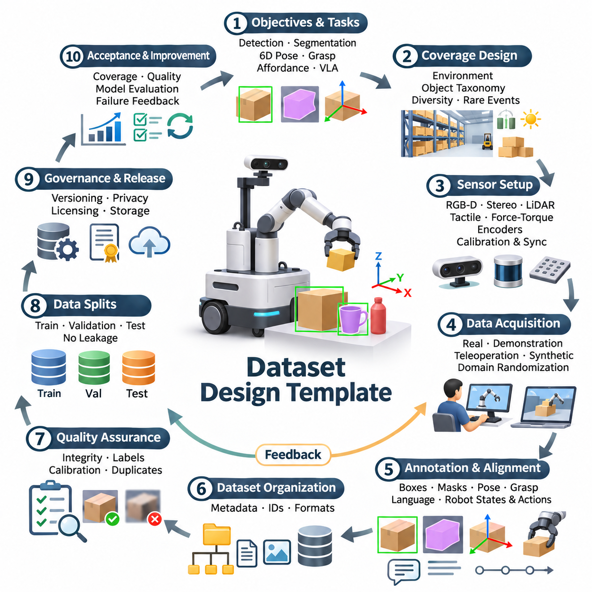
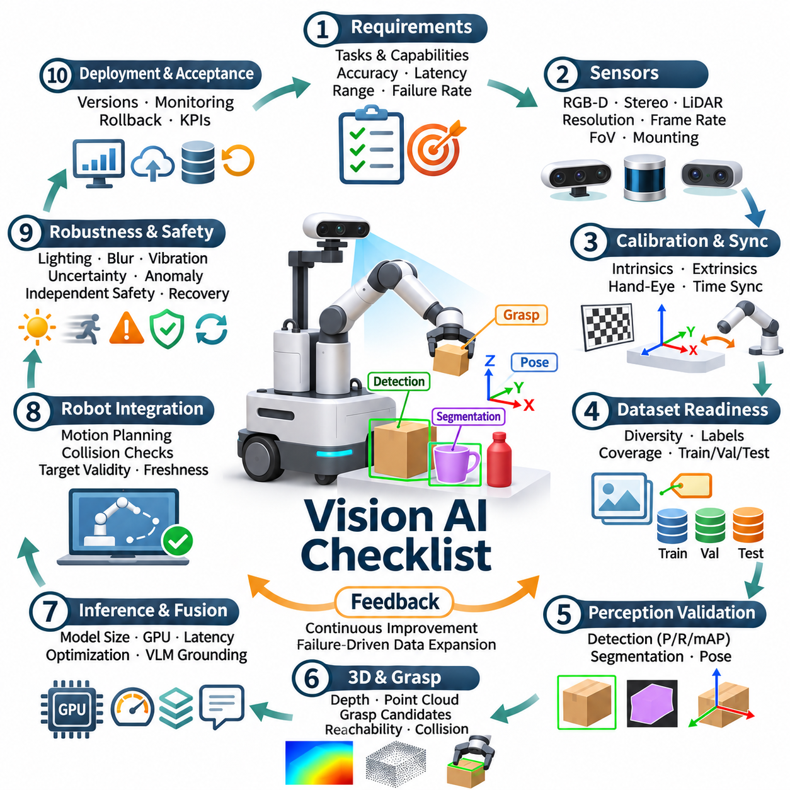
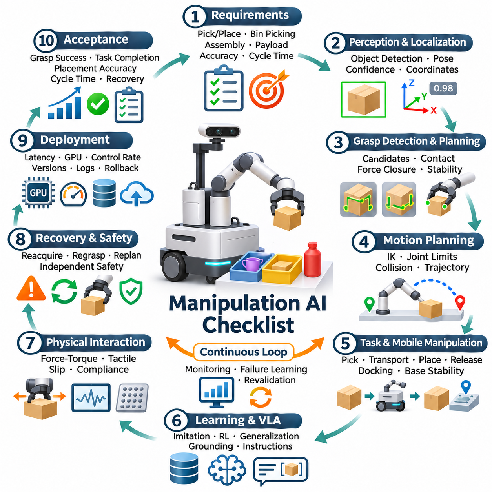
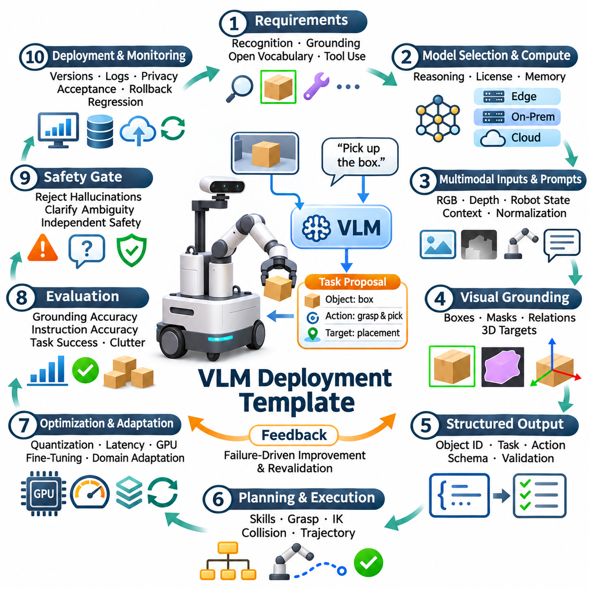
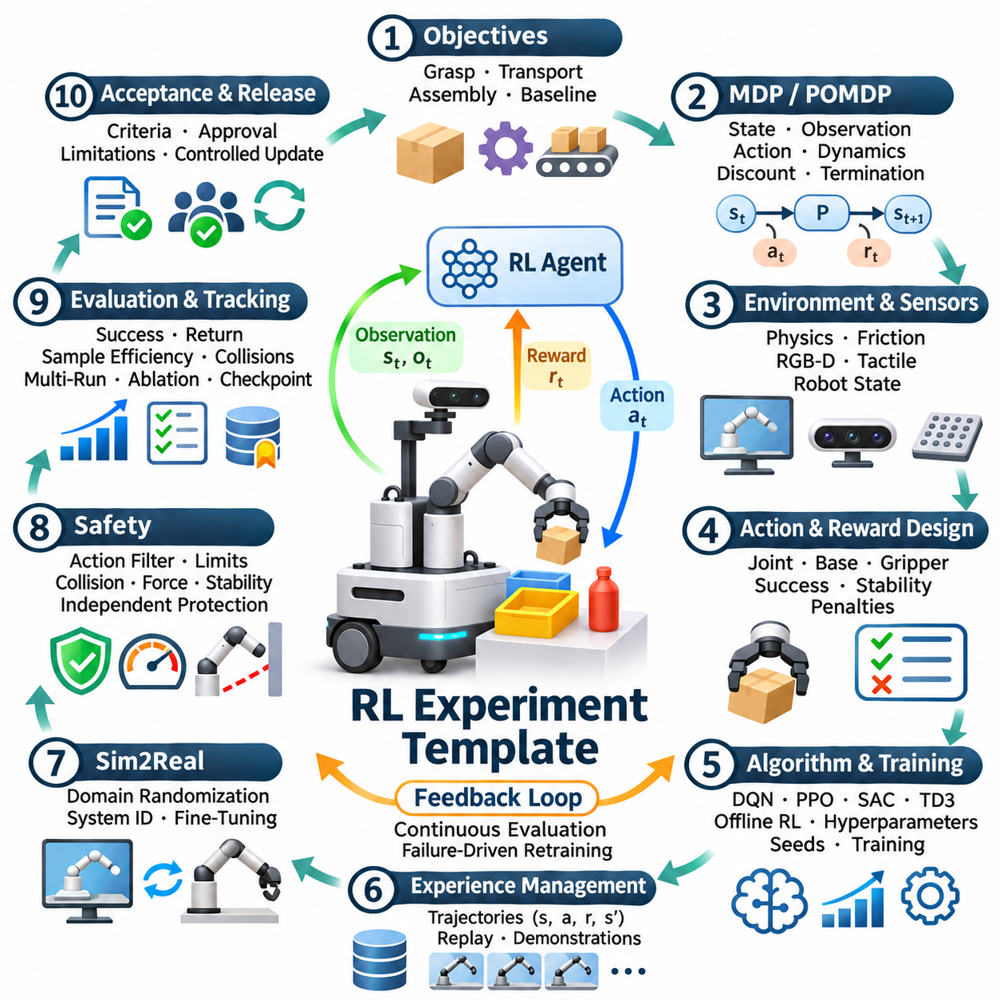
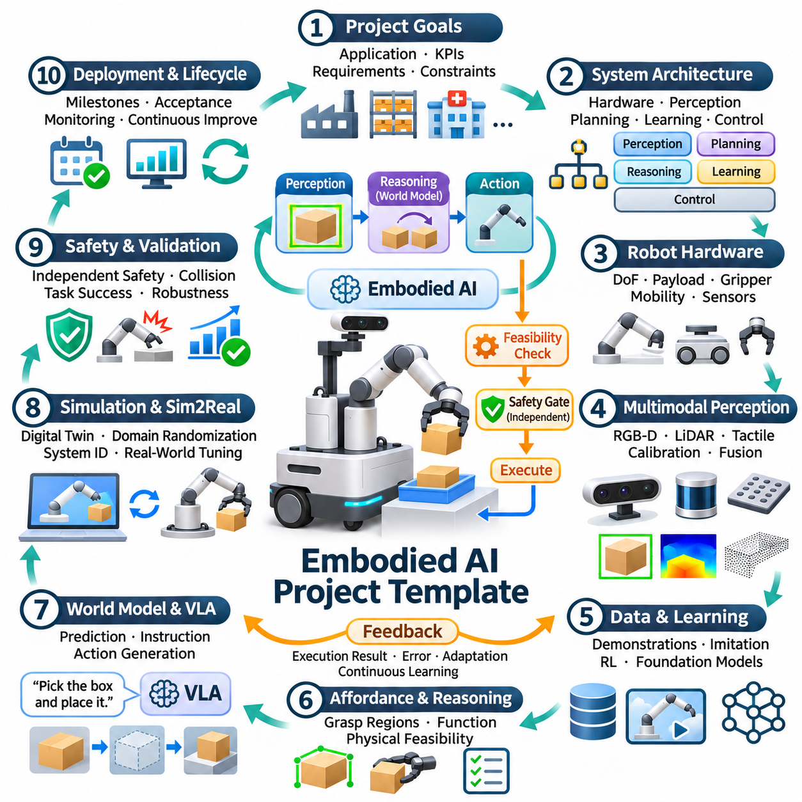

**Volume 03. Vision Manipulation and AI**

# Chapter 16. Checklists and Templates

## 01 Dataset Design Template

{width="7.268055555555556in" height="7.268055555555556in"}

A dataset design template provides a standardized framework for developing high-quality datasets that support visual perception, object detection, pose estimation, grasp planning, and intelligent manipulation in mobile manipulator systems. The template establishes a systematic process for defining data requirements, acquisition methods, annotation standards, quality assurance, and dataset management throughout the artificial intelligence development lifecycle.

The dataset design process begins with defining the project objectives and target applications. Engineers should identify whether the dataset will support object detection, instance segmentation, 6D object pose estimation, grasp detection, affordance learning, or vision-language-action models. Each application requires different data representations, annotation formats, environmental conditions, and evaluation criteria that must be established before data collection begins.

The operational environment must be clearly defined to ensure that the dataset represents realistic deployment conditions. Mobile manipulators may operate in manufacturing facilities, warehouses, hospitals, laboratories, and unstructured environments. The dataset should include variations in illumination, background complexity, object density, surface materials, environmental obstacles, human presence, and dynamic operating conditions.

Sensor configuration represents a fundamental component of the dataset design template. Depending on the application, data acquisition systems may incorporate RGB cameras, depth cameras, stereo cameras, 3D LiDAR, tactile sensors, force-torque sensors, and robot joint encoders. Sensor specifications, mounting positions, sampling frequencies, calibration parameters, coordinate systems, and synchronization requirements should be systematically documented.

Object taxonomy defines the categories and characteristics of objects that the mobile manipulator must recognize and manipulate. The taxonomy should consider object geometry, dimensions, weight, material properties, transparency, reflectivity, deformability, and available grasping surfaces. Hierarchical classification structures can support conventional object detection, semantic perception, and open-vocabulary manipulation applications.

Data diversity is essential for developing robust artificial intelligence models capable of generalizing beyond training environments. Dataset designers should establish coverage requirements for object orientations, camera viewpoints, distances, occlusion levels, clutter densities, lighting conditions, and object arrangements. Rare events and challenging manipulation scenarios should be intentionally included to reduce operational vulnerabilities.

The data acquisition strategy should define the procedures used to collect real-world sensor observations and robot interaction data. Fixed acquisition stations, mobile manipulators, human demonstrations, teleoperation systems, and automated robotic experiments can generate complementary datasets. Collection procedures should specify equipment configurations, environmental settings, task sequences, recording durations, and operator responsibilities.

Synthetic data generation can supplement real-world datasets by providing scalable training samples with automatically generated ground truth. Simulation environments enable variations in object geometry, textures, lighting, camera positions, physical properties, and manipulation configurations. Domain randomization should be incorporated where appropriate to improve model generalization and reduce the simulation-to-reality performance gap.

Annotation requirements must be defined according to the intended learning objectives. Object detection datasets generally require bounding boxes and class labels, while instance segmentation requires pixel-level masks. Pose estimation datasets may require keypoints, translation vectors, rotation representations, and coordinate transformations. Grasping datasets should include grasp poses, contact points, gripper configurations, and execution outcomes.

Multimodal datasets require additional consideration because intelligent mobile manipulators integrate perception, reasoning, and physical interaction. Images, depth maps, point clouds, language instructions, robot states, and executed actions should be associated using consistent timestamps and identifiers. Temporal alignment enables the development of robot foundation models, imitation learning policies, and vision-language-action architectures.

Dataset organization should follow a standardized directory structure, naming convention, metadata schema, and storage format. Each sample should be associated with relevant information such as acquisition date, sensor configuration, environmental conditions, object identifiers, robot configuration, and annotation status. Consistent organization improves traceability, reproducibility, interoperability, and collaboration among development teams.

Quality assurance procedures should verify sensor data integrity, annotation accuracy, calibration consistency, synchronization reliability, and dataset completeness. Automated validation tools can identify corrupted files, duplicate samples, missing labels, invalid coordinate transformations, and inconsistent metadata. Manual inspection should complement automated verification, particularly for ambiguous objects and complex manipulation scenarios.

Dataset partitioning should establish independent training, validation, and testing subsets. The partitioning strategy must prevent data leakage by considering object instances, acquisition sessions, physical environments, and temporally adjacent observations. Additional evaluation subsets may contain previously unseen objects, unfamiliar environments, or challenging operational conditions to assess model generalization and robustness.

Dataset management should incorporate version control, access permissions, data licensing, privacy protection, and storage lifecycle planning. Each dataset release should document its intended applications, acquisition procedures, known limitations, annotation conventions, and changes from previous versions. Large-scale robotics datasets may require dedicated storage infrastructure, compression strategies, and automated backup mechanisms.

The dataset design template should ultimately establish measurable acceptance criteria covering data diversity, annotation quality, environmental coverage, and suitability for downstream learning tasks. Model evaluation results and operational failure cases should guide subsequent data collection and refinement. This continuous improvement process transforms dataset management into an integral component of reliable mobile manipulation and Physical AI development.

## 02 Vision AI Checklist

{width="7.268055555555556in" height="7.268055555555556in"}

A Vision AI checklist provides a systematic framework for designing, developing, integrating, and validating artificial intelligence-based visual perception systems for mobile manipulators. It establishes engineering verification criteria across sensor configuration, image acquisition, dataset preparation, model development, inference optimization, and operational deployment, ensuring that visual intelligence supports reliable physical interaction.

The verification process begins with defining functional requirements and operational objectives. Engineers should identify the required perception capabilities, including object detection, instance segmentation, semantic recognition, pose estimation, and grasp detection. Target accuracy, processing latency, operating distance, environmental limitations, and acceptable failure rates must be established according to the intended manipulation tasks.

Camera system verification should evaluate sensor resolution, frame rate, field of view, exposure settings, dynamic range, and image acquisition stability. RGB cameras, depth cameras, stereo vision systems, and 3D LiDAR sensors should be selected according to operational requirements. Sensor mounting positions must provide sufficient visibility throughout the robot workspace while minimizing blind spots, mechanical interference, and self-occlusion.

Calibration and synchronization must be verified before integrating visual perception with robotic manipulation. Camera intrinsic parameters, extrinsic transformations, depth accuracy, and hand-eye calibration should satisfy predefined tolerances. Coordinate transformations between the camera, robot arm, mobile platform, and world reference frames must remain consistent, while synchronized timestamps ensure reliable multimodal sensor fusion.

Dataset readiness should be evaluated by examining data diversity, annotation accuracy, environmental coverage, and class distributions. Training samples must represent realistic variations in illumination, viewing angles, object orientations, surface materials, and cluttered environments. Independent validation and testing datasets should be established to prevent data leakage and provide objective assessments of model generalization.

Object detection verification should assess the ability of the Vision AI system to recognize and localize relevant objects under representative operating conditions. Precision, recall, mean Average Precision, false-positive rates, and missed detection rates should be measured. Particular attention must be given to partially occluded objects, unfamiliar appearances, overlapping objects, reflective surfaces, and small targets within the manipulation workspace.

Segmentation and pose estimation capabilities should be evaluated according to downstream manipulation requirements. Instance segmentation must provide sufficiently accurate object boundaries, while pose estimation should determine object positions and orientations within acceptable translational and rotational tolerances. Symmetric objects, ambiguous geometries, depth measurement errors, and coordinate transformation uncertainties must be considered during validation.

Three-dimensional perception and grasp detection require additional verification to ensure that visual information can be converted into executable manipulation targets. Depth maps and point clouds should be evaluated for completeness, spatial accuracy, noise, and missing measurements. Generated grasp candidates must be assessed for geometric feasibility, approach clearance, gripper compatibility, collision risk, and accessibility within the robot workspace.

Model architecture and inference performance should be reviewed against available computational resources. Engineers must evaluate model size, GPU memory consumption, processing throughput, inference latency, and computational utilization. Techniques such as quantization, pruning, hardware acceleration, and optimized inference engines should be validated to ensure that performance improvements do not introduce unacceptable reductions in perception accuracy.

Multimodal perception systems should be tested for consistency across visual, spatial, semantic, and robotic state information. Sensor fusion algorithms must accommodate differences in sampling frequencies, measurement uncertainties, coordinate frames, and communication delays. Vision-language models should additionally be evaluated for visual grounding accuracy, instruction interpretation, object-reference consistency, and unsupported semantic predictions.

Integration with robot control and motion planning must ensure that perception outputs are correctly translated into physical actions. Detected object positions, estimated orientations, grasp candidates, and confidence scores should be transmitted through standardized interfaces. The manipulation system must verify target validity, kinematic reachability, collision constraints, and perception freshness before initiating robot movements.

Operational robustness should be evaluated under conditions that differ from controlled laboratory environments. Testing should include changing illumination, motion blur, sensor contamination, vibration, communication interruptions, dynamic obstacles, and mobile platform positioning errors. The Vision AI system should detect degraded perception conditions and initiate appropriate corrective actions, such as reacquisition, viewpoint adjustment, or task suspension.

Safety-related verification must establish how the system responds to uncertain, inconsistent, or unavailable perception information. Confidence thresholds, uncertainty estimation, anomaly detection, and out-of-distribution recognition can support operational risk reduction. However, conventional Vision AI models must not replace independently validated safety functions. Unsafe or ambiguous perception outputs should prevent uncontrolled manipulation and trigger predefined recovery procedures.

Deployment readiness should include verification of software dependencies, model versions, hardware compatibility, communication interfaces, configuration parameters, and diagnostic capabilities. Runtime monitoring should record perception latency, detection confidence, resource utilization, sensor availability, and operational failures. Version-controlled deployment packages and rollback procedures should support reproducibility, controlled updates, and reliable system maintenance.

The final Vision AI checklist should establish measurable acceptance criteria for perception accuracy, spatial precision, computational performance, environmental robustness, and manipulation success. Verification results, unresolved limitations, corrective actions, and approval responsibilities must be documented. Continuous monitoring, failure-driven dataset expansion, and model revalidation establish a sustainable improvement process for intelligent mobile manipulation and Physical AI systems.

## 03 Manipulation AI Checklist

{width="7.268055555555556in" height="7.268055555555556in"}

A Manipulation AI checklist provides a systematic framework for designing, developing, integrating, and validating artificial intelligence-based robotic manipulation systems. Based on the scope of vision, manipulation, and AI, the checklist extends the chapter structure into recommended engineering verification criteria covering object localization, grasp generation, motion planning, learning-based control, physical interaction, and operational reliability.

The verification process begins with defining manipulation objectives and functional requirements. Engineers should identify target applications such as pick-and-place, random bin picking, material handling, assembly, sorting, and tool manipulation. Required positioning accuracy, payload capacity, grasping reliability, cycle time, task completion rate, and environmental constraints must be established according to the intended operational scenarios.

Object perception and localization must be verified before manipulation operations are executed. The system should accurately identify target objects, estimate their spatial positions and orientations, and distinguish them from surrounding obstacles. Perception outputs must include appropriate confidence information, while coordinate transformations between cameras, robot arms, mobile platforms, and target objects must remain geometrically consistent.

Grasp detection verification should evaluate the ability of AI models to generate feasible grasp candidates under diverse environmental conditions. Candidate grasps must account for object geometry, surface characteristics, gripper configuration, approach direction, and surrounding obstacles. Verification should include unfamiliar objects, partially occluded targets, irregular shapes, deformable materials, and densely cluttered environments.

Grasp planning validation should determine whether generated grasp candidates satisfy physical and mechanical constraints. Engineers must evaluate contact configurations, force closure, grasp stability, friction assumptions, gripper opening width, and payload limitations. Learning-based grasp quality predictions should be compared with actual execution outcomes to verify that predicted grasp success corresponds to reliable physical performance.

Motion planning integration must ensure that AI-generated manipulation targets can be converted into safe and executable robot trajectories. Inverse kinematics, joint limits, singularity avoidance, collision detection, and trajectory continuity should be verified. The system must evaluate approach, grasping, lifting, transportation, placement, and retreat movements while maintaining appropriate clearance from surrounding objects and structures.

Pick-and-place and bin-picking operations require verification of complete manipulation sequences rather than individual grasping actions. The system should demonstrate reliable object selection, grasp execution, secure transportation, accurate placement, and successful release. Multi-object interference, unstable object configurations, double picking, dropped objects, and failed placement conditions must be included in operational testing.

Mobile manipulation introduces additional verification requirements because the robot arm operates from a movable platform. Base positioning accuracy, localization uncertainty, platform stability, docking repeatability, and arm accessibility must be evaluated. Coordination between mobile navigation and manipulation should ensure that the robot reaches an appropriate working position before executing grasping operations or performing coordinated whole-body movements.

Learning-based manipulation models should be evaluated for dataset quality, training stability, generalization capability, and execution reliability. Supervised learning, behavior cloning, imitation learning, and reinforcement learning may support different manipulation functions. Independent testing environments and previously unseen objects should be used to determine whether learned policies remain effective outside their original training conditions.

Vision-language models and vision-language-action models require verification of semantic understanding, visual grounding, instruction interpretation, and action generation. The system must correctly associate natural language instructions with physical objects and executable manipulation tasks. Ambiguous instructions, unsupported predictions, incorrect object references, and physically infeasible actions should trigger clarification, rejection, or controlled recovery procedures.

Physical interaction verification should assess the ability of the manipulation system to respond appropriately to contact forces and environmental changes. Force-torque sensors, tactile sensors, joint feedback, and gripper state information can support closed-loop manipulation. Contact detection, grip force regulation, slip detection, compliance control, and object protection must be validated under representative physical interaction conditions.

Error detection and recovery mechanisms should address unsuccessful grasps, object slippage, perception failures, unexpected contact, motion planning failures, and communication interruptions. Recovery strategies may include perception reacquisition, alternative grasp selection, trajectory replanning, object repositioning, or controlled task termination. Recovery attempts must remain bounded by predefined operational and safety constraints.

Safety verification must establish explicit boundaries between AI-based decision-making and independently validated robot safety functions. AI-generated actions should be evaluated against workspace restrictions, speed limits, force limitations, collision constraints, and human presence. Uncertain predictions or inconsistent system states must not initiate uncontrolled movements, and safety-rated protective mechanisms must remain effective independently of AI performance.

Computational performance and deployment readiness should be evaluated under realistic operating workloads. Engineers must verify inference latency, control update rates, GPU utilization, communication stability, software compatibility, and end-to-end response time. Model versioning, configuration management, diagnostic logging, and rollback mechanisms should support controlled deployment, reproducible experiments, and long-term operational maintenance.

The final Manipulation AI checklist should establish measurable acceptance criteria for grasp success rate, task completion rate, placement accuracy, cycle time, recovery effectiveness, and operational safety. Verification results, unresolved limitations, corrective actions, and approval responsibilities must be documented. Continuous performance monitoring, failure-driven learning, and periodic revalidation support the sustainable development of intelligent mobile manipulation and Physical AI systems.

## 04 VLM Deployment Template

{width="7.268055555555556in" height="7.268055555555556in"}

A Vision-Language Model (VLM) deployment template provides a standardized framework for integrating multimodal artificial intelligence into mobile manipulator systems. Extending the architectural topics of vision-language manipulation, foundation models, and robot agents into practical engineering recommendations, the template defines model selection, computational requirements, integration procedures, performance validation, safety mechanisms, and operational management.

The deployment process begins with defining application objectives and functional requirements. Vision-language models may support object recognition, visual grounding, open-vocabulary manipulation, natural language instruction interpretation, task understanding, and tool use. Engineers should establish the expected input modalities, output representations, operating environments, response latency, and relationships with downstream manipulation functions.

Model selection should consider the target application, computational resources, multimodal reasoning capabilities, and deployment constraints. Candidate models must be evaluated for visual understanding, language comprehension, spatial reasoning, object-reference accuracy, and domain adaptability. Model licensing, parameter count, memory consumption, supported inference frameworks, and fine-tuning requirements should also be documented.

The computational architecture should define whether VLM inference operates on embedded edge devices, on-premises GPU servers, cloud infrastructure, or distributed computing systems. Edge deployment can reduce communication latency and network dependency, while centralized infrastructure can support larger models. Hybrid deployment strategies should balance computational performance, energy consumption, data privacy, and operational availability.

Input data preparation must establish standardized procedures for processing visual observations and natural language instructions. Camera images should undergo appropriate resizing, normalization, and quality verification before inference. Multimodal inputs may additionally include depth information, robot states, environmental descriptions, and historical observations, depending on the input modalities supported by the selected model.

Prompt engineering should define consistent instructional structures for communicating operational objectives to the VLM. System prompts, task descriptions, contextual information, object references, and output constraints should be organized according to application requirements. Structured prompts and representative examples can improve response consistency, reduce semantic ambiguity, and facilitate integration with downstream robotic software.

Visual grounding verification must ensure that language expressions are correctly associated with physical objects and spatial regions within the operating environment. Generated object references, bounding boxes, segmentation regions, and spatial relationships should be evaluated against ground-truth observations. Additional perception modules may be required to convert semantic predictions into accurate three-dimensional manipulation targets.

The output interface should establish machine-readable representations for transferring VLM predictions to other robotic subsystems. Structured outputs may include object identifiers, spatial references, task descriptions, action proposals, and execution constraints. Output schemas, validation rules, coordinate conventions, and communication protocols must be documented to ensure interoperability and prevent ambiguous interpretation.

Integration with task planning and manipulation systems should maintain a clear separation between semantic reasoning and physical execution. VLM-generated task proposals must be translated into supported robot skills, verified grasp candidates, and feasible motion plans. Conventional perception, inverse kinematics, collision detection, and trajectory planning should independently validate the physical feasibility of proposed actions.

Inference optimization should evaluate processing latency, GPU memory utilization, computational throughput, and energy consumption under representative operational workloads. Quantization, optimized inference engines, visual token reduction, and context management may improve deployment efficiency. Each optimization must be validated against baseline performance to ensure that semantic understanding and visual grounding remain sufficiently accurate.

Domain adaptation and fine-tuning should be considered when generic pretrained models demonstrate insufficient performance in specialized industrial environments. Application-specific images, object descriptions, manipulation instructions, and task demonstrations can support adaptation through supervised fine-tuning or parameter-efficient methods. Independent validation datasets should measure domain-specific improvements without introducing unacceptable performance degradation.

Performance evaluation must address both multimodal reasoning quality and downstream manipulation effectiveness. Relevant metrics include visual grounding accuracy, instruction interpretation accuracy, object-reference consistency, task planning success, inference latency, and manipulation completion rate. Evaluation scenarios should include unfamiliar objects, cluttered environments, ambiguous instructions, changing viewpoints, and incomplete sensory observations.

Safety mechanisms must prevent unsupported VLM predictions from directly initiating hazardous physical actions. Generated responses should be checked for semantic consistency, operational validity, and compliance with predefined execution constraints. Hallucinations, ambiguous object references, unsupported instructions, and unauthorized requests should trigger rejection or clarification, while independently validated safety functions retain authority over robot motion.

Operational monitoring should record input observations, model versions, generated responses, processing latency, resource utilization, validation outcomes, and execution failures. Diagnostic information should support failure classification, model evaluation, and continuous improvement. Data retention policies, access permissions, sensitive information protection, and network security requirements must be incorporated into the deployment architecture.

The final deployment template should establish measurable acceptance criteria, configuration baselines, integration test procedures, approval responsibilities, and rollback strategies. Model updates, prompt modifications, and environmental changes should trigger appropriate regression testing and revalidation. Continuous monitoring and failure-driven adaptation support reliable VLM deployment across intelligent mobile manipulation, embodied AI, and Physical AI applications.

## {width="7.268055555555556in" height="7.268055555555556in"}05 RL Experiment Template

A Reinforcement Learning (RL) experiment template provides a standardized framework for designing, executing, evaluating, and documenting learning-based robotic manipulation experiments. Based on the chapter structure covering reinforcement learning fundamentals, Markov Decision Processes, learning algorithms, mobile manipulation, simulation-to-reality transfer, and safety, the template extends these topics into practical experimental procedures and recommended verification criteria.

The experimental design process begins with defining research objectives, target applications, and expected learning outcomes. Engineers should identify whether the reinforcement learning agent will perform grasping, object transportation, assembly, tool manipulation, or coordinated mobile manipulation. Task completion requirements, environmental constraints, performance targets, and baseline comparison methods must be established before training begins.

The reinforcement learning problem should be formulated as a Markov Decision Process (MDP) or, when observations are incomplete, a Partially Observable Markov Decision Process (POMDP). The formulation must specify the state space, observation space, action space, transition dynamics, reward function, discount factor, and termination conditions. These components establish the mathematical foundation for policy learning and experimental evaluation.

The experimental environment should represent the physical characteristics and operational constraints of the intended robotic system. Simulation configurations must document robot geometry, joint limits, actuator characteristics, object properties, contact dynamics, friction coefficients, and sensor models. Environmental parameters, simulation time steps, physics solver settings, and initialization procedures should remain reproducible throughout the experiment.

Observation space design should establish the information available to the reinforcement learning agent during policy execution. Observations may include RGB images, depth maps, point clouds, joint positions, joint velocities, tactile measurements, force-torque information, and mobile platform states. Observation normalization, sensor noise, temporal history, and missing measurements should be considered to improve learning stability and operational robustness.

Action space design must define the commands that the learning agent can generate during interaction with the environment. Depending on the control architecture, actions may represent joint positions, joint velocities, joint torques, Cartesian target poses, gripper commands, or mobile base velocities. Action scaling, control frequencies, command limits, and coordination between the mobile platform and robot arm must be explicitly documented.

Reward function design represents a critical component of reinforcement learning experiments. Rewards may incorporate task completion, grasp stability, positioning accuracy, trajectory efficiency, collision avoidance, energy consumption, and execution time. Reward weights, penalty terms, and terminal rewards should be systematically documented. Experimental validation must identify unintended behaviors resulting from poorly designed reward functions or reward exploitation.

Algorithm selection should consider task complexity, observation dimensionality, action representation, computational resources, and sample efficiency. Value-based methods such as DQN may support discrete action spaces, while policy-based and actor-critic algorithms such as PPO, SAC, and TD3 can address continuous control problems. Offline reinforcement learning may be appropriate when direct interaction with physical robots is expensive or operationally restricted.

Training configurations should document neural network architectures, learning rates, batch sizes, discount factors, optimization methods, exploration strategies, and training durations. Experience replay capacity, target network update intervals, policy update frequencies, and entropy coefficients should be recorded where applicable. Random seeds, software versions, hardware configurations, and experiment identifiers must support reproducible comparisons.

Training data and experience management should define how interaction trajectories are generated, stored, sampled, and reused. Each trajectory may contain observations, actions, rewards, subsequent observations, termination indicators, and task metadata. Human demonstrations, previously collected robot experiences, and simulated interactions can supplement training through offline learning, imitation learning, or hybrid reinforcement learning strategies.

Simulation-to-reality transfer should incorporate methods for reducing discrepancies between simulated training environments and physical robotic systems. Domain randomization may vary object mass, friction, lighting, sensor noise, actuator response, and environmental geometry. System identification, observation adaptation, and controlled real-world fine-tuning can further improve policy transferability while reducing dependence on expensive physical experiments.

Safety constraints must be integrated into both experimental training and physical policy execution. Joint limits, workspace boundaries, collision restrictions, velocity limits, force thresholds, and platform stability requirements should be explicitly defined. Constrained reinforcement learning, action filtering, and safety monitors may reduce unsafe exploration, but independently validated protective mechanisms must retain authority over physical robot movements.

Performance evaluation should measure learning effectiveness, policy reliability, task efficiency, and generalization capability. Relevant metrics include cumulative episode reward, task success rate, grasp success rate, convergence speed, sample efficiency, collision frequency, cycle time, and energy consumption. Evaluation should use multiple independent training runs and unseen test conditions to quantify performance variability and reduce misleading conclusions.

Experiment tracking should record training curves, evaluation results, hyperparameter configurations, model checkpoints, resource utilization, and observed failure cases. Baseline comparisons and ablation studies should isolate the contributions of reward components, observation modalities, network architectures, and learning strategies. Statistical summaries should report performance distributions and uncertainty rather than relying exclusively on the best-performing experimental run.

The final reinforcement learning experiment template should establish measurable acceptance criteria, experiment documentation requirements, model release conditions, and physical deployment approval procedures. Unresolved limitations, safety violations, transfer performance, and corrective actions must be recorded before deployment. Continuous evaluation, failure-driven retraining, and controlled policy updates support reliable reinforcement learning for embodied AI, intelligent mobile manipulation, and Physical AI systems.

## 06 Embodied AI Project Template

{width="7.268055555555556in" height="7.268055555555556in"}

An Embodied AI project template provides a standardized framework for developing intelligent robotic systems that integrate perception, reasoning, learning, and physical interaction. Based on the chapter structure covering perception-action loops, affordance learning, embodied reasoning, world models, vision-language-action models, and Physical AI, the template extends these concepts into practical project development and verification recommendations.

Project initiation should establish the application objectives, operational scenarios, functional requirements, and expected development outcomes. Target applications may include autonomous material handling, warehouse picking, industrial assembly, service robotics, and general-purpose mobile manipulation. Project requirements must define measurable performance targets, environmental constraints, safety considerations, available resources, and technological limitations.

The system architecture should establish the relationships between physical hardware, perception modules, cognitive intelligence, task planning, learning algorithms, and execution control. An Embodied AI system typically integrates a mobile platform, robotic manipulator, end effector, multimodal sensors, computing infrastructure, and communication interfaces. Modular architectural boundaries should support scalability, interoperability, maintainability, and independent subsystem validation.

Hardware configuration should define the physical embodiment through which artificial intelligence interacts with the surrounding environment. Robot geometry, degrees of freedom, actuator capabilities, payload capacity, mobility constraints, gripper characteristics, and sensor mounting positions must be documented. Hardware selection should reflect the physical requirements of target tasks while accommodating future expansion and experimental development.

The perception architecture should establish how the robotic system observes, interprets, and represents its physical environment. RGB cameras, depth cameras, LiDAR, tactile sensors, force-torque sensors, and proprioceptive measurements may provide complementary information. Sensor calibration, temporal synchronization, coordinate transformation, multimodal fusion, and environmental representation must support reliable perception-action integration.

The perception-action loop should define how sensory observations are converted into decisions, physical actions, and subsequent environmental observations. The system must continuously update its understanding of object states, spatial relationships, task progress, and interaction outcomes. Feedback mechanisms should support online adaptation, error correction, action verification, and recovery from unexpected environmental changes.

Dataset development should establish procedures for collecting, annotating, organizing, and validating multimodal interaction data. Training datasets may include visual observations, language instructions, robot states, human demonstrations, action trajectories, contact measurements, and task outcomes. Data diversity, environmental coverage, temporal alignment, dataset versioning, and independent evaluation subsets must support reproducible learning experiments.

The learning architecture should define the roles of supervised learning, imitation learning, reinforcement learning, foundation models, and transfer learning within the overall system. Engineers should establish which capabilities require pretrained models, application-specific fine-tuning, simulation-based training, or controlled real-world adaptation. Learning objectives, computational resources, training configurations, and model evaluation procedures must be documented.

Affordance learning and embodied reasoning should enable the robotic system to understand potential interactions between objects, tools, and surrounding environments. The system should identify graspable regions, functional object components, physical constraints, and feasible manipulation opportunities. Reasoning mechanisms must connect semantic understanding with geometric information, physical properties, robot capabilities, and task-specific objectives.

World model development should establish how the system represents environmental states, predicts future conditions, and estimates the consequences of proposed actions. World models may incorporate spatial representations, temporal dynamics, object relationships, and learned physical interactions. Predictive accuracy, uncertainty estimation, temporal consistency, and the validity of predictions under unfamiliar conditions should be systematically evaluated.

Vision-language-action integration should define how natural language instructions and visual observations are transformed into robotic actions. Multimodal foundation models may support semantic understanding, visual grounding, task decomposition, and action generation. Generated actions must be evaluated against robot capabilities, physical constraints, available skills, and operational requirements before execution through the robotic control architecture.

Simulation and digital twin development should provide controlled environments for training, experimentation, integration testing, and performance evaluation. Virtual representations should incorporate robot kinematics, dynamics, sensor characteristics, object properties, and environmental conditions. Domain randomization, system identification, and staged physical validation should reduce simulation-to-reality discrepancies and improve the reliability of learned behaviors.

Safety architecture should establish independently validated protective mechanisms and explicit operational boundaries for learning-based decision-making. Joint limits, workspace restrictions, collision avoidance, force thresholds, platform stability, and human interaction constraints must be defined. AI-generated predictions and actions should undergo feasibility verification, while safety-rated functions retain independent authority over hazardous physical movements.

System integration and performance evaluation should assess the complete Embodied AI architecture under representative operational conditions. Evaluation metrics may include perception accuracy, task success rate, grasp reliability, reasoning accuracy, action latency, adaptation capability, recovery effectiveness, and energy consumption. Testing should incorporate unfamiliar objects, environmental disturbances, ambiguous instructions, and subsystem failures.

The final Embodied AI project template should establish development milestones, subsystem deliverables, configuration baselines, acceptance criteria, risk management procedures, and deployment approval responsibilities. Experimental results, model versions, operational limitations, and corrective actions must remain traceable throughout the project lifecycle. Continuous monitoring, failure-driven learning, and controlled system evolution support the sustainable development of general-purpose robotic systems and Physical AI.
